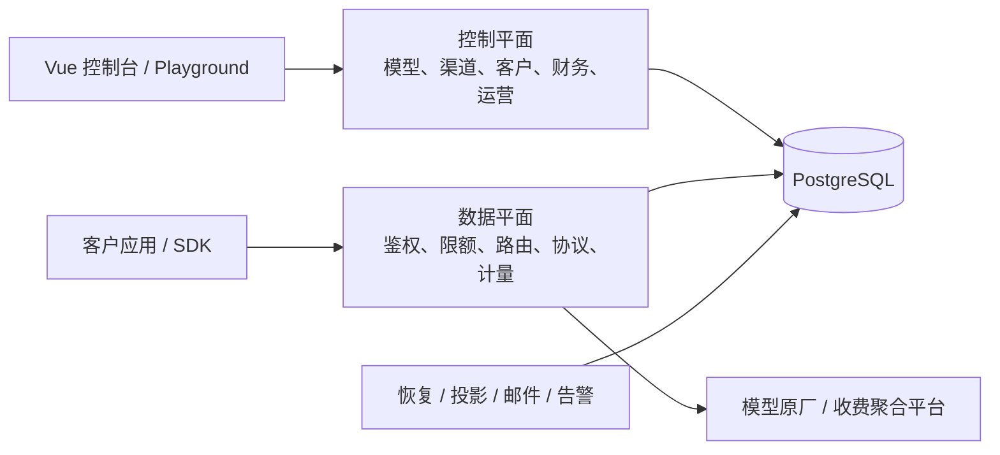

# moni-aigate

[](https://github.com/workhold/moni-aigate/actions/workflows/ci.yml)

面向对外 API 经营的自托管 AI 网关，将模型接入、客户授权、渠道采购、计费结算和运营控制台放在同一个平台中。
参考 New API / One API 的业务设计与 1Panel 的部署体验，采用 Go + PostgreSQL + Vue 3 独立实现，按 SDD 持续交付。

**当前版本：`v0.1.0-dev`，持续开发中。核心商业链路已完成限定本地验收；正式收款、生产部署与真实供应商认证尚未完成。**

[系统架构](docs/architecture/README.md) · [本地开发](docs/runbooks/development.md) · [部署手册](docs/runbooks/deployment.md) · [MVP 状态](docs/verification/mvp-status.md) · [交付计划](docs/design/delivery-plan.md)

快速导航：[特点](#定位与特点) · [能力与协议](#能力状态) · [架构](#架构概览) · [本地启动](#本地启动) · [Docker / 1Panel](#docker-compose--1panel) · [首次配置](#从部署到第一次-api-调用) · [API 示例](#api-示例) · [配置](#常用配置) · [贡献](#反馈与贡献) · [许可](#license-与来源)

## 定位与特点

moni-aigate 的上游既可以是模型原厂，也可以是其他收费聚合平台。客户按平台售价消费，平台按渠道与精确上游模型登记采购成本，并在授权、能力、地域、健康和预算约束内选择渠道。

- **销售与采购分开**：客户输入/输出售价、上游输入/输出采购价分别版本化，每次请求与尝试保留实际快照。
- **来源可追溯**：每笔入账保存来源本金与可用/冻结/已消费余额，消费按FIFO分配，消费退款返回原收费来源；控制台可逐请求核对。
- **资金先于派发**：金额以 CNY 微元整数存储，硬预占、唯一结算、不可变平衡流水；用量未知进入核对，不把估算当作账单。
- **渠道可治理**：不可变发布、凭据池、模型发现与差异预览、整批启停，以及可解释的选路与排除原因。
- **客户可自助**：租户控制台、API Key、模型目录、账单、Playground，以及可选的邮箱注册与恢复流程。
- **经营成本可核对**：按请求创建时间和模型查看消费收入、退款及采购成本，按渠道比较全部尝试成本，下载请求级 CSV；成本未知时保留待核对状态。
- **部署依赖少**：前端嵌入单个 Go 可执行文件，PostgreSQL 是唯一持久事实源；当前采用单活动实例。
- **设计随代码更新**：规格、接口合同、架构图、源码入口和验证边界共同维护，Make / CI 检查架构内容快照。

## 能力状态

“限定本地验收”指专用 PostgreSQL、本地协议模拟器或隔离浏览器中的指定范围验证，不代表真实供应商、生产支付或目标部署环境已经通过。
完整细节以[统一架构能力表](docs/architecture/README.md#当前能力与后续边界)和对应验证记录为准。

| 能力 | 当前状态 | 主要范围与边界 |
| --- | --- | --- |
| 租户与 API Key | 已实现 | 成员/模型授权，来源 IP/CIDR，RPM、burst、并发、地域、累计额度、有效期及撤销 |
| 六种推理协议 | 已实现，限定本地验收 | Chat、Responses、Messages、Embeddings、Rerank、Gemini 文本；范围见下表 |
| 模型与渠道运营 | 已实现，限定本地验收 | 不可变渠道/路由版本，1..32 成员凭据池，目录发现/差异预览，跨渠道批量启停 |
| 成本感知路由 | 已实现，限定本地验收 | 同模型优先级/权重/健康/容量；可配置成本优先、未知报价拒绝策略及采购单价上限 |
| 采购账户与预算 | 已实现，限定本地验收 | 跨渠道共享账户、累计与周期预算、逐次尝试预占、未知占用、双人更正；余额观察为人工证据 |
| 客户资金与账单 | 已实现，限定本地验收 | 硬预占、最终用量、唯一结算、双人入账/消费退款/核对、请求关联账单与采购成本 |
| 经营报表与导出 | 已实现，限定本地验收 | 请求创建窗口、客户/模型筛选、模型收入与毛利、渠道采购成本、请求级 CSV；未知成本或未结算时不确认毛利 |
| 客户自助与公开目录 | 已实现，限定本地验收 | API Key、账单、Playground、邮件证明、密码恢复、分组报价；模型默认私有，注册与邮件默认关闭 |
| 兑换券与经营告警 | 已实现，限定本地验收 | 双审赠额券、渠道隔离/采购余量/待核对积压告警；新券发行和告警评估默认关闭 |
| 应用支付订单 | 仅隔离本地模拟闭环 | 订单、签名通知、独立 worker 和唯一入账已接通；没有正式在线收款能力 |
| 资金来源与钱包开账 | 已实现，限定本地验收 | 四来源入账、FIFO预占、结算/释放、逆序消费退款、钱包与请求来源明细、平台只读核对；停服owner显式非现金开账。023使用新钱包历史，原路现金退款/拒付尚未交付 |
| 媒体与实时协议 | 图片/TTS/Video/Realtime 开发链路已接，限定本地验收 | 图片、TTS 与异步 video task 已接 mock provider、当前 media wallet journal、幂等和未知提交保护；图片/TTS inline 结果与异步 task 制品正文已持久化，Realtime 已接单 turn WS 与 PostgreSQL session/turn/event writer。真实供应商、浏览器、Compose 实跑和生产验收未完成；[阶段清单](specs/028-unified-metering-media/tasks.md) |
| 容器、1Panel 与 HA | 配置/手册已有，目标环境未验 | Compose 静态渲染已验；容器实际运行、1Panel 实装和 HA/多活尚未完成 |

采购报价支持按“渠道 + 精确上游模型”设置独立输入/输出单价与生效版本，不会把客户售价直接当作成本。
多渠道可绑定同一采购账户共同消耗预算；当前没有供应商真实余额或外部账单自动同步。
采购历史核验正在按 SDD 扩展：账户配置、逐次预占与周期预算的新链路已通过[隔离数据库专项验证](docs/verification/procurement-attempt-birth.md)，仍作为开发候选，尚未接入常规启动；该隔离历史研究不作为现行来源与媒体的前置；当前部署使用下述001–023。
商品/订阅、原路退款、拒付及生产支付按[交付计划](docs/design/delivery-plan.md)继续推进；周期预算不等于订阅商品，退回平台钱包不等于原路现金退款。

### 协议范围

| 接口 | 当前支持 |
| --- | --- |
| `GET /v1/models` | 返回当前 API Key 获授权且可用的逻辑模型 |
| `POST /v1/chat/completions` | 无状态文本、基础函数工具，JSON / SSE |
| `POST /v1/responses` | 无状态文本、基础函数工具，原生 JSON / SSE |
| `POST /v1/messages` | 无状态文本、基础函数工具，原生 JSON / SSE |
| `POST /v1/embeddings` | 单条/批次输入，float / base64 输出 |
| `POST /v1/rerank` | Jina 风格字符串文档重排 |
| `POST /v1beta/models/{model}:generateContent` | Gemini 原生无状态纯文本 |
| `POST /v1beta/models/{model}:streamGenerateContent?alt=sse` | Gemini 原生纯文本 SSE，必须带 `alt=sse` |

协议与模型必须具有明确的能力、硬计量上界和可信最终用量。基础工具调用由客户端执行，网关不执行函数；Gemini 暂无工具或多模态支持。
当前不承诺 Codex / Claude Code 全产品兼容，也不以接口路径相同推定所有供应商模型均可使用。

## 架构概览



控制平面与数据平面属于同一个 Go 模块化单体，网络调用在数据库事务之外。
客户一次请求唯一结算，上游成本按每次尝试留存；只允许明确安全的有限回退。消费未知时进入核对，恢复任务处理证据、结算和释放，不重新发送模型生成。

技术栈：Go / Gin / pgx，PostgreSQL 16，Vue 3 / TypeScript / Element Plus。
应用、报表投影与迁移角色分离；当前不引入 Redis / Kafka，不支持通过增加副本直接切换多活。

[统一系统架构](docs/architecture/README.md)集中展示模块依赖、请求时序、资金与采购链路、数据关系、权限、worker、部署和故障恢复，并链接到源码。
[HLD](docs/design/HLD.md)与[LLD](docs/design/LLD.md)保留详细设计和决策，能力状态以统一架构与验证记录为准。

设计与实现顺序见[资金、媒体与经营一体化设计](docs/design/integrated-wallet-media.md)：来源闭环 → 六文本统一计量 → 同步媒体 → 任务/实时轮次 → 供应商与部署验收 → 性能。当前来源实现见[架构](docs/architecture/wallet-sources.md)与[验证](docs/verification/wallet-sources.md)。

## 选择启动方式

| 场景 | 方式 | 准备条件 |
| --- | --- | --- |
| 开发与联调 | [源码 / 本地启动](#本地启动) | Go、Node、独立 PostgreSQL 数据库与三个角色 |
| 自托管试用 | [Docker Compose](#docker-compose--1panel) | Docker Engine、Compose v2、完整源码；镜像构建包含前端 |
| 1Panel 管理 | [导入编排并配置反向代理](docs/runbooks/deployment.md#首次安装) | 完整源码构建上下文、私有环境配置与可达的代理网络 |

三种方式运行同一应用。首次安装都须创建管理员、配置渠道与价格、授予客户模型权限并完成核款，之后才可使用 API；未预置可调用的演示模型或固定测试账号。

## 本地启动

需要 **Go ≥1.26、Node 22.12+（22 系列）、PostgreSQL 16**，以及 Git、Make。首次运行请使用专用数据库。

```sh
git clone https://github.com/workhold/moni-aigate.git
cd moni-aigate
make build
./bin/moni-aigate init-env --out .env
```

`init-env` 生成随机秘密，文件权限为 `0600`，不覆盖已有文件。它不会替你建立外部 PostgreSQL 数据库或 LOGIN 角色。
当前常规安装使用完整 **001–023** 迁移；`specs/` 中隔离研究 SQL 不属于安装步骤。
**MVP 前采用单一当前模型**：023会拒绝已有金融历史或非零余额的旧库。请保留旧库及备份，使用独立空数据库；本版不承诺旧内部金融数据无损升级，也不会自动补造来源。
继续启动前：

1. 按[建立本地数据库与角色](docs/runbooks/development.md#建立本地数据库与角色)建立空 `moni` 数据库、迁移 owner，以及独立的 `moni_app` / `moni_projection` LOGIN 角色。初始化管理身份执行建库/建角色，三个项目角色均不授予 `CREATEDB` / `CREATEROLE`。
2. 编辑私有 `.env`，补全 `DATABASE_URL`、`PROJECTION_DATABASE_URL`、`MIGRATION_DATABASE_URL`，格式见 [.env.example](.env.example)。URL 密码须百分号转义。
3. 本机 HTTP 使用 `PUBLIC_ORIGIN=http://localhost:8080`、`COOKIE_SECURE=false`、`LISTEN_ADDR=127.0.0.1:8080`。
4. 在仓库外准备权限 `0600` 的初始管理员密码文件，密码长度为 12–72 字节；将下方私有路径替换为实际路径。

```sh
set -a
. ./.env
set +a
./bin/moni-aigate migrate
DATABASE_URL="$MIGRATION_DATABASE_URL" ./bin/moni-aigate provision
./bin/moni-aigate bootstrap --email admin@example.com --password-stdin < /absolute/private/admin-password
./bin/moni-aigate serve
```

打开 `http://localhost:8080`，使用刚创建的管理员登录。**没有固定默认账号或密码；MFA 默认可选。** `bootstrap` 仅允许空用户库首次创建管理员，系统不预置演示模型或赠送余额。
管理员密码通过受保护文件提供 stdin；程序交互读取不会隐藏输入，避免将真实密码写入命令参数或历史。

首次登录后按下方[首次配置](#从部署到第一次-api-调用)接入模型。详细配置与故障排查见[开发手册](docs/runbooks/development.md)。

## Docker Compose / 1Panel

仓库提供 [Dockerfile](Dockerfile)、[compose.yaml](compose.yaml) 和 [Nginx 示例](deploy/nginx.conf)。当前从源码构建镜像；以下路径已核对配置，容器实际构建/运行与 1Panel 实装尚待目标环境验收。
部署主机需要 Docker Engine 与 Compose v2。将完整仓库检出到部署目录，在根目录执行以下命令。`go run` 需要 Go ≥1.26，也可在可信开发机生成私有配置后安全传入部署主机；已有 `.env` 时跳过生成步骤。

先在仓库外准备权限 `0600` 的管理员密码文件，内容为 12–72 字节的一行密码；将示例私有路径替换为实际文件。
仅在本机试用时可保留生成的 `PUBLIC_ORIGIN=http://localhost:8080`、`COOKIE_SECURE=false`；对外使用时按下例配置 HTTPS 域名与 Secure Cookie。

```sh
go run ./cmd/moni-aigate init-env --out .env
# 编辑 PUBLIC_ORIGIN=https://your-domain、COOKIE_SECURE=true、PORT=8080
docker compose config --quiet
docker compose build
docker compose run --rm -T app bootstrap --email admin@example.com --password-stdin < /absolute/private/admin-password
docker compose up -d app
```

`bootstrap` 命令会等待 Compose 的迁移与权限初始化依赖完成；它在应用对外监听前创建首次管理员。
启动后可用 `curl --fail http://127.0.0.1:8080/health/ready` 核查就绪状态，若修改了 `PORT`，相应替换端口；正常收费模式还须确认响应中的 `recovery_mode` 为 `false`。
使用 `docker compose ps` 查看服务状态，启动失败时按 `docker compose logs --tail=100 migrate provision app` 检查迁移、授权与应用日志。`migrate` / `provision` 是一次性任务，正常完成后显示退出状态；`/health/live` 仅说明进程存活。

Compose 为全新数据库卷建立独立角色，按 migrate → provision → app 启动；数据库不映射公网，应用仅绑定宿主机环回端口。已有 PostgreSQL 卷不会因修改 `.env` 自动更换角色密码，密码轮换须同时更新数据库角色与私有配置。
1Panel 可从“容器 → 编排”导入根 `compose.yaml`，编排目录与 `build: .` 构建上下文须指向完整仓库根目录，包含 Dockerfile、Go/Web 源码和初始化脚本。确认私有 `.env` 注入和相对路径后，再配置 HTTPS 反向代理；示例上游 `127.0.0.1:8080` 要求代理能够访问宿主机环回。如果 OpenResty 使用独立容器网络，该地址指向代理容器自身，须先按目标网络确认到应用的可达路径，并保持数据库和应用上游端口不向公网开放；详情见[首次安装](docs/runbooks/deployment.md#首次安装)。
SSE 须关闭代理缓冲和生成 POST 自动重试，显式设置可信代理 CIDR；不要直接信任客户端转发头。

升级须先排空并停止旧实例，再执行迁移/授权后启动新实例。生产配置、密钥轮换、单活与反代约束见[部署手册](docs/runbooks/deployment.md)，恢复演练见[备份恢复](docs/runbooks/backup-restore.md)。

## 从部署到第一次 API 调用

1. **准备运营账号**：创建客户租户、成员与所需财务账号；客户资金操作按双人审批流程执行。
2. **定义可售模型**：配置逻辑模型及能力 profile，明确支持协议、计量方式和单次用量上界。
3. **接入上游**：填写渠道地址、私有凭据和精确上游模型，发布完整的渠道绑定与路由版本。上游可以是原厂或收费聚合平台，实际可用范围取决于已支持协议及模型计量合同。
4. **设置销售与采购**：分别发布客户售价、渠道模型采购价；按需绑定共享采购账户、预算与成本路由策略。
5. **授权与入账**：授予客户模型权限，通过财务核款流程录入客户可用资金；匿名价格展示不会授予调用权限。
6. **调用与核对**：客户创建 API Key，在 Playground 或下方 API 示例发起请求；通过 `X-Request-ID` 核对调用记录、客户账单和上游采购成本。

官方 OpenAI、Anthropic、DeepSeek、Gemini、GLM 以及硅基流动等供应商是计划逐一认证的接入目标；当前协议模拟器通过不代表这些供应商全部实测通过。供应商选型与验收范围见[接入认证计划](docs/design/provider-qualification-plan.md)。

## API 示例

先由平台配置并授权可用模型，通过私有环境提供 `MONI_API_KEY`。下列模型名须替换为已发布的逻辑模型；接入真实上游会产生供应商费用。

```sh
curl http://localhost:8080/v1/models \
  -H "Authorization: Bearer $MONI_API_KEY"

curl -N http://localhost:8080/v1/chat/completions \
  -H "Authorization: Bearer $MONI_API_KEY" \
  -H 'Content-Type: application/json' \
  -d '{"model":"your-public-model","messages":[{"role":"user","content":"Hello"}],"max_tokens":128,"stream":true}'
```

推理使用客户 API Key，与控制台会话分开。Messages 也可单独使用 `x-api-key`，不能同时提交两种认证。Gemini 入口仅接受唯一的 Bearer API Key，不接受 `x-goog-api-key`、`x-api-key` 或 query `key`；客户端须能配置这一认证方式。
响应提供 `X-Request-ID`，可在控制台关联请求、尝试、客户账单与采购成本。
匿名 `/pricing` 默认没有模型；管理员显式公开后才展示当前价格，公开展示不授予调用权限。

## 经营报表与对账

平台管理员、财务制单或审批账号进入 **运营与成本报表**，在“经营报表与对账导出”选择起止时间，可按客户 ID、模型 ID 缩小范围。默认最近 7 天，一次最多 31 天、5,000 个请求；修改筛选后点击查询。结果包含模型汇总、渠道采购成本和请求明细，点击请求 ID 可查看路由与全部尝试。

统计按**请求创建时间**选取范围，使用同一只读快照中的当前结算、退款和采购事实。一次请求只计一次消费收入，失败和回退产生的全部上游尝试分别计成本。未知成本或未结算请求存在时，毛利显示“待核对”；渠道表仅展示采购成本，不分摊客户收入。四来源钱包入账（包括非现金开账）、平台探测、手续费和税费不属于该毛利口径。当前媒体请求和媒体结算也沿用同一请求收入口径，媒体 attempt 因尚无供应商成本字段保持未知，`raw_amount` 不当作供应商成本；任务/实时的写入接线仍按028阶段清单推进。

“下载 CSV”导出请求级明细，金额列是 **CNY 微元整数**，1 元 = 1,000,000 微元，未知毛利留空。下载读取独立的新快照，期间的新结算或成本更正可能使文件与屏幕不同；超出请求上限时请缩短时间或增加筛选。客户账号无法访问平台采购成本。模块与验证范围见[经营报表架构](docs/architecture/operating-reports.md)。

### 使用 OpenAI Python SDK

在客户端项目安装 `openai`，将 `MONI_API_KEY` 设为客户 API Key，`MONI_BASE_URL` 设为网关地址（包含 `/v1`，例如 `http://localhost:8080/v1`）：

```python
import os
from openai import OpenAI

client = OpenAI(
    api_key=os.environ["MONI_API_KEY"],
    base_url=os.environ["MONI_BASE_URL"],
    max_retries=0,
)
response = client.chat.completions.create(
    model="your-public-model",
    messages=[{"role": "user", "content": "Hello"}],
    max_tokens=128,
)
print(response.choices[0].message.content)
```

模型名使用平台发布并授权的逻辑模型。示例关闭 SDK 自动重试，避免在网络中断、消费状态未知时由客户端重复生成；需要重试时先核对请求记录，再按业务约束处理。其他客户端同样配置网关地址和客户 API Key；实际功能范围以[协议范围](#协议范围)为准。

## 常用配置

常用变量与格式示例见 [.env.example](.env.example)，生成私有配置使用 `init-env`。源码/二进制启动时显式加载 `.env`；Compose 会读取根目录 `.env` 并通过 `compose.yaml` 映射变量。

| 配置 | 用途与默认行为 |
| --- | --- |
| `DATABASE_URL` / `PROJECTION_DATABASE_URL` / `MIGRATION_DATABASE_URL` | 二进制部署分别配置应用、投影、迁移连接；Compose 通过三个独立角色与相应密码建立连接 |
| `MASTER_KEY` / `AUTH_SECRET` | 渠道秘密加密与身份验证材料，由 `init-env` 生成，须受保护保存与备份 |
| `PUBLIC_ORIGIN` / `COOKIE_SECURE` | 对外访问源与 Cookie 策略；本机 HTTP 将 `COOKIE_SECURE` 设 `false`，HTTPS 部署设 `true` |
| `LISTEN_ADDR` / `PORT` | 二进制监听地址 / Compose 宿主机环回映射端口，示例使用 8080 |
| `TRUSTED_PROXY_CIDRS` | 默认为空；反代部署按应用实际观察的代理源地址配置 |
| `MFA_ENFORCE_PLATFORM` | 默认 `false`；个人已绑定 MFA 的账号仍须验证动态码 |
| `AUTH_REGISTRATION_ENABLED` / `MAIL_TRANSPORT` | 默认 `false` / `disabled`；自助注册须配合有效邮件服务 |
| `PAYMENTS_MODE` | 默认 `off`；当前在线支付仅有独立隔离本地模拟验收 |

## 安全默认

- **MFA 默认可选**：未启用时可密码登录；账号安全页支持本地二维码扫描或手工密钥绑定。启用后使用验证器动态码，并妥善保存恢复码。
- `MFA_ENFORCE_PLATFORM=true` 可要求平台/财务账号先绑定。关闭强制策略不会解除已有个人绑定；敏感操作再认证与双人审批继续生效。
- 注册、邮件、新券发行、经营告警评估与支付默认关闭；正式部署按独立配置和验收边界逐项开启。
- 日志默认只留元数据，不记录请求/回复正文或 Authorization；上游出口默认 HTTPS，私网需显式 CIDR 配置并接受 SSRF 校验。
- 生产使用 HTTPS 与 Secure Cookie；秘密、`.env` 和真实凭据不入库，主密钥及身份秘密须独立备份。公开反代禁止访问 `/metrics`。

## 验证与性能

按[开发验证](docs/runbooks/development.md#开发验证)准备**专用 PostgreSQL 16 测试集群**，通过私有环境设置 `TEST_DATABASE_URL` 后执行：

```sh
npm --prefix web ci
make check
make verify-mvp
```

`make check` 执行只读架构与候选采购列布局检查、Go vet 和前端构建；`make verify-mvp` 额外运行前端测试、Go race 测试和二进制构建，并强制要求测试库配置。Go race 测试还需要启用 CGO 并提供可用的 C 编译器。同一专库的测试包使用 `-p 1` 串行执行，避免 fixture 临时调整创建者全局默认权限时影响其他包；包内的业务并发测试继续执行。独立 opt-in 专项仍须单独执行；跳过的数据库测试不能作为商业验收完成。
环境准备与提交要求见[贡献指南](CONTRIBUTING.md)，实际验收范围见 [MVP 状态](docs/verification/mvp-status.md)和[发布验收](docs/verification/mvp-release-qualification.md)。

当前优先完善能力，再推进性能专项。网关额外首字节延迟与模型首 token 时间分开衡量；历史 Mock 结果不能代表当前版本或真实供应商。
尚未完成 Rust LiteLLM / Bifrost 同条件实跑对比，不宣称性能相近。方法与固定参考见[性能规格](specs/002-performance-parity/spec.md)、[容量方法](docs/verification/capacity.md)和[研究记录](docs/research/performance-references.md)。

## SDD 与架构同步

每项行为先补齐规格、状态机、接口/数据合同、故障与验收边界，再修改实现。
主要入口：[商业 MVP 规格](specs/001-commercial-mvp/spec.md)、[HLD](docs/design/HLD.md)、[LLD](docs/design/LLD.md)、[能力路线图](docs/design/new-api-roadmap.md)、[交付计划](docs/design/delivery-plan.md)。

MVP 前按[单一路径决策](docs/decisions/ADR-005-pre-mvp-single-path.md)优先完成架构与业务能力：新功能以当前模型为准，开发库必要时重建，不承诺未发布版本的数据兼容，不增加新旧双写或自动回退。隔离历史核验候选暂不扩展，不作为经营功能交付的前置条件。

每次代码、测试、依赖、迁移、部署、CI 或设计合同变化，都同步复核统一架构并保留[变更记录](docs/architecture/changes.md)与 [SHA-256 清单](docs/architecture/architecture-manifest.json)。Make / CI 默认只读检查，不自动刷新；具体流程见[贡献指南](CONTRIBUTING.md#架构同步与检查)和 [AGENTS.md](AGENTS.md)。

采购历史核验仍是开发期候选，普通启动不会安装对应 SQL。源码关系、当前已实现的校验与剩余观察缺口见[采购模块细图](docs/architecture/procurement-replay.md)；数据库材料与当前执行接缝见[采购尝试验收](docs/verification/procurement-attempt-birth.md)和[显式执行器验收](docs/verification/procurement-execution-runner.md)。局部校验通过不代表完整历史证明或正式迁移已交付。

采购历史核验候选已实现固定三入口的事务、业务/HTTP 适配和[只读回执观察](docs/verification/procurement-execution-observer.md)。提交结果未知时，可在新只读快照中核对准确原件，观察结果不授权重新派发或重复写入。实际事务范围见[执行器验收](docs/verification/procurement-execution-runner.md)，模块关系见[采购架构](docs/architecture/procurement-attempt-birth.md)。完整历史认证与常规启动接线尚未交付；候选材料不属于部署步骤，MVP 前暂不继续扩展其历史兼容范围。

[字段布局合同](specs/023-periodic-products/b-procurement-schema-contract.md)可用 `make procurement-layout-check` 单独检查。它只比对候选表列与设计物料，不安装数据库；部署请遵循上面的常规迁移与启动步骤。

## Roadmap

按[交付计划](docs/design/delivery-plan.md)逐片设计、实施和验收，可并行的纯模块与只读工作独立推进，资金写入和迁移由集成人串行收口。

1. 经营报表/成本/CSV与资金来源/非现金开账已完成限定本地验收；当前按[028阶段清单](specs/028-unified-metering-media/tasks.md)完整替换六文本内部计量，再接同步媒体、任务和实时轮次，持续回归同一经营报表。
2. 继续客户与渠道运营、商品/套餐、选定支付及原路退款，按[交付计划](docs/design/delivery-plan.md)纵向交付；历史兼容与完整证明候选保留原边界，不作为业务前置。
3. 对选定真实供应商逐一完成协议、硬计量上界和采购合同认证。
4. 完成容器/1Panel 目标环境、灾备与生产发布门禁；HA/多活按独立共享执行合同推进。
5. 在完整商业检查下优化首字节与完成延迟，并执行固定环境的竞品对照。

## 仓库导览

| 目录 / 文档 | 内容 |
| --- | --- |
| [`cmd/`](cmd/) | 网关命令入口与隔离支付验收工具 |
| [`internal/`](internal/) | 鉴权、协议、路由、计量、账务、运营与后台任务 |
| [`web/`](web/) | Vue 控制台、客户自助与 Playground |
| [`migrations/`](migrations/) | 正式数据库迁移；开发中的候选材料不在此目录安装 |
| [`deploy/`](deploy/) | PostgreSQL 初始化及反向代理配置，配合根目录 Compose 使用 |
| [`specs/`](specs/) | SDD 规格、数据与接口合同、分片计划和验收条件 |
| [`docs/architecture/`](docs/architecture/) | 当前系统架构、模块细图和变更追踪 |
| [`docs/runbooks/`](docs/runbooks/) / [`docs/verification/`](docs/verification/) | 开发部署手册、实际验证结果与保留边界 |

开发前先阅读[贡献指南](CONTRIBUTING.md)和[仓库约定](AGENTS.md)。当前可使用的能力以本文及统一架构为准，规划中的设计合同须结合对应验证记录阅读。

## 竞品与相关项目

以下项目用于研究设计取舍，不是本项目运行时依赖，也不表示继承其全部能力或宣传性能。
完整固定源码、许可与证据范围见[竞品研究矩阵](docs/research/landscape.md)。

| 项目 | 主要参考方向 |
| --- | --- |
| [One API](https://github.com/songquanpeng/one-api) / [New API](https://github.com/QuantumNous/new-api) | 统一接口、渠道、客户/令牌、计价与预扣流程 |
| [ChatAPI](https://github.com/ai365vip/chat-api) | 自托管令牌、渠道治理与简化运营流程 |
| [Moni-AI（Gitee）](https://gitee.com/moni-ai/moni-ai) | 动态调度研究候选；给定地址未取得可核查源码，能力与许可待验证 |
| [1Panel-Gateway](https://github.com/1Panel-dev/1Panel-Gateway) | 公开产品治理与自托管部署；给定固定公开树没有网关业务实现 |
| [LiteLLM](https://github.com/BerriAI/litellm) / [Bifrost](https://github.com/maximhq/bifrost) / [Portkey](https://github.com/Portkey-AI/gateway) | 路由、预算、回退、成本与观测边界 |
| [Higress](https://github.com/alibaba/higress) / [Apache APISIX](https://github.com/apache/apisix) | 网关策略阶段、流式处理与插件边界 |
| [Lago](https://github.com/getlago/lago) / [OpenMeter](https://github.com/openmeterio/openmeter) | 计量事件身份、交易来源、更正与投影 |
| [TensorZero](https://github.com/tensorzero/tensorzero) / [Plano](https://github.com/katanemo/plano) / [RouteLLM](https://github.com/lm-sys/RouteLLM) | 配置快照、候选评估与语义路由的后续边界 |
| [Open WebUI](https://github.com/open-webui/open-webui) | 外部客户端接入；它是前端，不是网关 |

进一步阅读：[New API 源码分析](docs/research/new-api-analysis.md)、[身份/商业源码笔记](docs/research/implementation-auth-commerce-notes.md)、[协议源码笔记](docs/research/implementation-protocol-notes.md)、[依赖来源](docs/research/dependency-provenance.md)。

[Calcium-Ion/new-api](https://github.com/Calcium-Ion/new-api) 是 New API 的旧地址，研究记录已归一到 QuantumNous/new-api；Moni-AI 的来源访问与未验证范围见[国内项目研究](docs/research/ecosystem-domestic.md)。

## 反馈与贡献

功能建议与可复现问题请提交到 [GitHub Issues](https://github.com/workhold/moni-aigate/issues)。安全问题请按[安全报告说明](SECURITY.md)提交。开发流程、测试环境和 PR 要求见[贡献指南](CONTRIBUTING.md)；仓库约定见 [AGENTS.md](AGENTS.md)。问题描述和日志中请移除密钥、个人信息及真实请求正文。

## License 与来源

**项目源码发布许可证尚未决定，当前没有选定的开源许可证。** 第三方依赖各自遵循其许可证。
本项目采用独立编写的代码、UI 与测试，不是 New API / One API 或 1Panel 的 fork，也不代表官方合作。
团队已阅读上游源码，不宣称经过法律意义上的 clean-room 认证；独立重写本身不能替代来源与许可核查。
路线差异、复用边界和来源记录见 [ADR-001](docs/decisions/ADR-001-source-strategy.md)与[依赖来源清单](docs/research/dependency-provenance.md)。
