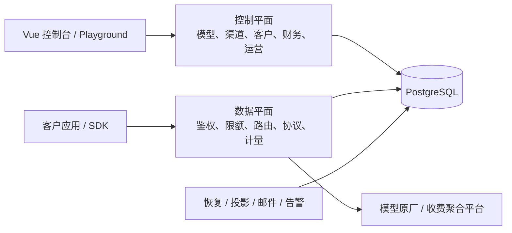

# moni-aigate

[](https://github.com/workhold/moni-aigate/actions/workflows/ci.yml)

面向对外 API 经营的自托管 AI 网关，将模型接入、客户授权、渠道采购、计费结算和运营控制台放在同一个平台中。
参考 New API / One API 的业务设计与 1Panel 的部署体验，采用 Go + PostgreSQL + Vue 3 独立实现，按 SDD 持续交付。

**当前版本：`v0.1.0-dev`。核心商业链路已完成限定本地验收；正式收款、生产部署与真实供应商认证仍需独立验收。**

[系统架构](docs/architecture/README.md) · [本地开发](docs/runbooks/development.md) · [部署手册](docs/runbooks/deployment.md) · [MVP 状态](docs/verification/mvp-status.md) · [交付计划](docs/design/delivery-plan.md)

## 定位与特点

moni-aigate 的上游既可以是模型原厂，也可以是其他收费聚合平台。客户按平台售价消费，平台按渠道与精确上游模型登记采购成本，并在授权、能力、地域、健康和预算约束内选择渠道。

- **销售与采购分开**：客户输入/输出售价、上游输入/输出采购价分别版本化，每次请求与尝试保留实际快照。
- **资金先于派发**：金额使用 CNY 精确整数，硬预占、唯一结算、不可变平衡流水；用量未知进入核对，不把估算当作账单。
- **渠道可治理**：不可变发布、凭据池、模型发现与差异预览、整批启停，以及可解释的选路与排除原因。
- **客户可自助**：租户控制台、API Key、模型目录、账单、Playground，以及可选的邮箱注册与恢复流程。
- **部署依赖少**：前端嵌入单个 Go 可执行文件，PostgreSQL 是唯一持久事实源；当前采用单活动实例。
- **设计随代码更新**：规格、接口合同、架构图、源码入口和验证边界共同维护，Make / CI 检查架构内容快照。

## 能力状态

“限定本地验收”指专用 PostgreSQL、本地协议模拟器或隔离浏览器中的指定范围验证，不代表真实供应商、生产支付或目标部署环境已经通过。
完整细节以[统一架构能力表](docs/architecture/README.md#当前能力与后续边界)和对应验证记录为准。

| 能力 | 当前状态 | 主要范围与边界 |
| --- | --- | --- |
| 租户与 API Key | 已实现 | 成员/模型授权，来源 IP/CIDR，RPM、burst、并发、模型/地域、累计额度、有效期及撤销 |
| 六种推理协议 | 已实现，限定本地验收 | Chat、Responses、Messages、Embeddings、Rerank、Gemini 文本；范围见下表 |
| 模型与渠道运营 | 已实现，限定本地验收 | 不可变渠道/路由版本，1..32 成员凭据池，目录发现/差异预览，跨渠道批量启停 |
| 成本感知路由 | 已实现，限定本地验收 | 同模型优先级/权重/健康/容量；可配置成本优先、未知报价拒绝策略及采购单价上限 |
| 采购账户与预算 | 已实现，限定本地验收 | 跨渠道共享账户、累计与周期预算、逐 attempt 预占、未知占用、双人更正；余额观察为人工证据 |
| 客户资金与账单 | 已实现，限定本地验收 | 硬预占、最终用量、唯一结算、双人入账/消费退款/核对、请求关联账单与采购成本 |
| 公开目录与分组报价 | 已实现，限定本地验收 | 模型默认私有，管理员显式发布；客户分组售价与周期硬预算，不等于订阅商品 |
| 自助身份与兑换券 | 已实现，限定本地验收 | 邮件证明、密码恢复、双审赠额券；注册、邮件和新券发行默认关闭 |
| 应用支付订单 | 仅隔离本地模拟闭环 | 订单、签名通知、独立 worker 和唯一入账已接通；没有正式在线收款能力 |
| 站内经营告警 | 已实现，限定本地验收 | 渠道隔离、采购登记余量和待核对积压，规则/历史/确认；默认关闭评估 |
| 资金来源与原路退款 | 部分基础模块已实现 | 已有来源分配、账本读取、业务来源图，以及钱包全序声明的纯检查；实际 lot/FIFO/退款重放、维护切换、原路退款和拒付仍在推进 |
| 停服维护授权与受控读取 | 库级已实现，验证按阶段记录 | Gate、Snapshot、Permit 与 ReadLease；已有单租约 68 表、七项业务来源算法的组合读取，lot 全序重放、生产维护 CLI、basis 与 epoch 开账仍在推进 |
| 媒体与实时协议 | 仅纯计量基础层已实现 | 图片、音频、异步任务和 Realtime 尚未接通生产协议 |
| 容器、1Panel 与 HA | 配置/手册已有，目标环境未验 | Compose 静态渲染已验；容器实际运行、1Panel 实装和 HA/多活尚未完成 |

采购报价支持按“渠道 + 精确上游模型”设置独立输入/输出单价与生效版本，不会把客户售价直接当作成本。
多渠道可绑定同一采购账户共同消耗预算；当前没有供应商真实余额或外部账单自动同步。

### 协议范围

| 接口 | 当前支持 |
| --- | --- |
| `GET /v1/models` | 返回当前 API Key 获授权且可用的逻辑模型 |
| `POST /v1/chat/completions` | 无状态文本、基础函数工具，JSON / SSE |
| `POST /v1/responses` | 无状态文本、基础函数工具，原生 JSON / SSE |
| `POST /v1/messages` | 无状态文本、基础函数工具，原生 JSON / SSE |
| `POST /v1/embeddings` | 单条/批次输入，float / base64 输出 |
| `POST /v1/rerank` | Jina 风格字符串文档重排 |
| `POST /v1beta/models/{model}:generateContent` | Gemini 原生无状态纯文本 |
| `POST /v1beta/models/{model}:streamGenerateContent` | Gemini 原生纯文本 SSE |

协议与模型必须具有明确的能力、硬计量上界和可信最终用量。基础工具调用由客户端执行，网关不执行函数；Gemini 暂无工具或多模态支持。
当前不承诺 Codex / Claude Code 全产品兼容，也不以接口路径相同推定所有供应商模型均可使用。

## 架构概览



控制平面与数据平面属于同一个 Go 模块化单体，网络调用在数据库事务之外。
客户一次请求唯一结算，上游成本按每次 attempt 留存；只允许明确安全的有限回退，消费未知时不自动重放生成请求。
恢复任务处理证据、结算和释放，不重新发送模型生成。

技术栈：Go / Gin / pgx，PostgreSQL 16，Vue 3 / TypeScript / Element Plus。
应用、报表投影与迁移角色分离；当前不引入 Redis / Kafka，不支持通过增加副本直接切换多活。

[统一系统架构](docs/architecture/README.md)集中展示模块依赖、请求时序、资金与采购链路、数据关系、权限、worker、部署和故障恢复，并链接到源码。
[HLD](docs/design/HLD.md)与[LLD](docs/design/LLD.md)保留详细设计和决策，能力状态以统一架构与验证记录为准。

停服维护已有授权与只读核验基础，新增同一快照 68 表读取与七项业务来源核验；报告区分物理读完、算法实际执行及历史缺证。钱包全序检查可发现所提供原行中的断链、分叉、错误尾指针、journal 绑定和事件声明不符，当前是独立纯函数，尚未接入维护或在线资金操作。实际 lot/FIFO/退款重放、开账切换、原路退款、拒付和生产维护命令仍在开发。读取范围、实现入口和验证结果见[维护架构](docs/architecture/maintenance-gate.md)。

套餐的价值分摊与月期限算法已独立实现，尚未接入购买、扣款或权益发放，详见[纯算法合同](specs/023-periodic-products/c-value-contract.md)。

## 本地启动

需要 **Go ≥1.26、Node 22、PostgreSQL 16**。首次运行请使用专用数据库。

```sh
git clone https://github.com/workhold/moni-aigate.git
cd moni-aigate
make build
./bin/moni-aigate init-env --out .env
```

`init-env` 生成随机秘密，文件权限为 `0600`，不覆盖已有文件。它不会替你建立外部 PostgreSQL 数据库或 LOGIN 角色。
继续启动前：

1. 按[建立本地数据库与角色](docs/runbooks/development.md#建立本地数据库与角色)建立空 `moni` 数据库、迁移 owner，以及独立的 `moni_app` / `moni_projection` LOGIN 角色。初始化管理身份执行建库/建角色，三个项目角色均不授予 `CREATEDB` / `CREATEROLE`。
2. 编辑私有 `.env`，补全 `DATABASE_URL`、`PROJECTION_DATABASE_URL`、`MIGRATION_DATABASE_URL`，格式见 [.env.example](.env.example)。URL 密码须百分号转义。
3. 本机 HTTP 使用 `PUBLIC_ORIGIN=http://localhost:8080`、`COOKIE_SECURE=false`、`LISTEN_ADDR=127.0.0.1:8080`。
4. 在仓库外准备权限 `0600` 的初始管理员密码文件，密码长度为 12–72 字节；将下方私有路径替换为实际路径。

```sh
set -a
. ./.env
set +a
./bin/moni-aigate migrate
DATABASE_URL="$MIGRATION_DATABASE_URL" ./bin/moni-aigate provision
./bin/moni-aigate bootstrap --email admin@example.com --password-stdin < /absolute/private/admin-password
./bin/moni-aigate serve
```

打开 `http://localhost:8080`，使用刚创建的管理员登录。`bootstrap` 仅允许空用户库首次创建管理员；没有固定默认账号、密码、演示模型或赠送余额。
程序交互读取密码不会隐藏输入，建议使用密码管理器或受保护文件提供 stdin，避免将真实密码写进命令参数或历史。

首次经营顺序：模型能力 profile → 上游渠道 → 发布完整 binding/revision → 客户售价与采购报价 → 客户模型授权 → 两个财务账号核款 → 客户创建 Key → 调用。
详细配置与故障排查见[开发手册](docs/runbooks/development.md)。

## Docker Compose / 1Panel

仓库提供 [Dockerfile](Dockerfile)、[compose.yaml](compose.yaml) 和 [Nginx 示例](deploy/nginx.conf)。以下为待目标环境验收的部署路径，容器实际构建/运行与 1Panel 实装尚未验证。
部署主机需要 Docker Engine 与 Compose v2；下方 `go run` 需要 Go ≥1.26，也可在可信开发机生成配置后安全传入部署主机。先将完整仓库检出到部署目录，以下命令均在仓库根目录执行，再生成私有配置；已有 `.env` 时跳过生成步骤：

```sh
go run ./cmd/moni-aigate init-env --out .env
# 编辑 PUBLIC_ORIGIN=https://your-domain、COOKIE_SECURE=true、PORT=8080
docker compose config --quiet
docker compose build
docker compose run --rm -T app bootstrap --email admin@example.com --password-stdin < /absolute/private/admin-password
docker compose up -d app
```

`bootstrap` 命令会等待 Compose 的迁移与权限初始化依赖完成；它在应用对外监听前创建首次管理员。

Compose 为全新数据库卷建立独立角色，按 migrate → provision → app 启动；数据库不映射公网，应用仅绑定宿主机环回端口。已有 PostgreSQL 卷不会因修改 `.env` 自动更换角色密码，密码轮换须同时更新数据库角色与私有配置。
1Panel 可从“容器 → 编排”导入根 `compose.yaml`，编排目录和构建上下文须指向完整仓库根目录：`migrate` 使用 `build: .`，需要 `Dockerfile`、Go/Web 源码和 `deploy/init-roles.sh`，仅复制 YAML 与初始化脚本不足以构建。确认私有 `.env` 注入和相对路径后，再配置 HTTPS 反向代理到 `127.0.0.1:8080`；详情见[首次安装](docs/runbooks/deployment.md#首次安装)。
SSE 须关闭代理缓冲和生成 POST 自动重试，显式设置可信代理 CIDR；不要直接信任客户端转发头。

升级须先排空并停止旧实例，再执行迁移/授权后启动新实例。生产配置、密钥轮换、单活与反代约束见[部署手册](docs/runbooks/deployment.md)，恢复演练见[备份恢复](docs/runbooks/backup-restore.md)。

## API 示例

先由平台配置并授权可用模型，通过私有环境提供 `MONI_API_KEY`。下列模型名须替换为已发布的逻辑模型；接入真实上游会产生供应商费用。

```sh
curl http://localhost:8080/v1/models \
  -H "Authorization: Bearer $MONI_API_KEY"

curl -N http://localhost:8080/v1/chat/completions \
  -H "Authorization: Bearer $MONI_API_KEY" \
  -H 'Content-Type: application/json' \
  -d '{"model":"your-public-model","messages":[{"role":"user","content":"Hello"}],"max_tokens":128,"stream":true}'
```

推理使用客户 API Key，与控制台会话分开。Messages 也可单独使用 `x-api-key`，不能同时提交两种认证。
响应提供 `X-Request-ID`，可在控制台关联请求、尝试、客户账单与采购成本。
匿名 `/pricing` 默认没有模型；管理员显式公开后才展示当前价格，公开展示不授予调用权限。

## 安全默认

- **MFA 默认可选**：未启用时可密码登录；账号安全页支持本地二维码扫描或手工密钥绑定。启用后使用验证器动态码，并妥善保存恢复码。
- `MFA_ENFORCE_PLATFORM=true` 可要求平台/财务账号先绑定。关闭强制策略不会解除已有个人绑定；敏感操作再认证与双人审批继续生效。
- 注册、邮件、新券发行、经营告警评估与支付默认关闭；正式部署按独立配置和验收边界逐项开启。
- 日志默认只留元数据，不记录请求/回复正文或 Authorization；上游出口默认 HTTPS，私网需显式 CIDR 配置并接受 SSRF 校验。
- 生产使用 HTTPS 与 Secure Cookie；秘密、`.env` 和真实凭据不入库，主密钥及身份秘密须独立备份。公开反代禁止访问 `/metrics`。

## 验证与性能

按[开发验证](docs/runbooks/development.md#开发验证)准备**专用 PostgreSQL 16 测试集群**：实际端点为 `127.0.0.1:55439/moni_test`，测试 LOGIN 为 `moni_test`。通过私有环境设置 `TEST_DATABASE_URL` 后执行：

```sh
npm --prefix web ci
make check
make verify-mvp
```

`make check` 执行只读架构检查、Go vet 和前端构建。
`make verify-mvp` 强制要求测试库配置，并运行前端测试/构建、Go race 测试、vet 和构建；未配置数据库而跳过的测试不能作为商业验收完成。
本地验证与生产门禁分别记录在 [MVP 状态](docs/verification/mvp-status.md)和[发布验收](docs/verification/mvp-release-qualification.md)。
维护集成与普通服务的依赖隔离由可执行门禁检查。启动回归、维护读取专项、整仓检查和每轮 CI 均保留精确版本身份，详见[集成隔离验证](docs/verification/maintenance-integration-isolation.md)。

当前优先完善能力，再推进性能专项。网关额外首字节延迟与模型首 token 时间分开衡量；历史 Mock 结果不能代表当前版本或真实供应商。
尚未完成 Rust LiteLLM / Bifrost 同条件实跑对比，不宣称性能相近。方法与固定参考见[性能规格](specs/002-performance-parity/spec.md)、[容量方法](docs/verification/capacity.md)和[研究记录](docs/research/performance-references.md)。

## SDD 与架构同步

每项行为先补齐规格、状态机、接口/数据合同、故障与验收边界，再修改实现。
主要入口：[商业 MVP 规格](specs/001-commercial-mvp/spec.md)、[HLD](docs/design/HLD.md)、[LLD](docs/design/LLD.md)、[能力路线图](docs/design/new-api-roadmap.md)、[交付计划](docs/design/delivery-plan.md)。

代码、测试、依赖、迁移、部署、CI 或设计合同发生变化时，都要复核[统一架构](docs/architecture/README.md)的模块图、请求链路、数据关系、权限边界、能力状态和源码链接。
汇总并行任务结果后，由集成人完成语义复核、更新受影响正文，并执行：

```sh
go run ./scripts/check-architecture --refresh --reviewed --reason '本次变更及其架构影响；无结构变化时说明复核结论'
go run ./scripts/check-architecture
```

统一交付架构正文、[架构变更记录](docs/architecture/changes.md)和 [SHA-256 清单](docs/architecture/architecture-manifest.json)。默认检查只读，CI 不自动刷新；内容快照不能替代语义审查。
详细规则见 [AGENTS.md](AGENTS.md)。

## Roadmap

按[交付计划](docs/design/delivery-plan.md)逐片设计、实施和验收，可并行的纯模块与只读工作独立推进，资金写入和迁移由集成人串行收口。

1. 完成资金来源全路径、停服维护与独立核验，再推进原路退款、拒付及正式支付。当前已接通采购证据、周期预算、支付来源的同一快照读取；接着完成 lot 重放、basis 与 epoch 开账，进度见[交付计划](docs/design/delivery-plan.md)。
2. 完成商品/订阅、媒体协议与扩展运行能力；已有周期预算或纯计量模块不视为这些能力交付。
3. 对选定真实供应商逐一完成协议、硬计量上界和采购合同认证。
4. 完成容器/1Panel 目标环境、灾备与生产发布门禁；HA/多活按独立共享执行合同推进。
5. 在完整商业检查下优化首字节与完成延迟，并执行固定环境的竞品对照。

## 竞品与相关项目

以下项目用于研究设计取舍，不是本项目运行时依赖，也不表示继承其全部能力或宣传性能。
完整固定源码、许可与证据范围见[竞品研究矩阵](docs/research/landscape.md)。

| 项目 | 主要参考方向 |
| --- | --- |
| [One API](https://github.com/songquanpeng/one-api) / [New API](https://github.com/QuantumNous/new-api) | 统一接口、渠道、客户/令牌、计价与预扣流程 |
| [1Panel-Gateway](https://github.com/1Panel-dev/1Panel-Gateway) | 公开产品治理与自托管部署；给定固定公开树没有网关业务实现 |
| [LiteLLM](https://github.com/BerriAI/litellm) / [Bifrost](https://github.com/maximhq/bifrost) / [Portkey](https://github.com/Portkey-AI/gateway) | 路由、预算、回退、成本与观测边界 |
| [Higress](https://github.com/alibaba/higress) / [Apache APISIX](https://github.com/apache/apisix) | 网关策略阶段、流式处理与插件边界 |
| [Lago](https://github.com/getlago/lago) / [OpenMeter](https://github.com/openmeterio/openmeter) | 计量事件身份、交易来源、更正与投影 |
| [TensorZero](https://github.com/tensorzero/tensorzero) / [Plano](https://github.com/katanemo/plano) / [RouteLLM](https://github.com/lm-sys/RouteLLM) | 配置快照、候选评估与语义路由的后续边界 |
| [Open WebUI](https://github.com/open-webui/open-webui) | 外部客户端接入；它是前端，不是网关 |

进一步阅读：[New API 源码分析](docs/research/new-api-analysis.md)、[身份/商业源码笔记](docs/research/implementation-auth-commerce-notes.md)、[协议源码笔记](docs/research/implementation-protocol-notes.md)、[依赖来源](docs/research/dependency-provenance.md)。

## 反馈与贡献

功能建议与可复现问题请提交到 [GitHub Issues](https://github.com/workhold/moni-aigate/issues)。开发流程、测试环境和 PR 要求见[贡献指南](CONTRIBUTING.md)；仓库约定见 [AGENTS.md](AGENTS.md)。问题描述和日志中请移除密钥、个人信息及真实请求正文。

## License 与来源

**项目源码发布许可证尚未决定，当前没有选定的开源许可证。** 第三方依赖各自遵循其许可证。
本项目采用独立编写的代码、UI 与测试，不是 New API / One API 或 1Panel 的 fork，也不代表官方合作。
团队已阅读上游源码，不宣称经过法律意义上的 clean-room 认证；独立重写本身不能替代来源与许可核查。
路线差异、复用边界和来源记录见 [ADR-001](docs/decisions/ADR-001-source-strategy.md)与[依赖来源清单](docs/research/dependency-provenance.md)。
