# moni-aigate 统一系统架构

本文件是当前系统的架构入口，面向开发、平台运营、财务和部署人员。正文描述已经实现的行为；规划在能力表中明确标记。详细约束以关联 SDD 合同和代码为准，实际验收范围以验证记录为准。历史设计中的“未来支持”条目不能覆盖此处的当前状态。

moni-aigate 是对外提供 API 的自托管商业运营平台。它借鉴 New API/One API 的模型接入、渠道经营和客户控制台，以及 1Panel 的自托管部署体验，采用独立实现。当前以业务与资金正确性优先，先完善能力，再推进性能专项；竞品全功能、生产发布或性能对标均需独立验收。

建议先看系统上下文、请求时序和部署图，再按模块表进入源码。设计入口：[HLD](../design/HLD.md)、[LLD](../design/LLD.md)、[能力路线图](../design/new-api-roadmap.md)、[商业 MVP 合同](../../specs/001-commercial-mvp/spec.md)。当前验收入口：[MVP 状态](../verification/mvp-status.md)、[逐项验收边界](../verification/acceptance-execution.md)与[001–028整体盘点](../verification/overall-delivery-inventory.md)。

**当前研发原则**：[ADR-005](../decisions/ADR-005-pre-mvp-single-path.md)采用单一现行模型，MVP 前优先架构完整与业务能力，不新增旧版本兼容、双写或自动回退。下面的隔离历史证明候选保留其事实与验证边界，暂不扩展，也不作为经营功能的前置依赖；它们没有接入默认服务。现行资金与租户正确性继续保持。

当前服务迁移和启动入口使用 `migrations.ApplyCurrent`/`VerifyCurrent`。安装器只执行 `migrations/current_mvp.sql` 这一份当前基线，只接受空的当前数据库，并在业务 DDL 前拒绝历史 `schema_migrations`、已有业务关系或其他用户关系。旧库不升级、不转换，`ApplyThrough` 只供隔离历史 fixture 使用。

**2026-11-09 当前状态校正**：下方 2026-11-08 的媒体开发记录按当时提交顺序保留，但其中“尚未接入”的描述已被后续纵向接线覆盖。当前 `POST /v1/images/generations`、TTS、`/v1/tasks`、独立 worker 和 `/v1/realtime` 已进入当前 server/worker 入口；图片/TTS、video task 和 Realtime 使用当前媒体 Reserve/Attempt/Observe/Settle，异步制品正文与 Realtime provider identity 已持久化。已通过的范围是 55439 专库与 mock provider 的定向 race，以及本机临时 Compose 的迁移/provision/bootstrap/live/ready/重启验收。真实供应商、对象存储、浏览器业务调用、1Panel 和完整 028-U guard/商业出口仍未完成。

Realtime turn 的当前数据库绑定还通过来源类型闭合检查。文本 turn 必须使用文本 request/reservation/attempt 三表，media-backed turn 必须使用 media 三表，不能因为 request ID 相同而交叉组合。该边界已有 55439 反例测试，仍不等同完整 U guard matrix。

当前 U guard 专项已补齐一组 55439 PostgreSQL 负控矩阵，覆盖跨租户/跨 request-attempt、不可变快照与最终证据、Observation 来源闭集、成本指针互斥、资金边界回滚和计量角色 ACL。它是当前迁移的实证扩展，完整九组 guard、历史金融拒迁和目标环境权限验收仍按任务清单开放。

2026-11-10 权限定义收口：024 与 `current_mvp.sql` 在所有 `meter_%` 函数创建完成后统一设置 `SECURITY INVOKER`、固定到当前 schema 加 `pg_catalog, pg_temp` 的搜索路径并撤销 PUBLIC 执行权。`internal/operations` 的角色核验逐函数确认 APP 可执行、projector/PUBLIC 不可执行，且不接受 SECURITY DEFINER 或未固定搜索路径。55439 实际 LOGIN、迁移 guard 与回归专项通过。该片只收紧函数定义与检查，不扩大计量表写权限，也不关闭完整九组 guard 和旧金融拒迁矩阵。

异步 task 的公开准备链现在可以从 owner-scoped request detail 读取原 profile、reservation、attempt 身份，资金页读取原 funding lot/source 身份，再按 task 合同提交。服务端仍校验这些引用属于同一租户和原 request，不把缺失引用转换成新的商业事实。

当前 task 集成证据也经公开 HTTP 入口取得这些引用，再进入 `/v1/tasks` 和 worker 状态机。测试 fixture 不再用 owner SQL 直接拼接 task 请求，避免把内部数据库读取误当成用户可用能力。

2026-11-08 028-U续片：人工核对收费提交已切为绑定原请求 schema 的完整 `retail_quantities` 向量，proposal 保存 canonical/digest，批准继续沿 approved_reconciliation 观察和原结算链且 supplier 保持 missing；HTTP/UI删除 `input_tokens/output_tokens` 输入，并新增旧标量、未知字段、重复键负控。此前受限APP六协议默认价/组价组合、退款来源一致性和过期未知用量恢复不重生成已在55439专库通过，验证包含唯一结算、原组价快照、退款边、钱包来源核对和单次上游POST。该证据仍是本地fixture的局部验收；完整guard、超界、浏览器、正式供应商和部署/HA/性能仍未完成。

2026-11-08 008/028-U续片：024 的 route complete guard 现在要求每个 binding 的 supplier cap 为零条或完整两条文本 token 维度，单 cap 和跨 binding 半套在提交时回滚；Reserve/finish 的 funding-lot 写集先做纯余额投影，再按原 allocation 顺序一次批量发送。迁移 route-cap 矩阵和 billing 回滚/生命周期专项在55439通过；008剩余全链路故障、028-U完整guard/商业出口、浏览器、正式供应商和部署仍未验收。

2026-11-08 008/028-U商业续片：超预占 profile block 与 audit 已与结算尾写组成同一 PostgreSQL batch，周期预算超界失败、回滚和重试唯一性通过55439；受限 APP 六协议补齐过期 unknown 恢复不重生成、重复恢复和幂等一次收费矩阵。它们仍是本地 fixture/受限角色证据，008完整验收、028-U完整guard、真实供应商、浏览器和部署/HA/性能仍未完成。

2026-11-08 008/028-U结构续片：现行周期预算 024 fixture 的额外渠道改由完整 route publication 和 catalog cost operation 建立，`internal/periodicbudget` 整包 race 在 55439 通过；冻结历史/prefix fixture 保持原身份。024 成本来源 guard 还拒绝已有 correction 被 late finalization 覆盖。上述只补当前结构和失败边界，008完整验收、028-U完整guard、真实供应商、浏览器和部署/HA/性能仍未完成。

2026-11-08 008/028-U验证续片：`scripts/financial-write-batch-qa` 已用不同 SHA-256 的 before/after binary 串行跑完三对固定样本，六次均通过 100 请求、100 结算、账本平衡和资源归零。024 新增请求报价身份 guard，冻结 request HMAC、streaming 与 route revision 等字段；人工核对 HTTP 的 `settle` 动作也已明确映射到账务层 `propose`。固定 binary 证据、当前 guard 和 HTTP 修复均已记录，008 独立评审/最终预览与 028-U 完整存储、商业出口、浏览器、正式供应商和部署仍未收口。

2026-11-08 028-S/A/R 纯域候选第一片：`internal/media`、`internal/tasks`、`internal/realtime` 已分别冻结并通过纯 Go race/vet；它们只验证输入、状态、幂等和资源边界，不含数据库、HTTP/WS、provider、账务、wallet 或报表接线。对应复选框继续未勾，生产能力仍以后续纵向验收为准。

2026-11-08 图片 HTTP MVP：`POST /v1/images/generations` 与受原 API Key 保护的结果读取入口已接入 `internal/media` 和 `provider.MockMediaAdapter`。严格输入、同 Key 幂等、同键异体冲突、结果所有权和已发送未知消费不重发已在 server 专项测试覆盖。请求记录与结果只存在内存，尚未接入 request/attempt、统一计量、billing/wallet/settlement、持久化、真实供应商或生产发布，028-S 仍未完成。

2026-11-08 028-S/A/R 开发续片：S/A/R 已补可复用的 provider adapter、service、持久化接口、任务 lease、实时 ticket/session/turn/event 和单次收费引用边界；024 新增当前媒体任务/实时关系及状态/绑定 guard，ProvisionFor 收紧 APP 与 projector/payment worker 权限。当前仍缺 HTTP/WS、真实 PostgreSQL writer、mock provider 运行器和现有 billing/wallet/settlement 的纵向接线，不能标记媒体扩展完成。

2026-11-08 异步任务入口续片：新增 API Key 保护的 `video_generation` 任务 HTTP 入口，创建、状态、提交、取消和结果授权均进入当前任务 Store/状态机，提交使用当前 mock adapter 并保留未知提交不可重发边界。该入口尚未接 worker 重启恢复、对象正文持久化或统一 billing/wallet/settlement，因此不标记异步能力完成。

2026-11-08 异步 worker 续片：`media_tasks` 的持久 lease 支持 claim、续租和释放，`internal/tasks.Worker` 沿当前任务状态机执行一次 submit/observe/cancel/expire。该实现仍需接入实际 worker 运行入口、统一账务收尾和重启端到端验收。

2026-11-08 worker 部署续片：`cmd/moni-aigate worker` 和 Compose 独立 worker 服务已接入当前 task lease。worker 使用当前 mock task adapter，独立进程权限不扩大到计量、wallet 或 payment worker；Compose 静态配置通过，真实容器运行和重启验收仍未完成。

2026-11-08 媒体商业入口续片：024 追加 `media_model_profiles`、media request/attempt/observation/reservation/settlement 与 funding-lot edge。图片/TTS HTTP 在有数据库的 Server 上复用 `internal/billing/media.go` 的当前 wallet journal，Realtime 单 turn 在有数据库时也使用 `realtime_turn` media profile，纯协议 fixture 仍保留 pending 边界。异步 video task 尚未接统一账务，媒体正文持久化、数据库 realtime writer、真实供应商和容器运行验收仍未完成。

<!-- architecture:context -->
## 系统上下文与边界

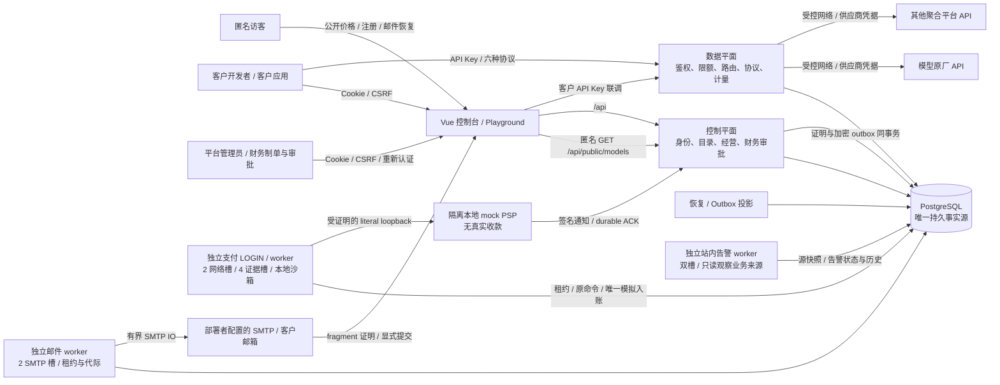

控制平面与数据平面是同一个 Go 进程内的职责边界，当前没有拆成独立微服务。客户钱包和供应商采购独立：客户按平台售价消费；上游可以是模型原厂或收费聚合平台。渠道＋精确上游模型成本版本固定每次attempt的报价，永久凭据归属把多个渠道和Key接到同一采购账户。019已实现累计采购预算和逐attempt预占，通过限定本地验收；外部余额只保存显式人工证据，不代表供应商认证余额或自动账单同步。

目标供应商为OpenAI/Codex相关API模型、Claude、DeepSeek、Gemini、GLM，以及硅基流动等第三方平台。每个平台分别认证协议profile、硬计量边界、采购报价和账户，不按模型同名继承认证；当前实现与正式认证之间的差别见[逐渠道接入计划](../design/provider-qualification-plan.md)。

技术栈为 Go/Gin、pgx/PostgreSQL、Vue 3/TypeScript/Element Plus；前端构建嵌入单个 Go 可执行文件。无需 Redis/Kafka。PostgreSQL 同时承担事务事实源、恢复任务与 outbox；累计钱包统计通过独立角色投影，026经营报表经APP读取同一业务快照，两者不直接参与模型响应的网络过程。

<!-- architecture:modules -->
## 模块、依赖与源码地图

当前 `serve` 和普通领域入口的主干如下。来源分配直接参与原账务事务，026经营报表只读同一份文本与媒体业务事实；媒体报表接缝只读，不改变媒体写链或任务/实时状态机。

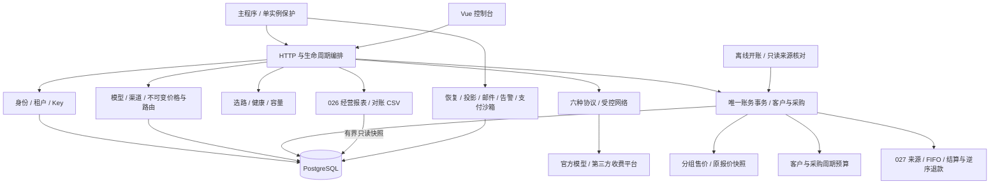

现行来源链路详见[资金来源与开账](wallet-sources.md)，整体下一阶段设计见[资金、媒体与经营一体化设计](../design/integrated-wallet-media.md)。以下完整源码关系图同时保留隔离研究模块，默认折叠；它们有明确身份和边界，不能作为经营功能的依赖清单。

<details>
<summary>展开完整源码与隔离研究关系图</summary>

```mermaid
flowchart TD
    CLI[cmd/moni-aigate\n装配、CLI、启动与排空]
    Web[web\n控制台与内嵌静态资源]
    HTTP[internal/server\nHTTP 编排与准入]
    Identity[identity\n会话、租户、Key]
    Catalog[catalog\n模型、渠道、版本、发现、公开投影与分组售价]
    Pricing[pricing\n既有Tx内精确价格域选择]
    ProductValue[productvalue\n纯本金价值分摊 / UTC锚点月\n无生产调用方]
    PaymentProto[paymentproto\n纯协议/签名与查询绑定]
    PaymentApp[payments\n订单 / 通知 / 双manifest证明 / Processor / Runner]
    PeriodicBudget[periodicbudget\n既有事务内客户与采购周期预算]
    PeriodicVerifier[periodicbudget.Verifier\n离线只读快照 / 三态报告]
    SandboxCLI[cmd/moni-payment-sandbox\n独立本地QA进程]
    MockPSP[mockpsp\n命令/查询/双槽回调]
    PaymentReceiver[paymentreceiver\n验签/持久回执]
    PaymentRuntime[paymentruntime\nmanifest/角色/ownership证明]
    SandboxQA[paymentsandboxqa\n仅离线装配与验证]
    SandboxSchema[paymentsandboxschema\n自有SQL与静态inventory]
    SandboxPG[(专用测试PG\n三schema；B0七/B3八角色)]
    DescriptorCLI[scripts/funding-lot-descriptor\n离线元数据候选导出 / 隔离安装与清理]
    DescriptorPG[(同一专用测试PG\n每profile独立随机schema / 四角色)]
    DescriptorFiles[未审阅descriptor候选\n结构与权限分开 / 固定来源摘要]
    CatalogRR[调用方持有的RR\n静态库接口，尚无main装配]
    LotCatalog[fundinglotcatalog\n全对象/权限与事务opaque证明]
    CatalogExpected[固定expected / PG16.15 profile\nordinary五变体 / 完整sandbox]
    WalletReadProfile[显式WalletReadV2\n固定base加四列ACL delta / 新完整root\n仅catalog权限版本 / 不授资金写权]
    RuntimeCaller[库级actual APP调用方\n独占caller-owned RR READ ONLY / 无main装配]
    FundingLotRuntime[fundinglotruntime\n显式旧84表 / V3新87表组合与strict原件\n最多30秒发行原事务RuntimeProof]
    PrefixProfile[显式PeriodicPrefixV3\nsource71 / wallet87 / basis112 / catalog128\n固定original22候选 / 无main接线]
    PrefixCompatibility[fundinglotprefixcompat\n12条静态历史与fresh映射\nobserver与runtime共用 / 无authority]
    PrefixReaders[fundinglotscan显式prefix读取\n71/635来源与87/804钱包\n同session共享预算 / generated逐值核验]
    PrefixProjections[三个prefix无查询投影\n同raw重算资格 / 深拷贝普通原件]
    ApplicationState[fundinglotruntime.ApplicationState\nAPP私有文件严格加载 / 独立5秒\n仅owned V1与APP nonce摘要]
    RuntimeProof[RuntimeProof.VerifyTx\n原wrapper-Conn-PgConn-top xid\n新ctx最多5秒 / 无跨事务资金许可]
    MaintenanceGate[maintenancetrust\nGate / 私有Snapshot / Attest / Permit]
    FundingLotsPhase[maintenancetrust私有开账phase\n第八once / pre与basis / 自持draft\n固定writer / strict v2与实际post / 唯一提交]
    FundingLotsObserver[maintenancetrust显式旧/V3 observer\n新双锁 / RR只读 / strict原件与当前图\nRO终结及cleanup后返回普通结果]
    MaintenanceLease[maintenancetrust.ReadLease\n同rawTx / 单生命周期busy / 封闭codec]
    MaintenanceProof[ScanProof\n仅原Permit绑定的固定kind完成凭据]
    MaintenanceScan[maintenancescan\n独立维护集成 / Require core Finish\n私有结果绑定真实ScanProof]
    MaintenanceManifest[migrations\n固定embed22项 / 完整history helper]
    MaintenanceCaller[库级调用方\nGate成功只表示持锁]
    Routing[routing\n候选、采购比价与容量租约]
    Provider[provider\n协议、usage、SSE、网络]
    Billing[billing\n预占、结算、成本、双审券、统一入账与投影]
    Procurement[procurement\n共享采购账户、永久绑定、命令回执]
    Reporting[reporting\n当前请求窗口 / 精确经营汇总与CSV]
    Operations[operations\n实例保护、角色配置、恢复闸门]
    Mail[mailworker / maildeliver\n独立生命周期、SMTP与清理]
    AlertWorker[alertworker\n双槽 / 专用双连接 / Guard]
    Alerts[alerts\n四种观察 / 规则 / 发生与历史]
    Security[security / telemetry / config]
    PG[(PostgreSQL)]
    LedgerReader[billing ledger reader\n原RR入口 / 无权威raw facts core\n三表完整EOF]
    FundingSourceReader[billing source-link reader\n人工核款 / voucher / receipt raw facts\n三表完整C序分页与EOF]
    FinancialReader[billing funding financial reader\n21表同session owned图 / 四项局部摘要]
    CompleteReader[fundinglotscan.Read\n原68表一次读取 / 共享预算与私有EOF\n原七项算法 / native资格与ordinary排除]
    SeedProjection[fundinglotscan.ProjectLegacySeed\n原68完整一致资格 / 新ctx与深复制\n九组普通原件 / 无Query]
    SourceWalletReader[fundinglotscan.ReadWallet\n84表同session一次读取 / 共享资源\n原七来源算法 + 实际钱包lot重放]
    EpochProjection[fundinglotscan.ProjectEpochProof\n同次完整原行 / 新ctx与深复制\n普通epoch及attestation / 无Query]
    ApplicationProjection[fundinglotscan.ProjectApplicationPaymentProof\n同次84raw / APP marker与v1原件\nordinary双空 / sandbox双单例 / 无Query]
    SourceChecks[fundinglotscan共享检查设施\n同raw投影 / 原七来源算法]
    BasisReader[fundinglotbasis\n固定旧109/976或新112/1004\n唯一metadata分页hash / 同RR basis v1]
    BasisMaterials[受审静态descriptor / manifest / send profile\n固定原字节与SHA / 不接受live expected]
    SandboxCaptureReader[billing sandbox-capture direct-link reader\nfunding_receipts + payment_captures\n两表完整C序分页与EOF]
    ProcurementReader[billing procurement history reader\n19 relations / shared budget / complete C-order EOF]
    subgraph PureModules[纯算法/核验基础层：不接入在线资金写入或媒体运行链]
      ProcurementRelations[procurementprefixschema\n固定关系SQL / 32新表与原件扩列\n隔离候选，无业务安装或权限]
      ProcurementPrefixFoundation[procurementprefix\n40原件+32前缀DTO / 共享资源预检\n旧Base无损投影 / 未导出Check]
      ProcurementAccountWriter[procurementaccountwriter\n账户命令20函数29触发器隔离候选\nactual LOGIN限定专项通过 / 无在线接线]
      ProcurementIdentity[procurementidentity\n六函数固定SQL身份材料 / 原Go ABI\n不安装、不授权、无默认业务调用方]
      ProofCodec[fundinglotproof\n严格V1与V2 canonical / owned bytes\n纯格式 / 不授数据库或启动权限]
      InitPlanner[fundinglotinit.Build\n旧业务与账本独立核对 / 确定开账写集\n纯描述性计划 / 无stamp与权限]
      LotPlanner[billing lot_plan\nFIFO / 原收费分配 / 逆原来源退回]
      Metering[metering\n八维完整向量 / 精确费率 / 上界与摘要]
      Inference[inference\n不可变计划 / 原报价 / 分侧观察\n028-U纯域，尚无serve接线]
      StrictJSON[strictjson\n唯一有界JSON语法层 / 无损Unicode]
      RefundProto[paymentrefundproto\n退款v2封闭协议 / v1只读桥 / 三用途签名]
      LedgerRows[fundinglotverify\n大整数账本检查 + 人工/券/沙箱直接关联\n局部raw facts算法 / 无authority]
      ProcurementBudgetCore[fundinglotverify\n采购账户 / reservations / budget event投影核验\nbig.Int局部算法 / 无authority]
      ProcurementAttemptCore[fundinglotverify\n凭据绑定 / attempt / quote / upper-bound图核验\nbig.Int局部算法 / 无authority]
      ProcurementApprovalCore[fundinglotverify\n双审proposal / correction / event双向核验\n历史身份 / 无authority]
      ProcurementCommandCore[fundinglotverify\ncommand / binding / observation / audit双向核验\n历史快照 / 无authority]
      ProcurementJournalCore[fundinglotverify\ncost proposal / correction / audit / outbox双向核验\n成本消息 / 无authority]
      FundingGraphCore[fundinglotverify\n人工券来源图 / CustomerKey资金图\n21表reader已接线]
      ProcurementEvidenceCore[fundinglotverify\n23组采购证据与事件三态\n完整reader已接线]
      PeriodicGraphCore[fundinglotverify\n18组PB独立重放与历史缺证\n完整reader已接线]
      PeriodicPrefixCore[periodicbudgetprefix\n命令精确前缀 / 窗口出生顺序\n显式V3完整reader已接线 / 候选]
      SandboxGraphCore[fundinglotverify\n33组支付stored-verified来源图\n完整reader已接线]
      WalletSequenceCore[fundinglotverify.CheckWalletSequenceRows\n七投影全序 / journal与事件声明\n纯前置检查]
      WalletLotsCore[fundinglotverify.CheckWalletLotsRows\n25组原行 / FIFO与三桶 / 逆序退款\n纯核验 / 84表维护reader已接线]
    end
    Inference --> Metering
    Inference --> StrictJSON
    Metering --> StrictJSON
    WalletLotsCore -->|内部原行投影 / 结构计数| WalletSequenceCore
    RefundProto -->|仅已验证capture值的只读桥| PaymentProto
    LedgerReader -->|读取后整份独立核算| LedgerRows
    FundingSourceReader -->|原始来源facts后双向关联核对| LedgerRows
    SandboxCaptureReader -->|capture↔sandbox receipt直接引用检查| LedgerRows
    ProcurementReader -->|账户缓存与reservation/event delta独立比较| ProcurementBudgetCore
    ProcurementReader -->|binding / attempt / quote / reservation关联核验| ProcurementAttemptCore
    ProcurementReader -->|approved proposal ↔ managed correction / event| ProcurementApprovalCore
    ProcurementReader -->|command snapshots ↔ binding / observation / audit| ProcurementCommandCore
    ProcurementReader -->|cost sources ↔ audit / cost_corrected outbox| ProcurementJournalCore
    FinancialReader -->|共用账本原始行| LedgerRows
    FinancialReader -->|来源与Key独立关系| FundingGraphCore
    FinancialReader -->|21表完整EOF / 原lease共用预算| PG
    MaintenanceScan -->|第六kind / authenticated SourceMode / 唯一Finish| CompleteReader
    CompleteReader -->|固定68表列并集 / 同rawTx| PG
    CompleteReader --> SourceChecks
    CompleteReader -->|完成的一致Facts / 无新增SQL| SeedProjection
    SeedProjection -->|普通LegacySeedRows| InitPlanner
    InitPlanner -->|纯类型定义 / 无维护依赖| LedgerRows
    SourceChecks --> LedgerRows
    SourceChecks --> FundingGraphCore
    SourceChecks --> ProcurementEvidenceCore
    SourceChecks --> PeriodicGraphCore
    PeriodicPrefixCore -->|内部重跑原算法 / 保留Base缺证| PeriodicGraphCore
    PrefixProfile -->|唯一Begin固定 / Init首读前锁128表| MaintenanceGate
    PrefixProfile -->|封闭选择固定读集| PrefixReaders
    MaintenanceScan -->|原kind6/7 / 显式wrapper| PrefixReaders
    FundingLotsPhase -->|新profile的pre71/post87| PrefixReaders
    FundingLotsObserver -->|新profile完整来源及原件| PrefixReaders
    FundingLotRuntime -->|新profile实际APP读取| PrefixReaders
    PrefixReaders -->|同次raw / 重跑原全部算法| SourceChecks
    PrefixReaders -->|新scope / 原Base保留| PeriodicPrefixCore
    PrefixReaders -->|新wallet同raw重放| WalletLotsCore
    PrefixReaders -->|完整EOF / 单次物理预算| PG
    PrefixReaders --> PrefixProjections
    PrefixProjections -->|合格seed| InitPlanner
    PrefixProjections -->|普通epoch及APP原件| FundingLotRuntime
    PrefixProjections -->|普通epoch原件| FundingLotsObserver
    PrefixProfile -->|封闭选择新固定descriptor| BasisReader
    PrefixProfile -->|三个专用API / 共用发行核心| LotCatalog
    PrefixProfile -->|显式V3普通与sandbox入口| FundingLotRuntime
    PrefixCompatibility -->|严格历史原件映射| FundingLotRuntime
    PrefixCompatibility -->|严格历史原件映射| FundingLotsObserver
    SourceChecks --> SandboxGraphCore
    MaintenanceScan -->|第七kind / 原模式与Permit / 唯一Finish| SourceWalletReader
    SourceWalletReader -->|68业务 + 16 C0固定原列 / 同rawTx| PG
    SourceWalletReader -->|同raw实际重跑原七来源算法| SourceChecks
    SourceWalletReader -->|同raw25组投影 / 实际执行| WalletLotsCore
    BasisReader -->|安全metadata后 / 固定ONLY分页 / 全EOF| PG
    BasisReader -->|静态比较与hash帧| BasisMaterials
    MaintenanceGate -->|PlanFundingLots / InitializeFundingLots| FundingLotsPhase
    FundingLotsPhase -->|旧profile自己读取pre68| CompleteReader
    FundingLotsPhase -->|自己的seed与纯规划| InitPlanner
    FundingLotsPhase -->|同RR pre及post / owned固定选择| BasisReader
    FundingLotsPhase -->|真实owned证据发行并严格复核| ProofCodec
    FundingLotsPhase -->|旧profile实际写后84表| SourceWalletReader
    FundingLotsPhase -->|固定14组INSERT / 16C0 allowlist| PG
    MaintenanceGate -->|独占唯一Begin / 不发行Permit| FundingLotsObserver
    FundingLotsObserver -->|自己读取当前84表| SourceWalletReader
    SourceWalletReader -->|完整一致Facts / 无新增SQL| EpochProjection
    SourceWalletReader -->|同次完整一致Facts / 无新增SQL| ApplicationProjection
    RuntimeCaller --> FundingLotRuntime
    ApplicationState -->|仅sandbox / 本机材料快照| FundingLotRuntime
    ApplicationState -->|纯格式资格| ProofCodec
    ApplicationState -->|仅旧keyring资格 / 不保留秘密| PaymentProto
    FundingLotRuntime -->|入口出口 / actual APP / WalletReadV2| LotCatalog
    FundingLotRuntime -->|固定有界guard / 完整22项原helper| MaintenanceManifest
    FundingLotRuntime -->|原tx私有adapter / 固定mode| SourceWalletReader
    FundingLotRuntime -->|同raw投影并绑定实际epoch-v2| EpochProjection
    FundingLotRuntime -->|同raw自有APP原件 / 三方V1相等| ApplicationProjection
    FundingLotRuntime -->|strict原件 / 六条静态历史兼容| ProofCodec
    FundingLotRuntime -->|全阶段成功后发行| RuntimeProof
    RuntimeProof -->|仅原活跃RR身份 / 不重扫资金| LotCatalog
    FundingLotsObserver -->|严格绑定实际pins与历史原件| ProofCodec
    FundingLotsObserver -->|只读原件投影| EpochProjection
    ProcurementEvidenceCore -->|同raw固定重跑五项局部关系| ProcurementBudgetCore
    ProcurementEvidenceCore --> ProcurementAttemptCore
    ProcurementEvidenceCore --> ProcurementApprovalCore
    ProcurementEvidenceCore --> ProcurementCommandCore
    ProcurementEvidenceCore --> ProcurementJournalCore
    LedgerReader -->|三表显式读取 / 原RR入口前置保持| PG
    SandboxCaptureReader -->|两表无过滤完整读取 / 同一原快照| PG
    ProcurementReader -->|十九表无过滤完整读取 / 同一原快照| PG
    MaintenanceScan -->|真实ReadLease / 私有adapter| MaintenanceLease
    MaintenanceScan -->|固定账本算法 / 不可信raw facts| LedgerReader
    MaintenanceScan -->|固定PB算法及19表资源guard| PeriodicBudget
    MaintenanceScan -->|单向领域依赖| Billing
    CLI --> HTTP
    CLI --> Operations
    CLI --> Billing
    CLI -->|独立实际worker LOGIN和连接池| PaymentApp
    HTTP -->|支付领域 / 精确DTO / 独立准入| PaymentApp
    PaymentApp --> PaymentProto
    PaymentApp -->|唯一capture资金事务| Billing
    PaymentApp --> PG
    PaymentApp -->|固定受控本地PSP出口| MockPSP
    CLI -->|verify-periodic-budgets| PeriodicVerifier
    PeriodicVerifier -->|RR READ ONLY / 无业务行锁| PG
    CLI --> Mail
    CLI --> AlertWorker
    SandboxCLI --> MockPSP
    SandboxCLI --> PaymentReceiver
    MockPSP --> PaymentProto
    PaymentReceiver --> PaymentProto
    MockPSP --> PaymentRuntime
    PaymentReceiver --> PaymentRuntime
    PaymentRuntime --> SandboxSchema
    PaymentRuntime --> SandboxPG
    SandboxQA -->|离线DDL/非空资金基线| SandboxPG
    SandboxQA --> SandboxSchema
    DescriptorCLI -->|固定001–022与候选DDL / 原provision| DescriptorPG
    DescriptorCLI --> DescriptorFiles
    CatalogRR --> LotCatalog
    CatalogExpected --> LotCatalog
    WalletReadProfile -->|显式profile / 所选类别界与完整比较| LotCatalog
    LotCatalog -->|只读catalog / Installation发行时空集| PG
    MaintenanceCaller --> MaintenanceGate
    MaintenanceGate -->|双锁 / ONLY125 / 真实身份与前驱 / accounts锁及清理| PG
    MaintenanceGate -->|固定内置stage / 同rawTx安装证明| LotCatalog
    MaintenanceGate -->|固定manifest与原history核验| MaintenanceManifest
    MaintenanceGate -->|原v1 SQL版本与摘要叶子| SandboxSchema
    MaintenanceGate -->|Permit.BeginScan / 入口出口完整重核| MaintenanceLease
    MaintenanceCaller -->|库级五个维护reader| MaintenanceScan
    MaintenanceLease -->|原快照内固定SELECT / EOF Err Close| PG
    MaintenanceLease -->|正常Finish / 无悬挂查询| MaintenanceProof
    MaintenanceScan -->|ScanFunding / 固定reader| FundingSourceReader
    MaintenanceScan -->|ScanFunding / 与三表入口二选一| FinancialReader
    MaintenanceScan -->|ScanSandboxSources / 固定reader| SandboxCaptureReader
    MaintenanceScan -->|ScanProcurement / 固定reader| ProcurementReader
    AlertWorker --> Alerts
    Mail --> Identity
    CLI --> Web
    Web -->|同源 HTTP| HTTP
    HTTP --> Identity
    HTTP --> Catalog
    HTTP --> Routing
    HTTP --> Provider
    HTTP --> Billing
    HTTP --> Procurement
    HTTP --> Reporting
    HTTP --> Operations
    HTTP --> Alerts
    HTTP -->|周期预算Reader / Commander| PeriodicBudget
    Alerts --> PG
    Identity --> PG
    Catalog --> Pricing
    Billing --> Pricing
    Billing -->|既有事务内预算helper| PeriodicBudget
    PeriodicBudget --> PG
    Pricing --> PG
    Catalog --> PG
    Billing --> PG
    Procurement --> PG
    Reporting -->|同一有界RR只读快照| PG
    Operations --> PG
    Routing -->|端点与协议类型| Provider
    HTTP -. 公共支撑 .-> Security
```

</details>

图中实线表示主要装配、调用或存储关系，不代表每一条Go import。`productvalue`是独立数学模块，无生产调用方，详见[C-V合同](../../specs/023-periodic-products/c-value-contract.md)。维护集成的单向依赖由[合同§7](../../specs/022-self-service-payments/c0-read-lease-contract.md#7-ci-启动回归后的维护集成隔离根冻结)和可执行依赖门禁另外约束：普通业务与领域测试不得反向导入维护/catalog。`provider`不写财务状态、不自动重试生成请求；`routing`管理内存健康与容量，不替代数据库最新准入；`server`将各阶段串联，网络调用始终在数据库事务之外。

此前GitHub入口交付将README、首次启动和部署路径统一到当时001–022；当前027采用001–023与新钱包历史，旧记录不作为升级承诺。首次远端CI发现SCRAM与旧无密码LOGIN fixture、Docker bridge与固定SQL loopback endpoint不符，以及时间内部表示/远端退出观察竞态；原四组修订保留[历史证据](../verification/github-ci-profile.md)。第二轮身份组通过，billing/server仍耗尽累计600秒，支付模拟器另因UTC反解析文本与固定Shanghai库存不符被严格拒绝。按[CI合同](../verification/ci-profile-contract.md)将两个大包各按实际完整顶层名单分四组，加identity/other共十个独立runner/数据库；临时PG显式Asia/Shanghai及真实loopback，就绪SQL核验，全部子测、race、各进程10分钟及业务期限保留。相同临时fixture原始Open在UTC拒绝、Shanghai两组件均成功，证据和新远端边界见[第二轮记录](../verification/github-ci-second-run.md)。前端、架构、vet、嵌入构建仍执行，不把配置修订视作新远端通过。最终本地make check及指定专库make verify-mvp均通过，286项前端/全默认Go race/vet/build见[集成记录](../verification/maintenance-snapshot-integration.md)。B0回调测试按[冻结oracle](../../specs/022-self-service-payments/b-runtime-contract.md#103-根冻结双网络槽与prepare竞争的独立测试oracle)区分双HTTP槽与合法保守lease：网络槽测试仅在fixture使用同实际LOGIN单连接pool，另以标准多连接真实gate竞争证明Prepare deferred不改原租约/attempt或制造IO证据。生产pool、两槽调度、Guard和全部预算保持原合同；整仓结果与原失败见[本轮集成记录](../verification/github-initial-delivery.md)。

独立纯基础层没有连接到当前请求链；LotPlanner只处理候选快照，Metering只处理完整已知向量，RefundProto只验证封闭退款协议及原capture绑定，LedgerRows只核调用方传入的三类账本行。它们不证明数据库已读全、来源、授权、真实外部退款或供应商计量，不授资金写入能力。C0生产来源、C1原路退款、023-C商品和024-B0-I媒体接线仍须各自完成SQL/权限、全路径与真实验收。

LedgerReader保留原caller-owned RR入口；billing的[LedgerFactQuery/Rows与ReadLedgerFacts](../../internal/billing/funding_ledger_facts.go)、人工/券来源固定reader、sandbox capture直接关联reader、采购预算与attempt reader及PB的[VerificationQuery/Rows/Row](../../internal/periodicbudget/verifier.go)提供无维护依赖的窄raw-facts接缝，复用各自唯一固定算法。LedgerFacts与source-link facts只描述局部结果；普通ledger入口的actual LOGIN、owner、history、RRRO与事务规则保持。独立maintenancescan单向依赖领域包与maintenancetrust→fundinglotcatalog，通过私有adapter消费真实ReadLease，执行Require→固定算法→Finish，才构造保存本次事实与ScanProof的私有结果。manual/voucher source-link reader完整读取credit_orders、voucher_redemptions、funding_receipts，只双向核对manual_credit与voucher_grant；sandbox_capture仍在该局部summary中计为未覆盖。新的ScanSandboxSources独立reader完整读取funding_receipts和payment_captures，仅检查直接receipt↔capture引用，不验证订单、identity/evidence/processing/review/effect、journal、ledger、outbox、audit或PSP真实性。ScanProcurement完整读取十九张固定关系表，同批原始行分别核预算投影、永久binding/attempt/request/凭据池/报价/上界、成本双审、command/binding/observation及命令审计、成本审计/outbox五类局部关系。audit只读一次并共享给后两个core；两者仅解释精确action/kind，保留全表反向查漏。evidence/metering、完整事件重放和周期预算交叉关系仍未覆盖，不证明采购全域或供应商真实账单。各reader相互独立，均不减少full-source coverage债务。纯关联算法不发行authority，伪造query至多得到不可信局部数据；没有外部provider、FromFacts或结果转proof的构造器。五个已连接维护reader仍无普通main、HTTP或生产维护CLI装配，局部结果不证明完整资金来源。

`fundinglotcatalog`是另一个只读叶子模块：固定expected先作SHA/封闭解析，原三个公开API固定LegacyV1，在同一RR核完整schema、角色和ACL并发行同事务证明。ordinary真实无worker，sandbox完整三schema八角色；Installation只额外证明发行时十六表全空。R1-A新增两项显式profile API与WalletReadV2，APP只增加完整资金图所缺四列SELECT，保持原5秒、所有对象与ACL核验及同事务寿命；新旧API不会隐式互换矩阵。T2维护授权仍使用原owned installation。当前没有普通main或资金调用边，CatalogProof不是完整RuntimeProof。详见[原细化架构](funding-lot-catalog.md)与[读取版本细图](runtime-read-profile.md)。

`fundinglotruntime`提供独立 APP 完整组合库：原入口在 actual APP 原 RR READ ONLY 中核 WalletReadV2 catalog、完整 history、84 表八算法与严格 epoch/v2；新增显式 V3 入口核128表catalog、exact original22及87表九算法，observer/runtime共用12条固定历史映射。sandbox再核本地APP文件及DB V1/内嵌V1三方原件。全部成功才发行原事务RuntimeProof，累计30秒与原事务寿命保留，未接普通main/HTTP/资金写入。旧路径的PB缺口和历史验收见[原流程](runtime-composer.md)与[原记录](../verification/runtime-composer.md)，新路径见[完整组合架构](periodic-budget-prefix-profile.md)与[本片记录](../verification/periodic-budget-prefix-profile.md)。

`maintenancetrust`在T0双锁基础上提供T1私有单次Snapshot及T2真实维护授权。T3新增真实ReadLease：单次扫描全程持原busy，入口/出口重核原authority，固定至多30秒并受原Snapshot和caller更早期限约束；封闭参数/Scan目标、完整EOF/Err/Close和CPU取消共同控制读取生命周期。当前依赖方向是maintenancescan→billing/periodicbudget/procurement与maintenancescan→maintenancetrust→fundinglotcatalog；普通billing/PB/main及领域测试不得反向依赖维护集成或catalog，避免无关eager初始化。五个已连接reader分别消费ScanLedger、ScanPeriodicBudget、ScanFunding、ScanSandboxSources与ScanProcurement，每个Permit对每kind仅允许尝试一次；它们均为局部扫描，不可拼装成全来源proof。T1历史真实PG/race115.412秒、124终态PASS保持原范围；T2/T3历史与各独立reader验收分别记录，尚无普通main维护API、完整全来源或资金接线，详见[细化架构](maintenance-gate.md)。

| 模块 | 负责什么 | 源码与合同 |
| --- | --- | --- |
| 进程入口 | 配置、迁移校验、单活保护、worker、SIGTERM 排空 | [main.go](../../cmd/moni-aigate/main.go)、[运行手册](../runbooks/deployment.md) |
| HTTP 编排 | Console API、匿名公开目录、六协议入口、请求/完成短阶段队列、独立限额 | [server.go](../../internal/server/server.go)、[gateway.go](../../internal/server/gateway.go)、[admission_queue.go](../../internal/server/admission_queue.go)、[Key 桶](../../internal/server/key_runtime_limiter.go) |
| 身份与授权 | Session、MFA、平台/租户角色、模型授权、Key 三条配置版本线 | [identity](../../internal/identity)、[身份合同](../../specs/001-commercial-mvp/contracts/identity.md)、[017](../../specs/017-key-configuration/spec.md) |
| 模型与渠道 | 能力 profile、渠道/凭据版本、模型映射、目录发现、批量启停 | [catalog](../../internal/catalog)、[012 凭据池](../../specs/012-credential-pools/spec.md)、[013 批量操作](../../specs/013-channel-batch-operations/spec.md) |
| 公开目录 | 默认私有、六协议安全DTO、单SQL时钟/公共默认域售价、公开CAS与匿名有界准入 | [public_catalog.go](../../internal/catalog/public_catalog.go)、[HTTP](../../internal/server/public_catalog.go)、[准入](../../internal/server/public_catalog_admission.go)、[020合同](../../specs/020-public-catalog/contracts.md)、[价格页](../../web/src/views/PricingView.vue) |
| 路由 | 优先级/权重、健康隔离、采购比价与单价上限、渠道与成员双容量、候选解释 | [routing](../../internal/routing)、[成本策略](../../internal/routing/cost.go)、[018 合同](../../specs/018-cost-aware-routing/spec.md)、[路由决策集成验证](../../internal/server/route_decisions_integration_test.go) |
| 协议与出口 | 请求约束、响应/usage 校验、SSE、SSRF/DNS/重定向限制 | [provider](../../internal/provider)、[协议合同](../../specs/001-commercial-mvp/contracts/provider.md) |
| 媒体/任务/Realtime MVP（028-S/A/R） | 图片与 TTS 受限 inline 结果、统一 media Reserve/Attempt/Observe/Settle、持久任务与 worker lease、PostgreSQL session/turn/event、结果正文保护和 mock provider；真实供应商/浏览器/目标部署仍另验 | [媒体 handler](../../internal/server/image_handlers.go)、[TTS](../../internal/server/media_handlers.go)、[任务](../../internal/server/task_handlers.go)、[Realtime](../../internal/server/realtime.go)、[统一细图](unified-metering.md) |
| 财务与恢复 | 客户硬预占、不可变证据、唯一结算/释放、成本、补偿、恢复/投影 | [billing](../../internal/billing)、[计费合同](../../specs/001-commercial-mvp/contracts/billing.md) |
| 经营报表与对账（026/028接缝） | 当前请求创建窗口、模型消费收入/退款/毛利、全部文本与媒体attempt成本口径、请求级CSV；平台只读，同一有界快照，媒体成本读取不可变 settlement supplier cost snapshot，unknown 保留待核对 | [reporting](../../internal/reporting)、[HTTP](../../internal/server/operating_reports.go)、[控制台](../../web/src/components/OperatingReport.vue)、[细图与口径](operating-reports.md)、[验证](../verification/operating-reports.md) |
| 共同入账与双审券（022-A） | 人工核款/运营赠额唯一入账、六命令回执、独立HMAC、一次codes、来源查询与未知提交保护 | [funding](../../internal/billing/funding.go)、[核验](../../internal/billing/funding_verify.go)、[券命令](../../internal/billing/voucher_commands.go)、[安全查询](../../internal/billing/voucher_query.go)、[keyring](../../internal/security/voucher.go)、[HTTP](../../internal/server/commerce_handlers.go)、[017迁移](../../migrations/017_funding_vouchers.sql)、[证据](../verification/funding-vouchers.md) |
| 分组售价（023-A） | 单tenant单组、绝对价/缺价拒绝、不可变请求快照、原操作回执及缺价预览；已完成限定本地集成验收 | [Tx helper](../../internal/pricing/pricing.go)、[管理](../../internal/catalog/pricing_commands.go)、[查询](../../internal/catalog/pricing_queries.go)、[HTTP](../../internal/server/pricing_handlers.go)、[018迁移](../../migrations/018_tenant_pricing.sql)、[精确合同](../../specs/023-periodic-products/a-contract.md) |
| 独立本地支付沙箱（022-B0） | P协议、M模拟器/receiver/持久回调和私密运行证明已编码；专项真实PG/race和真实进程短程通过，长程故障验收按记录推进；独立M/Q进程限定验证；应用接线另见B3 | [协议](../../internal/paymentproto)、[模拟器](../../internal/mockpsp)、[接收器](../../internal/paymentreceiver)、[运行证明](../../internal/paymentruntime)、[版本1 SQL/inventory](../../internal/paymentsandboxschema)、[离线QA](../../internal/paymentsandboxqa)、[精确合同](../../specs/022-self-service-payments/b-runtime-contract.md)、[验证记录](../verification/payment-sandbox.md) |
| 周期预算核心（023-B） | 020追加迁移、billing预占/采购/派发/原窗收尾、受限角色与启动核验已接线；Reader/Commander与HTTP/控制台已接线，核心全Go/HTTP专项/前端/真实多tab/隔离main浏览器通过；最终020相关回归与预览升级通过，独立三态只读核验器和CLI专项通过，交叉回归继续 | [纯基础层](../../internal/periodicbudget)、[HTTP冻结片](../../specs/023-periodic-products/b-http-contract.md)、[Tx合同](../../specs/023-periodic-products/b-tx-contract.md)、[Reader合同](../../specs/023-periodic-products/b-reader-contract.md)、[Commander合同](../../specs/023-periodic-products/b-commander-contract.md)、[核心接线](../../specs/023-periodic-products/b-integration-contract.md)、[020迁移](../../migrations/020_periodic_budgets.sql)、[核心验证](../verification/periodic-budgets.md) |
| 周期预算离线核验 | 实际owner LOGIN、六表owner及完整最新迁移，同一RR只读快照核19类异常与3类历史缺证；0/2/3/1退出码，不修复数据 | [Verifier](../../internal/periodicbudget/verifier.go)、[CLI](../../cmd/moni-aigate/periodic_verify.go)、[迁移快照核验](../../migrations/verify_readonly.go)、[精确合同](../../specs/023-periodic-products/b-verifier-contract.md) |
| 周期预算命令前缀（023-B-P1..P3） | 纯核验与隔离 SQL 候选已接显式 V3：71表来源、87表钱包、112表basis、128表catalog、受保护开账/observer/APP runtime；保留旧Base与legacy缺证；采购历史屏障缺证未关闭，catalog正式双轮/负例race已通过，B-P3整体未完成，尚未接正式迁移/启动/在线来源钱包 | [纯包](../../internal/periodicbudgetprefix)、[完整组合合同](../../specs/023-periodic-products/b-prefix-profile-contract.md)、[候选 SQL](../../specs/023-periodic-products/b-prefix-candidate.sql)、[完整组合架构](periodic-budget-prefix-profile.md)、[验证](../verification/periodic-budget-prefix-profile.md) |
| 采购身份 SQL 材料（023-B-P4-D1-I） | 六函数纯 codec 已实现，原 Go JSON/摘要 ABI 的真实 PG/race 差分通过；不查询业务表、不安装或授予业务权限，普通 main 无依赖；完整 writer/来源/历史重放与新 profile 尚待实现 | [材料包](../../internal/procurementidentity/materials.go)、[冻结合同](../../specs/023-periodic-products/b-procurement-identity-contract.md)、[验证](../verification/procurement-identity-leaf.md) |
| 采购关系 SQL 材料（023-B-P4-D1） | 固定摘要、单次schema引用与全域keys/checks/FK分段装配；32新表715列（68 generated）、18原表110个nullable新增列。仅隔离关系DDL，无root/validator/guard/ACL或默认业务调用 | [材料包](../../internal/procurementprefixschema/materials.go)、[原件合同](../../specs/023-periodic-products/b-procurement-original-ddl-contract.md)、[关系验证](../verification/procurement-relation-materials.md) |
| 采购纯核基础（023-B-P4-D1-R0） | 40类原件482列与32类前缀715列DTO、72数组共享预算、旧23数组173字段Base无损投影已实现并通过定向race；未导出Check；已有私有重放叶子与Required枚举，完整来源、finish历史cut、aggregate及新profile仍缺 | [类型](../../internal/procurementprefix/types.go)、[原件](../../internal/procurementprefix/original_types.go)、[投影](../../internal/procurementprefix/base_projection.go)、[冻结合同](../../specs/023-periodic-products/b-procurement-core-dto-contract.md)、[本片验证](../verification/procurement-account-prefix.md) |
| 采购历史重放叶子（023-B-P4-D1-R1） | 已有请求/账户/成本私有重放、Reconcile/finish局部核验、来源关系与真实资金/PB效果；covered PB命令的历史动态快照已补精确前缀；legacy cut、历史absence、业务资格及逐对象依赖未齐，无公共Check/Proven或线上接线 | [模块与调用图](procurement-replay.md)、[动态快照与DML验收](../verification/procurement-pb-snapshot-dml.md)、[来源内容与效果](../verification/procurement-source-relations.md) |
| 采购账户命令writer（023-B-P4-D1-W0） | 20函数/29触发器及精确账户ACL隔离候选；actual APP基础、203项提交失权、232次必要W DML故障与50次正控制已限定PG验收；仅create/configure，完整故障与其余根/profile未接 | [材料](../../internal/procurementaccountwriter/materials.go)、[最新验收](../verification/procurement-pb-snapshot-dml.md)、[完整出生根设计](../../specs/023-periodic-products/b-procurement-attempt-birth-writer-contract.md) |
| 采购request＋attempt出生（023-B-P4-A2） | 独立38函数/68trigger材料、精确ACL与安装catalog；actual APP组合、PB新建/后配、故障及争用限定race通过。完整矩阵、executor及线上profile仍未接 | [材料](../../internal/procurementattemptbirth/materials.go)、[验证](../verification/procurement-attempt-birth.md)、[细图](procurement-attempt-birth.md) |
| 采购候选执行器（A5-S1..S3） | 三根固定ABI、显式Runner/业务适配与只读Observe已实现并限定验证；未知提交不重放，观察不授派发权；无默认启动接线，完整历史专项暂缓 | [协议](../../internal/procurementexecution/query.go)、[Runner](../../internal/procurementexecution/runner.go)、[Observe](../../internal/procurementexecution/observe.go)、[事务验收](../verification/procurement-execution-runner.md)、[观察验收](../verification/procurement-execution-observer.md) |
| 采购历史写入合同（023-B-P4-D1-S） | 共同/账户/成本及PB、81个PP错误（含PP906）、完整ACL/锁图和四域重放读取合同已冻结；关系材料与纯核基础已交，完整受控writer/独立重放/新profile未完成；宽TEXT exact-link RC原语实验通过，685项候选关系未改 | [共同协议](../../specs/023-periodic-products/b-procurement-source-contract.md)、[账户](../../specs/023-periodic-products/b-procurement-account-contract.md)、[成本/request](../../specs/023-periodic-products/b-procurement-cost-request-contract.md)、[精确链接候选](../../specs/023-periodic-products/b-procurement-exact-link-contract.md) |
| 支付资金接缝（022-B2） | 021追加完整支付SQL、第三来源helper、十方向核验与三角色最小权限；真实PG专项通过；订单领域/worker/HTTP现由B3接线 | [021](../../migrations/021_payment_sandbox.sql)、[第三来源](../../internal/billing/funding_sandbox.go)、[角色](../../internal/operations/payment_roles.go)、[冻结合同](../../specs/022-self-service-payments/b2-funding-contract.md)、[B3设计](../../specs/022-self-service-payments/b3-http-ui-contract.md) |
| 应用支付闭环（022-B3） | 订单/通知/安全视图、双manifest/022证明、独立真实worker、2网络/4证据槽、HTTP/UI和main已接线；专项PG/race及两轮真实主进程、最终浏览器整链通过限定本地验收；在途SIGTERM/真实Guard失权独立真实进程补验通过 | [领域与运行](../../internal/payments)、[HTTP](../../internal/server/payment_handlers.go)、[准入](../../internal/server/payment_admission.go)、[启动](../../cmd/moni-aigate/payment_startup.go)、[022](../../migrations/022_payment_runtime_attestation.sql)、[前端](../../web/src/components/PaymentsPage.vue)、[分层证据](../verification/payment-application.md) |
| 来源分配算法与027生产接线 | 原package-private FIFO/finish/逆序refund算法已复用到四个现行资金入口；旧C0历史重放/证明仍冻结，不作前置 | [算法](../../internal/billing/lot_plan.go)、[冻结范围](../../specs/022-self-service-payments/c0-lot-contract.md#12-根冻结纯分配算法切片2026-11-01)、[验证](../verification/funding-lot-planners.md) |
| 独立账本与来源关联纯核验（022-C0-V0-L/T3窄片） | ledger三类原始行十方向大整数检查；新增manual/voucher receipt双向关联core；均不接DB或authority，来源core由固定reader使用，不授全源coverage | [纯包](../../internal/fundinglotverify)、[账本合同](../../specs/022-self-service-payments/c0-verifier-contract.md#12-首个有界实施片-v0-l原始账本行独立纯重放根冻结)、[来源合同](../../specs/022-self-service-payments/c0-source-link-contract.md)、[账本验证](../verification/funding-ledger-rows.md)、[来源验证](../verification/funding-source-links.md) |
| 同RR账本读取（022-C0-V0-R） | 私有caller-owned RR、实际LOGIN、四表窄shape/history与函数解析前置；三表128条keyset至完整EOF后独立核算，保留journal额外事实；原15项真实PG/race与vet专项保留，读取core现与T3共用；该原入口自身不发proof | [reader](../../internal/billing/funding_ledger_read.go)、[共享core](../../internal/billing/funding_ledger_query.go)、[冻结合同](../../specs/022-self-service-payments/c0-ledger-reader-contract.md)、[原验证](../verification/funding-ledger-reader.md) |
| C0离线结构与权限导出 | 固定001–022/DDL/ACL/provision与工具源码；ordinary/sandbox各自before/after，双轮十文件一致、失败DDL清理通过；只生成未审候选 | [生成器](../../scripts/funding-lot-descriptor/main.go)、[冻结窄片](../../specs/022-self-service-payments/c0-schema-check-contract.md#9-根冻结窄片metadata-only-离线-descriptor-生成器)、[元数据证据](../verification/funding-lot-descriptor.md) |
| C0正式静态检查与事务证明 | 固定PG16.15 profile、ordinary五变体/无worker、sandbox三schema八角色；Snapshot/Installation/Runtime三入口与同tx opaque证据，最终leaf真实PG race已通过；不授维护或资金权限 | [API](../../internal/fundinglotcatalog/types.go)、[核验与证明](../../internal/fundinglotcatalog/proof.go)、[固定root](../../internal/fundinglotcatalog/expected_embedded.go)、[细化图](funding-lot-catalog.md)、[冻结合同§10](../../specs/022-self-service-payments/c0-schema-check-contract.md#10-根冻结完整静态检查器的实现与正式期望启用) |
| 独立 APP 完整运行核验（022-C0-R1-B / B-P3） | 原WalletReadV2固定84表/六条映射；新显式V3接128表catalog、87表九算法、12条共用历史映射，保留原事务proof/APP V1三方绑定及30秒界；候选实际验收见记录，无普通main/ready或在线来源钱包接线 | [原编排](../../internal/fundinglotruntime/runtime_compose.go)、[V3入口](../../internal/fundinglotruntime/prefix_compose.go)、[原件绑定](../../internal/fundinglotruntime/runtime_bindings.go)、[共同材料](../../internal/fundinglotprefixcompat/materials.go)、[原细图](runtime-composer.md)、[新细图](periodic-budget-prefix-profile.md)、[原验收](../verification/runtime-composer.md)、[新验收](../verification/periodic-budget-prefix-profile.md) |
| 维护双锁Gate与快照（022-C0-T0/T1） | T0真实PG/race已验；T1私有单次RR、ONLY125/固定catalog stage、总期限及终结状态，历史真实PG/race124终态全PASS；T0/T1历史片不含Permit、main或资金接线 | [Gate](../../internal/maintenancetrust/gate.go)、[身份](../../internal/maintenancetrust/identity.go)、[冻结合同§10](../../specs/022-self-service-payments/c0-permit-contract.md#10-根冻结t0专用连接双session-gate与清理)、[细化图](maintenance-gate.md)、[T0验证](../verification/maintenance-gate.md)、[T1验证](../verification/maintenance-snapshot.md) |
| 固定109表basis / strict v2叶子 | 原二进制basis摘要、metadata前置、严格canonical及旧v1绑定；纯模块不授权限，受保护phase已装配；无在线启动接线 | [basis包](../../internal/fundinglotbasis)、[proof包](../../internal/fundinglotproof)、[basis合同](../../specs/022-self-service-payments/c0-basis-reader-contract.md)、[v2合同](../../specs/022-self-service-payments/c0-proof-v2-codec-contract.md)、[验证](../verification/basis-proof-v2.md) |
| 受保护钱包开账事务 | 同原Permit第八once、pre68/birth/109basis、自持计划、固定writer、strict v2/实际84post及post109比较后唯一提交；库级候选，无正式迁移/CLI/在线运行 | [生命周期](../../internal/maintenancetrust/funding_lots_phase.go)、[编排](../../internal/maintenancetrust/funding_lots_run.go)、[写入](../../internal/maintenancetrust/funding_lots_writer.go)、[proof](../../internal/maintenancetrust/funding_lots_proof.go)、[合同](../../specs/022-self-service-payments/c0-protected-init-phase-contract.md)、[验证](../verification/protected-init-phase.md) |
| 最小旧数据投影 / 纯开账规划 | 原68表一致Facts到九组深复制原件；独立来源与ledger校验、确定ID开账写集；无DB stamp/epoch/proof/写权 | [投影](../../internal/fundinglotscan/seed_projection.go)、[规划](../../internal/fundinglotinit/types.go)、[合同](../../specs/022-self-service-payments/c0-init-planner-contract.md)、[验证](../verification/init-planner.md) |
| 真实维护授权（022-C0-T2） | 同原Snapshot发行一次Permit；实际身份、完整history/前驱、新鲜停服及仅Init账户锁；T2专库专项通过，不授资金写入 | [Attest/Verify](../../internal/maintenancetrust/permit.go)、[冻结合同](../../specs/022-self-service-payments/c0-authority-contract.md)、[T2证据](../verification/maintenance-authority.md) |
| 受控维护读取与五个局部reader（022-C0-T3） | ReadLease、封闭codec、完整Rows生命周期、原authority入口/出口重核；固定五reader为ledger、PB、manual/voucher、sandbox capture直接关联及采购；其中采购有五项局部摘要；本行五类scope不提供全来源coverage/basis/epoch，生产CLI仍未实现 | [lease](../../internal/maintenancetrust/lease.go)、[Rows](../../internal/maintenancetrust/lease_rows.go)、[codec](../../internal/maintenancetrust/lease_codec.go)、[集成包](../../internal/maintenancescan)、[manual/voucher reader](../../internal/billing/funding_source_read.go)、[sandbox reader](../../internal/billing/funding_source_capture_read.go)、[采购reader](../../internal/billing/procurement_attempt_read.go)、[采购历史reader](../../internal/billing/procurement_command_read.go)、[历史读取合同](../../specs/022-self-service-payments/c0-procurement-history-read-contract.md)、[命令观察合同](../../specs/022-self-service-payments/c0-procurement-command-contract.md)、[成本消息合同](../../specs/022-self-service-payments/c0-procurement-cost-journal-contract.md)、[账本core](../../internal/billing/funding_ledger_query.go)、[纯核验core](../../internal/fundinglotverify)、[PB core/guard](../../internal/periodicbudget/verifier_maintenance.go)、[采购预算合同](../../specs/022-self-service-payments/c0-procurement-budget-contract.md)、[attempt合同](../../specs/022-self-service-payments/c0-procurement-attempt-contract.md)、[sandbox窄合同](../../specs/022-self-service-payments/c0-sandbox-capture-link-contract.md)、[T3租约合同](../../specs/022-self-service-payments/c0-read-lease-contract.md)、[采购验证状态](../verification/procurement-budget-maintenance.md)、[此前来源reader证据](../verification/funding-source-links.md)、[T3历史专项](../verification/maintenance-read-lease.md)、[T3集成记录](../verification/maintenance-read-lease-integration.md) |
| 退款v2纯协议（022-C1-P） | v1已验capture只读桥、严格六种DTO、四摘要域与三用途HMAC、不可变opaque；独立Python向量及race/vet/fuzz通过，无运行接线 | [纯包](../../internal/paymentrefundproto)、[精确合同](../../specs/022-self-service-payments/c1-protocol-v2-contract.md)、[独立向量](../verification/payment-refund-v2-golden.json)、[验证](../verification/payment-refund-protocol-v2.md) |
| 退款v2本地模拟（022-C1-M） | 隔离mock overlay已通过命令/查询canonical、终局fact、累计上限/并发、冲突、not_seen/in_progress和immutable query专项；仍未接入普通runtime、签名HTTP/UI、C1-S生产SQL或钱包Q/F资金效果 | [协议输入](../../internal/mockpsp/refund_input.go)、[仓储](../../internal/mockpsp/repo_refunds.go)、[集成专项](../verification/payment-refund-c1-m.md)、[schema资源](../../internal/paymentrefundschema)、[模拟合同](../../specs/022-self-service-payments/c1-m-mock-contract.md)、[SQL候选](../../specs/022-self-service-payments/c1-m-mock-schema.sql) |
| 通用向量计量纯层（024-B0-P） | 闭合八维、两侧完整schema绑定、有理率总和一次ceil、上界/actual区分、规范摘要和旧token等价adapter；专项race/vet/fuzz通过，尚未被网关运行模块调用 | [纯模块](../../internal/metering)、[冻结合同](../../specs/024-extension-platform/b0-pure-contract.md)、[证据](../verification/metering-vectors.md) |
| 统一计量共同值域（028-U阶段1） | 024候选迁移已在空库落地两维文本schema、profile/计划/报价/观察/终态向量；6a–6d 已接完整发布operation、catalog/routing/billing复验、报表/采购读端、客户R/结算/capability/route complete guard，以及受限APP六协议局部链。11.2 procurement evidence identity 拒迁、attempt quote/parent plan、跨租户 snapshot 和实际 LOGIN ACL 负控已有 55439 证据。完整九组guard、六文本全矩阵、浏览器、正式供应商/部署与媒体仍未验收，028-U不标完成 | [当前细图与边界](unified-metering.md)、[共同合同](../../specs/028-unified-metering-media/u-domain-contract.md)、[存储草案](../../specs/028-unified-metering-media/u-storage-contract.md)、[阶段任务](../../specs/028-unified-metering-media/tasks.md) |
| 采购资金 | 平台共享账户、永久凭据绑定、累计预算、逐attempt预占、未知占用、双人更正与人工观察 | [procurement](../../internal/procurement)、[采购账务](../../internal/billing/procurement.go)、[019合同](../../specs/019-procurement-accounts/contract.md)、[014迁移](../../migrations/014_procurement_accounts.sql) |
| 运维与安全 | 最小数据库角色、实例 advisory lock、恢复闸门、密钥轮换 | [operations](../../internal/operations)、[security](../../internal/security)、[telemetry](../../internal/telemetry)、[config](../../internal/config) |
| 自助身份 | 邮箱证明后最小权限开户、当前MFA下恢复密码、全部会话撤销、加密邮件队列/有界投递与清理；默认关闭注册与邮件 | [身份事务](../../internal/identity/self_service.go)、[匿名HTTP](../../internal/server/self_service_handlers.go)、[outbox](../../internal/identity/mail_outbox.go)、[worker](../../internal/mailworker/worker.go)、[SMTP](../../internal/maildeliver/smtp.go)、[021合同](../../specs/021-self-service-identity/contract.md) |
| 站内经营告警（024-A，限定本地验收通过） | 四个固定来源、规则CAS、共同确认、不可变历史及观察新鲜度；默认关闭评估 | [领域](../../internal/alerts)、[worker](../../internal/alertworker/worker.go)、[HTTP](../../internal/server/alert_handlers.go)、[准入](../../internal/server/alert_admission.go)、[019迁移](../../migrations/019_operations_alerts.sql)、[精确合同](../../specs/024-extension-platform/a-contract.md)、[验证范围](../verification/operations-alerts.md) |
| 控制台 | 渠道/模型/成本经营、客户 Key/钱包/账单、六协议 Playground | [web/src](../../web/src)、[路由](../../web/src/router.ts)、[路由编辑器](../../web/src/components/RouteEditor.vue)、[成本编辑器](../../web/src/components/CostEditor.vue)、[成本编辑状态与金额合同](../../web/src/cost-aware-routing.ts)、[内嵌入口](../../web/embed.go) |
| 数据演化 | 追加 SQL、嵌入摘要校验；服务角色不执行迁移 | [migrations](../../migrations)、[角色配置](../../deploy/init-roles.sh) |
| 架构同步 | 内容清单、文档链接与完整性检查、显式复核历史 | [检查器](../../scripts/check-architecture)、[开发约定](../../AGENTS.md) |

### C0离线结构与权限候选

[元数据生成器](../../scripts/funding-lot-descriptor/main.go)只操作固定专用测试库中的随机schema和四角色，不接入普通main或资金事务。它先由原迁移/provision安装001–022，再安装固定候选C0 SQL/ACL；ordinary和sandbox分别导出完整before/after，原函数正文逐字节保留，结构依赖和ACL依赖分别编码。两轮独立安装的十个文件一致，资源精确清理及故障DDL清理通过；输出均标为`unreviewed_descriptor_candidate`，不是正式expected，也不发行InstallationProof、epoch或RuntimeProof。[证据](../verification/funding-lot-descriptor.md)记录固定来源、摘要和实际验收范围。

C0新增16表及41函数，表/列数据权限和函数EXECUTE对projector/PUBLIC为零；显式`fl_source_proof`及其数组对projector/PUBLIC的有效USAGE为零。PG16自动生成的16个table row type及16个数组保留默认USAGE，projector有效USAGE为true且无grant option；类型USAGE不授予表SELECT或函数EXECUTE。正式checker精确核这34个type的owner、raw/default ACL、有效权限及依赖，不能用“全部type零权”替代。当前资金、数据模型和运行角色未应用这些候选对象。

### C0正式静态检查与事务证明

[`fundinglotcatalog`](../../internal/fundinglotcatalog)已实现[冻结合同§10](../../specs/022-self-service-payments/c0-schema-check-contract.md#10-根冻结完整静态检查器的实现与正式期望启用)。固定root由ordinary五种形态各两轮独立安装、完整sandbox两轮及根独立来源/差异审阅形成；声明期嵌入，初始化只做静态SHA/严格解析，运行不从live DB更新expected。旧导出器及原001–022/ACL/provision pins保持不变。[变体证据](../verification/funding-lot-variants.md)、[完整peer证据](../verification/funding-lot-catalog-peers.md)与[collector证据](../verification/funding-lot-catalog-collector.md)分别记录实装、元数据、角色和解析层验收，最终出口见[正式checker汇总](../verification/funding-lot-catalog.md)。

接口继承调用方RR；Snapshot可RO/RW，Runtime仅actual选定LOGIN的RO，Installation仅增加发行时全空。真实认证身份、配置/实际TCP endpoint、DB/schema/owner/角色OID、具体wrapper/Conn/PID/backend_start/top xid在前后重核；Installation.Catalog返回新wrapper避免调用方赋值篡改empty证据。五秒覆盖发行全调用；原节点/类型I/O/其他执行对象先预检，再有界逐record采集，依赖multiset的raw/distinct上界分别从固定root得出。失败固定错误、零证明，不控制事务或改权限。

普通APP/projector与sandbox五runtime均禁止数据库CREATE及三类database grant option；PUBLIC默认CONNECT/TEMPORARY可保留，不能从namespace权限推断DB边界。类型默认USAGE和十组跨域负权分别核。当前expected只认证专库PG16.15/initdb catalog-profile，plpgsql language OID14038及C/default collation环境已记录；任意PG16/1Panel安装需后续独立profile或受审符号绑定，不自动接纳未知OID。该模块未发Permit/epoch/完整RuntimeProof，没有修改普通资金链或长期预览。

最终完整leaf race217.140秒通过，47个顶层测试、176场景PASS、3个独立capture/diagnostic/export在本命令skip；原五秒预算保持。前两轮真实预算失败与查询等价优化保留在[汇总证据](../verification/funding-lot-catalog.md)，独立清理审计确认本片角色/schema/随机DB/backend全部归零、public与database ACL未变。metadata-only observer保留DTO验证，公开issuer以同一完整已认证variant的Schema/Roles逐节点精确比较承担actual封闭校验，无公开skip口。

### 维护双锁Gate与单次快照

[Gate](../../internal/maintenancetrust/gate.go)与[非权威身份预检](../../internal/maintenancetrust/identity.go)按[根冻结T0](../../specs/022-self-service-payments/c0-permit-contract.md#10-根冻结t0专用连接双session-gate与清理)实施。专用连接不从pool借还；取得前、每次明确true及释放前后核本PID的完整advisory集合。入口共用父期限与30秒的较早值；只有明确false每50ms轮询，失回复不重发或补偿解锁。Close使用独立最多5秒，401→402明确成功并最终无锁；异常立即封闭socket registry、关闭真实底层连接，再有界清理pgx，防其异步取消晚到dial漏关。副本共态、busy拒绝及首次cleanup结果保持幂等。

Acquire本身仍不发BEGIN。T1按[根冻结生命周期](../../specs/022-self-service-payments/c0-snapshot-lifecycle-contract.md#10-根冻结范围与尚未开放的能力)建立唯一顶层RR，rawTx/Conn/context不导出；固定SET后Init第一条SELECT之前一次取得ONLY125全局C序SRE。唯一内置catalog stage保留原五秒issuer预算，stage全程独占；总期限watcher只标失效并立即关原始socket，不并发pgx。Commit/Rollback/Close保留Committed/RolledBack/Unknown/Abandoned及首次结果。账户行锁由T2在完整认证后执行，T1历史范围不含账户业务SELECT、Permit或epoch。sandbox真实super/datdba身份、可信manifest与[完整v1前驱](../../specs/022-self-service-payments/c0-predecessor-contract.md)由T2认证，T3在其原Permit上发行ReadLease与五个局部结果；独立完整来源及后续初始化仍待完成。T0/T1历史验收保留原范围，T1真实PG/race115.412秒、46顶层/124终态全部PASS，见[历史验证](../verification/maintenance-snapshot.md)，当前细节见[维护架构](maintenance-gate.md)。

### 同RR原始账本读取

[私有reader](../../internal/billing/funding_ledger_read.go)保持调用方的Repeatable Read事务、连接、backend、top xid、DB/schema及真实LOGIN身份；既不提交，也不取得维护或资金许可。它先核四表的permanent heap/owner/RLS/继承、所用builtin列和单列主键，再核history表解析与helper两个函数名的完整搜索路径重载集合，拒绝同名/default/variadic覆盖后才调用原迁移helper。

三张账本表分别显式投影、128条C序keyset至真实EOF；完整收集后只调用独立`fundinglotverify.CheckLedgerRows`一次。额外journal原列保留在同snapshot，不以JOIN过滤孤儿行，不以逐页AND代替全局算术。100000行/16MiB是整份逻辑输入硬界，30秒为全部读取共用deadline；私有RR入口失败仍返回原四个固定错误及整个零snapshot。T3[独立维护集成](../../internal/maintenancescan)经真实ReadLease调用同一[读取core](../../internal/billing/funding_ledger_query.go)，入口前置由原T2承担，Require与固定算法成功并正常Finish后才保存私有snapshot和ScanProof。领域窄query/rows接缝及算法只返回不可信事实，不接受Permit/ScanProof或外部报告，不发行authority。成功摘要仍仅`supplied_ledger_rows`，不声称全部来源/Key/采购/周期/支付/lot图已核验。

### 独立本地支付沙箱（022-B0）

`moni-payment-sandbox`运行模拟器或接收器；它们保留独立装配。B3另将普通网关连接到同一专用mock API，使用新的APP/worker证明与独立受限worker；两种运行链路分别验收。离线QA使用专用127.0.0.1:55439/moni_test建三个随机schema：应用克隆、mock、receiver，及B0七个无membership的owner/runtime/projector角色；B3离线应用QA另增第八个真实worker LOGIN。mock/receiver各自实际LOGIN只读写自己的schema；它们不能访问应用资金或对方业务表，应用/投影角色也不能进入沙箱schema。离线installer会沿真实人工双审与投影建立非空资金基线，所有专项前后逐字段摘要比较；这不是在线PSP入账。

启动先验证私有文件、DSN、数据库/schema/角色OID、精确静态catalog inventory、最小权限、不可变marker/key摘要，再取得独占ownership；失败前不打开listener。运行时fresh Guard失败永久fence并取消服务。模拟器API与QA control分别认证并有独立准入；receiver仅接受固定路径的exact raw HMAC通知。签名密钥、nonce、token、DSN不进入日志或持久安全回执。关闭先取消并排空HTTP、事务与两个回调槽，再释放ownership。

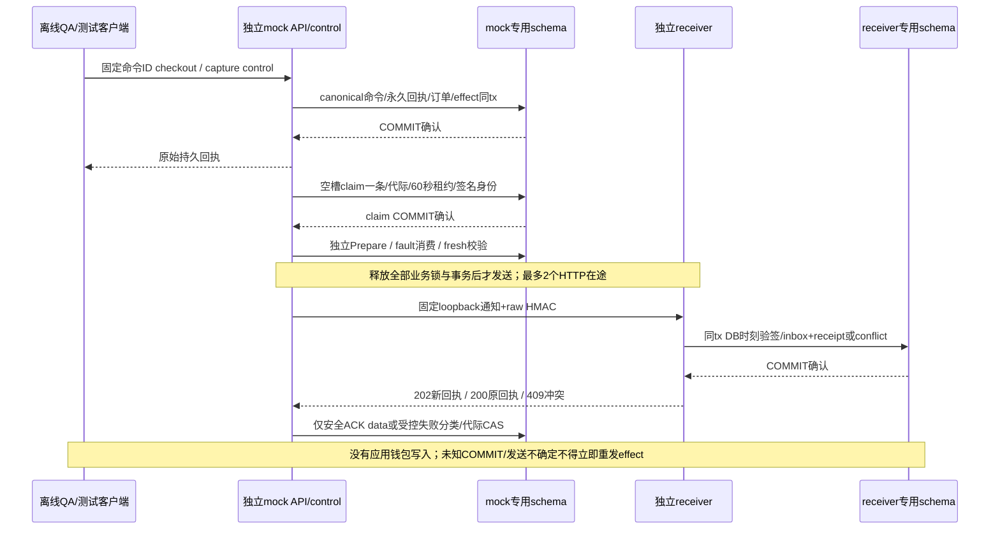

mock的16张自有表分为环境/版本/key、命令/processing/results、订单/transition/capture、永久query、control/fault以及notification/delivery/attempt/observation；receiver六表是环境/版本/key、inbox、receipt和conflict。canonical业务体及回执不可变；target session gate先于merchant/行锁，网络不持锁。过期租约与退避可恢复通知投递；每次实际claim消耗次数，第20代转review并保留迟到证据，禁止第21代。这些代码规则的真实长程与崩溃覆盖按[验证记录](../verification/payment-sandbox.md)分别标注，不将短PG或SQL checkpoint当作完整运行验收。

<!-- architecture:protocols -->
## 现行资金来源与钱包开账（027）

023正式迁移新增六张来源表及开账原件；[运行 helper](../../internal/billing/lot_runtime.go)在 `ApplyFundingTx`、`Reserve`、`finish`、`ApproveRefund` 原事务内维护来源。来源FIFO、结算沿原分配收费/释放、消费退款逆原收费边，不恢复Key/周期已消费额度。数据库对事件、余额、分配、journal、账户及租户复合FK建立约束；角色/函数在启动前只读验证，支付worker不获人工/券/开账读取权。[明细架构](wallet-sources.md)列出数据、锁序、API、权限与故障边界。

开账是停服后owner通过 `open-wallet` 向未使用空钱包显式导入非现金初始余额；同业务意图重读原件，不改造旧历史。`check-wallet-sources` 与平台核对为5秒RR只读观察，不修钱。023拒绝已有金融历史/非零余额；已有开发库保留，当前版本使用独立新库。此决策不增加旧余额导入、旧退款或双模型兼容路径。

来源回执/筛选与累计摘要统一覆盖四来源，新增必填`wallet_opening_amount`；来源余额三桶和原件累计分别展示，不将开账计为销售收入。通用查询DTO输出UTC并保留精度和分页instant，前端保持严格UTC解析。浏览器已核对来源分配、平台零差异及026经营报表/CSV；实际APP/worker/projector四来源与HTTP开账验收见[本片记录](../verification/wallet-sources.md)。

隔离研究只修正原001–022材料及历史helper的固定基线身份，不接受023或新增proof/profile，也未进入serve。旧descriptor继续对当前迁移/provision漂移拒绝；旧checkout镜像正例及其变异矩阵不再作为当前测试，其覆盖边界缩减与首轮失败保留在本片记录。

## 对外协议与产品能力

正式渠道目标已明确为OpenAI/Codex、Claude、DeepSeek、Gemini、GLM及硅基流动等第三方平台，逐渠道profile、采购费率和实际用量认证范围见[接入计划](../design/provider-qualification-plan.md)。当前协议实现不等于这些平台所有模型已获可售认证。

所有推理入口使用客户 API Key。Console session 不等价于客户推理授权；Playground 使用客户自己输入的 Key。有效模型权限是“平台启用与能力 profile ∩ 租户授权 ∩ 成员授权 ∩ Key 范围”，并叠加来源地址、地域、期限、预算和运行限额。

| 协议 | 入口 | 当前范围与计费 |
| --- | --- | --- |
| OpenAI Chat | `POST /v1/chat/completions` | 文本 JSON/SSE；基础客户端函数工具转发；输入/输出 token |
| OpenAI Responses | `POST /v1/responses` | 文本与基础函数工具；输入/输出 token |
| Anthropic Messages | `POST /v1/messages` | 文本与基础工具；输入/输出 token |
| OpenAI Embeddings | `POST /v1/embeddings` | 非流，受界限的批量输入；仅输入 token |
| Jina Rerank | `POST /v1/rerank` | token 计费的非流检索重排；仅输入 token |
| Gemini native | `POST /v1beta/models/{model}:generateContent` / `:streamGenerateContent` | 无状态纯文本 JSON/SSE；thinking 计入输出，cache 是输入子集 |
| 图片生成 MVP | `POST /v1/images/generations`、`GET /v1/images/generations/{id}` | 受限 inline PNG；当前走 media profile、wallet reservation/settlement、artifact persistence 和 mock adapter |

模型列表为 `GET /v1/models`。协议由显式发布的 profile 决定，模型上架不代表它的任何任意参数或端点都可以透传。当前不是全部 SDK/供应商认证：托管工具、多模态、Realtime、Gemini 工具和其他计费方式仍在后续范围。协议约束见[009 检索](../../specs/009-retrieval-protocols/spec.md)、[010 Gemini](../../specs/010-gemini-native/spec.md)及[provider 类型](../../internal/provider/types.go)。

<!-- architecture:request -->
## 一次请求怎样经过系统

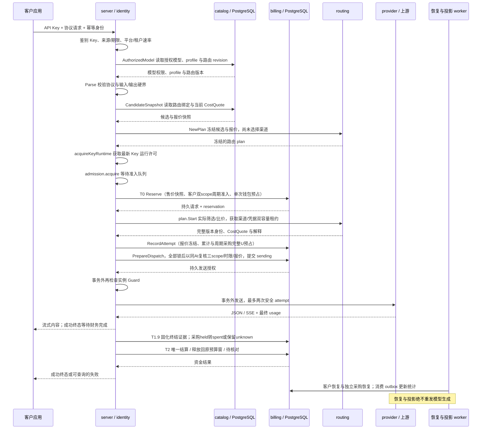

`Reserve`、`RecordAttempt` 和 `PrepareDispatch` 是数据库内的最新准入检查点；撤权、来源策略、Key 范围/期限、渠道启停与凭据撤销不能只依赖请求开始时的缓存。`PrepareDispatch` 提交 `sending` 是允许发送的边界，之后的限制不能追溯撤回已在途请求，也不能阻止其财务收尾。[短阶段调度](../../internal/server/admission_queue.go)和[派发读取批次](../verification/dispatch-read-batches.md)优化只减少往返，不省略这些锁和新快照。

默认 `manual/allow` 且没有采购单价上限的路由，按渠道优先级/权重与健康/容量选择渠道。018 增加可选采购比价与硬单价门禁，详细规则见下文。然后在渠道的不可变凭据池中按成员权重/容量选择凭据；增加池成员不会额外扩大渠道的业务权重。已选择的渠道版本、池 revision、凭据、精确上游模型与采购报价写入 attempt。最多两个生成 attempt；仅在已证明无消费且满足策略时换渠道，未知消费、已经输出或同渠道换 Key 都不能触发重放。

请求幂等和财务幂等各自持久化。提交结果未知时不得以“没收到响应”为由重试网络请求。客户取消、连接中断和 SSE 尾包丢失必须保留消费可能性，不能直接当成免费成功或零成本。

### 客户资金与上游成本

客户售价固定在请求的零售版本快照中，与最终选到哪个渠道无关。T0 在一个事务内冻结钱包与 Key 可用额度，写请求、reservation、平衡分录和恢复/outbox 依据；T2 只使用可信最终 usage，并以原始预占为上限结算、释放剩余。金额采用 CNY 微元整数，不用浮点数累计。

成本按每一次已准入 attempt 保存：`channel + upstream_model + effective_at` 命中的成本版本、输入/输出每百万 token 单价，以及 `contract/invoice/unknown` 依据。已知最终用量才能核算可能消费的请求；缺价格或缺用量必须保持 unknown，不能记为零。已明确 `not_sent` 或满足供应商无消费合同的 `rejected` 证据可以确认为零成本，不能与未知消费混淆。平台可以追加幂等成本修正，修正不会改变零售价格、客户钱包或原始事实。[成本接口](../../internal/server/reports.go)、[成本与证据逻辑](../../internal/billing/evidence.go)、[平台成本查询](../../internal/billing/query.go)。

仍可能消费但没有可信最终量的请求进入待核对。数据库时钟和行锁控制 24 小时硬截止：届时仍未结算则释放客户冻结；晚到证据只能补充平台成本，不能自动再扣客户。退款追加补偿分录，累计不超过原消费，不重置 Key 已消费数。[恢复](../../internal/billing/recovery.go)、[结算](../../internal/billing/settle.go)、[财务审批](../../internal/billing/orders.go)。

### 018 采购单价门禁与成本感知路由

018 后端与控制台已实现并通过限定本地验收，实际范围见[018 验证记录](../verification/cost-aware-routing.md)。不可变路由策略新增 `cost_mode=manual|cost_first` 与 `unknown_cost_policy=allow|deny`；完整路由发布仍受模型 revision CAS 保护，每个 binding 可设置输入/输出两维 `max_*_cost_rate`。上限 `null` 表示该维不限，`"0"` 要求该维已知免费；API 费率采用十进制字符串，内部为 CNY 微元/百万计费 token。`cost_first` 必须拒绝未知成本；manual/allow 无上限保留旧行为。启用成本管控后，缺报价、缺任一维或 basis unknown 均被拒绝，不会把未知按零参与比较。

选路先排除权限/地域/启停/撤销、已尝试、健康/容量和成本硬限制不合格的候选，再取最高 priority 层；`cost_first` 仅在该层比较 `S = input_upper_bound × input_rate + output_limit × output_rate`，使用 `big.Int` 不提前舍入。同价保留原渠道权重，再按成员权重选择凭据；跨渠道统一比价需配置相同 priority。S 是保守用量界对应的比较分数，不能当作实际账单、共享采购预算预占或实际最优成本。

候选读取冻结 `CostQuote`（版本、两维费率、basis）；`RecordAttempt` 在原准入锁后核对当前报价并冻结；`PrepareDispatch` 取得全部父记录/渠道/凭据/reservation/attempt 锁后，以新的数据库时钟重新选当前生效报价，再比较冻结版本/费率/basis 和上限，最后才提交 `sending`。报价变化以 `cost_quote_stale` 拒绝，不发送、不自动重报价/重规划，客户冻结按未发送证据收尾。`sending` 之后的调价不影响在途请求和原财务收尾，不在共用收尾锁 helper 增加成本门禁。

成本发布使用 `expected_channel_revision` 与渠道 UPDATE 屏障，版本和审计同事务；数据库 INSERT 触发器让直接 SQL 同样参与渠道管理 revision 和派发同步。新发布同渠道/精确上游模型/生效时刻的重复版本被拒绝，历史同刻多版本按 `effective_at DESC, created_at DESC, id DESC` 确定选择。未来调价即便没有后续写入，也会在 sending 前的新时钟校验中被发现。仅平台管理员可查看采购报价与完整候选解释；平台 probe 和目录发现继续沿自己的合同，不使用客户成本偏好。[018 规格](../../specs/018-cost-aware-routing/spec.md)、[013 迁移](../../migrations/013_cost_aware_routing.sql)、[报价同步检查](../../internal/billing/cost_policy.go)、[竞态验证源码](../../internal/billing/cost_policy_integration_test.go)。

这些门禁约束本库登记的采购单价，不能强制供应商外部的真实扣款；自动查价、汇率、缓存折扣、阶梯价及供应商真实余额同步仍需后续规格。019累计采购预算见下文；客户售价、钱包、最多两次安全尝试和不重放规则保持独立合同。

### 019 共享采购账户与双边资金

永久credential绑定使多个渠道、多个客户共用同一采购账户；没有绑定的成员逐个标记legacy_unmanaged。绑定后所有新attempt强制完整已知报价和候选→attempt→sending一致性，manual/allow或旧渠道版本不能绕过。账户累计预算为CNY微元，余额事实用NUMERIC、API用字符串；候选按实际请求硬界和账户快照初筛，真正保证由RecordAttempt的数据库账户锁与持久预占完成。

锁序为原tenant/身份/Key/model/channel/credential → 客户reservation → attempt → 采购account（FOR NO KEY UPDATE）→ 采购reservation。账户管理只锁account不回取前层，绑定从channel UPDATE开始。全部锁后重新采样数据库时间检查报价与截止；暂停或预算收紧阻新sending，已发证据和资金收尾继续。客户释放、退款与24小时截止均不释放采购未知占用。独立采购恢复可释放过期且未获许可的prepared；sending崩溃只能保留unknown，恢复没有生成网络调用能力。

可信usage把采购held转spent并释放差额；超硬界保存完整成本、暂停账户；证据冲突保留spent并恢复保守held，独立双人对账。语义证据指纹追加去重，提案同时冻结资金revision和证据数量，新冲突使旧待审失效；同义重复不重开已裁决结果。unknown/disputed异常即使账户被手工改active也不能新发；已确定成本异常仍需管理员显式决定恢复。采购成本更正不追加扣客户，减少spent需要供应商invoice证据，旧单人成本接口拒绝受控attempt。

账户配置、永久绑定和人工余额观察均有持久operation_id及applied/rejected回执。控制台未知写仅只读查询原ID；金额无损，身份/页面/关闭epoch隔离晚回。观察带来源、语义、时刻和known/unknown/unsupported/error，不参与预算准入。采购历史不可变、投影角色无采购读取权；deferred校验要求账户余额＝采购预占合计＝不可变事件合计。该校验会随账户历史增长增加查询开销，性能阶段须按保留不变量的增量合同优化。[冻结合同](../../specs/019-procurement-accounts/contract.md)、[HTTP](../../internal/server/procurement_handlers.go)、[控制台](../../web/src/views/ProcurementView.vue)、[采购竞态测试](../../internal/billing/procurement_integration_test.go)。

### 020 匿名模型目录与售价观察

访客通过独立公开布局 `/pricing` 访问 `GET /api/public/models` 及 `/:id`，页面在私有 loadMe/MFA 路径之前分流，匿名请求省略凭据。公开只读取 `public_visible AND enabled` 模型，旧/新模型默认私有；只返回逻辑模型名、六协议能力限制和当前客户售价的白名单DTO。原始profile、渠道/供应商地址或秘密、采购成本、租户与内部健康均不进入公开响应。私有、停用和不存在详情同404，异常公开profile或无界字段整次503，不伪造能力或以旧缓存兜底。

单次SQL使用一个数据库时钟（含空页），售价按 `effective_at DESC, created_at DESC, id DESC` 选择当前版本；既有001同模型/生效时刻唯一约束保留。公开、已登录当前价和Reserve采用同序，但公开观察不锁定调用价格或授予模型/Key权限。金额使用规范int64字符串和前端BigInt；缺价unavailable与零价区分，检索协议输出价固定0。固定50条、额外取1判断更多，按C排序和严格筛选绑定cursor分页；每批保留独立观察时刻。

匿名总桶20rps/burst40、每来源2rps/burst8、来源总数≤4096（含unknown）；metadata Guard前最多4在途，满额立即429，2秒context包含DB pool等待且许可仅归还一次。独立于登录/收费桶；原ready/Guard仍可返回instance_unavailable，恢复模式仅允许原本就ready且Guard有效的只读访问，不能重新置ready。无模型网络调用和资金写入。

仅admin可在原CSRF/再认证/MFA/恢复门禁下修改公开标记；完整CAS使用独立字符串public_revision，启停不覆盖公开列，停用保留预设，重启用恢复展示。冲突或结果不明先只读核查，显式新编辑才提交。迁移015和DB触发器使直接SQL也不能伪造revision。[冻结合同](../../specs/020-public-catalog/contracts.md)、[015迁移](../../migrations/015_public_catalog.sql)、[本地验证](../verification/public-catalog.md)。

## 自助身份与邮件链路（021）

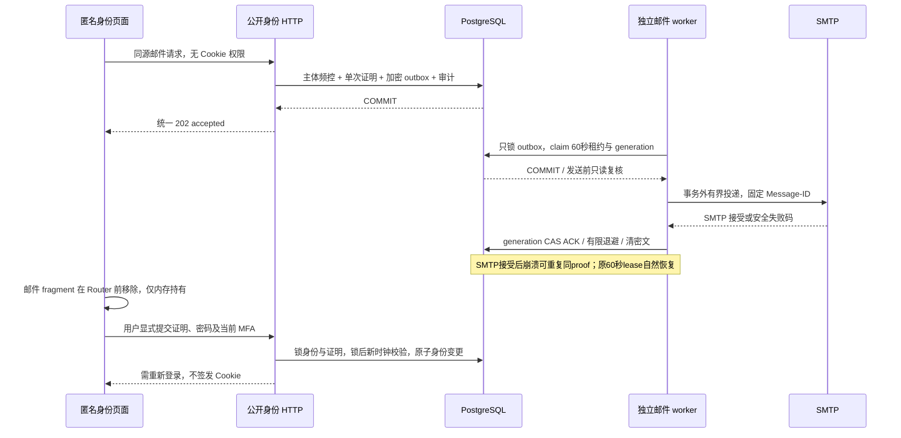

`GET /api/auth/capabilities`仅返回全站有效能力与原因。默认`AUTH_REGISTRATION_ENABLED=false`、`MAIL_TRANSPORT=disabled`；reset flag默认为true但无邮件不能使用。初始化标志和Bootstrap管理员同事务，旧库仅有admin时回填，公开注册不能抢先封死初始化。开户前只签发证明；完成后新user为none、新tenant owner的allow_all_models=false，零余额、无模型授权与API Key。

密码恢复锁序user→subject→challenge→当前MFA→全部session families按ID；最后锁等待后重读DB时钟/密码revision/TTL。正确因素消费、密码变更、证明消费、所有family撤销与审计同事务，普通改密也由DB增加revision。API Key独立；此前已完成session认证的普通在途业务写仍沿既有行为，不承诺全部撤回。

SMTP与资金恢复分开运行，最多2个空闲槽claim，5次有限重试；lease60秒、网络20秒、发送前至少25秒余量。仅锁outbox，提交后才网络IO；旧代际ACK无效。SMTP接受与ACK不原子，可重复同一邮件，proof仍只消费一次；sent不代表客户实际收件。终态/自然失效清秘密、7天保留后删元数据；第5次claim崩溃过租约转dead。功能关闭/恢复模式暂停投递但有效Guard下继续失效清理；Guard失败全部停止。正常退出取消邮件IO，已开始Guard检查独立最长1秒完成，避免正常取消误伤HTTP排空。

025-A1-M已验两个真实SIGKILL窗口：claim后/220前，以及最终250后、实际APP的FinishMail被物理行锁阻塞时。替代进程保留原60秒lease，自然generation2，分别1/2封同Message-ID和proof，sent清密文且proof未消费。SMTP全程上界小于9秒，FinishMail观察/kill/零连接小于4.5秒，限定证据与清理见[邮件进程记录](../verification/mail-lifecycle-025.md)。这不证明外部收件、容器、HA或灾备。

匿名POST使用严格4KiB DTO、同源、实例Guard、独立有界IP/主体限流及4个hash槽。前端四条匿名路由省略凭据；GET/刷新不消费证明，不自动POST，unknown后仅显式登录核查。fragment及history.state在createWebHistory之前清理，token/password/MFA不写storage；loadMe epoch同时隔离晚回状态与401事件。真实收件、域名信誉和生产反滥用保留外部门禁。[详细设计](../design/self-service-identity.md)、[016迁移](../../migrations/016_self_service_identity.sql)。

<!-- architecture:data -->
## 分组售价与请求快照（023-A）

价格组与tenant隔离、模型授权、Key scope及预算独立。tenant只能归属一个组，NULL为公共默认域；组价格是两维绝对价。管理服务使用不可变pricing_operations保存原safe_input/fingerprint/result，组修改与归属各自CAS；创建/发布首回201、重放200。原operation GET永远解码原snapshot，不根据当前资源拼回。当前active admin可写，三平台读角色每请求重查；客户只看自己当前域。

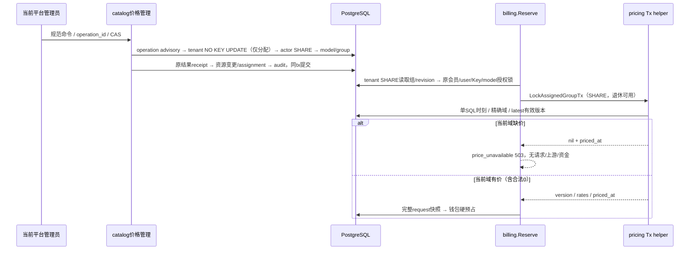

钱包等待前冻结组/revision/version/两费率/观察时刻，钱包锁后仅复查原Key与deadline。后续调组、组退休或晚发布不重写已接纳请求，也不阻止历史有利收尾。旧请求新增三列全NULL为legacy，不能补成“当时默认价”；新请求须完整，DB触发器与request列权限共同禁止改价。

匿名目录与旧平台默认价接口显式过滤NULL域；客户模型/报价和已生效历史在同SQL核对当前user/tenant/membership/模型授权后读取本域，不回落默认。平台缺价preview以目标tenant当前启用且已授权模型为范围，每页统一SQL时刻并返回完整context；可明确接受缺价分配，预览不保证未来调用可用。列表50+1、游标绑定当前actor/接口/target、末页空串；新读/写/preview/客户报价各有独立有界准入。额外模型报价不改变/v1/models结构。

数据关系为tenant→price_group、price_version→可选group、group/归属事件→immutable operation、request→原price与组快照。018只追加列/表/guard与唯一性，NULLS NOT DISTINCT保护默认域同生效时刻唯一；历史不更新，不产生资金。app仅组状态列、tenant业务及pricing列、request生命周期三列有UPDATE权；projector无新表读取权。023-A真实PG分包回归/并发故障、227项前端/strict、真实main浏览器和018预览升级通过[限定本地验收](../verification/tenant-pricing.md)；周期预算与商品不因A接通而完成。

023-A的assignment-first并发验收现用同一pg_locks采样中的精确tenant tuple与事务XID等待边，替代pg_stat_activity SQL文本推定；pgx批处理下两种观察可不同步。该场景关闭可选幂等键以避免先行FK KEY SHARE使tuple排队标记省略，仍实际核分组/价格/revision及钱包与禁止重试掩盖死锁。生产锁序、价格选择、身份/权限、迁移、超时和请求路径均无变化；模块/链路图不变。CI失败及修正范围见[CI屏障记录](../verification/pricing-lock-ci.md)。

## 周期预算核心（023-B）

020引入tenant、Key与procurement三种独立control，UTC自然日/月，首次cap从下一完整周期生效。客户按最终Reserve时刻记录完整R，两种客户scope共享同一次钱包预占；采购每个实际attempt按冻结报价完整预占U。control.total_held包含旧期与legacy未决占用，当期spent与全部held共同参与新准入；关cap仍持续记账。配置日历固定，退款不减少spent，自然换期不复制/重置allocation。

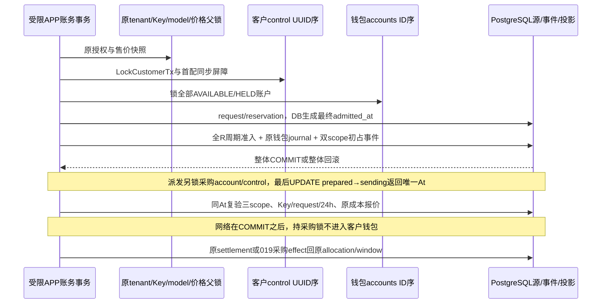

预算事件绑定真实reservation/唯一settlement/019采购event；数据库guard验证初占完整性、来源投影、创建事务与scope屏障，防止漏mirror或直接改汇总。采购allocation到attempt只有受保护的逻辑引用，避免account持锁后因FK回取attempt形成反环；窗口/control间为真实复合FK。Finish先完成必要model锁升级，再客户control→账户；采购证据/恢复/更正只取account→supplier control→采购source，不取客户control或钱包。

Reader与Commander已实现：当前DB授权、RR只读分页、规范签名cursor，配置CAS/原不可变operation、首配≤1000完整导入、未知COMMIT不重放。六表APP仅精确状态投影列可更新，projector无权读取；[角色检查](../../internal/operations/periodic_roles.go)在main启动listener前核验实际LOGIN和effective权限闭包。020核心已通过最终全Go真实PG race；020版本产品HTTP/UI、浏览器与最终相关回归及评审预览升级已通过，见[验证](../verification/periodic-budgets.md)。

[管理HTTP](../../internal/server/periodic_budget_handlers.go)已注册tenant/Key/采购三类GET/PUT、wallet只读、窗口与allocation分页及两域原operation核查；main在listener前初始化签名Reader和Commander。Cookie/session、CSRF、可选MFA、再认证、恢复与实例Guard保持既有准入；领域事务再次验证当前数据库权限。B独立[有界准入](../../internal/server/periodic_budget_admission.go)共享32总读、额外8核查，写8，actor分别4总读/1核查/1写；5/10秒工作deadline覆盖fresh Guard、pool/锁/语句及响应编码。strict五字段8KiB输入和128KiB整次响应不返回半页，任何未知驱动错误只映射安全503。

控制台按[HTTP/UI合同](../../specs/023-periodic-products/b-http-contract.md)从wallet/Key/tenant/采购入口进入独立预算页，完整区分当期spent/held与carry。IndexedDB以actor/身份域/目标为复合键，在单个readwrite事务complete后才发PUT；刷新恢复pending为unknown，只核查原operation，不能换ID重发。身份/目标epoch和实际AbortSignal阻止晚回覆盖；270项web与strict构建、原生IndexedDB跨tab原子互斥及隔离真实main浏览器已通过；020版本最终server/cmd真实PG race和预览升级通过，见[记录](../verification/periodic-budgets.md)。当前58123固定该020验收包，首页及52资源匹配，没有升级尚未配套的支付运营接线。

### 独立只读核验

`verify-periodic-budgets [--timeout 30s]`在服务配置、实例锁、worker及listener之前独立分支，仅使用明确的离线owner DATABASE_URL。实际连接必须为LOGIN、current_user=session_user且拥有六张预算表；完整当前嵌入迁移（含022）与来源权限同一RR READ ONLY快照核对。默认30秒、允许1秒至10分钟，总预算覆盖连接、扫描和只读COMMIT；不取业务行锁、不调用在线预算helper、不按当前权限/价格/时钟重判历史。

核验从客户/采购来源双向查漏，再核原effect、事件序列、allocation/window/control投影、配置/operation/audit。19项异常计数、10项扫描计数和3项缺证计数均以JSON十进制字符串返回。全部可证明且一致为balanced/退出0；发现损坏为mismatch/退出2；无损坏但旧终态成员、legacy采购effect边界或原动态快照缺见证为indeterminate/退出3；执行/权限/迁移/超时失败退出1且无部分报告。它不补账、不重发请求，也不把净SUM相等称作全历史完整。源码与SQL详见[冻结合同](../../specs/023-periodic-products/b-verifier-contract.md)。

### 支付资金第三来源（022-B2）

[021](../../migrations/021_payment_sandbox.sql)追加支付表及不可变/租约/身份/资金完整性约束，默认policy关闭、无marker与业务事实。旧A资金谓词原位替换并保留OID/owner/依赖；人工与券走静态旧分支，sandbox走独立分支，使worker无需读取A表。资金helper仅接受capture定位键，在实际RC worker事务重建order、identity、首选evidence、effect和代次关联，账户锁后再次核对；固定system actor、capture operation、order reference及SANDBOX_FUNDING_CLEARING。外层Processor的审计/终态CAS未完整时不能提交；已有完整receipt只返回原回执。

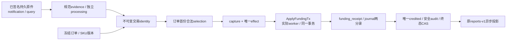

图表示SQL/helper与B3 Processor共同实施的完整关系；APP接收、唯一资金处理与网络Runner已接线，真实main/最终浏览器整链已通过[限定本地验收](../verification/payment-application.md)，在途SIGTERM/真实Guard失权独立真实进程补验通过。VerifyFunding扩至十计数，VerifyLedger/Rebuild复用完整来源核验；摘要严格六字段，三来源SUM使用NUMERIC，前端同步严格解析和独立“本地模拟入账”标签/筛选，不当作现金收入。来源lot、原路退款和拒付仍待022-C。

APP和projector由普通ProvisionFor收紧B表/列ACL，worker显式owner provision。43份函数以审定021静态摘要/签名/属性/path核验，worker明示31 EXECUTE；继承、SET/ADMIN闭包、PUBLIC、grant option、SECURITY DEFINER和全schema表/视图越权均拒绝。projector对B表/本族函数零权，其runtime仅查pg_catalog权限；环境归属由owner离线三角色核验及APP私密启动证明负责。APP/worker不能借owner SET ROLE冒充真实LOGIN。普通main现于listener前装配运行证明；普通off且无B历史不注册通知或创建支付worker，带完整证明的sandbox或历史off构造独立worker。

[022](../../migrations/022_payment_runtime_attestation.sql)新增默认空的运行证明表；没有自动nonce、key或endpoint回填。它把原环境marker与typed DB/schema/owner/三运行角色OID、两个nonce摘要及canonical proof摘要关联，复用不可变历史触发器。APP/worker仅SELECT，projector零权，支付权限清单现为23表；021的43份静态函数与worker31 EXECUTE保持。role核验在普通public schema遇到内建pg_database_owner时，以当前database.datdba核实际迁移对象所有者；其他schema仍精确核nspowner，不接受任意owner或放宽在线身份。

### 应用订单、支付执行与通知（022-B3）

`internal/payments`现拥有完整Service/Processor/Runner及APP/worker专用运行证明。配置`PAYMENTS_MODE=off`为默认；live在连接前拒绝。普通off没有marker、证明或B业务事实时，只做当前迁移、权限和历史空性核验，不读秘密、不创建支付连接池或出站，也不注册通知。sandbox及带历史证明的off必须提供同环境的两个私密manifest；APP、projection和worker三条DSN都在首次连接前受literal-loopback白名单约束。实际listener必须匹配不可变callback origin。完整双nonce/keyset/OID、角色闭包、M/Q负权限与022 canonical proof在ready前核验；不允许按mode=off丢弃历史。

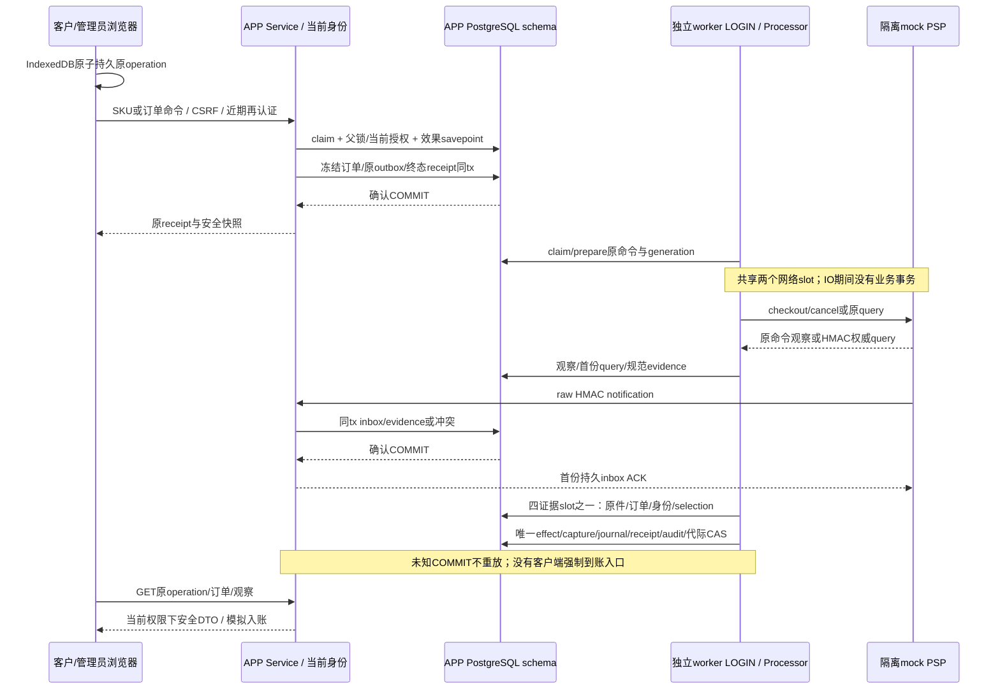

命令的父锁、当前授权和语义决策先于效果savepoint，rejected也持有父锁至提交。Create已提交后若安全订单读取失败返回结果未知，浏览器保留原ID。平台观察按logical order UUID读取，未知订单的review也可查；租户页面仍只读取自己当前授权范围。HTTP写和匿名通知各有独立10rps/burst20及4在途；人类另有actor+scope 1rps/burst2。5秒期限覆盖读取body，严格JSON、128KiB响应和8KiB ACK，UTC6和金额字符串保持一致。

Processor的opaque lease/work/response绑定实例、原ID、generation、canonical请求与摘要。mutation最多10次、query/evidence最多20次；网络2共享slot、证据4slot和独立有界lease回收不预取。Recovery仅安全读、durable通知和权威query；不发送mutation或应用资金。正常取消不永久fence；真实Guard丢失停止ready与所有支付执行。SIGTERM并行停止新HTTP及Runner，join全部IO/事务后关闭worker pool，最后释放Instance。

控制台`/payments`与`/platform/payments`使用独立IndexedDB journal，事务complete后才发送；reload/离线/失真/GET404均保留原操作。每身份域128项、epoch/AbortSignal与跨tab原子互斥，最多五次只读核查，不重试写。policy CAS未知结果须读取当前版本并显式开始新意图。页面持续标注本地模拟，没有真实付款URL或模拟到账按钮。当前专项与集成证据见[应用支付验证](../verification/payment-application.md)，来源lot/原路退款/拒付、正式PSP和最终生产验收继续独立门禁。

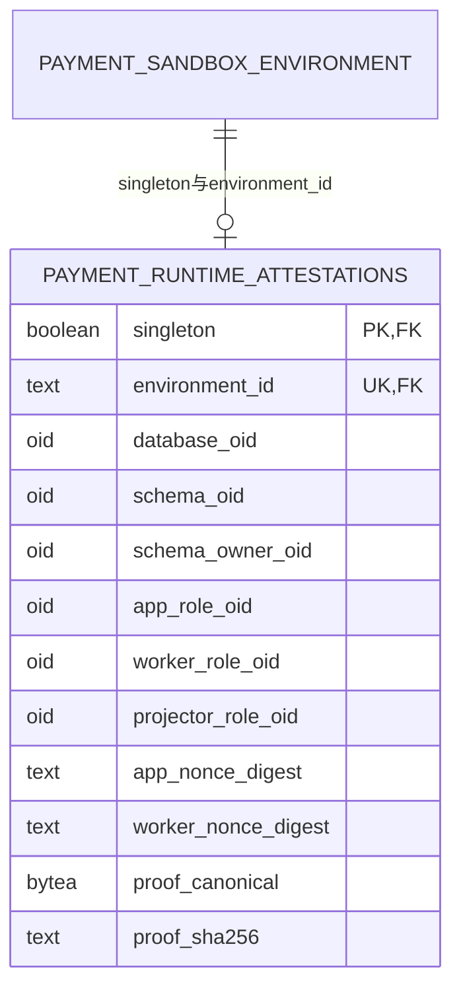

[B3运行合同](../../specs/022-self-service-payments/b3-runtime-contract.md#10-根冻结与精确追加ddl2026-11-01)与[Processor执行合同](../../specs/022-self-service-payments/b-processor-contract.md)已由根冻结：同serve进程的独立真实worker LOGIN/连接池、两网络槽/四证据槽、Guard与正常取消区分、Recovery仅query、原QueryWork绑定、mutation到期order-first锁序。真实PG库级专项、两轮普通main/mock及最终浏览器已通过[限定本地验收](../verification/payment-application.md)；完整唯一资金、原command的HTTP丢回包恢复、Recovery/off、IDB重载和资源清理均有分层证据，真实Guard/在途SIGTERM独立真实进程补验通过，数据库COMMIT回包丢失仍SKIP。C0全资金路径/历史cutover与[全钱包操作序列](../../specs/022-self-service-payments/c0-sequence-contract.md)保持生产候选；已冻结并实现的在线算法仅纯分配层，不写DB、不授资金能力；迁移history窄核验和仅测试候选回归另见下文，见[验证](../verification/funding-lot-planners.md)。原路退款/拒付继续依赖C0整体通过。


### 私有维护授权（022-C0-T2）

[真实授权合同](../../specs/022-self-service-payments/c0-authority-contract.md)冻结并实现唯一二参`Attest(ctx, snapshot)`与`Permit.Verify(ctx)`，只消费原Snapshot内部owned installation。完整固定链为history scalar guard与原helper、编译manifest、实际维护LOGIN/有效owner、两条独立SQL clear→新鲜全runtime采样、16表重空、完整ordinary/v1前驱、仅Init全部账户C序锁、出口复核。全程保留原busy/绝对期限与rawTx，失败/取消/终结开始撤销所有副本并关原socket；没有裸Tx/Conn/context或SQL回调。前驱完整列与安全投影、有限typed时间、262行/1MiB及累计5秒；账户ID按原无限长TEXT语义流式长度前缀摘要。实现见[细化架构](maintenance-gate.md)，T2[专库PG/race](../verification/maintenance-authority.md)333.879秒、89顶层/832父子终态全部PASS；它只覆盖T2版本与范围，T3及整仓回归分别记录。

源码入口：[一次发行与Verify](../../internal/maintenancetrust/permit.go)、[真实身份与新鲜停服](../../internal/maintenancetrust/authority_identity.go)、[manifest与完整history](../../internal/maintenancetrust/authority_manifest.go)、[完整accounts锁](../../internal/maintenancetrust/authority_accounts.go)、[前驱编排](../../internal/maintenancetrust/predecessor.go)、[v1规范编码](../../internal/maintenancetrust/predecessor_codec.go)、[typed rows与资源记账](../../internal/maintenancetrust/predecessor_rows.go)、[服务端有界投影](../../internal/maintenancetrust/predecessor_sql.go)。

### 受控读取租约与局部核验结果（022-C0-T3）

[冻结合同](../../specs/022-self-service-payments/c0-read-lease-contract.md)对应的`Permit.BeginScan(ctx, kind)`现已实现。它保留原Snapshot/rawTx，从BeginScan到Finish/Abort持续持原Gate busy；SQL、遍历和CPU间隙共用一次最多30秒，并取原Snapshot/caller更早期限。每个Permit的同kind只尝试一次，入口与正常出口均完整重核T2 evidence及新鲜runtime停服采样；期间Permit.Verify、另一个scan及Commit/Rollback/Close立即busy，不并发SQL。失败或取消撤销整个Snapshot与全部既有proof，原socket由watcher关闭；正在使用pgx的方法返回后才释放其operation/busy，不另goroutine drain。

[封闭codec](../../internal/maintenancetrust/lease_codec.go)仅接受审阅过的exact内建参数与Scan目标，内部simple protocol，先复制slice及可借用数据；拒绝pgx控制参数、QueryRewriter、Scanner/Valuer/RowScanner、自定义类型和`*any`等出口。参数最多1024项及累计16MiB逻辑bytes，`[]string`逐项含长度框架；Scan经过本地typed临时值再owned复制，不把原Rows交给caller。只开放Deadline/Done/Err取消视图，不导出Context/Conn/Tx/Exec/回调。SQL文本面向同进程受审的固定SELECT reader，未作为任意SQL安全沙箱开放到HTTP或插件。

[Rows生命周期](../../internal/maintenancetrust/lease_rows.go)要求每次Next true恰好Scan一次，真实EOF后同时观察Err和显式Close；跳行、重复Scan、提前Close、未消费Row或悬挂Rows使Finish失败并物理撤销。QueryRow.Scan核恰好一行、EOF、Err及Close。没有pending对象且出口重核成功才返回私有共态`ScanProof`。proof只绑定原Permit/Snapshot/lease nonce与固定kind的正常完成；原Snapshot终结、失败或到期即全部复制proof失效，零值、JSON或同摘要不能重绑。纯Verify可以在另一lease持busy时做绑定核验，不发SQL。

ledger与PB维护入口是[`maintenancescan.VerifyLedgerMaintenance`](../../internal/maintenancescan/ledger.go)与[`VerifyMaintenance`](../../internal/maintenancescan/periodic_budget.go)，只接受真实`*ReadLease`，在包内构造私有adapter并依次Require→固定领域算法→Finish。账本入口通过[billing.ReadLedgerFacts](../../internal/billing/funding_ledger_facts.go)调用[共享core](../../internal/billing/funding_ledger_query.go)的三表分页与独立大整数核算；PB入口调用[ReadBoundedVerificationRows与guard](../../internal/periodicbudget/verifier_maintenance.go)，先累计19关系全部声明字段、全量audit与history，最多100000行、单字段cast text后的UTF8 bytes最多65536、累计16MiB，再执行原业务SQL/列与操作receipt核验，超界整个零结果。schema仅来自租约内固定SELECT，不由维护调用方指定。私有`MaintenanceLedgerResult`/`MaintenanceResult`只在正常Finish后保存本次事实与真实ScanProof，Summary分别为`supplied_ledger_rows`和`periodic_budget_rows`；Verify/Summary继续绑定原Permit和固定kind。

第三个[`maintenancescan.VerifyFundingSourceLinksMaintenance`](../../internal/maintenancescan/funding_sources.go)在同一个ScanFunding lease内组合billing固定[来源reader](../../internal/billing/funding_source_read.go)与[纯关联core](../../internal/fundinglotverify/funding_sources.go)，全量读取`credit_orders`、`voucher_redemptions`、`funding_receipts`并只双向核对人工核款和兑换券source↔receipt关系。sandbox capture收据过去在这里仅计为未覆盖；新增第四个`ScanSandboxSources` reader使用单独的固定合同和扫描kind，不升级`ScanFunding`的既有结果。

新增[`VerifyFundingFinancialMaintenance`](../../internal/maintenancescan/funding_financial.go)仍消费同一个`ScanFunding` kind，与旧三表入口在每个Permit中二选一。它调用[billing私有同session reader](../../internal/billing/funding_financial_read.go)，在原lease里一次完整读取21表：用户/租户、三张账本、人工单据/receipt、批次/券/兑换/撤销、commerce命令与终态、audit/outbox、Key/请求/预占/结算/消费退款。固定128行C序分页，21表累计100000实际行与16MiB原始投影文本，沿原最多30秒期限；完整EOF、Err、Close及ctx复核后登记私有表完成记录。ledger raw沿[唯一三表算法](../../internal/billing/funding_ledger_query.go)读取，不复制其SQL/预算规则；共享用户、租户、账户、journal与line仅读一次，多core不重复计源预算。返回facts只保留owned图及四个安全摘要，无原始值或完成位出口。

四个摘要分别是原ledger、原source links、[`manual_voucher_funding_graph_v1`](../../internal/fundinglotverify/funding_source_graph.go)和[`customer_key_financial_graph_v1`](../../internal/fundinglotverify/customer_key_graph.go)。新来源core核双审券状态/commerce终态、资格时点、精确两行入账及唯一audit/outbox；六种券kind与四种payment kind精确分派，后者只核通用身份/FK而不冒充支付图已验。Key core独立重算R、状态关系、原始消费C、held/spent和approved退款累计；退款不减spent，允许多笔pending退款暂时超过可退款额。零预占/零收费仍需真实零分录。组合保留旧ledger元数据与SourceLinks数字资格，执行错误整体零facts；普通mismatch不跳过其它core。维护wrapper校验四scope、闭合五类错误、唯一Finish后才绑定原Permit，Snapshot终结即撤销。[合同](../../specs/022-self-service-payments/c0-financial-read-session-contract.md)与[验证范围](../verification/funding-financial-graph.md)细化资源、历史缺证和失败边界。

[`maintenancescan.VerifySandboxCaptureReceiptLinksMaintenance`](../../internal/maintenancescan/sandbox_capture_links.go)消费真实`ScanSandboxSources` lease，通过billing的固定 reader完整读取`funding_receipts`与`payment_captures`两表，再由[`CheckSandboxCaptureReceiptLinks`](../../internal/fundinglotverify/sandbox_capture_links.go)按精确TEXT ID双向检查收据和capture的租户、钱包入账金额与币种。没有过滤/join/helper谓词；两表共用每ReadLease 100000行、16MiB逻辑字符串与最多30秒期限，失败返回零facts。结果scope为`sandbox_capture_receipt_reference_v1`，逐capture报告`UnvalidatedCaptureGraphs`和`UnvalidatedLedgerEffects`。它不检查订单、身份、evidence、processing/review/effect链，也不读journal/ledger/outbox/audit或验证PSP真实性；直接链接一致不表示完整SandboxFacts或任何资金效果正确。reader只属于库级维护集成，没有普通main、HTTP、支付worker、线上writer、basis或epoch装配。[窄合同](../../specs/022-self-service-payments/c0-sandbox-capture-link-contract.md)与[本片验证状态](../verification/sandbox-capture-links.md)独立记录；目前真实PG Plan/Init及整仓专库验收待执行。

第五个[`maintenancescan.VerifyProcurementMaintenance`](../../internal/maintenancescan/procurement.go)消费唯一ScanProcurement lease，通过[billing固定reader](../../internal/billing/procurement_attempt_read.go)及[历史扩展reader](../../internal/billing/procurement_command_read.go)完整读取十九表：channels、credentials、versions、credential pool、tenants、requests、cost versions、采购账户、永久绑定、upstream attempts、采购 reservations、budget events、users ID、cost corrections、cost proposals、procurement commands、balance observations、audit events与projection outbox。每表128行C序keyset至EOF，pool用独立复合tuple游标；十九表共用100000行、16MiB投影文本预算和原lease期限，audit只扫一次。

同批原始事实产生五个scope独立摘要：预算投影、attempt绑定/报价、成本双审、命令/余额观察、成本审计/消息。新增[`CheckProcurementCommandGraph`](../../internal/fundinglotverify/procurement_command.go)严格解析闭合before/after JSON，双向核applied命令与不可变binding/observation、精确command审计；历史账户只核快照内部变化和revision，不与当前配置反推比较。新增[`CheckProcurementCostJournalGraph`](../../internal/fundinglotverify/procurement_cost_journal.go)核proposal的proposed/approved审计、legacy correction审计及每个correction的唯一cost_corrected消息；managed按reservation存在性分类，Money必须为规范字符串，无关action/kind不按采购JSON解释。

数据矛盾正常Finish并返回局部mismatch；SQL、EOF/Err/Close、资源、取消或timeout错误返回零结果并撤销lease。五项summary绑定同一个原Permit/ScanProof，只Require与Finish各一次，不组合Procurement coverage。evidence/metering、完整事件重放、PB/客户资金交叉图和供应商消费/发票真实性仍未证明；旧证据冲突不能从最终行猜回原始输入，见[evidence研究](../research/procurement-evidence-lifecycle.md)。本reader仍仅为库级维护能力，无迁移、在线权限或生产装配变化。合同为[历史读取](../../specs/022-self-service-payments/c0-procurement-history-read-contract.md)、[命令/观察](../../specs/022-self-service-payments/c0-procurement-command-contract.md)及[成本审计/消息](../../specs/022-self-service-payments/c0-procurement-cost-journal-contract.md)，本地测试及未执行真实Plan/Init的边界见[状态记录](../verification/procurement-budget-maintenance.md)。

领域raw-facts接口不接受或发行authority；维护入口不接受外部provider或预计算通过位，假的query只能生成无权威局部描述，不能铸造维护结果。原三类历史缺证继续indeterminate，原public Verifier的独立LOGIN/owner/history/RRRO/SET/Commit规则未放宽。资源profile限制客户端返回与保留的逻辑输入，不证明PG排序/CTE/array_agg内存或Go RSS界。

旧五类扫描的局部结果与ScanProof不授全来源CoverageComplete、资金写入或生产运行权，不能拼成init/basis/epoch就绪条件。第六类[68表组合](../../specs/022-self-service-payments/c0-complete-source-reader-contract.md)现已从同raw读取采购evidence/事件、PB与支付来源并运行七算法；旧sandbox两表和采购十九表入口的局部scope保持。lot全序纯重放与第七kind的84表同session读取已实现；protected pre/post、basis、epoch、封闭writer和生产维护CLI尚未完成。历史ReadLease及局部验证保留[T3记录](../verification/maintenance-read-lease.md)的版本范围，新组合另见[本轮记录](../verification/complete-source-reader.md)。

### 资金来源、退款与后续经营设计

[C0生产候选](../../specs/022-self-service-payments/c0-production-schema.sql)以lot三桶和tenant全钱包连续序列连接全部来源、Reserve、finish及消费退款；[列权限](../../specs/022-self-service-payments/c0-production-permissions.sql)和[维护/proof v2](../../specs/022-self-service-payments/c0-maintenance-contract.md)尚在审查，不是生产迁移。旧tenant含零可用opening、新tenant的受保护出生事务、非genesis operation与完整新journal同top-xid及逐settlement退款累计已补入候选SQL。APP tenant INSERT收敛为原八列，UPDATE保留原六列，不授UPDATE(id,created_at)；worker原锁权限保留。五项版本化真实PG/race回归全部实际运行通过，见[候选验证](../verification/funding-lot-candidate.md)、[冻结测试范围](../../specs/022-self-service-payments/c0-candidate-regression-contract.md)及[仅测试源码](../../internal/qa/c0candidate)。测试通过不发行维护许可、不启动main、不分配生产迁移号。[独立重放候选](../../specs/022-self-service-payments/c0-verifier-contract.md)中的纯lot域已按[V0-WL](../../specs/022-self-service-payments/c0-wallet-lots-rows-contract.md)实现，完整受控组合仍未实现；不能只靠正常业务代码或总额守恒证明来源。纯分配算法通过不代表这些接线已经完成。

已实现的窄依赖是[caller-owned RR清单核验](../../migrations/verify_snapshot.go)：在原只读或读写RR事务核对完整latest history，固定安全错误，不Begin/Commit或写库；原VerifyReadOnlyTx仍只接受RR READ ONLY。它不授予维护权限、不核函数/trigger/ACL、不发行epoch，见[冻结合同](../../specs/022-self-service-payments/c0-snapshot-contract.md)与[验证](../verification/migration-snapshot.md)。

[C1原路退款候选](../../specs/022-self-service-payments/c1-refund-contract.md)及[独立v2协议候选](../../specs/022-self-service-payments/c1-protocol-v2-contract.md)将消费退款与支付返还分域，以原lot的Q/F桶、双审和新版本外部事实串联。调度预算耗尽保留held及Q，后到完整终态仍可收尾；最终no_effect必须阻止原命令晚生效。拒付、债务及退款交叉仍须独立合同/SQL/实际验收；当前未注册原路退款或拒付入口。[C2拒付/债务候选](../../specs/022-self-service-payments/c2-dispute-contract.md)固定风险先提交、原lot回收与独立债务、显式原来源偿付及精确反转；[C3交叉/恢复候选](../../specs/022-self-service-payments/c3-cross-recovery-contract.md)继续要求完整原交易最终事实和离库恢复证据，尚未实现。[023-C商品候选](../../specs/023-periodic-products/c-contract.md)另用非现金权益及本金价值条带；[C-V纯算法合同](../../specs/023-periodic-products/c-value-contract.md)与`internal/productvalue`仅处理精确分摊和UTC锚点月，不接DB、购买或资金发放，不把公开模型目录当作订阅。

[024-B0-P](../../specs/024-extension-platform/b0-pure-contract.md)只实现完整已知向量、精确有理计价与摘要，生产价格/预占/媒体证据尚未接线。[025共享执行候选](../../specs/025-production-ha/b0-shared-execution-contract.md)已明确保守活性代价：已授权sending/running不能因TTL过期自动回收；本地join不证明供应商后台计算停止。当前仍为单活，生产DDL、权限、配置桥接及真实双进程验证待冻结与执行。[身份邮件真实进程切片](../../specs/025-production-ha/a1-mail-process-contract.md)已通过两个本地SIGKILL/原租约恢复窗口，见[限定证据](../verification/mail-lifecycle-025.md)；无生产hook。上述候选均不意味着商业收款、媒体或多活已验收。

## 共同入账（022-A0）

A0已实现并通过专项，人工ApproveCredit持原业务根和双财务身份锁，进入共同ApplyFundingTx。helper只接可信source身份和内部scope，持全部账户ID序锁、锁后DB时刻，唯一写入账journal、不可变funding_receipt及一个credited；不自开/提交事务、不回锁父根。manual对手科目FUNDING_CLEARING，voucher source使用独立OPERATING_GRANT_CLEARING，赠额不是现金收入。外层同tx写原审批audit；钱包total_credited按全部receipt累计，六字段兼容。

017严格验证旧approved credit/source/journal/两分录/credited，坏历史拒绝升级；正常历史只回填receipt，不新发钱/事件。提交guard双向验证来源/回执/精确科目及命令/批次/作废决定关系，任意其他journal kind不能绕用清算科目。VerifyFunding/VerifyLedger/Rebuild逐笔核验，保留reports-v1，projector无新增source/券/command读权。A1服务/HTTP/UI已完成限定本地验收；B0-P纯协议已实现并通过race/vet/fuzz；M精确SQL已有[隔离原型稿](../../specs/022-self-service-payments/b-mock-sql-contract.md)，M/Q已冻结实施且真实进程短程通过，旧版本20代长程完成、最新补丁/精确故障另验；B1核心设计/SQL已冻结并通过隔离LOGIN原型，B2第三来源已实施，B3运行证明、领域/worker/HTTP/UI/main已接通，真实主进程/浏览器整链通过限定本地验收，生命周期补验已通过，C继续独立推进。详见[A0合同](../../specs/022-self-service-payments/a-contract.md#12-a0-账务接口与追加-ddl)及[阶段证据](../verification/funding-vouchers.md)。

### 双审运营赠额券（022-A1）

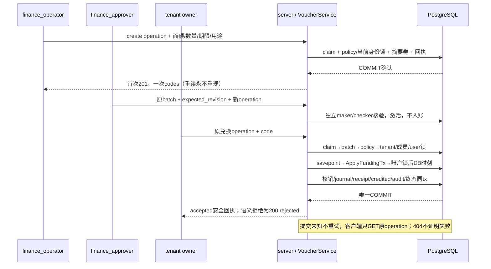

`VOUCHERS_ENABLED=false`是默认部署硬上限，DB policy也默认off。硬off挡create/redeem全部POST重放，旧GET不要求HMAC key，已有审批/作废/撤销仍可收尾；Recovery拒全部写。启动时开启硬上限必须严格校验独立HMAC keyring与全部历史引用，失败不监听。code与command用途分域，数据库只存摘要，不可恢复券码。

领域命令READ COMMITTED，业务根/当前授权父锁后savepoint，基础设施错误全回滚；stale撤销仅额外保留不可变rejected decision。严格白名单错误无SQL或秘密；查询REPEATABLE READ按当前平台/tenant角色复验，固定50+1与绑定scope/filter的cursor，时间UTC六微秒、金额字符串。HTTP独立4096桶/20rps全局/最多4在途，5秒预算含pool、锁、已证明回滚最多2次重试和COMMIT；取消回滚失败由pgx销毁连接，许可唯一归还。

平台控制台[批次页](../../web/src/views/VouchersView.vue)、[写入器](../../web/src/components/CommerceWriter.vue)与[安全journal](../../web/src/commerce-state.ts)实现一次展示/迟到丢弃、双审、作废/撤销和只读原回执。钱包[来源面板](../../web/src/components/FundingPanel.vue)显示累计人工/赠额与同步DB时刻。浏览器sessionStorage仅保存五项操作元数据，不保存券、正文、响应或摘要；身份epoch失效丢弃晚回，unknown与GET404不会解锁重发。赠额不是现金收入，不赋予原路退款资格。

## 站内经营告警（024-A）

当前生产源码、有效权限、真实PG/HTTP/浏览器/主进程故障、全量race/vet与019预览均通过，架构只读检查和make check通过，见[验证记录](../verification/operations-alerts.md)。`/platform/alerts` 使用平台会话；admin管理规则，admin/finance_operator/finance_approver读取和确认。HTTP预检查之外，每次读在独立只读RR事务中复查当前角色，写在actor SHARE锁等待后复查；CSRF、MFA、近期再认证、恢复和实例门禁继续有效。客户与推理Key不获得采购或平台告警读权。

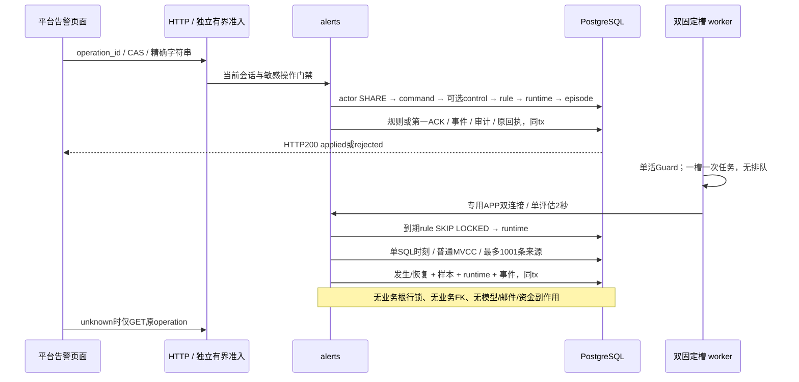

四种来源为持久渠道quarantined、登记采购预算`limit-spent-held`、客户pending_reconciliation及采购unknown/disputed的预占创建年龄。预算可负且保留100位累计金额；两类积压最多1001条，达到上限显示“至少”，不推算金额。两个来源部分索引按scope/created_at/C排序ID限制扫描；来源缺失或失败保留原发生记录，不能冒充恢复。

每规则至多一个未结束episode。第一ACK只记actor/time，不改变来源；条件恢复、配置实际改变、禁用和退役分别保留结束原因。配置版本、episode协作版本和内部runtime写版本独立；晚回失败须同时匹配配置及runtime版本，不能覆盖较新的成功。事件完整链、当前指针、原命令回执和状态由即时及deferred约束双向核验；退休历史不占64启用/256未退休规则名额。

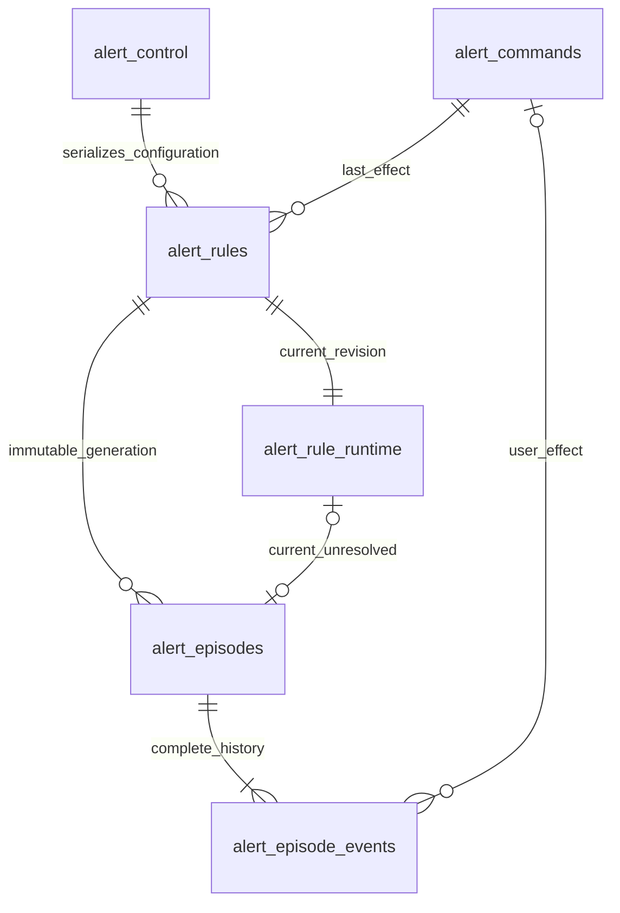

以上关系仅在告警内部。scope_type/id为逻辑来源引用，不通过FK回锁商业表。app无DELETE、历史event不可修改，终态command不可修改；projector无新表权限。HTTP使用独立有界桶和读32/写8全局在途上限，每actor读4/写2；查询2秒、写3秒、50+1分页、显式null末页及256KiB响应上限，金额/revision/计数为字符串，时刻固定UTC六位微秒。

[角色核验](../../internal/operations/alert_roles.go)检查六张告警表及其schema的有效权限，涵盖PUBLIC/继承/列授权、GRANT OPTION、所有权、高权属性及递归SET/ADMIN可提升路径。`ProvisionFor`在同一事务完成授权与矩阵核验，外部group越权导致整次回滚；serve在任何worker/HTTP前用APP和PROJECTOR真实连接只读复验，开关关闭也执行。owner登录后SET ROLE不能作为受限连接。该检查不代替全库对象审计，也不宣称持续阻止离线owner在启动后改ACL。

`OPERATIONS_ALERTS_ENABLED=false`仅暂停评估，规则管理、读取和旧记录确认仍可用；恢复模式只读。启用时main创建专用双连接pool，worker和邮件/财务恢复生命周期分开，退出先取消并join槽再关闭pool。正常60秒评估、记录失败30秒后再观察；超过180秒或时钟回退显示stale，paused/never_evaluated与最后错误分别可见。告警不承担供应商余额认证、自动资金裁决、外发通知或HA。

## 持久化关系与不变量

```mermaid
erDiagram
    tenants ||--o{ memberships : contains
    users ||--o{ memberships : joins
    users ||--o{ session_families : authenticates
    users ||--o| identity_initialization : bootstraps
    identity_mail_subjects ||--o{ identity_challenges : serializes
    users |o--o{ identity_challenges : resets
    identity_challenges ||--o| identity_mail_outbox : delivers
    memberships ||--o{ api_keys : owns
    models ||--o{ model_capability_versions : freezes
    models ||--o{ price_versions : sells
    price_groups |o--o{ tenants : assigns
    price_groups |o--o{ price_versions : domains
    tenants ||--o{ tenant_pricing_assignments : records
    pricing_operations ||--o| tenant_pricing_assignments : proves
    pricing_operations |o--o{ price_versions : publishes
    price_groups |o--o{ request_records : freezes
    models ||--o{ route_policy_versions : routes
    channels ||--o{ channel_versions : publishes
    channel_versions ||--o{ channel_version_credentials : freezes
    channel_credentials ||--o{ channel_version_credentials : participates
    channel_versions ||--o{ model_bindings : binds
    route_policy_versions ||--o{ model_bindings : groups
    channels ||--o{ cost_versions : costs
    api_keys ||--o{ request_records : authorizes
    request_records ||--|| reservations : reserves
    request_records ||--o{ upstream_attempts : attempts
    request_records ||--o{ metering_events : measures
    upstream_attempts |o--o{ metering_events : identifies
    metering_events ||--o{ finalization_records : evidences
    upstream_attempts ||--o{ provider_cost_corrections : corrects
    channel_credentials ||--o| credential_procurement_bindings : permanently_binds
    procurement_accounts ||--o{ credential_procurement_bindings : shares
    upstream_attempts ||--o| procurement_reservations : procurement_hold
    credential_procurement_bindings ||--o{ procurement_reservations : freezes
    procurement_accounts ||--o{ procurement_reservations : aggregates
    procurement_reservations ||--o{ procurement_budget_events : changes
    procurement_reservations ||--o{ procurement_evidence_identities : deduplicates
    procurement_reservations ||--o{ procurement_cost_proposals : adjudicates
    procurement_accounts ||--o{ procurement_balance_observations : observes
    cost_versions |o--o{ upstream_attempts : freezes
    price_versions ||--o{ request_records : freezes
    request_records ||--o| settlements : settles
    tenants |o--o{ periodic_budget_controls : tenant_scope
    api_keys |o--o{ periodic_budget_controls : key_scope
    procurement_accounts |o--o{ periodic_budget_controls : supplier_scope
    periodic_budget_controls ||--o{ periodic_budget_windows : observes
    periodic_budget_controls ||--o{ periodic_budget_allocations : tracks
    periodic_budget_windows |o--o{ periodic_budget_allocations : original_window
    periodic_budget_allocations ||--o{ periodic_budget_events : applies
    periodic_budget_controls ||--o{ periodic_budget_events : serializes
    periodic_budget_controls ||--o{ periodic_budget_configuration_versions : versions
    periodic_budget_operations ||--o| periodic_budget_configuration_versions : proves
    journals ||--o{ journal_lines : balances
    tenants ||--o{ funding_receipts : receives
    journals ||--o| funding_receipts : proves
    credit_orders ||--o| funding_receipts : manual_source
    payment_captures ||--o| funding_receipts : sandbox_capture_reference
    commerce_commands ||--|| commerce_operation_receipts : terminates
    voucher_batches ||--|{ vouchers : issues
    vouchers ||--o| voucher_redemptions : redeems
    voucher_redemptions ||--|| funding_receipts : grant_source
    voucher_batches ||--o{ voucher_revocations : proposes
    voucher_revocations ||--o| voucher_revocation_decisions : decides
    ledger_accounts ||--o{ journal_lines : posts
    request_records ||--o| recovery_jobs : recovers
    tenants ||--o{ projection_outbox : projects
    projection_outbox ||--o{ projection_receipts : consumes
```

图为核心业务关联，省略复合外键、审计表和每个金额字段；实际约束以[001 核心](../../migrations/001_core.sql)、[002 计费](../../migrations/002_billing.sql)及[后续追加迁移](../../migrations)为准。关系中的“拥有/授权”是业务归属，不表示可绕过 tenant/member 复合校验。 ER中的payment_captures与funding_receipts关系仅表达source_kind='sandbox_capture'且source_id精确匹配capture ID的核验范围；它是TEXT引用，不是数据库外键或完整capture图证明。

| 数据域 | 事实与版本边界 |
| --- | --- |
| 身份 | users/password_revision、session_families/sessions、memberships、tenant/member grants、api_keys；初始化标志不可变；mail_subjects/challenges/outbox用途绑定、单次消费与受控秘密清理 |
| 目录 | models.public_visible/public_revision为独立公开线，默认私有；model_capability_versions、channel_versions、route_policy_versions、model_bindings、price_versions、cost_versions 为已发布历史事实；018 冻结成本模式/未知处理/两维上限，逐 attempt 固化报价 |
| 周期预算 | 六表保存稳定control/配置版本/原窗/allocation/不可变event/operation；source stamp和scope屏障保护首次导入，所有projection由精确源event派生；账务与HTTP/控制台已接，专项/多tab/隔离main通过，020最终相关回归/预览已通过，独立三态核验器专项通过，当前源码交叉回归继续 |
| 分组售价 | price_groups状态/配置revision、tenant独立pricing_revision、不可变pricing_operations/safe_input/result与归属事件；request固定域/revision/观察时刻，旧三列全NULL是legacy |
| 凭据池与运营 | channel_version_credentials 固化成员与 revision；撤销永久生效；channel_batch_operations 保存整批 applied/rejected 回执和同事务审计 |
| 调用 | request_records、request_idempotency、reservations、upstream_attempts、metering_events、finalization_records 固化派发与终结依据 |
| 财务 | ledger_accounts/journals/journal_lines 平衡；settlements 唯一；credit/refund/reconciliation 用独立制单/审批身份 |
| 共同入账 | funding_receipts逐source/journal唯一；manual_credit/voucher_grant精确两分录与唯一credited；九表提交保护与A1六命令/当前授权、版本化HMAC及未知COMMIT保护已接通 |
| 采购 | procurement_accounts共享累计预算；credential_procurement_bindings永久归属；procurement_reservations逐attempt占用；budget_events/evidence_identities/commands不可变；cost_proposals双人审批；balance_observations仅人工证据 |
| 告警 | alert_control/commands/rules/runtime/episodes/events；配置、协作和内部写版本独立；完整事件链、第一ACK、同事务终态命令与runtime双CAS；来源逻辑引用，不回锁业务表 |
| 恢复与统计 | recovery_jobs、recovery_gate、projection_outbox/receipts、report_totals/active_report_projection；统计可重建，不能反向成为资金事实 |
| 发现与解释 | 目录发现结果/历史/dynamic stale，以及每次 attempt 的候选解释；目录发现不自动发布模型、价格或授权 |

Key 有三条互不覆盖的 CAS 版本线：015 `access_policy_revision` 管 IP/CIDR；016 `limit_revision` 管 RPM/burst/concurrency；017 `configuration_revision` 管名称、模型/地域、累计预算和期限。消费产生的 spent/held 不会让配置版本失效。发生冲突或写入结果未知时，控制台进入只读核查，再由用户开始新编辑，不能自动重试写操作或凭一次相等 GET 宣称原操作成功。合同见[015](../../specs/015-key-access-policy/spec.md)、[016](../../specs/016-key-runtime-limits/spec.md)、[017](../../specs/017-key-configuration/spec.md)。

渠道版本/池版本、价格/成本和请求历史不能被编辑覆盖。渠道启停、隔离和凭据撤销是当前准入闸门，能限制已有发布绑定；换新凭据池需要显式重新发布路由。迁移以校验和验证，已应用 SQL 不能修改。

<!-- architecture:security -->
## 身份、密钥、网络与观测

Console 使用高熵 Cookie session、CSRF/Origin 检查和 bcrypt 密码；敏感写操作要求近期重新认证。MFA 默认可选，支持 TOTP 二维码、手动密钥和一次性恢复码；`MFA_ENFORCE_PLATFORM=true` 可要求平台/财务绑定，主动启用的账号始终遵守自己的 MFA。API Key 只在创建时返回明文，数据库保留 HMAC 摘要；上游凭据加密保存，历史版本使用 keyring 轮换。[可选 MFA 决策](../decisions/ADR-003-optional-mfa.md)、[身份实现](../../internal/identity)、[密钥实现](../../internal/security/security.go)。

022券使用独立有版本HMAC，code验证与command指纹域分离；与登录Pepper和上游AES keyring不互换。admin仅管理开关/只读，finance_operator制单/原maker作废或提撤销，finance_approver独立审批，tenant owner兑换，billing_viewer仅来源只读。HTTP预门禁后领域再次以当前DB身份核验；projector不得读取任何券/source/commerce command，普通app保留白名单状态列写权，离线owner负责迁移/provision。券秘密只在首次201返回，不进入审计/日志/持久浏览器journal。

入口默认不信任 forwarded headers。只有连接对端命中显式可信代理 CIDR，才接受反代覆盖写入的单值 `X-Real-IP`，用于来源限制与登录限流。上游按渠道网络策略限制 scheme、主机、端口、解析地址和重定向，防止配置后的 SSRF/DNS 重绑定。反代关闭生成 POST 自动重试及 SSE buffering。[客户端地址](../../internal/security/client_ip.go)、[上游网络](../../internal/provider/network.go)、[反代配置](../../deploy/nginx.conf)。

当前单活进程的 Key 桶最多 4096 个，不按 TTL 驱逐；重启恢复满桶，运行限额并非跨实例/跨重启的持久计费额度。默认每 Key 60 RPM/burst 20/concurrency 16，平台 6000 RPM/burst 200，租户 300 RPM/burst 40，全局并发 100、租户 32。额度真实性由数据库的冻结/已消费保证。020的周期硬限额是独立持久准入，不受内存桶重启影响；管理HTTP/UI已接并通过专项/浏览器，020最终相关回归与预览升级通过，当前源码交叉回归继续。全局内存锁内不执行数据库查询。[桶边界](../../internal/server/key_runtime_limiter.go)、[运行限额证据](../verification/key-runtime-limits.md)。

日志与指标保留 request_id、阶段、受限错误码、耗时、终态及最小计量事实；不记录 prompt、模型输出、完整上游 body、会话或密钥。路由解释也不暴露上游地址或凭据。`/metrics` 仅实际 loopback 对端可访问，反代需禁止外部暴露。`/health/live` 表示进程存活；`/health/ready` 联合 DB、实例保护与恢复模式报告，不是供应商 SLA。[telemetry](../../internal/telemetry)、[服务端观测入口](../../internal/server/server.go)。

<!-- architecture:deployment -->
## 部署、角色与故障恢复

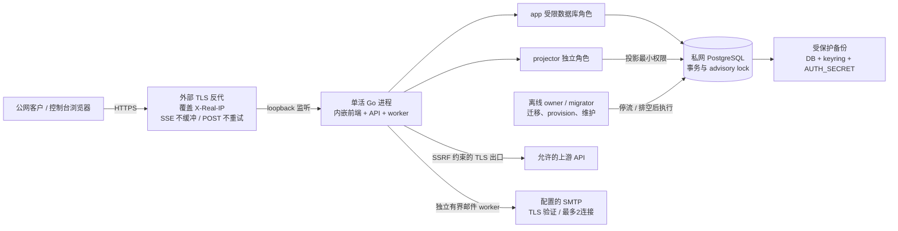

默认形态为单应用实例 + PostgreSQL + TLS 反代，适合 1Panel/Compose 自托管。数据库不公开端口，应用对反代暴露本机监听；app、projector 与 owner/migrator 必须分角色。身份表app仅状态需要的列级UPDATE，projector无身份表读取/写入；密文离线重包仅owner且不恢复已清秘密。CLI 仅 `migrate` 使用迁移连接，其他命令只验证迁移；启动要求单独 `PROJECTION_DATABASE_URL`，拒绝与 app 同一角色。[Dockerfile](../../Dockerfile)、[Compose](../../compose.yaml)、[部署手册](../runbooks/deployment.md)。

025-A0窄切片补齐Compose的021注册/恢复、MAIL_TRANSPORT和六项SMTP配置透传，仅app获得这些环境；默认注册关闭/邮件disabled，迁移与provision不获得SMTP秘密。常规Compose仅保留PAYMENTS_MODE=off，不注入隔离沙箱manifest/worker DSN。YAML/九项声明默认与合成覆盖、环境隔离/原角色端口排空边界的静态检查通过；全局Docker CLI仍无compose插件；另从Homebrew官方SHA验证的隔离Compose 5.6.1完成默认/合成覆盖的真实config --quiet和JSON渲染、九字段/环境隔离检查，见[实际渲染](../verification/compose-render-025.json)。独立临时Colima profile因官方VM镜像下载超时未启动，已删除本轮profile并确认既有profile未变，见[运行环境记录](../verification/compose-runtime-025.json)。容器、1Panel和正式邮件仍须各自验收；此前[静态记录](../verification/compose-config-025.json)保持原未执行结论，[合同](../../specs/025-production-ha/a0-compose-config-contract.md)限定配置范围。此片没有改变模块、数据或单活模型。

单活由 PostgreSQL advisory lock `782193402` 保证，新增副本不能当成 HA。实例保护失败会撤销 ready、取消上游 context 并停止服务；新的正常实例先等待前驱未结束请求的持久 deadline + 5 秒窗口。正常 SIGTERM 关闭 ready，并给予最多 310 秒 HTTP 排空。迁移仅用 `782193401` 串行化迁移，`provision` 也不会自动获取服务锁，两者依赖操作人先停流、排空再执行。离线报表重建和 secrets rewrap 额外强制 `MAINTENANCE_MODE=true` 并尝试取得服务锁；备份/恢复脚本同样使用服务锁。不能把迁移串行锁误认为在线服务已被自动停流。

正常 worker 每 10 秒检查实例保护；非恢复模式下以5秒限时处理最多100个客户恢复任务，再独立以5秒限时处理最多100个采购遗留attempt，随后以独立角色、5 秒限时最多 50 批 × 200 条消费投影 outbox。worker 只推进持久事实和幂等财务状态。恢复模式提供业务只读与恢复授权接口，禁止派发、探测和后台资金恢复；重新开放付费流量须完成双人恢复授权并重启。离线投影重建切换 active projection，不改账本。[进程 worker](../../cmd/moni-aigate/main.go)、[恢复闸门](../../internal/operations/recovery.go)、[报表重建](../../internal/billing/rebuild.go)。

备份需要数据库与解密/认证材料共同保护；只有数据库备份无法恢复上游凭据及 Key 校验。故障恢复依赖持久 evidence、唯一结算与补偿，不重发模型请求。[备份恢复手册](../runbooks/backup-restore.md)、[故障注入记录](../verification/mvp-failure-recovery.md)、[014 正常进程排空](../verification/mvp-release-qualification.md)。容器运行、真实网络分区和异地灾备仍需独立环境验收。

<!-- architecture:status -->
## 后续实施的依赖与并行边界

当前实施顺序由[027现行来源](../../specs/027-wallet-sources/spec.md)、[一体化设计](../design/integrated-wallet-media.md)和[028统一计量/媒体规格](../../specs/028-unified-metering-media/spec.md)决定：来源闭环 → 六文本统一向量计量 → 同步媒体 → 异步任务与实时轮次 → 部署/供应商验收 → 性能。下面旧候选依赖图保留研究背景，不再把catalog/profile/proof或其历史组合列为现行媒体前置。

下图是实施依赖，虚线表示可独立推进的设计或纯算法切片；它不表示当前运行时已调用这些模块。当前资金和请求链仍以上文实线系统图为准。阶段完成后先收口证据、更新本页和HLD/LLD，再推进依赖方。

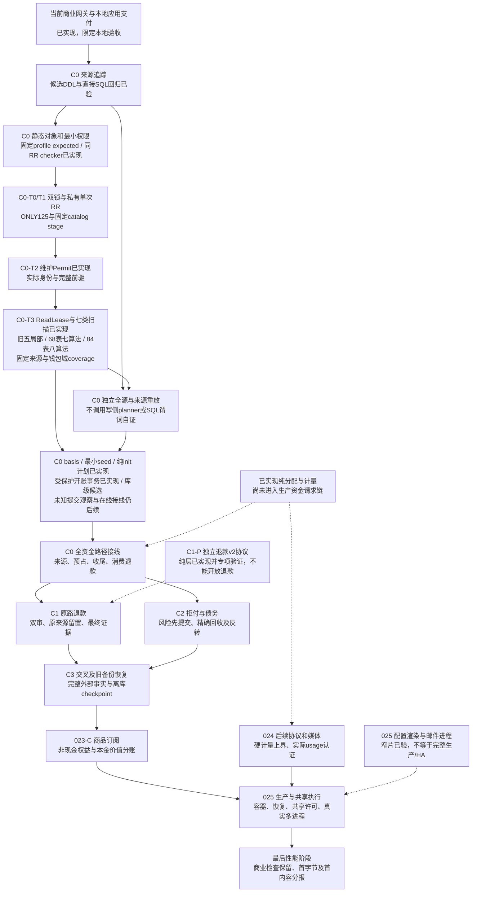

C0[静态检查](../../specs/022-self-service-payments/c0-schema-check-contract.md)、[维护身份](../../specs/022-self-service-payments/c0-permit-contract.md)、[运行helper](../../specs/022-self-service-payments/c0-runtime-helper-contract.md)和[独立重放](../../specs/022-self-service-payments/c0-verifier-contract.md)是分别审阅的合同；维护事务中的核验不冒充APP启动时的新只读事务证明。资金写入、迁移及共享源码由指定负责人串行修改；纯退款协议、只读审查、控制台合同和隔离部署准备可以并行。占用专用库InstanceLock的真实main验收串行执行，不能同时升级长期预览。

T3初版的billing/PB→maintenancetrust依赖曾将固定catalog初始化带入普通main和领域测试child。当前按[隔离合同§7](../../specs/022-self-service-payments/c0-read-lease-contract.md#7-ci-启动回归后的维护集成隔离根冻结)改为maintenancescan单向依赖billing/PB及maintenancetrust→fundinglotcatalog，普通生产与billing/PB测试依赖图不得包含维护/catalog；可执行依赖门禁防止测试重新引入。独立维护消费者仍eager完成固定SHA、严格有界expected、完整DTO/模板及全root canonical字节认证，expected raw parser、owned span缓存、digest后完整bytes.Equal和固定字段预编译全部保留。普通main不再为未使用的维护模块支付初始化成本。既有CLI/helper/main期限、600秒包期限和五秒发行预算不变；历史[启动测量](../verification/catalog-startup.md)仍只证明catalog自身优化，不能当作本次隔离或网关首字节验收。

本地 `make verify-mvp` 使用 `go test -race -p 1` 按包串行访问同一专库，保留全部包/测试、包内显式并发及原期限；这是专库验收调度，不授并发容量或远端CI结论。此前本地串行整仓1172.881秒成功保留原版本身份，精确提交`f572bbd`的[CI run 41359784155](https://github.com/workhold/moni-aigate/actions/runs/41359784155)仍在billing-0原12秒helper、server-2/3原10秒main与other周期核验CLI原60秒观察失败；普通路径不必要的eager初始化是本次隔离要移除的依赖问题。本次修改后的原失败进程、真实双reader/资源界、无权威core、完整整仓及新精确提交CI均须重新验收，结果由[隔离修复记录](../verification/maintenance-integration-isolation.md)，不借用此前本地或T2 CI通过。

## 当前能力与后续边界

| 能力 | 当前状态 | 依据/限制 |
| --- | --- | --- |
| 商业闭环 | 已实现，限定本地验收 | 人工双人入账 → 客户授权/Key → 六协议调用 → 预占/结算 → 报表/成本/退款；[014](../verification/mvp-release-qualification.md) |
| 模型/渠道经营 | 已实现 | 不可变版本、三格式发现、1..32 成员池、跨渠道整批启停；[011](../verification/model-discovery.md)、[012](../verification/credential-pools.md)、[013](../verification/channel-operations.md) |
| Key 经营 | 已实现 | 来源策略、动态运行限额、模型/地域/预算/期限三版本独立编辑；[017 验证](../verification/key-configuration.md) |
| 来源追踪核验基础 | C0完整来源读取与库级候选受保护开账已接线 | [68表合同](../../specs/022-self-service-payments/c0-complete-source-reader-contract.md)与[实现](../../internal/fundinglotscan/reader.go)：同lease扫描固定列并集，七算法、ordinary精确排除、原生时间资格、共享100000行/16MiB；[维护入口](../../internal/maintenancescan/complete_sources.go)绑定原Permit与第六kind。旧五局部scope不变；物理EOF与业务coverage独立，Unproven不授资格。另有[84表八算法](../../internal/fundinglotscan/wallet.go)与[第七kind维护入口](../../internal/maintenancescan/source_wallet.go)，实际调用lot重放并绑定原Permit；另有109表basis与strict v2独立叶子；[受保护开账](../verification/protected-init-phase.md)已装配；新增库级独立停服epoch观察，见[观察流程](#独立停服-epoch-观察)；独立[APP完整运行核验](#独立-app-完整资金运行核验)实现已汇合；限定验证见记录、完整经营验收仍有PB门禁；正式迁移、进程startup/ready、线上资金接线和生产CLI仍后续；[读取验收](../verification/source-wallet-reader.md) |
| 商品价值/期限纯算法 | C-V已实现，无生产接线 | [productvalue](../../internal/productvalue/value.go)精确端点价值差、原本金分区索引归因、UTC6原锚点月/半开term；[合同与专项](../../specs/023-periodic-products/c-value-contract.md)，无购买/权益发放/退款授权 |
| 上游模型成本 | 已实现 | 每渠道精确上游模型的输入/输出单价、生效版本、每attempt快照及unknown；受控采购更正双人审批，尚无自动供应商账单同步 |
| 经营报表与CSV | 026已接平台HTTP/控制台，限定专项验收见记录 | 最长31天/5000请求；消费收入一次、全部尝试成本、退款净额，未知成本或未结算时毛利待核对；独立于累计钱包异步投影，[架构](operating-reports.md)、[验证](../verification/operating-reports.md) |
| 资金来源与钱包开账 | 027已实现现行四写入口、正式023、CLI、HTTP与控制台，专项验收见记录 | 六表来源与开账原件，非现金opening、FIFO和逆序消费退款；新库策略，无历史无损升级或真实原路现金退款；[架构](wallet-sources.md)、[验证](../verification/wallet-sources.md) |
| 成本感知自动路由 | 018 已实现，限定本地验收通过 | 最高优先级内保守 big.Int 比价、未知拒绝、两维采购单价上限，候选/attempt/sending 报价同步；[规格](../../specs/018-cost-aware-routing/spec.md)、[真实 PG/浏览器/预览证据](../verification/cost-aware-routing.md) |
| 共享采购账户/预算 | 019已实现，限定本地验收通过 | [冻结合同](../../specs/019-procurement-accounts/contract.md)；跨渠道/Key/租户共享累计预算、逐attempt预占、未知占用和双人更正；周期硬预算已由023-B扩展；余额仅人工证据，供应商余额/账单自动同步待后续 |
| 公开模型目录 | 020已实现，限定本地验收通过 | 默认私有、安全DTO、当前价、筛选/分页、独立准入与admin公开CAS；[020验证](../verification/public-catalog.md) |
| 自助商业化 | 021与022-A完成限定本地验收；B0独立沙箱已编码并通过专项PG，真实进程短程通过、旧版本20代长程完成、最新补丁/精确故障另验；023-A完成限定本地验收 | [A证据](../verification/funding-vouchers.md)、[A1冻结接口](../../specs/022-self-service-payments/a-domain-contract.md)、[B0运行合同](../../specs/022-self-service-payments/b-runtime-contract.md)及[运行证据](../verification/payment-sandbox.md)区分纯协议、实际沙箱、未验故障；B1资金/身份/代次核心已冻结并通过SQL原型，B2已追加021并实现Go第三来源/十方向资金核验/三角色权限，真实PG专项通过；B3领域/worker/HTTP/UI/main已接线，专项与真实进程/浏览器整链通过限定本地验收，真实在途SIGTERM与Guard失权补验已通过；[023草案](../../specs/023-periodic-products/spec.md)、[A0精确合同](../../specs/023-periodic-products/a-contract.md)及[根复核](../../specs/023-periodic-products/review.md)已完成，A已通过[真实PG/浏览器/预览验收](../verification/tenant-pricing.md) |
| 站内经营告警 | 024-A已实现，限定本地验收通过 | 四固定来源、站内第一ACK、完整历史与命令、默认off双槽评估、独立准入与有效数据库角色核验；[024证据](../verification/operations-alerts.md) |
| 更多协议与运行形态 | 024纯计量已实现；028统一文本/媒体/任务/Realtime合同已形成，生产替换仍待实施 | [024](../../specs/024-extension-platform/spec.md)划分站内告警、媒体计量/异步/长连接/外部身份；[告警精确合同](../../specs/024-extension-platform/a-contract.md)经独立反例审查修正后冻结019，隔离DDL/行为/权限/源EXPLAIN原型通过；生产领域/worker/HTTP/UI已接通，真实PG/HTTP/浏览器/主进程故障、全量race与019预览均通过，架构只读检查和make check通过；[025](../../specs/025-production-ha/spec.md)定义真实进程故障、共享许可/HA与生产出口；媒体/Realtime/多活尚未完成 |
| 同步图片 HTTP MVP | 已接当前媒体商业链路，限定本地验收 | `POST /v1/images/generations`、结果访问控制、幂等和未知消费边界已覆盖；有数据库时复用 media request/attempt/observation/reservation/settlement、wallet 和不可变 artifact，开发环境使用 mock provider；[HTTP说明](../design/image-http-mvp.md)、[验证](../verification/unified-metering.md) |
| 容器/生产与正式供应商 | 部分未验收 | 025-A0静态透传和隔离Compose实际渲染已验，实际容器未验；正式渠道 usage/硬界、网络分区/异地灾备与发行许可仍是门禁 |
| 性能 | 目标未达成 | 历史 007 本机 100 并发额外首字节 P95 61.56–69.74ms；目标 4vCPU/8GB 下 ≤50ms，未完成 Rust LiteLLM/Bifrost 同条件对比 |

性能中的“额外首字节”是网关相对于同一 fixture 直连所增加的延迟，首有效内容单独记录；它不等同于真实模型的首 token 时间。历史数据只代表对应版本与本地环境，不能推出新增能力后的当前性能或与竞品相近。[容量方法](../verification/capacity.md)、[007 原始结果](../verification/dispatch-read-batches.md)。

018 本地验证包括真实 PostgreSQL 全 Go race、122 项前端测试及 strict 构建、vet/build、隔离真实 main 的两次完整 SSE、完整路由 CAS 冲突后只读核查与显式新编辑、390×844 移动布局和资金核对；客户两次各收 20 微元，对应采购成本 8/22 微元，客户 held 为 0 且账本平衡。预览 58123 已应用 013 迁移/provision，并以受限角色 ready、非恢复模式运行，首页与 29 项 assets 匹配。这些结果不替代正式供应商、容器、灾备或性能发布门禁；详细执行与资源清理见[018 记录](../verification/cost-aware-routing.md)。

019增加真实PG采购预算/证据/审批竞态及最小角色验证，前端141项与strict构建、全Go race/vet通过；浏览器持久CAS冲突、人工观察、一次SSE与采购资金核对通过，最终仅“余额未知”文案重建后另做窄补验。两轮均客户20/采购22微元、held0和账本平衡，QA资源/秘密清理。预览58123已迁移014/provision并运行最终包，首页和32项assets匹配。证据与首轮/最终包摘要见[019记录](../verification/procurement-accounts.md)。

020增加真实PG公开投影/CAS/分页/异常大行与匿名准入测试，前端156项、strict构建和全Go race通过；最终SQL长度保护修订后另跑catalog/server专项race通过。真实main浏览器验证默认私有、管理员409后只读核查/显式新编辑、精确大整数/零价/缺价、筛选和下架恢复、390px布局，资金事实和生成请求全0；QA资源秘密已清理。58123已迁移015/provision并运行最终包，首页与35项assets匹配。完整证据见[020记录](../verification/public-catalog.md)。021已接续交付身份迁移/事务、公开HTTP、outbox/worker和四个匿名页面；186项前端/strict、最终身份/HTTP代码全Go真实PG race、vet通过，运行器身份生命周期补验11.792s。隔离真实main+本地SMTP/浏览器验证邮件请求、证明GET/fragment清理、零权益及新密码登录；注册与改密提交由HTTP验证，不冒称浏览器修改凭据。零推理/资金、proof单次、outbox终态清密文及资源清理通过。58123已升级016、ready非恢复、首页与40assets匹配，默认注册关闭/邮件disabled；真实SMTP另门禁。[021证据](../verification/self-service-identity.md)。

022-A在017阶段完成限定本地验收，历史包/预览证据见[022记录](../verification/funding-vouchers.md)。023-A现已完成018/helper/管理HTTP/客户报价/控制台，真实PG分包race及并发/COMMIT代理、227项前端/strict、真实main三模式与失败清理16.160s、隔离浏览器与账本核对通过。三笔调用收费8/20/20微元，采购均12，缺组价无新request/扣款，退休原归属继续，调回默认不改旧快照。023-A验收时58123升级018/provision，首页与48assets匹配当期包；历史[023证据与包摘要](../verification/tenant-pricing.md)。024-A验收时已升级019/provision，受限APP及projector有效权限核验在worker/HTTP前通过；ready非恢复，首页及50assets匹配最终包，注册/邮件/券/告警评估默认off，账号与资金事实未变。告警完整链路与主进程故障、最终全Go真实PG race/vet、251项前端和strict构建通过；[024证据](../verification/operations-alerts.md)与[当前包摘要](../verification/operations-alerts-024-preview.json)。

022-B0-P保留标准库纯协议race/vet/89.4%覆盖及393430次fuzz证据。M/Q已实现独立进程装配、模拟器/receiver仓储、HTTP/双槽回调、完整启动权限证明（含精确namespace row/array及额外执行对象拒绝）和离线非空资金fixture；专项真实PG/race、并发/签名/故障消费及资金不变通过。真实进程短程及旧版本20代长程已通过；最新补丁/COMMIT丢包/精确崩溃等仍按[运行证据](../verification/payment-sandbox.md)独立收口，021与B2第三来源已独立实施，B3订单/worker/main现已接线，真实主进程/最终浏览器整链通过限定本地验收，真实在途SIGTERM与Guard失权补验已通过。023-B的[精确合同工作稿](../../specs/023-periodic-products/b-contract.md)已形成核心/命令/权限SQL及真实PG并发原型，源同步/首配/派发反例已修订，B核心/HTTP/UI与020预览已完成限定验收，独立只读核验器专项已通过，C商品/订阅继续独立门禁；024-A生产代码、有效角色边界、全量race/vet、真实PG/HTTP/浏览器/主进程故障与019预览均已验证，架构只读检查和make check通过。025与最后性能阶段继续按独立门禁推进。

最终重建已补验历史不完整报价的只读兼容和分页游标校验；新报价仍须两维完整，既有成本管控不接受部分报价。首轮包与最终包的验证摘要分别保留，最终包另完成浏览器核查/发布及一次 HTTP SSE/资金核对、资源清理和预览更新，见[最终补验](../verification/cost-routing-018-final-browser.json)、[最终清理](../verification/cost-routing-018-final-harness.json)、[最终预览](../verification/cost-routing-018-preview.json)。这不改变上述模块或请求/财务边界。

<!-- architecture:evolution -->
## 每次变更如何同步这份架构

本文件、[演化记录](changes.md)和[机器清单](architecture-manifest.json)共同组成当前架构快照。源码映射是阅读入口，SHA-256 清单检测新增/修改/删除，不需要仓库已有提交。每个快照保留复核时间、变更理由、源文件数量/摘要及后续增量路径。

工作顺序为：阅读对应规格 → 设计缺口先补 SDD/HLD/LLD → 实现与相关验证 → 更新本文件受影响的图、边界、能力状态和来源 → 并行结果汇总后显式复核 → 刷新并执行只读检查。若代码没有改变架构结构，也必须复核现有描述，并在理由中说明结论。要求见[根 AGENTS.md](../../AGENTS.md)。

当前工作划分、可并行实现的边界及各阶段前置依赖见[交付与并行计划](../design/delivery-plan.md)。共享接口/数据合同先冻结；各任务完成专项验证后，由集成人合并检查跨模块行为、能力状态与统一架构，最后建立同一个可复核快照。

```sh
# 源码/设计稳定后，由完成语义复核的集成人执行；理由必须描述实际变更。
go run ./scripts/check-architecture --refresh --reviewed --reason '实现变更与架构影响；同步对应状态/链路/数据边界'
go run ./scripts/check-architecture

# 等价快捷入口；make check 和 make verify-mvp 也执行只读检查。
make architecture-refresh REASON='本次变更与架构影响'
make architecture-check
```

默认检查不会修改任何文件，CI 只运行默认检查；不能用自动 refresh 掩盖缺失的设计。覆盖 `cmd/internal/migrations/scripts/deploy/.github/web`、`specs`、`docs/design/runbooks/verification/decisions`、`docs/architecture` 下后续支持文档/图和根级依赖/构建/部署配置；新目录中的常见代码与配置扩展名也自动纳入，避免新增模块漏检。排除 `.git`、`.local`、`bin`、依赖缓存、`node_modules`、精确 `.vite` 缓存目录组件、`web/dist` 等产物、架构写入临时文件和私密 `.env*`（保留 `.env.example`），不以修改时间判断。正文要求主要架构章节与至少三张 Mermaid 图，并检查本地链接没有失效或越出仓库；正文、演化记录也有独立摘要。

主架构十六张、[C0细化视图](funding-lot-catalog.md)、[维护Gate、Snapshot、Permit与ReadLease细化视图](maintenance-gate.md)及根README概览各一张，共十九张Mermaid图。T2版本使用官方npm Mermaid12.2.0解析及独立临时浏览器实际渲染，原[渲染证据](../verification/architecture-maintenance-authority.json)仅绑定当时四份正文SHA；T3首片十九图也曾使用同版官方Mermaid与独立临时浏览器实际渲染，见[历史T3图证据](../verification/architecture-maintenance-read-lease.json)及[T3集成记录](../verification/maintenance-read-lease-integration.md)。本次维护集成隔离再次修改依赖图，使用同版Mermaid与独立临时浏览器重新解析并渲染十九图，精确正文与PNG身份见[隔离图证据](../verification/architecture-maintenance-integration-isolation.json)，不覆盖旧图记录。此前十六图与检查器race/vet保留原[架构同步验证](../verification/architecture-sync.md)。每轮内容快照均由集成人汇总全部文档后显式刷新，交付前确认只读检查通过。

工具可以发现“源代码或设计已经变化，但架构快照尚未复核”，不能证明自然语言与实现语义一致。`--reviewed` 是执行人的明确复核声明；需要阅读代码、图与验证边界，不能机械刷新。修改覆盖策略也属于代码变更，必须解释原因并复核本文件。机器清单本身不参与自己的哈希，演化记录只引用源快照摘要，避免循环依赖。

022-M/Q本轮新增独立CLI、paymentruntime/schema、mockpsp/receiver与离线QA；模块图/独立通知时序/数据分组/角色边界和源码入口已同步。B0独立进程证据只覆盖原M/Q链路，B3普通main新增的订单/通知/资金与worker另行验收；B0验证范围见[运行证据](../verification/payment-sandbox.md)，不能将已编码或专项PG等同尚未执行的长程和生产验收。

023-B核心已按[冻结接线合同](../../specs/023-periodic-products/b-integration-contract.md)追加020并从billing调用；请求、数据和权限图同步更新，产品HTTP/UI已接并通过专项/多tab/隔离main浏览器，020最终相关回归与预览已通过，独立三态核验器和CLI专项通过，当前源码交叉回归继续。022-B1[核心设计](../../specs/022-self-service-payments/b1-contract.md)及[SQL验证](../../specs/022-self-service-payments/b1-verification.md)已冻结，B2新增[第三来源冻结合同](../../specs/022-self-service-payments/b2-funding-contract.md)，已追加021、实现Go第三来源与三角色核验，真实PG专项通过；领域/worker/HTTP/UI/main现由B3接线，真实主进程/浏览器限定本地验收及未验边界另记。

2026-11-02第三轮[GitHub CI](../verification/github-ci-third-run.md)在精确f64b56f源码上十组全部success：1036顶层PASS、54明确SKIP，web286全PASS，架构/vet/build通过。专用C0与真实main opt-in仍未开启，不覆盖后续T2/T3新增代码或生产环境。

2026-11-02随后[T2发布CI](../verification/github-ci-authority-run.md)在精确46f25e0源码十组success：1066顶层PASS、69明确SKIP，父子3555PASS/109SKIP，web286全PASS，架构/vet/build通过。专用C0与真实main等opt-in仍未开启；当前T3代码以新专项和集成记录为准。


### 023-C-V 与 025-A1-G 独立片

[productvalue](../../internal/productvalue/value.go)使用精确整数前缀`F(k)=floor(P*k/G)`，将权益半开区间映射回原本金条带，并按原本金分区索引归因。拆分不丢舍入余数，零价值权益不补钱；[month](../../internal/productvalue/month.go)从原UTC6锚点直接计算月界，1月31日可恢复到3月31日，term按半开区间分类。它没有来源ID、资金资格、幂等状态或DB/HTTP/worker/生产调用方，不提供购买、发放或退款许可，详见[C-V合同](../../specs/023-periodic-products/c-value-contract.md)。

[025-A1-G合同](../../specs/025-production-ha/a1-model-process-contract.md)冻结私有browser-qa模型fixture和真实main两个SIGKILL窗口：sending已提交但上游未响应，以及最终证据已提交但客户Settle等待AVAILABLE物理锁。运行器不加生产hook，不改原300秒request期限，重启须自然经过deadline+5秒。编译和fixture测试不等于实际主进程故障验收；本轮无显式专库/制品配置，真实运行仍待验，见[运行器验证](../verification/model-lifecycle-025.md)；当前仍为单活动实例，完整HA与生产认证未完成。


2026-11-02本批集成：采购十五表reader/maintenance/QA专项race与vet通过，productvalue的race/vet及三组短fuzz通过，整仓`go test -race -p 1 ./... -count=1 -timeout 600s`通过。独立复核后补严025幂等409/原ID、290..300秒原期限窗口和观察权限前置，最终browser-qa包race/vet再次通过。`make check`的只读架构、全仓vet和前端strict构建均通过；未配置专用数据库，真实Plan/Init、两个模型main SIGKILL窗口及`make verify-mvp`未执行。本次无迁移、新数据库关系、在线资金权限或生产装配变化。


2026-11-02采购历史后续集成：按三份新合同扩为十九表/五局部摘要，audit单次读取复用，单lease预算及唯一Finish保持。独立复核后修复无关outbox空operation的全量pair去重漏检；补丁后四包race与vet通过，整仓Go race的早于该最后补丁版本也通过，具体版本范围见[采购验证记录](../verification/procurement-budget-maintenance.md)。README补充部署主机依赖、已有卷密码边界与贡献入口，启动命令经独立静态核对。本轮未配置专库，真实Plan/Init、容器/1Panel与make verify-mvp未执行。无迁移、新数据库关系、在线资金权限或生产装配变化；完整evidence/事件重放/PB与资金交叉图、全来源/basis/epoch仍后续。

十九表交付最终检查：根复核后架构清单与只读检查通过，`make check`通过（全仓vet及Vue/TypeScript strict构建）；最终验证文字收口后再次同步清单。数据库opt-in仍明确SKIP，原限界不变。


2026-11-02资金同session增量：新增21表固定owned原始图、人工/券独立来源关系及CustomerKey资金纯core，旧ledger reader仅抽取唯一raw读取算法而保留既有入口语义。ScanFunding不新增kind，旧三表与新21表入口每Permit二选一，四摘要只Finish一次。没有新增迁移、数据库关系、在线资金权限、HTTP/main装配、basis或epoch。真实PG QA补足成员模型授权、将真实业务写入放在候选C0触发器安装前、以fixture完成后的legacy基线比较，并校正全表租户计数；未配置专库的执行仍明确SKIP。完整来源/采购evidence/PB/sandbox与phase组合依赖保持开放，见[本轮记录](../verification/funding-financial-graph.md)。


本轮19图的Mermaid12.2.0语法解析通过，逐图内容SHA见[当前图记录](../verification/architecture-funding-financial-graph.json)；本轮未执行浏览器布局渲染，既有PNG仅证明其历史版本。


21表资金片原轮验证：全部并行实现与独立复核汇合后，相关四包race/vet、全仓`go test -race -count=1 ./...`及`make check`通过。该轮真实Plan/Init子用例因缺C0专库配置明确SKIP，未运行`make verify-mvp`；后续真实PG执行单独记录，历史跳过结果不追溯改写。

## 采购、PB与支付来源纯图：实现与读取分层

2026-11-02先补齐三个仅读取传入原行的独立来源算法，随后接通下节的68表同session reader；均无线上调用方。模块图同时展示21表局部reader、68表组合reader与纯算法的依赖，避免将库级算法误画成在线资金装配。

| 核心入口 | 原始依赖 | 主要检查与历史边界 |
| --- | --- | --- |
| [CheckProcurementEvidenceGraph](../../internal/fundinglotverify/procurement_evidence_graph.go) | 23组采购及证据原行 | 同raw内部运行原五局部core；独立Usage/digest、meter出生、identity、全部预算事件、成本与账户配置来源；复杂历史按固定Unproven规则报告 |
| [CheckPeriodicBudgetGraph](../../internal/fundinglotverify/periodic_budget_graph.go) | 18组PB与业务来源原行 | control事件有序重放、allocation/window版本、三层投影、配置/指纹/audit/snapshot；保留三类legacy/prefix缺证，不调用现公共SQL verifier作oracle |
| [CheckSandboxSourceGraph](../../internal/fundinglotverify/sandbox_source_graph.go) | 23张payment表与10张共用表 | stored-verified原件、canonical、SKU链、query/evidence/review到完整资金效果的双向图；不从字面v1 proof构造真实安装认证 |

精确DTO、资源、三态、合法多事件与故障边界见[采购合同](../../specs/022-self-service-payments/c0-procurement-evidence-graph-contract.md)、[PB合同](../../specs/022-self-service-payments/c0-periodic-budget-graph-contract.md)、[支付合同](../../specs/022-self-service-payments/c0-sandbox-source-graph-contract.md)。这三个输入组数不能直接相加当物理读取表数；下节68表reader已对重叠表取固定列并集，只读一次并共用源预算。

原十九表采购reader、PB公共owner Verifier与两表sandbox关联reader保持scope；新核心由下节第六kind组合，不隐式扩展旧入口。业务来源七算法、ordinary排除与唯一Finish已接线；另有独立纯lot重放与第七kind的84表同session接线；pre/post、basis/epoch、资金writer和生产维护CLI仍后续。旧范围真实数据库补验见[原记录](../verification/maintenance-financial-postgres.md)，新组合另见[本轮记录](../verification/complete-source-reader.md)。README保留特性、协议、使用、部署、许可证与验收边界，贡献流程见[指南](../../CONTRIBUTING.md)。

本轮还修复已有商业命令的并发幂等占位：支付和兑换券共用的`commerce_commands`有两个含operation的唯一索引，两个INSERT均使用无target的`ON CONFLICT DO NOTHING`，随后仍逐项核对原命令身份、输入指纹与terminal。没有新表、迁移、权限、通用重试或资金链路变化；原5秒总预算、3秒锁期限与未知提交不重放保持。既有八并发用例增加共同起跑屏障，专项与整仓结果见[并发验证](../verification/commerce-concurrency.md)。

本轮最终`make check`及真实专库下`make verify-mvp`通过，后者959.665秒，含286项前端/strict、全默认Go race/vet/build；维护C0独立opt-in另以210.188秒专项证明原局部范围。19张当前Mermaid语法记录见[本轮图清单](../verification/architecture-source-graphs.json)，完整回归与边界见[机器记录](../verification/source-graph-integration.json)。验证后仅补文档及架构清单，不把历史图记录或专项通过转移到未实现的新reader、完整phase、供应商或生产部署。

## 同租约 68 表业务来源读取

按[根冻结合同](../../specs/022-self-service-payments/c0-complete-source-reader-contract.md)新增无权威叶子包 [fundinglotscan](../../internal/fundinglotscan/types.go)。它固定合并 Financial21、采购新增18、PB新增6、Payment新增23，物理表和共享列各读一次；七项纯算法从同 owned 原行投影。普通服务与 billing/PB 的生产及测试依赖不反向引入 maintenance/catalog。没有迁移、新表、角色权限、在线资金或HTTP变更。

[第六种 ReadLease](../../internal/maintenancetrust/lease.go)保留旧五枚举和scope；[SourceMode](../../internal/maintenancetrust/lease_source_mode.go)来自原authority持有的authenticated predecessor。维护集成自行 Require→mode/schema→固定读取→唯一Finish，私有结果只接受原Permit；假的Query只能生成描述性Facts。原30秒lease、Snapshot更早期限、busy与入口/出口认证继续生效。

全部68表共享100000行/16MiB预算；TEXT/JSONB原bytes、bytea原件、bool每字段1B、native时间envelope每字段32B，单字段65536B，128行显式C序keyset。原时间经timestamptz_send原生8字节/NULL传输并由固定binary plan还原，保留simple protocol且支持year10000；必填NULL/infinity先保留原生值、完成物理EOF，再将不可表示的旧DTO域标input_mismatch而不运行该core；PB保留原生时间交其算法判定。普通模式仍读取23张payment表并精确检查absence/policy/六旁路，合法时仅sandbox为not_applicable。

报告区分PhysicalEOFComplete、七算法执行状态和CoverageComplete；数据mismatch可以与完整执行并存，Unproven或输入资格缺口不能获得完整coverage。范围仅为固定业务来源图，尚无lot全序、protected pre/post、basis、epoch或RuntimeProof。验证和已知边界见[本轮记录](../verification/complete-source-reader.md)，后续按[交付计划](../design/delivery-plan.md)推进。


## 钱包全序声明的独立前置检查

[CheckWalletSequenceRows](../../internal/fundinglotverify/wallet_sequence.go)位于现有纯核验模块，由WL内部调用，84表维护路径经WL实际执行；普通main与在线资金路径仍无调用，未新增持久关系。七组传入原行投影核序列连续/唯一head、旧新tenant genesis、原journal与event top-xid绑定、全局source唯一及legacy互斥、event_count和四项大整数声明。两种新退款kind共用归一源命名空间；同top-xid多次操作仍分别推进seq。

它只返回 `supplied_wallet_sequence_rows` 范围的 RowsConsistent 和计数，不读数据库、不产生EOF/coverage/proof，也不证明来源资格、金额桶、FIFO或退款分配；相互自洽改写的金额仍可能通过这层。原68表来源reader与旧六种ReadLease保持范围；下文新增第七kind的84表来源与lot读取，没有新增资金writer、HTTP/main、角色或迁移。实际lot重放已按下节V0-WL实现；protected pre/post、109表basis、init/epoch和APP接线仍须逐片冻结实现。规格、独立手算与资源/取消边界见[合同](../../specs/022-self-service-payments/c0-wallet-sequence-rows-contract.md)和[验证](../verification/wallet-sequence-rows.md)。


## 所提供原行的完整 lot 域重放

[CheckWalletLotsRows](../../internal/fundinglotverify/wallet_lots.go)在现有纯核验模块新增实际数值重放：九组业务原行与16张C0事实表原列，在共享100000行/16MiB预算后建立私有索引。内部运行WS结构检查，并从receipt、reserve、settlement和approved refund原金额独立推导big.Int状态；事件、分配边和余额cache只作比较对象。该纯层内部调用WS；新增84表维护reader已实际调用此核验器，普通在线服务仍无到它的运行箭头。

它按tenant seq核新旧genesis与legacy集合，推导cutover开账A/H；FIFO按原来源时间和lot ID的C序预占，正序结算保留charge=0尾边，逆原收费边支持分次消费退款。旧terminal的后批退款验证原F0累计后发行新nonrefundable lot；旧未结预占后批结算仍沿opening原边。最后比较三桶、事件链/revision、cache、当前账户与退款累计，反向枚举全部实际事实。时间保留原生NULL/finite/infinity，不用墙钟决定seq。

源金额或必要身份不可确定时，保留可算前缀，只停止该tenant依赖的后缀；缺event locator不会拿下条before或cache恢复金额。确定缺父/跨租户或健康完整重放后的多余效果报告orphan，受损前缀后缀记deferred。输出仅supplied scope、三态和脱敏计数，没有数据库EOF、CoverageComplete、ScanProof或资金权限。人工双审/券资格/capture深层来源仍依赖独立来源域；给定epoch/attestation内部一致不认证真实安装、OID或运行proof。

[冻结合同](../../specs/022-self-service-payments/c0-wallet-lots-rows-contract.md)与[验证记录](../verification/wallet-lots-rows.md)描述完整边界。原68表reader、旧六kind、DDL候选和普通main保持；第七kind与84表读取见下节，uint8 once仍足够。下一步冻结protected pre+basis/init/post/epoch，再推进全部资金写路径、原路退款和拒付。


## 同租约 84 表来源与钱包读取

[冻结合同](../../specs/022-self-service-payments/c0-source-wallet-reader-contract.md)先于实现。新增 [ReadWallet](../../internal/fundinglotscan/wallet.go)在同一个owned raw session扫描68业务表和16张C0事实表；[25组固定钱包绑定](../../internal/fundinglotscan/projection_wallet.go)与原四组来源绑定取物理列并集，九张共享业务表仅增加 tenants.fl_created_xid，其余共用列只读一次。它直接执行原七项来源算法，再以同raw投影实际调用CheckWalletLotsRows；没有重新调用旧Read或拼接旧Facts/Report/ScanProof。模块图的共享检查节点执行原七算法，不重复读取68表。

84表统一100000行/16MiB、128行C序keyset及完整EOF。epoch/attestation按真实singleton键保留false/true，legacy sources按(kind,source_id)逐项分页。TEXT/JSONB/bytea默认65536B，唯一固定例外为attestation.proof_canonical的262144B，SQL资格与Go计账两侧保持一致且仍计总界。时间由timestamptz_send原生8字节/NULL还原；钱包envelope将NULL/infinity/极端年份交算法判定。不可表示的必填TEXT/bool按物理字段去重，受损core标input_mismatch，其余EOF及可执行core继续；无法分页的NULL主键则为执行失败。

WalletFacts私有保存本次session，Summary只给平铺的 complete_source_wallet_graphs_v1 与固定八项执行状态；Wallet保留 supplied_wallet_lots_rows。确定不符优先于indeterminate，CoverageComplete只说明本固定域执行完整，数据mismatch可以同时coverage完整；缺epoch正常报告mismatch，钱包没有N/A。所有执行错误整个零结果，日志/JSON仅脱敏。原Read仍恰68表/七算法/原scope，不查询fl_created_xid或C0。

[第七ScanSourceWallet](../../internal/maintenancetrust/lease.go)保留旧六枚举和uint8 once；[SourceMode](../../internal/maintenancetrust/lease_source_mode.go)仅为第六/第七kind读取原authority predecessor。[唯一可信wrapper](../../internal/maintenancescan/source_wallet.go)在Require成功后接管Abort，取得原schema/mode，私有adapter完成读取和唯一Finish后保存真实proof；Verify/Summary只接受原Permit，Snapshot终结撤销。该结果不授初始化或资金写入权。

现有VerifyInstallation和Attest发行都要求16张C0表为空；证据Verify、BeginScan和Finish不重复空表检查。未来同Init原RR可按Attest→受保护init写入→84表post读取实施，当前受保护writer/phase尚未交付。已提交epoch环境也不能重走原空安装发行入口，须另冻post/runtime authority。ReadLease检查生命周期、codec与非空SQL，不解析SELECT或在SQL层强制只读；受审scanner仅发固定SELECT，不借Init的RW能力写seed或绕过phase。

本批真实维护正例验证开账前的空C0并保留缺epoch不符；非空C0的真实SQL、原值与算法验证使用独立owner RR，只证明reader而非维护postphase。没有迁移、ACL、普通billing/PB/main依赖或在线资金装配变化。验证、环境失败与最终回归独立记录在[本片证据](../verification/source-wallet-reader.md)。下一关口是protected pre+basis、init/post/epoch与全部资金路径；之后继续退款/拒付、商品、扩展、生产/HA，最后性能。

## 固定 109 表 basis 与严格 v2 格式叶子

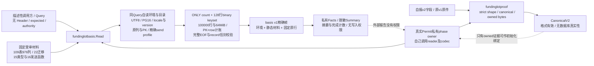

[basis合同](../../specs/022-self-service-payments/c0-basis-reader-contract.md)冻结原109表/976列，不加入16张C0表、tenant新增birth列、as_of、PID、xid或nonce。该reader先比较原列/PK、permanent heap/无RLS与继承、15内建type/16 send完整静态元数据，再对业务原行执行record_send；tenants仅接受原8列或精确第9列fl_created_xid。实际server/client/database UTF8、PG16 minor、locale/provider及stored/actual版本进入域分离SHA帧，名称与事务身份留给未来authority。同一数据可跨plan/init比较，源明文不公开。

分页游标为PK record的原二进制顺序，COUNT与最终行数相等；MATERIALIZED页的窗口前缀预算同时约束剩余行数、PK+row bytes和单记录，超限行返回false拒绝，不能过滤成EOF。Go核record字段数、OID、长度、NULL、固定宽度与PK/row对应值；变长payload保留原字节，不宣称重验全部PG内部编码。metadata独立2048行/1MiB/单文本65536B；业务100000行/64MiB，单PK262144B/row1048576B。这是逻辑输入限制，非server/RSS/网络实际字节界。

[proof v2合同](../../specs/022-self-service-payments/c0-proof-v2-codec-contract.md)冻结21字段、显式ordinary/sandbox可空union、manifest自摘要和sandbox原v1严格原件绑定。生产只用标准库，CanonicalV2私有owned canonical bytes、SHA及deep-copy bindings，fmt/JSON脱敏；原件≤262144B、depth12/8192值节点。合法未知digest仅格式通过，不能由已知root或自报值推导数据库认证。旧v1 wire/loader、相等key时间及重复digest接受条件不改；差分测试在maintenancetrust单向依赖纯叶子，普通领域测试不反向依赖维护。

本片未增加ScanKind、once位、第八pre+basis lease、protected writer、phase owner、epoch、RuntimeProof、迁移/ACL或普通serve/HTTP/worker装配。特别是不能先Finish释放busy再持外部Facts授写权；未来phase须贯穿pre+basis→write→strict v2与84表post→commit-ready，并约束Commit与ready后的新lease。当前Installation/Attest仍要求空C0，ReadLease没有SELECT解析器，叶子报告不能绕过这些边界。cutover basis用于停服plan/init比较，普通startup不能将经营后当前109表数据强等于历史basis；已有epoch的observer/runtime及其最小权限另冻。验收见[basis与v2记录](../verification/basis-proof-v2.md)，下一步仍按[交付计划](../design/delivery-plan.md)推进受保护组合及全资金路径。

## 最小旧数据投影与纯初始化规划

[初始化合同](../../specs/022-self-service-payments/c0-init-planner-contract.md)先于代码冻结。新增`fundinglotverify.LegacySeedRows`九组普通行：tenant仅ID，其余是原account/journal/line/receipt/request/reservation/settlement/refund。旧68不读tenant birth，新出口也不声称读过NULL。

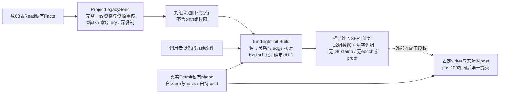

[投影实现](../../internal/fundinglotscan/seed_projection.go)重核原registry/EOF/报告与100000行/16MiB原预算，ordinary/sandbox资格固定；不修改原Facts，不使用原Read已经结束的ctx，不额外查询或输出秘密原件。它仍只是描述性数据出口，fake Query可以构造普通Facts，所以不授snapshot或资金权限。

[纯规划](../../internal/fundinglotinit/types.go)从历史资金来源和业务原金额重算A/H，与原ledger净和、账户cache三方比较，独立检查journal/请求/预占/结算/退款关系及孤儿。输出准确legacy集合、每旧tenant含零available opening、每未结reserve含零held opening、每tenant seq0/head，以及正额opening各自lot/event/cache和正held allocation。terminal不建held；旧approved已包含A不再发lot；历史receipt不逐笔发新lot。跨tenant合计与A+H使用NUMERIC积分文本，各桶仍限制BIGINT。

生成UUID按epoch namespace与固定长度帧确定，输出按PK字节序；不读clock，不伪造CreatedXID/CreatedAt。Metadata只是计数/总额draft，没有角色/OID/basis或CanonicalV2。九组输入加生成计划与固定metadata预留共享资源界，不等于完整68+84post的容量证明。生产依赖仅stdlib与verify纯类型/检查，不反向依赖scanner、维护权限或在线服务；没有迁移、ACL、HTTP/main、worker或资金接线变化。

上述纯模块的交付范围保留在[原验证记录](../verification/init-planner.md)。受保护组合现由下节实现；外部Plan仍无权限，纯模块仍无SQL或运行时资金接线。


## 受保护钱包初始化事务

按[冻结合同](../../specs/022-self-service-payments/c0-protected-init-phase-contract.md)，[PlanFundingLots / InitializeFundingLots](../../internal/maintenancetrust/funding_lots_run.go) 是原Permit上的同步操作，消费第八once位而不增加公开ScanKind。两个方法自行完成各自原事务的唯一COMMIT后才发布结果；Plan返回五项比较值和描述性计数，Init不接外部Plan、Facts、SQL或回调。它必须在新真实Init快照重读事实，比较epoch及四摘要，不能直接执行上次计划的内存写集。

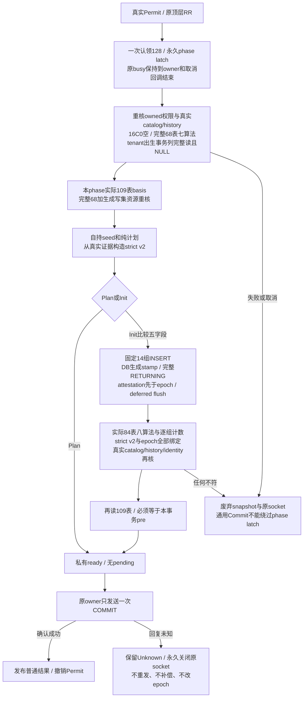

[固定writer](../../internal/maintenancetrust/funding_lots_writer.go) 仅可在原Init的Writing阶段运行，按静态列/类型逐条INSERT并检查完整返回原件、真实EOF和DB生成的top-xid/原生时间；不将数据库创建时间伪造为EpochAt。历史本金不重复发行，保留含0旧tenant开账、零额与终态预占成员；只写16C0 allowlist。epoch.actor固定为offline-maintenance操作类别，实际LOGIN由原identity复核，不另写audit_events改变基线。

[post](../../internal/maintenancetrust/funding_lots_post.go) 检查实际84表完整资格与各组行数；[证明核验](../../internal/maintenancetrust/funding_lots_proof.go) 重新读取实际epoch/attestation并严格解码全部21字段、原v1、OID、历史基线、manifest、catalog roots及大整数总额。之后再读109表，覆盖84之外41表。全68+生成写集共享10万行/16MiB并预留1MiB metadata；basis独立10万行/64MiB，真实post仍独立检查预算。

[生命周期与唯一提交](../../internal/maintenancetrust/funding_lots_commit.go) 不导出ready句柄，通用Commit在认领phase后不能绕过它；取消watcher只撤销/关socket，不并发drain pgx。提交丢回复保守Unknown，所有错误零结果。库级独立只读观察现按下节新合同实现，测试故障oracle仍不作为部署恢复工具。旧安装/Attest继续要求16表空；独立APP非空运行核验已按[R1-B](#独立-app-完整资金运行核验)汇合实现，限定真实PG专项结果见运行核验记录，完整经营PB验收仍有门禁，正式C0迁移、维护CLI、进程startup/ready及全资金接线另片推进。不能把后续经营的当前109 basis强等于历史cutover摘要。验证详见[本片记录](../verification/protected-init-phase.md)；前面各窄片“phase后续”保留其历史交付范围，以本节和能力表为当前状态。

旧 tenant 的 TEXT 主键/外键统一按[冻结校准](../../specs/022-self-service-payments/c0-protected-init-phase-contract.md#6-验收与交付)处理：空串不等于平台 SQL NULL，tenant 索引保留空键并检测重复。完整来源图的资金关联、采购 binding/approval/cost/metering/finalization 和周期预算 tenant scope 采用相同词法与精确集合边界；Sandbox 按固定命令 kind 决定 platform/tenant scope。原对象 ID、非 tenant 引用、voucher UUID scope、在线 API 输入、金额/状态及所有资源预算不放宽。真实历史 SQL fixture 与原业务 API fixture 分别证明范围，不能以零钱包通过代替有资金来源与跨域关系。


## 独立停服 epoch 观察

[新合同](../../specs/022-self-service-payments/c0-epoch-observer-contract.md)和[入口](../../internal/maintenancetrust/funding_lots_observe.go)把未知初始化的后续观察与原写事务分开：新的物理连接重获双 session 锁后才开始 RR READ ONLY，沿实际 owner/stopped/catalog/history/predecessor 身份验证；不经过要求16表空的Installation/Attest，不返回任何授权句柄。

```mermaid
flowchart TD
  Unknown[原初始化 OutcomeUnknown 保留] --> Acquire[新物理连接 / 重获双 session 锁]
  Acquire --> Observe[唯一 Begin / 固定30秒 / 全程busy
新 RR READ ONLY 与取消关闭]
  Observe --> Auth[完整current catalog与history
真实LOGIN及pins / fresh stopped / 实际v1]
  Auth --> Empty{完整16张C0表是否全空}
  Empty -->|全空| Absent[暂存 Uninitialized
不表示来源图或写许可]
  Empty -->|非空| Wallet[实际84表 / 八算法 / EOF与共享预算
所有 mismatch与unproven必须为零]
  Wallet --> Proof[本次原行深复制双单例
strict v2与实际环境及历史basis绑定]
  Proof --> Compare{目标epoch及四摘要}
  Compare -->|全部相同| Matched[暂存 Matched]
  Compare -->|另一有效ID| Different[暂存 DifferentEpoch]
  Compare -->|同ID摘要不同或损坏| Fail[零结果 / 关闭原socket
禁止重试开账或重放业务]
  Absent --> Exit[重新完整catalog/history/identity/fresh stopped]
  Matched --> Exit
  Different --> Exit
  Exit --> Finish[原只读ROLLBACK / 确认idle
停止并确认取消watcher]
  Finish --> Cleanup[独立最多5秒cleanup
逆序解锁 / 原物理连接关闭]
  Cleanup --> Result[发布普通观察值 / 无资金权限]
  Observe -->|任何失败或取消| Fail
  Wallet -->|任何不完整或不一致| Fail
  Cleanup -->|清理失败| Fail
```

[Rows owner](../../internal/maintenancetrust/funding_lots_observe_rows.go)保持完整EOF/Err/Close和取消期间零部分输出；[无Query投影](../../internal/fundinglotscan/epoch_proof_projection.go)从当前84表原行深复制epoch/attestation，所有字段沿固定SQL资格与预算。strict-v2每个字段与实际pins、受审manifest/catalog、原v1和双单例精确绑定；历史计数/NUMERIC合计沿原独立lot重放核开账成员，不拿当前余额或tenant总数替代。经营后当前109表摘要可以变化，观察不重新计算后强等历史basis。

全部验证、只读终结和cleanup完成才返回三种封闭结论；不同ID也须验证完整图。五项Expected没有原attempt身份，只能说明目标持久状态。失败永远零结果；不修改原Unknown、不重建proof/epoch、不生成模型或支付请求。当前观察器仍是库级候选，没有生产CLI；独立APP RuntimeProof已按下节汇合实现，限定真实PG专项结果见运行核验记录，完整经营PB验收仍有门禁，不从本观察器结果转换发行。实际[观察验证](../verification/epoch-observer.md)保留原范围，正式迁移、进程启动与在线资金接线继续后续。


## 独立 APP 完整资金运行核验

按[R1-B冻结合同](../../specs/022-self-service-payments/c0-runtime-composer-contract.md)新增独立 [`fundinglotruntime`](../../internal/fundinglotruntime)；实现已汇合；限定验证与完整验收缺口见记录。它由库级调用方传入 actual APP LOGIN 的独占 RR READ ONLY，不从维护 Permit/观察结果或 caller Facts 发行证明。当前没有普通 main、HTTP、billing/PB、worker/projector、ready 或资金写入装配；本片也不增加迁移/GRANT/provision。

```mermaid
flowchart TD
    Input[原actual APP RR READ ONLY
pins深复制 / owned expected V2
sandbox已加载自有APP文件] --> Entry[入口完整WalletReadV2 catalog
固定history guard / 完整001–022]
    Entry --> Scan[原tx私有adapter读取84表
共享10万行与16MiB / 八算法 / 全EOF]
    Scan --> Project[同raw纯投影
epoch-v2与APP-v1原件 / 无新增SQL]
    Project --> Bind[严格V2与expected bytes / 全字段actual pins
六条固定历史兼容 / epoch历史basis
sandbox V1三方bytes与APP nonce]
    Bind --> Exit[出口完整catalog与history
两个原CatalogProof最终身份检查]
    Exit --> Issued[原事务RuntimeProof
不存发行ctx / 不持有资金原行或秘密]
    Issued --> Verify[新ctx最多5秒VerifyTx
仅原wrapper-Conn-PgConn-top xid]
    Input -->|任一失败或超界| Fail[nil proof / 取消本次work
不额外drain / caller fresh有界清理]
    Scan -->|任何不完整或不一致| Fail
    Bind -->|任何不符| Fail
    Exit -->|失败或超界| Fail
```

发行累计最多30秒，两次catalog各最多5秒，后续VerifyTx每次总计最多5秒，均沿caller更早deadline且同时核context与绝对时刻。APP文件loader独立最多5秒，保留旧manifest完整严格解析、no-follow/euid/0700/0600与nonce/所有key材料资格，成功只留owned V1原件及APP nonce摘要。新的[V1纯格式API](../../internal/fundinglotproof/v1_public.go)保留旧codec语义；新的[APP同raw投影](../../internal/fundinglotscan/application_payment_proof_projection.go)不增加SQL或84表/776列读取面，只增加精确source pin。

原v2的LegacyV1历史roots按[包内静态材料](../../internal/fundinglotruntime/expected/compatibility-v1.json)映射至当前WalletReadV2，六条完整tuple和22项manifest由[独立工具](../../scripts/check-runtime-compatibility.py)从原catalog与源码重算。expected V2仅比较实际原件，不认证文件来源；当前没有V2文件loader，生产持有/发行/加载另冻。历史basis与epoch绑定，经营后当前109表数据无需等于cutover摘要，历史成员与新业务仍由本次完整重放核对。

RuntimeProof仅覆盖原仍活跃的RR快照；结束/关闭或换事务后不能继续使用，当次wrapper/连接/角色/search_path偏离原身份时拒绝，不能跨RC写事务沿用。失败取消本次work但不接管caller事务：caller使用fresh有界cleanup做Rollback，失败/busy或无法确认idle时关闭连接，不能归还busy pool。本库没有维护O1的自持socket watcher与双锁清理保证。流程、模块、APP/peer权限与寿命详见[完整细图](runtime-composer.md)，实际专项结果见[验证记录](../verification/runtime-composer.md)。R2的V2材料装配、各actual runtime自核、顶层结束确认、startup/ready/guard及在线资金路径仍为后续门禁。

原 WalletReadV2 实际验收确认[非空周期预算历史前缀证据缺口](../../specs/022-self-service-payments/c0-runtime-pb-evidence-gap.md)：原算法对活动held/window历史保留OperationSnapshotPrefixUnproven，旧composer继续拒绝。B-P3现已按新合同将不可变证据接入显式V3组合，保留原Base并独立判断新scope；新路径的实际非空经营验证见[本片记录](../verification/periodic-budget-prefix-profile.md)。候选组合不会自动开放R2在线资金ready，正式迁移与启动装配仍需后续合同和验收。

## 周期预算观察前缀候选（023-B-P1）

按[冻结合同](../../specs/023-periodic-products/b-prefix-contract.md)新增独立 `periodicbudgetprefix` 纯包和隔离 SQL 候选，细节见[模块与数据关系图](periodic-budget-prefix.md)。命令和窗口出生共用观察 ordinal，资金 effect 继续使用原 event_seq；回执 JSON 与 cut 在同一锁内原件上生成。新报告自行运行旧 PB 算法，并在新 scope 按唯一 cut 逐命令认证，原 Base 与两类 legacy gap 保留。

候选只在精确 001–022 后的专用 schema 验证，来源字段与三张证据表不由普通 migrate/provision/main/Compose 安装。旧读取器、basis/catalog roots与APP运行入口不隐式升级；B-P3的显式新profile与完整组合见下节，追加迁移和启动接线继续后续。CI仅在原other分区的测试命令显式开启PB候选专项，沿用该job独立PG/JSONL；新catalog/维护专项仍须各自opt-in，默认SKIP不能当验收。B-P1实际范围见[历史验证](../verification/periodic-budget-prefix.md)。

### 固定历史与候选安装隔离（B-P2）

按[安装合同](../../specs/023-periodic-products/b-prefix-install-contract.md)新增固定 original22 历史材料与同事务核验、纯候选材料包和仅测试支持的安装接缝。测试 fixture 明确应用原 022，候选安装在 caller RR RW 的私有 savepoint 中完成历史检查、完整缺席、DDL、最小授权与局部有效权限复核；失败 fresh 有界回滚，成功仍由 caller 决定最终提交。未来 current 追加不会使历史材料跟随 latest，也不能使已记录新版本的数据库冒充原 22。

新三表、三 source 字段与准确 12 个函数的权限单独验证，包含 PUBLIC/默认授权、角色 SET/ADMIN、owner 与 grant option。旧 `ProvisionFor` 在候选后重跑会扩权，必须检出；不修改旧命令隐式适配候选。普通服务模块、请求/资金链路、正式迁移、worker/部署权限、旧 roots 和 RuntimeProof 均不因本片改变。安装状态机与源码见[细化架构](periodic-budget-prefix-install.md)，实际专项与未验范围见[验证记录](../verification/periodic-budget-prefix-install.md)。

### 完整来源、静态 profile 与受保护组合（B-P3）

按[先行合同](../../specs/023-periodic-products/b-prefix-profile-contract.md)实现 source71/635、wallet87/804 的单session固定读取及三个深拷贝投影；basis112/1004使用新静态descriptor并共用原metadata/分页/hash。新增PeriodicPrefixV3的三个专用catalog API、固定128表/1173列全对象root和profile专属builtin；旧generic API、roots、旧30项scanner源pin与旧basis/golden保留。observer与runtime共用新的无权威12条兼容材料，不重签历史原件。

Gate在唯一Begin时固定profile，V3 Init在首个SELECT前一条C序LOCK锁128表；安装API不可改选，原catalogUsed、kind6/7与第八phase once共用。原受保护phase按owned选择pre71→seed→basis112→draft/writer→post87→basis复读及freshcatalog/authority→唯一commit，source+generated资源和来源守恒包含新增证据；新独立observer和actual APP普通/sandbox composer自行核完整图与原件，保留原事务身份、30秒总界和5秒catalog界。

模块依赖、数据面、状态机、权限、材料与源码链接见[完整细图](periodic-budget-prefix-profile.md)，静态delta与独立重算见[审定记录](../verification/periodic-prefix-catalog-static.md)，实际专项、回归与SKIP边界见[验证记录](../verification/periodic-budget-prefix-profile.md)。候选仍exact original22，正式migration/provision/CLI/main/ready、在线来源资金写入与生产环境认证未在本片启用。

B-P3整体未完成：[采购绝对成本更正的历史提案屏障缺证](../../specs/023-periodic-products/b-prefix-procurement-barrier-gap.md)继续产生`ProposalBarrierUnproven`，owned V3 Plan必须拒绝，不能以拒绝通过替代采购更正后完整成功的合同门禁；下一片须先设计不可变审批消费证据。[catalog CPU诊断](../verification/periodic-prefix-catalog-cpu.md)保留原5秒预算，标准无race诊断与局部解码差分已通过，但原LegacyV1 baseline的catalog race时限仍未通过；该诊断不属于网关TTFB/TTFT性能验收。


### 采购账户与成本完整历史证据（B-P4）

[设计稿 v0.1](../../specs/023-periodic-products/b-procurement-prefix-design.md)面向共享收费账户与可审计成本，覆盖真实账户操作前缀、正常成本资格、审批消费、冲突incoming和request级finalization前驱。原采购图十一项Unproven保留，不能以当前余额、revision或PB journal替代历史。

[权限与事务合同](../../specs/023-periodic-products/b-procurement-writer-authority-contract.md)选择固定闭合DB mutation及独立最小NOLOGIN writer，非业务表/schema owner。真实锁内读取before、执行gate并生成来源和效果；APP没有raw改投影后补证入口。受信业务schema居首以保留原020 namespace锁域，实际LOGIN设计实验已验证该原语，完整角色闭包及攻击矩阵仍待新profile验收。

本轮汇合[共同来源协议](../../specs/023-periodic-products/b-procurement-source-contract.md)、[账户合同](../../specs/023-periodic-products/b-procurement-account-contract.md)、[成本/request合同](../../specs/023-periodic-products/b-procurement-cost-request-contract.md)和[PB最小权限合同](../../specs/023-periodic-products/b-procurement-pb-acl-contract.md)。以下为**候选设计关系，尚未安装为业务表**：

```mermaid
flowchart LR
    Root[不可变 operation root
最后 INSERT seal] --> Step[连续 root steps]
    Step <--> Typed[每步唯一 typed source]
    Typed <--> Original[原业务来源 / journal / audit / outbox]
    Step <--> Node[有 attempt 的步骤
唯一 attempt node]
    Node --> Head[attempt head]
    Typed --> Local[独立 request / account / member 前缀]
    Typed --> Before[锁后真实 before 与完整 cut]
    Before --> Effect[消费已出生 source
核对实际 RETURNING]
    Effect --> PB[原 PB / B-P1 效果与延迟检查]
```

root分request和平台account_command两scope，不伪造平台tenant；一步只有一个canonical child，原件与journal等为双向约束companion。attempt_birth本身无node，managed reserved为node1；其他有attempt根的每步均接同一attempt链。source先保存真实before及预分配输出，效果完成后精确闭合，root最后seal；共享audit/outbox统一六列来源pointer及封闭角色槽。Reconcile完整覆盖propose/approve/release，分审批和最终资金层捕获before，保留原deadline、pending原因更新、内部冲突整体回滚及未消费输入的接受集。全部8类采购事件与同额/零delta动作仍保留。

PB合同按精确表/列及函数划定写面：allocation新INSERT省三项原占位列，由BEFORE派生；不发行配置command、不授control创建或配置变更。dispatch须覆盖tenant/key/supplier三scope，Reconcile还需客户资金/PB收尾。PUBLIC EXECUTE收口和APP顶层COMMIT的invoker只读闭包须独立纳入新profile，不能直接复用旧授权清单。APP锁账户选择仅授created_at单列UPDATE；[真实PG实验](../verification/procurement-account-lock-acl.md)验证四种行锁、写guard及竞争锁，未验证原014组合或真实writer允许分支。

已实现的[身份SQL叶子](../../internal/procurementidentity/materials.go)仅包含六个纯函数，无默认业务调用、安装或财务权限。原Go ABI的真实PG/race差分通过；精确提交2223e40的[远端CI](../verification/procurement-identity-ci.md)10/10任务成功，Go56包为52PASS/4无测试，前端286PASS，新identity为2顶层/8含子项PASS且无SKIP。13套PG专项和1诊断仍未验收，5个父PASS而子全SKIP的范围不变。此前[本机整仓失败](../verification/procurement-identity-leaf.md#本轮整仓集成与未通过项)及三例定向PASS分别保留，远端通过不确定本机超时根因。

本轮继续固定[物理布局](../../specs/023-periodic-products/b-procurement-schema-contract.md)、[执行与锁图](../../specs/023-periodic-products/b-procurement-execution-contract.md)、[完整ACL](../../specs/023-periodic-products/b-procurement-full-acl-contract.md)及[重放读取](../../specs/023-periodic-products/b-procurement-replay-read-contract.md)合同。32新表拆分来源、局部head/前驱、命令与更正、原件与客户finish；完整`pp_record_attempt`由DB执行原检查、首次选价和INSERT/幂等，再由私有helper闭合出生，APP撤attempt直接INSERT。预期报价文字通过BYTEA保留被忽略输入的原接受集，未消费值不转TEXT；报价选择时刻不被当作旧目录完整性证明。单根整体5秒、锁3秒，不给内部SQL逐条续时。RequestHead认证latest/sticky顺序，不能据此认证request状态的全部生命周期。

新纯核按来源闭合/request incoming/attempt cost/account四域独立重放，保留旧Base与十一项缺证计数；候选source/wallet读取105/121表，basis144、catalog160表和显式V4均只完成合同，准确全列物料尚待实现。五个全域只读validator、父表锁用单列UPDATE及拒真实写guard、81个PP SQLSTATE（含PP906未受证域）、未知提交只读观察与三scope PB按合同单独验收，不把APP普通资金权限改成来源证明。

开发工具[列布局检查](../../scripts/check-procurement-layout/main.go)只读比对[32新表/715列物料](../../specs/023-periodic-products/b-procurement-column-layout-v1.json)，其中68 generated、647非generated；更新须显式`--write`。本次逐边关系审查补齐delivery两cause、reset反向类型和new-settlement分支四列，不改写前版711列的[历史验证](../verification/procurement-prefix-layout.md)。JSON本身仍不包含约束、原表扩列或最终reader/catalog。

新增[procurementprefixschema](../../internal/procurementprefixschema/materials.go)固定六份SQL摘要并安全引用一次schema，按新表→原18表110列→所有keys→checks→FK装配。[source](../../specs/023-periodic-products/b-procurement-source-ddl-contract.md)、[account](../../specs/023-periodic-products/b-procurement-account-ddl-contract.md)、[cost](../../specs/023-periodic-products/b-procurement-cost-ddl-contract.md)与[原件](../../specs/023-periodic-products/b-procurement-original-ddl-contract.md)合同逐边同步；PK/UK非deferred，FK validated且初始延迟。原件旧行新增组全NULL，不回填假历史。关系材料没有函数、trigger、GRANT或默认main依赖；隔离PG结构及命名约束测试范围见[验证记录](../verification/procurement-relation-materials.md)。宽TEXT复合UK的旧数据兼容和后续索引宽度仍须解决，不把空fixture安装当旧数据全兼容。

按[DTO合同](../../specs/023-periodic-products/b-procurement-core-dto-contract.md)新增独立[procurementprefix](../../internal/procurementprefix/types.go)：40类原件482列（含全部110扩列）与32新表715列均为静态具名DTO，时间保留NULL/finite/infinity envelope。全部72数组先共享100000行/16MiB预算，普通字段65536B、两列route_decisions272144B，才做解析或索引；[Base投影](../../internal/procurementprefix/base_projection.go)无损保存旧23数组173字段，拒绝int32溢出或不可表示时间并返回零结果。独立测试保留旧readset相关列、逐列核110扩列并用旧scanner ABI核173字段；根定向race通过。随后按[实施合同](../../specs/023-periodic-products/b-procurement-replay-implementation-contract.md)加入私有来源/请求/账户重放叶子及十一类Required精确对象集合；实际调用、候选与完整性见[独立重放细图](procurement-replay.md)和[本轮验证](../verification/procurement-replay-leaves.md)。**当前没有导出的Check**，完整来源、AttemptCost剩余历史cut、原Base调用与最终aggregate仍未完成，不接受caller Base，也不发行consistent或coverage结论。

续片实现[成本历史](../../internal/procurementprefix/attempt_cost.go)与[Reconcile/finish](../../internal/procurementprefix/finish_replay.go)两个私有子域，分别核冻结采购价与客户售价、node成本变化、三action和最终资金时钟、真实账本/PB效果；来源新增严格路由JSON、原18表追踪联合及request26/attempt15冻结列双向核验。账户提案/批准audit金额已校准真实Money字符串ABI。finish历史request/delivery cut与历史PB闭包尚未齐，Complete=false；后续人工来源序的收口见下文，两个子域不冒充完整AttemptCost。完整范围和回归见[续片验证](../verification/procurement-cost-finish-replay.md)。

2026-11-04续片补齐来源域current request/attempt末项、永久dispatch身份及managed journal、p出生/自身最后journal和三处严格Usage JSON；完整链坏序不能充作空历史，新source也不能借legacy NULL豁免。finish按各自deadline使用三个独立墙钟样本，允许时间回退，已释放分支不得恢复收费；[专项与回归](../verification/procurement-current-source-clocks.md)记录实际范围。后续按[收口计划](../../specs/023-periodic-products/b-procurement-replay-closure-plan.md)实现人工P→A→R偏序、原case最后人工来源、proposal/actor消费与派生normal decision的真实before_latest桥；旧人工来源缺失保留私有LegacyCases，当前reason可由自动流程修改。来源域同时独立核Reconciliation/finish完整行内NULL/角色/result/金额/profile及mode/reason/deadline联合；既有结算的reason接受集不缩减，墙钟不互排。人工last-source项已移除，finish仍保留未派生decision的latest/sent观察与历史PB absence/命令动态快照两项Unimplemented。实际范围和回归见[人工顺序验证](../verification/procurement-reconciliation-order.md)；Complete=false、Qualified为空、715列与无公共Check边界保持。

本轮继续按[来源值与连续性实施合同](../../specs/023-periodic-products/b-procurement-replay-implementation-contract.md)补齐40类原件本地值、四类采购命令与采购审计/消息的严格JSON、报价与账户/采购事件行内业务联合，以及attempt/account/member跨链连续性。自动采购成本保留NUMERIC100、人工Money为int64，旧TEXT身份、部分未知报价和平台signed余额的接受集分别保留；错误账户journal不进入正确attempt动作序，错误计数不依赖map遍历顺序。实现、独立反例和最终回归见[验证记录](../verification/procurement-source-values-continuity.md)。该片交付时尚缺PB操作JSON与跨行效果；后续本轮已按独立合同补齐，准确范围见下一段。

本轮按[PB操作JSON](../../specs/023-periodic-products/b-procurement-pb-json-contract.md)、[命令与消息内容](../../specs/023-periodic-products/b-procurement-payload-relations-contract.md)及[精确资金/PB效果](../../specs/023-periodic-products/b-procurement-effect-relations-contract.md)三个合同，加入来源域独立叶子：原生bool/UTC6/日历与长度framing指纹，四类command快照和typed audit/outbox的真实内容、归属及双向集合，客户ledger/tenant与Key PB及供应商PB的原件精确效果。已知业务槽旁全NULL重复原件不能冒充legacy；今天余额、退款额、渠道revision和后来配置不倒填历史。源码与实际验证见[模块细图](../architecture/procurement-replay.md)和[本轮记录](../verification/procurement-source-relations.md)。历史PB命令动态快照与absence、业务cause与资格、逐对象Qualified、完整Base和aggregate仍未齐，来源Complete=false、Qualified为空、无公共Check。

另已形成[历史观察B-HO1设计草案](../../specs/023-periodic-products/b-procurement-historical-observation-design.md)：request序与PB scope序共六表候选，复用已有normal decision前驱及正向PB event桥，补未派生decision的latest/sent与未配置scope/首配导入观察。草案未实现、未安装、未验收；需要全writer/guard/锁图、独立reader/replay、ACL/basis/catalog新版本共同交付，不就地改签715列或回填旧历史。本轮不改变正式迁移、部署、权限或在线资金链路。


按[账户writer合同](../../specs/023-periodic-products/b-procurement-account-writer-contract.md)新增[procurementaccountwriter](../../internal/procurementaccountwriter/materials.go)纯材料包：20函数/29触发器、两个公开账户命令根与精确账户列ACL；只在明确original22+B-P1+identity+关系材料之后隔离装配。APP实际LOGIN调用W owned definer，私有函数invoker，source先出生、原件/command/audit闭合后最后seal root；部分原件或旧未受证账户以PP902/PP906拒绝。schema dollarquote按绑定标识符选择安全delimiter后单次替换。actual APP LOGIN限定专项已通过，完整故障矩阵仍待完成；候选不装配普通main、迁移或在线权限，不能认证其他八类根、完整PB/商业链路。实施与最终结果见[本片记录](../verification/procurement-account-prefix.md)。

[宽TEXT精确链接合同](../../specs/023-periodic-products/b-procurement-exact-link-contract.md)与[268 PK/UK、291 FK清单](../../specs/023-periodic-products/b-procurement-exact-link-inventory-v1.json)冻结原定位FK加双端逐列比较的候选方向：tracked写在真实BEFORE拒绝非RC，子先FOR SHARE锁父，等待后新语句重读，父反向枚举最终子行；legacy接受集和RR只读保留。专库[RC原语实验](../../internal/procurementprefixschema/exact_link_experiment_postgres_test.go)6组race场景通过，仅证明长TEXT/NULL/双端/并发锁与RR分支原语。现有685项关系约束未改；全域逐边映射、不可绕过来源出生/guard/ACL与固定profile仍缺，宽TEXT门禁继续保留。

README的特点、使用及Docker/1Panel步骤已复核，并补[安全报告](../../SECURITY.md)入口。**D1整体、I1完整writer、A0及B-P3尚未完成**：剩余根/全域validator/写guard、完整触发顺序与ACL、完整四域独立重放、宽TEXT全域切换、最终reader/basis/catalog/profile与actual APP全矩阵仍待交付。现有线上模块/调用边、正式业务表、权限和部署不变；旧算法/V3材料不改签，十一项Unproven、R2正式迁移/CLI/启动/在线资金、C1/C2/C3、商品/扩展、真实供应商/支付、目标Docker/1Panel、生产/HA与最终性能边界保持。

### B-P4 本轮关系与提交闭包

本轮按[更正原件](../../specs/023-periodic-products/b-procurement-correction-original-relations-contract.md)、[PB配置与观察](../../specs/023-periodic-products/b-procurement-pb-operation-relations-contract.md)和[PB事件重放](../../specs/023-periodic-products/b-procurement-pb-event-relations-contract.md)合同扩充私有来源域。两类成本cause独立绑定全局operation、原correction内容及attempt/proposal出生桥；周期预算分别核完整配置版本、changed/no-op和观察来源，以及真实source镜像、allocation/window/control三层桶。legacy残余只证明金额边界相容，不能推定历史cut；命令快照动态金额、scope absence/首次完整导入、B-HO1和逐对象资格仍保留。准确源码、验证及架构见[最新记录](../verification/procurement-pb-relations.md)与[细图](procurement-replay.md)。

[账户故障矩阵](../../specs/023-periodic-products/b-procurement-account-writer-fault-matrix.md)补203项实际有效权限逐项撤销，以及operation/account两种锁的真实超时与精确取消；APP拒绝提交后九表逐值恢复baseline，独立清理随机schema/角色。此为真实专库账户候选证据，不扩充业务根或固定SQL，不视为完整writer/profile、生产支付或部署验收。715/482/173列字段边界、旧迁移和在线链路不变；来源Complete=false、Qualified为空且无公共Check。

### B-P4 动态快照与必要 DML 续片

[动态快照](../../internal/procurementprefix/source_closure_pb_snapshot_prefix.go)已接同次私有来源入口：独立按真实effect的event_seq推进桶，在每条covered command的精确cut核carry与窗口H/S/revision/latest-tail；birth ordinal决定窗口当时是否存在，同资金cut也不能合并两种出生顺序。多值身份不任选，今天投影不作expected。已修重复控制对象反复扫描、错指外部allocation污染合法兄弟、可定位重复后缀误拒早cut；模块图与各责任见[重放细图](procurement-replay.md)。来源仍Complete=false/Qualified空，legacy cut、scope absence、完整首配、B-HO1与实际资格/逐对象聚合继续后续。

[必要DML矩阵](../../internal/procurementaccountwriter/account_dml_fault_postgres_test.go)在原候选上逐项撤W的138个必要grant，create/changed-configure共232次原42501故障；25个当前未使用journal grant另做50次成功回滚正控制。真实APP发起、精确ACL恢复、九表全行回滚均实际执行。最终账户包10顶层/478子项、纯核220顶层/1123子项race全PASS且零SKIP/FAIL，首轮测试观测类型错误与修复后结果分别保留，见[验证](../verification/procurement-pb-snapshot-dml.md)。业务SQL、正式权限与线上链路未变。

前轮[真实attempt出生根设计](../../specs/023-periodic-products/b-procurement-attempt-birth-writer-contract.md)冻结时：允许upstream先INSERT，p的原020 stamp与014 identity之后拟加末序BEFORE hook，读取真实NEW.pb_admitted_at一次完整生source再写p，closure最后seal；replay不新生root/source。真实request出生、command+reserve新guard/validator、exact-link、ACL及actual LOGIN验收列为A0–A6前置，当时尚未实现；后续独立A2实现与限定验收见本节末。该候选依赖没有新增为线上调用边。

### B-P4-A0 原规则与 A1 父请求切片

[procurementattemptrules](../../internal/procurementattemptrules/materials.go)已实现五函数独立材料：原UUID Parse接受集、Go路由JSON字节、expected BYTEA联合/Equal、单statement真实DB采时与确定选价。包没有安装器或普通main/billing调用；仅test-only billing直接用原私有规则与真实CostQuote作oracle。真实原001–022/actual APP专库差分2顶层/224子项race PASS，零SKIP/FAIL；报价同生效旧数据经真实012→013边界准备，原guard不禁用，前两轮fixture失败如实保留，见[验证](../verification/procurement-attempt-rules.md)。CI billing分区显式开启这一opt-in，不转称完整attempt根或性能结果。

[A1真实request合同](../../specs/023-periodic-products/b-procurement-request-birth-writer-contract.md)与[最小exact-link合同](../../specs/023-periodic-products/b-procurement-birth-exact-link-integration-contract.md)冻结独立四表、request四列及窄定位关系，不先安装685项旧关系再删宽UK。[关系材料](../../internal/procurementbirthschema/materials.go)提供4表71列、5键、8CHECK、10条真deferred FK；[真实AFTER writer/guards/ACL](../../internal/procurementrequestbirth/materials.go)已实现7函数/16trigger。在原预算/钱包/raw/授权矩阵之上新增父锁、PB等待、回执和catalog四份先行合同与独立测试，actual APP原Reserve与旧片汇合后整包 **32顶层/528子项race PASS，零SKIP/FAIL，62.292s**（五顶层静态或纯wire，其余27顶层真实PG），见[A1限定验证](../verification/procurement-request-birth.md)。原九预算配置、zero/input-only/分组价、pending/Release/recovery、钱包跨价与超时/取消、冻结字段/22错边、291必要失权均回归；两allocation读权继续保守未用。新增八项父资格锁后重读及解锁前26表baseline、两种提前约束、tenant/Key控制行跨价/过期，以及真实成功C/COMMIT帧丢失后的独立已提交事实/三种原幂等观察。catalog核五关系104普通列/38约束/8索引、七完整函数/20trigger、角色/OID/全部grantee普通和系统ACL，78种同事务漂移准确拒绝；仅测试显式调用，不自动发行Qualified/profile。原SQL/摘要/fixture/001–022及线上权限未变。active预算争用、真实UTC窗口跨期、所有旧经营父锁撤权及其余未实测攻击仍开放；不泛化所有未知提交。原Reserve保留21列APP INSERT，等价raw自动birth只认证初态，完整资金来源及A2/A3另验。模块、时序、数据/角色责任见[细图](procurement-attempt-birth.md)。

独立 [A2材料](../../internal/procurementattemptbirth/materials.go)已实现38函数/68trigger、12表262列/七原表38扩列/137约束及精确ACL，完整command＋request＋managed/unmanaged/reserved的限定实际APP组合与catalog验收为12顶层/25子项race PASS、零SKIP/FAIL、18.045s（8顶层真实PG，4静态）。账户create→reserve→configure→reserve、supplierPB新建/后配导入、15DML故障、共享硬限额争用与等待跨scheduled报价均实跑；每次安装在COMMIT前核固定catalog，另核提交后。birth→p复用原双列UK保持NULL激活，未新增宽索引。完整A1差分、逐grant/漂移攻击、未知提交、A5 executor/全域profile和R2正式接线仍开放，普通billing.New与001–022不变。范围与首轮失败/修复见[A2验证](../verification/procurement-attempt-birth.md)。 模块与边界见[细图](procurement-attempt-birth.md)。

README增加Python SDK使用示例，源码/Compose/1Panel步骤已按实际入口复核。普通在线模块、正式迁移、供应商或支付能力没有新增；来源纯核Complete=false、Qualified空，完整writer/profile、B-P3/R2及后续阶段保持未完成。

独立catalog双轮安装、drift与旧profile拒绝候选race矩阵在原5秒界全PASS（3顶层/37子项），仅关闭该专项复验缺口；历史失败、采购命题、B-P3整体及R2仍分别保留。README复核项目特点、使用/部署并补仓库导览；Docker daemon未运行，目标容器/1Panel实装不据静态说明标通过。

2026-11-04继续扩展[A2采购出生验收](../verification/procurement-attempt-birth.md)：新增原规则/宽输入/replay/报价、A2下原Reserve与预算/资金/raw兼容、1339项实际授权及110项catalog漂移反例。catalog结构覆盖权限材料涉及的50关系，补固定依赖正文/owner与全部grantee原始ACL，避免peer/PUBLIC旁路；1339项区分1334必要拒权预期与5项真实有效失权后COMMIT成功控制，保守授权保留。最终整包47顶层/1648子项race全部PASS，0 FAIL/SKIP，535.086秒，含41顶层真实PG与6静态；临时schema/role零残留，见[机器记录](../verification/procurement-attempt-birth-hardening.json)。完整结果、失败修正与场景限制由验证记录单列。模块图、请求链路、数据关系和生产权限没有新增：本轮仅扩大测试证明面，正式迁移、默认billing.New/serve/provision与在线资金接线不变，完整A4/A5、全域profile/R2与供应商/生产门禁继续开放。相关源入口与测试职责已同步[采购细图](procurement-attempt-birth.md)。

测试部署边界同步调整：上一轮[CI 42501](../verification/ci-package-isolation.md)与同installer全局默认函数权限的跨包竞争一致，Make/CI将同库包串行`-p 1`；A2另按完整顶层发现及C序轮转四份，连同billing/server四份及identity/other，共14组独立runner/数据库。110反例保留13语义类，metadata/ACL固定拆分后15fixture/四顶层；原180秒fixture、RC/3s/5s、10分钟进程、race、全部名单核对和包内并发均保留。该变更不改变生产部署、实例并发或TTFB目标。README与前端README已复核特点、首次使用、本地/Docker/1Panel、MFA默认可选及代理路径；正式供应商、支付、目标容器/1Panel与HA仍按原验收边界。

### A4 同步/期限与 A5-S1 候选协议

2026-11-04先冻结[同步](../../specs/023-periodic-products/b-procurement-attempt-synchronization-contract.md)、[故障期限](../../specs/023-periodic-products/b-procurement-attempt-fault-deadline-contract.md)和[A5执行器](../../specs/023-periodic-products/b-procurement-prospective-executor-contract.md)合同。新增9个actual APP顶层分别核绑定/首配双向等待、两真实租户共享采购账户、锁后paused、55P03/定向57014、Key/request cut和单frontend根累计5秒；具体终态、34表回滚与失败历史见[A4记录](../verification/procurement-attempt-synchronization.md)。原guard、材料摘要、ACL与001–022不变；原请求时序和生产权限未新增。active周期cap、跨UTC及24小时财务cut仍未验，不能用首次配置或压缩时钟替代。

新增[procurementexecution](../../internal/procurementexecution/query.go)的S1固定受信schema查询、私有参数快照、BYTEA/NULL联合、恰一行typed回执、旧TEXT replay及NUMERIC100与PP cause分类保持。[S1纯验证](../verification/procurement-execution-protocol.md)是原协议层证据；本轮新增[S2 Runner](../../internal/procurementexecution/runner.go)显式Acquire、RC、LOCAL3s锁/5s语句、确认COMMIT后发布结果。仅attempt在确认回滚且连接idle/ctx有效时对40P01/40001最多三次；unknown毁弃原连接、保留opaque handle，不自动观察/重做或调用模型。Rollback和必要Close共用独立5s绝对清理预算，Release后不再碰已转移连接，外部pool回调须遵pgx不panic约定。

[S3合同](../../specs/023-periodic-products/b-procurement-executor-adapter-contract.md)及[billing](../../internal/billing/prospective.go)/[procurement](../../internal/procurement/prospective.go)两个NewProspective已实现，仅三个方法显式选候选；原外层validator、五字段Attempt/九字段Command、不可变快照及As/Is/PG cause保留。HTTP在原始约束fallback和admission的context/队列判断前处理typed unknown/执行错误，安全503且不泄露handle；普通New/main/provision仍无探测或fallback。实际APP三根、回滚、丢真实COMMIT帧与适配验证见[事务记录](../verification/procurement-execution-runner.md)。[Observe](../../internal/procurementexecution/observe.go)依[冻结合同](../../specs/023-periodic-products/b-procurement-executor-observation-contract.md)实现14组固定投影、独立Go digest、新RR只读快照、来源/root/步骤及既有validator反向关系，完成ROLLBACK和清理后仅返回State/Reason；未知仍未知，不自动轮询或重发。[观察专项](../verification/procurement-execution-observer.md)列出真实提交丢确认/发送前断开的正反控与权限恢复。现有validator不认证完整PB配置/B-P1观察整图；完整legacy、损坏关系和并发snapshot仍未验。按ADR-005冻结这些隔离候选的继续扩展，完整A4/A5/S4、PB错误域与全域profile保持未完成，经营功能不再等待其收口。

模块图、请求/数据关系、精确角色责任及源码入口已复核至[采购细图](procurement-attempt-birth.md)。README沿用实际启动、首次管理员、本地/Docker/1Panel与能力边界，并由独立源码复核确认；当前候选协议不加入常规部署步骤。

最终本地完整清单为56顶层/1652子项race PASS、0 FAIL/SKIP，保留前三分片与休眠后原第四分片整片复验；原失败不删，50顶层实际PG与六静态区分。S1纯race20顶层/56子项另列，不计入该数据库清单。前一精确提交9688929的[14组远端CI](../verification/ci-package-isolation.md#精确提交-9688929-的最终远端审计)全部通过，220测试SKIP名称/理由保留；该结果不覆盖当前A4/S1新提交。
### 2026-11-08 当前 MVP 媒体纵向接线续片

异步 video task 通过现有 media wallet 入口完成当前本地纵向接线。`/v1/tasks` 创建在原文本 request/reservation/attempt/source 引用上建立 `video_generation` media reservation，submit 前标记 media attempt sending，worker 的 submit/observe/cancel/expire 由租户 scoped adapter 调用现有 FinalizeMedia。submission unknown、失败、取消和过期释放冻结，重复观察与 worker lease 重试不生成第二 attempt 或 settlement。`internal/tasks.PostgresStore` 读取 nullable provider/artifact，按 024 的 raw `sha256(canonical)` 保存事件摘要。

图片与 TTS 在结算成功后把受保护 inline bytes 写入不可变 `media_result_artifacts`。读取同时校验 tenant、owner user、API key 和原 request 或 idempotency key，内存缓存只做加速。Realtime 的有数据库入口使用租户绑定的 PostgreSQL persistence 写入 `realtime_sessions`、`realtime_turns` 和 `realtime_events`，事件重复、状态转移和单 inflight 由事务与现有约束保护。经营报表读取媒体请求、唯一媒体结算和全部媒体 attempt，收入只在 request 侧计一次，supplier cost 读取 settlement snapshot，unknown 保留待核对。

异步制品 metadata 与正文现在共用 `media_task_artifacts`。首次下载正文通过原 provider 后一次性写入，新的 Store 和新的短期 grant 可以在进程重启后读取正文，不会再次调用 provider。mock task adapter 按 task ID 恢复观察，worker/provider 重启只产生一个 attempt 和 settlement。

上述是 mock provider 与 55439 隔离专库的限定本地验收。provider session 重启恢复、独立 worker 容器重启、真实供应商成本、对象存储、浏览器、Compose 实跑和完整 028/S/A/R 出口仍未完成。
