# moni-aigate 统一系统架构

本文件是当前系统的架构入口，面向开发、平台运营、财务和部署人员。正文描述已经实现的行为；规划在能力表中明确标记。详细约束以关联 SDD 合同和代码为准，实际验收范围以验证记录为准。历史设计中的“未来支持”条目不能覆盖此处的当前状态。

moni-aigate 是对外提供 API 的自托管商业运营平台。它借鉴 New API/One API 的模型接入、渠道经营和客户控制台，以及 1Panel 的自托管部署体验，采用独立实现。当前以业务与资金正确性优先，先完善能力，再推进性能专项；竞品全功能、生产发布或性能对标均需独立验收。

建议先看系统上下文、请求时序和部署图，再按模块表进入源码。设计入口：[HLD](../design/HLD.md)、[LLD](../design/LLD.md)、[能力路线图](../design/new-api-roadmap.md)、[商业 MVP 合同](../../specs/001-commercial-mvp/spec.md)。当前验收入口：[MVP 状态](../verification/mvp-status.md)与[逐项验收边界](../verification/acceptance-execution.md)。

<!-- architecture:context -->
## 系统上下文与边界

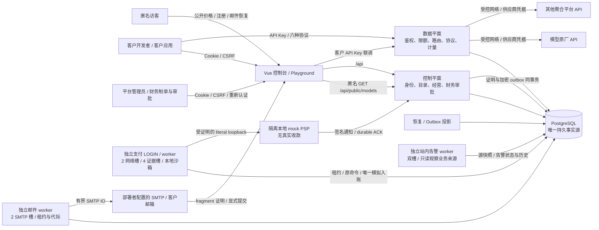

控制平面与数据平面是同一个 Go 进程内的职责边界，当前没有拆成独立微服务。客户钱包和供应商采购独立：客户按平台售价消费；上游可以是模型原厂或收费聚合平台。渠道＋精确上游模型成本版本固定每次attempt的报价，永久凭据归属把多个渠道和Key接到同一采购账户。019已实现累计采购预算和逐attempt预占，通过限定本地验收；外部余额只保存显式人工证据，不代表供应商认证余额或自动账单同步。

目标供应商为OpenAI/Codex相关API模型、Claude、DeepSeek、Gemini、GLM，以及硅基流动等第三方平台。每个平台分别认证协议profile、硬计量边界、采购报价和账户，不按模型同名继承认证；当前实现与正式认证之间的差别见[逐渠道接入计划](../design/provider-qualification-plan.md)。

技术栈为 Go/Gin、pgx/PostgreSQL、Vue 3/TypeScript/Element Plus；前端构建嵌入单个 Go 可执行文件。无需 Redis/Kafka。PostgreSQL 同时承担事务事实源、恢复任务与 outbox，统计通过独立角色投影，不直接参与模型响应的网络过程。

<!-- architecture:modules -->
## 模块、依赖与源码地图

```mermaid
flowchart TD
    CLI[cmd/moni-aigate\n装配、CLI、启动与排空]
    Web[web\n控制台与内嵌静态资源]
    HTTP[internal/server\nHTTP 编排与准入]
    Identity[identity\n会话、租户、Key]
    Catalog[catalog\n模型、渠道、版本、发现、公开投影与分组售价]
    Pricing[pricing\n既有Tx内精确价格域选择]
    PaymentProto[paymentproto\n纯协议/签名与查询绑定]
    PaymentApp[payments\n订单 / 通知 / 双manifest证明 / Processor / Runner]
    PeriodicBudget[periodicbudget\n既有事务内客户与采购周期预算]
    PeriodicVerifier[periodicbudget.Verifier\n离线只读快照 / 三态报告]
    SandboxCLI[cmd/moni-payment-sandbox\n独立本地QA进程]
    MockPSP[mockpsp\n命令/查询/双槽回调]
    PaymentReceiver[paymentreceiver\n验签/持久回执]
    PaymentRuntime[paymentruntime\nmanifest/角色/ownership证明]
    SandboxQA[paymentsandboxqa\n仅离线装配与验证]
    SandboxSchema[paymentsandboxschema\n自有SQL与静态inventory]
    SandboxPG[(专用测试PG\n三schema；B0七/B3八角色)]
    DescriptorCLI[scripts/funding-lot-descriptor\n离线元数据候选导出 / 隔离安装与清理]
    DescriptorPG[(同一专用测试PG\n每profile独立随机schema / 四角色)]
    DescriptorFiles[未审阅descriptor候选\n结构与权限分开 / 固定来源摘要]
    CatalogRR[调用方持有的RR\n静态库接口，尚无main装配]
    LotCatalog[fundinglotcatalog\n全对象/权限与事务opaque证明]
    CatalogExpected[固定expected / PG16.15 profile\nordinary五变体 / 完整sandbox]
    MaintenanceGate[maintenancetrust\nGate / 私有Snapshot / Attest / Permit]
    MaintenanceLease[maintenancetrust.ReadLease\n同rawTx / 单生命周期busy / 封闭codec]
    MaintenanceProof[ScanProof\n仅原Permit绑定的固定kind完成凭据]
    PeriodicMaintenance[periodicbudget.VerifyMaintenance\n维护资源guard / 原三态核验core]
    MaintenanceManifest[migrations\n固定embed22项 / 完整history helper]
    MaintenanceCaller[库级调用方\nGate成功只表示持锁]
    Routing[routing\n候选、采购比价与容量租约]
    Provider[provider\n协议、usage、SSE、网络]
    Billing[billing\n预占、结算、成本、双审券、统一入账与投影]
    Procurement[procurement\n共享采购账户、永久绑定、命令回执]
    Operations[operations\n实例保护、角色配置、恢复闸门]
    Mail[mailworker / maildeliver\n独立生命周期、SMTP与清理]
    AlertWorker[alertworker\n双槽 / 专用双连接 / Guard]
    Alerts[alerts\n四种观察 / 规则 / 发生与历史]
    Security[security / telemetry / config]
    PG[(PostgreSQL)]
    LedgerReader[billing ledger reader\ncaller-owned RR或真实ReadLease / 三表完整EOF]
    subgraph PureModules[纯基础层：已实现，尚未接入资金或媒体运行链]
      LotPlanner[billing lot_plan\nFIFO / 原收费分配 / 逆原来源退回]
      Metering[metering\n八维完整向量 / 精确费率 / 上界与摘要]
      RefundProto[paymentrefundproto\n退款v2封闭协议 / v1只读桥 / 三用途签名]
      LedgerRows[fundinglotverify\n独立大整数账本行检查 / 十方向不符]
    end
    RefundProto -->|仅已验证capture值的只读桥| PaymentProto
    LedgerReader -->|读取后整份独立核算| LedgerRows
    LedgerReader -->|三表显式读取 / 原RR入口前置保持| PG
    Billing -->|VerifyLedgerMaintenance生产依赖| MaintenanceLease
    PeriodicBudget -->|VerifyMaintenance生产依赖| MaintenanceLease
    LedgerReader -->|维护入口复用同一读取core| MaintenanceLease
    PeriodicMaintenance -->|19表资源资格及同一业务core| MaintenanceLease
    CLI --> HTTP
    CLI --> Operations
    CLI --> Billing
    CLI -->|独立实际worker LOGIN和连接池| PaymentApp
    HTTP -->|支付领域 / 精确DTO / 独立准入| PaymentApp
    PaymentApp --> PaymentProto
    PaymentApp -->|唯一capture资金事务| Billing
    PaymentApp --> PG
    PaymentApp -->|固定受控本地PSP出口| MockPSP
    CLI -->|verify-periodic-budgets| PeriodicVerifier
    PeriodicVerifier -->|RR READ ONLY / 无业务行锁| PG
    CLI --> Mail
    CLI --> AlertWorker
    SandboxCLI --> MockPSP
    SandboxCLI --> PaymentReceiver
    MockPSP --> PaymentProto
    PaymentReceiver --> PaymentProto
    MockPSP --> PaymentRuntime
    PaymentReceiver --> PaymentRuntime
    PaymentRuntime --> SandboxSchema
    PaymentRuntime --> SandboxPG
    SandboxQA -->|离线DDL/非空资金基线| SandboxPG
    SandboxQA --> SandboxSchema
    DescriptorCLI -->|固定001–022与候选DDL / 原provision| DescriptorPG
    DescriptorCLI --> DescriptorFiles
    CatalogRR --> LotCatalog
    CatalogExpected --> LotCatalog
    LotCatalog -->|只读catalog / Installation发行时空集| PG
    MaintenanceCaller --> MaintenanceGate
    MaintenanceGate -->|双锁 / ONLY125 / 真实身份与前驱 / accounts锁及清理| PG
    MaintenanceGate -->|固定内置stage / 同rawTx安装证明| LotCatalog
    MaintenanceGate -->|固定manifest与原history核验| MaintenanceManifest
    MaintenanceGate -->|原v1 SQL版本与摘要叶子| SandboxSchema
    MaintenanceGate -->|Permit.BeginScan / 入口出口完整重核| MaintenanceLease
    MaintenanceCaller -->|库级两个维护reader| LedgerReader
    MaintenanceCaller -->|库级维护PB reader| PeriodicMaintenance
    MaintenanceLease -->|原快照内固定SELECT / EOF Err Close| PG
    MaintenanceLease -->|正常Finish / 无悬挂查询| MaintenanceProof
    AlertWorker --> Alerts
    Mail --> Identity
    CLI --> Web
    Web -->|同源 HTTP| HTTP
    HTTP --> Identity
    HTTP --> Catalog
    HTTP --> Routing
    HTTP --> Provider
    HTTP --> Billing
    HTTP --> Procurement
    HTTP --> Operations
    HTTP --> Alerts
    HTTP -->|周期预算Reader / Commander| PeriodicBudget
    Alerts --> PG
    Identity --> PG
    Catalog --> Pricing
    Billing --> Pricing
    Billing -->|既有事务内预算helper| PeriodicBudget
    PeriodicBudget --> PG
    Pricing --> PG
    Catalog --> PG
    Billing --> PG
    Procurement --> PG
    Operations --> PG
    Routing -->|端点与协议类型| Provider
    HTTP -. 公共支撑 .-> Security
```

图中实线表示主要装配、调用或存储关系，不代表每一条 Go import。`provider` 不写财务状态、不自动重试生成请求；`routing` 管理内存健康与容量，不替代数据库的最新准入；`server` 将各阶段串联，网络调用始终在数据库事务之外。

本轮GitHub入口交付将根README、首次启动和部署路径统一到当前001–022。首次远端CI发现SCRAM与旧无密码LOGIN fixture、Docker bridge与固定SQL loopback endpoint不符，以及时间内部表示/远端退出观察竞态；原四组修订保留[历史证据](../verification/github-ci-profile.md)。第二轮身份组通过，billing/server仍耗尽累计600秒，支付模拟器另因UTC反解析文本与固定Shanghai库存不符被严格拒绝。按[CI合同](../verification/ci-profile-contract.md)将两个大包各按实际完整顶层名单分四组，加identity/other共十个独立runner/数据库；临时PG显式Asia/Shanghai及真实loopback，就绪SQL核验，全部子测、race、各进程10分钟及业务期限保留。相同临时fixture原始Open在UTC拒绝、Shanghai两组件均成功，证据和新远端边界见[第二轮记录](../verification/github-ci-second-run.md)。前端、架构、vet、嵌入构建仍执行，不把配置修订视作新远端通过。最终本地make check及指定专库make verify-mvp均通过，286项前端/全默认Go race/vet/build见[集成记录](../verification/maintenance-snapshot-integration.md)。B0回调测试按[冻结oracle](../../specs/022-self-service-payments/b-runtime-contract.md#103-根冻结双网络槽与prepare竞争的独立测试oracle)区分双HTTP槽与合法保守lease：网络槽测试仅在fixture使用同实际LOGIN单连接pool，另以标准多连接真实gate竞争证明Prepare deferred不改原租约/attempt或制造IO证据。生产pool、两槽调度、Guard和全部预算保持原合同；整仓结果与原失败见[本轮集成记录](../verification/github-initial-delivery.md)。

独立纯基础层没有连接到当前请求链；LotPlanner只处理候选快照，Metering只处理完整已知向量，RefundProto只验证封闭退款协议及原capture绑定，LedgerRows只核调用方传入的三类账本行。它们不证明数据库已读全、来源、授权、真实外部退款或供应商计量，不授资金写入能力。C0生产来源、C1原路退款、023-C商品和024-B0-I媒体接线仍须各自完成SQL/权限、全路径与真实验收。

LedgerReader是独立核验的读取依赖，保留私有caller-owned RR入口，新增库级`VerifyLedgerMaintenance(*ReadLease)`入口；两者复用同一显式列、完整EOF读取和独立LedgerRows核算core。维护入口真正消费原T2 Permit发行的ReadLease，不借pool或新建事务。PB另有库级`VerifyMaintenance(*ReadLease)`，与原public Verifier共用业务SQL及三态算法；原public实际LOGIN/owner/history/RRRO边界保持。两个维护入口均无普通main、HTTP或生产维护CLI装配，局部结果不证明完整资金来源。

`fundinglotcatalog`是另一个只读叶子模块：固定expected先作SHA/封闭解析，三个公开API在同一RR核完整schema、角色和ACL并发行同事务证明。ordinary真实无worker，sandbox完整三schema八角色；Installation只额外证明发行时十六表全空。T2维护授权通过原Snapshot内部owned installation消费其证明，当前仍没有普通main或资金调用边。详见[细化架构](funding-lot-catalog.md)。

`maintenancetrust`在T0双锁基础上提供T1私有单次Snapshot及T2真实维护授权。T3新增真实ReadLease：单次扫描全程持原busy，入口/出口重核原authority，固定至多30秒并受原Snapshot和caller更早期限约束；封闭参数/Scan目标、完整EOF/Err/Close和CPU取消共同控制读取生命周期。新增生产依赖为billing→maintenancetrust及periodicbudget→maintenancetrust。T1历史真实PG/race115.412秒、124终态PASS保持原范围；T2与T3证据分别记录，尚无普通main、完整全来源或资金接线，详见[细化架构](maintenance-gate.md)。

| 模块 | 负责什么 | 源码与合同 |
| --- | --- | --- |
| 进程入口 | 配置、迁移校验、单活保护、worker、SIGTERM 排空 | [main.go](../../cmd/moni-aigate/main.go)、[运行手册](../runbooks/deployment.md) |
| HTTP 编排 | Console API、匿名公开目录、六协议入口、请求/完成短阶段队列、独立限额 | [server.go](../../internal/server/server.go)、[gateway.go](../../internal/server/gateway.go)、[admission_queue.go](../../internal/server/admission_queue.go)、[Key 桶](../../internal/server/key_runtime_limiter.go) |
| 身份与授权 | Session、MFA、平台/租户角色、模型授权、Key 三条配置版本线 | [identity](../../internal/identity)、[身份合同](../../specs/001-commercial-mvp/contracts/identity.md)、[017](../../specs/017-key-configuration/spec.md) |
| 模型与渠道 | 能力 profile、渠道/凭据版本、模型映射、目录发现、批量启停 | [catalog](../../internal/catalog)、[012 凭据池](../../specs/012-credential-pools/spec.md)、[013 批量操作](../../specs/013-channel-batch-operations/spec.md) |
| 公开目录 | 默认私有、六协议安全DTO、单SQL时钟/公共默认域售价、公开CAS与匿名有界准入 | [public_catalog.go](../../internal/catalog/public_catalog.go)、[HTTP](../../internal/server/public_catalog.go)、[准入](../../internal/server/public_catalog_admission.go)、[020合同](../../specs/020-public-catalog/contracts.md)、[价格页](../../web/src/views/PricingView.vue) |
| 路由 | 优先级/权重、健康隔离、采购比价与单价上限、渠道与成员双容量、候选解释 | [routing](../../internal/routing)、[成本策略](../../internal/routing/cost.go)、[018 合同](../../specs/018-cost-aware-routing/spec.md)、[路由决策集成验证](../../internal/server/route_decisions_integration_test.go) |
| 协议与出口 | 请求约束、响应/usage 校验、SSE、SSRF/DNS/重定向限制 | [provider](../../internal/provider)、[协议合同](../../specs/001-commercial-mvp/contracts/provider.md) |
| 财务与恢复 | 客户硬预占、不可变证据、唯一结算/释放、成本、补偿、恢复/投影 | [billing](../../internal/billing)、[计费合同](../../specs/001-commercial-mvp/contracts/billing.md) |
| 共同入账与双审券（022-A） | 人工核款/运营赠额唯一入账、六命令回执、独立HMAC、一次codes、来源查询与未知提交保护 | [funding](../../internal/billing/funding.go)、[核验](../../internal/billing/funding_verify.go)、[券命令](../../internal/billing/voucher_commands.go)、[安全查询](../../internal/billing/voucher_query.go)、[keyring](../../internal/security/voucher.go)、[HTTP](../../internal/server/commerce_handlers.go)、[017迁移](../../migrations/017_funding_vouchers.sql)、[证据](../verification/funding-vouchers.md) |
| 分组售价（023-A） | 单tenant单组、绝对价/缺价拒绝、不可变请求快照、原操作回执及缺价预览；已完成限定本地集成验收 | [Tx helper](../../internal/pricing/pricing.go)、[管理](../../internal/catalog/pricing_commands.go)、[查询](../../internal/catalog/pricing_queries.go)、[HTTP](../../internal/server/pricing_handlers.go)、[018迁移](../../migrations/018_tenant_pricing.sql)、[精确合同](../../specs/023-periodic-products/a-contract.md) |
| 独立本地支付沙箱（022-B0） | P协议、M模拟器/receiver/持久回调和私密运行证明已编码；专项真实PG/race和真实进程短程通过，长程故障验收按记录推进；独立M/Q进程限定验证；应用接线另见B3 | [协议](../../internal/paymentproto)、[模拟器](../../internal/mockpsp)、[接收器](../../internal/paymentreceiver)、[运行证明](../../internal/paymentruntime)、[版本1 SQL/inventory](../../internal/paymentsandboxschema)、[离线QA](../../internal/paymentsandboxqa)、[精确合同](../../specs/022-self-service-payments/b-runtime-contract.md)、[验证记录](../verification/payment-sandbox.md) |
| 周期预算核心（023-B） | 020追加迁移、billing预占/采购/派发/原窗收尾、受限角色与启动核验已接线；Reader/Commander与HTTP/控制台已接线，核心全Go/HTTP专项/前端/真实多tab/隔离main浏览器通过；最终020相关回归与预览升级通过，独立三态只读核验器和CLI专项通过，交叉回归继续 | [纯基础层](../../internal/periodicbudget)、[HTTP冻结片](../../specs/023-periodic-products/b-http-contract.md)、[Tx合同](../../specs/023-periodic-products/b-tx-contract.md)、[Reader合同](../../specs/023-periodic-products/b-reader-contract.md)、[Commander合同](../../specs/023-periodic-products/b-commander-contract.md)、[核心接线](../../specs/023-periodic-products/b-integration-contract.md)、[020迁移](../../migrations/020_periodic_budgets.sql)、[核心验证](../verification/periodic-budgets.md) |
| 周期预算离线核验 | 实际owner LOGIN、六表owner及完整最新迁移，同一RR只读快照核19类异常与3类历史缺证；0/2/3/1退出码，不修复数据 | [Verifier](../../internal/periodicbudget/verifier.go)、[CLI](../../cmd/moni-aigate/periodic_verify.go)、[迁移快照核验](../../migrations/verify_readonly.go)、[精确合同](../../specs/023-periodic-products/b-verifier-contract.md) |
| 支付资金接缝（022-B2） | 021追加完整支付SQL、第三来源helper、十方向核验与三角色最小权限；真实PG专项通过；订单领域/worker/HTTP现由B3接线 | [021](../../migrations/021_payment_sandbox.sql)、[第三来源](../../internal/billing/funding_sandbox.go)、[角色](../../internal/operations/payment_roles.go)、[冻结合同](../../specs/022-self-service-payments/b2-funding-contract.md)、[B3设计](../../specs/022-self-service-payments/b3-http-ui-contract.md) |
| 应用支付闭环（022-B3） | 订单/通知/安全视图、双manifest/022证明、独立真实worker、2网络/4证据槽、HTTP/UI和main已接线；专项PG/race及两轮真实主进程、最终浏览器整链通过限定本地验收；在途SIGTERM/真实Guard失权独立真实进程补验通过 | [领域与运行](../../internal/payments)、[HTTP](../../internal/server/payment_handlers.go)、[准入](../../internal/server/payment_admission.go)、[启动](../../cmd/moni-aigate/payment_startup.go)、[022](../../migrations/022_payment_runtime_attestation.sql)、[前端](../../web/src/components/PaymentsPage.vue)、[分层证据](../verification/payment-application.md) |
| 资金来源分配算法（022-C0窄切片） | 仅package-private纯FIFO/finish/逆原charged边refund算法及race专项通过；无DB/网络/资金入口，C0正式DDL与维护仍候选 | [算法](../../internal/billing/lot_plan.go)、[冻结范围](../../specs/022-self-service-payments/c0-lot-contract.md#12-根冻结纯分配算法切片2026-11-01)、[验证](../verification/funding-lot-planners.md) |
| 独立账本行核验（022-C0-V0-L） | 三类原始行、平台余额/分录/跨tenant/孤儿/重复十方向，独立big.Int求和；原race/vet/fuzz通过，现由私有RR和T3维护reader共用；无普通main或资金入口 | [纯包](../../internal/fundinglotverify)、[冻结合同](../../specs/022-self-service-payments/c0-verifier-contract.md#12-首个有界实施片-v0-l原始账本行独立纯重放根冻结)、[验证](../verification/funding-ledger-rows.md) |
| 同RR账本读取（022-C0-V0-R） | 私有caller-owned RR、实际LOGIN、四表窄shape/history与函数解析前置；三表128条keyset至完整EOF后独立核算，保留journal额外事实；原15项真实PG/race与vet专项保留，读取core现与T3共用；该原入口自身不发proof | [reader](../../internal/billing/funding_ledger_read.go)、[共享core](../../internal/billing/funding_ledger_query.go)、[冻结合同](../../specs/022-self-service-payments/c0-ledger-reader-contract.md)、[原验证](../verification/funding-ledger-reader.md) |
| C0离线结构与权限导出 | 固定001–022/DDL/ACL/provision与工具源码；ordinary/sandbox各自before/after，双轮十文件一致、失败DDL清理通过；只生成未审候选 | [生成器](../../scripts/funding-lot-descriptor/main.go)、[冻结窄片](../../specs/022-self-service-payments/c0-schema-check-contract.md#9-根冻结窄片metadata-only-离线-descriptor-生成器)、[元数据证据](../verification/funding-lot-descriptor.md) |
| C0正式静态检查与事务证明 | 固定PG16.15 profile、ordinary五变体/无worker、sandbox三schema八角色；Snapshot/Installation/Runtime三入口与同tx opaque证据，最终leaf真实PG race已通过；不授维护或资金权限 | [API](../../internal/fundinglotcatalog/types.go)、[核验与证明](../../internal/fundinglotcatalog/proof.go)、[固定root](../../internal/fundinglotcatalog/expected_embedded.go)、[细化图](funding-lot-catalog.md)、[冻结合同§10](../../specs/022-self-service-payments/c0-schema-check-contract.md#10-根冻结完整静态检查器的实现与正式期望启用) |
| 维护双锁Gate与快照（022-C0-T0/T1） | T0真实PG/race已验；T1私有单次RR、ONLY125/固定catalog stage、总期限及终结状态，历史真实PG/race124终态全PASS；T0/T1历史片不含Permit、main或资金接线 | [Gate](../../internal/maintenancetrust/gate.go)、[身份](../../internal/maintenancetrust/identity.go)、[冻结合同§10](../../specs/022-self-service-payments/c0-permit-contract.md#10-根冻结t0专用连接双session-gate与清理)、[细化图](maintenance-gate.md)、[T0验证](../verification/maintenance-gate.md)、[T1验证](../verification/maintenance-snapshot.md) |
| 真实维护授权（022-C0-T2） | 同原Snapshot发行一次Permit；实际身份、完整history/前驱、新鲜停服及仅Init账户锁；T2专库专项通过，不授资金写入 | [Attest/Verify](../../internal/maintenancetrust/permit.go)、[冻结合同](../../specs/022-self-service-payments/c0-authority-contract.md)、[T2证据](../verification/maintenance-authority.md) |
| 受控维护读取与两个局部reader（022-C0-T3首片） | ReadLease、封闭codec、完整Rows生命周期、原authority入口/出口重核；ledger/PB真实维护入口与原core复用已实现，验证范围单独记录；无全源coverage/basis/epoch/生产CLI | [lease](../../internal/maintenancetrust/lease.go)、[Rows](../../internal/maintenancetrust/lease_rows.go)、[codec](../../internal/maintenancetrust/lease_codec.go)、[ledger](../../internal/billing/funding_ledger_maintenance.go)、[PB](../../internal/periodicbudget/verifier_maintenance.go)、[合同](../../specs/022-self-service-payments/c0-read-lease-contract.md)、[T3专项](../verification/maintenance-read-lease.md)、[集成记录](../verification/maintenance-read-lease-integration.md) |
| 退款v2纯协议（022-C1-P） | v1已验capture只读桥、严格六种DTO、四摘要域与三用途HMAC、不可变opaque；独立Python向量及race/vet/fuzz通过，无运行接线 | [纯包](../../internal/paymentrefundproto)、[精确合同](../../specs/022-self-service-payments/c1-protocol-v2-contract.md)、[独立向量](../verification/payment-refund-v2-golden.json)、[验证](../verification/payment-refund-protocol-v2.md) |
| 通用向量计量纯层（024-B0-P） | 闭合八维、两侧完整schema绑定、有理率总和一次ceil、上界/actual区分、规范摘要和旧token等价adapter；专项race/vet/fuzz通过，尚未被网关运行模块调用 | [纯模块](../../internal/metering)、[冻结合同](../../specs/024-extension-platform/b0-pure-contract.md)、[证据](../verification/metering-vectors.md) |
| 采购资金 | 平台共享账户、永久凭据绑定、累计预算、逐attempt预占、未知占用、双人更正与人工观察 | [procurement](../../internal/procurement)、[采购账务](../../internal/billing/procurement.go)、[019合同](../../specs/019-procurement-accounts/contract.md)、[014迁移](../../migrations/014_procurement_accounts.sql) |
| 运维与安全 | 最小数据库角色、实例 advisory lock、恢复闸门、密钥轮换 | [operations](../../internal/operations)、[security](../../internal/security)、[telemetry](../../internal/telemetry)、[config](../../internal/config) |
| 自助身份 | 邮箱证明后最小权限开户、当前MFA下恢复密码、全部会话撤销、加密邮件队列/有界投递与清理；默认关闭注册与邮件 | [身份事务](../../internal/identity/self_service.go)、[匿名HTTP](../../internal/server/self_service_handlers.go)、[outbox](../../internal/identity/mail_outbox.go)、[worker](../../internal/mailworker/worker.go)、[SMTP](../../internal/maildeliver/smtp.go)、[021合同](../../specs/021-self-service-identity/contract.md) |
| 站内经营告警（024-A，限定本地验收通过） | 四个固定来源、规则CAS、共同确认、不可变历史及观察新鲜度；默认关闭评估 | [领域](../../internal/alerts)、[worker](../../internal/alertworker/worker.go)、[HTTP](../../internal/server/alert_handlers.go)、[准入](../../internal/server/alert_admission.go)、[019迁移](../../migrations/019_operations_alerts.sql)、[精确合同](../../specs/024-extension-platform/a-contract.md)、[验证范围](../verification/operations-alerts.md) |
| 控制台 | 渠道/模型/成本经营、客户 Key/钱包/账单、六协议 Playground | [web/src](../../web/src)、[路由](../../web/src/router.ts)、[路由编辑器](../../web/src/components/RouteEditor.vue)、[成本编辑器](../../web/src/components/CostEditor.vue)、[成本编辑状态与金额合同](../../web/src/cost-aware-routing.ts)、[内嵌入口](../../web/embed.go) |
| 数据演化 | 追加 SQL、嵌入摘要校验；服务角色不执行迁移 | [migrations](../../migrations)、[角色配置](../../deploy/init-roles.sh) |
| 架构同步 | 内容清单、文档链接与完整性检查、显式复核历史 | [检查器](../../scripts/check-architecture)、[开发约定](../../AGENTS.md) |

### C0离线结构与权限候选

[元数据生成器](../../scripts/funding-lot-descriptor/main.go)只操作固定专用测试库中的随机schema和四角色，不接入普通main或资金事务。它先由原迁移/provision安装001–022，再安装固定候选C0 SQL/ACL；ordinary和sandbox分别导出完整before/after，原函数正文逐字节保留，结构依赖和ACL依赖分别编码。两轮独立安装的十个文件一致，资源精确清理及故障DDL清理通过；输出均标为`unreviewed_descriptor_candidate`，不是正式expected，也不发行InstallationProof、epoch或RuntimeProof。[证据](../verification/funding-lot-descriptor.md)记录固定来源、摘要和实际验收范围。

C0新增16表及41函数，表/列数据权限和函数EXECUTE对projector/PUBLIC为零；显式`fl_source_proof`及其数组对projector/PUBLIC的有效USAGE为零。PG16自动生成的16个table row type及16个数组保留默认USAGE，projector有效USAGE为true且无grant option；类型USAGE不授予表SELECT或函数EXECUTE。正式checker精确核这34个type的owner、raw/default ACL、有效权限及依赖，不能用“全部type零权”替代。当前资金、数据模型和运行角色未应用这些候选对象。

### C0正式静态检查与事务证明

[`fundinglotcatalog`](../../internal/fundinglotcatalog)已实现[冻结合同§10](../../specs/022-self-service-payments/c0-schema-check-contract.md#10-根冻结完整静态检查器的实现与正式期望启用)。固定root由ordinary五种形态各两轮独立安装、完整sandbox两轮及根独立来源/差异审阅形成；声明期嵌入，初始化只做静态SHA/严格解析，运行不从live DB更新expected。旧导出器及原001–022/ACL/provision pins保持不变。[变体证据](../verification/funding-lot-variants.md)、[完整peer证据](../verification/funding-lot-catalog-peers.md)与[collector证据](../verification/funding-lot-catalog-collector.md)分别记录实装、元数据、角色和解析层验收，最终出口见[正式checker汇总](../verification/funding-lot-catalog.md)。

接口继承调用方RR；Snapshot可RO/RW，Runtime仅actual选定LOGIN的RO，Installation仅增加发行时全空。真实认证身份、配置/实际TCP endpoint、DB/schema/owner/角色OID、具体wrapper/Conn/PID/backend_start/top xid在前后重核；Installation.Catalog返回新wrapper避免调用方赋值篡改empty证据。五秒覆盖发行全调用；原节点/类型I/O/其他执行对象先预检，再有界逐record采集，依赖multiset的raw/distinct上界分别从固定root得出。失败固定错误、零证明，不控制事务或改权限。

普通APP/projector与sandbox五runtime均禁止数据库CREATE及三类database grant option；PUBLIC默认CONNECT/TEMPORARY可保留，不能从namespace权限推断DB边界。类型默认USAGE和十组跨域负权分别核。当前expected只认证专库PG16.15/initdb catalog-profile，plpgsql language OID14038及C/default collation环境已记录；任意PG16/1Panel安装需后续独立profile或受审符号绑定，不自动接纳未知OID。该模块未发Permit/epoch/完整RuntimeProof，没有修改普通资金链或长期预览。

最终完整leaf race217.140秒通过，47个顶层测试、176场景PASS、3个独立capture/diagnostic/export在本命令skip；原五秒预算保持。前两轮真实预算失败与查询等价优化保留在[汇总证据](../verification/funding-lot-catalog.md)，独立清理审计确认本片角色/schema/随机DB/backend全部归零、public与database ACL未变。metadata-only observer保留DTO验证，公开issuer以同一完整已认证variant的Schema/Roles逐节点精确比较承担actual封闭校验，无公开skip口。

### 维护双锁Gate与单次快照

[Gate](../../internal/maintenancetrust/gate.go)与[非权威身份预检](../../internal/maintenancetrust/identity.go)按[根冻结T0](../../specs/022-self-service-payments/c0-permit-contract.md#10-根冻结t0专用连接双session-gate与清理)实施。专用连接不从pool借还；取得前、每次明确true及释放前后核本PID的完整advisory集合。入口共用父期限与30秒的较早值；只有明确false每50ms轮询，失回复不重发或补偿解锁。Close使用独立最多5秒，401→402明确成功并最终无锁；异常立即封闭socket registry、关闭真实底层连接，再有界清理pgx，防其异步取消晚到dial漏关。副本共态、busy拒绝及首次cleanup结果保持幂等。

Acquire本身仍不发BEGIN。T1按[根冻结生命周期](../../specs/022-self-service-payments/c0-snapshot-lifecycle-contract.md#10-根冻结范围与尚未开放的能力)建立唯一顶层RR，rawTx/Conn/context不导出；固定SET后Init第一条SELECT之前一次取得ONLY125全局C序SRE。唯一内置catalog stage保留原五秒issuer预算，stage全程独占；总期限watcher只标失效并立即关原始socket，不并发pgx。Commit/Rollback/Close保留Committed/RolledBack/Unknown/Abandoned及首次结果。账户行锁由T2在完整认证后执行，T1历史范围不含账户业务SELECT、Permit或epoch。sandbox真实super/datdba身份、可信manifest与[完整v1前驱](../../specs/022-self-service-payments/c0-predecessor-contract.md)由T2认证，T3在其原Permit上发行ReadLease与两个局部结果；独立完整来源及后续初始化仍待完成。T0/T1历史验收保留原范围，T1真实PG/race115.412秒、46顶层/124终态全部PASS，见[历史验证](../verification/maintenance-snapshot.md)，当前细节见[维护架构](maintenance-gate.md)。

### 同RR原始账本读取

[私有reader](../../internal/billing/funding_ledger_read.go)保持调用方的Repeatable Read事务、连接、backend、top xid、DB/schema及真实LOGIN身份；既不提交，也不取得维护或资金许可。它先核四表的permanent heap/owner/RLS/继承、所用builtin列和单列主键，再核history表解析与helper两个函数名的完整搜索路径重载集合，拒绝同名/default/variadic覆盖后才调用原迁移helper。

三张账本表分别显式投影、128条C序keyset至真实EOF；完整收集后只调用独立`fundinglotverify.CheckLedgerRows`一次。额外journal原列保留在同snapshot，不以JOIN过滤孤儿行，不以逐页AND代替全局算术。100000行/16MiB是整份逻辑输入硬界，30秒为全部读取共用deadline；私有RR入口失败仍返回原四个固定错误及整个零snapshot。T3[维护入口](../../internal/billing/funding_ledger_maintenance.go)经真实ReadLease调用同一[读取core](../../internal/billing/funding_ledger_query.go)，入口前置由原T2承担，Finish后才保存私有snapshot和ScanProof。成功摘要仍仅`supplied_ledger_rows`，不声称全部来源/Key/采购/周期/支付/lot图已核验。

### 独立本地支付沙箱（022-B0）

`moni-payment-sandbox`运行模拟器或接收器；它们保留独立装配。B3另将普通网关连接到同一专用mock API，使用新的APP/worker证明与独立受限worker；两种运行链路分别验收。离线QA使用专用127.0.0.1:55439/moni_test建三个随机schema：应用克隆、mock、receiver，及B0七个无membership的owner/runtime/projector角色；B3离线应用QA另增第八个真实worker LOGIN。mock/receiver各自实际LOGIN只读写自己的schema；它们不能访问应用资金或对方业务表，应用/投影角色也不能进入沙箱schema。离线installer会沿真实人工双审与投影建立非空资金基线，所有专项前后逐字段摘要比较；这不是在线PSP入账。

启动先验证私有文件、DSN、数据库/schema/角色OID、精确静态catalog inventory、最小权限、不可变marker/key摘要，再取得独占ownership；失败前不打开listener。运行时fresh Guard失败永久fence并取消服务。模拟器API与QA control分别认证并有独立准入；receiver仅接受固定路径的exact raw HMAC通知。签名密钥、nonce、token、DSN不进入日志或持久安全回执。关闭先取消并排空HTTP、事务与两个回调槽，再释放ownership。

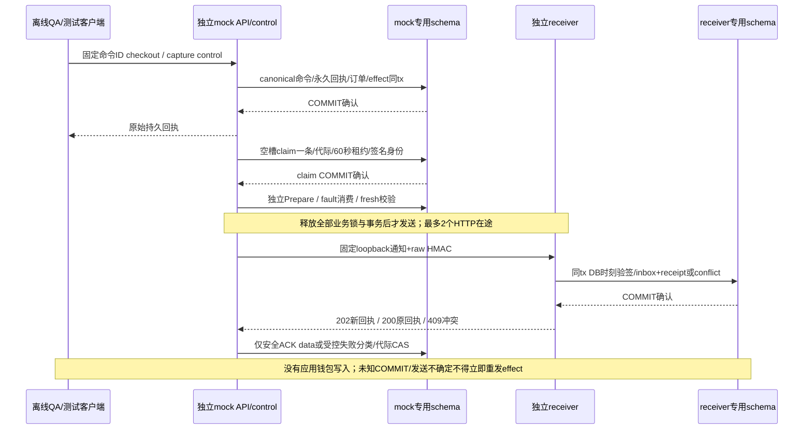

mock的16张自有表分为环境/版本/key、命令/processing/results、订单/transition/capture、永久query、control/fault以及notification/delivery/attempt/observation；receiver六表是环境/版本/key、inbox、receipt和conflict。canonical业务体及回执不可变；target session gate先于merchant/行锁，网络不持锁。过期租约与退避可恢复通知投递；每次实际claim消耗次数，第20代转review并保留迟到证据，禁止第21代。这些代码规则的真实长程与崩溃覆盖按[验证记录](../verification/payment-sandbox.md)分别标注，不将短PG或SQL checkpoint当作完整运行验收。

<!-- architecture:protocols -->
## 对外协议与产品能力

正式渠道目标已明确为OpenAI/Codex、Claude、DeepSeek、Gemini、GLM及硅基流动等第三方平台，逐渠道profile、采购费率和实际用量认证范围见[接入计划](../design/provider-qualification-plan.md)。当前协议实现不等于这些平台所有模型已获可售认证。

所有推理入口使用客户 API Key。Console session 不等价于客户推理授权；Playground 使用客户自己输入的 Key。有效模型权限是“平台启用与能力 profile ∩ 租户授权 ∩ 成员授权 ∩ Key 范围”，并叠加来源地址、地域、期限、预算和运行限额。

| 协议 | 入口 | 当前范围与计费 |
| --- | --- | --- |
| OpenAI Chat | `POST /v1/chat/completions` | 文本 JSON/SSE；基础客户端函数工具转发；输入/输出 token |
| OpenAI Responses | `POST /v1/responses` | 文本与基础函数工具；输入/输出 token |
| Anthropic Messages | `POST /v1/messages` | 文本与基础工具；输入/输出 token |
| OpenAI Embeddings | `POST /v1/embeddings` | 非流，受界限的批量输入；仅输入 token |
| Jina Rerank | `POST /v1/rerank` | token 计费的非流检索重排；仅输入 token |
| Gemini native | `POST /v1beta/models/{model}:generateContent` / `:streamGenerateContent` | 无状态纯文本 JSON/SSE；thinking 计入输出，cache 是输入子集 |

模型列表为 `GET /v1/models`。协议由显式发布的 profile 决定，模型上架不代表它的任何任意参数或端点都可以透传。当前不是全部 SDK/供应商认证：托管工具、多模态、Realtime、Gemini 工具和其他计费方式仍在后续范围。协议约束见[009 检索](../../specs/009-retrieval-protocols/spec.md)、[010 Gemini](../../specs/010-gemini-native/spec.md)及[provider 类型](../../internal/provider/types.go)。

<!-- architecture:request -->
## 一次请求怎样经过系统

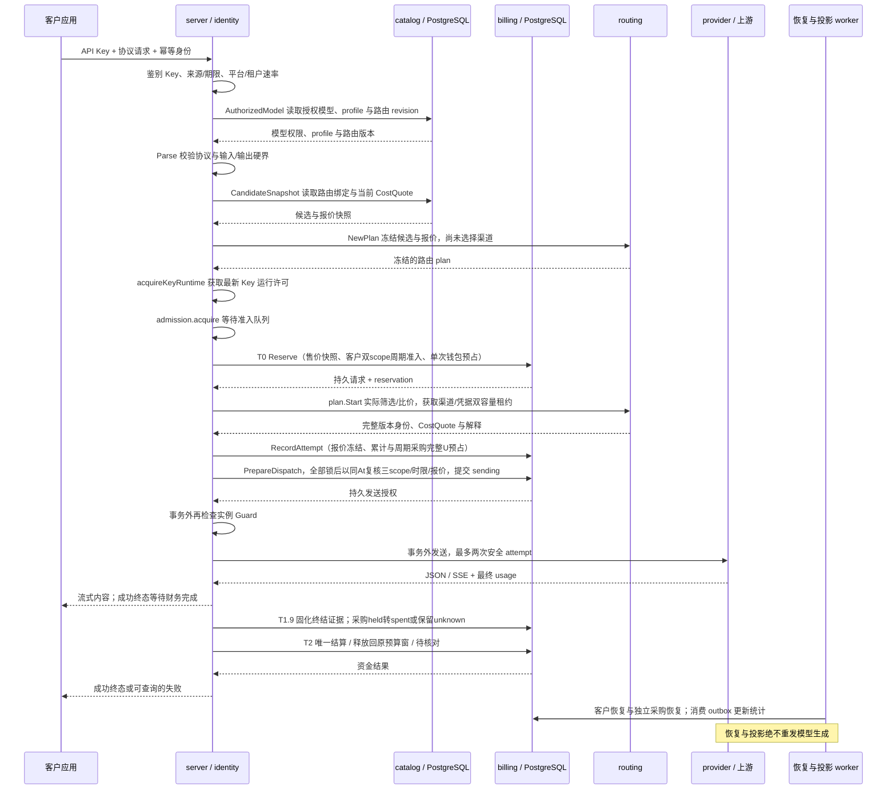

`Reserve`、`RecordAttempt` 和 `PrepareDispatch` 是数据库内的最新准入检查点；撤权、来源策略、Key 范围/期限、渠道启停与凭据撤销不能只依赖请求开始时的缓存。`PrepareDispatch` 提交 `sending` 是允许发送的边界，之后的限制不能追溯撤回已在途请求，也不能阻止其财务收尾。[短阶段调度](../../internal/server/admission_queue.go)和[派发读取批次](../verification/dispatch-read-batches.md)优化只减少往返，不省略这些锁和新快照。

默认 `manual/allow` 且没有采购单价上限的路由，按渠道优先级/权重与健康/容量选择渠道。018 增加可选采购比价与硬单价门禁，详细规则见下文。然后在渠道的不可变凭据池中按成员权重/容量选择凭据；增加池成员不会额外扩大渠道的业务权重。已选择的渠道版本、池 revision、凭据、精确上游模型与采购报价写入 attempt。最多两个生成 attempt；仅在已证明无消费且满足策略时换渠道，未知消费、已经输出或同渠道换 Key 都不能触发重放。

请求幂等和财务幂等各自持久化。提交结果未知时不得以“没收到响应”为由重试网络请求。客户取消、连接中断和 SSE 尾包丢失必须保留消费可能性，不能直接当成免费成功或零成本。

### 客户资金与上游成本

客户售价固定在请求的零售版本快照中，与最终选到哪个渠道无关。T0 在一个事务内冻结钱包与 Key 可用额度，写请求、reservation、平衡分录和恢复/outbox 依据；T2 只使用可信最终 usage，并以原始预占为上限结算、释放剩余。金额采用 CNY 微元整数，不用浮点数累计。

成本按每一次已准入 attempt 保存：`channel + upstream_model + effective_at` 命中的成本版本、输入/输出每百万 token 单价，以及 `contract/invoice/unknown` 依据。已知最终用量才能核算可能消费的请求；缺价格或缺用量必须保持 unknown，不能记为零。已明确 `not_sent` 或满足供应商无消费合同的 `rejected` 证据可以确认为零成本，不能与未知消费混淆。平台可以追加幂等成本修正，修正不会改变零售价格、客户钱包或原始事实。[成本接口](../../internal/server/reports.go)、[成本与证据逻辑](../../internal/billing/evidence.go)、[平台成本查询](../../internal/billing/query.go)。

仍可能消费但没有可信最终量的请求进入待核对。数据库时钟和行锁控制 24 小时硬截止：届时仍未结算则释放客户冻结；晚到证据只能补充平台成本，不能自动再扣客户。退款追加补偿分录，累计不超过原消费，不重置 Key 已消费数。[恢复](../../internal/billing/recovery.go)、[结算](../../internal/billing/settle.go)、[财务审批](../../internal/billing/orders.go)。

### 018 采购单价门禁与成本感知路由

018 后端与控制台已实现并通过限定本地验收，实际范围见[018 验证记录](../verification/cost-aware-routing.md)。不可变路由策略新增 `cost_mode=manual|cost_first` 与 `unknown_cost_policy=allow|deny`；完整路由发布仍受模型 revision CAS 保护，每个 binding 可设置输入/输出两维 `max_*_cost_rate`。上限 `null` 表示该维不限，`"0"` 要求该维已知免费；API 费率采用十进制字符串，内部为 CNY 微元/百万计费 token。`cost_first` 必须拒绝未知成本；manual/allow 无上限保留旧行为。启用成本管控后，缺报价、缺任一维或 basis unknown 均被拒绝，不会把未知按零参与比较。

选路先排除权限/地域/启停/撤销、已尝试、健康/容量和成本硬限制不合格的候选，再取最高 priority 层；`cost_first` 仅在该层比较 `S = input_upper_bound × input_rate + output_limit × output_rate`，使用 `big.Int` 不提前舍入。同价保留原渠道权重，再按成员权重选择凭据；跨渠道统一比价需配置相同 priority。S 是保守用量界对应的比较分数，不能当作实际账单、共享采购预算预占或实际最优成本。

候选读取冻结 `CostQuote`（版本、两维费率、basis）；`RecordAttempt` 在原准入锁后核对当前报价并冻结；`PrepareDispatch` 取得全部父记录/渠道/凭据/reservation/attempt 锁后，以新的数据库时钟重新选当前生效报价，再比较冻结版本/费率/basis 和上限，最后才提交 `sending`。报价变化以 `cost_quote_stale` 拒绝，不发送、不自动重报价/重规划，客户冻结按未发送证据收尾。`sending` 之后的调价不影响在途请求和原财务收尾，不在共用收尾锁 helper 增加成本门禁。

成本发布使用 `expected_channel_revision` 与渠道 UPDATE 屏障，版本和审计同事务；数据库 INSERT 触发器让直接 SQL 同样参与渠道管理 revision 和派发同步。新发布同渠道/精确上游模型/生效时刻的重复版本被拒绝，历史同刻多版本按 `effective_at DESC, created_at DESC, id DESC` 确定选择。未来调价即便没有后续写入，也会在 sending 前的新时钟校验中被发现。仅平台管理员可查看采购报价与完整候选解释；平台 probe 和目录发现继续沿自己的合同，不使用客户成本偏好。[018 规格](../../specs/018-cost-aware-routing/spec.md)、[013 迁移](../../migrations/013_cost_aware_routing.sql)、[报价同步检查](../../internal/billing/cost_policy.go)、[竞态验证源码](../../internal/billing/cost_policy_integration_test.go)。

这些门禁约束本库登记的采购单价，不能强制供应商外部的真实扣款；自动查价、汇率、缓存折扣、阶梯价及供应商真实余额同步仍需后续规格。019累计采购预算见下文；客户售价、钱包、最多两次安全尝试和不重放规则保持独立合同。

### 019 共享采购账户与双边资金

永久credential绑定使多个渠道、多个客户共用同一采购账户；没有绑定的成员逐个标记legacy_unmanaged。绑定后所有新attempt强制完整已知报价和候选→attempt→sending一致性，manual/allow或旧渠道版本不能绕过。账户累计预算为CNY微元，余额事实用NUMERIC、API用字符串；候选按实际请求硬界和账户快照初筛，真正保证由RecordAttempt的数据库账户锁与持久预占完成。

锁序为原tenant/身份/Key/model/channel/credential → 客户reservation → attempt → 采购account（FOR NO KEY UPDATE）→ 采购reservation。账户管理只锁account不回取前层，绑定从channel UPDATE开始。全部锁后重新采样数据库时间检查报价与截止；暂停或预算收紧阻新sending，已发证据和资金收尾继续。客户释放、退款与24小时截止均不释放采购未知占用。独立采购恢复可释放过期且未获许可的prepared；sending崩溃只能保留unknown，恢复没有生成网络调用能力。

可信usage把采购held转spent并释放差额；超硬界保存完整成本、暂停账户；证据冲突保留spent并恢复保守held，独立双人对账。语义证据指纹追加去重，提案同时冻结资金revision和证据数量，新冲突使旧待审失效；同义重复不重开已裁决结果。unknown/disputed异常即使账户被手工改active也不能新发；已确定成本异常仍需管理员显式决定恢复。采购成本更正不追加扣客户，减少spent需要供应商invoice证据，旧单人成本接口拒绝受控attempt。

账户配置、永久绑定和人工余额观察均有持久operation_id及applied/rejected回执。控制台未知写仅只读查询原ID；金额无损，身份/页面/关闭epoch隔离晚回。观察带来源、语义、时刻和known/unknown/unsupported/error，不参与预算准入。采购历史不可变、投影角色无采购读取权；deferred校验要求账户余额＝采购预占合计＝不可变事件合计。该校验会随账户历史增长增加查询开销，性能阶段须按保留不变量的增量合同优化。[冻结合同](../../specs/019-procurement-accounts/contract.md)、[HTTP](../../internal/server/procurement_handlers.go)、[控制台](../../web/src/views/ProcurementView.vue)、[采购竞态测试](../../internal/billing/procurement_integration_test.go)。

### 020 匿名模型目录与售价观察

访客通过独立公开布局 `/pricing` 访问 `GET /api/public/models` 及 `/:id`，页面在私有 loadMe/MFA 路径之前分流，匿名请求省略凭据。公开只读取 `public_visible AND enabled` 模型，旧/新模型默认私有；只返回逻辑模型名、六协议能力限制和当前客户售价的白名单DTO。原始profile、渠道/供应商地址或秘密、采购成本、租户与内部健康均不进入公开响应。私有、停用和不存在详情同404，异常公开profile或无界字段整次503，不伪造能力或以旧缓存兜底。

单次SQL使用一个数据库时钟（含空页），售价按 `effective_at DESC, created_at DESC, id DESC` 选择当前版本；既有001同模型/生效时刻唯一约束保留。公开、已登录当前价和Reserve采用同序，但公开观察不锁定调用价格或授予模型/Key权限。金额使用规范int64字符串和前端BigInt；缺价unavailable与零价区分，检索协议输出价固定0。固定50条、额外取1判断更多，按C排序和严格筛选绑定cursor分页；每批保留独立观察时刻。

匿名总桶20rps/burst40、每来源2rps/burst8、来源总数≤4096（含unknown）；metadata Guard前最多4在途，满额立即429，2秒context包含DB pool等待且许可仅归还一次。独立于登录/收费桶；原ready/Guard仍可返回instance_unavailable，恢复模式仅允许原本就ready且Guard有效的只读访问，不能重新置ready。无模型网络调用和资金写入。

仅admin可在原CSRF/再认证/MFA/恢复门禁下修改公开标记；完整CAS使用独立字符串public_revision，启停不覆盖公开列，停用保留预设，重启用恢复展示。冲突或结果不明先只读核查，显式新编辑才提交。迁移015和DB触发器使直接SQL也不能伪造revision。[冻结合同](../../specs/020-public-catalog/contracts.md)、[015迁移](../../migrations/015_public_catalog.sql)、[本地验证](../verification/public-catalog.md)。

## 自助身份与邮件链路（021）

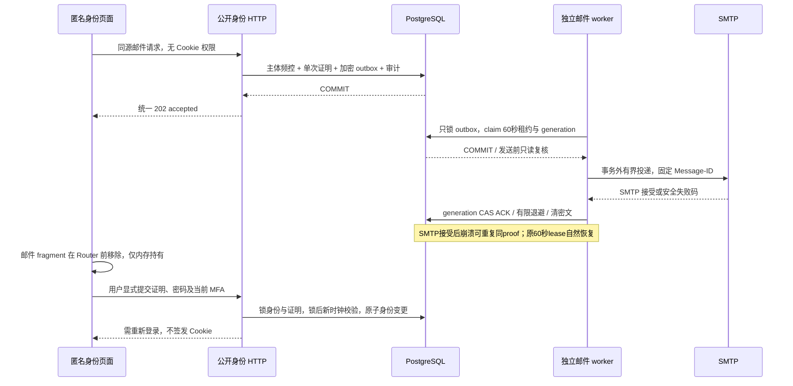

`GET /api/auth/capabilities`仅返回全站有效能力与原因。默认`AUTH_REGISTRATION_ENABLED=false`、`MAIL_TRANSPORT=disabled`；reset flag默认为true但无邮件不能使用。初始化标志和Bootstrap管理员同事务，旧库仅有admin时回填，公开注册不能抢先封死初始化。开户前只签发证明；完成后新user为none、新tenant owner的allow_all_models=false，零余额、无模型授权与API Key。

密码恢复锁序user→subject→challenge→当前MFA→全部session families按ID；最后锁等待后重读DB时钟/密码revision/TTL。正确因素消费、密码变更、证明消费、所有family撤销与审计同事务，普通改密也由DB增加revision。API Key独立；此前已完成session认证的普通在途业务写仍沿既有行为，不承诺全部撤回。

SMTP与资金恢复分开运行，最多2个空闲槽claim，5次有限重试；lease60秒、网络20秒、发送前至少25秒余量。仅锁outbox，提交后才网络IO；旧代际ACK无效。SMTP接受与ACK不原子，可重复同一邮件，proof仍只消费一次；sent不代表客户实际收件。终态/自然失效清秘密、7天保留后删元数据；第5次claim崩溃过租约转dead。功能关闭/恢复模式暂停投递但有效Guard下继续失效清理；Guard失败全部停止。正常退出取消邮件IO，已开始Guard检查独立最长1秒完成，避免正常取消误伤HTTP排空。

025-A1-M已验两个真实SIGKILL窗口：claim后/220前，以及最终250后、实际APP的FinishMail被物理行锁阻塞时。替代进程保留原60秒lease，自然generation2，分别1/2封同Message-ID和proof，sent清密文且proof未消费。SMTP全程上界小于9秒，FinishMail观察/kill/零连接小于4.5秒，限定证据与清理见[邮件进程记录](../verification/mail-lifecycle-025.md)。这不证明外部收件、容器、HA或灾备。

匿名POST使用严格4KiB DTO、同源、实例Guard、独立有界IP/主体限流及4个hash槽。前端四条匿名路由省略凭据；GET/刷新不消费证明，不自动POST，unknown后仅显式登录核查。fragment及history.state在createWebHistory之前清理，token/password/MFA不写storage；loadMe epoch同时隔离晚回状态与401事件。真实收件、域名信誉和生产反滥用保留外部门禁。[详细设计](../design/self-service-identity.md)、[016迁移](../../migrations/016_self_service_identity.sql)。

<!-- architecture:data -->
## 分组售价与请求快照（023-A）

价格组与tenant隔离、模型授权、Key scope及预算独立。tenant只能归属一个组，NULL为公共默认域；组价格是两维绝对价。管理服务使用不可变pricing_operations保存原safe_input/fingerprint/result，组修改与归属各自CAS；创建/发布首回201、重放200。原operation GET永远解码原snapshot，不根据当前资源拼回。当前active admin可写，三平台读角色每请求重查；客户只看自己当前域。

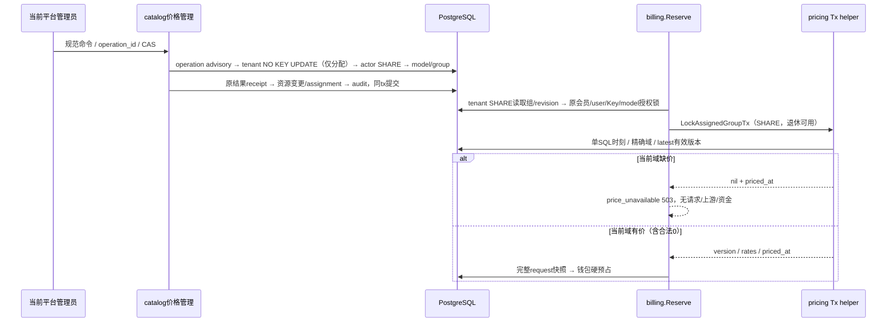

钱包等待前冻结组/revision/version/两费率/观察时刻，钱包锁后仅复查原Key与deadline。后续调组、组退休或晚发布不重写已接纳请求，也不阻止历史有利收尾。旧请求新增三列全NULL为legacy，不能补成“当时默认价”；新请求须完整，DB触发器与request列权限共同禁止改价。

匿名目录与旧平台默认价接口显式过滤NULL域；客户模型/报价和已生效历史在同SQL核对当前user/tenant/membership/模型授权后读取本域，不回落默认。平台缺价preview以目标tenant当前启用且已授权模型为范围，每页统一SQL时刻并返回完整context；可明确接受缺价分配，预览不保证未来调用可用。列表50+1、游标绑定当前actor/接口/target、末页空串；新读/写/preview/客户报价各有独立有界准入。额外模型报价不改变/v1/models结构。

数据关系为tenant→price_group、price_version→可选group、group/归属事件→immutable operation、request→原price与组快照。018只追加列/表/guard与唯一性，NULLS NOT DISTINCT保护默认域同生效时刻唯一；历史不更新，不产生资金。app仅组状态列、tenant业务及pricing列、request生命周期三列有UPDATE权；projector无新表读取权。023-A真实PG分包回归/并发故障、227项前端/strict、真实main浏览器和018预览升级通过[限定本地验收](../verification/tenant-pricing.md)；周期预算与商品不因A接通而完成。

## 周期预算核心（023-B）

020引入tenant、Key与procurement三种独立control，UTC自然日/月，首次cap从下一完整周期生效。客户按最终Reserve时刻记录完整R，两种客户scope共享同一次钱包预占；采购每个实际attempt按冻结报价完整预占U。control.total_held包含旧期与legacy未决占用，当期spent与全部held共同参与新准入；关cap仍持续记账。配置日历固定，退款不减少spent，自然换期不复制/重置allocation。

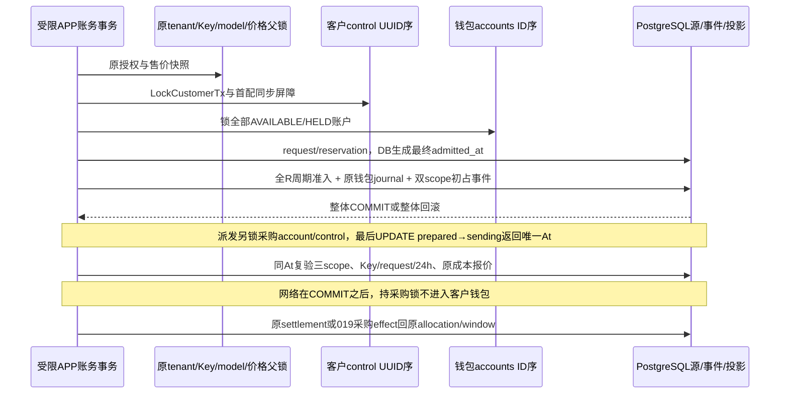

预算事件绑定真实reservation/唯一settlement/019采购event；数据库guard验证初占完整性、来源投影、创建事务与scope屏障，防止漏mirror或直接改汇总。采购allocation到attempt只有受保护的逻辑引用，避免account持锁后因FK回取attempt形成反环；窗口/control间为真实复合FK。Finish先完成必要model锁升级，再客户control→账户；采购证据/恢复/更正只取account→supplier control→采购source，不取客户control或钱包。

Reader与Commander已实现：当前DB授权、RR只读分页、规范签名cursor，配置CAS/原不可变operation、首配≤1000完整导入、未知COMMIT不重放。六表APP仅精确状态投影列可更新，projector无权读取；[角色检查](../../internal/operations/periodic_roles.go)在main启动listener前核验实际LOGIN和effective权限闭包。020核心已通过最终全Go真实PG race；020版本产品HTTP/UI、浏览器与最终相关回归及评审预览升级已通过，见[验证](../verification/periodic-budgets.md)。

[管理HTTP](../../internal/server/periodic_budget_handlers.go)已注册tenant/Key/采购三类GET/PUT、wallet只读、窗口与allocation分页及两域原operation核查；main在listener前初始化签名Reader和Commander。Cookie/session、CSRF、可选MFA、再认证、恢复与实例Guard保持既有准入；领域事务再次验证当前数据库权限。B独立[有界准入](../../internal/server/periodic_budget_admission.go)共享32总读、额外8核查，写8，actor分别4总读/1核查/1写；5/10秒工作deadline覆盖fresh Guard、pool/锁/语句及响应编码。strict五字段8KiB输入和128KiB整次响应不返回半页，任何未知驱动错误只映射安全503。

控制台按[HTTP/UI合同](../../specs/023-periodic-products/b-http-contract.md)从wallet/Key/tenant/采购入口进入独立预算页，完整区分当期spent/held与carry。IndexedDB以actor/身份域/目标为复合键，在单个readwrite事务complete后才发PUT；刷新恢复pending为unknown，只核查原operation，不能换ID重发。身份/目标epoch和实际AbortSignal阻止晚回覆盖；270项web与strict构建、原生IndexedDB跨tab原子互斥及隔离真实main浏览器已通过；020版本最终server/cmd真实PG race和预览升级通过，见[记录](../verification/periodic-budgets.md)。当前58123固定该020验收包，首页及52资源匹配，没有升级尚未配套的支付运营接线。

### 独立只读核验

`verify-periodic-budgets [--timeout 30s]`在服务配置、实例锁、worker及listener之前独立分支，仅使用明确的离线owner DATABASE_URL。实际连接必须为LOGIN、current_user=session_user且拥有六张预算表；完整当前嵌入迁移（含022）与来源权限同一RR READ ONLY快照核对。默认30秒、允许1秒至10分钟，总预算覆盖连接、扫描和只读COMMIT；不取业务行锁、不调用在线预算helper、不按当前权限/价格/时钟重判历史。

核验从客户/采购来源双向查漏，再核原effect、事件序列、allocation/window/control投影、配置/operation/audit。19项异常计数、10项扫描计数和3项缺证计数均以JSON十进制字符串返回。全部可证明且一致为balanced/退出0；发现损坏为mismatch/退出2；无损坏但旧终态成员、legacy采购effect边界或原动态快照缺见证为indeterminate/退出3；执行/权限/迁移/超时失败退出1且无部分报告。它不补账、不重发请求，也不把净SUM相等称作全历史完整。源码与SQL详见[冻结合同](../../specs/023-periodic-products/b-verifier-contract.md)。

### 支付资金第三来源（022-B2）

[021](../../migrations/021_payment_sandbox.sql)追加支付表及不可变/租约/身份/资金完整性约束，默认policy关闭、无marker与业务事实。旧A资金谓词原位替换并保留OID/owner/依赖；人工与券走静态旧分支，sandbox走独立分支，使worker无需读取A表。资金helper仅接受capture定位键，在实际RC worker事务重建order、identity、首选evidence、effect和代次关联，账户锁后再次核对；固定system actor、capture operation、order reference及SANDBOX_FUNDING_CLEARING。外层Processor的审计/终态CAS未完整时不能提交；已有完整receipt只返回原回执。

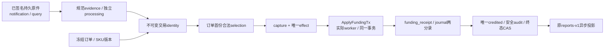

图表示SQL/helper与B3 Processor共同实施的完整关系；APP接收、唯一资金处理与网络Runner已接线，真实main/最终浏览器整链已通过[限定本地验收](../verification/payment-application.md)，在途SIGTERM/真实Guard失权独立真实进程补验通过。VerifyFunding扩至十计数，VerifyLedger/Rebuild复用完整来源核验；摘要严格六字段，三来源SUM使用NUMERIC，前端同步严格解析和独立“本地模拟入账”标签/筛选，不当作现金收入。来源lot、原路退款和拒付仍待022-C。

APP和projector由普通ProvisionFor收紧B表/列ACL，worker显式owner provision。43份函数以审定021静态摘要/签名/属性/path核验，worker明示31 EXECUTE；继承、SET/ADMIN闭包、PUBLIC、grant option、SECURITY DEFINER和全schema表/视图越权均拒绝。projector对B表/本族函数零权，其runtime仅查pg_catalog权限；环境归属由owner离线三角色核验及APP私密启动证明负责。APP/worker不能借owner SET ROLE冒充真实LOGIN。普通main现于listener前装配运行证明；普通off且无B历史不注册通知或创建支付worker，带完整证明的sandbox或历史off构造独立worker。

[022](../../migrations/022_payment_runtime_attestation.sql)新增默认空的运行证明表；没有自动nonce、key或endpoint回填。它把原环境marker与typed DB/schema/owner/三运行角色OID、两个nonce摘要及canonical proof摘要关联，复用不可变历史触发器。APP/worker仅SELECT，projector零权，支付权限清单现为23表；021的43份静态函数与worker31 EXECUTE保持。role核验在普通public schema遇到内建pg_database_owner时，以当前database.datdba核实际迁移对象所有者；其他schema仍精确核nspowner，不接受任意owner或放宽在线身份。

### 应用订单、支付执行与通知（022-B3）

`internal/payments`现拥有完整Service/Processor/Runner及APP/worker专用运行证明。配置`PAYMENTS_MODE=off`为默认；live在连接前拒绝。普通off没有marker、证明或B业务事实时，只做当前迁移、权限和历史空性核验，不读秘密、不创建支付连接池或出站，也不注册通知。sandbox及带历史证明的off必须提供同环境的两个私密manifest；APP、projection和worker三条DSN都在首次连接前受literal-loopback白名单约束。实际listener必须匹配不可变callback origin。完整双nonce/keyset/OID、角色闭包、M/Q负权限与022 canonical proof在ready前核验；不允许按mode=off丢弃历史。

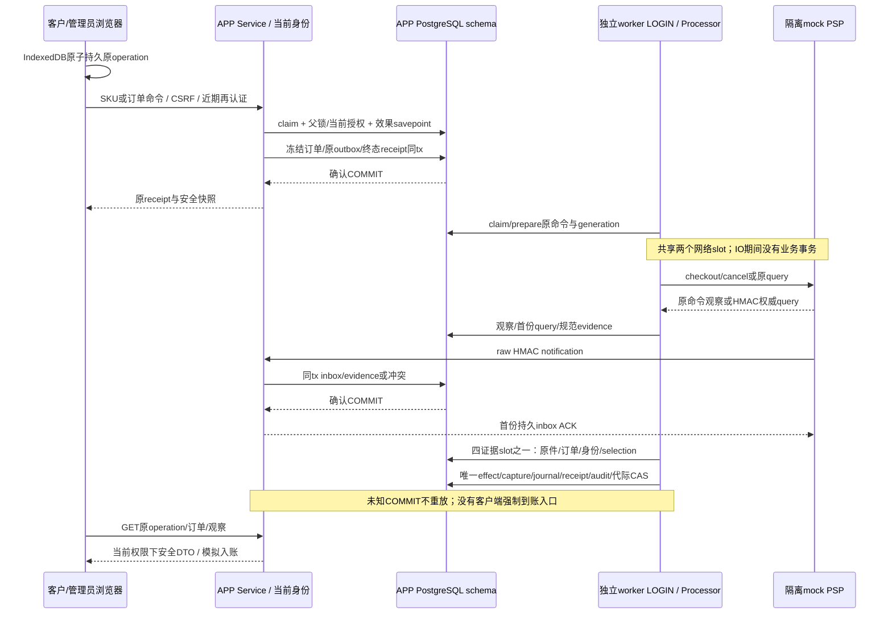

命令的父锁、当前授权和语义决策先于效果savepoint，rejected也持有父锁至提交。Create已提交后若安全订单读取失败返回结果未知，浏览器保留原ID。平台观察按logical order UUID读取，未知订单的review也可查；租户页面仍只读取自己当前授权范围。HTTP写和匿名通知各有独立10rps/burst20及4在途；人类另有actor+scope 1rps/burst2。5秒期限覆盖读取body，严格JSON、128KiB响应和8KiB ACK，UTC6和金额字符串保持一致。

Processor的opaque lease/work/response绑定实例、原ID、generation、canonical请求与摘要。mutation最多10次、query/evidence最多20次；网络2共享slot、证据4slot和独立有界lease回收不预取。Recovery仅安全读、durable通知和权威query；不发送mutation或应用资金。正常取消不永久fence；真实Guard丢失停止ready与所有支付执行。SIGTERM并行停止新HTTP及Runner，join全部IO/事务后关闭worker pool，最后释放Instance。

控制台`/payments`与`/platform/payments`使用独立IndexedDB journal，事务complete后才发送；reload/离线/失真/GET404均保留原操作。每身份域128项、epoch/AbortSignal与跨tab原子互斥，最多五次只读核查，不重试写。policy CAS未知结果须读取当前版本并显式开始新意图。页面持续标注本地模拟，没有真实付款URL或模拟到账按钮。当前专项与集成证据见[应用支付验证](../verification/payment-application.md)，来源lot/原路退款/拒付、正式PSP和最终生产验收继续独立门禁。

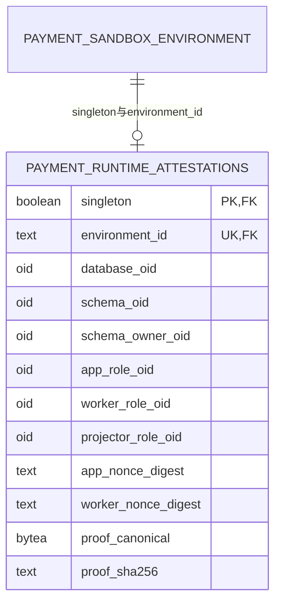

[B3运行合同](../../specs/022-self-service-payments/b3-runtime-contract.md#10-根冻结与精确追加ddl2026-11-01)与[Processor执行合同](../../specs/022-self-service-payments/b-processor-contract.md)已由根冻结：同serve进程的独立真实worker LOGIN/连接池、两网络槽/四证据槽、Guard与正常取消区分、Recovery仅query、原QueryWork绑定、mutation到期order-first锁序。真实PG库级专项、两轮普通main/mock及最终浏览器已通过[限定本地验收](../verification/payment-application.md)；完整唯一资金、原command的HTTP丢回包恢复、Recovery/off、IDB重载和资源清理均有分层证据，真实Guard/在途SIGTERM独立真实进程补验通过，数据库COMMIT回包丢失仍SKIP。C0全资金路径/历史cutover与[全钱包操作序列](../../specs/022-self-service-payments/c0-sequence-contract.md)保持生产候选；已冻结并实现的在线算法仅纯分配层，不写DB、不授资金能力；迁移history窄核验和仅测试候选回归另见下文，见[验证](../verification/funding-lot-planners.md)。原路退款/拒付继续依赖C0整体通过。


### 私有维护授权（022-C0-T2）

[真实授权合同](../../specs/022-self-service-payments/c0-authority-contract.md)冻结并实现唯一二参`Attest(ctx, snapshot)`与`Permit.Verify(ctx)`，只消费原Snapshot内部owned installation。完整固定链为history scalar guard与原helper、编译manifest、实际维护LOGIN/有效owner、两条独立SQL clear→新鲜全runtime采样、16表重空、完整ordinary/v1前驱、仅Init全部账户C序锁、出口复核。全程保留原busy/绝对期限与rawTx，失败/取消/终结开始撤销所有副本并关原socket；没有裸Tx/Conn/context或SQL回调。前驱完整列与安全投影、有限typed时间、262行/1MiB及累计5秒；账户ID按原无限长TEXT语义流式长度前缀摘要。实现见[细化架构](maintenance-gate.md)，T2[专库PG/race](../verification/maintenance-authority.md)333.879秒、89顶层/832父子终态全部PASS；它只覆盖T2版本与范围，T3及整仓回归分别记录。

源码入口：[一次发行与Verify](../../internal/maintenancetrust/permit.go)、[真实身份与新鲜停服](../../internal/maintenancetrust/authority_identity.go)、[manifest与完整history](../../internal/maintenancetrust/authority_manifest.go)、[完整accounts锁](../../internal/maintenancetrust/authority_accounts.go)、[前驱编排](../../internal/maintenancetrust/predecessor.go)、[v1规范编码](../../internal/maintenancetrust/predecessor_codec.go)、[typed rows与资源记账](../../internal/maintenancetrust/predecessor_rows.go)、[服务端有界投影](../../internal/maintenancetrust/predecessor_sql.go)。

### 受控读取租约与两个局部核验结果（022-C0-T3首片）

[冻结合同](../../specs/022-self-service-payments/c0-read-lease-contract.md)对应的`Permit.BeginScan(ctx, kind)`现已实现。它保留原Snapshot/rawTx，从BeginScan到Finish/Abort持续持原Gate busy；SQL、遍历和CPU间隙共用一次最多30秒，并取原Snapshot/caller更早期限。每个Permit的同kind只尝试一次，入口与正常出口均完整重核T2 evidence及新鲜runtime停服采样；期间Permit.Verify、另一个scan及Commit/Rollback/Close立即busy，不并发SQL。失败或取消撤销整个Snapshot与全部既有proof，原socket由watcher关闭；正在使用pgx的方法返回后才释放其operation/busy，不另goroutine drain。

[封闭codec](../../internal/maintenancetrust/lease_codec.go)仅接受审阅过的exact内建参数与Scan目标，内部simple protocol，先复制slice及可借用数据；拒绝pgx控制参数、QueryRewriter、Scanner/Valuer/RowScanner、自定义类型和`*any`等出口。参数最多1024项及累计16MiB逻辑bytes，`[]string`逐项含长度框架；Scan经过本地typed临时值再owned复制，不把原Rows交给caller。只开放Deadline/Done/Err取消视图，不导出Context/Conn/Tx/Exec/回调。SQL文本面向同进程受审的固定SELECT reader，未作为任意SQL安全沙箱开放到HTTP或插件。

[Rows生命周期](../../internal/maintenancetrust/lease_rows.go)要求每次Next true恰好Scan一次，真实EOF后同时观察Err和显式Close；跳行、重复Scan、提前Close、未消费Row或悬挂Rows使Finish失败并物理撤销。QueryRow.Scan核恰好一行、EOF、Err及Close。没有pending对象且出口重核成功才返回私有共态`ScanProof`。proof只绑定原Permit/Snapshot/lease nonce与固定kind的正常完成；原Snapshot终结、失败或到期即全部复制proof失效，零值、JSON或同摘要不能重绑。纯Verify可以在另一lease持busy时做绑定核验，不发SQL。

[ledger维护reader](../../internal/billing/funding_ledger_maintenance.go)实际调用同三表分页与独立大整数核算core，私有`MaintenanceLedgerResult`保留完整snapshot与proof，Summary仍为`supplied_ledger_rows`。[PB维护reader](../../internal/periodicbudget/verifier_maintenance.go)复用原业务SQL/列与操作receipt核验，维护专用scalar guard先累计19关系全部声明字段、全量audit与history，最多100000行、单字段cast text后的UTF8 bytes最多65536、累计16MiB；超界零结果。PB结果的Summary明确`periodic_budget_rows`，原三类历史缺证继续indeterminate，原public Verifier的独立LOGIN/owner/history/RRRO规则未放宽。资源profile限制客户端返回与保留的逻辑输入，不证明PG排序/CTE/array_agg内存或Go RSS界。

这两个局部结果与ScanProof均不授全来源`CoverageComplete`、资金写入或生产运行权，不能成为init/basis/epoch就绪条件。Funding、Key、采购、B来源及lot全图仍需独立逐列读取、双向sweep、coverage清单与完整组合器；basis、epoch、封闭writer和生产维护CLI尚未完成。[T3专项](../verification/maintenance-read-lease.md)与[集成记录](../verification/maintenance-read-lease-integration.md)单独记录实际执行范围，不沿用T2通过计数。

### 资金来源、退款与后续经营设计

[C0生产候选](../../specs/022-self-service-payments/c0-production-schema.sql)以lot三桶和tenant全钱包连续序列连接全部来源、Reserve、finish及消费退款；[列权限](../../specs/022-self-service-payments/c0-production-permissions.sql)和[维护/proof v2](../../specs/022-self-service-payments/c0-maintenance-contract.md)尚在审查，不是生产迁移。旧tenant含零可用opening、新tenant的受保护出生事务、非genesis operation与完整新journal同top-xid及逐settlement退款累计已补入候选SQL。APP tenant INSERT收敛为原八列，UPDATE保留原六列，不授UPDATE(id,created_at)；worker原锁权限保留。五项版本化真实PG/race回归全部实际运行通过，见[候选验证](../verification/funding-lot-candidate.md)、[冻结测试范围](../../specs/022-self-service-payments/c0-candidate-regression-contract.md)及[仅测试源码](../../internal/qa/c0candidate)。测试通过不发行维护许可、不启动main、不分配生产迁移号。[独立重放候选](../../specs/022-self-service-payments/c0-verifier-contract.md)仍未实现；不能只靠正常业务代码或总额守恒证明来源。纯分配算法通过不代表这些接线已经完成。

已实现的窄依赖是[caller-owned RR清单核验](../../migrations/verify_snapshot.go)：在原只读或读写RR事务核对完整latest history，固定安全错误，不Begin/Commit或写库；原VerifyReadOnlyTx仍只接受RR READ ONLY。它不授予维护权限、不核函数/trigger/ACL、不发行epoch，见[冻结合同](../../specs/022-self-service-payments/c0-snapshot-contract.md)与[验证](../verification/migration-snapshot.md)。

[C1原路退款候选](../../specs/022-self-service-payments/c1-refund-contract.md)及[独立v2协议候选](../../specs/022-self-service-payments/c1-protocol-v2-contract.md)将消费退款与支付返还分域，以原lot的Q/F桶、双审和新版本外部事实串联。调度预算耗尽保留held及Q，后到完整终态仍可收尾；最终no_effect必须阻止原命令晚生效。拒付、债务及退款交叉仍须独立合同/SQL/实际验收；当前未注册原路退款或拒付入口。[C2拒付/债务候选](../../specs/022-self-service-payments/c2-dispute-contract.md)固定风险先提交、原lot回收与独立债务、显式原来源偿付及精确反转；[C3交叉/恢复候选](../../specs/022-self-service-payments/c3-cross-recovery-contract.md)继续要求完整原交易最终事实和离库恢复证据，尚未实现。[023-C商品候选](../../specs/023-periodic-products/c-contract.md)另用非现金权益及本金价值条带，未把公开模型目录当作订阅。

[024-B0-P](../../specs/024-extension-platform/b0-pure-contract.md)只实现完整已知向量、精确有理计价与摘要，生产价格/预占/媒体证据尚未接线。[025共享执行候选](../../specs/025-production-ha/b0-shared-execution-contract.md)已明确保守活性代价：已授权sending/running不能因TTL过期自动回收；本地join不证明供应商后台计算停止。当前仍为单活，生产DDL、权限、配置桥接及真实双进程验证待冻结与执行。[身份邮件真实进程切片](../../specs/025-production-ha/a1-mail-process-contract.md)已通过两个本地SIGKILL/原租约恢复窗口，见[限定证据](../verification/mail-lifecycle-025.md)；无生产hook。上述候选均不意味着商业收款、媒体或多活已验收。

## 共同入账（022-A0）

A0已实现并通过专项，人工ApproveCredit持原业务根和双财务身份锁，进入共同ApplyFundingTx。helper只接可信source身份和内部scope，持全部账户ID序锁、锁后DB时刻，唯一写入账journal、不可变funding_receipt及一个credited；不自开/提交事务、不回锁父根。manual对手科目FUNDING_CLEARING，voucher source使用独立OPERATING_GRANT_CLEARING，赠额不是现金收入。外层同tx写原审批audit；钱包total_credited按全部receipt累计，六字段兼容。

017严格验证旧approved credit/source/journal/两分录/credited，坏历史拒绝升级；正常历史只回填receipt，不新发钱/事件。提交guard双向验证来源/回执/精确科目及命令/批次/作废决定关系，任意其他journal kind不能绕用清算科目。VerifyFunding/VerifyLedger/Rebuild逐笔核验，保留reports-v1，projector无新增source/券/command读权。A1服务/HTTP/UI已完成限定本地验收；B0-P纯协议已实现并通过race/vet/fuzz；M精确SQL已有[隔离原型稿](../../specs/022-self-service-payments/b-mock-sql-contract.md)，M/Q已冻结实施且真实进程短程通过，旧版本20代长程完成、最新补丁/精确故障另验；B1核心设计/SQL已冻结并通过隔离LOGIN原型，B2第三来源已实施，B3运行证明、领域/worker/HTTP/UI/main已接通，真实主进程/浏览器整链通过限定本地验收，生命周期补验已通过，C继续独立推进。详见[A0合同](../../specs/022-self-service-payments/a-contract.md#12-a0-账务接口与追加-ddl)及[阶段证据](../verification/funding-vouchers.md)。

### 双审运营赠额券（022-A1）

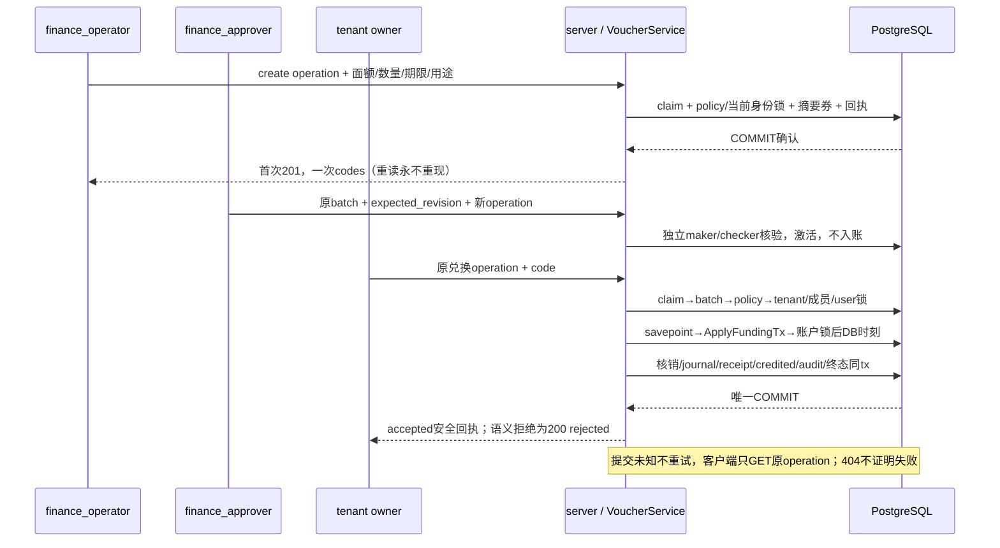

`VOUCHERS_ENABLED=false`是默认部署硬上限，DB policy也默认off。硬off挡create/redeem全部POST重放，旧GET不要求HMAC key，已有审批/作废/撤销仍可收尾；Recovery拒全部写。启动时开启硬上限必须严格校验独立HMAC keyring与全部历史引用，失败不监听。code与command用途分域，数据库只存摘要，不可恢复券码。

领域命令READ COMMITTED，业务根/当前授权父锁后savepoint，基础设施错误全回滚；stale撤销仅额外保留不可变rejected decision。严格白名单错误无SQL或秘密；查询REPEATABLE READ按当前平台/tenant角色复验，固定50+1与绑定scope/filter的cursor，时间UTC六微秒、金额字符串。HTTP独立4096桶/20rps全局/最多4在途，5秒预算含pool、锁、已证明回滚最多2次重试和COMMIT；取消回滚失败由pgx销毁连接，许可唯一归还。

平台控制台[批次页](../../web/src/views/VouchersView.vue)、[写入器](../../web/src/components/CommerceWriter.vue)与[安全journal](../../web/src/commerce-state.ts)实现一次展示/迟到丢弃、双审、作废/撤销和只读原回执。钱包[来源面板](../../web/src/components/FundingPanel.vue)显示累计人工/赠额与同步DB时刻。浏览器sessionStorage仅保存五项操作元数据，不保存券、正文、响应或摘要；身份epoch失效丢弃晚回，unknown与GET404不会解锁重发。赠额不是现金收入，不赋予原路退款资格。

## 站内经营告警（024-A）

当前生产源码、有效权限、真实PG/HTTP/浏览器/主进程故障、全量race/vet与019预览均通过，架构只读检查和make check通过，见[验证记录](../verification/operations-alerts.md)。`/platform/alerts` 使用平台会话；admin管理规则，admin/finance_operator/finance_approver读取和确认。HTTP预检查之外，每次读在独立只读RR事务中复查当前角色，写在actor SHARE锁等待后复查；CSRF、MFA、近期再认证、恢复和实例门禁继续有效。客户与推理Key不获得采购或平台告警读权。

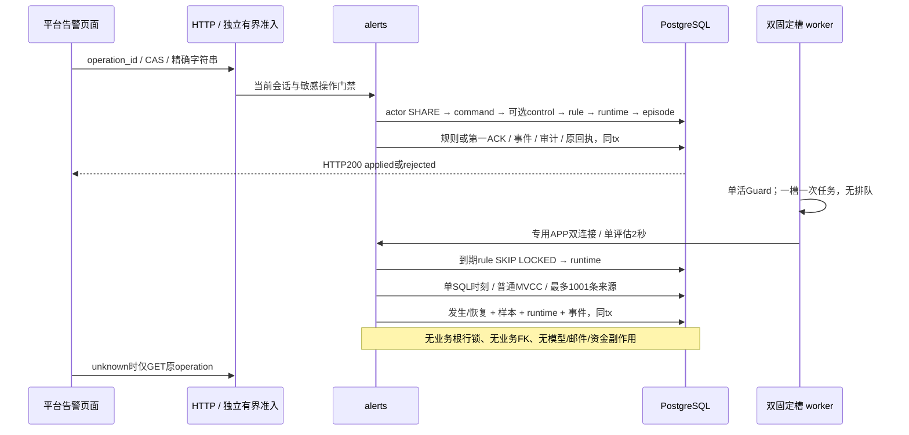

四种来源为持久渠道quarantined、登记采购预算`limit-spent-held`、客户pending_reconciliation及采购unknown/disputed的预占创建年龄。预算可负且保留100位累计金额；两类积压最多1001条，达到上限显示“至少”，不推算金额。两个来源部分索引按scope/created_at/C排序ID限制扫描；来源缺失或失败保留原发生记录，不能冒充恢复。

每规则至多一个未结束episode。第一ACK只记actor/time，不改变来源；条件恢复、配置实际改变、禁用和退役分别保留结束原因。配置版本、episode协作版本和内部runtime写版本独立；晚回失败须同时匹配配置及runtime版本，不能覆盖较新的成功。事件完整链、当前指针、原命令回执和状态由即时及deferred约束双向核验；退休历史不占64启用/256未退休规则名额。

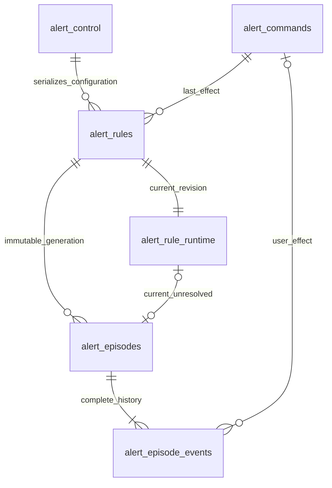

以上关系仅在告警内部。scope_type/id为逻辑来源引用，不通过FK回锁商业表。app无DELETE、历史event不可修改，终态command不可修改；projector无新表权限。HTTP使用独立有界桶和读32/写8全局在途上限，每actor读4/写2；查询2秒、写3秒、50+1分页、显式null末页及256KiB响应上限，金额/revision/计数为字符串，时刻固定UTC六位微秒。

[角色核验](../../internal/operations/alert_roles.go)检查六张告警表及其schema的有效权限，涵盖PUBLIC/继承/列授权、GRANT OPTION、所有权、高权属性及递归SET/ADMIN可提升路径。`ProvisionFor`在同一事务完成授权与矩阵核验，外部group越权导致整次回滚；serve在任何worker/HTTP前用APP和PROJECTOR真实连接只读复验，开关关闭也执行。owner登录后SET ROLE不能作为受限连接。该检查不代替全库对象审计，也不宣称持续阻止离线owner在启动后改ACL。

`OPERATIONS_ALERTS_ENABLED=false`仅暂停评估，规则管理、读取和旧记录确认仍可用；恢复模式只读。启用时main创建专用双连接pool，worker和邮件/财务恢复生命周期分开，退出先取消并join槽再关闭pool。正常60秒评估、记录失败30秒后再观察；超过180秒或时钟回退显示stale，paused/never_evaluated与最后错误分别可见。告警不承担供应商余额认证、自动资金裁决、外发通知或HA。

## 持久化关系与不变量

```mermaid
erDiagram
    tenants ||--o{ memberships : contains
    users ||--o{ memberships : joins
    users ||--o{ session_families : authenticates
    users ||--o| identity_initialization : bootstraps
    identity_mail_subjects ||--o{ identity_challenges : serializes
    users |o--o{ identity_challenges : resets
    identity_challenges ||--o| identity_mail_outbox : delivers
    memberships ||--o{ api_keys : owns
    models ||--o{ model_capability_versions : freezes
    models ||--o{ price_versions : sells
    price_groups |o--o{ tenants : assigns
    price_groups |o--o{ price_versions : domains
    tenants ||--o{ tenant_pricing_assignments : records
    pricing_operations ||--o| tenant_pricing_assignments : proves
    pricing_operations |o--o{ price_versions : publishes
    price_groups |o--o{ request_records : freezes
    models ||--o{ route_policy_versions : routes
    channels ||--o{ channel_versions : publishes
    channel_versions ||--o{ channel_version_credentials : freezes
    channel_credentials ||--o{ channel_version_credentials : participates
    channel_versions ||--o{ model_bindings : binds
    route_policy_versions ||--o{ model_bindings : groups
    channels ||--o{ cost_versions : costs
    api_keys ||--o{ request_records : authorizes
    request_records ||--|| reservations : reserves
    request_records ||--o{ upstream_attempts : attempts
    request_records ||--o{ metering_events : measures
    upstream_attempts |o--o{ metering_events : identifies
    metering_events ||--o{ finalization_records : evidences
    upstream_attempts ||--o{ provider_cost_corrections : corrects
    channel_credentials ||--o| credential_procurement_bindings : permanently_binds
    procurement_accounts ||--o{ credential_procurement_bindings : shares
    upstream_attempts ||--o| procurement_reservations : procurement_hold
    credential_procurement_bindings ||--o{ procurement_reservations : freezes
    procurement_accounts ||--o{ procurement_reservations : aggregates
    procurement_reservations ||--o{ procurement_budget_events : changes
    procurement_reservations ||--o{ procurement_evidence_identities : deduplicates
    procurement_reservations ||--o{ procurement_cost_proposals : adjudicates
    procurement_accounts ||--o{ procurement_balance_observations : observes
    cost_versions |o--o{ upstream_attempts : freezes
    price_versions ||--o{ request_records : freezes
    request_records ||--o| settlements : settles
    tenants |o--o{ periodic_budget_controls : tenant_scope
    api_keys |o--o{ periodic_budget_controls : key_scope
    procurement_accounts |o--o{ periodic_budget_controls : supplier_scope
    periodic_budget_controls ||--o{ periodic_budget_windows : observes
    periodic_budget_controls ||--o{ periodic_budget_allocations : tracks
    periodic_budget_windows |o--o{ periodic_budget_allocations : original_window
    periodic_budget_allocations ||--o{ periodic_budget_events : applies
    periodic_budget_controls ||--o{ periodic_budget_events : serializes
    periodic_budget_controls ||--o{ periodic_budget_configuration_versions : versions
    periodic_budget_operations ||--o| periodic_budget_configuration_versions : proves
    journals ||--o{ journal_lines : balances
    tenants ||--o{ funding_receipts : receives
    journals ||--o| funding_receipts : proves
    credit_orders ||--o| funding_receipts : manual_source
    commerce_commands ||--|| commerce_operation_receipts : terminates
    voucher_batches ||--|{ vouchers : issues
    vouchers ||--o| voucher_redemptions : redeems
    voucher_redemptions ||--|| funding_receipts : grant_source
    voucher_batches ||--o{ voucher_revocations : proposes
    voucher_revocations ||--o| voucher_revocation_decisions : decides
    ledger_accounts ||--o{ journal_lines : posts
    request_records ||--o| recovery_jobs : recovers
    tenants ||--o{ projection_outbox : projects
    projection_outbox ||--o{ projection_receipts : consumes
```

图为核心业务关联，省略复合外键、审计表和每个金额字段；实际约束以[001 核心](../../migrations/001_core.sql)、[002 计费](../../migrations/002_billing.sql)及[后续追加迁移](../../migrations)为准。关系中的“拥有/授权”是业务归属，不表示可绕过 tenant/member 复合校验。

| 数据域 | 事实与版本边界 |
| --- | --- |
| 身份 | users/password_revision、session_families/sessions、memberships、tenant/member grants、api_keys；初始化标志不可变；mail_subjects/challenges/outbox用途绑定、单次消费与受控秘密清理 |
| 目录 | models.public_visible/public_revision为独立公开线，默认私有；model_capability_versions、channel_versions、route_policy_versions、model_bindings、price_versions、cost_versions 为已发布历史事实；018 冻结成本模式/未知处理/两维上限，逐 attempt 固化报价 |
| 周期预算 | 六表保存稳定control/配置版本/原窗/allocation/不可变event/operation；source stamp和scope屏障保护首次导入，所有projection由精确源event派生；账务与HTTP/控制台已接，专项/多tab/隔离main通过，020最终相关回归/预览已通过，独立三态核验器专项通过，当前源码交叉回归继续 |
| 分组售价 | price_groups状态/配置revision、tenant独立pricing_revision、不可变pricing_operations/safe_input/result与归属事件；request固定域/revision/观察时刻，旧三列全NULL是legacy |
| 凭据池与运营 | channel_version_credentials 固化成员与 revision；撤销永久生效；channel_batch_operations 保存整批 applied/rejected 回执和同事务审计 |
| 调用 | request_records、request_idempotency、reservations、upstream_attempts、metering_events、finalization_records 固化派发与终结依据 |
| 财务 | ledger_accounts/journals/journal_lines 平衡；settlements 唯一；credit/refund/reconciliation 用独立制单/审批身份 |
| 共同入账 | funding_receipts逐source/journal唯一；manual_credit/voucher_grant精确两分录与唯一credited；九表提交保护与A1六命令/当前授权、版本化HMAC及未知COMMIT保护已接通 |
| 采购 | procurement_accounts共享累计预算；credential_procurement_bindings永久归属；procurement_reservations逐attempt占用；budget_events/evidence_identities/commands不可变；cost_proposals双人审批；balance_observations仅人工证据 |
| 告警 | alert_control/commands/rules/runtime/episodes/events；配置、协作和内部写版本独立；完整事件链、第一ACK、同事务终态命令与runtime双CAS；来源逻辑引用，不回锁业务表 |
| 恢复与统计 | recovery_jobs、recovery_gate、projection_outbox/receipts、report_totals/active_report_projection；统计可重建，不能反向成为资金事实 |
| 发现与解释 | 目录发现结果/历史/dynamic stale，以及每次 attempt 的候选解释；目录发现不自动发布模型、价格或授权 |

Key 有三条互不覆盖的 CAS 版本线：015 `access_policy_revision` 管 IP/CIDR；016 `limit_revision` 管 RPM/burst/concurrency；017 `configuration_revision` 管名称、模型/地域、累计预算和期限。消费产生的 spent/held 不会让配置版本失效。发生冲突或写入结果未知时，控制台进入只读核查，再由用户开始新编辑，不能自动重试写操作或凭一次相等 GET 宣称原操作成功。合同见[015](../../specs/015-key-access-policy/spec.md)、[016](../../specs/016-key-runtime-limits/spec.md)、[017](../../specs/017-key-configuration/spec.md)。

渠道版本/池版本、价格/成本和请求历史不能被编辑覆盖。渠道启停、隔离和凭据撤销是当前准入闸门，能限制已有发布绑定；换新凭据池需要显式重新发布路由。迁移以校验和验证，已应用 SQL 不能修改。

<!-- architecture:security -->
## 身份、密钥、网络与观测

Console 使用高熵 Cookie session、CSRF/Origin 检查和 bcrypt 密码；敏感写操作要求近期重新认证。MFA 默认可选，支持 TOTP 二维码、手动密钥和一次性恢复码；`MFA_ENFORCE_PLATFORM=true` 可要求平台/财务绑定，主动启用的账号始终遵守自己的 MFA。API Key 只在创建时返回明文，数据库保留 HMAC 摘要；上游凭据加密保存，历史版本使用 keyring 轮换。[可选 MFA 决策](../decisions/ADR-003-optional-mfa.md)、[身份实现](../../internal/identity)、[密钥实现](../../internal/security/security.go)。

022券使用独立有版本HMAC，code验证与command指纹域分离；与登录Pepper和上游AES keyring不互换。admin仅管理开关/只读，finance_operator制单/原maker作废或提撤销，finance_approver独立审批，tenant owner兑换，billing_viewer仅来源只读。HTTP预门禁后领域再次以当前DB身份核验；projector不得读取任何券/source/commerce command，普通app保留白名单状态列写权，离线owner负责迁移/provision。券秘密只在首次201返回，不进入审计/日志/持久浏览器journal。

入口默认不信任 forwarded headers。只有连接对端命中显式可信代理 CIDR，才接受反代覆盖写入的单值 `X-Real-IP`，用于来源限制与登录限流。上游按渠道网络策略限制 scheme、主机、端口、解析地址和重定向，防止配置后的 SSRF/DNS 重绑定。反代关闭生成 POST 自动重试及 SSE buffering。[客户端地址](../../internal/security/client_ip.go)、[上游网络](../../internal/provider/network.go)、[反代配置](../../deploy/nginx.conf)。

当前单活进程的 Key 桶最多 4096 个，不按 TTL 驱逐；重启恢复满桶，运行限额并非跨实例/跨重启的持久计费额度。默认每 Key 60 RPM/burst 20/concurrency 16，平台 6000 RPM/burst 200，租户 300 RPM/burst 40，全局并发 100、租户 32。额度真实性由数据库的冻结/已消费保证。020的周期硬限额是独立持久准入，不受内存桶重启影响；管理HTTP/UI已接并通过专项/浏览器，020最终相关回归与预览升级通过，当前源码交叉回归继续。全局内存锁内不执行数据库查询。[桶边界](../../internal/server/key_runtime_limiter.go)、[运行限额证据](../verification/key-runtime-limits.md)。

日志与指标保留 request_id、阶段、受限错误码、耗时、终态及最小计量事实；不记录 prompt、模型输出、完整上游 body、会话或密钥。路由解释也不暴露上游地址或凭据。`/metrics` 仅实际 loopback 对端可访问，反代需禁止外部暴露。`/health/live` 表示进程存活；`/health/ready` 联合 DB、实例保护与恢复模式报告，不是供应商 SLA。[telemetry](../../internal/telemetry)、[服务端观测入口](../../internal/server/server.go)。

<!-- architecture:deployment -->
## 部署、角色与故障恢复

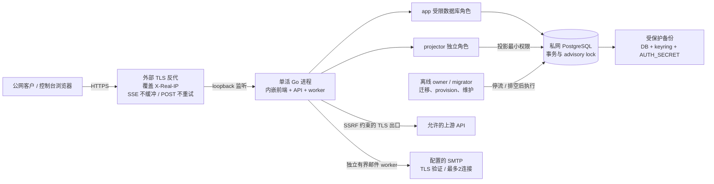

默认形态为单应用实例 + PostgreSQL + TLS 反代，适合 1Panel/Compose 自托管。数据库不公开端口，应用对反代暴露本机监听；app、projector 与 owner/migrator 必须分角色。身份表app仅状态需要的列级UPDATE，projector无身份表读取/写入；密文离线重包仅owner且不恢复已清秘密。CLI 仅 `migrate` 使用迁移连接，其他命令只验证迁移；启动要求单独 `PROJECTION_DATABASE_URL`，拒绝与 app 同一角色。[Dockerfile](../../Dockerfile)、[Compose](../../compose.yaml)、[部署手册](../runbooks/deployment.md)。

025-A0窄切片补齐Compose的021注册/恢复、MAIL_TRANSPORT和六项SMTP配置透传，仅app获得这些环境；默认注册关闭/邮件disabled，迁移与provision不获得SMTP秘密。常规Compose仅保留PAYMENTS_MODE=off，不注入隔离沙箱manifest/worker DSN。YAML/九项声明默认与合成覆盖、环境隔离/原角色端口排空边界的静态检查通过；全局Docker CLI仍无compose插件；另从Homebrew官方SHA验证的隔离Compose 5.6.1完成默认/合成覆盖的真实config --quiet和JSON渲染、九字段/环境隔离检查，见[实际渲染](../verification/compose-render-025.json)。独立临时Colima profile因官方VM镜像下载超时未启动，已删除本轮profile并确认既有profile未变，见[运行环境记录](../verification/compose-runtime-025.json)。容器、1Panel和正式邮件仍须各自验收；此前[静态记录](../verification/compose-config-025.json)保持原未执行结论，[合同](../../specs/025-production-ha/a0-compose-config-contract.md)限定配置范围。此片没有改变模块、数据或单活模型。

单活由 PostgreSQL advisory lock `782193402` 保证，新增副本不能当成 HA。实例保护失败会撤销 ready、取消上游 context 并停止服务；新的正常实例先等待前驱未结束请求的持久 deadline + 5 秒窗口。正常 SIGTERM 关闭 ready，并给予最多 310 秒 HTTP 排空。迁移仅用 `782193401` 串行化迁移，`provision` 也不会自动获取服务锁，两者依赖操作人先停流、排空再执行。离线报表重建和 secrets rewrap 额外强制 `MAINTENANCE_MODE=true` 并尝试取得服务锁；备份/恢复脚本同样使用服务锁。不能把迁移串行锁误认为在线服务已被自动停流。

正常 worker 每 10 秒检查实例保护；非恢复模式下以5秒限时处理最多100个客户恢复任务，再独立以5秒限时处理最多100个采购遗留attempt，随后以独立角色、5 秒限时最多 50 批 × 200 条消费投影 outbox。worker 只推进持久事实和幂等财务状态。恢复模式提供业务只读与恢复授权接口，禁止派发、探测和后台资金恢复；重新开放付费流量须完成双人恢复授权并重启。离线投影重建切换 active projection，不改账本。[进程 worker](../../cmd/moni-aigate/main.go)、[恢复闸门](../../internal/operations/recovery.go)、[报表重建](../../internal/billing/rebuild.go)。

备份需要数据库与解密/认证材料共同保护；只有数据库备份无法恢复上游凭据及 Key 校验。故障恢复依赖持久 evidence、唯一结算与补偿，不重发模型请求。[备份恢复手册](../runbooks/backup-restore.md)、[故障注入记录](../verification/mvp-failure-recovery.md)、[014 正常进程排空](../verification/mvp-release-qualification.md)。容器运行、真实网络分区和异地灾备仍需独立环境验收。

<!-- architecture:status -->
## 后续实施的依赖与并行边界

下图是实施依赖，虚线表示可独立推进的设计或纯算法切片；它不表示当前运行时已调用这些模块。当前资金和请求链仍以上文实线系统图为准。阶段完成后先收口证据、更新本页和HLD/LLD，再推进依赖方。

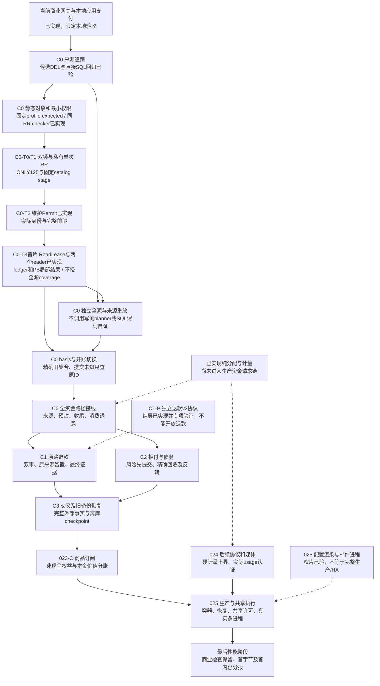

C0[静态检查](../../specs/022-self-service-payments/c0-schema-check-contract.md)、[维护身份](../../specs/022-self-service-payments/c0-permit-contract.md)、[运行helper](../../specs/022-self-service-payments/c0-runtime-helper-contract.md)和[独立重放](../../specs/022-self-service-payments/c0-verifier-contract.md)是分别审阅的合同；维护事务中的核验不冒充APP启动时的新只读事务证明。资金写入、迁移及共享源码由指定负责人串行修改；纯退款协议、只读审查、控制台合同和隔离部署准备可以并行。占用专用库InstanceLock的真实main验收串行执行，不能同时升级长期预览。

T3新增billing/PB→maintenancetrust依赖同时将固定catalog初始化带入普通main及测试子进程；普通main尚未调用维护证明发行API。启动仍完整认证固定SHA、严格有界expected、DTO/模板及全root canonical字节；expected专用raw parser保持原Token接受语义并作逐树差分，actual/candidate原parser不变。只有全部成功后才从私有owned canonical bytes取span缓存，digest命中后仍完整bytes.Equal；固定字段类型描述仅一次预编译。实现与纯测/冷启动观察见[独立记录](../verification/catalog-startup.md)，原进程与整仓回归见[T3集成](../verification/maintenance-read-lease-integration.md)。既有CLI/helper/main期限和五秒发行预算保持；初始化测量不代表网关首字节或目标容量。

本地 `make verify-mvp` 使用 `go test -race -p 1` 按包串行访问同一专库，保留全部包/测试、包内显式并发及原期限；解决跨包资源争用的验收调度，不改变生产模块、权限或资金行为，也不替代并发容量与独立CI结果。

## 当前能力与后续边界

| 能力 | 当前状态 | 依据/限制 |
| --- | --- | --- |
| 商业闭环 | 已实现，限定本地验收 | 人工双人入账 → 客户授权/Key → 六协议调用 → 预占/结算 → 报表/成本/退款；[014](../verification/mvp-release-qualification.md) |
| 模型/渠道经营 | 已实现 | 不可变版本、三格式发现、1..32 成员池、跨渠道整批启停；[011](../verification/model-discovery.md)、[012](../verification/credential-pools.md)、[013](../verification/channel-operations.md) |
| Key 经营 | 已实现 | 来源策略、动态运行限额、模型/地域/预算/期限三版本独立编辑；[017 验证](../verification/key-configuration.md) |
| 来源追踪核验基础 | C0部分依赖已实现，尚未进入完整资金链 | 纯分配/账本行检查、[离线metadata候选](../verification/funding-lot-descriptor.md)、[同RR完整账本读取](../verification/funding-ledger-reader.md)、[正式静态checker](funding-lot-catalog.md)、[维护Gate与读取租约](maintenance-gate.md)；T2原[专库race专项](../verification/maintenance-authority.md)保留，T3库级ReadLease和ledger/PB真实维护reader已实现，[专项](../verification/maintenance-read-lease.md)与[集成](../verification/maintenance-read-lease-integration.md)单独记录；全源/lot核验、basis/epoch及全资金接线仍后续，PG安装profile/生产推广另验 |
| 上游模型成本 | 已实现 | 每渠道精确上游模型的输入/输出单价、生效版本、每attempt快照及unknown；受控采购更正双人审批，尚无自动供应商账单同步 |
| 成本感知自动路由 | 018 已实现，限定本地验收通过 | 最高优先级内保守 big.Int 比价、未知拒绝、两维采购单价上限，候选/attempt/sending 报价同步；[规格](../../specs/018-cost-aware-routing/spec.md)、[真实 PG/浏览器/预览证据](../verification/cost-aware-routing.md) |
| 共享采购账户/预算 | 019已实现，限定本地验收通过 | [冻结合同](../../specs/019-procurement-accounts/contract.md)；跨渠道/Key/租户共享累计预算、逐attempt预占、未知占用和双人更正；周期硬预算已由023-B扩展；余额仅人工证据，供应商余额/账单自动同步待后续 |
| 公开模型目录 | 020已实现，限定本地验收通过 | 默认私有、安全DTO、当前价、筛选/分页、独立准入与admin公开CAS；[020验证](../verification/public-catalog.md) |
| 自助商业化 | 021与022-A完成限定本地验收；B0独立沙箱已编码并通过专项PG，真实进程短程通过、旧版本20代长程完成、最新补丁/精确故障另验；023-A完成限定本地验收 | [A证据](../verification/funding-vouchers.md)、[A1冻结接口](../../specs/022-self-service-payments/a-domain-contract.md)、[B0运行合同](../../specs/022-self-service-payments/b-runtime-contract.md)及[运行证据](../verification/payment-sandbox.md)区分纯协议、实际沙箱、未验故障；B1资金/身份/代次核心已冻结并通过SQL原型，B2已追加021并实现Go第三来源/十方向资金核验/三角色权限，真实PG专项通过；B3领域/worker/HTTP/UI/main已接线，专项与真实进程/浏览器整链通过限定本地验收，真实在途SIGTERM与Guard失权补验已通过；[023草案](../../specs/023-periodic-products/spec.md)、[A0精确合同](../../specs/023-periodic-products/a-contract.md)及[根复核](../../specs/023-periodic-products/review.md)已完成，A已通过[真实PG/浏览器/预览验收](../verification/tenant-pricing.md) |
| 站内经营告警 | 024-A已实现，限定本地验收通过 | 四固定来源、站内第一ACK、完整历史与命令、默认off双槽评估、独立准入与有效数据库角色核验；[024证据](../verification/operations-alerts.md) |
| 更多协议与运行形态 | 仅024-B0-P纯计量层已实现；B0生产接线及其余B–F仍候选 | [024](../../specs/024-extension-platform/spec.md)划分站内告警、媒体计量/异步/长连接/外部身份；[告警精确合同](../../specs/024-extension-platform/a-contract.md)经独立反例审查修正后冻结019，隔离DDL/行为/权限/源EXPLAIN原型通过；生产领域/worker/HTTP/UI已接通，真实PG/HTTP/浏览器/主进程故障、全量race与019预览均通过，架构只读检查和make check通过；[025](../../specs/025-production-ha/spec.md)定义真实进程故障、共享许可/HA与生产出口；媒体/Realtime/多活尚未完成 |
| 容器/生产与正式供应商 | 部分未验收 | 025-A0静态透传和隔离Compose实际渲染已验，实际容器未验；正式渠道 usage/硬界、网络分区/异地灾备与发行许可仍是门禁 |
| 性能 | 目标未达成 | 历史 007 本机 100 并发额外首字节 P95 61.56–69.74ms；目标 4vCPU/8GB 下 ≤50ms，未完成 Rust LiteLLM/Bifrost 同条件对比 |

性能中的“额外首字节”是网关相对于同一 fixture 直连所增加的延迟，首有效内容单独记录；它不等同于真实模型的首 token 时间。历史数据只代表对应版本与本地环境，不能推出新增能力后的当前性能或与竞品相近。[容量方法](../verification/capacity.md)、[007 原始结果](../verification/dispatch-read-batches.md)。

018 本地验证包括真实 PostgreSQL 全 Go race、122 项前端测试及 strict 构建、vet/build、隔离真实 main 的两次完整 SSE、完整路由 CAS 冲突后只读核查与显式新编辑、390×844 移动布局和资金核对；客户两次各收 20 微元，对应采购成本 8/22 微元，客户 held 为 0 且账本平衡。预览 58123 已应用 013 迁移/provision，并以受限角色 ready、非恢复模式运行，首页与 29 项 assets 匹配。这些结果不替代正式供应商、容器、灾备或性能发布门禁；详细执行与资源清理见[018 记录](../verification/cost-aware-routing.md)。

019增加真实PG采购预算/证据/审批竞态及最小角色验证，前端141项与strict构建、全Go race/vet通过；浏览器持久CAS冲突、人工观察、一次SSE与采购资金核对通过，最终仅“余额未知”文案重建后另做窄补验。两轮均客户20/采购22微元、held0和账本平衡，QA资源/秘密清理。预览58123已迁移014/provision并运行最终包，首页和32项assets匹配。证据与首轮/最终包摘要见[019记录](../verification/procurement-accounts.md)。

020增加真实PG公开投影/CAS/分页/异常大行与匿名准入测试，前端156项、strict构建和全Go race通过；最终SQL长度保护修订后另跑catalog/server专项race通过。真实main浏览器验证默认私有、管理员409后只读核查/显式新编辑、精确大整数/零价/缺价、筛选和下架恢复、390px布局，资金事实和生成请求全0；QA资源秘密已清理。58123已迁移015/provision并运行最终包，首页与35项assets匹配。完整证据见[020记录](../verification/public-catalog.md)。021已接续交付身份迁移/事务、公开HTTP、outbox/worker和四个匿名页面；186项前端/strict、最终身份/HTTP代码全Go真实PG race、vet通过，运行器身份生命周期补验11.792s。隔离真实main+本地SMTP/浏览器验证邮件请求、证明GET/fragment清理、零权益及新密码登录；注册与改密提交由HTTP验证，不冒称浏览器修改凭据。零推理/资金、proof单次、outbox终态清密文及资源清理通过。58123已升级016、ready非恢复、首页与40assets匹配，默认注册关闭/邮件disabled；真实SMTP另门禁。[021证据](../verification/self-service-identity.md)。

022-A在017阶段完成限定本地验收，历史包/预览证据见[022记录](../verification/funding-vouchers.md)。023-A现已完成018/helper/管理HTTP/客户报价/控制台，真实PG分包race及并发/COMMIT代理、227项前端/strict、真实main三模式与失败清理16.160s、隔离浏览器与账本核对通过。三笔调用收费8/20/20微元，采购均12，缺组价无新request/扣款，退休原归属继续，调回默认不改旧快照。023-A验收时58123升级018/provision，首页与48assets匹配当期包；历史[023证据与包摘要](../verification/tenant-pricing.md)。024-A验收时已升级019/provision，受限APP及projector有效权限核验在worker/HTTP前通过；ready非恢复，首页及50assets匹配最终包，注册/邮件/券/告警评估默认off，账号与资金事实未变。告警完整链路与主进程故障、最终全Go真实PG race/vet、251项前端和strict构建通过；[024证据](../verification/operations-alerts.md)与[当前包摘要](../verification/operations-alerts-024-preview.json)。

022-B0-P保留标准库纯协议race/vet/89.4%覆盖及393430次fuzz证据。M/Q已实现独立进程装配、模拟器/receiver仓储、HTTP/双槽回调、完整启动权限证明（含精确namespace row/array及额外执行对象拒绝）和离线非空资金fixture；专项真实PG/race、并发/签名/故障消费及资金不变通过。真实进程短程及旧版本20代长程已通过；最新补丁/COMMIT丢包/精确崩溃等仍按[运行证据](../verification/payment-sandbox.md)独立收口，021与B2第三来源已独立实施，B3订单/worker/main现已接线，真实主进程/最终浏览器整链通过限定本地验收，真实在途SIGTERM与Guard失权补验已通过。023-B的[精确合同工作稿](../../specs/023-periodic-products/b-contract.md)已形成核心/命令/权限SQL及真实PG并发原型，源同步/首配/派发反例已修订，B核心/HTTP/UI与020预览已完成限定验收，独立只读核验器专项已通过，C商品/订阅继续独立门禁；024-A生产代码、有效角色边界、全量race/vet、真实PG/HTTP/浏览器/主进程故障与019预览均已验证，架构只读检查和make check通过。025与最后性能阶段继续按独立门禁推进。

最终重建已补验历史不完整报价的只读兼容和分页游标校验；新报价仍须两维完整，既有成本管控不接受部分报价。首轮包与最终包的验证摘要分别保留，最终包另完成浏览器核查/发布及一次 HTTP SSE/资金核对、资源清理和预览更新，见[最终补验](../verification/cost-routing-018-final-browser.json)、[最终清理](../verification/cost-routing-018-final-harness.json)、[最终预览](../verification/cost-routing-018-preview.json)。这不改变上述模块或请求/财务边界。

<!-- architecture:evolution -->
## 每次变更如何同步这份架构

本文件、[演化记录](changes.md)和[机器清单](architecture-manifest.json)共同组成当前架构快照。源码映射是阅读入口，SHA-256 清单检测新增/修改/删除，不需要仓库已有提交。每个快照保留复核时间、变更理由、源文件数量/摘要及后续增量路径。

工作顺序为：阅读对应规格 → 设计缺口先补 SDD/HLD/LLD → 实现与相关验证 → 更新本文件受影响的图、边界、能力状态和来源 → 并行结果汇总后显式复核 → 刷新并执行只读检查。若代码没有改变架构结构，也必须复核现有描述，并在理由中说明结论。要求见[根 AGENTS.md](../../AGENTS.md)。

当前工作划分、可并行实现的边界及各阶段前置依赖见[交付与并行计划](../design/delivery-plan.md)。共享接口/数据合同先冻结；各任务完成专项验证后，由集成人合并检查跨模块行为、能力状态与统一架构，最后建立同一个可复核快照。

```sh
# 源码/设计稳定后，由完成语义复核的集成人执行；理由必须描述实际变更。
go run ./scripts/check-architecture --refresh --reviewed --reason '实现变更与架构影响；同步对应状态/链路/数据边界'
go run ./scripts/check-architecture

# 等价快捷入口；make check 和 make verify-mvp 也执行只读检查。
make architecture-refresh REASON='本次变更与架构影响'
make architecture-check
```

默认检查不会修改任何文件，CI 只运行默认检查；不能用自动 refresh 掩盖缺失的设计。覆盖 `cmd/internal/migrations/scripts/deploy/.github/web`、`specs`、`docs/design/runbooks/verification/decisions`、`docs/architecture` 下后续支持文档/图和根级依赖/构建/部署配置；新目录中的常见代码与配置扩展名也自动纳入，避免新增模块漏检。排除 `.git`、`.local`、`bin`、依赖缓存、`node_modules`、精确 `.vite` 缓存目录组件、`web/dist` 等产物、架构写入临时文件和私密 `.env*`（保留 `.env.example`），不以修改时间判断。正文要求主要架构章节与至少三张 Mermaid 图，并检查本地链接没有失效或越出仓库；正文、演化记录也有独立摘要。

主架构十六张、[C0细化视图](funding-lot-catalog.md)、[维护Gate、Snapshot、Permit与ReadLease细化视图](maintenance-gate.md)及根README概览各一张，共十九张Mermaid图。T2版本使用官方npm Mermaid12.2.0解析及独立临时浏览器实际渲染，原[渲染证据](../verification/architecture-maintenance-authority.json)仅绑定当时四份正文SHA；本轮T3修改模块/依赖图与维护细化图，十九图使用同版官方Mermaid与独立临时浏览器重新实际渲染，见[本轮图证据](../verification/architecture-maintenance-read-lease.json)及[T3集成记录](../verification/maintenance-read-lease-integration.md)。此前十六图与检查器race/vet保留原[架构同步验证](../verification/architecture-sync.md)。每轮内容快照均由集成人汇总全部文档后显式刷新，交付前确认只读检查通过。

工具可以发现“源代码或设计已经变化，但架构快照尚未复核”，不能证明自然语言与实现语义一致。`--reviewed` 是执行人的明确复核声明；需要阅读代码、图与验证边界，不能机械刷新。修改覆盖策略也属于代码变更，必须解释原因并复核本文件。机器清单本身不参与自己的哈希，演化记录只引用源快照摘要，避免循环依赖。

022-M/Q本轮新增独立CLI、paymentruntime/schema、mockpsp/receiver与离线QA；模块图/独立通知时序/数据分组/角色边界和源码入口已同步。B0独立进程证据只覆盖原M/Q链路，B3普通main新增的订单/通知/资金与worker另行验收；B0验证范围见[运行证据](../verification/payment-sandbox.md)，不能将已编码或专项PG等同尚未执行的长程和生产验收。

023-B核心已按[冻结接线合同](../../specs/023-periodic-products/b-integration-contract.md)追加020并从billing调用；请求、数据和权限图同步更新，产品HTTP/UI已接并通过专项/多tab/隔离main浏览器，020最终相关回归与预览已通过，独立三态核验器和CLI专项通过，当前源码交叉回归继续。022-B1[核心设计](../../specs/022-self-service-payments/b1-contract.md)及[SQL验证](../../specs/022-self-service-payments/b1-verification.md)已冻结，B2新增[第三来源冻结合同](../../specs/022-self-service-payments/b2-funding-contract.md)，已追加021、实现Go第三来源与三角色核验，真实PG专项通过；领域/worker/HTTP/UI/main现由B3接线，真实主进程/浏览器限定本地验收及未验边界另记。

2026-11-02第三轮[GitHub CI](../verification/github-ci-third-run.md)在精确f64b56f源码上十组全部success：1036顶层PASS、54明确SKIP，web286全PASS，架构/vet/build通过。专用C0与真实main opt-in仍未开启，不覆盖后续T2/T3新增代码或生产环境。

2026-11-02随后[T2发布CI](../verification/github-ci-authority-run.md)在精确46f25e0源码十组success：1066顶层PASS、69明确SKIP，父子3555PASS/109SKIP，web286全PASS，架构/vet/build通过。专用C0与真实main等opt-in仍未开启；当前T3代码以新专项和集成记录为准。
