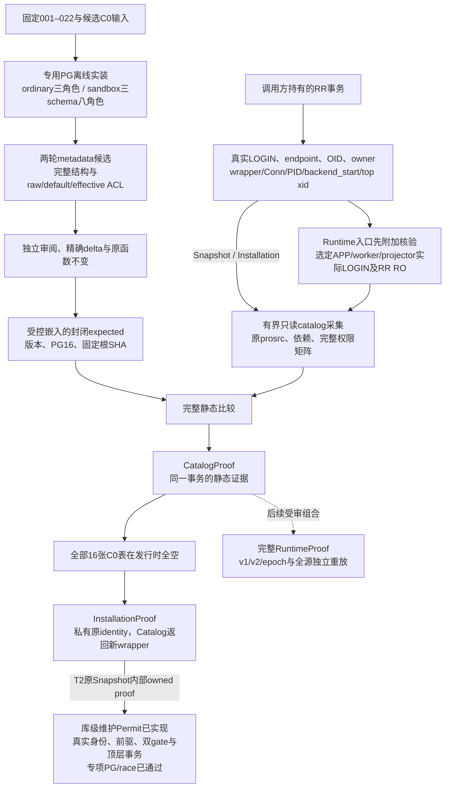

# C0 静态安装核验与事务证明

本页是[统一架构](README.md)的细化视图，对应[冻结合同§10](../../specs/022-self-service-payments/c0-schema-check-contract.md#10-根冻结完整静态检查器的实现与正式期望启用)。实现入口为[`fundinglotcatalog`](../../internal/fundinglotcatalog/types.go)。两套正式expected已完成根审并固定嵌入；公开证明接口的最终验证见[汇总记录](../verification/funding-lot-catalog.md)，资金运行链仍按后续依赖接线。

`VerifySnapshotTx`允许调用方RR RO/RW；`VerifyRuntimeTx`只接受选定实际runtime LOGIN的RR RO。`VerifyInstallationTx`在同一次五秒总预算内增加十六表空集事实。API不控制事务、不改GUC或权限、不安装DDL。任何失败只返回固定错误与nil证明；调用方负责回滚或结束事务。

ordinary正式期望包含五个封闭安装profile：named隔离NOLOGIN owner，以及named/public各自的最小LOGIN owner与默认PG管理员LOGIN owner。实际owner LOGIN是T2维护Permit必要的认证形态；NOLOGIN样本仅用于静态profile与旧候选交叉核验，不能通过SET ROLE取得维护Permit。不存在worker占位。public的namespace raw owner是builtin `pg_database_owner`，对象owner须为实际datdba，两个身份分别绑定。其他安装组合需要新增实装证据和受审expected。

sandbox完整检查app/mock/receiver的对象正文、类型与自动TOAST/RI关系、依赖、显式ACL、默认ACL和八角色有效权限；同时核十组跨域负权。自动表row/array type的默认USAGE不是表读取权，named `fl_source_proof`及array的权限单独收紧。完整沙盒基线遵循原v1实际离线授权顺序，旧app-only导出候选不会自动升级为正式期望。

opaque证明保存具体事务wrapper、连接、backend PID/start、top xid与深拷贝全pins；`VerifyTx`只重核同一事务身份，不反复执行全catalog比较。它不能抵御受信DDL owner在受控维护之外自行修改对象，因此DDL/GRANT仍由停服维护路径管理。提交、回滚、出错、断连或换事务后旧证明失效。Installation的“发行时全空”在受审init写入后仍是原时点证据；维护Permit必须自行防止二次发行，不能从这份证明推导资金权限。

本catalog包依赖只允许标准库、pgx和受控静态expected。离线安装及来源交叉核验只在test中引用operations/migrations。当前真正维护消费者沿maintenancescan→maintenancetrust→fundinglotcatalog执行完整认证；maintenancescan单向依赖billing/PB的无权威固定事实算法，普通billing/PB/main及领域测试不反向导入维护或catalog。T3初版曾通过领域包间接将eager初始化带入普通main和测试child；依赖隔离按[合同§7](../../specs/022-self-service-payments/c0-read-lease-contract.md#7-ci-启动回归后的维护集成隔离根冻结)移除这项无关成本，未开放普通main证明发行API。T2 [维护基础设施](maintenance-gate.md)已在原Snapshot同rawTx消费完整InstallationProof并实现二参[Attest/Permit.Verify](../../internal/maintenancetrust/permit.go)，[T2真实PG/race专项](../verification/maintenance-authority.md)已通过；T0/T1和catalog历史验证不因此扩张。T3首片ReadLease及两个局部维护reader的原[专项](../verification/maintenance-read-lease.md)保留精确版本，本次隔离修复须另验。旧v1 checker、SQL/ACL pins与证明字节保持原规则；epoch开账、全源/lot重放、在线资金helper及完整RuntimeProof仍后续。

静态root在本包初始化时完成固定SHA、严格有界解析、完整DTO/模板和全root canonical字节校验；独立维护消费者仍eager执行，普通main的依赖隔离不改此行为。expected专用raw parser与原Token树作完整差分并保留其资源/数值/UTF8/重复key/EOF语义；actual/candidate原strictJSONNodes不改。随后私有缓存仅使用同一已认证root的规范JSON片段与完整字节相等共享expected，固定record/attribute字段表预编译，减少重复编码和分配；不从actual建立或修复expected，不推迟认证到五秒发行事务中。此前本地串行整仓1172.881秒成功并未排除远端问题：精确f572bbd/CI run 41359784155仍发生billing-0原12秒helper、server-2/3原10秒main及other周期核验CLI原60秒观察超时。本次依赖隔离不延长这些期限，结果须以新验收记录为准。catalog自身优化、集成历史与新修复范围分别见[初始化记录](../verification/catalog-startup.md)、[集成记录](../verification/maintenance-read-lease-integration.md)和[当前依赖合同§7](../../specs/022-self-service-payments/c0-read-lease-contract.md#7-ci-启动回归后的维护集成隔离根冻结)，不视作首字节性能验收。

两runtime（ordinary）或五runtime（sandbox）的database级CREATE与CREATE/CONNECT/TEMPORARY grant option均须为false；默认PUBLIC CONNECT/TEMPORARY可保留。namespace权限不能替代这一database闭包。当前expected仅实证PG16.15/Homebrew initdb profile、UTF8/C/C；PL/pgSQL language OID14038属于本profile的安装分配。其他集群、locale、1Panel及生产部署需要独立profile认证或后续语言/扩展符号合同，不能由major16或同名对象推断兼容。

公开链对normalized actual与同一完整固定variant作逐节点精确比较，继承expected已验证的封闭shape、字段与值类型；只有两棵Schema/Roles全部匹配后才做peer闭包和发行。metadata-only observer另保留完整DTO验证，不存在公开跳过校验入口。actual原始资源、类型I/O、scalar、符号与依赖alias/multiplicity检查均在；这是消除重复遍历，不能用部分字段或一个摘要代替完整比较。依赖查询拆分两端EXISTS保留全部原重复行，固定权限向量展开也须与原查询同RR逐字节等值。

## 显式读取profile增量（C0-R1-A）

原三发行API与上文历史验证继续固定LegacyV1。新增`VerifySnapshotProfileTx/VerifyRuntimeProfileTx`显式选择LegacyV1或WalletReadV2；后者只增加APP读取完整资金图所缺的四列SELECT，并对整个schema/role图进行同样完整比较。静态根从受审base精确派生、全envelope固定SHA复核，selected descriptor同时控制raw/normalized类别界和比较，原5秒/事务身份规则保持。新CatalogProof保存profile但不成为完整RuntimeProof，O1维护路径仍固定旧root。详细当前结构和实际验证分别见[读取版本细图](runtime-read-profile.md)与[记录](../verification/runtime-read-profile.md)。
