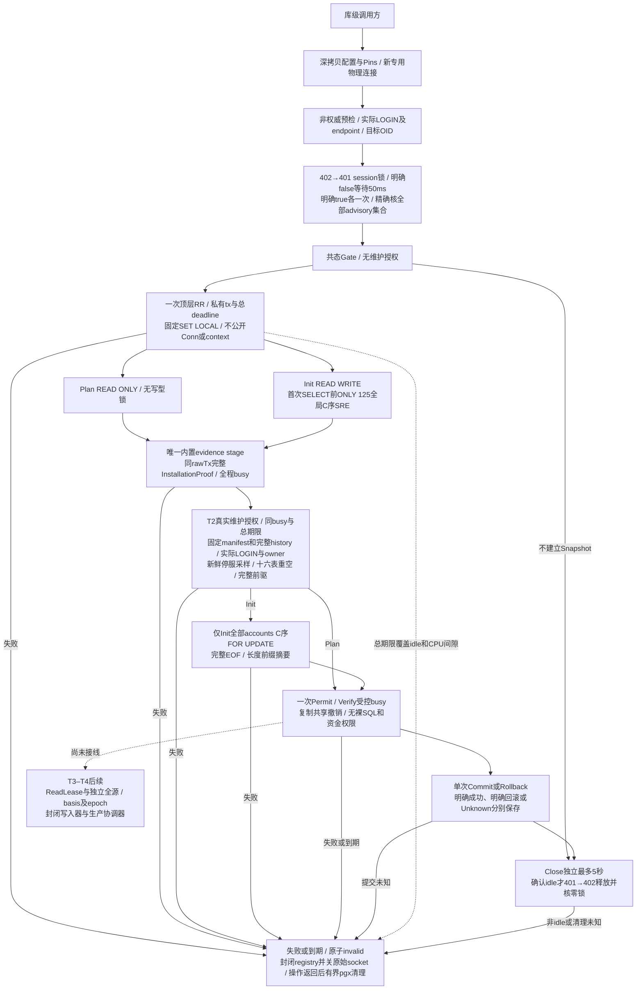

# C0 维护 Gate 与快照细化架构

本页描述 022-C0-T0/T1/T2 库级维护基础设施。统一入口见[系统架构](README.md)，锁合同以[T0 §10](../../specs/022-self-service-payments/c0-permit-contract.md#10-根冻结t0专用连接双session-gate与清理)为准，Snapshot 以[T1 根冻结](../../specs/022-self-service-payments/c0-snapshot-lifecycle-contract.md#10-根冻结范围与尚未开放的能力)为准。T2以[真实授权根冻结](../../specs/022-self-service-payments/c0-authority-contract.md)为准，实现与新增专项分别记录，不扩大T1历史范围。没有普通 main、CLI 或资金调用者；T1 历史真实 PG/race 115.412秒、46顶层/124终态全部通过，见[新验证](../verification/maintenance-snapshot.md)。

## 专用连接与双锁

[Gate](../../internal/maintenancetrust/gate.go)及[预检](../../internal/maintenancetrust/identity.go)使用新物理连接，不借还 runtime pool。Acquire 共用父期限与30秒的较早值，只有明确 false 才每50ms轮询；每把明确 true 后不重入。核本 PID/DB 的完整 advisory 集合，拒绝额外/shared/two-int 或丢锁，不调用 unlock_all。sandbox 保持字面 127.0.0.1:55439/moni_test 及实际 moni_test LOGIN；T2另重读super/datdba维护授权。

## 单次快照与固定 catalog stage

[Snapshot](../../internal/maintenancetrust/snapshot.go)只由 Gate 一次 BeginPlan/BeginInit 发行，保存直接 BeginTx 产生的同一个私有顶层 pgx.Tx。无 Tx/Conn/PgConn/Context/任意回调出口，不制作新 proxy 绕过 opaque proof 的 wrapper 身份。Plan RR RO 无 SRE；Init 固定 SET 后、首次任何 SELECT 前，执行[静态125表](../../internal/maintenancetrust/snapshot_tables.go)的一条完整 ONLY/全限定/C序 SHARE ROW EXCLUSIVE 命令。账户行锁只在T2认证history/身份/前驱后执行，T1不查询账户业务行。

VerifyInstallation 在同一个 rawTx 调用 fundinglotcatalog 的真实 issuer、完整 pins 匹配和出口复核；全程占有 stage busy，Commit/Rollback/Close 或第二 stage 并发立即拒绝。保留 issuer 五秒预算和固定 expected profile；不把 catalog 成功当作完整 migration history、维护授权或资金证明。返回 wrapper 与内部持有 wrapper 分离，调用方赋零不改变内部证据。

## 期限、终结与物理清理

Begin 无 deadline 默认30秒，有 deadline 取父期限与10分钟较早值，剩余不足一秒拒绝。每 stage 同时受原 Snapshot 和该次 caller 取消/期限限制，后续 Background 不能延长。生命周期 watcher 在 SQL 阻塞、CPU 间隙或无人使用的 idle Snapshot 也立即 invalid 并关闭捕获 socket；它不并发调用 pgx。晚到 CancelRequest dial 遇已封闭 registry 立即关闭。

Commit 一次调用开始后按可能已发送处理：明确 COMMIT、明确 ROLLBACK/服务器回滚、无法确认分别保留 Committed/RolledBack/Unknown。错误不 unwrap driver；Unknown 不重发、不能由后续 Rollback 改成确定未提交。Rollback 独立最多5秒且不延长 Snapshot 授权。Close 遇活跃 stage 立即 busy；未显式终结的无人使用 Snapshot 直接物理关闭并保留 Abandoned，不能擅自提交。已确认 idle 才沿同一5秒 cleanup 预算逆序解锁并核空集。副本共态，重复终结/清理不重复发 SQL。

## 证据与后续边界

[T0专项](../verification/maintenance-gate.md)保留原代码版本和运行范围，不自动升级为 T1 证据。本轮新增[真实 PG 验证](../verification/maintenance-snapshot.md)覆盖唯一 RR、首次快照物理 writer 屏障、125表锁、idle期限、busy、真实提交丢回复与明确回滚；最终race 124终态全PASS，独立清理为零。首轮测试语句子串误判已保留原日志并修正，未改产品锁/预算。

[完整前驱矩阵](../../specs/022-self-service-payments/c0-predecessor-contract.md)已按T2根冻结实施，App v1、M/Q实际字段、ordinary-off21表及6旁路不虚构active key、peer文件原件或v1不存在的字段。ReadLease、独立全源结果、basis、epoch、startup RuntimeProof与生产接线继续后续。

## 真实授权与不可变前驱（T2）

[Attest/Permit](../../internal/maintenancetrust/permit.go)唯一二参入口仅消费原Snapshot内部owned installation。固定顺序为原binding/proof/pins、[编译manifest与完整history](../../internal/maintenancetrust/authority_manifest.go)、[实际维护身份及新鲜停服](../../internal/maintenancetrust/authority_identity.go)、16表重新全空、[私有完整前驱](../../internal/maintenancetrust/predecessor.go)、仅Init[完整账户锁](../../internal/maintenancetrust/authority_accounts.go)、出口重核后一次Permit。manifest22项2459bytes固定SHA，先服务端资格guard再原migrations.VerifySnapshotTx；不从live行生成expected。

ordinary要求actual LOGIN就是有效schema与PB六表owner；public唯一pg_database_owner按本DB datdba解析。sandbox仅字面专库moni_test真实super+DBowner例外，三NOLOGIN owner与五runtime仍受原完整catalog约束。每次入口/出口/Verify均两条相邻独立SQL先pg_stat_clear_snapshot再按目标DB与完整runtime OID采样，覆盖所有连接状态。零连接只证明当前采样，进程停服/join/禁止重连及owner并发写仍属外部协调边界。

前驱累计五秒subcall沿原watcher控制CPU间隙及SQL，成功stop/ack后cancel。逐列SQL资格位与CASE在客户端收到大字段前限制，单例LIMIT2、keys C序LIMIT129，成功业务行262与安全投影累计1MiB；有限typed时间、原canonical bytes/重编码/原SHA三向绑定，peer本地值独立保留。Init一条无WHERE/LIMIT全账户C序FOR UPDATE，逐ID长度前缀SHA与count，原TEXT ID无新增长度限制。

Permit所有字段私有，复制共享撤销；Verify使用新受控call持原busy，发行call结束不影响合法验证。失败、总期限/调用取消及终结开始均撤销全部副本并关原socket；watcher不并发pgx，不清正在读取的不可变事实。没有Tx/Conn/Context/回调、FromDigest、资金写入或生产CLI。T2新增[专库PG/race](../verification/maintenance-authority.md)333.879秒、89顶层/832父子终态全部PASS，整仓回归另记；不能用T1或默认CI跳过项冒充。
