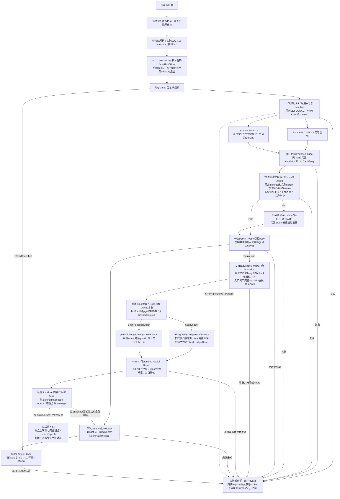

# C0 维护 Gate 与快照细化架构

本页描述 022-C0-T0/T1/T2 与 T3 首片库级维护基础设施。统一入口见[系统架构](README.md)，锁合同以[T0 §10](../../specs/022-self-service-payments/c0-permit-contract.md#10-根冻结t0专用连接双session-gate与清理)为准，Snapshot 以[T1 根冻结](../../specs/022-self-service-payments/c0-snapshot-lifecycle-contract.md#10-根冻结范围与尚未开放的能力)为准，T2以[真实授权](../../specs/022-self-service-payments/c0-authority-contract.md)、T3以[受控读取租约合同](../../specs/022-self-service-payments/c0-read-lease-contract.md)为准。真实ReadLease及ledger/PB两个维护reader已实现，尚无普通main、HTTP、生产维护CLI或资金写入装配。T1历史真实PG/race115.412秒、46顶层/124终态通过保留[原范围](../verification/maintenance-snapshot.md)；T2与T3证据分别记录。

## 专用连接与双锁

[Gate](../../internal/maintenancetrust/gate.go)及[预检](../../internal/maintenancetrust/identity.go)使用新物理连接，不借还 runtime pool。Acquire 共用父期限与30秒的较早值，只有明确 false 才每50ms轮询；每把明确 true 后不重入。核本 PID/DB 的完整 advisory 集合，拒绝额外/shared/two-int 或丢锁，不调用 unlock_all。sandbox 保持字面 127.0.0.1:55439/moni_test 及实际 moni_test LOGIN；T2另重读super/datdba维护授权。

## 单次快照与固定 catalog stage

[Snapshot](../../internal/maintenancetrust/snapshot.go)只由 Gate 一次 BeginPlan/BeginInit 发行，保存直接 BeginTx 产生的同一个私有顶层 pgx.Tx。无 Tx/Conn/PgConn/Context/任意回调出口，不制作新 proxy 绕过 opaque proof 的 wrapper 身份。Plan RR RO 无 SRE；Init 固定 SET 后、首次任何 SELECT 前，执行[静态125表](../../internal/maintenancetrust/snapshot_tables.go)的一条完整 ONLY/全限定/C序 SHARE ROW EXCLUSIVE 命令。账户行锁只在T2认证history/身份/前驱后执行，T1历史范围不查询账户业务行。

VerifyInstallation 在同一个 rawTx 调用 fundinglotcatalog 的真实 issuer、完整 pins 匹配和出口复核；全程占有 stage busy，Commit/Rollback/Close 或第二 stage 并发立即拒绝。保留 issuer 五秒预算和固定 expected profile；不把 catalog 成功当作完整 migration history、维护授权或资金证明。返回 wrapper 与内部持有 wrapper 分离，调用方赋零不改变内部证据。

静态expected在包初始化时先完成固定SHA、独立有界严格JSON解析、完整DTO/模板验证及全root规范字节相等。随后[私有边界索引](../../internal/fundinglotcatalog/expected_spans.go)只从本次owned canonical编码结果定位variant/family/scope/category，复用完整规范片段构建原缓存，避免重复编码大树；digest命中后仍逐字节核相等才共享immutable map/value。索引有独立节点/深度界，字段与已验证DTO精确对应且失败关闭；无actual输入、外部入口、lazy认证或预算放宽。固定字段类型描述一次编译为同次序私有字段表，逐字段类型、枚举与exactKeys核验仍全部执行。启动优化的测量与证据按[T3合同§6](../../specs/022-self-service-payments/c0-read-lease-contract.md#6-集成启动开销与静态缓存合同)分层，不能替代正式数据库、生产或首字节验收。

## 期限、终结与物理清理

Begin 无 deadline 默认30秒，有 deadline 取父期限与10分钟较早值，剩余不足一秒拒绝。每 stage 同时受原 Snapshot 和该次 caller 取消/期限限制，后续 Background 不能延长。生命周期 watcher 在 SQL 阻塞、CPU 间隙或无人使用的 idle Snapshot 也立即 invalid 并关闭捕获 socket；它不并发调用 pgx。晚到 CancelRequest dial 遇已封闭 registry 立即关闭。

Commit 一次调用开始后按可能已发送处理：明确 COMMIT、明确 ROLLBACK/服务器回滚、无法确认分别保留 Committed/RolledBack/Unknown。错误不 unwrap driver；Unknown 不重发、不能由后续 Rollback 改成确定未提交。Rollback 独立最多5秒且不延长 Snapshot 授权。Close 遇活跃 stage或lease立即 busy；未显式终结的无人使用 Snapshot 直接物理关闭并保留 Abandoned，不能擅自提交。已确认 idle 才沿同一5秒 cleanup 预算逆序解锁并核空集。副本共态，重复终结/清理不重复发 SQL。

## 证据与后续边界

[T0专项](../verification/maintenance-gate.md)保留原代码版本和运行范围，不自动升级为 T1 证据。[T1真实 PG 验证](../verification/maintenance-snapshot.md)覆盖唯一 RR、首次快照物理 writer 屏障、125表锁、idle期限、busy、真实提交丢回复与明确回滚；最终race 124终态全PASS，独立清理为零。首轮测试语句子串误判已保留原日志并修正，未改产品锁/预算。

[完整前驱矩阵](../../specs/022-self-service-payments/c0-predecessor-contract.md)已按T2根冻结实施，App v1、M/Q实际字段、ordinary-off21表及6旁路不虚构active key、peer文件原件或v1不存在的字段。T3 ReadLease与两个局部reader已经实现；独立全来源结果、完整组合、basis、epoch、startup RuntimeProof与生产接线继续后续。

## 真实授权与不可变前驱（T2）

[Attest/Permit](../../internal/maintenancetrust/permit.go)唯一二参入口仅消费原Snapshot内部owned installation。固定顺序为原binding/proof/pins、[编译manifest与完整history](../../internal/maintenancetrust/authority_manifest.go)、[实际维护身份及新鲜停服](../../internal/maintenancetrust/authority_identity.go)、16表重新全空、[私有完整前驱](../../internal/maintenancetrust/predecessor.go)、仅Init[完整账户锁](../../internal/maintenancetrust/authority_accounts.go)、出口重核后一次Permit。manifest22项2459bytes固定SHA，先服务端资格guard再原migrations.VerifySnapshotTx；不从live行生成expected。

ordinary要求actual LOGIN就是有效schema与PB六表owner；public唯一pg_database_owner按本DB datdba解析。sandbox仅字面专库moni_test真实super+DBowner例外，三NOLOGIN owner与五runtime仍受原完整catalog约束。每次入口/出口/Verify均两条相邻独立SQL先pg_stat_clear_snapshot再按目标DB与完整runtime OID采样，覆盖所有连接状态。零连接只证明当前采样，进程停服/join/禁止重连及owner并发写仍属外部协调边界。

前驱累计五秒subcall沿原watcher控制CPU间隙及SQL，成功stop/ack后cancel。逐列SQL资格位与CASE在客户端收到大字段前限制，单例LIMIT2、keys C序LIMIT129，成功业务行262与安全投影累计1MiB；有限typed时间、原canonical bytes/重编码/原SHA三向绑定，peer本地值独立保留。Init一条无WHERE/LIMIT全账户C序FOR UPDATE，逐ID长度前缀SHA与count，原TEXT ID无新增长度限制。

Permit所有字段私有，复制共享撤销；Verify使用新受控call持原busy，发行call结束不影响合法验证。失败、总期限/调用取消及终结开始均撤销全部副本并关原socket；watcher不并发pgx，不清正在读取的不可变事实。没有Tx/Conn/Context/回调、FromDigest、资金写入或生产CLI。T2原[专库PG/race](../verification/maintenance-authority.md)333.879秒、89顶层/832父子终态全部PASS，保留对应代码与范围；T3与整仓回归另记，不能用T1或默认CI跳过项冒充。

## 真实受控读取租约（T3首片）

[Permit.BeginScan](../../internal/maintenancetrust/lease.go)仅从原有效Permit建立固定kind的lease，保留同一私有rawTx、Snapshot和身份。入口与正常Finish出口均通过原authority完整verifyEvidence，含新鲜全runtime停服采样。从BeginScan至Finish/Abort持续占Gate busy，覆盖SQL、Rows遍历和纯CPU间隙；Permit.Verify、第二scan及Commit/Rollback/Close在此期间立即busy且不发SQL。每个Permit同kind只尝试一次；成功后的重复调用被拒绝，已完成局部结果仍绑定原Snapshot。

每个lease总预算最多30秒，并取caller/原Snapshot更早期限，不逐query重置。只有Deadline/Done/Err只读取消视图，不公开原Context或Value。watcher及并发Abort只改共享撤销状态并关闭原socket，不并发Rows.Close、Rollback或drain；原operation返回后才释放其operation/busy。失败、取消及原Snapshot终结会撤销Permit和全部完成proof；成功Finish后defer Abort幂等。

[lease_codec.go](../../internal/maintenancetrust/lease_codec.go)以exact内建类型允许集封闭参数和Scan目标。参数总数最多1024、累计逻辑bytes最多16MiB；slice owned复制，`[]string`每项长度框架也记账，内部固定simple protocol。QueryRewriter/NamedArgs、pgx控制参数、Scanner/Valuer/RowScanner、自定义别名类型、`*any`及借用driver目标被拒绝且不触发callback。Scan先写受审本地typed临时值，再复制赋给caller；不把原pgx.Rows交给caller。SQL文本仍只面向同进程受审固定SELECT scanner，并非任意SQL解析器或owner恶意代码沙箱，不连接HTTP/插件入口。

[Rows](../../internal/maintenancetrust/lease_rows.go)要求每次Next true恰好Scan一次，真正EOF后必须观察Err与显式Close，两者可以任意先后；单operation所有权不把busy误报为EOF。跳行、重复Scan、提前Close、未消费Row或悬挂Rows均使Finish永久失败并关连接。QueryRow.Scan核恰好一行，再验证EOF/Err/Close。没有悬挂读取且出口完整重核成功时，Finish才发行私有共态ScanProof。proof纯Verify核原Permit/Snapshot/lease nonce和固定kind，可在另一lease占busy时核绑定，不发SQL；原Snapshot终结、失败或到期时所有副本失效。零值、JSON、同摘要或同PID不能重绑。

## 两个实际reader与证明范围

新增生产依赖是billing→maintenancetrust与periodicbudget→maintenancetrust。[billing.VerifyLedgerMaintenance](../../internal/billing/funding_ledger_maintenance.go)要求ScanLedger，使用原T2前置和lease内current_schema，同一[私有query core](../../internal/billing/funding_ledger_query.go)读取三表完整C序128条分页、保留journal额外事实，EOF/Err/Close后对整份原始行运行独立大整数CheckLedgerRows；原caller-owned RR入口仍保留自身实际LOGIN/窄shape/history前置。100000行、16MiB逻辑输入和共用期限保留。MaintenanceLedgerResult只在正常Finish后私有保存完整snapshot和ScanProof，Summary仍为`supplied_ledger_rows`，不提供原始driver或资金能力。

[periodicbudget.VerifyMaintenance](../../internal/periodicbudget/verifier_maintenance.go)要求ScanPeriodicBudget，复用原业务SQL、声明列及receipt核验core；原public Verifier仍自行取得RR READ ONLY，执行actual LOGIN、六表owner、完整history/SET和Commit规则。维护入口先在同lease内只读scalar资源guard：固定19关系/146声明字段，全量audits与schema_migrations均计入，最多100000行、每非NULL字段cast text后的UTF8 bytes最多65536、累计16MiB，超界固定ErrVerifyExecution及零结果。该界限制返回客户端与保留的逻辑输入，不宣称界定PG排序/CTE/array_agg内存或Go堆/RSS。MaintenanceResult私有保存原Verification与ScanProof，Summary明确`periodic_budget_rows`；三类历史缺证仍为indeterminate，不因T2维护授权消失。

ScanProof只证明固定kind的lease正常完成；两个局部结果不能授予完整来源`CoverageComplete`、资金写入或init/basis/epoch就绪条件。Funding、Key、采购、B来源与lot全图仍需独立逐列scanner、双向sweep、coverage清单与完整组合器，不复用写侧funding_valid或PB局部SQL充当全源证明。验证分别见[T3专项](../verification/maintenance-read-lease.md)与[集成记录](../verification/maintenance-read-lease-integration.md)，不能沿用T2计数或把本地fixture通过扩大为正式供应商/生产验收。

完成证明的纯绑定还同锁检查当前未stopped permitCall的caller/context取消，防止后继lease取消后、异步回调调度前旧结果短暂通过；旧成功call的正常cancel不影响proof。客户端captured socket及时关闭与服务器会话退出分开验收：raw-close不保证即时中断任意长服务器SQL，服务器通常在下一次I/O发现断线；不由此推定服务器端锁已即时消失。
