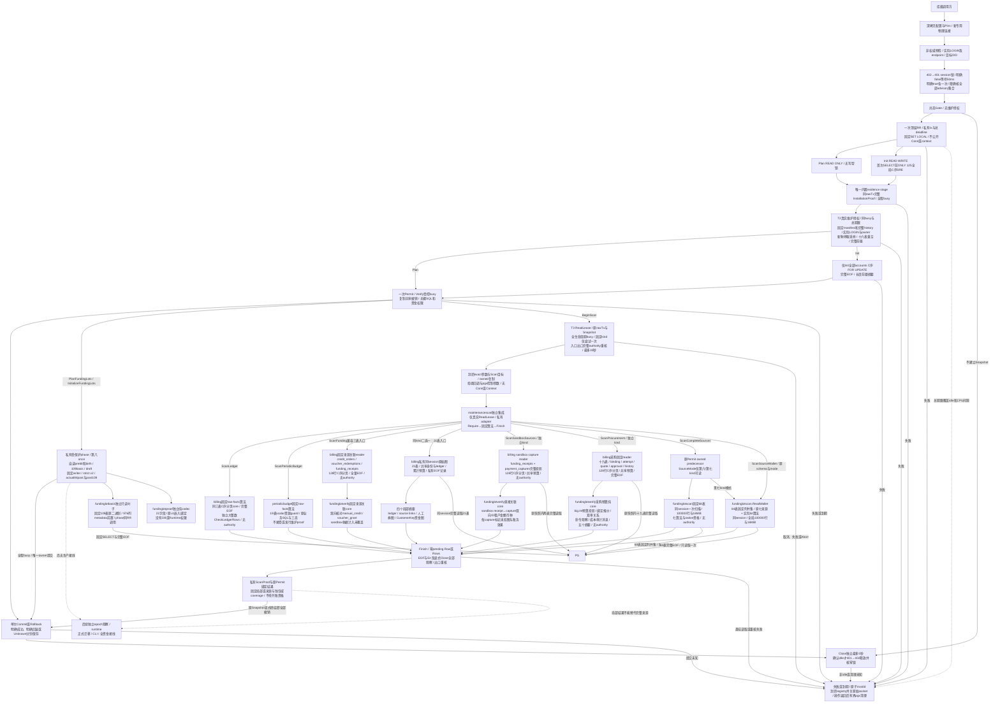
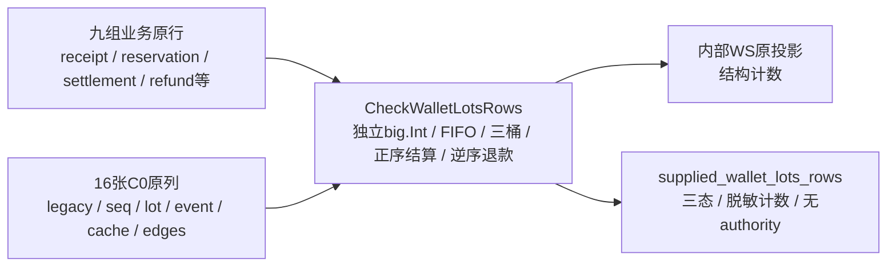
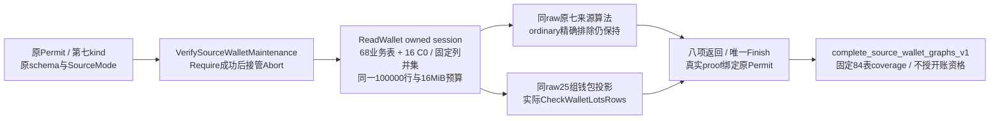

# C0 维护 Gate 与快照细化架构

当前增量：第八once位的私有受保护开账phase已装配原68表、tenant birth、109表basis、纯规划、固定writer与strict v2/实际84post/唯一提交。原七类公开ScanKind和scope不变；正式迁移、CLI、非空epoch观察及在线资金接线仍后续。详见[当前事务架构](README.md#受保护钱包初始化事务)。旧五类真实PG补验见[原记录](../verification/maintenance-financial-postgres.md)，68表与84表分别见[业务来源记录](../verification/complete-source-reader.md)和[来源钱包记录](../verification/source-wallet-reader.md)；本页早期片段保留历史范围，不将局部结果升级成开账/epoch证明。

本页描述 022-C0-T0/T1/T2 与 T3 库级维护基础设施。统一入口见[系统架构](README.md)，锁合同以[T0 §10](../../specs/022-self-service-payments/c0-permit-contract.md#10-根冻结t0专用连接双session-gate与清理)为准，Snapshot 以[T1 根冻结](../../specs/022-self-service-payments/c0-snapshot-lifecycle-contract.md#10-根冻结范围与尚未开放的能力)为准，T2以[真实授权](../../specs/022-self-service-payments/c0-authority-contract.md)、T3以[受控读取租约合同](../../specs/022-self-service-payments/c0-read-lease-contract.md)、[人工/券来源关联窄合同](../../specs/022-self-service-payments/c0-source-link-contract.md)、[sandbox capture直接关联合同](../../specs/022-self-service-payments/c0-sandbox-capture-link-contract.md)、[采购预算投影合同](../../specs/022-self-service-payments/c0-procurement-budget-contract.md)及[采购attempt关系合同](../../specs/022-self-service-payments/c0-procurement-attempt-contract.md)为准。当前ReadLease提供旧五类局部扫描、第六类68表/七算法业务来源读取及第七类84表/八算法来源与钱包读取；ScanFunding保留兼容三表和21表入口。它们是库级维护能力，没有普通main、HTTP、生产维护CLI或普通在线资金写入装配；本页顶部所述私有phase是新增的候选维护写入闭环。旧范围真实PG/race与新增组合各自记录，不将历史局部验证升级为lot/basis/epoch证明。

## 专用连接与双锁

[Gate](../../internal/maintenancetrust/gate.go)及[预检](../../internal/maintenancetrust/identity.go)使用新物理连接，不借还 runtime pool。Acquire 共用父期限与30秒的较早值，只有明确 false 才每50ms轮询；每把明确 true 后不重入。核本 PID/DB 的完整 advisory 集合，拒绝额外/shared/two-int 或丢锁，不调用 unlock_all。sandbox 保持字面 127.0.0.1:55439/moni_test 及实际 moni_test LOGIN；T2另重读super/datdba维护授权。

## 第六类完整业务来源读取

[完整合同](../../specs/022-self-service-payments/c0-complete-source-reader-contract.md)冻结68张物理业务表，不含外层安装catalog、schema_migrations与peer前驱。[SourceMode](../../internal/maintenancetrust/lease_source_mode.go)允许有效ScanCompleteSources或新增ScanSourceWallet lease读取原authority owned predecessor，沿用原begin/endMethod与身份绑定，不根据当前payment policy猜模式。

[集成](../../internal/maintenancescan/complete_sources.go)自行取得schema/mode，使用私有Query与仅Deadline/Done/Err的context视图，不接caller Facts/Report。读取[固定原行](../../internal/fundinglotscan/reader.go)、[七算法](../../internal/fundinglotscan/checks.go)并完成唯一Finish后返回私有结果；结果验证绑定原Permit/kind/lease，终结撤销。时间由timestamptz_send原生二进制经既有[]byte codec还原，支持year10000而不修改lease的simple protocol；输入不合格的域明确不执行，物理EOF和coverage分开，ordinary的22空表+policy+六旁路均实际核对。原codec、期限和资金权限不变；新业务来源coverage仍不能代替lot重放、pre/post与basis/epoch。

## 单次快照与固定 catalog stage

[Snapshot](../../internal/maintenancetrust/snapshot.go)只由 Gate 一次 BeginPlan/BeginInit 发行，保存直接 BeginTx 产生的同一个私有顶层 pgx.Tx。无 Tx/Conn/PgConn/Context/任意回调出口，不制作新 proxy 绕过 opaque proof 的 wrapper 身份。Plan RR RO 无 SRE；Init 固定 SET 后、首次任何 SELECT 前，执行[静态125表](../../internal/maintenancetrust/snapshot_tables.go)的一条完整 ONLY/全限定/C序 SHARE ROW EXCLUSIVE 命令。账户行锁只在T2认证history/身份/前驱后执行，T1历史范围不查询账户业务行。

VerifyInstallation 在同一个 rawTx 调用 fundinglotcatalog 的真实 issuer、完整 pins 匹配和出口复核；全程占有 stage busy，Commit/Rollback/Close 或第二 stage 并发立即拒绝。保留 issuer 五秒预算和固定 expected profile；不把 catalog 成功当作完整 migration history、维护授权或资金证明。返回 wrapper 与内部持有 wrapper 分离，调用方赋零不改变内部证据。

静态expected在包初始化时先完成固定SHA、独立有界严格JSON解析、完整DTO/模板验证及全root规范字节相等。随后[私有边界索引](../../internal/fundinglotcatalog/expected_spans.go)只从本次owned canonical编码结果定位variant/family/scope/category，复用完整规范片段构建原缓存，避免重复编码大树；digest命中后仍逐字节核相等才共享immutable map/value。索引有独立节点/深度界，字段与已验证DTO精确对应且失败关闭；无actual输入、外部入口、lazy认证或预算放宽。固定字段类型描述一次编译为同次序私有字段表，逐字段类型、枚举与exactKeys核验仍全部执行。启动优化的测量与证据按[T3合同§6](../../specs/022-self-service-payments/c0-read-lease-contract.md#6-集成启动开销与静态缓存合同)分层，不能替代正式数据库、生产或首字节验收。

## 期限、终结与物理清理

Begin 无 deadline 默认30秒，有 deadline 取父期限与10分钟较早值，剩余不足一秒拒绝。每 stage 同时受原 Snapshot 和该次 caller 取消/期限限制，后续 Background 不能延长。生命周期 watcher 在 SQL 阻塞、CPU 间隙或无人使用的 idle Snapshot 也立即 invalid 并关闭捕获 socket；它不并发调用 pgx。晚到 CancelRequest dial 遇已封闭 registry 立即关闭。

Commit 一次调用开始后按可能已发送处理：明确 COMMIT、明确 ROLLBACK/服务器回滚、无法确认分别保留 Committed/RolledBack/Unknown。错误不 unwrap driver；Unknown 不重发、不能由后续 Rollback 改成确定未提交。Rollback 独立最多5秒且不延长 Snapshot 授权。Close 遇活跃 stage或lease立即 busy；未显式终结的无人使用 Snapshot 直接物理关闭并保留 Abandoned，不能擅自提交。已确认 idle 才沿同一5秒 cleanup 预算逆序解锁并核空集。副本共态，重复终结/清理不重复发 SQL。

## 证据与后续边界

[T0专项](../verification/maintenance-gate.md)保留原代码版本和运行范围，不自动升级为 T1 证据。[T1真实 PG 验证](../verification/maintenance-snapshot.md)覆盖唯一 RR、首次快照物理 writer 屏障、125表锁、idle期限、busy、真实提交丢回复与明确回滚；最终race 124终态全PASS，独立清理为零。首轮测试语句子串误判已保留原日志并修正，未改产品锁/预算。

[完整前驱矩阵](../../specs/022-self-service-payments/c0-predecessor-contract.md)已按T2根冻结实施，App v1、M/Q实际字段、ordinary-off21表及6旁路不虚构active key、peer文件原件或v1不存在的字段。T3 ReadLease先交付ledger/PB与人工核款/兑换券等五类局部reader；第六类68表业务来源组合现已实现，见上节。纯lot重放与第七kind的84表同session读取已实现；protected pre/post、basis、epoch、startup RuntimeProof与生产接线仍继续后续。

## 真实授权与不可变前驱（T2）

[Attest/Permit](../../internal/maintenancetrust/permit.go)唯一二参入口仅消费原Snapshot内部owned installation。固定顺序为原binding/proof/pins、[编译manifest与完整history](../../internal/maintenancetrust/authority_manifest.go)、[实际维护身份及新鲜停服](../../internal/maintenancetrust/authority_identity.go)、16表重新全空、[私有完整前驱](../../internal/maintenancetrust/predecessor.go)、仅Init[完整账户锁](../../internal/maintenancetrust/authority_accounts.go)、出口重核后一次Permit。manifest22项2459bytes固定SHA，先服务端资格guard再原migrations.VerifySnapshotTx；不从live行生成expected。

ordinary要求actual LOGIN就是有效schema与PB六表owner；public唯一pg_database_owner按本DB datdba解析。sandbox仅字面专库moni_test真实super+DBowner例外，三NOLOGIN owner与五runtime仍受原完整catalog约束。每次入口/出口/Verify均两条相邻独立SQL先pg_stat_clear_snapshot再按目标DB与完整runtime OID采样，覆盖所有连接状态。零连接只证明当前采样，进程停服/join/禁止重连及owner并发写仍属外部协调边界。

前驱累计五秒subcall沿原watcher控制CPU间隙及SQL，成功stop/ack后cancel。逐列SQL资格位与CASE在客户端收到大字段前限制，单例LIMIT2、keys C序LIMIT129，成功业务行262与安全投影累计1MiB；有限typed时间、原canonical bytes/重编码/原SHA三向绑定，peer本地值独立保留。Init一条无WHERE/LIMIT全账户C序FOR UPDATE，逐ID长度前缀SHA与count，原TEXT ID无新增长度限制。

Permit所有字段私有，复制共享撤销；Verify使用新受控call持原busy，发行call结束不影响合法验证。失败、总期限/调用取消及终结开始均撤销全部副本并关原socket；watcher不并发pgx，不清正在读取的不可变事实。没有Tx/Conn/Context/回调、FromDigest、资金写入或生产CLI。T2原[专库PG/race](../verification/maintenance-authority.md)333.879秒、89顶层/832父子终态全部PASS，保留对应代码与范围；T3与整仓回归另记，不能用T1或默认CI跳过项冒充。

## 真实受控读取租约（T3首片）

[Permit.BeginScan](../../internal/maintenancetrust/lease.go)仅从原有效Permit建立固定kind的lease，保留同一私有rawTx、Snapshot和身份。入口与正常Finish出口均通过原authority完整verifyEvidence，含新鲜全runtime停服采样。从BeginScan至Finish/Abort持续占Gate busy，覆盖SQL、Rows遍历和纯CPU间隙；Permit.Verify、第二scan及Commit/Rollback/Close在此期间立即busy且不发SQL。每个Permit同kind只尝试一次；成功后的重复调用被拒绝，已完成局部结果仍绑定原Snapshot。

每个lease总预算最多30秒，并取caller/原Snapshot更早期限，不逐query重置。只有Deadline/Done/Err只读取消视图，不公开原Context或Value。watcher及并发Abort只改共享撤销状态并关闭原socket，不并发Rows.Close、Rollback或drain；原operation返回后才释放其operation/busy。失败、取消及原Snapshot终结会撤销Permit和全部完成proof；成功Finish后defer Abort幂等。

[lease_codec.go](../../internal/maintenancetrust/lease_codec.go)以exact内建类型允许集封闭参数和Scan目标。参数总数最多1024、累计逻辑bytes最多16MiB；slice owned复制，`[]string`每项长度框架也记账，内部固定simple protocol。QueryRewriter/NamedArgs、pgx控制参数、Scanner/Valuer/RowScanner、自定义别名类型、`*any`及借用driver目标被拒绝且不触发callback。Scan先写受审本地typed临时值，再复制赋给caller；不把原pgx.Rows交给caller。SQL文本仍只面向同进程受审固定SELECT scanner，并非任意SQL解析器或owner恶意代码沙箱，不连接HTTP/插件入口。

[Rows](../../internal/maintenancetrust/lease_rows.go)要求每次Next true恰好Scan一次，真正EOF后必须观察Err与显式Close，两者可以任意先后；单operation所有权不把busy误报为EOF。跳行、重复Scan、提前Close、未消费Row或悬挂Rows均使Finish永久失败并关连接。QueryRow.Scan核恰好一行，再验证EOF/Err/Close。没有悬挂读取且出口完整重核成功时，Finish才发行私有共态ScanProof。proof纯Verify核原Permit/Snapshot/lease nonce和固定kind，可在另一lease占busy时核绑定，不发SQL；原Snapshot终结、失败或到期时所有副本失效。零值、JSON、同摘要或同PID不能重绑。

## 五个实际reader与证明范围

维护装配集中到独立[`maintenancescan`](../../internal/maintenancescan)：它单向依赖billing、periodicbudget与maintenancetrust→fundinglotcatalog。普通billing/PB/main及领域测试不导入集成包、维护库或catalog；只有真正维护消费者承担catalog完整eager认证。[LedgerFactQuery/Rows与ReadLedgerFacts](../../internal/billing/funding_ledger_facts.go)复用[唯一固定query core](../../internal/billing/funding_ledger_query.go)，不接受authority，只返回私有保存snapshot的LedgerFacts；LocalSummary仅描述无权威局部结果。[maintenancescan.VerifyLedgerMaintenance](../../internal/maintenancescan/ledger.go)要求真实`*ReadLease`和ScanLedger，自行构造私有adapter，使用原T2前置与lease内current_schema，读取三表完整C序128条分页、保留journal额外事实，完整EOF/Err/Close后对整份原始行运行独立大整数CheckLedgerRows。原caller-owned RR入口仍保留实际LOGIN/窄shape/history前置，100000行、16MiB和共用期限保持。Require→固定core→Finish全部成功后，集成包才构造私有MaintenanceLedgerResult并保存本次完整snapshot与真实ScanProof，Summary仍为`supplied_ledger_rows`。

[`maintenancescan.VerifyMaintenance`](../../internal/maintenancescan/periodic_budget.go)要求真实`*ReadLease`和ScanPeriodicBudget，复用[PB固定业务SQL、声明列及receipt核验core](../../internal/periodicbudget/verifier_maintenance.go)；原public Verifier仍自行取得RR READ ONLY，执行actual LOGIN、六表owner、完整history/SET和Commit规则。固定ReadBoundedVerificationRows先执行维护专用scalar guard：19关系/146声明字段，全量audits与schema_migrations均计入，最多100000行、每非NULL字段cast text后的UTF8 bytes最多65536、累计16MiB，超界固定ErrVerifyExecution及零结果。该界限制返回客户端与保留的逻辑输入，不宣称界定PG排序/CTE/array_agg内存或Go堆/RSS。集成包从租约内固定SELECT取得schema，在Require→固定算法→Finish成功后才保存私有MaintenanceResult及真实ScanProof；Summary明确`periodic_budget_rows`，三类历史缺证仍为indeterminate。领域接缝无Permit/ScanProof、通过位或任意SQL入口；假的query至多得到无权威局部数据。两个维护入口不接收外部schema、provider或预计算报告，也不提供FromFacts/结果转proof构造器；Verify/Summary/Report继续绑定原Permit和固定kind，所有错误整个零结果。

[`maintenancescan.VerifyFundingSourceLinksMaintenance`](../../internal/maintenancescan/funding_sources.go)要求真实`*ReadLease`和ScanFunding。billing的[固定reader](../../internal/billing/funding_source_read.go)完整读取`credit_orders`、`voucher_redemptions`、`funding_receipts`，以每表128行C序keyset到EOF，执行Rows.Err/Close并共用100000行、16MiB及ReadLease总期限；[纯关联core](../../internal/fundinglotverify/funding_sources.go)双向核对manual/voucher source↔receipt的ID、租户、金额和journal关系，收据公共shape单独核验。`sandbox_capture`不参与支付source语义，只计入uncovered；unknown kind保留mismatch计数。summary仅声明`manual_voucher_receipt_links`的局部一致性，原始事实与proof均私有并绑定同一个ScanFunding/Permit。此reader及summary不核voucher批次/revocation/command图、sandbox支付证据、Key、采购、periodic budget或lot关系，不证同事务顶层xid；未来完整Funding组合必须在同一lease内接入其他reader并统一Finish，ScanFunding不能重复消费。

第四个[`maintenancescan.VerifySandboxCaptureReceiptLinksMaintenance`](../../internal/maintenancescan/sandbox_capture_links.go)要求真实`*ReadLease`和独立kind `ScanSandboxSources`，不会覆盖或升级上面的ScanFunding结果。billing的[固定reader](../../internal/billing/funding_source_capture_read.go)无过滤、无join地完整读取`funding_receipts`和`payment_captures`，按每表128行C序keyset分页至真实EOF；两表共用100000行、16MiB逻辑字符串预算和原lease最多30秒期限，失败返回零facts。纯[`CheckSandboxCaptureReceiptLinks`](../../internal/fundinglotverify/sandbox_capture_links.go)只按原始TEXT ID检查sandbox收据与capture的直接引用、tenant、receipt amount与capture wallet_credit_amount、currency，并独立计数孤儿、不匹配、缺收据、重复引用与shape问题。scope固定为`sandbox_capture_receipt_reference_v1`；`UnvalidatedCaptureGraphs`和`UnvalidatedLedgerEffects`各等于扫描capture数。直接链接一致不说明capture的order/identity/evidence/processing/review/effect图、journal/ledger/outbox/audit效果或外部PSP真实性成立。本reader及result没有普通main、HTTP、支付worker、资金writer、basis或epoch接线，也没有full-source coverage字段。[窄合同](../../specs/022-self-service-payments/c0-sandbox-capture-link-contract.md)冻结所有边界。

第五个[`maintenancescan.VerifyProcurementMaintenance`](../../internal/maintenancescan/procurement.go)要求真实`*ReadLease`和`ScanProcurement`。billing固定[reader](../../internal/billing/procurement_attempt_read.go)及[历史扩展](../../internal/billing/procurement_command_read.go)一次完整扫描十九表：channels、channel_credentials、channel_versions、channel_version_credentials、tenants、request_records、cost_versions、procurement_accounts、credential_procurement_bindings、upstream_attempts、procurement_reservations、procurement_budget_events、users、provider_cost_corrections、procurement_cost_proposals、procurement_commands、procurement_balance_observations、audit_events与projection_outbox。单列键按C序keyset，pool用复合tuple游标；所有表共用100000行、16MiB所有投影文本预算（含NUMERIC转文本）和原lease最多30秒。audit只读一次并共享给两个纯core。

预算、attempt绑定/报价、成本双审三个原scope保留；新增`procurement_command_observation_graph_v1`严格解析闭合历史快照，核applied command↔binding/observation及精确command audit；新增`procurement_cost_journal_graph_v1`核proposed/approved/legacy成本审计及cost_corrected outbox。历史配置快照不与当前账户配置比较，managed按reservation存在性分类，无关action/kind不按采购JSON解释。五摘要只在全部读取和五个core完成后Finish一次并绑定同一Permit/ScanProof，不合成Procurement coverage。evidence/metering、完整事件重放、PB/客户资金交叉关系和供应商消费真实性仍未证明。

数据矛盾正常Finish并返回mismatch；SQL、EOF/Err/Close、资源、取消、deadline或Finish错误返回零结果并撤销lease。没有普通main、HTTP、资金writer、basis或epoch装配，无新迁移或权限变化。精确增量为[历史读取](../../specs/022-self-service-payments/c0-procurement-history-read-contract.md)、[命令观察](../../specs/022-self-service-payments/c0-procurement-command-contract.md)、[成本审计消息](../../specs/022-self-service-payments/c0-procurement-cost-journal-contract.md)，历史与本轮验收范围分列于[验证记录](../verification/procurement-budget-maintenance.md)。

ScanProof只证明固定kind的lease正常完成；五个局部结果不能授予完整来源`CoverageComplete`、资金写入或init/basis/epoch就绪条件。Funding、Key、采购与支付B业务图已由第六kind固定68表scanner、七算法与唯一Finish组合，范围见[完整读取](#第六类完整业务来源读取)；第七kind已组合lot全图读取；protected pre/post及开账组合仍后续。旧五kind不复用写侧funding_valid或PB局部SQL充当全源证明。ReadLease历史验证见[T3专项](../verification/maintenance-read-lease.md)与[集成记录](../verification/maintenance-read-lease-integration.md)；manual/voucher reader合同与范围见[来源关联验证](../verification/funding-source-links.md)，sandbox与采购窄片见[各自合同](../../specs/022-self-service-payments/c0-sandbox-capture-link-contract.md)、[采购合同](../../specs/022-self-service-payments/c0-procurement-budget-contract.md)及[验证记录](../verification/sandbox-capture-links.md)、[采购状态](../verification/procurement-budget-maintenance.md)。它们互不递减完整资金来源未覆盖数，也不沿用历史T3通过计数。

完成证明的纯绑定还同锁检查当前未stopped permitCall的caller/context取消，防止后继lease取消后、异步回调调度前旧结果短暂通过；旧成功call的正常cancel不影响proof。客户端captured socket及时关闭与服务器会话退出分开验收：raw-close不保证即时中断任意长服务器SQL，服务器通常在下一次I/O发现断线；不由此推定服务器端锁已即时消失。

依赖隔离按[合同§7](../../specs/022-self-service-payments/c0-read-lease-contract.md#7-ci-启动回归后的维护集成隔离根冻结)实施，并以可执行依赖图门禁同时检查普通生产与billing/PB测试。此前本地串行1172.881秒成功只覆盖原版本；`f572bbd`的CI run 41359784155仍在billing-0原12秒helper、server-2/3原10秒main和other周期核验CLI原60秒观察失败。固定catalog的raw parser、span缓存与完整eager认证保留在真实维护消费者，普通main移除不必要依赖；不延长任何原期限或五秒issuer预算。后续隔离修改的原失败进程、真实双reader/资源界和整仓已重新验收；精确实现提交824e4e5的十组CI全部成功，见[独立记录](../verification/maintenance-integration-isolation.md)，不沿用f572bbd身份或扩大到生产验收。

## 资金同session原始图（T3后续）

按[固定session合同](../../specs/022-self-service-payments/c0-financial-read-session-contract.md)新增[billing.ReadFundingFinancialFacts](../../internal/billing/funding_financial_read.go)与[VerifyFundingFinancialMaintenance](../../internal/maintenancescan/funding_financial.go)。新入口不增加ScanKind，原Permit可选择旧三表或新21表一次。用户/租户/账本只读一次，再共享给来源与Key纯core；完整EOF/Err/Close/ctx后才登记私有完成记录，全部21表和四core正常完成后唯一Finish。每页128行、100000源行、16MiB原始string文本及原lease总期限不按表或core重置。

[人工/券core](../../internal/fundinglotverify/funding_source_graph.go)核双审批次与撤销、兑换资格、commerce终态、精确两行journal和唯一audit/outbox；[Key core](../../internal/fundinglotverify/customer_key_graph.go)核R与预占/终态/退款/held/spent，退款不减少原始spent。支付四kind仅通用检查，sandbox明确计未覆盖；独立时钟不被误当历史单调序列。旧ledger元数据与source-link数字资格继续作为组合前置，错误封闭五类且全部零结果；真实数据mismatch正常保留四摘要。结果四scope与原Permit绑定，零值/JSON/局部事实不能发行proof或资金权。

21表是业务来源组合的基础；采购证据、PB与sandbox的新纯核验核心见下节，现已纳入第六kind的68表同session reader。旧ScanFunding保持四局部scope；纯lot重放与第七kind的84表同session接线已实现，protected pre/post、basis/epoch与线上writer仍未实现。历史跳过项及QA顺序修正见[原记录](../verification/funding-financial-graph.md)，本轮真实PG补验另列[独立记录](../verification/maintenance-financial-postgres.md)，不追溯升级旧T2/T3结果。

## 采购、周期预算与支付来源的独立原始图

三个纯核心继续位于`fundinglotverify`，只解释传入的原始行，不接收外部摘要或完成位，不连接数据库，也不发行维护权威。

| 核心 / 合同 | 输入与独立核验 | 明确边界 |
| --- | --- | --- |
| [采购证据](../../internal/fundinglotverify/procurement_evidence_graph.go) / [合同](../../specs/022-self-service-payments/c0-procurement-evidence-graph-contract.md) | 23组原始行；内部从同一图重跑原五core，再核用量、finalization双摘要、语义identity、八类预算事件、成本记录与账户配置来源 | 缺失的incoming归属、历史前驱或事件顺序按明确行级规则报告indeterminate；不猜供应商真实账单 |
| [周期预算](../../internal/fundinglotverify/periodic_budget_graph.go) / [合同](../../specs/022-self-service-payments/c0-periodic-budget-graph-contract.md) | 18组业务行；独立逐笔重放control序列、allocation/window revision与三层投影，核配置版本、命令指纹、审计及来源反向关系 | 保留legacy成员、legacy效果边界、历史snapshot prefix三类真实缺证；原owner Verifier保持兼容 |
| [支付来源](../../internal/fundinglotverify/sandbox_source_graph.go) / [合同](../../specs/022-self-service-payments/c0-sandbox-source-graph-contract.md) | 33组原始行；独立canonical/digest、SKU前驱链、命令/query、验签原件、evidence/processing/review、identity/selection/capture及完整入账效果 | 依赖外层原安装/前驱认证；stored-verified本地关系不替代历史HMAC、外部收款或正式PSP认证 |

完整关系中的确定矛盾始终报告mismatch；真正保存不足的历史才进入合同规定的Unproven。SQL/权限/EOF/资源/取消失败是执行错误，不能降为历史缺证。原图共享预算、反向枚举及context检查由各纯核心执行，摘要不暴露ID、金额或原件。

这三项是库级纯算法，现由[第六kind完整业务来源读取](#第六类完整业务来源读取)在同一owned session实际执行。固定列并集、可信ordinary/sandbox模式、共享资源、物理EOF与唯一Finish已实现；旧五类reader保持scope，其ScanProof不能拼成新结果。原行lot全钱包纯重放与第七kind同session读取现已实现；下一步冻结protected pre/post与同pre快照basis、init/post replay、epoch和APP资金接线。没有迁移、权限或生产装配变化。

## 钱包序列前置检查的范围

[纯序列检查](../../internal/fundinglotverify/wallet_sequence.go)只接受七组原行投影，无lease、tx、外部报告或权限参数。按[冻结合同](../../specs/022-self-service-payments/c0-wallet-sequence-rows-contract.md)比较seq/genesis/head、原journal/event绑定、全局唯一、legacy/new互斥和四delta声明。即使 RowsConsistent=true，也不能证明扫描完整、真实来源或FIFO；没有ScanProof或CoverageComplete。

原纯检查片保留六kind/原once状态；本轮第七kind继续使用原uint8 once，不导出 CompleteSourcesResult 私有facts，不改变Require/Finish、普通main或运行依赖。下节纯lot重放接受原业务源和16表原行，实际数据库读取与pre+basis/post仍须在owned同session内组合；本纯函数不能接收先前report或用外部bool补齐这些条件。验证见[记录](../verification/wallet-sequence-rows.md)。

## 实际 lot 域纯重放与维护接线边界

[V0-WL合同](../../specs/022-self-service-payments/c0-wallet-lots-rows-contract.md)已冻结实现；本图描述纯函数本身的依赖；新增第七kind的84表reader已调用该函数，普通main仍未接入。共25组原行共享100000行/16MiB，proof bytea单字段262144B仍计总预算；原生时间按32B包络计量。所有执行错误返回零结果。旧tenant held集合按legacy reserve减legacy terminal确定，不从当前unfinished倒推；批次本金和每次分配从真实业务金额计算，不接收外部分配计划或通过bool。

原单租约68表仍只证明业务来源范围；第七kind的84表reader在下节增加实际钱包重放。权限、生产迁移和维护CLI保持；之后须冻结protected pre+basis与init/post/epoch，本纯报告不能批准资金开账、原路退款或发行RuntimeProof。专项与回归记录见[验证](../verification/wallet-lots-rows.md)。

## 第七类完整来源与钱包读取

[ReadWallet](../../internal/fundinglotscan/wallet.go)与[固定投影](../../internal/fundinglotscan/projection_wallet.go)从同raw完成EOF后执行来源和钱包算法，不调用旧Read重新扫描，也不拼报告。九共享业务表仅tenants增加fl_created_xid；16表真实PK完整分页，singleton不滤false，legacy sources按kind/source_id。普通字段65536B，唯一attestation proof262144B特例在SQL与Go计账同时生效；总源预算不变。时间保留原生NULL/finite/infinity并按core资格分派。

[wrapper](../../internal/maintenancescan/source_wallet.go)只接真实第七kind ReadLease，Require成功后才defer Abort，原模式/同raw读取/唯一Finish后私有保存WalletFacts与ScanProof。六旧kind、旧68表入口、uint8 once及普通服务依赖保持。错误五类封闭且整个零结果，Resource保留优先；必填非PK不可表示属于输入mismatch，主键NULL无法分页则执行失败。

Coverage只表示本84表与八算法域的执行完整；没有epoch如实mismatch，不能当钱包N/A或开账权限。原Installation/Attest发行仍要求16表空，后续Verify/BeginScan/Finish不重空。尚无受保护init writer/phase capability，不能通过RW Init lease写SQL来伪造；ReadLease本身没有SELECT解析器，只约束codec/非空SQL/生命周期，固定scanner只发SELECT。未来同Init原RR的Attest→protected writer→post读取可沿原证据生命周期组合，但已提交epoch须新post/runtime授权合同。

真实维护测试只在空C0执行Plan/Init并核缺epoch、八算法、原Permit、once与撤销；非空C0数据由独立owner RR验证reader，不构成维护postphase或严格v2证明。精确合同与验证见[冻结规格](../../specs/022-self-service-payments/c0-source-wallet-reader-contract.md)、[本片记录](../verification/source-wallet-reader.md)。

## basis 与 proof v2 的独立边界

[固定109表basis叶子](../../specs/022-self-service-payments/c0-basis-reader-contract.md)和[严格v2纯codec](../../specs/022-self-service-payments/c0-proof-v2-codec-contract.md)现分别提供只读原二进制摘要与owned canonical格式对象。basis自行读取环境、UTF8、原结构和15type/16send受审profile，之后才能读取业务；使用PK record字节序分页、完整COUNT/EOF、记录信封与共享资源限制。proof只检查21字段、manifest自摘要及sandbox嵌入旧v1的完整严格格式/原SHA/DB和角色schema绑定。完整链路图与资源边界见[统一架构](README.md#固定-109-表-basis-与严格-v2-格式叶子)。

两者当前没有维护lease或issuer调用方，也不消费第八kind。Facts/Summary和CanonicalV2均不能发行RuntimeProof或准许初始化。后续必须在真实phase owner内保持原busy和同RR，将完整pre+basis、plan比较、私有写入、strict v2与84表post接到唯一commit-ready；通用Snapshot.Commit当前仍无phase检查。PID/xid/nonce仅属于私有authority，不放跨plan/init比较的basis；已提交epoch另需新observer/runtime合同，不能通过旧空安装入口复用。验证证据见[本片记录](../verification/basis-proof-v2.md)。

## 旧68表的最小数据出口与纯规划

[ProjectLegacySeed](../../internal/fundinglotscan/seed_projection.go)只从符合原68表完整一致资格的私有Facts提取九组普通业务行；tenant仅ID，未读取birth不构成NULL断言。它不执行Query，使用本次ctx、独立rejected并深复制返回值。原Read和ReadWallet的scope、SQL和七kind保持，84表Facts不能冒充原68数据出口。

[fundinglotinit](../../internal/fundinglotinit/types.go)纯Build独立核输入并算出历史membership/开账写集，专门INSERT DTO省略DB stamp，不发行epoch/attestation或写权。源金额、账本净额与账户缓存三方相等；历史receipt/approved退款不重复发lot，零额与terminal集合按[合同](../../specs/022-self-service-payments/c0-init-planner-contract.md)精确保留。

未来phase必须自己从真实Query取得seed并保存在私有state，唯一writer只接同state，不能提供Apply(permit,外部Plan)。原busy须贯穿pre+basis、write、strict v2/84post与commit-ready；当前通用Commit没有该约束，第八kind未消费，不能先Finish再拿描述性数据授写。新片验证见[记录](../verification/init-planner.md)。

## 第八once与受保护开账

[完整合同](../../specs/022-self-service-payments/c0-protected-init-phase-contract.md)和[当前总图](README.md#受保护钱包初始化事务)为本片现状。phase保持原busy、私有nonce/state及累计30秒预算，自读完整68表/tenant出生事务列NULL/16空表和109basis，自己构造draft与v2。固定writer只在原Init Writing阶段，epoch最后、flush后真实84重扫、strict proof所有绑定及fresh catalog/history/identity再核，再实际读109并比同事务pre。全部成功才由私有owner消费ready发送一次COMMIT；Plan也先成功提交只读事务再发布结果。

phase latch永久保留；公开Commit不得在失败或半完成后绕过。原ReadLease仍按七kind提供读取完成证明，无新增权威出口。提交未知关闭原socket并保留Unknown，不自动重做；当前无独立生产观察器。库级候选验证及源码身份见[验证记录](../verification/protected-init-phase.md)。前面独立叶子及T0–T3的“未装配”文字描述各自历史范围，不将其旧测试当新事务证据。
