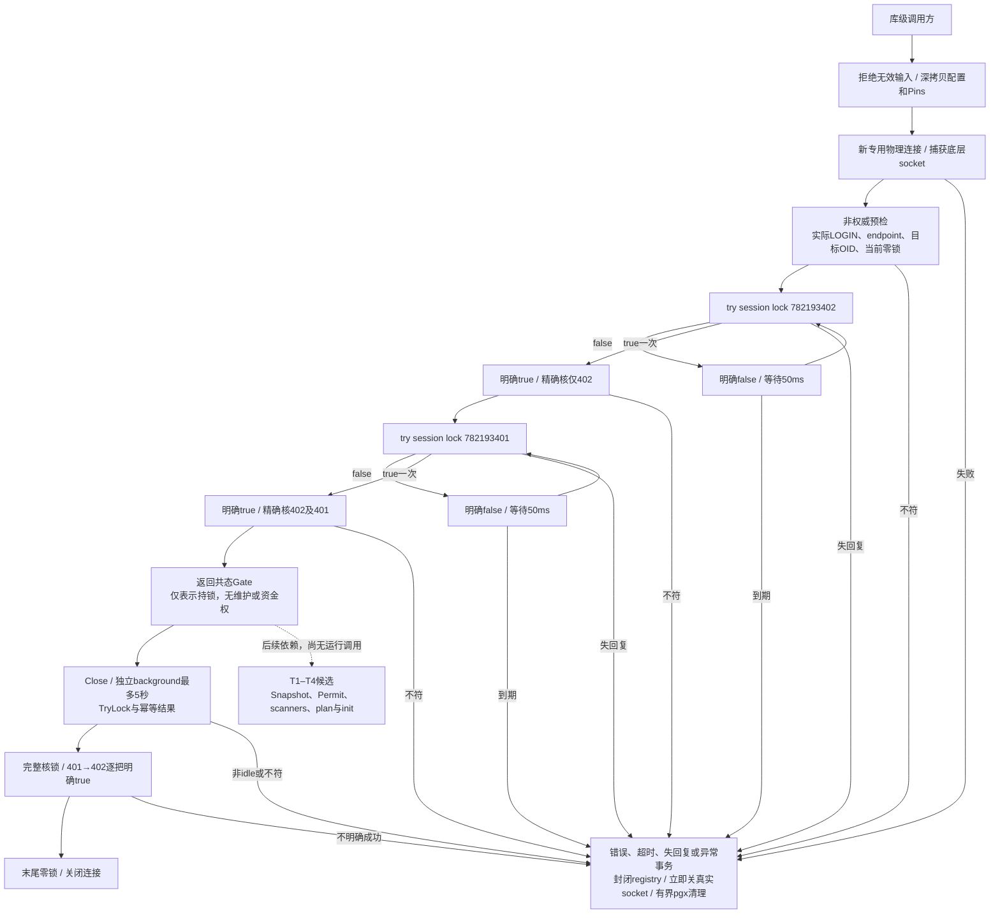

# C0维护双锁Gate细化架构

本页描述已实现的022-C0-T0库级切片。统一入口见[系统架构](README.md)，行为以[根冻结合同§10](../../specs/022-self-service-payments/c0-permit-contract.md#10-根冻结t0专用连接双session-gate与清理)、[Gate源码](../../internal/maintenancetrust/gate.go)、[身份预检](../../internal/maintenancetrust/identity.go)和[专项验证](../verification/maintenance-gate.md)为准。尚无普通main、CLI或资金调用者。

Acquire整个入口共用父期限与30秒的较早值。明确true后不重入该key；只有明确false允许轮询。每次核本PID完整advisory集合，拒绝额外/shared/two-int锁及丢锁，不调用unlock_all。配置、真实TCP peer与SQL server相互绑定；sandbox限定字面127.0.0.1:55439/moni_test及moni_test真实LOGIN，super/datdba维护授权留给T2。

Close无论caller context已取消或nil均独立最多5秒；Gate副本共享busy/closed/首次cleanup结果。失败不补偿或重发未知SQL，先关闭真实连接，避免pgx异步关闭延迟继续持锁。socket registry具有互斥和永久closing标记，异步CancelRequest晚到dial也立即关；远端backend消失与锁释放须由独立观察确认。

本片只依赖标准库、pgx和fundinglotcatalog的Pins值类型，不调用catalog issuer，不发BEGIN、SET或业务SQL。它不验证安装全空、维护身份授权、完整history/v1来源，也不授Snapshot/Permit/epoch/RuntimeProof或资金许可。T1–T4须先解决[合同§9](../../specs/022-self-service-payments/c0-permit-contract.md#9-2026-11-02独立审阅后的冻结前修订项)的账户锁顺序、scanner全程lease/总deadline、可信manifest和完整前驱字段矩阵。
