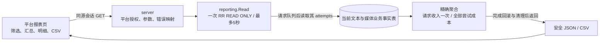

# 经营报表与对账导出（026）

2026-11-04。平台报表页已接入当前业务事实的只读经营报表：按请求创建时间筛选，展示消费收入、退款、模型调用毛利、模型汇总、渠道采购成本和请求明细，并导出CSV。[规格](../../specs/026-operating-reports/spec.md)限定口径，[验证记录](../verification/operating-reports.md)说明实际执行范围。

## 模块与读取链

[读取器](../../internal/reporting/read.go)以必填`from/to`和可选tenant/model ID建立请求队列，窗口为`[from,to)`、不超过31天。先限量读取5001条，超过5000请求返回422而非截断总额；随后只读队列内全部attempt，每请求至多两次。查询与`as_of`共享新RR只读事务、同一最多5秒工作context；rows排流后ROLLBACK，连接健康idle才Release，必要销毁共用独立5秒清理预算。任何读取、校验或清理失败都没有部分报表。报表不发模型请求、不修改资金、不影响准入。

## 数据与口径

| 现有数据 | 关联与用途 |
| --- | --- |
| request_records | 创建时间窗口及tenant/model筛选；请求ID是收入计数单位 |
| settlements | 按request+tenant关联唯一结算；已收费及截至快照的累计消费退款；缺失则未结算 |
| upstream_attempts | 按request读取全部尝试；仅contract/invoice且非NULL金额为已知成本，其余计未知 |
| tenants、models、channels | 当前可见名称；稳定ID保留准确关联身份 |
| media_requests、media_settlements | 媒体请求创建窗口及唯一媒体结算；`charged_amount`只在媒体request侧计一次，released或未结算请求不伪造收入 |
| media_attempts | 按媒体request读取全部attempt；supplier cost 从唯一结算的不可变 known/unknown 快照读取，不能把`raw_amount`当供应商成本 |

[聚合器](../../internal/reporting/report.go)在请求侧只计算一次收入，再累加每次尝试成本，避免重试造成收入翻倍。`net_revenue=charged-refunded`；只有未结算请求和未知attempt成本均为零，才提供`gross_margin=net_revenue-known_provider_cost`，否则为null。金额用CNY微元十进制字符串和Go big.Int，不经浮点；毛利允许负数。渠道只汇总成本，不分摊客户收入。探测、钱包充值/赠额、手续费及税费不纳入，报表不宣称现金流或平台净利润。

原[累计钱包报表](../../internal/server/reports.go)读取reports-v1异步投影，表达入账、消费、退款与释放累计并显示待投影数量；026直接读取当前请求/结算/成本事实。两者服务不同口径，经营报表不依赖投影刷新，也不替代钱包权威账本或离线重建。

## 权限、输出与控制台状态

`GET /api/platform/reports/operations`与`.csv`沿现有会话、MFA策略、单活Guard和平台中间件，仅admin/finance_operator/finance_approver可读；客户owner/billing_viewer/member均403。复用APP既有六表SELECT，没有新表、迁移、角色或授权。响应不包含凭据、prompt或模型正文。

[HTTP](../../internal/server/operating_reports.go)拒绝重复/未知参数，非法筛选400、请求上限422、数据库/超时503；所有响应no-store，错误不输出SQL/cause。CSV先在内存完整生成再发送，固定文件名、UTF-8与nosniff；[CSV编码](../../internal/reporting/csv.go)保留整数金额，未知毛利留空，对文本前导空白/control后的公式前缀转义。每次导出独立新快照，可能与旧屏幕的`as_of`不同。

[OperatingReport](../../web/src/components/OperatingReport.vue)嵌入[ReportsView](../../web/src/views/ReportsView.vue)，默认最近7天，请求明细按同一返回快照本地分页并复用RouteAttempts下钻。[状态模块](../../web/src/operating-report.ts)在筛选、路由、身份变化和卸载时废弃旧结果；只接受当前generation/sequence的响应。下载验证CSV类型与认证事件，失败不保存错误文件，object URL使用后回收。

模块已接入默认平台HTTP/控制台；本片真实PG、前端和集成结果见[验证记录](../verification/operating-reports.md)。正式供应商账单同步、现金流、异步报表、生产容量及性能不属于026。

## 027来源与028统一计量的衔接

027四来源入账及非现金opening都不进入settlement消费收入；来源分配不join到收入聚合，避免一个request分配多lot后重复计收入。实际023后报表/CSV及四来源305入账但经营收入0的证据见[来源验证](../verification/wallet-sources.md)。

028已经从原request不可变快照读取protocol/execution_kind/profile/schema/variant，筛选、JSON、CSV及前端沿同一合同工作；不能从当前model profile推断历史。当前媒体接缝继续使用同一只读RR快照，把media_requests与media_settlements映射为请求事实，把media_attempts映射为全部attempt事实；媒体操作可通过protocol筛选，video_generation使用asynchronous执行类型。金额继续读原settlement和全部attempt投影，不从向量或`media.raw_amount`重算，也不因人工客户量确认而把上游未知成本改成0。任务生成归原提交request，实时按收费轮次request；poll/下载/heartbeat不增加收入或生成attempt。媒体 supplier cost 只从结算时冻结的 known/unknown 快照读取，失败、取消、缺失或未知消费仍进入未知成本并使毛利为null。跨维度数量若另行汇总须按schema/dimension/unit/side分组，不把Token、图片、字符和时长相加。实施范围见[028消费者清单](../../specs/028-unified-metering-media/u-consumer-inventory.md)与[阶段出口](../../specs/028-unified-metering-media/tasks.md)。
