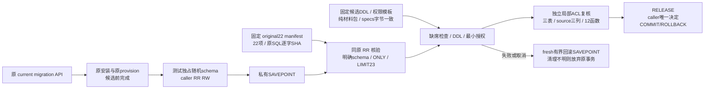

# 固定历史与预算证据候选安装

本片按 [B-P2 合同](../../specs/023-periodic-products/b-prefix-install-contract.md)隔离历史材料与安装权限，承接 [B-P1 观察来源](periodic-budget-prefix.md)。它提供候选测试的安装接缝，没有生产安装入口。后续显式V3的完整读取、catalog及运行组合见[B-P3架构](periodic-budget-prefix-profile.md)，本片自身不发行运行权限。执行结果与未验范围见[验证记录](../verification/periodic-budget-prefix-install.md)。

图像预览：[安装状态机](../verification/assets/architecture-periodic-budget-prefix-install-detail.png)。

## 材料与事务边界

[`migrations/original22.go`](../../migrations/original22.go)只按冻结的 22 个名字认证原 SQL，再返回独立 canonical 副本。未来 current 追加文件不改变历史材料，数据库中的额外记录仍拒绝。`VerifyOriginal22SnapshotTx` 不借新连接或事务核历史，明确引用目标 schema；CASE 在数据库侧限制历史字段传输大小，最多读取 23 行来检测额外项。不信任主键存在，也不从 search_path 采用同名临时表。

[`periodicbudgetprefixschema`](../../internal/periodicbudgetprefixschema/materials.go)只保存与 specs 原件逐字相同的固定 DDL 和授权模板，标识符以引用形式替换。它不连接数据库或取得任何 authority。

[`testsupport/periodicprefix.InstallTx`](../../internal/testsupport/periodicprefix/install.go)仅支持本机专库与测试 fixture 的明确随机身份。原 001–022 与原授权先完成；私有 savepoint 内依次验证历史、候选完整缺席、DDL、最小 delta 和局部 ACL。任一步失败回滚整个私有片；成功只释放 savepoint，最终提交仍归原 caller。它不复制维护 Gate，不声明生产排他，不处理未知最终提交后的自动重装。

## 授权与拒绝条件

[`VerifyRolesTx`](../../internal/testsupport/periodicprefix/roles.go)静态规定三表 25 列、row type 和准确 12 个函数签名；验证 raw ACL 与 APP/projection 的实际有效权限，并遍历可 SET/ADMIN 的角色上下文。新 source 三字段不增加 UPDATE。函数保持 invoker 和固定查找路径；不允许 PUBLIC、新投影读权、grant option 或外部默认授权扩大权限。

候选后不能重跑旧 `ProvisionFor`：其 ALL TABLES 广授会扩大新三表权限，本片会将其检出，不能据旧命令成功认为新候选边界成立。完整 catalog 对象、函数正文、依赖、约束和全 schema root 仍由后续 B-P3 负责，局部 ACL 检查不发行证明。

[精确旧 profile 反例](../../internal/fundinglotcatalog/prefix_rejection_integration_test.go)在 named ordinary 的 LegacyV1/WalletReadV2 正常基线先发行证明，再追加完整候选，验证旧 snapshot/runtime 明确拒绝，LegacyV1 原 installation 同样拒绝；原材料和 roots 保持。该窄测试没有为新候选发行新 profile。

## 系统影响与后续

只改变隔离候选 fixture 的安装链，普通服务请求、资金、worker、启动和部署路径不变。旧 current/history API、旧 roots/goldens、84 表读取和 109 表 basis 继续原样；本片未把新来源接进 APP RuntimeProof。

下一依赖要共同冻结新完整读取、共享物理预算、basis/catalog/report profile、历史到 current 的明确兼容，以及 protected pre/post、观察与 APP runtime。正式迁移和在线资金 ready 继续在最后接线验收后开放，旧缺证 control 不因安装而补造出生来源。
