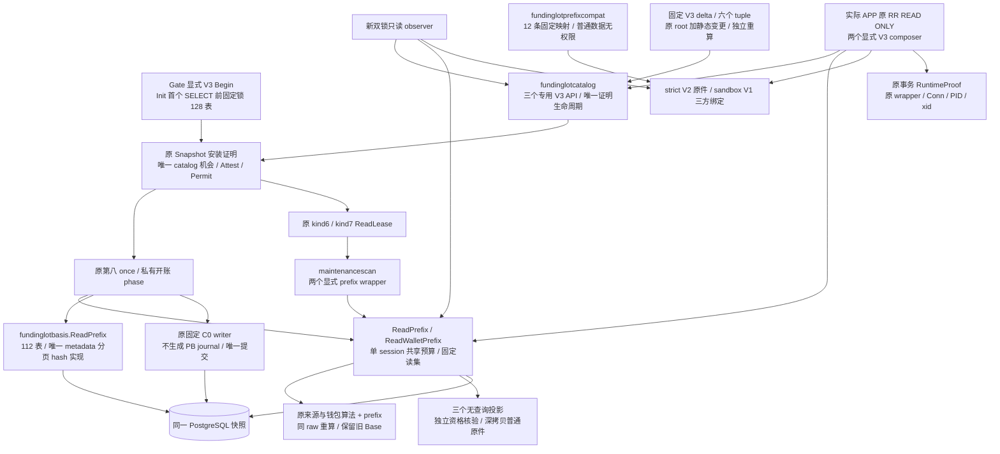
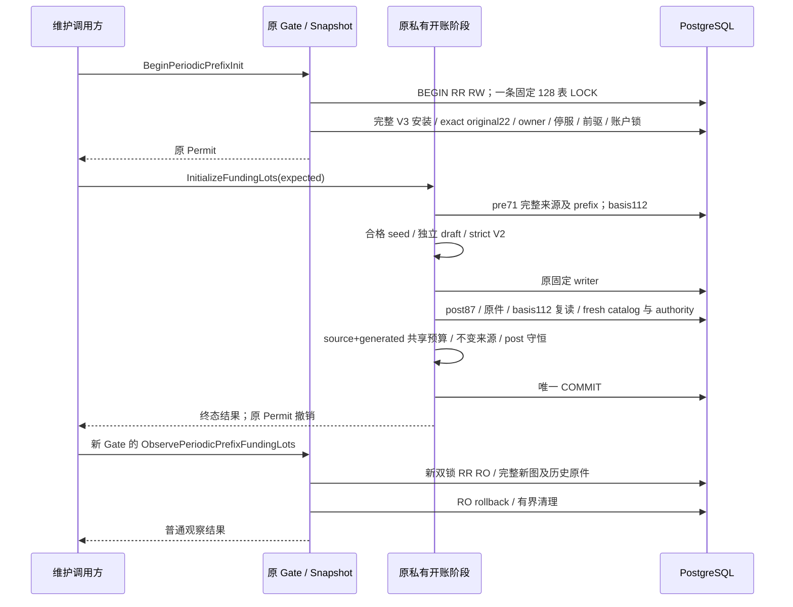

# 周期预算完整来源与受保护组合（B-P3）

本片将[不可变观察证据](periodic-budget-prefix.md)接入完整来源、basis、catalog、停服开账、独立观察及实际 APP 运行核验。行为先冻结于 [B-P3 合同](../../specs/023-periodic-products/b-prefix-profile-contract.md)，实际执行范围见[验证记录](../verification/periodic-budget-prefix-profile.md)。它仍是精确 original22 加受审候选的库级路径；普通 migrate/provision/main/Compose 不安装候选，也不因此开放在线来源钱包。

## 模块与版本选择

profile 在 Begin 时写入私有状态，安装核验只能选择该 profile；caller 不能通过外部 CatalogProof、参数或失败后换入口扩大接受范围。新旧 Begin 共用 Gate 的唯一开始机会，新旧安装 API 共用原 catalogUsed，新旧 wrapper 共用 ScanKind 6/7；第八 phase 位仍为 128，没有新增第九位。选错或扫描失败消耗原机会并沿原失败终结管线撤销权限。

旧 `Read`、`ReadWallet`、LegacyV1 / WalletReadV2 roots、旧 descriptor、旧兼容材料和 codec/golden 保留。旧 generic catalog API 拒绝 enum=3；新路径必须调用三个专用 V3 API。公共 verify core、metadata/分页/hash、phase、observer 与 runtime 生命周期仍只有一份，profile 只在封闭接缝选择固定材料及读取器。

## 数据面与资源界

| 路径 | 业务表 / 列 | 单次物理逻辑预算 | 完整性 |
| --- | --- | --- | --- |
| prefix source | 71 / 635 | 100000 行 / 16 MiB | 原七来源算法加 prefix，8 项状态 |
| prefix wallet | 87 / 804 | 同一个 session 共享 100000 行 / 16 MiB | 原八算法加 prefix，9 项状态 |
| prefix basis | 112 / 1004，131 PK 字段 | 100000 行 / 64 MiB | 原二进制 framing 加实际新 descriptor |
| V3 catalog | 128 普通表 / 1173 列 | 原总 5 秒及静态 category 预算 | 完整对象、正文、ACL、角色与依赖闭包 |

source/wallet 的 history(name/checksum) 由外层单独核验；basis 本已包含 history，排除原 16 张 C0 输出表及 `tenants.fl_created_xid` 的内容指纹。metadata 仍为 2048 行 / 1 MiB；旧 basis 的 relation/PK/attribute sentinel 为 110/110/978，新路径为 113/113/1006，不扩大旧入口。

新增三关系为 origins 4 列、heads 4 列、journal 17 列，既有 operation/window 增三列。journal 的两项 generated discriminator 实际传输、计量且逐值检查，随后才投影为纯 checker 的 15 字段。共享原业务表和 audit 原始行只读一次；不能拼接两个快照的报告。独立纯 checker 仍执行自己的逻辑预算。

新报告保留 `PeriodicPrefix.Base == Periodic`，旧 `OperationSnapshotPrefixUnproven` 原样可见。新 aggregate 只在不可变证据逐命令证明成功时取得完整性；legacy membership/effect boundary 缺证、确定 mismatch、资源或上下文错误继续阻断。新 Facts 有不同私有命名 state，不能外部转换 source→wallet。三个新投影重新核 raw、固定读集、EOF、预算与全部算法后深拷贝，无 SQL 或权限发行。

## 原快照内的开账与独立核验

Init 的 128 表固定 C 序锁在首个建立数据快照的 SELECT 之前完成；旧 Init 继续 125 表。source+generated 总资源、post 钱包计数与来源不变性均按当前 owned profile 比较。原 writer 只写 C0 allowlist，不反向写 PB 观察；测试同时核 journal 计数不变。失败、取消、busy、unknown commit、socket 关闭和全部副本撤销仍沿原 Gate/phase 状态机。

新 observer 以自己的原 raw tx 重核完整 catalog/history、87 表图、strict 原件及停服，只能在原 RO rollback 和清理成功后返回。APP composer 不结束 caller 事务，在累计 30 秒内进行前后完整 catalog、exact original22、87 表图及 strict 绑定；每次 catalog 不超过 5 秒。RuntimeProof 只对原 wrapper/Conn/PgConn/PID/top xid 及仍活跃 RR RO 有效，结束后不可沿用到在线写事务。

## 静态材料与权限

新 basis descriptor SHA 为 `104914e6176e3d02a289e4e0acf0d476a69dcfb2e8772cf29336b520a7ec82bc`。catalog 从原静态 envelope 与受审准确 delta 推导 ordinary/sandbox 六个 tuple；两份只读脚本重新计算整份 delta 及最终 roots，数据库仅验证静态材料。完整对象数量与内建对象依据见[静态审定](../verification/periodic-prefix-catalog-static.md)。三项新增 builtin 仅 V3 可选，旧 collector 接受集不扩大。

APP 取得三表和原三字段的精确读写权限，generated/source 不可任意改写；projector/worker/peer 不新增内容权限。原 C0 十六表 Installation 空集检查共用，三张 PB 证据表可有真实经营历史。

[fundinglotprefixcompat](../../internal/fundinglotprefixcompat/materials.go)固定 12 条历史映射：六条 LegacyV1 旧 basis→V3，以及六条 V3 新 basis→同 V3。映射严格绑定 mode、variant、manifest、descriptor 与 historical/current 完整 tuple，普通返回值不授 authority。维护 observer 和 APP runtime 共用该叶子；没有历史发行路径的 WalletReadV2 不凭推测加入，旧文件不改签。正式迁移改变 manifest 时必须另审映射。

## 源码与交付边界

| 责任 | 入口 |
| --- | --- |
| 固定读集、session 与投影 | [prefix_reader.go](../../internal/fundinglotscan/prefix_reader.go)、[prefix_projection.go](../../internal/fundinglotscan/prefix_projection.go)、[readset](../../specs/023-periodic-products/b-prefix-readset.json) |
| basis 固定选择 | [prefix.go](../../internal/fundinglotbasis/prefix.go)、[descriptor](../../internal/fundinglotbasis/materials/descriptor-prefix-v1.json) |
| catalog 专用发行与 expected | [prefix_profile.go](../../internal/fundinglotcatalog/prefix_profile.go)、[prefix_expected.go](../../internal/fundinglotcatalog/prefix_expected.go)、[roots](../verification/periodic-prefix-profile-roots.json) |
| profile / Begin / 安装 / lease | [periodic_prefix_profile.go](../../internal/maintenancetrust/periodic_prefix_profile.go)、[两个 wrapper](../../internal/maintenancescan/periodic_prefix.go) |
| 受保护阶段与 observer | [funding_lots_prefix.go](../../internal/maintenancetrust/funding_lots_prefix.go)、[funding_lots_prefix_observe.go](../../internal/maintenancetrust/funding_lots_prefix_observe.go) |
| APP runtime 与共同历史材料 | [prefix_compose.go](../../internal/fundinglotruntime/prefix_compose.go)、[prefix_materials.go](../../internal/fundinglotruntime/prefix_materials.go)、[固定兼容材料](../../internal/fundinglotprefixcompat/expected/compatibility-v1.json) |

本片不注册生产迁移、维护 CLI、startup/ready 或在线来源资金写入。完整生产发行还需正式 migration/provision、历史材料升级、各实际 runtime 认证与在线写事务合同；原路退款/拒付、供应商认证、正式支付、Docker/1Panel/HA 和性能专项继续按交付计划独立验收。旧路径的非空 PB gap 仍保留，新 V3 路径的候选验收不得写成普通服务已自动启用。

B-P3整体未完成。[采购历史证据缺口](../../specs/023-periodic-products/b-prefix-procurement-barrier-gap.md)保留合法approved提案的更正前revision；当前reservation已递增时，原checker仍返回`ProposalBarrierUnproven`，完整aggregate与owned V3 Plan必须关闭。无该缺证的跨窗、客户/key和供应商释放历史可独立验收，但不能替代合同要求的采购成本更正后完整成功。后续须先设计不可变审批消费的revision、完整evidence集与唯一成本事件绑定，不向历史行补造证明。 绝对更正同时保留`CostRecordedEligibilityUnproven`；同一共享采购账户包含多个来源及已终态事件时，原core另保留`AccountAdmissionOrderUnproven`。这两类历史的PB prefix可分别完整，但均不足以让完整aggregate取得资格，准确集合按对应规格与测试分别断言。

[catalog CPU诊断](../verification/periodic-prefix-catalog-cpu.md)记录了固定权限行的受限解码优化及等价回退边界；SQL、root、权限面和总5秒期限保持。标准无race完整诊断通过不抵消原LegacyV1 baseline的catalog race时限失败，该门禁仍未关闭；局部解码基准也不代表网关TTFB/TTFT或生产性能。
