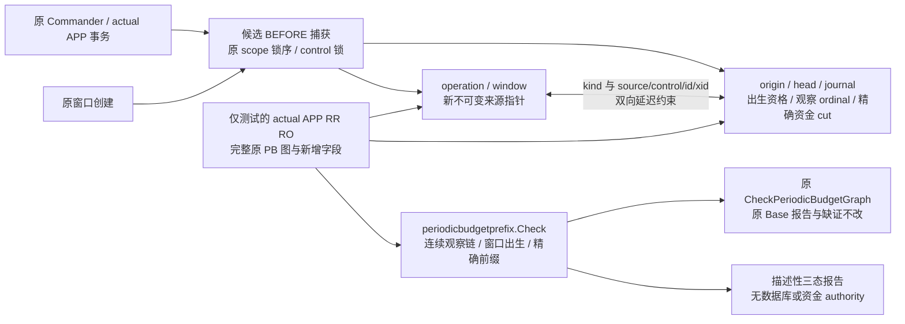

# 周期预算命令前缀与窗口出生证据

2026-11-03。设计先于实现冻结于 [B-P1 合同](../../specs/023-periodic-products/b-prefix-contract.md)，对应[运行核验发现的历史缺口](../../specs/022-self-service-payments/c0-runtime-pb-evidence-gap.md)。验证范围单独记录于[本片证据](../verification/periodic-budget-prefix.md)。

图像预览：[系统模块图](../verification/assets/architecture-periodic-budget-prefix-application.png) · [本片数据流](../verification/assets/architecture-periodic-budget-prefix-detail.png)。

## 模块与交付边界

[候选 SQL](../../specs/023-periodic-products/b-prefix-candidate.sql)与[候选权限](../../specs/023-periodic-products/b-prefix-permissions.sql)仅用于精确 001–022 后的隔离 schema。它们不属于正式迁移、provision、普通 main 或 Compose 安装路径。旧 owner 核验器、68/84 表 reader、109 表 basis、catalog roots 与 APP RuntimeProof 均未隐式扩大范围。

纯包 [periodicbudgetprefix](../../internal/periodicbudgetprefix/types.go)只接不可信原行，自行调用原完整算法，不接受调用方通过位。专库 fixture 的读取器用于语义验证，不承担生产预算、catalog 或 EOF authority；生产 scanner 的共享物理预算与新读取 profile 必须另行冻结。

## 两种次序与数据关系

资金 `event_seq` 表示已应用的资金 effect；新增每 control 的观察 `ordinal` 共同排列 `window_birth` 与 `command`，包括 no-op。命令回执的资金 cut、窗口 revision/tail 和 JSON 来自同一份锁内原件，窗口存在性由出生 ordinal 决定。因此同一资金 cut 下，“先回执后创建空窗”和“先创建空窗后回执”能够区分。

新 control 在原 guard 后无条件建立 origin 与零 head。窗口与命令在最后受审 BEFORE 阶段生成 fresh journal，再将不可变指针写回原 source；双向复合外键延迟核对 source/control/kind/ID/top xid，命令还绑定原观察时刻。head 只能前进一个 ordinal 并准确接续当前事务 journal。函数固定 search_path、使用 invoker 权限；没有 SECURITY DEFINER。

应用角色只取得候选所需 SELECT、列级 INSERT/UPDATE 与 EXECUTE；投影角色不因此取得新关系读取权。origin/journal 不可更新、删除或清空；head 不能任意跳号或回退；旧窗口不能自报新出生。

## 核验与历史兼容

新报告 scope 为 `periodic_budget_snapshot_prefix_v1`。核验原 origin、source 双向绑定、ordinal 链、资金 cut/tail、窗口出生顺序，并按唯一 cut 重放金额和严格 JSON 回执；不会搜索“金额恰好相等”的其他前缀。

仅逐命令认证的新 scope 可以解决对应 `OperationSnapshotPrefixUnproven`；原 Base 报告原样保留。旧 control 不补造 origin，缺证保持 `indeterminate`；`LegacyMembershipUnproven`、`LegacyEffectBoundaryUnproven` 继续独立阻断完整性。空图按原合同可 balanced，不代表已有活动预算通过认证。

全部原图与新增投影共同受 100000 行、16 MiB 逻辑预算与 65536 字节单字段上界限制。取消、超时和资源错误返回安全错误与零报告，结果不包含原件 ID 或正文。

后续先完成候选的精确安装/材料隔离，再设计完整新 scanner/basis/catalog/report profile、pre/post 与 APP runtime 组合，最后发布追加迁移与启动装配。旧历史字节与 roots 不重签，缺证历史不因新安装自动补全；R1-B 完整经营验收与 R2 在线资金门禁继续保留。
