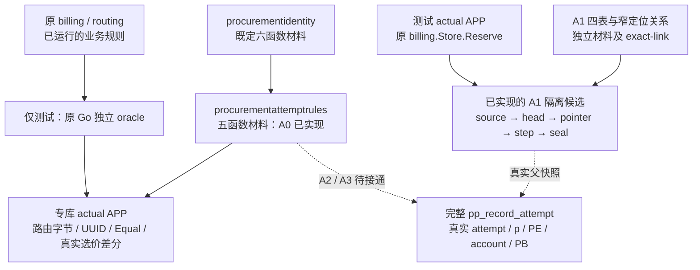

# 采购 attempt 出生：原规则与真实父请求

本页承接[完整 attempt 根](../../specs/023-periodic-products/b-procurement-attempt-birth-writer-contract.md)，按 A0 原规则、A1 真实父请求、A2/A3 attempt 与预占效果推进。它描述显式隔离候选；当前正式安装仍为 001–022，普通 `serve` 不安装这些材料。

## 模块、调用与状态

实线为已实现的材料依赖和隔离测试；虚线为后续依赖。A1 的实际执行限于显式专库装配，普通服务不安装它。规则包没有数据库连接、安装器或运行时业务调用，测试中的 `billing` 导入不会使其进入生产路径。

## A0 的实际规则边界

[新材料包](../../internal/procurementattemptrules/materials.go)只提供固定 SQL 字节、版本和 SHA-256；[规则正文](../../internal/procurementattemptrules/materials/attempt-rules-v1.sql)包含以下五个函数，全部 SECURITY INVOKER，撤销 PUBLIC EXECUTE，不授予角色或 DML。

| 函数 | 实际责任 |
| --- | --- |
| `pp_at_uuid_parse_v1` | 保留原 `google/uuid.Parse` 接受集，包括 38 字节任意 ASCII 包裹；不把原文字身份归一化 |
| `pp_at_route_json_v1` | 五字段路由、1000 项、完整 int64 / uint64、20 reason 与原错误分支；输出与 Go JSON 逐字节一致 |
| `pp_at_expected_shape_v1` | 检查 expected BYTEA 的存在性联合；保留空、NUL、非法 UTF8、负或 NULL rate |
| `pp_at_quote_equal_v1` | 消费时比较原字节与 nullable rate，沿真实 `CostQuote.Equal`；不代替 Known 或政策检查 |
| `pp_at_current_quote_v1` | 单条 SQL 用一个真实 DB 时钟稳定选价；无报价仍返回一行采时及 NULL 成本维度 |

前四个函数 IMMUTABLE / PARALLEL SAFE；只读选价函数 VOLATILE / PARALLEL UNSAFE，不自行取渠道锁。完整根仍需在真实锁等待后以新语句重读资格，保留原错误顺序与 5 秒 statement 界。

[独立差分](../../internal/billing/procurement_attempt_rules_postgres_test.go)直接调用原私有 `validID`、`validatedRouteDecisions`、`currentAttemptCostSQL` 和公开 `CostQuote.Equal` 作 oracle。它在随机 schema 中安装原 001–022、原 identity 和新材料，再由实际受限 APP LOGIN 执行。报价同生效时刻的旧数据在真实 012→013 迁移边界前准备，不禁用原 013 的新发布约束。CI 的 billing 分区显式开启专库变量；本地未设置变量时明确 SKIP。

## A1 与后续的设计责任

[A1 合同](../../specs/023-periodic-products/b-procurement-request-birth-writer-contract.md)与[exact-link 集成合同](../../specs/023-periodic-products/b-procurement-birth-exact-link-integration-contract.md)冻结独立四表、request 四列和窄 locator FK，不先安装旧 685 项关系再删除宽 UK。原件与来源的完整 payload 由双端 guard 和最终只读核验逐列比较；单列原 TEXT 身份保留，不用 hash 或新长度上限替代相等。

原 Reserve 保留 APP 的 21 列 INSERT，故同一 actual APP 手写的完全等价 INSERT 也会自动出生。该来源只认证真实初态与冻结事实，不能证明完整 Reserve 已经受控执行；客户资金来源、零售选价时刻的完整资格、后续 request decision 和 attempt 根仍有各自责任。原 018/020 触发器、资金硬预占与最终 COMMIT 保持真实运行。

[独立 DDL](../../internal/procurementbirthschema/materials.go)与[request writer](../../internal/procurementrequestbirth/materials.go)均已实现；四表 71 列、5 键、8 CHECK、10 条 native deferred FK 配套七函数、16 trigger、五个 deferred trigger。W 为无登录角色，仅 capture 为 definer；APP 无来源写权或私有 EXECUTE，W 对 origin/head/step 三项行锁列的实际 UPDATE 由 guard 拒绝。actual APP Reserve、legacy 差分、角色/写保护与九处故障回滚已通过[限定 PG 验证](../verification/procurement-request-birth.md)；PB/预算、并发等待、逐必要 grant 失权、等价 raw 和资金终态兼容等完整矩阵仍待完成。

A2/A3 继续在真实父请求上完成 managed / unmanaged attempt、真实 PB admission 时点、reserved 效果、command+reserve 新账户 guard / validator、唯一 seal 与反向集合。旧账户 writer v1 对 reserve 的拒绝不能绕过；A1 四表切片不等于全 715 列布局、完整读集、profile 或线上启用。

实际测试、失败修正和当前保留边界分别见[A0 原规则](../verification/procurement-attempt-rules.md)与[A1 真实父请求](../verification/procurement-request-birth.md)。来源纯核仍 `Complete=false`、Qualified 为空，无公共 Check；D1/I1、B-P3、R2、生产支付、真实供应商、目标容器/1Panel 与最终性能阶段没有因本轮局部通过而关闭。
