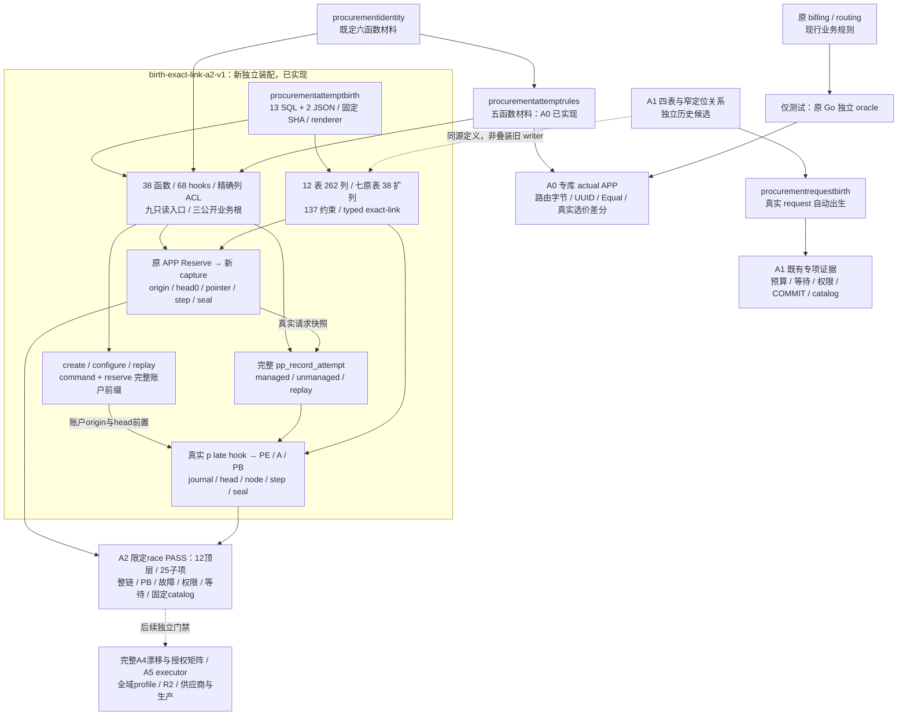
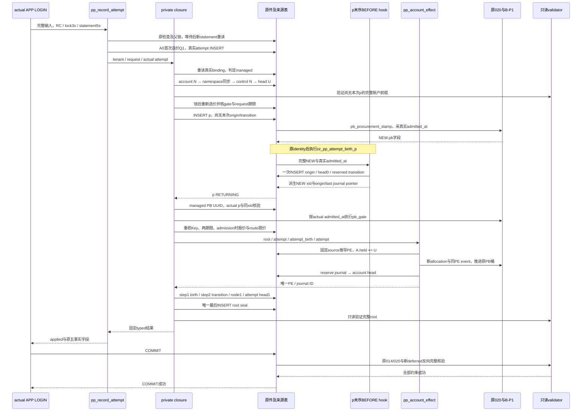

# 采购 attempt 出生：原规则、真实来源与预占效果

本页承接[完整 attempt 根](../../specs/023-periodic-products/b-procurement-attempt-birth-writer-contract.md)，按 A0 原规则、A1 真实父请求、A2/A3 attempt 与预占效果推进。A2 的独立材料、renderer、真实 writer/guard/validator/ACL 已实现，限定专库 race 与固定 catalog 检查已通过；完整 A4/A5、全域来源认证和生产接线继续后续。当前正式安装仍为 001–022，普通 `serve` 不安装这些材料。

## 模块、调用与状态

实线为已实现的材料依赖、调用与隔离测试关系，不代表相应测试均已通过。第一条虚线是只复用 A1 关系定义，第二条是后续交付门禁；A2 不在已运行的 A1 writer 上叠装。A0/A1/A2 的实际执行均限于显式专库装配；材料包没有数据库连接或自动安装，测试中的 `billing` 导入不将候选接入生产路径。

## A0 的实际规则边界

[新材料包](../../internal/procurementattemptrules/materials.go)只提供固定 SQL 字节、版本和 SHA-256；[规则正文](../../internal/procurementattemptrules/materials/attempt-rules-v1.sql)包含以下五个函数，全部 SECURITY INVOKER，撤销 PUBLIC EXECUTE，不授予角色或 DML。

| 函数 | 实际责任 |
| --- | --- |
| `pp_at_uuid_parse_v1` | 保留原 `google/uuid.Parse` 接受集，包括 38 字节任意 ASCII 包裹；不把原文字身份归一化 |
| `pp_at_route_json_v1` | 五字段路由、1000 项、完整 int64 / uint64、20 reason 与原错误分支；输出与 Go JSON 逐字节一致 |
| `pp_at_expected_shape_v1` | 检查 expected BYTEA 的存在性联合；保留空、NUL、非法 UTF8、负或 NULL rate |
| `pp_at_quote_equal_v1` | 消费时比较原字节与 nullable rate，沿真实 `CostQuote.Equal`；不代替 Known 或政策检查 |
| `pp_at_current_quote_v1` | 单条 SQL 用一个真实 DB 时钟稳定选价；无报价仍返回一行采时及 NULL 成本维度 |

前四个函数 IMMUTABLE / PARALLEL SAFE；只读选价函数 VOLATILE / PARALLEL UNSAFE，不自行取渠道锁。完整根仍需在真实锁等待后以新语句重读资格，保留原错误顺序与 5 秒 statement 界。

[独立差分](../../internal/billing/procurement_attempt_rules_postgres_test.go)直接调用原私有 `validID`、`validatedRouteDecisions`、`currentAttemptCostSQL` 和公开 `CostQuote.Equal` 作 oracle。它在随机 schema 中安装原 001–022、原 identity 和新材料，再由实际受限 APP LOGIN 执行。报价同生效时刻的旧数据在真实 012→013 迁移边界前准备，不禁用原 013 的新发布约束。CI 的 billing 分区显式开启专库变量；本地未设置变量时明确 SKIP。

## A1 的独立候选与既有证据

[A1 合同](../../specs/023-periodic-products/b-procurement-request-birth-writer-contract.md)与[exact-link 集成合同](../../specs/023-periodic-products/b-procurement-birth-exact-link-integration-contract.md)冻结独立四表、request 四列和窄 locator FK，不先安装旧 685 项关系再删除宽 UK。原件与来源的完整 payload 由双端 guard 和最终只读核验逐列比较；单列原 TEXT 身份保留，不用 hash 或新长度上限替代相等。

原 Reserve 保留 APP 的 21 列 INSERT，故同一 actual APP 手写的完全等价 INSERT 也会自动出生。该来源只认证真实初态与冻结事实，不能证明完整 Reserve 已经受控执行；客户资金来源、零售选价时刻的完整资格、后续 request decision 和 attempt 根仍有各自责任。原 018/020 触发器、资金硬预占与最终 COMMIT 保持真实运行。

[独立 DDL](../../internal/procurementbirthschema/materials.go)与[request writer](../../internal/procurementrequestbirth/materials.go)均已实现；四表 71 列、5 键、8 CHECK、10 条 native deferred FK 配套七函数、16 trigger、五个 deferred trigger。W 为无登录角色，仅 capture 为 definer；APP 无来源写权或私有 EXECUTE，W 对 origin/head/step 三项行锁列的实际 UPDATE 由 guard 拒绝。原候选 SQL/摘要保持；在原预算/钱包/raw/授权四份专项之上，再增加父锁、PB等待、提交回执和catalog四份先行合同/独立测试。最终整包 **32 顶层 / 528 子项 race PASS，0 SKIP/FAIL，62.292s**，含五个静态或纯wire顶层，其余27个为真实PG；总数已含上轮23/423及初片，详见[真实 PG 记录](../verification/procurement-request-birth.md)。

| 新增验收面 | 当前证明与保留边界 |
| --- | --- |
| [预算与资金](../../internal/procurementrequestbirth/request_birth_budget_postgres_test.go) | tenant/Key九种配置、零价/input-only/分组价、pending/Release/recovery及三处故障；fresh enabled只证明配置与追踪，active cap和正向settled另验 |
| [真实钱包等待](../../internal/procurementrequestbirth/request_birth_wait_postgres_test.go) | 真实锁证据下保留较早零售价、过期回滚、55P03与精确57014；不代替PB锁等待或COMMIT未知 |
| [raw与误授](../../internal/procurementrequestbirth/request_birth_raw_postgres_test.go) | 等价raw/同xid双请求、原020缺reservation、写隔离、冻结逐槽、真实guard与capture内错边；request允许同值no-op，来源表任意UPDATE拒绝 |
| [有效授权](../../internal/procurementrequestbirth/request_birth_grant_fault_postgres_test.go) | 291必要失权、全行与canonical ACL恢复；原PUBLIC重叠单独控制。W两allocation SELECT因原020身份不变的AND短路当前不使用，另以有效撤权成功验证，不能称所有现有grant均必需 |
| [父行与提前约束](../../internal/procurementrequestbirth/request_birth_parent_wait_postgres_test.go) | 八项真实等待后的资格变更及26表解锁前baseline；ALL IMMEDIATE先由原020报23514，单提前origin_complete由A1报PP902，回滚/恢复正控完整 |
| [PB控制行](../../internal/procurementrequestbirth/request_birth_pb_wait_postgres_test.go) | 精确原LockCustomerTx和blocking PID，tenant/Key两种控制行跨价保留120与四种期限回滚；不证明active cap或窗口跨期 |
| [提交回执丢失](../../internal/procurementrequestbirth/request_birth_commit_unknown_postgres_test.go) | 实际APP socket的真实C/COMMIT帧零泄漏与独立已提交可见性；原Store仍传输失败，三种原幂等观察无重复资金/出生。纯wire六控制另列，不泛化所有未知窗口 |
| [catalog/全部grantee](../../internal/procurementrequestbirth/request_birth_catalog_postgres_test.go) | 独立固定DDL参考与正文pins，五关系104列/38约束/8索引、七函数、20trigger、角色/OID/普通和系统ACL；78项同事务漂移准确拒绝，回滚复核。仅测试显式调用，未自动发行profile/Qualified |

先行合同分别为[预算](../../specs/023-periodic-products/b-procurement-request-birth-budget-contract.md)、[钱包等待](../../specs/023-periodic-products/b-procurement-request-birth-wait-contract.md)、[raw](../../specs/023-periodic-products/b-procurement-request-birth-raw-contract.md)、[授权](../../specs/023-periodic-products/b-procurement-request-birth-grant-fault-contract.md)、[父行](../../specs/023-periodic-products/b-procurement-request-birth-parent-wait-contract.md)、[PB等待](../../specs/023-periodic-products/b-procurement-request-birth-pb-wait-contract.md)、[回执](../../specs/023-periodic-products/b-procurement-request-birth-commit-unknown-contract.md)和[catalog](../../specs/023-periodic-products/b-procurement-request-birth-catalog-contract.md)。仍需active预算争用、真实UTC窗口跨期、全体旧经营父锁授权撤还及其余未实测攻击，完整A1尚未关闭。fresh控制必须遵守原020下一周期生效，不能改时钟或手改control冒充active。原SQL/权限未变，验证修正不靠人为增加读取。

## A2 的独立装配与源码

按[装配合同](../../specs/023-periodic-products/b-procurement-attempt-installation-contract.md)新增 [procurementattemptbirth](../../internal/procurementattemptbirth/materials.go)，候选为 `birth-exact-link-a2-v1`。它在原 001–022＋B-P1 干净前驱与独立 identity/A0 之上一次装配完整 command＋request＋managed/unmanaged attempt。不能混装旧 account v1 mutation/validator/trigger 或 A1 封闭 writer/validator/trigger，也不提供已有业务 A1 schema 的升级转换。

包内 **13 SQL＋2 JSON** 由 [material pins](../../internal/procurementattemptbirth/material_pins.go)固定未渲染原件 SHA-256。renderer 先核完整材料清单及每项字节，再对 schema/APP/W 标识符一次 quoting、绑定预期 OID并避开 dollar-quote 冲突。`SQL` 与 `Permissions` 分离，须由受审安装者在同一事务依序安装；两个 descriptor 只返回静态期望，没有公共 Check、Qualified 或运行授权构造器。

| 材料 / 源码入口 | 当前实际责任 |
| --- | --- |
| [preflight](../../internal/procurementattemptbirth/materials/preflight-v1.sql)、[tables](../../internal/procurementattemptbirth/materials/a2-tables-v1.sql)、[扩列](../../internal/procurementattemptbirth/materials/a2-original-columns-v1.sql)、[constraints](../../internal/procurementattemptbirth/materials/a2-constraints-v1.sql) | 拒旧候选混装；12 表 262 列、七原表 38 nullable 扩列、137 约束；无 backfill，不改原 001–022 |
| [pure](../../internal/procurementattemptbirth/materials/account-pure-v1.sql)、[authority](../../internal/procurementattemptbirth/materials/authority-v1.sql) | 同源五账户纯函数、两固定 session/current/OID/事务配置核验；不复用旧 mutation 或其权限 |
| [validators](../../internal/procurementattemptbirth/materials/validators-v1.sql)、[guards](../../internal/procurementattemptbirth/materials/guards-v1.sql) | 四只读 leaf＋五固定只读接口、无递归 writer 边；完整原件/typed 输出双向核对，真实暂态按固定来源和阶段封闭 |
| [account writer](../../internal/procurementattemptbirth/materials/account-writer-v1.sql)、[attempt writer](../../internal/procurementattemptbirth/materials/attempt-writer-v1.sql)、[request capture](../../internal/procurementattemptbirth/materials/request-capture-v1.sql) | 两账户公开根、一完整 attempt 公开根；原 APP Reserve 的真实 request 自动出生；managed reserved 效果及私有最后 seal |
| [triggers](../../internal/procurementattemptbirth/materials/triggers-v1.sql)、[permissions](../../internal/procurementattemptbirth/materials/permissions-v1.sql) | 68 个真实 hooks；38 函数 ownership 与精确列/普通函数 ACL，不授宽表 DML |
| [relation descriptor](../../internal/procurementattemptbirth/materials/relation-descriptor-v1.json)、[catalog descriptor](../../internal/procurementattemptbirth/materials/catalog-v1.json) | 精确物理关系、逐边 NULL 激活 registry、函数正文及 hooks 的静态期望；不能代替实际 catalog 认证 |

38 函数中仅三公开业务根与真实 request capture 为 W-owned SECURITY DEFINER，其余为 INVOKER。五纯函数与 identity/A0 前置的责任分开；不能把同名函数、渲染成功或静态计数当成真实 APP 执行成功。

## managed attempt 的真实执行顺序

以下为实现的 managed 初次出生顺序；每个箭头表示当前源码调用或真实 DML，不表示完整故障矩阵已验。`p` 为采购 reservation、`PE` 为采购事件、`A` 为采购账户，`U` 为冻结输入/输出上界与本次成本价计算出的硬预占。

原 upstream attempt INSERT 先于来源，只允许受控新根的初态与冻结 quote pointers；不能提前伪造 source。p BEFORE 的真实顺序为原 `pb_procurement_stamp`→原 `procurement_reservation_identity`→新 `zz_pp_attempt_birth_p`。末序 hook 使用原采样 `NEW.pb_admitted_at` 一次生完整 origin/transition，随后派生 p pointer；没有 pending source、origin UPDATE 或 caller phase。p/PE/A/PB/journal/head 暂不齐全只允许留在当前事务，不能成为可提交状态；root 的唯一 seal 归 private closure。

`pp_account_effect(root_id,attempt_id,source_kind,source_id)` 为固定四参 ABI，本片精确调用 `pp_account_effect(root,attempt,'attempt_birth',attempt)`，不接外部金额、before、ordinal 或账户目标。只消费同 root 的真实来源；未来合法 evidence_choice/approval_consumed/recovery discriminator 返回 PP906，陌生或损坏 discriminator 返回 PP902，NULL 协议错误 PP903。managed PB 在 p RETURNING 后补核原 `pb_uuid` 接受集；unmanaged 原 TEXT 身份不统一收紧。

unmanaged 不进入账户/PB效果：冻结首次 Q1，仅 origin/head0、step1 和最后 root，无 p/PE/transition/journal；closure 不跨 schedule 重选。已存在序号的 replay 仍先执行原 checks，再只核四身份，返回旧五事实字段，root/source SQL NULL；不调用 closure、不补来源、不重做采购。RecordAttempt 不发送模型请求；派发许可与未知消费恢复仍有独立责任。

## 账户账本前缀与关系边

账户按 N→head U 串行锁，锁后新 statement 认证 command＋reserve 完整前缀，允许 create→reserve→configure→reserve。head 配置、桶与实际 A 逐值一致；账户 journal 的 ordinal 不等于配置 revision，reservation 的自身 last journal 也不等于账户全局前驱。

| 新步骤 | 账户 / attempt 的准确结果 |
| --- | --- |
| create | account/head 从零桶出生，journal ordinal1、previous NULL；command source、原command/audit、step与最后root闭合 |
| configure / noop / revision_conflict | 对存在账户追加唯一 command journal并推进ordinal；只有实际配置变化增加configuration revision，noop/冲突不变；保留H/S。not_found有原command/audit/source/root但无account journal |
| managed reserve | A 与head的H增加U，S/配置revision不变；journal前驱为该账户旧tail，p before五项NULL、after为rev1/prepared/H=U/S0；原PE、transition、p pointer及journal逐值闭合 |
| attempt链 | birth为step1无node；reserved transition为step2及唯一node1/previous NULL，head由0推到1、member_count=0/member_tail=NULL |
| supplier PB | 未配control仍做namespace同步并要求无allocation/event；已配control使用真实admitted_at的唯一`origin=new` allocation及同PE事件。后配Commander导入是另一条原控制配置路径，不能当新出生helper的legacy兜底 |

关系候选总 **137＝22 PK/UK＋46 CHECK＋69 FK**，原 001–022/B-P1 约束另行保留。A1 的10条不变；A2的59条准确分类为 **12条保留native＋1条复用既有双列UK的NULL激活保持替换＋46条locator**。第13条是 `pp_ad_birth_p`：`pp_attempt_origins(attempt_id,account_id)`→原014既有 `procurement_reservations(attempt_id,account_id)` UK，MATCH SIMPLE、DEFERRABLE INITIALLY DEFERRED。managed两列非NULL才激活；unmanaged account_id=NULL时关闭，不强迫不存在的p出生。它不是旧六列native原样保留，也不是单列attempt locator；其余binding/xid/journal/admitted_at的完整旧tuple由exact guard/validator闭合。

其余 locator 按真正对应子槽引用自然单列PK或固定双列step，不以宽TEXT/payload UK替代精确关系，也不因同表有id就选错槽。descriptor对全部59边保留旧/新激活列与合法分支的NULL review；当旧tuple关闭而新locator激活时，必须确认合法分支本已要求该父存在。来源/step/root/journal/transition/node 不可UPDATE/DELETE/TRUNCATE；head仅在固定状态机中推进。

## 权限、限定验证与后续责任

业务根核actual APP session、固定APP/W OID与RC/3s/5s；W是NOLOGIN/NOINHERIT，非表/schema owner。APP不获private helper EXECUTE，原attempt直接INSERT撤回，原Reserve的request INSERT仍由真实capture出生；APP原管理/客户资金及PB Commander能力保留。原Key/reservation行锁只授created_at单列UPDATE，七父guard拒W真实写；不授未使用credential/root锁权。W仅四原表xmin，APP原sidecar单独保留；普通列SELECT与系统列不混为表级扩权。

九只读入口均INVOKER，不加锁/DML，不进入writer或形成递归叶子图；actual session为APP，current仅合法APP/W，不要求写根的RC/timeout，允许RR/read-only。deferred在actual APP顶层COMMIT执行，APP必须具有准确SELECT/EXECUTE传递闭包。静态ACL/描述符已实现不等于全部grantee、继承、误授和逐项有效撤权均完成实测。

[A2业务PG测试](../verification/procurement-attempt-birth.md)覆盖基础命令/request/managed/unmanaged/replay、supplier PB新配/后配导入、15 DML故障边界/**34表全快照**、raw/private拒绝、账户硬预算争用和锁后重价。最终新增包 **12顶层 / 25子项 race全部PASS，0 SKIP/FAIL，18.045s**：四顶层为静态检查（3 material＋1 catalog inventory），八顶层为真实PG（七组合业务＋一catalog）。专库随机 `ab_*` schema/roles 最终 **0/0**；精确命令、原件字节/SHA与失败历史由[验证记录](../verification/procurement-attempt-birth.md)保存。该结果没有使用真实模型或支付供应商。

[test-only catalog inspector](../../internal/procurementattemptbirth/catalog_postgres_test.go)在每个fixture安装事务COMMIT前执行，独立顶层另于提交后重复核验。期望从认证冻结材料在可回滚子事务中独立重建，不抄actual定义；核19张受影响关系的物理列/约束/索引、38函数完整正文/签名/安全属性/owner、68 hooks及完整触发器顺序、混装inventory、APP/W身份和membership、有效普通/系统列ACL、函数PUBLIC与O/W默认ACL。W覆盖全部固定历史关系，APP覆盖50张明确变更关系；它尚未扩成所有grantee原始ACL、有效失权和漂移攻击矩阵，也不发行runtime profile或Qualified。

首次unmanaged可空FK激活错误已按上一节修复。首次完整七业务PG顶层中，account-wait用例自身在持account后发布成本价，反转原channel→account锁序而死锁；现先按原channel顺序真实发布1500ms后生效报价，再持account等待跨生效，保持原3s/5s且不改生产锁序。修订后包含在上述整包通过中；不把失败删成未发生，也不将等待用例扩大成全部时钟/父锁验收。

完整A4的所有grantee/漂移攻击/逐项有效授权矩阵，A5显式prospective Go executor与typed错误适配，完整A1差分、全部原checks/route字节/quote/expiry/双向等待/累计超时/未知COMMIT，以及active cap/真实跨UTC周期继续按[安装合同](../../specs/023-periodic-products/b-procurement-attempt-installation-contract.md)独立收口。未实现dispatch/delivery、finalization/incoming、cost/member/correction、proposal/approval、case/recovery/finish/outbox；保留列或generated discriminator不表示启用这些域。没有正式迁移、线上安装/profile、默认provision或失败回退。

实际测试、失败修正和当前保留边界分别见[A0原规则](../verification/procurement-attempt-rules.md)、[A1真实父请求](../verification/procurement-request-birth.md)与[A2出生/效果](../verification/procurement-attempt-birth.md)。来源纯核仍 `Complete=false`、Qualified为空、无公共Check；D1/I1、B-P3历史命题、全域profile、R2、生产支付、真实供应商、目标容器/1Panel、HA与最终性能阶段没有因局部通过而关闭。
