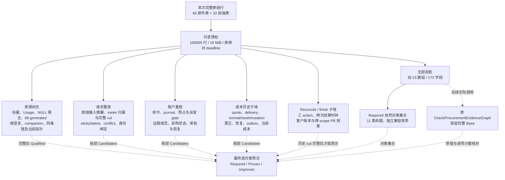

# 采购历史独立重放

本页对应 [B-P4 读取合同](../../specs/023-periodic-products/b-procurement-replay-read-contract.md)与[本轮实施合同](../../specs/023-periodic-products/b-procurement-replay-implementation-contract.md)。它展示开发中的纯核，正式运行入口与剩余门禁见[统一架构](README.md)、[首轮叶子验证](../verification/procurement-replay-leaves.md)、[成本与结算续片](../verification/procurement-cost-finish-replay.md)和[当前指针与时钟续片](../verification/procurement-current-source-clocks.md)。后续逐对象依赖与观察缺口见[收口计划](../../specs/023-periodic-products/b-procurement-replay-closure-plan.md)。

## 模块与数据流

实线是本轮已有私有执行路径，虚线是未接通的完整聚合路径。当前没有导出的 `Check`，不发行新 scope 的一致或覆盖结论。普通服务、数据库迁移、SQL writer、固定读取 profile 与维护权限均没有接入此包。

## 职责与源码

| 部分 | 实际职责 | 源码入口 |
| --- | --- | --- |
| 资源与对象身份 | 全 72 数组先预检；工作循环共享取消与原绝对 deadline；复合键使用逐分量字节长度，保留空串及 UTF8 身份 | [scalar.go](../../internal/procurementprefix/scalar.go)、[replay_support.go](../../internal/procurementprefix/replay_support.go) |
| 来源闭合 | 核物理标量和 NULL envelope、真实 PK 重复、generated、canonical/root、companion 与 request/attempt/account/member 链；未完整时 `Complete=false`、`Qualified` 为空 | [source_closure.go](../../internal/procurementprefix/source_closure.go) |
| 来源续片 | 两列 route_decisions 严格五字段 JSON，64 位 priority/uint64 weight、selected、1000 项与 Go 业务字节界；原18表追踪联合及 request26/attempt15 冻结列双向核验 | [路由](../../internal/procurementprefix/source_closure_routes.go)、[原件联合](../../internal/procurementprefix/source_closure_original_unions.go)、[出生快照](../../internal/procurementprefix/source_closure_birth_snapshots.go) |
| 当前指针与原件 Usage | request latest/last decision、attempt最后mutation/delivery及当前值、永久dispatch六列/真实PB时点与managed journal、p出生及自身最后journal双向核验；三处六字段Usage严格JSON | [当前指针](../../internal/procurementprefix/source_closure_current_pointers.go)、[Usage](../../internal/procurementprefix/source_closure_usage_payloads.go) |
| 请求 | 独立复算原 Go JSON/SHA ABI；保留 meter 首次出生归属，按 ordinal 核完整竞争集合和 witness；重放跨 attempt 或无 attempt 的 sticky/latest 与 conflict | [request_replay.go](../../internal/procurementprefix/request_replay.go)、[输入 ABI](../../internal/procurementprefix/request_replay_input.go) |
| 账户 | 从 create 开始重放全账户 journal、配置与 reservation revision、H/S/C、reserve/dispatch gate；按真实 cut 核 evidence/member、effect/skip、proposal/approval 与恢复 | [account_replay.go](../../internal/procurementprefix/account_replay.go)、[证据](../../internal/procurementprefix/account_replay_evidence.go)、[屏障](../../internal/procurementprefix/account_replay_barriers.go) |
| 成本历史 | 从 prepared、unknown/NULL 按唯一 attempt node 顺序核冻结报价、交付、正常资格、reset/mutation、绝对更正、恢复和自身 canonical outbox；历史目录可见全集不在本证明范围 | [attempt_cost.go](../../internal/procurementprefix/attempt_cost.go)、[事件](../../internal/procurementprefix/attempt_cost_events.go)、[原件](../../internal/procurementprefix/attempt_cost_objects.go) |
| 人工对账与客户结算 | 核真正消费输入及角色、无 attempt 派生 incoming、三时钟用途、new/existing/pending、金额、Key 局部桶、账本和 PB 双向效果；历史 cut 未齐，`Complete=false` | [finish_replay.go](../../internal/procurementprefix/finish_replay.go)、[账本与 PB](../../internal/procurementprefix/finish_replay_effects.go)、[严格 JSON](../../internal/procurementprefix/finish_replay_json.go) |
| Required | 从本次无损原件投影构独立索引，沿原算法实际条件记录自然对象；不读取调用方 Report 或接受调用方计数，不证明对象 | [required.go](../../internal/procurementprefix/required.go)、[严格解析](../../internal/procurementprefix/required_parse.go) |

`Complete` 只说明本域算法实施并执行的范围，不代表输入无矛盾。业务域 `Candidates` 只表示本域的局部候选，必须再与完整来源及其他依赖逐对象结合，才可能计入 `Proven`。一个域的通过不能抵消另一个域的错误，也不能拼接其他调用的历史。

账户全局 ordinal 与各 attempt node 必须描述一致的顺序。逐 attempt 的账户动作 node 严格递增；证据/提案/批准/恢复的观察 cut 位于其前后动作之间，并按该 attempt 的 source node 前进，不允许同额更正或无 effect 行掩盖未来/回退 cut。不同 attempt 与账户配置仍可合法交错。

Required 的十一类对象依次是 finalization、request、conflict、两个 attempt/digest 身份集合、三个 attempt 集合、proposal、两个 account 集合。实际条件保持原算法的合法标量、主键去重、complex 事件数量、不同值更正、tenant conflict、配置与审批屏障分支。测试用手算精确键集合及同次原 checker 的逐项 Unproven 长度做双重核对；旧 mismatch 和全部 Base 字段不改写。

上游成本和客户收费分别重放。成本使用 attempt 冻结的采购单价，客户使用 request 冻结的销售单价，均在大整数求和后单次 ceil。审批时钟只决定能否产生带原真实 delivery 的 finalization；结算决定时钟和资金锁后的最终时钟各自判定截止，墙钟允许回退，执行顺序不由时间比较决定。已选择的deadline释放不能因后续时间回退恢复收费；最终过期同时清零 raw/charged/waived，不产生 REVENUE 或 profile-block 效果。零价收费仍可 settled，HELD/AVAILABLE 的真实零 delta 行不能省略。

当前原件的last与immutable出生快照分别核验。request末decision可以是conflict而latest仍为旧normal；attempt最新delivery可以是收尾而永久permit仍是初次dispatch。p.last按账户全序筛选本attempt，允许其他配置和attempt穿插；新journal不能借全NULL追踪列伪装旧p，也不能指向另一账户的同ID attempt。真正全NULL且无新来源的旧行保留缺证，不倒造历史。

finish 只核本次历史局部 before/after 与真实输出，不把今天 Key/ledger 余额、已退款金额或旧 profile-block.request 倒填到过去。租户/Key PB 使用原 admission window、真实 reserve/import event 和本次 settlement event，客户不允许 legacy catchup。其历史 control absence、完整配置/窗口链、请求 latest/无 delivery cut 以及 reconciliation 最新人工来源的全序仍待闭合。两个成本私有子域不等于完整 AttemptCost；来源和最终 aggregate 也继续未完成。

## 权限、失败与当前边界

纯核不连接数据库，不读取供应商密钥，不发模型请求，不修改钱包、采购余额或历史。执行失败返回错误与零结果；数据矛盾保留固定分类计数，不能包装成执行错误后忽略，也不能因缺证而隐藏确定矛盾。

完整来源闭合、AttemptCost 的剩余历史 cut、完整 Base 调用及 aggregate 仍是交付前置；当前局部算法不解除旧十一项历史 Unproven。最终还需要完整固定 scanner/readset、V4 profile、basis/catalog、protected pre/post、actual APP 全路径与独立验收；正式迁移/启动和在线资金接线继续由 R2 合同控制。已完成与未完成算法的逐项范围以[成本与结算验证](../verification/procurement-cost-finish-replay.md)为准。
