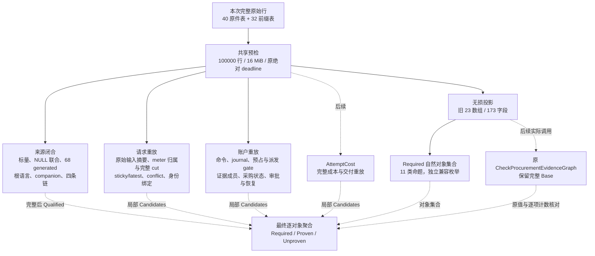

# 采购历史独立重放

本页对应 [B-P4 读取合同](../../specs/023-periodic-products/b-procurement-replay-read-contract.md)与[本轮实施合同](../../specs/023-periodic-products/b-procurement-replay-implementation-contract.md)。它展示开发中的纯核，正式运行入口与剩余门禁见[统一架构](README.md)和[验证记录](../verification/procurement-replay-leaves.md)。

## 模块与数据流

实线是本轮已有私有执行路径，虚线是未接通的完整聚合路径。当前没有导出的 `Check`，不发行新 scope 的一致或覆盖结论。普通服务、数据库迁移、SQL writer、固定读取 profile 与维护权限均没有接入此包。

## 职责与源码

| 部分 | 实际职责 | 源码入口 |
| --- | --- | --- |
| 资源与对象身份 | 全 72 数组先预检；工作循环共享取消与原绝对 deadline；复合键使用逐分量字节长度，保留空串及 UTF8 身份 | [scalar.go](../../internal/procurementprefix/scalar.go)、[replay_support.go](../../internal/procurementprefix/replay_support.go) |
| 来源闭合 | 核物理标量和 NULL envelope、真实 PK 重复、generated、canonical/root、companion 与 request/attempt/account/member 链；未完整时 `Complete=false`、`Qualified` 为空 | [source_closure.go](../../internal/procurementprefix/source_closure.go) |
| 请求 | 独立复算原 Go JSON/SHA ABI；保留 meter 首次出生归属，按 ordinal 核完整竞争集合和 witness；重放跨 attempt 或无 attempt 的 sticky/latest 与 conflict | [request_replay.go](../../internal/procurementprefix/request_replay.go)、[输入 ABI](../../internal/procurementprefix/request_replay_input.go) |
| 账户 | 从 create 开始重放全账户 journal、配置与 reservation revision、H/S/C、reserve/dispatch gate；按真实 cut 核 evidence/member、effect/skip、proposal/approval 与恢复 | [account_replay.go](../../internal/procurementprefix/account_replay.go)、[证据](../../internal/procurementprefix/account_replay_evidence.go)、[屏障](../../internal/procurementprefix/account_replay_barriers.go) |
| Required | 从本次无损原件投影构独立索引，沿原算法实际条件记录自然对象；不读取调用方 Report 或接受调用方计数，不证明对象 | [required.go](../../internal/procurementprefix/required.go)、[严格解析](../../internal/procurementprefix/required_parse.go) |

`Complete` 只说明本域算法实施并执行的范围，不代表输入无矛盾。业务域 `Candidates` 只表示本域的局部候选，必须再与完整来源及其他依赖逐对象结合，才可能计入 `Proven`。一个域的通过不能抵消另一个域的错误，也不能拼接其他调用的历史。

账户全局 ordinal 与各 attempt node 必须描述一致的顺序。逐 attempt 的账户动作 node 严格递增；证据/提案/批准/恢复的观察 cut 位于其前后动作之间，并按该 attempt 的 source node 前进，不允许同额更正或无 effect 行掩盖未来/回退 cut。不同 attempt 与账户配置仍可合法交错。

Required 的十一类对象依次是 finalization、request、conflict、两个 attempt/digest 身份集合、三个 attempt 集合、proposal、两个 account 集合。实际条件保持原算法的合法标量、主键去重、complex 事件数量、不同值更正、tenant conflict、配置与审批屏障分支。测试用手算精确键集合及同次原 checker 的逐项 Unproven 长度做双重核对；旧 mismatch 和全部 Base 字段不改写。

## 权限、失败与当前边界

纯核不连接数据库，不读取供应商密钥，不发模型请求，不修改钱包、采购余额或历史。执行失败返回错误与零结果；数据矛盾保留固定分类计数，不能包装成执行错误后忽略，也不能因缺证而隐藏确定矛盾。

完整来源闭合、AttemptCost、完整 Base 调用及 aggregate 仍是交付前置；当前局部算法不解除旧十一项历史 Unproven。最终还需要完整固定 scanner/readset、V4 profile、basis/catalog、protected pre/post、actual APP 全路径与独立验收；正式迁移/启动和在线资金接线继续由 R2 合同控制。已完成与未完成算法的逐项范围以[本轮验证记录](../verification/procurement-replay-leaves.md)为准。
