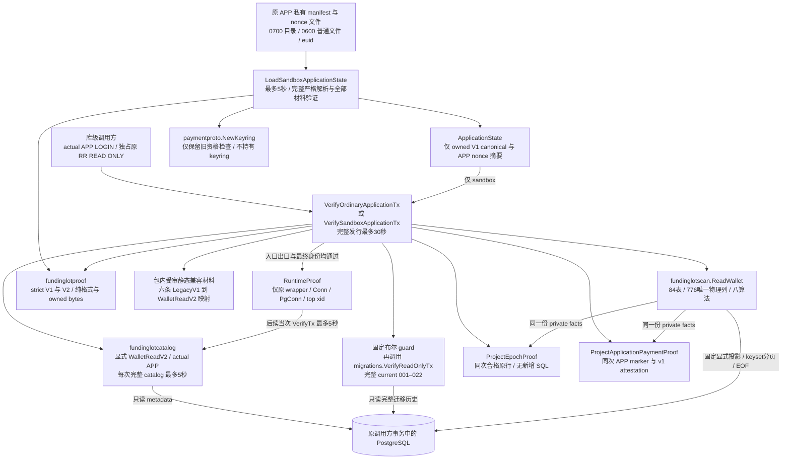
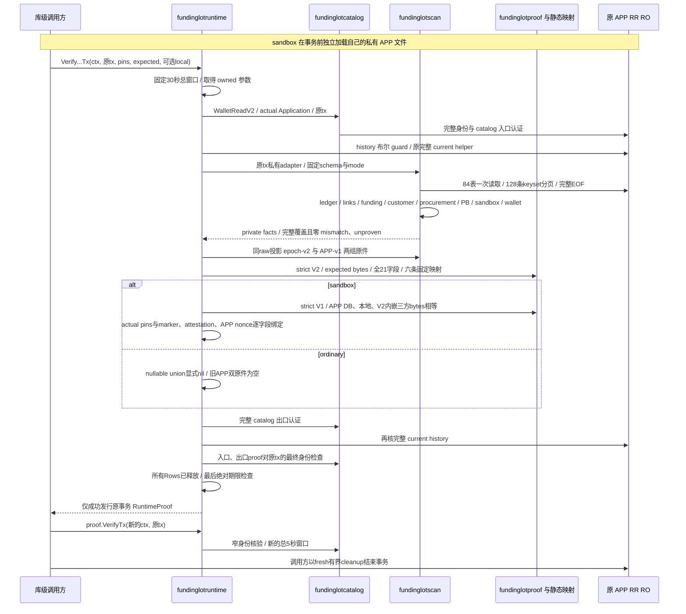
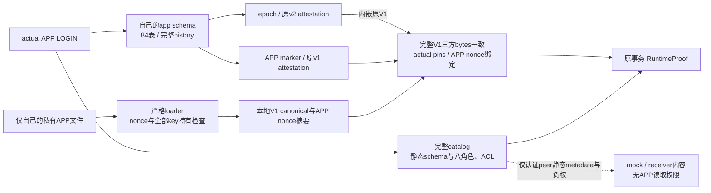
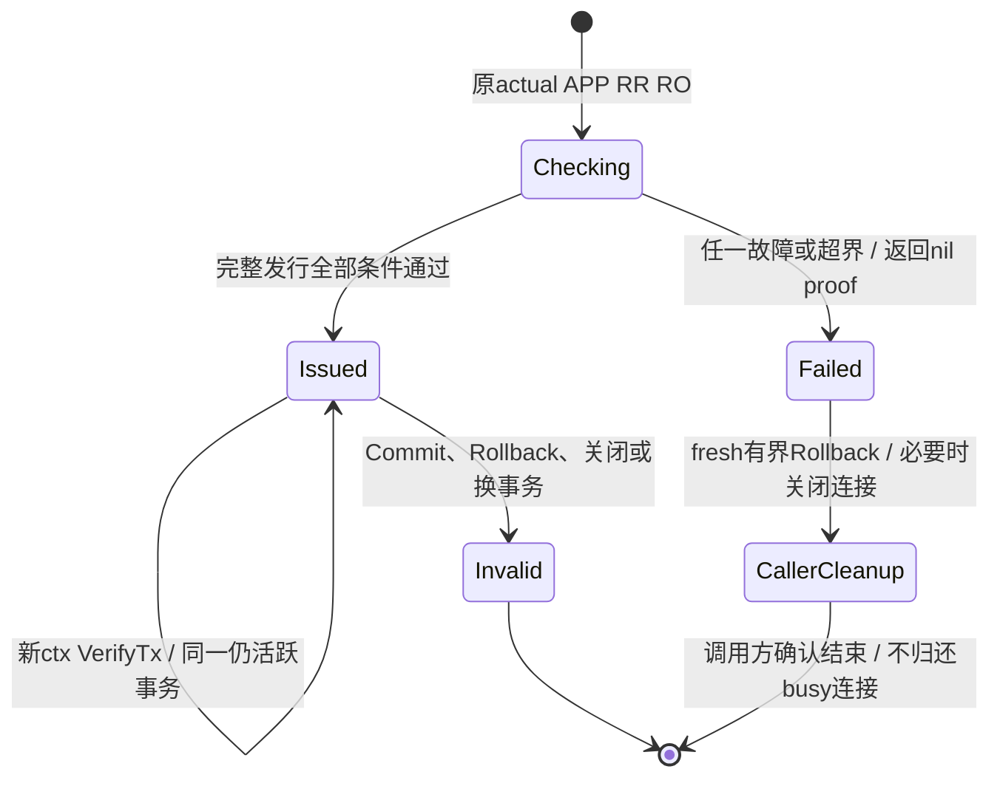

# C0-R1-B：独立 APP 完整资金运行核验

本页是[统一架构](README.md)中独立 APP 核验库的流程、权限与事务寿命细图。**当前实现已汇合；限定验证与完整验收缺口见记录**；最终 PASS、SKIP、清理和版本身份以[验证记录](../verification/runtime-composer.md)为准。[冻结合同](../../specs/022-self-service-payments/c0-runtime-composer-contract.md)规定全部发行条件；本页不把实现完成写成完整验收或生产接线完成。

`internal/fundinglotruntime` 在调用方已经建立的 actual APP LOGIN、Repeatable Read、READ ONLY 事务内，自行读取当前完整 catalog/history 和 84 表资金全图，核对持久 epoch、严格 v2 原件及 sandbox 自有旧 v1 材料。全部阶段成功后才发行私有 `RuntimeProof`，其寿命仅覆盖原仍活跃的事务快照。

## 模块与调用边界

新组合库不依赖 `billing`、`payments`、`maintenancetrust`、`maintenancescan`、HTTP 或运行构造器。它不建立 pool/连接，不切换角色，不发行维护 Permit，也不写资金。普通 main/server/billing/PB 与其领域测试仍受[在线依赖门禁](../../scripts/online-dependency-qa/dependencies_test.go)约束；新库尚未连接到普通启动、ready、worker 或请求链。

## API 与输入来源

| API | 输入与结果 | 固定边界 |
| --- | --- | --- |
| `LoadSandboxApplicationState` | 绝对路径的原 APP manifest；返回不可变私有本地加载快照 | 事务前独立最多 5 秒；普通模式不调用 |
| `VerifyOrdinaryApplicationTx` | 原 APP RR RO、ordinary pins、明确 expected V2 | 全部实际读取与核验成功才返回 proof；旧 APP 两原件必须均为空 |
| `VerifySandboxApplicationTx` | 原 APP RR RO、sandbox pins、明确 expected V2、有效本地 APP state | 再核 APP 自有 marker/attestation、nonce 与完整 V1 三方相等 |
| `RuntimeProof.VerifyTx` | 原仍存活的同一个事务 wrapper | 每次最多 5 秒，只重核原事务身份；不重新扫描资金图 |

`pins` 是比较值，actual DB、端点、schema、owner 与角色由完整 catalog 认证。入口深复制可空 pins 和 expected 原件，不保留 caller 可变 wrapper 作为数据真值。

`CanonicalV2` 只证明严格格式，`expected` 只用于与本次实际持久原件逐字节比较，不认证文件路径、所有者或来源。本片不提供 V2 文件 loader，也不从 DB 自动采纳 expected。当前 Plan/Init 的公开结果只提供摘要；真实测试由独立 owner 准备阶段读取持久原件并与 Plan.Expected 摘要核对，此步骤只是 fixture 的 expected 准备。R2 仍须冻结 V2 发行、持有和加载的生产合同。

## 完整发行流程

`ReadWallet` 返回 nil error 不等于完整合格：组合层要求固定 scope、consistent、84 表 PhysicalEOFComplete/CoverageComplete、八项执行状态，以及所有 mismatch/unproven 为零。ordinary 的 sandbox 算法唯一为 `not_applicable`。两个同 raw 投影还会重核原 report/raw 关联、完整 registry、EOF、累计预算和字段资格；不能用 caller Facts、描述性报告或几份局部报告替代。

本次不重新计算经营后的 109 表摘要并强等历史 basis。历史 basis/version/descriptor/manifest 由 v2 与 epoch 相等绑定，历史计数及 immutable legacy/opening 关系由完整钱包重放核对；后续新增 tenant、预占、结算、退款等沿八算法检查。

## 历史证明与当前权限

初始化保存的 v2 使用 LegacyV1 catalog roots；R1-A 的当前 WalletReadV2 仅补 APP 读取 `payment_query_conflicts` 所需四列 SELECT。组合层按完整历史与当前 tuple 唯一匹配受审转换，不重签历史 v2，也不接受未知历史前缀。

| mode | 唯一受审 variant |
| --- | --- |
| ordinary | `named-isolated`、`named-minimal-login`、`named-image-login`、`public-minimal-login`、`public-image-login` |
| sandbox | `full-sandbox` |

每条映射包含历史 expected/schema/roles 与当前 expected/schema/roles 的完整摘要；共同绑定 PG major 16、descriptor version 1、basis version 1、固定 basis descriptor 以及完整 22 项迁移。规范 manifest 为 2459 字节、最大 name 为 35 字节，SHA 为 `ba5e965dabdbee6469f0cfa45c26b244fe7bfecde11ce85ecb33fffd9c14b1de`。完整值见[冻结合同 §7](../../specs/022-self-service-payments/c0-runtime-composer-contract.md#7-固定历史-cutover--current-profile-映射)和[静态材料](../../internal/fundinglotruntime/expected/compatibility-v1.json)。

[独立复算工具](../../scripts/check-runtime-compatibility.py)直接读取原两份 catalog，独立施加四列 ACL/effective/dependency 变化与 sandbox peer metadata 镜像，计算全部六条历史/当前 tuple，并核每项迁移及 basis 源字节。运行不从 live metadata 更新 expected；未来迁移或 catalog 变化须另审完整转换记录。

## APP 自有材料与权限边界

loader 严格解析整个旧 APP manifest，保留合法空白与字段顺序，拒绝嵌套重复/缺多字段/null/错类型/坏 UTF 和数字词法。实际父目录与文件经 no-follow/openat、euid、精确权限及固定大小检查；这不证明所有祖先路径都没有 symlink。nonce 和全部 key 要求规范 RawURL 32 字节材料、域摘要匹配并两两不复用。全部 key 的旧 keyring 资格仍核，不额外要求当下有效。成功仅保存 owned V1 原件与 APP nonce 摘要，不保留 nonce、key、原含秘密 manifest、keyring 或开放 FD。

APP attestation、本地 V1 与 V2 内嵌 V1 必须完整逐字节相等；marker/attestation 的环境、merchant/payee、协议、DB/schema/owner/runtime OID、两个 nonce 摘要、版本与时间逐字段绑定。APP 只证明自己的 nonce 与加载的 signing key 持有；WorkerNonceDigest、APITokenDigest 是原件保存的声明。本片不读取或背书 peer 当前 nonce、目录、control digest 或 keyset；各 actual runtime 自核及整体 ready 留给 R2。

## 预算、Rows 与事务寿命

| 域 | 固定成功窗口或资源界 |
| --- | --- |
| 完整发行 | 单入口累计最多 30 秒，caller 更早 deadline 优先 |
| 每次完整 catalog / 后续 VerifyTx | 每次最多 5 秒，并受父窗口剩余时间限制 |
| loader | 事务前独立最多 5 秒，保留 context 与绝对时刻双检查 |
| 资金扫描 | 84 表共享 100000 行 / 16MiB / 128 条分页；一般字段 65536 字节，固定 v2 canonical 列 262144 字节 |
| catalog | 每次沿原独立 metadata 资源界；不与资金读取混算成全调用 16MiB |
| history | 一个 bounded bool 预检；`ONLY` 关系最多取 23 行以排除额外行，成功再核完整 22 项原 helper |

所有 SQL、Rows、算法、投影、比较与最终发行边界同时检查 context 和固定绝对截止；不因 timer 尚未调度而接纳已越界的成功。

proof 保存原入口与出口 catalog identity、deep-owned pins、固定兼容记录、epoch 与安全摘要/覆盖计数；不保存 raw 资金行、秘密或已被 defer cancel 的发行 context。发行 context 事后取消不会把 proof 永久撤销；当次 `VerifyTx` 的取消只使当次检查失败。当次核验发现 wrapper、Conn、PgConn、PID/backend_start、top-xid、角色或 search_path 偏离时拒绝；Commit、Rollback、关闭连接或换事务后原 proof 不能继续使用。身份核验只观察当次值，不提供所有历史配置变更的持续监控。后续身份核验不是最新 catalog/history/资金重扫，也不能将原 RR 证明移到 RC 写事务。

私有 adapter 成功必须完整 `Next → Scan → EOF → Err → Close`，清空唯一 pending 后才允许后续查询。提前 Close、driver 故障、资源或截止失败会先 latch 并取消自己的 work context，保留 pending poisoned，拒绝后续 SQL；adapter 不额外调用 driver.Close/Next 去消费未完成结果。pgx 自身的 Next/fatal 可能关闭并 drain，文档不承诺改变驱动行为。

组合库不 Commit/Rollback/Close caller 连接。失败后，caller 必须用新的有界 cleanup context 结束事务；Rollback 失败、仍 busy 或无法确认 idle 时关闭连接，不能归还 busy pool。closed 连接可能保留缓存 TxStatus `T`，应结合 IsClosed 与实际 backend 结束判断。本片没有维护 O1 自持 socket watcher、idle ACK 与双锁清理保证。

## 当前交付边界与源码

实现已汇合，真实 PG 专项已完成本轮限定场景；固定文件、纯 codec、投影、静态映射、Rows 和 binding 的专项结果按[验证记录](../verification/runtime-composer.md)汇总。普通 main、HTTP、billing/PB、worker/projector、ready、维护 CLI、迁移/GRANT 与线上资金写路径均未接本库。当前 catalog expected 仍限于已审专库 PG16.15/initdb profile；任意 PG16 或 1Panel 安装须另验受审 profile，不自动接纳未知内置 OID。正式 PSP、真实供应商、容器/1Panel、HA 和性能仍按[交付计划](../design/delivery-plan.md)独立推进。

| 源码 | 职责 |
| --- | --- |
| [runtime_compose.go](../../internal/fundinglotruntime/runtime_compose.go) / [runtime_types.go](../../internal/fundinglotruntime/runtime_types.go) | 两模式完整编排、窄 VerifyTx 与私有 proof |
| [runtime_bindings.go](../../internal/fundinglotruntime/runtime_bindings.go) | V2/epoch/APP V1 原件与实际 pins 绑定 |
| [runtime_history.go](../../internal/fundinglotruntime/runtime_history.go) | 固定预检、原 helper 与有界 Rows |
| [runtime_rows.go](../../internal/fundinglotruntime/runtime_rows.go) / [runtime_window.go](../../internal/fundinglotruntime/runtime_window.go) | 私有固定类型 adapter、失败取消与双重截止 |
| [application_state.go](../../internal/fundinglotruntime/application_state.go) / [application_files.go](../../internal/fundinglotruntime/application_files.go) / [application_codec.go](../../internal/fundinglotruntime/application_codec.go) | 严格本地加载与不保留秘密的 state |
| [runtime_materials.go](../../internal/fundinglotruntime/runtime_materials.go) / [独立复算](../../scripts/check-runtime-compatibility.py) | 六条完整静态转换与完整 migration/basis 材料 |
| [v1_public.go](../../internal/fundinglotproof/v1_public.go) | 原 V1 语义的最小纯格式 API；旧 V1/V2 核心及 wire 保持 |
| [application_payment_proof_projection.go](../../internal/fundinglotscan/application_payment_proof_projection.go) | 同次合格 84 raw 的 APP 双原件纯投影 |

原 WalletReadV2 验收确认[非空周期预算历史前缀证据缺口](../../specs/022-self-service-payments/c0-runtime-pb-evidence-gap.md)：原算法对活动held/window历史保留OperationSnapshotPrefixUnproven，旧composer继续拒绝。空预算配置不等于完整经营认证。

B-P3现按[独立合同](../../specs/023-periodic-products/b-prefix-profile-contract.md)新增显式ordinary/sandbox V3入口：完整128表catalog、exact original22、同session87表804列九算法及prefix深拷贝投影，observer/runtime共用12条固定历史映射。旧入口、六条旧映射、原84表读集和旧缺证保持；新路径仍绑定原APP事务、sandbox本地V1原件及30秒总预算，未接普通main/ready或在线写事务。新模块、数据面和实际验收分别见[完整组合架构](periodic-budget-prefix-profile.md)及[本片记录](../verification/periodic-budget-prefix-profile.md)，不能据候选组合打开R2在线资金ready。
