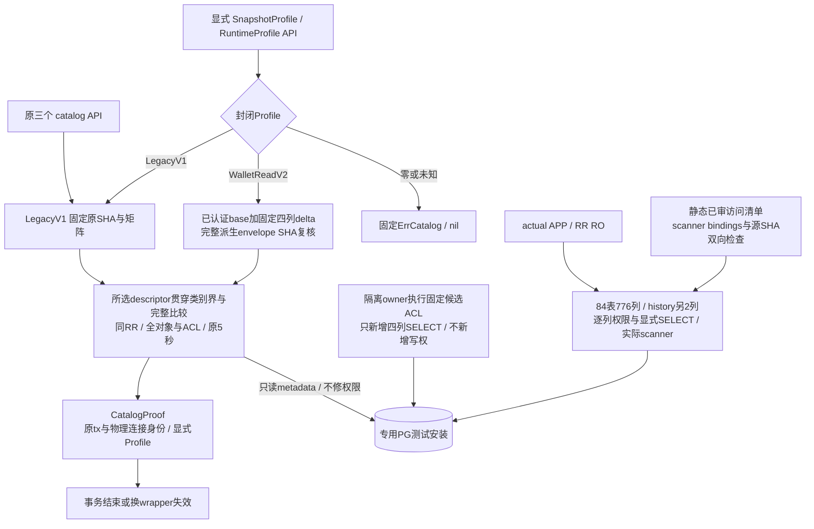

# C0-R1-A：完整资金图读取权限版本

本页是[统一架构](README.md)的权限细图。按[冻结合同](../../specs/022-self-service-payments/c0-runtime-read-profile-contract.md)新增显式catalog profile，当前仍为库级候选；真实验证范围见[记录](../verification/runtime-read-profile.md)。生产迁移/CLI、历史epoch兼容与完整RuntimeProof保持后续边界。

[Profile API](../../internal/fundinglotcatalog/profile.go)不设置角色、不开始或终结事务。原Snapshot/Installation/Runtime三个API固定LegacyV1；新API必须明确选择profile。两套profile均完整比较整个安装，请求WalletReadV2失败时不得自动降级到LegacyV1，也不能把旧入口升级为接纳更宽矩阵。Installation继续使用原16表空集门禁，本片没有新的安装profile入口。

[派生器](../../internal/fundinglotcatalog/wallet_expected.go)改变application角色文档的四列ACL、四个有效SELECT位与四条真实列级ACL依赖；sandbox的mock/receiver文档仅各增加同四条依赖的镜像，三scope共12条metadata记录；table级SELECT、写入、grant option均不增加。除上述delta外，原五ordinary/一sandbox的schema、其余节点及peer内容权限原字节不变，实际比较仍覆盖全部对象、raw/default/effective权限、函数正文和依赖。私有新数组/节点不修改原cache；新完整envelope须符合固定SHA才可使用。类别上界也取本次profile，避免collector仍误用旧root限制。

[已审列清单](../../specs/022-self-service-payments/c0-wallet-readset.json)从固定scanner的124个binding合并为84表776个唯一物理列，history另外两列。scanner侧测试复核双向集合和源SHA，PG侧用actual APP逐列验证并实际SELECT、执行原ReadWallet。清单与CatalogProof均不能证明历史epoch或资金业务图合法；catalog fixture没有genuine支付前驱与epoch，不能从完整读取推导业务验收。

[离线ACL候选](../../specs/022-self-service-payments/c0-runtime-read-permissions.sql)只在本轮随机测试安装由owner执行；旧operations checker及其源SHA不变，旧checker继续拒绝该增量。APP/worker仍不能读取mock/receiver内容；worker的八张C0表窄权与projector边界保持。普通main、HTTP、账务与worker没有新增依赖或配置出口。

R1-B继续冻结历史cutover roots到当前profile的明确兼容关系，认证APP自有v1/严格文件并完成同RR全源组合。不能重签历史proof或要求经营后109表basis等于切换时摘要。R2再引入正式迁移、维护CLI、在线资金路径和进程ready/guard，原路退款、拒付、商品、媒体、部署/HA与性能按[交付计划](../design/delivery-plan.md)继续。
