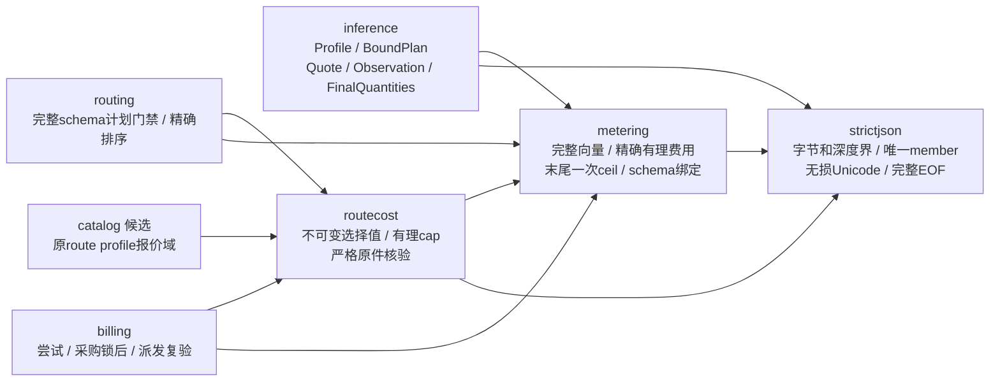

# 统一计量与共同值域（028-U）

当前服务通过 `migrations.ApplyCurrent` 只安装 `migrations/current_mvp.sql` 空库基线，`VerifyCurrent` 在 serve/worker 启动前只读校验该文件的 checksum。旧历史不会被升级、转换或导入。

管理端仍接收每百万 token 的整数费率，但只通过 `metering.ManagementTokenRates`、`ManagementTokenBounds` 和 `ManagementTokenQuantities` 在管理边界转换为 canonical rational vector。当前运行时、路由和账务不再暴露 `LegacyToken*` scalar API。TTS provider usage 也必须通过 `confirmed_final` 字符数和 WAV 结构校验后才进入媒体结算。

2026-11-08。共同纯领域已接入当前文本模型的报价、预占、结算和终态投影。候选024只安装空库、不转换已有历史。请求和尝试保存原四条界行；UUID档案与64位小写hex HMAC就绪时写入计划、外层inference报价及纯核bounds/rates/QuoteDigest，未就绪时这些canonical/digest同空。6a–6d 已接入完整发布operation、读端、客户R/结算/capability/route complete guard、非零route_revision边界和受限APP六协议局部链；本日又补齐每个 route binding 的 supplier cap 0/2 条完整性提交边界，并把 Reserve/finish 的 funding-lot 写集改为纯投影后单批次发送。超预占 profile block/audit 同样采用单 batch，过期 unknown 恢复和幂等一次收费已扩至六协议专项。默认/组价组合、一次退款来源专项也已通过55439验证。用量事件绑定真实attempt，采用inference Observation；人工核对收费提交现只接受绑定原请求 schema 的完整 `retail_quantities`，proposal 保存 canonical/digest，HTTP/UI不再接受两列 token 输入。028-U完整存储/HTTP/UI/商业出口、浏览器和生产验收尚未收口。

2026-11-09 当前媒体状态校正：Realtime 的 tenant-bound PostgreSQL persistence 已写入 session、turn、event 及 provider session/turn identity，新的 adapter 可在进程重启后继续原 Receive/Cancel/Settle。异步 task 已接统一媒体 Reserve/Attempt/Observe/Settle，worker 重启和制品正文重读专项已通过；上一段以及后续历史记录中“未接 writer/账务/正文”的文字属于当日中间状态，不是当前实现状态。

2026-11-09 Realtime binding guard 续片：数据库 turn guard 按来源类型闭合 request/reservation/attempt 三元组。相同 request ID 下混用文本 reservation 与 media attempt，或 media reservation 与文本 attempt，均在 INSERT 时拒绝并回滚。该 guard 保护当前两种已接入事实集合，不把它们合并成第三套账务路径。

2026-11-09 task 引用续片：请求详情沿原 request snapshot 返回 profile、reservation、首个 attempt，资金详情返回 funding lot/source identity，供当前 task 合同使用。读取仍经过租户和 owner/member 规则，不把 task 创建改成客户端自造钱包或 attempt。

当前 U guard 专项已增加 55439 PostgreSQL 负控矩阵，覆盖跨租户/跨 request-attempt、不可变快照与最终证据、Observation 来源闭集、成本指针互斥、资金边界回滚和计量角色 ACL。该专项补强当前迁移的实证边界，完整九组 guard、历史金融拒迁和目标环境权限验收仍未完成。
2026-11-08 续片：024 的请求记录触发器现在把 `request_hmac`、`streaming` 和 `route_revision` 纳入不可变报价身份，固定函数搜索路径并撤销 PUBLIC 执行。人工核对服务层把 `settle` 明确映射为账务 `propose`，避免空动作进入账务入口。上述是当前入口守卫和错误映射的局部修复，attempt/supplier quote 完整守卫、028-U九组完整guard与完整商业出口仍按任务清单验收。

2026-11-08 媒体扩展开发续片：当前 024 追加任务/实时关系只保存绑定、状态、事件和制品元数据，不创建第二钱包或结算表；APP 的状态写权限由 `ProvisionFor` 独立收紧。S/A/R service 接口把原 request/reservation/attempt/settlement 引用作为外部事实传入，provider unknown 进入不可重发边界。后续纵向接线已将这些接口接入当前 HTTP/WS、mock provider、账务和制品正文路径，下面的 2026-11-09 记录为当前状态。

2026-11-08 媒体商业入口续片：024 追加 `media_model_profiles` 与当前媒体 request/attempt/observation/reservation/settlement 及 funding-lot edge。`internal/billing/media.go` 复用既有账本账户锁、FIFO lot 投影、journal 和 wallet event validator，图片/TTS HTTP 在有数据库的 Server 上走同一 Reserve→Attempt→Observe→Settle 入口，unknown 提交终止且不重发；Realtime 单 turn 同样接入 `realtime_turn` media profile。异步 task 也已接入同一账务链并由独立 worker 驱动，结果正文写入受保护 artifact 表。

异步任务入口续片：`/v1/tasks` 当前要求客户端携带已经存在的 request、reservation、attempt、funding source 和不可变 profile/schema 身份，再写入 `media_tasks`。创建时通过 `ReserveMedia` 建立 video media reservation/attempt，状态查询和提交使用相同 task identity，未知提交通过任务状态机阻止再次生成，终态通过 `FinalizeMedia` 收口。独立 worker 只使用当前 lease 和 adapter，不直接取得 payment worker 或计量函数权限。

异步 worker 续片：任务 lease 与 task 状态保存在同一当前表，claim 时使用 PostgreSQL 行锁和过期 lease 条件，状态操作完成后释放 lease。`tasks.Worker` 通过 server 的 tenant-scoped adapter 操作任务和 provider，账务收尾仍由集成层完成，worker 不自行绕过状态机写 wallet 或 settlement。

规格入口：[总体](../../specs/028-unified-metering-media/spec.md)、[共同域精确合同](../../specs/028-unified-metering-media/u-domain-contract.md)、[存储草案](../../specs/028-unified-metering-media/u-storage-contract.md)、[消费者清单](../../specs/028-unified-metering-media/u-consumer-inventory.md)、[阶段任务](../../specs/028-unified-metering-media/tasks.md)。当前经营/资金链分别见[026报表](operating-reports.md)与[027来源](wallet-sources.md)。

请求/尝试两侧bounds与known rates的纯核摘要从原价格/成本快照重建，外层报价继续使用 `moni-aigate.inference.quote.v1` 身份；unknown供应商不伪造数值quote。迁移、计费和角色局部专项已有PostgreSQL 16.15证据，当前轮次验证见[记录](../verification/unified-metering.md)。

第 2 片进一步保存 attempt snapshot 到原 request Plan 的独立 `parent_plan_digest`，并在同一事务内重读 request snapshot 校验父子摘要关系；缺父计划、跨请求或只写一侧都会拒绝。

attempt成本投影使用同tenant/attempt的finalization或correction来源指针，known恰有一个、unknown都为空；对应数据库专项已有局部通过证据。

随后在指定 PostgreSQL 16.15 专库通过迁移、billing lifecycle/evidence/settlement 与 operations meter role boundary 专项；该验证只覆盖本片，028-U整体仍未完成。

2026-11-08 成本来源续片：`upstream_attempts` 已有 correction 来源时，更新不能清除 correction 并用迟到 finalization 重新成为 authoritative cost；正常 finalization→correction 的更正路径仍允许。该约束只保护原 attempt 成本来源指针，不能替代正式供应商账单或完整 U guard 验收。

第 4 片把事件中的 `observation_canonical` 接到 inference Observation 的固定 canonical 和 `moni-aigate.inference.observation.v1` digest，补来源闭集、事件元数据和数据库重建 guard；迁移、billing、采购和角色边界专项已通过，HTTP/UI 与完整商业链路仍未完成。

当前目录的路由发布、公共发布校验统一读取不可变capability；当前成本路由/公共目录夹具使用meter函数和快照，历史迁移夹具保持其原schema并验证拒迁。周期预算HTTP仅编译，55439专库仍待验收；完整六文本商业链及前端仍待收口。

第5片续关闭采购报价域串价：发布HTTP/UI显式绑定schema_id/digest/default，SQL从指定schema重建摘要，不再取全局最近capability；route保存原profile与出生stamp，非零active route和请求route必须匹配profile。候选沿route、attempt/采购锁后沿request snapshot、派发沿attempt snapshot选择同channel/upstream/schema/digest/variant报价。跨域known零价或unknown既不补缺价也不使本域报价过期；快照独立检查真实attempt域，不因无计划/unknown而跳过。该片不新增资金表、结算器或供应商权限，原金额/来源与APP/投影/payment worker权限边界不变；新增meter函数同样拒PUBLIC及投影执行。完整向量DTO与pricing_operations/指纹仍是后续工作，不能据此标028-U完成。

第5片的实际金额读端续片冻结存储合同6.2.1：客户结算、attempt成本和采购实际消费经[billing/vector_actual](../../internal/billing/vector_actual.go)只读取原版本完整Rates和对应侧finalization Quantities canonical。schema/费率摘要与规范字节由Go复核，终态外层digest仍由DB inference.final.v1 guard验证；缺失或错绑定回滚，不反算每百万两价或改用当前价。financialRequest两价已移除，计划未就绪不回填canonical。已知零价/unknown、人工客户核对/supplier missing、超界与唯一结算保持；完整DTO/指纹与九组guard仍待收口，存储复选框保持未勾。禁用反算函数的本地owner专项不等于受限APP六文本完整验收。

客户预占续片按存储合同4.1.1实施：[pricing.Selection](../../internal/pricing/pricing.go)只携原版本/domain/profile/default、完整Schema/Rates及时刻；选价同时限定当前capability的schema/digest，逐byte核canonical和摘要，不再返回两rate。Reserve独立核原锁定capability后，以文本Bounds和原Rates调用metering.ReservationAmount；input-only输出率必须0，溢出返回amount_overflow，保留原锁序、等待前冻结与等待后期限复验。Reservation只作资金回执，移除两价镜像，不造legacy联合。受限APP隔离专项已在禁用两标量函数后通过默认/组价、零价、单ceil、input-only、缺价/未来价和溢出回滚/同幂等键重试；这是预占片，不是采购/退款/恢复完整出口。采购准入、发布指纹及完整HTTP/UI仍待切换，角色和计划未就绪门禁未改。

采购U续片按存储合同7.1实施：[原向量读端](../../internal/billing/vector_procurement.go)绑定原attempt、实际channel/upstream、schema和known成本，解析原Rates及完整supplier界后共用ReservationAmount；计划未就绪仍沿原版本/界行，不回填快照。024的SECURITY INVOKER延迟guard固定隔离schema搜索路径，独立由原率和原界一次ceil核对U；缺失、未知、错误或溢出均拒绝。该采购U片当时的CostQuote标量复验已由后述在线续片替换；发布指纹/其余HTTP仍未去标量，不能称全线切换完成。

采购列表续片按存储合同7.2将[当前SQL](../../internal/procurement/store.go)与[TS/UI](../../web/src/procurement.ts)同步切到原attempt的supplier Bounds wire、原profile/schema/default，修复旧列503并撤除HTTP两界字段。024新增只读meter_attempt_supplier_bounds，完整核原tenant/request/attempt/schema与supplier界；列表保持采购行为根，缺关联不静默消失，失败不返回半页。计划未就绪仍读原界行且不填canonical；金额原样读取，不重新计价。函数STABLE/SECURITY INVOKER/固定搜索路径，PUBLIC/projector/payment worker无执行权，APP沿既有meter闭包；原资金锁序、唯一结算/全部attempt成本和026金额读链均不变。受限APP局部专项覆盖50+1分页/账户与租户/两输入型协议/错误原件；完整HTTP/发布指纹、完整guard和六文本商业出口仍未收口，无浏览器验收。

## 当前报价链与纯依赖

inference/metering/strictjson/routecost这四个纯包无数据库、网络、环境、时钟或资金写入。catalog/routing/billing是现行serve中的消费者；完整Quote不是新inference报价身份。6a–6d 已补当前发布operation、读端、独立金额/结构guard、route complete和非零route边界，并有受限APP六协议局部证据；图中接线仍不表示九组完整guard、完整商业出口、供应商认证或生产部署已完成。纯值解析成功不授模型派发、租户权限、供应商认证或资金许可。

| 源码 | 责任与边界 |
| --- | --- |
| [inference](../../internal/inference) | opaque不可变profile、request/attempt计划、known/unknown原报价及分维度观察；只接受已验证的六文本材料，协议parser仍归provider |
| [metering](../../internal/metering) | 完整schema/side绑定、数量与原界、规范有理率、精确金额和精确成本比较；不判断供应商真实性或业务收费资格 |
| [只读描述](../../internal/metering/describe.go) | schema身份/维度/mask与已验证费率的copy；input-only可拒非零输出价，不用反解析canonical或暴露内部slice |
| [strictjson](../../internal/strictjson/parse.go) | 从原metering提取唯一通用语法实现；拒重复键、非法UTF8/孤立surrogate、深度>8、尾JSON；各领域仍独占字段/值/绑定规则 |
| [routecost](../../internal/routecost/quote.go) | 完整schema/default/channel/upstream/version/basis及supplier Rates的不可变选择值，原canonical/digest严格复核与可选有理cap；现由catalog/routing/billing消费，不新增报价摘要算法或金额计算 |

2026-11-05在线续片按存储4.2.2接入完整候选、采购account/PB等待和PrepareDispatch：NewPlan先校实际channel/upstream、完整schema和原硬界，不把非法Quote/cap变成unknown；CostExclusion返回独立error，只有合法unknown才按manual/allow或deny政策处理。Limits精确有理比较，CompareExactCost排序不ceil，采购初筛和原U只用ReservationAmount。派发复用原最后锁后决策时刻，不改客户价/U、不补未就绪canonical。普通Store删除prospective分支，显式ProspectiveStore独立保留FrozenAttemptInput/原13参ABI；原研究SQL/pins和001–023不变，历史fixture的current业务oracle组合仅编译、明确拒绝，不能报运行验收。6a–6d 后续接入发布operation/读端、客户R/结算/capability/route guard和非零route边界；受限SET ROLE APP禁两标量函数覆盖六协议paid/known-zero、unknown策略与排期等待的局部矩阵。独立LOGIN、完整guard和六文本商业总矩阵仍未验，相关存储任务与商业出口继续未勾。

## 关键合同

Profile和所有vector零值无效；canonical返回copy，digest绑定完整schema定义。共同Profile以摘要绑定完整provider合同；同一UUID但不同schema内容不相容。U只发行default variant及同步json/events，Embeddings/Rerank明确0输出界、0输出价和0最终量，不用missing代替0。

request Plan绑定排序去重后的完整合法profile集合、有效输入HMAC、所选output和stream；公共输入界取候选最大值，attempt只能命中原集合并收紧。**实际U路由仍只有每模型唯一capability**，跨渠道/凭据先去重且由billing重新核闭包；纯算法的多profile支持不表示已安装异构路由的持久身份或参数兼容规则。

known报价保留原版本、完整rates/bounds并由metering算R/U；unknown只允许supplier，区分version_missing与basis_unknown，后者保留已选版本。unknown不能读取伪0金额或空rates。媒体及managed采购准入另要求known；纯对象不替代账务政策。

Observation必须绑定原tenant/request/attempt/profile/schema/variant/plan。每维保留confirmed/provisional/missing/conflicting；只有某一侧mask完整时才能获得该侧FinalQuantities。supplier独有量缺失不抹掉已确认retail，共享量冲突不能被隐藏。人工approved_reconciliation只确认客户侧，永不能据此确认供应商成本；无attempt准入失败直接Release，不伪造观察。真实超界量保留，客户R与供应商U异常在未来账务接线处理。

## 生产集成与经营报表

计划、外层报价和快照纯核原件共享就绪门禁，四条界行及原价格/成本版本绑定始终保留，快照不可后补或更新。

`024_unified_text_metering.sql` 在同一当前模型中安装两维文本 schema、有理费率、请求/尝试快照、事件数量行和双侧终态投影；沿现有一份 finalization、一个客户 settlement 及每 attempt 采购事实，不建媒体钱包或第二结算器。提交时核对事件行、已知采购报价、请求价格归属、尝试与请求一致，以及终态投影等于事件行按 `moni-aigate.inference.final.v1` 重建的结果。已知供应商金额必须等于原费率对终态用量的一次 ceil；授权更正等于更正原件；未发送或认证无消费只能为 0。人工核对不能确认供应商侧。应用角色只能 SELECT/INSERT 计量表。001–023 不改写，旧历史库不自动转换。受管采购的单次预占必须等于该尝试的预算事件合计；已批准提案必须等于预占消费，结算时还要等于供应商金额。批准时证据条数必须仍是提案记下的条数，修订号必须是当时的值或批准这一步加一。用量事件必须指向同一次请求上已经存在的尝试，不能改挂到别的请求，也不能在没有尝试时补造观察。没有尝试的恢复仍按原政策释放。档案版本是 UUID 且请求 HMAC 为 64 位十六进制时，请求快照保存共同 request 计划，尝试快照保存由它派生的 attempt 计划。自由版本号仍不能生成计划。请求和尝试快照各有四行用量界，输入等于档案硬界，输出等于本次选定值。计划就绪时，报价外壳与 inference 的 `moni-aigate.inference.quote.v1` 一致；计划未就绪时报价列为空。纯核报价摘要已落库，计划未就绪时bounds/rates与摘要也为空。6c 已补客户R、结算金额、capability完整性、route complete、route/binding出生及非零route_revision guard；九组完整guard仍未齐。

026继续只读唯一settlement收入/消费退款和全部attempt采购金额；opening不计销售。protocol/execution/profile/schema/variant及筛选、CSV、UI已从原request快照接线，不从当前模型回填，不从vector重算金额。未知成本仍使毛利待核对；本轮Node已可用，前端329项测试（含报表合同）和strict/Vite构建通过，仍无本轮浏览器验收证据。阶段1盘点进一步独立证明 payment worker 对 024 计量表和 `meter_%` 函数无权限；这仍是角色负控，不等同正式生产 LOGIN/部署验收。

候选 024 的建表前拒迁还会拒绝已有 api key/procurement held-spent、周期预算、funding lot child 与支付 capture/identity/effect 事实，并在失败后保持 `schema_migrations` 与计量表不变；这是局部拒迁负控，仍未覆盖 11.2 全部旧金融事实。

当前生产消费者与冻结研究逐个列在[清单](../../specs/028-unified-metering-media/u-consumer-inventory.md)。旧proof/scan/prospective候选只保持其原身份、编译及拒绝current边界，不升级兼容矩阵，不成为U前置。当前已有受限APP六协议局部链、周期预算HTTP和完整 server/billing race 证据；后续验收仍必须覆盖六文本全矩阵、采购/027来源/退款/恢复、026 JSON/CSV与控制台，纯包测试不能替代这些出口。
### 2026-11-08 当前 MVP 媒体/任务/实时续片

当前媒体写链继续只有一套 `Profile → Plan/Bound → Reserve → Attempt → Observe → Settle`。异步 `video_generation` 在 HTTP 创建时复用 `media_model_profiles` 和 `billing.ReserveMedia`，worker 通过租户 scoped adapter 在 submit 前进入 sending，并把终态 observation 收口到 `FinalizeMedia`。submission unknown、失败、取消和过期不重发模型请求。同步图片与 TTS 结算后追加不可变 `media_result_artifacts`，重置进程内缓存后仍按原租户、用户、Key、request/idempotency 读取结果。

任务的当前纵向专项采用 HTTP-first。公开 request detail/funding 读端提供原引用，`/v1/tasks` 再创建持久 task，后续 worker、重启、失败和 unknown 断言继续复用现有 media billing。

Realtime 在有数据库的 Server 路径按 tenant 绑定的 PostgreSQL persistence 写入 session、turn、event 三张现有表，复用原 request/reservation/attempt/source 引用，并持久化 provider session ID、turn handle、dispatch unknown 和 cancel 状态。新的 persistence/adapter 已验证 Receive→Settle 不重新 Dispatch。报表只读接入媒体 request、唯一 settlement 与全部 attempt，`raw_amount` 不当作供应商成本。异步制品正文在 `media_task_artifacts.body` 中一次性落库，后续新 Store/新 grant 直接读取正文；deterministic mock provider 可从 task ID 恢复观察，避免 worker 重启重新 submit。当前证明来自 55439 迁移、角色、billing、server、reporting、task artifact restart、realtime restart race 和 Docker Compose QA，仍不覆盖真实供应商 task handle、1Panel、对象存储、浏览器和生产供应商。
