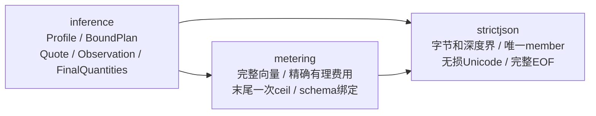

# 统一计量与共同值域（028-U）

2026-11-04。当前新增的是共同纯领域，**尚未接入serve的报价、预占和结算**。当前六文本仍沿现行正式模型运行；U集成将一次替换内部Token专用计算链，不增加运行模式或旧DTO fallback。图片、音频、任务和Realtime端点尚未交付。

规格入口：[总体](../../specs/028-unified-metering-media/spec.md)、[共同域精确合同](../../specs/028-unified-metering-media/u-domain-contract.md)、[存储草案](../../specs/028-unified-metering-media/u-storage-contract.md)、[消费者清单](../../specs/028-unified-metering-media/u-consumer-inventory.md)、[阶段任务](../../specs/028-unified-metering-media/tasks.md)。当前经营/资金链分别见[026报表](operating-reports.md)与[027来源](wallet-sources.md)。

## 已实现的纯依赖

这三个包无数据库、网络、环境、时钟或资金写入。图中没有serve调用边，不代表已完成U生产接线。纯值解析成功不授模型派发、租户权限、供应商认证或资金许可。

| 源码 | 责任与边界 |
| --- | --- |
| [inference](../../internal/inference) | opaque不可变profile、request/attempt计划、known/unknown原报价及分维度观察；只接受已验证的六文本材料，协议parser仍归provider |
| [metering](../../internal/metering) | 完整schema/side绑定、数量与原界、规范有理率、精确金额和精确成本比较；不判断供应商真实性或业务收费资格 |
| [只读描述](../../internal/metering/describe.go) | schema身份/维度/mask与已验证费率的copy；input-only可拒非零输出价，不用反解析canonical或暴露内部slice |
| [strictjson](../../internal/strictjson/parse.go) | 从原metering提取唯一通用语法实现；拒重复键、非法UTF8/孤立surrogate、深度>8、尾JSON；各领域仍独占字段/值/绑定规则 |

## 关键合同

Profile和所有vector零值无效；canonical返回copy，digest绑定完整schema定义。共同Profile以摘要绑定完整provider合同；同一UUID但不同schema内容不相容。U只发行default variant及同步json/events，Embeddings/Rerank明确0输出界、0输出价和0最终量，不用missing代替0。

request Plan绑定排序去重后的完整合法profile集合、有效输入HMAC、所选output和stream；公共输入界取候选最大值，attempt只能命中原集合并收紧。**实际U路由仍只有每模型唯一capability**，跨渠道/凭据先去重且由billing重新核闭包；纯算法的多profile支持不表示已安装异构路由的持久身份或参数兼容规则。

known报价保留原版本、完整rates/bounds并由metering算R/U；unknown只允许supplier，区分version_missing与basis_unknown，后者保留已选版本。unknown不能读取伪0金额或空rates。媒体及managed采购准入另要求known；纯对象不替代账务政策。

Observation必须绑定原tenant/request/attempt/profile/schema/variant/plan。每维保留confirmed/provisional/missing/conflicting；只有某一侧mask完整时才能获得该侧FinalQuantities。supplier独有量缺失不抹掉已确认retail，共享量冲突不能被隐藏。人工approved_reconciliation只确认客户侧，永不能据此确认供应商成本；无attempt准入失败直接Release，不伪造观察。真实超界量保留，客户R与供应商U异常在未来账务接线处理。

## 生产集成与经营报表

存储草案定义在同一当前模型中升级schema、rate lines、原request/attempt快照、事件量与双侧终态；沿现有一份finalization原件、一个客户settlement及每attempt采购事实，不建媒体钱包或第二结算器。正式迁移全文、SQL guard/精确权限和实际PG原型仍待实施；001–023不改写，旧历史库不自动转换。

026继续只读唯一settlement收入/消费退款和全部attempt采购金额；opening不计销售。U计划从原request不可变快照补protocol/execution/schema/variant与筛选/CSV/UI，不从当前模型回填，也不从vector重算金额。未知采购仍使毛利待核对。任务poll/下载、实时heartbeat不产生第二笔收入。该元数据扩展尚未接线。

当前生产消费者与冻结研究逐个列在[清单](../../specs/028-unified-metering-media/u-consumer-inventory.md)。旧proof/scan/prospective候选只保持其原身份、编译及拒绝current边界，不升级兼容矩阵，不成为U前置。后续验收必须覆盖实际受限APP的六文本、采购/周期预算/027来源/退款/恢复、026 JSON/CSV与控制台，纯包测试不能替代这些出口。
