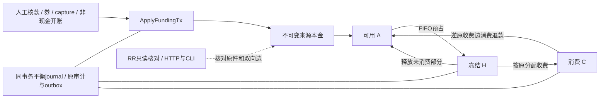

# 现行资金来源与钱包开账（027）

[统一架构](README.md)的当前生产链路；精确合同见[027规格](../../specs/027-wallet-sources/spec.md)，实际执行范围见[验证记录](../verification/wallet-sources.md)。023迁移是新的单一钱包模型，不安装旧C0历史证明候选。

每来源本金始终等于A+H+C。客户预占与采购预占独立，上游第二次安全尝试不重新分配客户来源；采购unknown不因客户释放清零。manual_credit、voucher_grant与wallet_opening均nonrefundable；sandbox_capture仅有本地沙箱资格。消费退款只回钱包原来源，不恢复Key/周期spent，不产生真实现金退款资格。

## 数据、锁序与约束

| 事实 | 当前关系 |
| --- | --- |
| 原件与本金 | funding_receipts → funding_lots；lot ID等于receipt ID，金额、来源、时间及资格不可变 |
| 三桶与事件 | funding_lot_balances；funding_lot_events绑定同事务journal、operation、递增revision和精确delta |
| 请求预占 | funding_reservation_lots保存连续allocation_index、lot与金额 |
| 结算 | funding_settlement_lots逐原分配保存charged/released，两者合计等于原预占 |
| 消费退款 | funding_consumption_refund_lots沿原charged分配逆序退回，累计不得超过已收费 |
| 开账原件 | wallet_openings绑定唯一tenant、external_ref、管理员、金额和原receipt/journal |

[023正式SQL](../../migrations/023_wallet_sources.sql)以复合tenant FK隔离关系，余额写需匹配事件；递延检查核对来源、事件、分配、journal与账户余额。FIFO写前约束拒绝跳过当前更早可用来源，结算/退款检查原分配顺序与精确累计。全部账户按ID锁后，lot余额按lot_id锁；来源/授权/请求/Key/模型/周期控制沿原前序。Reserve在lot等待后再验期限并INSERT request；finish在全部等待后验24小时财务截止。

四写入口见[入账](../../internal/billing/funding.go)、[预占](../../internal/billing/reserve.go)、[收尾](../../internal/billing/settle.go)、[消费退款](../../internal/billing/orders.go)，共用[来源事务helper](../../internal/billing/lot_runtime.go)与原纯分配算法。helper不另开事务、不联网、不重试模型生成。

## 角色与维护

APP对来源/事件/分配仅SELECT/INSERT，来源余额只更新三桶/revision；ledger_accounts只更新balance；开账原件只读。projector不读写新来源关系。支付worker只新增lots/balances/events三表读写及余额列写，七个安全wallet函数可执行；funding/event校验使用显式语句分支，不给worker读取人工、券或开账原件。启动沿[现行权限核验](../../internal/operations/payment_roles.go)验证当前表/列/函数边界，期望来自受审迁移源码，不从待验DB学习。

`open-wallet`仅在MAINTENANCE_MODE=true、真实migration owner、停服且取得同一服务advisory锁后执行。只允许未使用空钱包，一tenant一次非零开账；同tenant/reference/amount/actor读取原receipt，异意图冲突。初始余额为非现金负债来源，使用WALLET_OPENING_CLEARING平衡，不算收款或销售收入。入口10秒预算；未知COMMIT销毁连接并返回未知，禁止自动重试。

`check-wallet-sources`读取当前RR READ ONLY快照，5秒工作预算，报告来源、事件、分配、钱包四类不一致计数。它双向检查缺失根/孤立边和账户/lot总和，不修余额，不授调用权。失败返回空结果；清理使用独立有界context。[开账](../../internal/billing/wallet_opening.go)、[只读核对](../../internal/billing/wallet_sources_read.go)、[CLI](../../cmd/moni-aigate/main.go)。

023对已有金融history或非零余额明确拒绝，原事务回滚；已有开发库保留，使用独立空当前数据库。不伪造来源，不自动转换旧余额；旧研究代码不参与serve或普通领域入口。

## API与控制台

| 入口 | 权限与响应 |
| --- | --- |
| GET /api/wallet/sources | tenant owner/billing_viewer；50+1来源分页，金额字符串，不带外部业务号/actor |
| GET /api/requests/:id/funding | 原请求详情授权；member仅本人请求，跨tenant/非本人404；原分配与nullable charged/released、累计退款 |
| GET /api/platform/wallet-sources?tenant_id=UUID | admin/finance_operator/finance_approver，必须显式单tenant |
| GET /api/platform/wallet-sources/check?tenant_id=UUID | 同上，只读核对结果与as_of；不一致不是修复接口 |

标准分页按created_at/id倒序，next_cursor空字符串表示结束；请求分配显示原allocation_index，不能把分页显示顺序当FIFO执行顺序。金额均精确微元字符串；未结算charged/released保持null，不填0。

原入账回执与摘要也覆盖四来源：可筛选`wallet_opening`，摘要必含`wallet_opening_amount`并与其余三类精确合计。累计入账、当前来源余额和模型销售收入分别来自receipt、lot余额和唯一settlement。通用[查询DTO装配](../../internal/server/queries.go)统一输出UTC时间，保持原精度与分页instant，前端UTC校验不放宽。

[HTTP](../../internal/server/wallet_sources.go)与[钱包组件](../../web/src/components/WalletSources.vue)、[请求分配](../../web/src/components/RequestFunding.vue)、[平台来源页](../../web/src/views/WalletSourcesView.vue)共享当前合同，身份/租户/路由切换或卸载使旧响应失效。平台核对手动触发。经营报表继续读唯一settlement和全部attempt；opening不计模型收入。媒体后续沿[028](../../specs/028-unified-metering-media/spec.md)进入同一来源模型。
