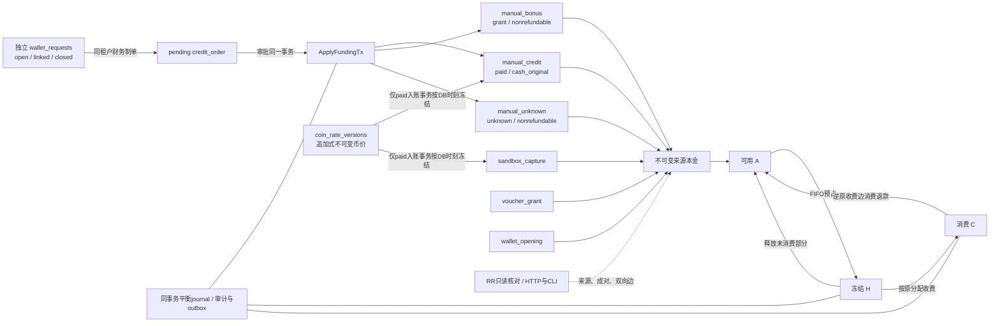

# 现行资金来源与钱包开账（027、034.1–034.3b）

[统一架构](README.md)的当前生产链路；精确合同见[027规格](../../specs/027-wallet-sources/spec.md)与[034规格](../../specs/034-virtual-coin/spec.md)。023建立单一钱包来源模型，current_004/005建立COIN边界，current_006增加角色、付款基准、独立申请与成对人工来源，current_008增加币价版本与付费receipt冻结引用；不安装旧C0历史证明候选，也不增加第二钱包。

每来源本金始终等于A+H+C+RH+R（available、held、consumed、refund_held、retired）；034.3 已安装五桶和静态退款会计guard，034.4 的现金退款状态机尚未开放。客户预占与采购预占独立，上游第二次安全尝试不重新分配客户来源；采购unknown不因客户释放清零。消费退款只回钱包原来源，不恢复Key/周期spent，不产生真实现金退款资格。

## 来源与付款基准

| source_kind | basis_kind | refund_class | 事实与分录 |
| --- | --- | --- | --- |
| manual_credit | paid | cash_original | 批准人工充值；记录法币币种/`FiatMoney`，与到账COIN分型；FUNDING_CLEARING |
| manual_bonus | grant | nonrefundable | 同单赠送或纯赠送；OPERATING_GRANT_CLEARING，不可现金退款 |
| manual_unknown | unknown | nonrefundable | 有到账币但付款基准未知；法币字段为NULL，不伪造收入 |
| voucher_grant | grant | nonrefundable | 兑换券来源 |
| sandbox_capture | paid | sandbox_original | 仅本地支付沙箱，保留沙箱付款与capture身份 |
| wallet_opening | opening | nonrefundable | 停服后未使用空钱包的非现金开账 |

同一`paid`充值单可有一个付费receipt与一个赠送receipt，两者各有一笔journal和不同`operation_id`；`bonus_amount=0`不产生赠送。纯`grant`只有bonus，未知只有`manual_unknown`。`wallet_credit_pair_valid`在COMMIT前核对来源数量、金额、主journal、法币字段及赠送时间，缺任一部分整体回滚；`check-wallet-sources`把不成对批准单计入来源不一致，而不是只检查已有lot。

赠送`created_at=max(clock_timestamp(), paid_created_at+1µs)`，同单始终先消耗付费来源，其他来源继续严格FIFO。`amount`、`bonus_amount`分别不得超过1e12微币，且总和不能溢出int64。`paid`缺法币字段、`grant/unknown`携带法币字段、receipt与lot组合不一致均被拒绝。

## 数据、锁序与约束

| 事实 | 当前关系 |
| --- | --- |
| 原件与本金 | funding_receipts → funding_lots；lot ID等于receipt ID，金额、来源、时间及资格不可变 |
| 五桶与事件 | funding_lot_balances增加refund_held/retired；funding_lot_events绑定同事务journal、operation、递增revision和精确五桶delta |
| 请求预占 | funding_reservation_lots保存连续allocation_index、lot与金额 |
| 结算 | funding_settlement_lots逐原分配保存charged/released，两者合计等于原预占 |
| 消费退款 | funding_consumption_refund_lots沿原charged分配逆序退回，累计不得超过已收费 |
| 开账原件 | wallet_openings绑定唯一tenant、external_ref、管理员、金额和原receipt/journal |
| 客户申请 | wallet_requests保存open/linked/closed、申请人、说明和唯一linked_order_id；不含钱包余额效果 |
| 运营设置 | wallet_operator_settings追加version、single_operator、actor、reason和时间；批准单据保存快照 |
| 静态退款事实 | cash_refund_orders仅用于会计guard；独立journal operation、hold/retire/release指针与refund_order_id事件关联，应用只读 |
| 币价版本 | coin_rate_versions按币种/生效时刻追加唯一版本；paid receipt冻结buy_rate_version_id，复合外键保证版本币种一致，非paid为NULL |

[023正式SQL](../../migrations/023_wallet_sources.sql)与[current_006追加SQL](../../migrations/current_006_paired_wallet_sources.sql)以复合tenant FK、CHECK、即时/递延guard隔离关系。余额写需匹配事件；FIFO写前约束拒绝跳过更早可用来源，结算/退款检查原分配顺序与精确累计。全部账户按ID锁后，lot余额按lot_id锁；来源/授权/请求/Key/模型/周期控制沿原前序。Reserve在lot等待后再验期限并INSERT request；finish在全部等待后验24小时财务截止。

四写入口见[入账](../../internal/billing/funding.go)、[预占](../../internal/billing/reserve.go)、[收尾](../../internal/billing/settle.go)、[消费退款](../../internal/billing/orders.go)，共用[来源事务helper](../../internal/billing/lot_runtime.go)与原纯分配算法；人工成对来源见[credit_funding.go](../../internal/billing/credit_funding.go)。helper不另开事务、不联网、不重试模型生成。

## 独立申请与单人运营

客户申请不是`credit_orders.requested`，该状态不存在。客户owner创建`open`申请只写申请与审计；财务创建`pending`充值单时锁定同租户`topup/open`申请，在同一事务继承`requested_by`并写入`linked_order_id`，此阶段仍无钱包效果。审批入账同事务关闭申请；open申请可由owner取消或财务拒绝。每租户最多20个open+linked申请，guard对直接SQL同样执行上限、owner资格、不可变身份和状态迁移。034.4前cash_refund申请不能关联单据。

`wallet_operator_settings`初始`single_operator=true`。admin读写设置；PUT要求近期再认证、CSRF、规范operation ID、expected_revision、理由及显式二次确认。设置与审计同事务追加，advisory lock串行CAS，重放核对完整意图。只有双方均为admin的自批使用例外并写`single_operator_exception`；其他财务角色不可自批，对账、恢复、采购和兑换券不继承该例外。

## 034.3 五桶静态退款会计

`refund_held_amount` 与 `retired_amount` 不进入 Reserve 或消费退款；现有 funding/reserve/finish/consumption-refund 的事件两个新 delta 必须为 0。余额按 `available+held+consumed+refund_held+retired=issued` 守恒，`REFUND_HELD` 租户账户等于对应来源桶汇总。现有 Go 更新只写旧三桶，SELECT 并保留新桶，034.3 不向应用或 worker 授予新桶 UPDATE。

静态 `cash_refund_orders` 不是生产退款工作流。每个迁移使用独立非零规范 UUID 作为 journal operation，订单 ID 仅作 reference 和事件外键；旧事件 `refund_order_id` 必须为 NULL，新 `refund_hold/refund_retire/refund_release` 必须非空且按 `(refund_order_id,kind)` 唯一。retire/release 必须有同订单、同 lot、同 `coin_amount` 的更早 hold，三种事件只允许 `paid+cash_original` 来源。

Deferred `wallet_cash_refund_order_valid` 校验 requested 无事实、approved/transfer_executed 只有 hold、completed 为 hold+retire、cancelled/failed 为无 hold 或 hold+release，retire/release 互斥且数量一致；`wallet_cash_refund_journal_valid` 校验独立 operation、journal kind/reference、订单 pointer、精确两条账户行和事件闭环。订单业务身份不可改、不可删除，应用只有 SELECT，034.4 才追加生产写权限、状态机和一来源一张未完成单索引。034.3b 只增加两个 nullable 币价外键，不执行现金退款金额计算或版本选择。

## 034.3b 币价版本与请求路径隔离

`coin_rate_versions` 保存精确有理数 `rate_num/rate_den`、币种、生效/创建时刻、理由与操作者，记录不可改、不可删除。只有 CNY `1/1`、epoch 创世版本允许 maker/approver 为 NULL；其他版本必须有真实双角色或受控单人例外，并满足 `effective_at>=created_at`。MVP 没有调价 API、控制台或隐式默认汇率。

人工 paid 与沙箱 paid 只在入账事务内调用 [coinRateAt](../../internal/billing/coin_rates.go)，按数据库时刻选取同币种最新生效版本并冻结 `buy_rate_version_id`；无版本返回 `coin_rate_unavailable` 并回滚整个入账。USD 必须已有显式版本，`fx_note` 不参与计算。paid 的版本引用必填，非 paid 必须为 NULL，复合外键保证版本与付款币种一致；存量 manual/sandbox paid 回填 CNY 创世版本。

Reserve、结算和消费退款不读取币价。journal validator 仅核对冻结引用非空，存在性和币种匹配由 CHECK/复合外键保证，避免余额 guard 形成间接读取；静态 Go 依赖检查与币价表改名后的真实 PostgreSQL 请求链共同验证。现金退款的 buy/refund rate 计算及缺版本失败关闭属于 034.4，本片不提前宣称。

## 角色与维护

APP对来源/事件/分配仅SELECT/INSERT，来源余额只更新旧三桶/revision；034.3不授新桶生产UPDATE，静态退款订单只读。ledger_accounts只更新balance；开账原件只读。设置与申请仅SELECT/INSERT及必要的状态列UPDATE，worker/projection无这些表及静态退款订单权限。APP、payment worker和projection对`coin_rate_versions`均只有SELECT，无运行时版本写入或修改权限。支付worker只新增lots/balances/events三表读写及余额列写，七个安全wallet函数可执行；funding/event校验使用显式语句分支，不给worker读取人工、券、申请、设置或开账原件。启动沿[现行权限核验](../../internal/operations/payment_roles.go)验证当前表/列/函数边界，期望来自受审迁移源码，不从待验DB学习；只有离线历史schema可缺失034表和函数。

`open-wallet`仅在MAINTENANCE_MODE=true、真实migration owner、停服且取得同一服务advisory锁后执行。只允许未使用空钱包，一tenant一次非零开账；同tenant/reference/amount/actor读取原receipt，异意图冲突。初始余额为非现金负债来源，使用WALLET_OPENING_CLEARING平衡，不算收款或销售收入。入口10秒预算；未知COMMIT销毁连接并返回未知，禁止自动重试。

`check-wallet-sources`读取当前RR READ ONLY快照，5秒工作预算，报告来源、事件、分配、钱包四类不一致计数；来源类包含pair错误，余额和事件前缀按五桶判定，REFUND_HELD账户与来源桶汇总一致。它双向检查缺失根/孤立边和账户/lot总和，不修余额，不授调用权。失败返回空结果；清理使用独立有界context。[开账](../../internal/billing/wallet_opening.go)、[只读核对](../../internal/billing/wallet_sources_read.go)、[CLI](../../cmd/moni-aigate/main.go)。

023对已有金融history或非零余额明确拒绝，原事务回滚；已有开发库保留，使用独立空当前数据库。不伪造来源，不自动转换旧余额；旧研究代码不参与serve或普通领域入口。

## API与控制台

| 入口 | 权限与响应 |
| --- | --- |
| GET /api/wallet/sources | tenant owner/billing_viewer；50+1来源分页，金额字符串，不带外部业务号/actor |
| GET /api/requests/:id/funding | 原请求详情授权；member仅本人请求，跨tenant/非本人404；原分配与nullable charged/released、累计退款 |
| GET /api/platform/wallet-sources?tenant_id=UUID | admin/finance_operator/finance_approver，必须显式单tenant |
| GET /api/platform/wallet-sources/check?tenant_id=UUID | 同上，只读核对结果与as_of；不一致不是修复接口 |
| GET/POST /api/wallet/requests | owner创建，owner/billing_viewer读取当前租户申请；POST需近期再认证与Idempotency-Key |
| POST /api/wallet/requests/:id/close | owner取消open申请，异状态拒绝，不产生钱包效果 |
| GET /api/platform/wallet-requests | admin/财务读取；支持tenant/kind/state过滤与游标 |
| POST /api/platform/wallet-requests/:id/close | 财务拒绝open申请；admin写权限同样受单人运营开关限制 |
| GET/PUT /api/platform/wallet-operator-settings | admin读取最近50版；PUT以operation_id和expected_revision追加设置并写审计 |
| POST /api/platform/credits | 财务制单，可选request_id原子关联topup/open；admin仅在开关开启时获得钱包写例外 |

标准分页按created_at/id倒序，next_cursor空字符串表示结束；请求分配显示原allocation_index，不能把分页显示顺序当FIFO执行顺序。金额均精确微币字符串；未结算charged/released保持null，不填0。逐来源响应还包含`refund_held_amount`、`retired_amount`，前端按五桶校验本金守恒。申请`open/linked`都不代表已付款或已入账。

原入账回执与摘要覆盖六类来源，必含`manual_bonus_amount`、`manual_unknown_amount`和`wallet_opening_amount`并精确合计。累计入账、当前来源余额和模型销售收入分别来自receipt、lot余额和唯一settlement。通用[查询DTO装配](../../internal/server/queries.go)统一输出UTC时间，保持原精度与分页instant，前端UTC校验不放宽。

[来源HTTP](../../internal/server/wallet_sources.go)、[申请HTTP](../../internal/server/wallet_request_handlers.go)、[设置HTTP](../../internal/server/operator_settings_handlers.go)与[钱包组件](../../web/src/components/WalletSources.vue)、[申请组件](../../web/src/components/WalletRequests.vue)、[设置组件](../../web/src/components/WalletOperatorSettings.vue)、[平台来源页](../../web/src/views/WalletSourcesView.vue)共享当前合同，身份/租户/路由切换或卸载使旧响应失效。平台核对手动触发。经营报表继续读唯一settlement和全部attempt；opening不计模型收入。034.3b 只实现币价版本与付费来源冻结引用；034.4 生产现金退款状态机、034.5 报表/余额展示和 034.6 约合/显示名仍需独立实现和验收。
