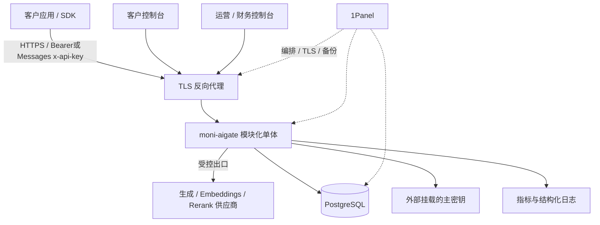
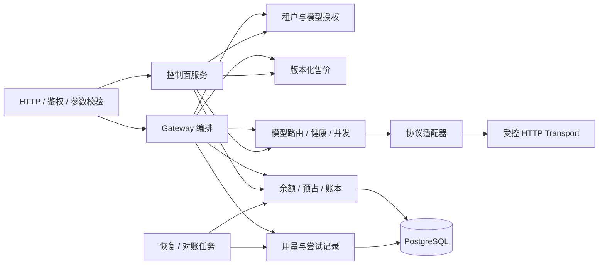

# HLD：moni-aigate 商业 API 网关

状态：r3 设计基线已获开发者同意，r4 实施对齐；目标版本：0.1.0-dev；基线日期：2026-10-30；最新修订：2026-11-01（022-B3生命周期、C0纯算法/RR核验、024计量纯层及025配置渲染/邮件进程）。实现与验收进度见[实施记录](../verification/implementation.md)，不代表生产发布验收通过。

## 1. 目标、前提与边界

已确认用途：对外提供 API 的商业运营平台。推荐从可控试运营版本开始，保障客户调用、余额与账单闭环，而非一次覆盖 New API 的全部功能。

前提：首版单地域、单活动应用实例；租户可为个人或企业；一个租户一个 CNY 预付费钱包；平台运营上游渠道，不允许客户上传供应商 Key；邀请开户和人工核款入账。对外正式扩大经营前，需要另行确定服务条款、支付与退款规则以及真实容量。

当前协议提供 `GET /v1/models`、`POST /v1/chat/completions`、`POST /v1/responses`、`POST /v1/messages`，支持文本、基础函数工具与 SSE；[009](../../specs/009-retrieval-protocols/spec.md)增加非流`POST /v1/embeddings`与Jina格式`POST /v1/rerank`；[010](../../specs/010-gemini-native/spec.md)增加`/v1beta/models/<model>:generateContent`和`:streamGenerateContent?alt=sse`无状态纯文本原生入口。每个公开模型绑定一个协议，保持原生事件与终态，不进行协议互转。Gemini本切片不含工具；所有协议拒绝未声明的图片/音频/文件、多候选、后台/有状态任务和供应商扩展。拒绝未知计费乘数，不能随意透传后再发现费用不可计算。

## 2. 利益相关者与业务域

| 角色 | 权责 |
|---|---|
| 平台管理员 | 客户/渠道/模型授权、路由、价格、运行策略；敏感操作再认证 |
| 平台财务操作员/审批员 | 录入核款单、审批入账、核对异常/退款；申请与审批必须不同账号 |
| 租户 owner | 管理本租户成员与 Key、查看钱包/账单；不能改价或查看渠道密钥 |
| 租户 member | 使用受限 Key、查看自己权限范围的调用记录 |
| 租户 billing viewer | 只读本租户资金与消费记录 |

平台管理员不默认拥有财务审批权限；角色可赋给多个账号，但同一笔入账/退款不能自己申请自己批准。

## 3. 系统上下文

1Panel 是部署和运维入口，moni-aigate 独立运行。不依赖 1Panel 插件源码、SSO 或席位系统，也不把 Compose 兼容等同于已经进入官方应用商店。

## 4. 应用结构与职责

- Gateway 负责生命周期，不能在 handler 内嵌全部业务规则。
- Adapter 处理模型名转换、请求/响应/SSE/usage、上游错误分类；不直接访问钱包。
- Billing 是唯一资金写入口；余额变动必须与平衡流水同事务。
- Pricing 返回不可变客户价格快照；供应商成本规则另建版本，不与客户价格复用字段。
- Routing 从已获授权且能力兼容的渠道中选择，输出决策理由；不能通过 fallback 绕过授权/数据地域。
- Usage 保存请求与每次尝试；报表允许延迟，账本提交结果为资金权威。
- 计量事件、统计投影与可丢弃遥测分开：资金事务同时保存待投影事件，重放只重建报表，不触发再次扣款。
- 后台 Worker 与 API 同一进程，任务通过 PostgreSQL 持久化，不引入消息队列。

### 4.1 补充竞品研究后的融合边界

LiteLLM、Bifrost、Portkey 用于补充预算/调度/回退配置和可观测设计；Higress、APISIX 用于参考策略生命周期与流式用量观测；Open WebUI 作为可选外部聊天客户端。它们不成为运行时必需组件，也不自动进入本项目依赖。

首版把策略执行分成准入、路由、上游尝试、响应计量、结算五个阶段，各自保存版本与结果。Token/RPM 限流属于资源治理，**不能替代金额预占与持久资金账本**。上游实际尝试的成本和客户一次收费继续分开。

首版只做优先级、权重、健康和容量路由；延迟/成本自适应评分需有真实遥测与回放评估，放后续规格。响应缓存也后置，避免跨租户内容复用和缓存命中计费语义未经定义。Higress/APISIX 的 Envoy/Istio/etcd/Wasm 等运行环境不引入首版单体。

Open WebUI 不纳入 moni 控制台源码；后续以公开 API 连接时须独立校验兼容性和租户 Key 归属，避免全站共享一把收费 Key 导致混账。它不替代本项目的渠道、客户或财务后台。具体研究来源与边界见竞品研究汇总。

### 4.2 GitHub / Chrome 扩展研究后的设计补强

新增项目提供的是边界设计，不是组件采购清单。TensorZero 的配置快照、Lago/OpenMeter 的事件身份与更正、Unkey 的 Key 判定、Helicone/Langfuse/Agent Router 的观测隔离，以及 OpenRouter 的硬约束/软偏好语义，合入首版既有模块；不新增 Redis、Kafka、ClickHouse、Envoy 或外部鉴权强依赖。

1. **配置可复现**：发布前校验候选、能力、引用和限额；策略与绑定形成不可变版本，原子切换活动指针，失败继续旧版。请求绑定实际版本，不能在一次调用中拼接新旧配置。
2. **约束先于排序**：权限、能力、地域、渠道状态等先做硬过滤，优先级/权重只对剩余候选生效。请求、模型别名、外部 header 不得放宽平台/租户/成员/Key 的限制；不静默丢弃不支持的参数。
3. **资金事件可追溯**：计量 event、上游 attempt、资金 operation 分别标识；账本和待投影项同事务提交。统计重放和通知重发不产生新扣款，退款/成本更正关联原始事实。
4. **观测不支配资金**：元数据白名单与统一脱敏覆盖 URL/错误；财务事实、结算证据和成功敏感变更审计完整持久化，不服从 trace 采样。拒绝类安全信号有界记录并暴露丢弃计数；遥测故障不阻塞推理，账本失败仍拒绝新收费调用。

后续自适应调度分两类：同模型渠道优化需真实延迟/成功率/成本的离线对照与影子评分；跨模型语义选择需显式 `auto` 商品、公布售价和质量门槛。Plano/RouteLLM 启发的上下文重送、缓存损失和额外路由器成本必须一起核算，不能只比单价。首版不加入这两类自适应策略。证据与取舍见[扩展研究入口](../research/landscape.md#5-证据入口)。

## 5. 技术选型与理由

| 层 | 推荐选型 | 原因 / 约束 |
|---|---|---|
| 服务端 | Go + Gin，采用实施时仍受支持的稳定 Go 版本并锁定工具链 | 适合流式代理；与 New API 同语言便于理解，但不继承其全部依赖 |
| 数据库访问 | pgx + 显式参数化 SQL（SQL 为事实源），版本化迁移 | 资金事务、唯一约束与锁顺序可明确审查；不做跨数据库兼容 |
| 前端 | Vue 3 + TypeScript + Element Plus | 适合治理/运营表单、表格；是 moni 的选型，并非声称 Gateway 使用相同技术 |
| 数据库 | PostgreSQL 16+，实施时锁定具体受支持版本 | 唯一资金事实源，事务/行锁/复合外键；首版不支持 SQLite/MySQL |
| 限流/并发 | 单实例内存令牌桶、分层信号量 | 降低首版运维成本；重启会重置速率窗口，不宣称跨重启严格 RPM |
| 分发 | 单应用镜像内嵌前端 + PostgreSQL，Compose | 经 1Panel 容器编排管理；固定版本 tag/digest |
| 可观测 | 结构化日志、Prometheus 格式指标、request_id | 不以用户 ID/Key 为指标标签，避免高基数与泄漏 |

**首版不需要 Redis**：钱与持久化 Key 花费上限全部由 PostgreSQL 原子约束；运行时控制只支持一个实例。多活动实例之前再设计共享限流、健康状态与配置失效机制，不允许先开 replicas=2 再补正确性。

## 6. 核心商业闭环

### 6.1 充值与退款

v0.1 人工核款：运营记录真实收款凭证和外部业务号 → 不同财务账号审批 → 一个数据库事务入账+平衡流水+审计。平台不直接经手真实支付接口；界面不得显示为“自动支付完成”。重复审批/业务号不得重复入账。

客户消费退款：绑定原消费单、限制累计退款不超过原 settlement 的实际收费额，审批后做补偿流水。提现/原路现金退款是另一业务，v0.1 走线下财务流程并记录状态，不把“退回平台钱包”称为现金退款。

### 6.2 请求与结算

1. 校验 Key/租户/模型/请求参数与服务能力，固定售价和模型能力版本。
2. 获取运行时并发许可，计算保守最大客户费用；数据库原子冻结余额并预占 Key 花费上限。
3. 提交事务后才能向上游发请求；上游调用期间不持有数据库事务。
4. 仅在明确没有处理/消费的情形下安全重试，最多一次。
5. 保存白名单内的最终用量/协议/交付事实和恢复任务，再按固定收费政策原子结算、释放余款；上游成本独立记录。
6. 明确未消费，或在计费责任点前上游/平台失败且未写出有效内容：客户免收并释放，供应商成本可单独待核对。
7. 对仍可能收费但缺可信最终usage的部分输出/客户取消等情形，客户冻结待核对；不能按估算或最大预占扣款。

待核对项有明确截止：v0.1建议24小时内处理；截止判定时尚未结算则释放客户冻结，即使已有可信用量但处理延迟也不例外，之后不自动追扣。供应商待核对成本可以继续保留。此为本版实现采用的客户计费政策，不因Worker延迟无限冻结客户余额。

协议完成、网络交付、usage可靠性和收费状态分开：length/tool_calls可以正常结算，流内error不等于零消费；扣款与网络交付不能原子提交。非流响应完整有界校验后结算再写出；T2已提交后的写失败不自动重生成或冲正，争议走原消费退款。细分政策见[LLD §7.1](LLD.md#71-协议交付与收费矩阵)，本版按该基线实施。

### 6.3 价格与成本

客户按对外逻辑模型的售价计费。路由到哪个渠道不会改变已锁定售价。所有价格都有版本与生效时间；修改价格创建新版本，历史单据不可回写。首版输入/输出两种 Token 单价，输入缓存 Token 不重复累加，也不提供未实现的缓存折扣。

资金预占使用独立输入/输出硬界：缺少供应商独立输入限额时，输入界取完整上下文；不能从上下文减最大输出推断。两个独立最大值可以保守过预占，最终只按可信实际量收费。边界校正与真实PG验收见[004](../../specs/004-conservative-bounds/spec.md)，既有profile不自动改写。

固定客户售价与严格预占是moni主动选择的合同：New API某些最终分组倍率会变化，其他Key/Token预算产品也不都提供余额硬预占，不能概括成直接继承上游保证。每个售卖profile需核实参数/工具边界、计费维度、usage终态与输出限制；只转发客户端函数工具，不执行工具或透传额外收费的托管工具。

上游成本分为“合同价格计算”“供应商账单确认”“未知”三类；利润报表标注口径，未知成本不按零元处理。首版不提供外汇、多币种和税务账单，业务流水不宣称法定会计总账。

## 7. 多租户与数据边界

从首版就有真实租户隔离，不能只给表预留 `tenant_id`。租户身份来自会话/Key；所有查改、明细、导出与幂等键绑定租户；关联表采用复合外键。平台渠道是显式平台域资源，通过 model_bindings 共享，不使用空 tenant_id 泛化越权。

有效模型授权为平台模型状态、租户授权、成员权限和 Key scope 的交集。空白授权默认拒绝；“全部模型”必须明确配置。客户不能查看渠道地址、凭据、其他租户账单或完整平台路由原因。

租户身份只来自服务端验证的会话/Key，不信任客户端提供的 tenant header。首版不开放任意供应商后缀、部署选择或路由表达式；逻辑模型名必须先按目录解析，不能绕过租户、能力或地域策略。

## 8. 安全与可观测

- 网关 Key 一次性展示，仅存摘要；上游凭据需要转发，使用带版本的认证加密，主密钥与数据库分开保存。
- 管理面采用独立会话；密码安全散列，敏感操作再认证。MFA默认可选、不自动启用，未绑定账号可密码登录；`MFA_ENFORCE_PLATFORM=true`时平台管理员/财务账号必须先绑定。主动启用后始终验证第二因子，关闭强制策略不解除已有绑定。绑定支持本地生成二维码与手动密钥。此默认值按2026-10-30开发者测试联调偏好调整，覆盖原先平台/财务一律强制的设计，见[ADR-003](../decisions/ADR-003-optional-mfa.md)。
- 自定义上游 URL 仅平台管理员可设置；默认 HTTPS、限制出口，逐次解析验证实际目标、禁止重定向和云元数据地址；私网渠道须显式允许 CIDR。
- 默认记录元数据，不记录请求/回答正文和 Authorization。首版不做全量内容审计和“语义合规”承诺。
- 观测字段采用白名单；日志、错误和后续 trace 共用脱敏出口，禁止完整 URL/query/userinfo、Cookie、原始供应商错误正文进入观测。遥测丢弃有计数，资金与审计不能走可丢弃队列。
- 关键事件串联 `request_id`、`attempt_id`、`price_version_id`、`reservation_id` 和 `journal_id`。
- 管理员修改渠道、价格、权限、入账、退款、人工核对都写审计；应用角色禁止更新/删除资金历史。

## 9. 部署、恢复与容量

首版只允许一个活动 app，启动取得 PostgreSQL advisory lock 的专用连接；失去锁连接即停止新请求并退出。升级执行停止接单→排空→停止旧实例→迁移→启动新实例。该约束用于防误部署，不对分区场景下上游请求执行提供分布式 exactly-once 保证。

反向代理需关闭 SSE 缓冲、配置大于应用流式上限的读取超时。应用区分 `/health/live` 与 `/health/ready`。数据库不可用时拒绝新转发；已有流结算失败进入恢复/待核对，不声称一定能恢复丢失的最终 usage。

数据库卷、外部主密钥、配置必须分别备份并在新环境演练恢复。建议数据库持续归档+每日基础备份；试运营目标 RPO≤15 分钟、RTO≤60 分钟，需实际部署验证。只有每日备份时不能宣称满足该 RPO。

从备份恢复必须进入 **recovery mode**：关闭新付费调用、核款审批和退款写入口，只允许运维读取与受控恢复核对。用独立于该数据库恢复点的财务凭证/入账回执归档、备份检查点和供应商记录核对丢失区间；恢复旧库自身无法知道恢复点后发生过哪些交易。无法证明的客户费用由平台按政策承担，禁止盲目重播入账/扣款。完成余额与流水校验、业务号去重核对和双人确认后才解除门禁。

容量是待测目标：固定 4 vCPU/8GB、PostgreSQL 同地域独立容器、模拟上游、100 个并发文本流时，代理额外首字节耗时 p95≤50ms，内存保持有界。测试需分别记录非流/流式、请求体大小与实际吞吐；不包含供应商生成耗时，不是已达到的性能承诺。首版单实例存在升级中断与故障停机，没有高可用 SLA。

容量报告还需列出资金事务/账户行锁等待、断连后的真实上游资源清理，以及首次事件与最终结算的各自延迟。所有层合计最多两次生成派发，SDK/HTTP客户端/反向代理不得额外重放；健康隔离不授予重试权。日志和trace不得旁路累积正文。详见[源码校准记录](../research/design-calibration.md)。

2026-10-30新增性能约束：接近Rust LiteLLM native gateway与Go版Bifrost。固定源码、客户端TTFB/首有效内容TTFC、同配额比较和完整商业链路门禁见 [SDD性能迭代](../../specs/002-performance-parity/spec.md)；[HLD/LLD补充设计](../../specs/002-performance-parity/plan.md)规定观测与优化顺序。当前未运行竞品，不能将微基准或首byte直接当作模型首token达标。

005/006在单活动实例内，按认证Key有界调度短准入和完成阶段，让同Key请求在借数据库连接前交接，保留原运行许可与数据库资金保护。票据不覆盖上游或客户端I/O，最终量仍先持久提交再独立结算；成功终态依然等待收费完成。清理排队使用原独立5s上下文，超时不造量、不自动重放。首次优化首byte的同时曾增加完成耗时，完整控制及后续处理见[Key调度记录](../verification/key-scheduling.md)，不把局部收益冒称持续吞吐或50ms达标。

[007](../../specs/007-dispatch-read-batches/spec.md)继续在原事务内部按顺序批量发送派发读取与账户初始化/锁读取，减少应用等待数据库的边界。所有SQL仍独立执行，保留等锁后的新快照、原错误顺序与全部COMMIT；不以同语句JOIN/CTE合并同步锁与授权/余额读取。实际验证与保留决定见[007记录](../verification/dispatch-read-batches.md)。

同日新增New API能力对齐要求，后续协议、渠道运营与自助经营的差距和顺序见[能力路线图](new-api-roadmap.md)。003已实现Responses与Anthropic Messages文本/基础工具、平台probe与客户Playground，沿用001资金与恢复政策。原生成功终态在最终量持久化和结算后发出；Messages缓存创建/读取合入统一输入计费量，尚无缓存折扣。完整客户端产品兼容、真实供应商认证与后续协议另行验收。

## 10. 版本路线与不做项

| 阶段 | 交付能力 | 出口条件 |
|---|---|---|
| 设计审阅（本轮） | 上游分析、HLD、LLD、规格、验收矩阵、ADR | 开发者确认路线及首发边界 |
| M0 基础与契约 | 租户鉴权、Key、模型/渠道、迁移、Mock 上游 | 租户隔离和契约检查通过 |
| M1 商业调用闭环 | 人工核款、钱包账本、价格、Chat/Responses/Messages、流、异常恢复 | 资金并发/崩溃/重复结算测试通过 |
| M2 可控试运营 v0.1 | 控制台、运营指标、退款/审计、部署恢复 | 验收矩阵通过，真实渠道合同与 usage 能力核实 |
| 后续功能切片 | 009 Embeddings/Rerank、010 Gemini文本、011模型发现、012凭据池与013批量启停；继续其余渠道运营、Key扩展、注册/支付/订阅与扩展能力 | 各切片协议/业务/计量/权限/控制台的本地验收与正式供应商门禁分别记录 |
| 扩容阶段 | 多活动实例、共享限流、日志分库等 | 容量实测证明有需要且故障语义补全 |

不设无依据工期或成本节省比例。开发者已确认参考设计后独立实现；新增竞品不改变该方向，也不把竞品的全部能力纳入首版任务。

2026-10-31优先级校准：先完善[能力路线图](new-api-roadmap.md)中的A/B/C功能，再推进002性能与008写批次专项。保留005–007已验证改动与资金不变量，本轮不继续压测。009复用已有授权→硬预占→不可变路由→最终证据→结算链路，新增输入独立计费类型；检索响应只在可信最终量并成功结算后交付，缺量保留预占待核对。输入硬界必须覆盖整个batch/query+documents的聚合供应商计费量，不能沿用单文档context当总量保证。供应商认证仍单列。

010沿相同商业链路实现Gemini原生文本。公开模型来自安全路径，上游模型使用不可变映射，供应商秘密只发x-goog-api-key；`/v1beta/`共用原300s/Guard/恢复门禁。Gemini可见与thinking计入同一输出价格，cache为输入子集。SSE先给文本、保留finish，等合法EOF和尾部最终usage后持久化并结算再发成功终态；未知量保留预占。maxOutputTokens对全部收费输出的聚合硬保证仍是正式供应商门禁，不由schema或mock替代，详见[合同研究](../research/gemini-contract-notes.md)和[验收](../verification/gemini-native.md)。

011在渠道管理面增加OpenAI/Anthropic/Gemini目录发现与差异预览。发现固定当前渠道/凭据版本与已发布绑定快照，受控GET读取供应商目录，开始与唯一终态分别追加审计；HTTP不持数据库事务，不调用生成或变更客户资金/路由。历史能看未绑定和目录缺失模型，渠道/凭据/绑定变化时动态标记stale；缺失只是人工核查提示，不自动下架。它为后续凭据池/批量运营提供渠道版本和接入参考，不能代替profile/计量认证或完整revision发布，见[011规格](../../specs/011-model-discovery/spec.md)与[验收](../verification/model-discovery.md)。

## 11. 关联文档

- [LLD](LLD.md)：具体契约与不变量。
- [需求规格](../../specs/001-commercial-mvp/spec.md)、[计划](../../specs/001-commercial-mvp/plan.md)、[验收](../../specs/001-commercial-mvp/acceptance.md)。
- [ADR-001](../decisions/ADR-001-source-strategy.md)：代码复用边界与发布方式。

## 19. 012 不可变渠道凭据池

一个渠道版本固定1..32个供应商凭据，每个成员有名称、权重和并发上限，第一项保留为primary。管理员提交完整池并比较`expected_version`，成功创建新渠道版本，不能覆盖原版本；完整路由以`expected_revision`重新发布后，新客户准入才使用该版本。普通渠道元数据修改保留全部成员及原凭据身份。池及其历史只向管理员开放，实际调用身份仅在平台接口显示；浏览器和接口历史不返回供应商秘密。

池大小不增加渠道选中概率。渠道总并发与按持久credential ID跨模型/版本共享的成员并发，在同一把运行时锁内取得，真实上游退出后归还；健康仍按credential+model区分。请求最多两次尝试，已尝试集合按渠道记录：同渠道失败后不换另一把Key继续生成，消费未知或下游已提交不重放。客户售价、模型授权、硬预占、最终证据、一次收费、待核对与恢复合同保持原样。每渠道仍只有一条安全路由解释，实际credential ID独立保存在attempt中。

移出成员只改变新版本，旧发布路由与在途请求仍保留原成员；紧急停止某身份使用永久撤销，覆盖全部历史版本。派发先锁渠道及实际凭据，再检查当前撤销状态；已发上游无法撤回。撤销不可恢复，重新录入历史同一秘密不能生成新身份绕过撤销。同一供应商Key若曾跨渠道保存为不同身份，撤销其中一个身份不等于供应商侧全局吊销。

008迁移将成员集与渠道版本在同一数据库事务内封口：版本创建事务stamp由数据库生成，成员只允许在该事务追加，提交后也不能由owner晚追加、更新或删除；primary必须是本版本成员。attempt、平台probe和模型发现均用version/channel/credential复合外键约束实际身份。完整备份恢复保留这些关系，恢复到已建schema的数据导入须满足同事务及版本先于成员的顺序，详见[备份恢复手册](../runbooks/backup-restore.md)。

平台probe从完整已发布池按同一Routing机制选一个成员，使用相同两层容量及原平台/全局预算，先保存实际身份与审计再访问上游；成功只表示该成员本次协议和用量校验。模型发现按position选当前池首个未撤销成员，仍只读目录GET并保存实际身份，二者均不动客户钱包。012没有后台自动轮换、定时探测、全池认证、跨渠道批量经营、供应商余额或全局账号额度；这些和正式供应商/SDK认证继续独立规格。合同见[012](../../specs/012-credential-pools/spec.md)。

## 20. 013 跨渠道批量启停与回执

管理员在渠道列表选择当前页，先预检再批量启用/停用。API每批1..100个渠道，控制台限当前页最多50项；一次操作要么全部应用，要么整批拒绝。预检展示当前版本、管理revision、可用凭据数和已发布/旧版本绑定数，只读取数据库，不访问供应商。预检不会锁住配置，提交时必须重新比较每个渠道的版本和管理revision。

启停直接改变`channels.enabled`实时门禁，覆盖该渠道的全部历史发布绑定；启用可能恢复旧路由，停用阻止后续准入和尚未派发尝试，不能撤回已发上游。它不创建渠道版本、不修改凭据池/撤销/隔离，不发布路由或修改客户资金。新池仍须按012显式发布；启用也不保证旧绑定成员、模型授权、健康或容量可用。

009迁移增加数据库维护的单调`management_revision`，所有渠道UPDATE均递增，检测状态恢复原值的ABA和原有单渠道写入口产生的变化；它不代表所有原有编辑接口都实现了CAS。每次批量提交以UUID标识，规范输入摘要及actor固定身份；同ID同内容永久返回原回执，异内容或actor冲突。回执单行保存完整安全元数据快照，提交后禁止追加、更新和删除，成功/拒绝都各有唯一同事务审计。

HTTP200仅表示收到持久决定，界面按`applied/rejected`展示实际结果。网络失败、5xx或非法响应会保留原操作ID，关闭或切页不丢失查询入口；不自动换ID重发。恢复后备份点以外的回执可能丢失，必须维持恢复门禁并核对，不凭404判断操作从未发生。详见[013规格](../../specs/013-channel-batch-operations/spec.md)、[LLD §20](LLD.md#20-013-跨渠道批量启停与回执)和[验证记录](../verification/channel-operations.md)。

## 21. 014 MVP 验证收口与首次接入修正

通过隔离的本机QA运行器启动真实main、正式迁移/最小角色和受控供应商mock，在真实浏览器操作完整Chat经营闭环及011–013代表功能。供应商认证、容器、异地灾备和性能分别保留自己的验收证据。QA身份/密钥/数据和评审数据库隔离，不增加生产调试API或跳过权限/账务的路径；运行器退出按先应用后数据库顺序清理本次资源。

渠道表单默认地域统一为既有租户/Key默认授权的精确`global`标签，保留未授权地域硬拒绝；global不表示任意地域或数据驻留保证。反向代理新增显式`TRUSTED_PROXY_CIDRS`，默认不信任转发头；边缘覆盖单一X-Real-IP，受信peer才据此区分登录限流客户端。metrics始终按真实传输peer判断且由边缘403屏蔽，不因转发头授予本机运维权限。

真实main的正常业务排空单独验证：SIGTERM停止新连接，在途SSE等待最终量并唯一结算后退出；同数据库重启不重发、不重复扣款。它补充已有SIGKILL事实恢复验证，不替代容器升级和数据库网络分区。范围与清单见[014规格](../../specs/014-mvp-release-qualification/spec.md)。

## 22. 015 Key 来源访问策略

客户可以为每个Key配置来源IPv4/IPv6或CIDR白名单，空列表保持旧Key不限来源；它与现有模型/成员/地域/预算约束共同生效。owner管理本租户，member仅自己的Key，billing_viewer只读；来源编辑只替换完整列表，带独立字符串revision做CAS，不更换秘密或改变累计额度/权限。资金spent/held更新不影响策略revision，配置与安全审计同事务。

来源在API Key鉴权时按014可信代理规则由服务端捕获一次，不接受客户端自报字段。所有API Key端点含模型目录都初筛；Reserve、attempt及PrepareDispatch在原Key锁屏障后按最新策略复查，防止排队或安全跨渠道尝试使用旧白名单。请求只在内部保存不可变来源快照，未知来源在非空策略下拒绝，历史NULL请求也不能借旧身份继续派发。

派发`sending`提交为本轮授权同步点，之后获准发送的请求不能撤回。策略收紧不停止已发流，不阻断可信量结算、释放、退款或恢复；完成路径不依赖新的来源许可。控制台按当前身份与编辑epoch隔离响应，CAS失败要求重新读取审核，未知写结果只核查当前配置，不自动重放。GET单条策略供核查，不是持久命令回执。范围见[015规格](../../specs/015-key-access-policy/spec.md)，动态速率/并发及周期预算独立后续。

## 23. 016 Key 动态运行限额

Key来源和运行限额独立版本、权限与审计；新增RPM/突发容量/并发三元组，默认60/20/16。配置可降低或在固定安全上限内提高，平台/租户/渠道限制仍共同生效。令牌补充速率不是固定分钟窗口或账务额度。

合法请求和候选准备后、Reserve前，在数据库Key共享锁保护下读取最新配置，并原子取得本机Key令牌与并发许可。配置UPDATE与这个运行准入同步；已获许可的排队/在途继续，限额不替代撤销/来源和sending派发屏障。配置失败不产生资金事实，已消耗速率令牌不退款。

一个Key保留一个桶和在途计数：新revision在下次运行检查被观察时切换，先按旧速率补充到观察时刻，容量提高不赠令牌，降低只截断桶余额而不清并发。独立4096 Key状态不在运行中TTL重建，满时新Key503；单活动实例重启满桶，持久限额不丢。该边界不等于分布式限流或新性能认证。

控制台分别展示/编辑来源与限额，冲突和未知结果只读核查后显式新编辑，epoch与单调版本防晚回。完整合同见[016规格](../../specs/016-key-runtime-limits/spec.md)。

## 24. 017 Key 基本配置编辑

名称、模型范围、地域、累计上限和有效期共享独立configuration_revision，来源与运行限额各自版本保持。GET仅安全九字段，完整PUT在tenant→actor membership→actor user→Key UPDATE锁下校验当前权限、CAS和最新spent+held下限；变更和before/after审计同事务。过期可明确续期/移除期限，撤销不可恢复，历史未改字段保留。012仅添加版本触发器，不以新CHECK阻断旧行财务收尾。

运行侧保留原锁序，Reserve读取当前预算/范围；RecordAttempt在已有锁之后单独复查Key范围/地域/到期，不能在共用收尾锁helper拒绝新策略。PrepareDispatch取得最后锁后使用新数据库时钟校验到期与deadline，sending提交后在途和资金收尾继续。三种编辑器独立CAS/unknown与版本合并，金额用精确字符串、日期保留原微秒，禁止自动重放未知写。完整合同见[017规格](../../specs/017-key-configuration/spec.md)。

## 25. 018 成本感知路由与架构持续同步

2026-11-01，018实现完成并通过限定本地验收，详见[执行证据](../verification/cost-aware-routing.md)及[验收清单](../../specs/018-cost-aware-routing/acceptance.md)。同一逻辑模型可采购自供应商或另一聚合平台，每个渠道＋精确上游模型单独登记成本版本；客户售价继续按请求冻结。完整路由版本新增manual/cost_first与未知成本策略，binding可设输入、输出两维采购单价上限。成本管控时未知报价排除，不能视为免费。

比较分数为输入硬上界×输入采购价＋输出上限×输出采购价，以大整数计算，不承诺实际最低账单。最高优先级仍是经营者的首要偏好；需要全池比价时显式统一priority。每次安全尝试记录自己的采购成本，客户只冻结一次，已发流和财务收尾不受后续调价阻断。库中单价上限不等于供应商可用余额或累计采购预算。

成本INSERT与请求的channel SHARE共用数据库行锁；新成本发布带渠道management_revision CAS，直接SQL由触发器兜底。候选到attempt再到sending前检查报价身份、费率和依据；定时生效也按锁后的新数据库时钟复核。该同步只覆盖登记合同，不能强制供应商外部真实收费。详细合同见[018规格](../../specs/018-cost-aware-routing/spec.md)。

统一架构入口为[系统架构](../architecture/README.md)，包含模块源码映射、请求/资金/成本/恢复链路、数据关系与部署边界。源码、规格、迁移与构建配置的内容快照由只读检查检测增删改；每轮需先复核正文，再显式刷新并追加变更理由，Make/CI执行检查。哈希检查只能发现未复核变更，不能代替语义审查。

后续采购账户、多个渠道/凭据共享采购额度、本地预算预占和供应商余额观察已拆成[019冻结合同](../../specs/019-procurement-accounts/contract.md)。必须逐attempt保留未知消费占用，客户退款/24小时释放不自动恢复采购预算；018不宣称已实现这些能力。能力完善继续优先于002性能优化。

## 26. 采购共享账户与双边资金（019已实现，限定本地验收）

[019冻结合同](../../specs/019-procurement-accounts/contract.md)明确永久credential→采购账户归属。客户request冻结一次客户资金，每个供应商attempt独立冻结共享采购预算；未知上游消费与客户24小时释放分开。绑定后所有渠道版本强制已知报价与硬界，不能借旧版本关闭采购控制。采购证据、双人更正、独立恢复只处理采购事实，不触发模型重发或追加客户扣费。累计预算与人工余额观察分离，周期及正式供应商余额适配尚待独立实现。

019实现与限定本地验收见[采购账户记录](../verification/procurement-accounts.md)。020公开目录也已完成限定本地验收；021注册/邮箱恢复已完成限定本地验收，022-A已完成限定本地验收；B0-P/M/Q及B2第三来源已实现并通过各自专项，B3已接线、真实主进程/浏览器整链通过限定本地验收、真实在途SIGTERM与Guard失权补验已通过，C仍后续，后续依赖见[交付计划](delivery-plan.md)。

## 27. 公开目录（020已实现，限定本地验收）

[020冻结合同](../../specs/020-public-catalog/contracts.md)已落实独立`/pricing`页面、匿名模型列表/详情及管理员公开配置。旧/新模型默认私有，只有显式公开且启用时展示六协议的真实能力、产品限制和当前客户售价。公开目录与租户/Key授权目录分开，不输出原始profile、渠道、采购或客户资料，不授予模型调用权限，也不承诺供应商实时可用。

公开标记采用独立字符串revision及管理员CAS；停用模型可预设公开，重新启用后恢复展示。匿名限流/4在途许可先于可能访问数据库的Guard取得，单SQL数据库时刻、50+1与C排序游标控制观察边界；公开读取、既有模型页和Reserve采用相同确定选价规则，实际请求仍独立冻结价格。目录观察不是报价锁定，也不改变已预占请求、资金或采购收尾。

020当期schema为001–015。156项前端测试及strict构建、最终catalog/server真实PG专项race、隔离真实main桌面/390px浏览器、冲突核查和015受限角色预览升级已通过限定本地验收；全Go race通过记录早于最后SQL安全修订，最终改动由相关专项覆盖，未冒称再次全量。完整范围见[020验收](../verification/public-catalog.md)，原始证据为[运行器与清理](../verification/public-catalog-020-harness.json)、[浏览器与零调用/零资金事实](../verification/public-catalog-020-browser.json)、[015预览与35资源一致性](../verification/public-catalog-020-preview.json)。正式供应商、生产部署及性能门禁保持独立。

## 28. 自助身份与邮件（021）

[021冻结合同](../../specs/021-self-service-identity/contract.md)已实现：默认关闭注册与邮件，Bootstrap持久标志、邮箱证明后最小权限开户、当前MFA下密码恢复、所有session family原子撤销及加密outbox。公开四条路由不依赖私有session，fragment在Router之前移除；成功不自动登录，API Key独立管理。注册不送资金或模型权限。

reset按user→subject→challenge→MFA→全部family ID序，全部锁后取DB时钟校验TTL；password_revision由DB按实际hash变更递增。SMTP独立worker只按2个空闲槽claim，60秒lease、25秒发送余量、20秒网络上限和5次有限重试，generation CAS防旧ACK；SMTP接受与ACK不原子，可能重复邮件但证明只消费一次。关闭/恢复只暂停，有效Guard下继续失效秘密清理；正常退出取消邮件IO，已开始Guard独立最长1秒完成，不误伤HTTP排空。维护密文重包仅owner、projector无身份读取。

详细DDL、锁图、权限、故障语义及源码入口见[设计](self-service-identity.md)和[统一架构](../architecture/README.md#自助身份与邮件链路021)。真实PG race、186项前端/strict、真实main+本地SMTP/浏览器及016预览升级完成限定本地验收，见[证据](../verification/self-service-identity.md)。正式SMTP收件与生产反滥用、022支付、023订阅、024媒体和025 HA继续独立验收。

## 29. 共同入账与双审兑换券（022-A）

022-A0已追加017九表、严格历史预检与人工receipt回填，共同ApplyFundingTx唯一拥有source到journal/receipt/credited的资金写入；manual与voucher赠额分开清算，不增加重复投影事件。VerifyFunding/VerifyLedger/Rebuild逐来源与精确分录核验，app列级写权限/projector无新增source读权。原钱包六字段保持，累计入账读取全部receipts。

A1独立HMAC keyring、六命令/当前授权、父锁后savepoint、未知COMMIT不重试与一次codes、严格HTTP/有界准入、控制台安全journal/来源摘要均已实现。全Go真实PG race、209项前端/strict、隔离真实main生命周期/浏览器及017默认off预览完成限定本地验收。B0-P标准库纯协议已实现并通过race/vet/fuzz，独立PG模拟器/接收器已按M/Q合同实现并通过真实进程短程，旧版本20代长程已完成，最新补丁/精确故障另验；B1核心设计/SQL与B2第三来源已冻结并实施相应切片，B3运行接线和C来源lot/原路退款继续独立收口。023-A按018精确接口/DDL与锁图已实现并通过[限定本地验收](../verification/tenant-pricing.md)，B核心/HTTP/UI、隔离浏览器和020预览已完成限定验收，独立只读核验器专项已通过，C商品/订阅继续；024-A0站内告警精确合同已冻结019；隔离DDL/权限/行为/源查询EXPLAIN原型通过，生产领域/worker/HTTP/UI已接通，真实进程/浏览器/全量race与019预览均通过，架构只读检查和make check通过；025已补独立草案，媒体/异步/长连接/外部身份、共享许可/HA和真实生产条件均不得标为已完成。源码入口、数据图和阶段证据见[统一架构](../architecture/README.md#共同入账022-a0)与[A验证](../verification/funding-vouchers.md)。

## 30. 客户价格域与请求事实（023-A）

价格组独立于tenant隔离、授权、预算与采购账户。组内缺价不回落默认。Reserve依tenant→membership→user→Key→model→group SHARE选精确域，单SQL DB时刻在钱包等待前冻结version/两维费率/组/归属revision/观察时刻。旧请求新增证据全NULL为legacy。后续派发及历史收尾不锁当前组或重算零售价。

组编辑NO KEY UPDATE；调组tenant NO KEY UPDATE→actor SHARE→目标group SHARE，兼容登录session FK KEY SHARE。pricing_operations保存不可变原result；018以NULLS NOT DISTINCT保护同域同effective唯一，app无历史/快照UPDATE，projector无新表权限。客户报价/历史仅当前域与当前授权，匿名和旧admin价入口固定默认。完整接口、锁图、DDL与权限见[合同](../../specs/023-periodic-products/a-contract.md)，运行证据见[023-A验证](../verification/tenant-pricing.md)。

## 31. 站内经营告警（024-A，限定本地验收通过）

迁移019与`internal/alerts`、独立双槽worker、平台HTTP及`/platform/alerts`已接通；真实PG/HTTP/主进程故障、最终bundle浏览器、全量race/vet和019预览均通过，架构只读检查和make check通过。四种固定来源只做MVCC观察，逻辑scope无业务FK，不锁商业根、不发模型/邮件/资金动作。admin管理、三平台角色读取/第一ACK；当前角色在领域事务复验，规则与原命令/事件/审计同事务。部署默认false暂停观察，历史与配置仍可用；恢复只读。

规则配置revision、episode行动revision、runtime内部写revision独立。完整事件链、唯一未结束发生记录、不可变快照、原命令关联及失败双CAS由019保护。双槽使用专用双连接，Guard与取消join后关闭pool；单评估2秒、源1.5秒、正常60秒/失败30秒、180秒stale。HTTP读写独立有界准入，严格嵌套JSON、字符串金额/计数/版本、UTC六位微秒、50+1/null游标及256KiB整次响应边界。

详细锁图、源码/观察时序及数据权限见[统一架构](../architecture/README.md#站内经营告警024-a)、[冻结合同](../../specs/024-extension-platform/a-contract.md)与[验证记录](../verification/operations-alerts.md)。023-B已新增[精确合同工作稿](../../specs/023-periodic-products/b-contract.md)，核心/命令/权限SQL及真实PG原型已形成，独立审查修正初占与派发时刻边界，现已冻结020核心接线；024-B–F、025与最后性能继续各自门禁。

022-B0-M/Q已按冻结合同实现独立模拟器/接收器、公共运行证明、自有SQL/inventory、独立CLI与离线QA装配。三schema/七角色/OID/实际LOGIN、私密manifest和各自ownership限定边界；命令/查询不可变回执、typed故障、双槽持久回调、验签inbox/receipt已通过专项真实PG/race。真实进程短程及旧版本20代长程已通过，最新补丁/精确故障验收继续按[记录](../verification/payment-sandbox.md)推进；021与Go第三来源已实施，普通网关main/订单/worker已由B3接线，真实主进程/浏览器整链通过限定本地验收，真实在途SIGTERM与Guard失权补验已通过，lot/退款仍待独立冻结。协议P保持不变，详细合同见[运行设计](../../specs/022-self-service-payments/b-runtime-contract.md)。

023-B纯DTO/cursor、Tx helper、Reader/Commander已按各自精确合同实施；020按[核心接线](../../specs/023-periodic-products/b-integration-contract.md)追加预算表、source/派发guard与固定namespace，从billing接入客户R、逐attempt采购U、原窗口收尾及同At派发，operations/main验证有效APP/projector角色。HTTP/UI专项与隔离真实main浏览器已通过，最终020相关回归与预览升级通过，独立三态只读核验器和CLI专项通过，交叉回归继续，见[023-B记录](../verification/periodic-budgets.md)。022-B1[核心合同](../../specs/022-self-service-payments/b1-contract.md)与SQL隔离LOGIN原型已冻结，通过双向资金/身份/代次验证；[B2第三来源合同](../../specs/022-self-service-payments/b2-funding-contract.md)已冻结，已追加021、实现Go第三来源与三角色核验，真实PG专项通过；领域/worker/HTTP已由B3接线，真实主进程验收另见[应用支付记录](../verification/payment-application.md)。离线历史fixture使用显式001–019前缀，普通服务始终要求最新迁移。

023-B管理HTTP按已冻结[接口合同](../../specs/023-periodic-products/b-http-contract.md)接入Reader/Commander，main在listener前初始化，独立32总读/8核查/8写与actor4/1/1及5/10秒工作期限。控制台从四类资源进入独立预算页，以IndexedDB单readwrite事务complete原子持久pending后才发命令；未知结果只核查原operation，原回执与当前预算分开展示。核心已通过全Go真实PG race，新增HTTP专项、270项前端/strict、真实多tab和隔离main浏览器已通过；020最终相关回归与预览升级通过，独立三态只读核验器和CLI专项通过；当前源码交叉回归继续；不将代码接线等同商品/订阅交付。

## 32. 独立预算核验与支付资金接缝

周期预算已完成020版本最终相关PG race与预览升级。新增离线Verifier从真实来源双向核对19类异常与3类历史缺证，在一个RR只读快照完成owner/迁移/来源检查；balanced、mismatch、indeterminate明确区分，CLI退出0/2/3，执行失败退出1且不返回部分结果。旧终态成员、legacy采购事件边界和动态operation快照缺见证时保留不可判定，不以总额相等伪证完整历史。此工具独立于在线Reader/helper，零业务行锁、无修复或网络动作，详见[冻结合同](../../specs/023-periodic-products/b-verifier-contract.md)。

022-B2已追加021并实现第三资金来源、十方向核验和APP/worker/projector最小角色，专项真实PG通过。sandbox capture经不可变身份与首份selection、原件与处理代次、effect、receipt、journal、credited、audit和终态CAS完整证明才成立；原A和reports-v1保持。六字段摘要/三来源严格前端同步，模拟入账明确无真实收款。订单Service、通知、Processor/Runner和支付页面已由B3接线，真实主进程/浏览器已完成限定本地整链验收，真实在途SIGTERM与Guard失权补验已通过，仍不称正式在线收款已通；来源lot及退款/拒付先经022-C。统一模块、资金关系和权限图见[架构入口](../architecture/README.md)。

022-B3已按[运行合同§10](../../specs/022-self-service-payments/b3-runtime-contract.md#10-根冻结与精确追加ddl2026-11-01)冻结同进程独立worker、双manifest与typed OID/双nonce/canonical proof。追加022仅建不可变默认空attestation，APP/worker只读、projector零权；23表权限与原43函数/worker31 EXECUTE并行保留。普通public schema把内建pg_database_owner解析为当前数据库实际owner来核迁移对象，仍拒无关owner。Processor已冻结exact QueryWork与order-first mutation expiry、共享两网络槽/四证据槽及Recovery只query；领域/runtime/Processor已进入正式internal/payments，普通main/支付HTTP及UI已装配；真实PG完整包race通过，真实主进程和浏览器已按[分层证据](../verification/payment-application.md)完成限定本地整链验收，真实在途SIGTERM与Guard失权补验已通过。详细当前状态和数据关系见[统一架构](../architecture/README.md#支付资金第三来源022-b2)。C0来源lot候选已审全部钱包路径，新增lot等待必须先于request INSERT固定周期源时刻；FIFO跨lot历史prefix证明、正式SQL/权限和维护切换尚未冻结，不注册原路退款/拒付。

## 33. 应用支付执行（022-B3）

支付Service、通知与普通HTTP共用APP身份；Processor/Runner使用同serve内独立真实worker身份和连接池，共用当前单活Guard。两个共享网络槽承载原checkout/cancel/query，四个证据槽提交唯一capture/effect及资金图，网络期间不持业务事务。默认off无秘密、无支付worker或通知；已有支付历史须保留原环境证明才能启动，off仍收尾历史授权，Recovery只读query/通知durable入箱而不执行mutation或入账。

双私密manifest、双nonce、固定完整keyset和022不可变canonical证明将DB/schema/角色OID及callback/listener绑定；APP/projector/worker三条连接在首次连接前限制专用literal目标。页面始终标注本地模拟，以独立IndexedDB保留原操作，不提供真实付款或模拟到账按钮。实现/分层证据见[应用支付](../verification/payment-application.md)，完整模块、时序、资金数据关系和权限见[统一架构](../architecture/README.md#应用订单支付执行与通知022-b3)。来源lot、原路退款/拒付、正式支付和后续阶段继续独立验收。

两轮真实普通main/mock及最终浏览器整链已完成限定本地验收，含原命令HTTP丢回包恢复、重复通知唯一资金、Recovery/off、IDB实际刷新与完整资源清理；真实Guard失权和在途SIGTERM独立补验已通过，数据库COMMIT回包丢失仍SKIP。C0仅[纯分配算法切片](../../specs/022-self-service-payments/c0-lot-contract.md#12-根冻结纯分配算法切片2026-11-01)已冻结实现并通过race专项；FIFO、finish和逆原charged边refund不携带任何资金权限，尚未接入资金事务。生产epoch/源序列/DDL/维护与独立Verifier仍按候选审查，不改变目前账务行为，见[算法证据](../verification/funding-lot-planners.md)。

## 34. 独立计量、维护接缝和后续候选

024-B0-P的`internal/metering`已按[精确合同](../../specs/024-extension-platform/b0-pure-contract.md)实现八个闭合收费维度、两侧完整schema绑定、末尾一次ceil、硬界与actual区分、域分离摘要和旧token等价adapter。它只依赖标准库，尚无生产import、DB/网络/资金权限；subset/diagnostic及媒体端点不在本片，见[证据](../verification/metering-vectors.md)。

C0新增[VerifySnapshotTx](../../specs/022-self-service-payments/c0-snapshot-contract.md)只在调用方RR事务核完整latest迁移history；写事务可核自身可见修改，失败统一固定错误，原VerifyReadOnlyTx不变。它不授maintenance permit或验证对象/来源。C0生产lot/全序/维护仍候选，需旧tenant含零opening、保护出生事务、逐源同事务与退款累计、全路径接线及独立重放全部通过。

[C1退款](../../specs/022-self-service-payments/c1-refund-contract.md)、[023-C商品](../../specs/023-periodic-products/c-contract.md)、[024计量接线](../../specs/024-extension-platform/b0-metering-contract.md)与[025共享执行](../../specs/025-production-ha/b0-shared-execution-contract.md)均保留未实现边界。退款调度耗尽不能解冻Q，no_effect须具最终拒绝语义；商品价值/权益分账；共享执行不得凭TTL回收sending/running，仍保持单活。025-A0仅[Compose配置透传](../../specs/025-production-ha/a0-compose-config-contract.md)静态及[隔离Compose实际渲染](../verification/compose-render-025.json)已验，容器/1Panel/真实邮件仍未验。业务、生产与最终性能继续按[交付计划](delivery-plan.md)执行。

C0候选SQL已补旧tenant含零opening、新tenant出生stamp、逐退款累计及新钱包operation与完整journal同top-xid，隔离APP/worker/旧退款/SAVEPOINT专项见[记录](../verification/funding-lot-candidate.md)；它不等于生产迁移或Go接线。独立[重放候选](../../specs/022-self-service-payments/c0-verifier-contract.md)尚未实现。[C2](../../specs/022-self-service-payments/c2-dispute-contract.md)将风险屏障与资金阶段分开，原来源回收/偿付及反转独立核对；[C3](../../specs/022-self-service-payments/c3-cross-recovery-contract.md)要求完整外部最终事实、原operation恢复与离库checkpoint，未达门槛保持review/Recovery。025[A1-M](../../specs/025-production-ha/a1-mail-process-contract.md)只扩展隔离QA，无生产hook或重放权限。

025-A1-M[邮件真实进程恢复](../verification/mail-lifecycle-025.md)已通过两个SIGKILL窗口：保留原60秒lease与同proof，自然恢复至generation2；SMTP全程上界小于9秒，FinishMail物理屏障放行至进程退出/零连接小于4.5秒。变更仅在隔离QA运行器，产品邮件语义、权限和单活模型保持原合同。

C0候选的[版本化直接SQL回归](../../specs/022-self-service-payments/c0-candidate-regression-contract.md)已覆盖实际APP/worker/projector、含零开账、SAVEPOINT top-xid、FIFO/逆原边消费退款及失败回滚；五项真实PG/race均通过。APP tenant INSERT原八列、UPDATE原六列，worker原锁权限保持；[测试代码](../../internal/qa/c0candidate)不进入普通main，未替代正式helper、独立Verifier或维护切换。

022-C1-P的[独立退款v2纯包](../../internal/paymentrefundproto)已实现，详见[冻结协议](../../specs/022-self-service-payments/c1-protocol-v2-contract.md)与[验证](../verification/payment-refund-protocol-v2.md)。它从v1已验capture只读构造绑定，提供六种严格DTO、四摘要域、三用途签名及不可变opaque；独立Python固定向量、race/vet/fuzz通过。没有生产import、P墓碑或资金接线；C0静态catalog、停服Permit、独立全源重放与全部钱包路径仍先于开放原路退款，现有单活和支付v1运行链保持。

C0-V0-L新增[独立纯账本行检查](../../internal/fundinglotverify)，对账户、journal、line完整输入使用大整数核平台余额、分录平衡、跨tenant、孤儿与重复十方向；专项race/vet/fuzz通过，见[证据](../verification/funding-ledger-rows.md)。RowsConsistent只表示传入行一致；100000行/16MiB是整份逻辑输入硬界，不能分页AND或据空输入声称数据库为空。同RR[私有reader](../../internal/billing/funding_ledger_read.go)已按[冻结合同](../../specs/022-self-service-payments/c0-ledger-reader-contract.md)实现，真实PG/race专项通过；完整EOF、窄shape及history/helper解析前置、原journal额外字段和失败零结果见[证据](../verification/funding-ledger-reader.md)。尚无运行入口，来源/Key/采购/PB/B与lot重放仍缺，不发行全源证明。

C0静态对象核验的[离线元数据生成器](../../scripts/funding-lot-descriptor/main.go)已按[冻结窄片](../../specs/022-self-service-payments/c0-schema-check-contract.md#9-根冻结窄片metadata-only-离线-descriptor-生成器)实现，专用PG16两轮独立安装/导出逐字节一致、失败清理通过，见[证据](../verification/funding-lot-descriptor.md)。旧工具只生成未审结构与权限候选，保留原函数正文及精确类型语义；自动row type的USAGE不等于读取业务表。后续独立checker见下段，资金epoch和完整RuntimeProof仍未实现；生产进程、迁移和资金路径没有因此变化。

C0正式静态检查器按[冻结合同§10](../../specs/022-self-service-payments/c0-schema-check-contract.md#10-根冻结完整静态检查器的实现与正式期望启用)落地于`internal/fundinglotcatalog`：ordinary五个完整安装profile真实无worker，sandbox三schema八角色；三入口发行同RR opaque证据，Installation只证明发行时十六表空集。固定expected根审后嵌入，无live接受或修权限路径；数据库CREATE/三类grant option、全局runtime owner与十跨域负权独立核。完整leaf race已通过217.140秒，176场景PASS、3个独立opt-in在本命令skip，原五秒预算保留，见[最终证据](../verification/funding-lot-catalog.md)与[细化架构](../architecture/funding-lot-catalog.md)。本版认证范围为专库PG16.15 initdb-profile，语言OID/默认collation及任意PG16/1Panel推广另验；Permit、全源重放、开账和资金接线仍后续。

## 35. 维护专用连接与双session gate（022-C0-T0）

[根冻结T0](../../specs/022-self-service-payments/c0-permit-contract.md#10-根冻结t0专用连接双session-gate与清理)仅落地`internal/maintenancetrust`的Acquire/Close：新专用物理连接、实际endpoint/LOGIN与目标OID预检，402→401取得并精确核锁，逆序有界释放。入口共用最多30秒，Close独立最多5秒；任何失回复立即物理关闭，不重发未知锁操作。Gate只证明这个session持有双锁，不证明维护授权、安装状态或资金来源。

当前没有普通main/CLI或资金调用者，不提供Snapshot/Permit stub。T1–T4中的首次RR观察、catalog认证后账户锁、scanner全程lease/deadline、可信manifest和v1前驱矩阵仍待分别冻结。实施与专项证据见[细化架构](../architecture/maintenance-gate.md)和[验证](../verification/maintenance-gate.md)；静态checker旧通过记录不替代本片运行验收。
