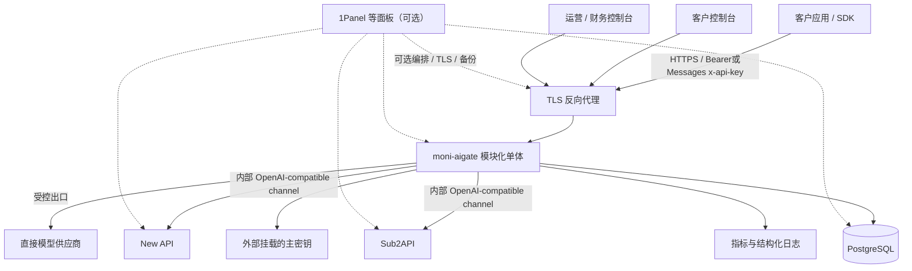
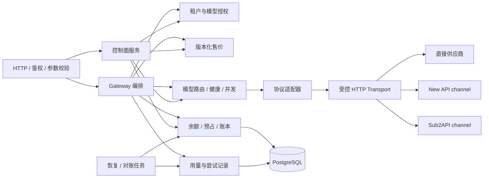
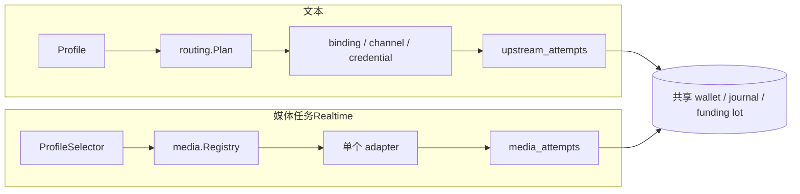

# HLD：moni-aigate 商业 API 网关

状态：r3 设计基线已获开发者同意，r5 实施对齐；目标版本：0.1.0-dev；基线日期：2026-10-30；最新修订：2026-11-10（四阶段路线、文本路由范围与文本/媒体结构边界）。实现与验收进度见[实施记录](../verification/implementation.md)，不代表生产发布验收通过。

## 1. 目标、前提与边界

已确认用途：对外提供 API 的商业运营平台。推荐从可控试运营版本开始，保障客户调用、余额与账单闭环；New API 与 Sub2API 先作为可统一部署的外部上游，再按 profile 逐项内收，不要求一次覆盖它们的全部功能。

阶段顺序以[四阶段路线](phase-roadmap.md)为准：0 阶段先完成统一部署与 New API/Sub2API 外部 channel 接入，第一阶段完成固定版本 New API 核心业务闭环，第二阶段参考 Bifrost 补文本数据面，第三阶段在 aigate 内实现跨 direct/new_api/sub2api 的文本动态路由，第四阶段做真实供应商认证、生产验证和已迁移能力的下游退役。真实供应商兼容不是 0/第一阶段的全部完成条件；deterministic mock 和外部 channel 证据必须分开标注。

前提：首版单地域、单活动应用实例；租户可为个人或企业；一个租户一个 CNY 预付费钱包；平台运营上游渠道，不允许客户上传供应商 Key；邀请开户和人工核款入账。对外正式扩大经营前，需要另行确定服务条款、支付与退款规则以及真实容量。

当前协议提供 `GET /v1/models`、`POST /v1/chat/completions`、`POST /v1/responses`、`POST /v1/messages`，支持文本、基础函数工具与 SSE；[009](../../specs/009-retrieval-protocols/spec.md)增加非流`POST /v1/embeddings`与Jina格式`POST /v1/rerank`；[010](../../specs/010-gemini-native/spec.md)增加`/v1beta/models/<model>:generateContent`和`:streamGenerateContent?alt=sse`无状态纯文本原生入口。每个公开模型绑定一个协议，保持原生事件与终态，不进行协议互转。Gemini本切片不含工具；所有协议拒绝未声明的图片/音频/文件、多候选、后台/有状态任务和供应商扩展。拒绝未知计费乘数，不能随意透传后再发现费用不可计算。

## 2. 利益相关者与业务域

| 角色 | 权责 |
|---|---|
| 平台管理员 | 客户/渠道/模型授权、路由、价格、运行策略；敏感操作再认证 |
| 平台财务操作员/审批员 | 录入核款单、审批入账、核对异常/退款；申请与审批必须不同账号 |
| 租户 owner | 管理本租户成员与 Key、查看钱包/账单；不能改价或查看渠道密钥 |
| 租户 member | 使用受限 Key、查看自己权限范围的调用记录 |
| 租户 billing viewer | 只读本租户资金与消费记录 |

平台管理员不默认拥有财务审批权限；角色可赋给多个账号，但同一笔入账/退款不能自己申请自己批准。

## 3. 系统上下文

部署和运维入口是仓库自带的 Compose/部署脚本，moni-aigate 独立运行。1Panel 等面板只是可选的部署环境：不依赖其插件源码、SSO 或席位系统，也不把 Compose 兼容等同于已经进入任何官方应用商店。

## 4. 应用结构与职责

- Gateway 负责生命周期，不能在 handler 内嵌全部业务规则。
- Adapter 处理模型名转换、请求/响应/SSE/usage、上游错误分类；不直接访问钱包。
- Billing 是唯一资金写入口；余额变动必须与平衡流水同事务。
- Pricing 返回不可变客户价格快照；供应商成本规则另建版本，不与客户价格复用字段。
- Routing 从已获授权且能力兼容的渠道中选择，输出决策理由；不能通过 fallback 绕过授权/数据地域。
- Usage 保存请求与每次尝试；报表允许延迟，账本提交结果为资金权威。
- 计量事件、统计投影与可丢弃遥测分开：资金事务同时保存待投影事件，重放只重建报表，不触发再次扣款。
- 后台 Worker 与 API 同一进程，任务通过 PostgreSQL 持久化，不引入消息队列。

### 4.1 补充竞品研究后的融合边界

LiteLLM、Bifrost、Portkey 用于补充预算/调度/回退配置和可观测设计；Higress、APISIX 用于参考策略生命周期与流式用量观测；Open WebUI 作为可选外部聊天客户端。它们不成为运行时必需组件，也不自动进入本项目依赖。

首版把策略执行分成准入、路由、上游尝试、响应计量、结算五个阶段，各自保存版本与结果。Token/RPM 限流属于资源治理，**不能替代金额预占与持久资金账本**。上游实际尝试的成本和客户一次收费继续分开。

0/第一阶段先做文本的优先级、权重、健康、容量和成本优先路由，候选可以是直接供应商、New API 或 Sub2API channel；延迟/成功率评分、质量门槛和利润优化属于第三阶段，需有遥测与回放评估。响应缓存属于第二阶段，先定义缓存命中计费语义和租户作用域，避免跨租户内容复用。LiteLLM、Bifrost 等源码机制在第二阶段的落点见[四阶段路线 §5](phase-roadmap.md#5-第二阶段bifrost-风格文本数据面)。Higress/APISIX 的 Envoy/Istio/etcd/Wasm 等运行环境不引入首版单体。

Open WebUI 不纳入 moni 控制台源码；后续以公开 API 连接时须独立校验兼容性和租户 Key 归属，避免全站共享一把收费 Key 导致混账。它不替代本项目的渠道、客户或财务后台。具体研究来源与边界见竞品研究汇总。

### 4.2 GitHub / Chrome 扩展研究后的设计补强

新增项目提供的是边界设计，不是组件采购清单。TensorZero 的配置快照、Lago/OpenMeter 的事件身份与更正、Unkey 的 Key 判定、Helicone/Langfuse/Agent Router 的观测隔离，以及 OpenRouter 的硬约束/软偏好语义，合入首版既有模块；不新增 Redis、Kafka、ClickHouse、Envoy 或外部鉴权强依赖。

1. **配置可复现**：发布前校验候选、能力、引用和限额；策略与绑定形成不可变版本，原子切换活动指针，失败继续旧版。请求绑定实际版本，不能在一次调用中拼接新旧配置。
2. **约束先于排序**：权限、能力、地域、渠道状态等先做硬过滤，优先级/权重只对剩余候选生效。请求、模型别名、外部 header 不得放宽平台/租户/成员/Key 的限制；不静默丢弃不支持的参数。
3. **资金事件可追溯**：计量 event、上游 attempt、资金 operation 分别标识；账本和待投影项同事务提交。统计重放和通知重发不产生新扣款，退款/成本更正关联原始事实。
4. **观测不支配资金**：元数据白名单与统一脱敏覆盖 URL/错误；财务事实、结算证据和成功敏感变更审计完整持久化，不服从 trace 采样。拒绝类安全信号有界记录并暴露丢弃计数；遥测故障不阻塞推理，账本失败仍拒绝新收费调用。

动态路由在第三阶段实现，只覆盖文本，候选包含直接供应商、New API 和 Sub2API channel，分三类：同一逻辑模型下的供应商切换（现有018已覆盖优先级/权重/成本优先，缺评分输入与回放）；同一质量档位下的物理模型切换；跨质量档位的显式 `auto` 商品，需公布售价和质量门槛。跨模型切换不能只按最低价格选择，须同时考虑模型能力、质量门槛、上下文长度、工具能力、延迟、成功率、当前供应商成本、缓存与上下文重传成本、会话粘性、最低毛利以及租户和 Key 权限。Plano/RouteLLM 启发的上下文重送、缓存损失和额外路由器成本必须一起核算。每次路由决策须能记录和回放。具体待冻结合同见[四阶段路线 §6](phase-roadmap.md#6-第三阶段openrouter-风格文本动态路由)，证据与取舍见[扩展研究入口](../research/landscape.md#5-证据入口)。第一、二阶段不加入这些自适应策略。

OpenRouter 是商业托管产品，本项目只参考其公开文档描述的产品语义，不把它写成开源代码来源。New API/Sub2API 的开源源码可以在许可证、NOTICE、来源提交和修改记录完整的前提下直接纳入，但不因此共享下游数据库、客户钱包或最终路由权。

## 5. 技术选型与理由

| 层 | 推荐选型 | 原因 / 约束 |
|---|---|---|
| 服务端 | Go + Gin，采用实施时仍受支持的稳定 Go 版本并锁定工具链 | 适合流式代理；可通过协议 adapter 或已审计源码模块吸收 New API/Sub2API 能力，不要求复刻其运行时边界 |
| 数据库访问 | pgx + 显式参数化 SQL（SQL 为事实源），版本化迁移 | 资金事务、唯一约束与锁顺序可明确审查；不做跨数据库兼容 |
| 前端 | Vue 3 + TypeScript + Element Plus | 适合治理/运营表单、表格；是 moni 的选型，并非声称 Gateway 使用相同技术 |
| 数据库 | PostgreSQL 16+，实施时锁定具体受支持版本 | 唯一资金事实源，事务/行锁/复合外键；首版不支持 SQLite/MySQL |
| 限流/并发 | 单实例内存令牌桶、分层信号量 | 降低首版运维成本；重启会重置速率窗口，不宣称跨重启严格 RPM |
| 分发 | 单应用镜像内嵌前端 + PostgreSQL，Compose/部署脚本 | 固定版本 tag/digest；1Panel 等面板可选导入同一编排 |
| 可观测 | 结构化日志、Prometheus 格式指标、request_id | 不以用户 ID/Key 为指标标签，避免高基数与泄漏 |

**首版不需要 Redis**：钱与持久化 Key 花费上限全部由 PostgreSQL 原子约束；运行时控制只支持一个实例。多活动实例之前再设计共享限流、健康状态与配置失效机制，不允许先开 replicas=2 再补正确性。

## 6. 核心商业闭环

### 6.1 充值与退款

v0.1 人工核款：运营记录真实收款凭证和外部业务号 → 不同财务账号审批 → 一个数据库事务入账+平衡流水+审计。平台不直接经手真实支付接口；界面不得显示为“自动支付完成”。重复审批/业务号不得重复入账。

客户消费退款：绑定原消费单、限制累计退款不超过原 settlement 的实际收费额，审批后做补偿流水。提现/原路现金退款是另一业务，v0.1 走线下财务流程并记录状态，不把“退回平台钱包”称为现金退款。

### 6.2 请求与结算

1. 校验 Key/租户/模型/请求参数与服务能力，固定售价和模型能力版本。
2. 获取运行时并发许可，计算保守最大客户费用；数据库原子冻结余额并预占 Key 花费上限。
3. 提交事务后才能向上游发请求；上游调用期间不持有数据库事务。
4. 仅在明确没有处理/消费的情形下安全重试，最多一次。
5. 保存白名单内的最终用量/协议/交付事实和恢复任务，再按固定收费政策原子结算、释放余款；上游成本独立记录。
6. 明确未消费，或在计费责任点前上游/平台失败且未写出有效内容：客户免收并释放，供应商成本可单独待核对。
7. 对仍可能收费但缺可信最终usage的部分输出/客户取消等情形，客户冻结待核对；不能按估算或最大预占扣款。

待核对项有明确截止：v0.1建议24小时内处理；截止判定时尚未结算则释放客户冻结，即使已有可信用量但处理延迟也不例外，之后不自动追扣。供应商待核对成本可以继续保留。此为本版实现采用的客户计费政策，不因Worker延迟无限冻结客户余额。

协议完成、网络交付、usage可靠性和收费状态分开：length/tool_calls可以正常结算，流内error不等于零消费；扣款与网络交付不能原子提交。非流响应完整有界校验后结算再写出；T2已提交后的写失败不自动重生成或冲正，争议走原消费退款。细分政策见[LLD §7.1](LLD.md#71-协议交付与收费矩阵)，本版按该基线实施。

### 6.3 价格与成本

客户按对外逻辑模型的售价计费。路由到哪个渠道不会改变已锁定售价。所有价格都有版本与生效时间；修改价格创建新版本，历史单据不可回写。首版输入/输出两种 Token 单价，输入缓存 Token 不重复累加，也不提供未实现的缓存折扣。

资金预占使用独立输入/输出硬界：缺少供应商独立输入限额时，输入界取完整上下文；不能从上下文减最大输出推断。两个独立最大值可以保守过预占，最终只按可信实际量收费。边界校正与真实PG验收见[004](../../specs/004-conservative-bounds/spec.md)，既有profile不自动改写。

固定客户售价与严格预占是moni主动选择的合同：New API某些最终分组倍率会变化，其他Key/Token预算产品也不都提供余额硬预占，不能概括成直接继承上游保证。每个售卖profile需核实参数/工具边界、计费维度、usage终态与输出限制；只转发客户端函数工具，不执行工具或透传额外收费的托管工具。

上游成本分为“合同价格计算”“供应商账单确认”“未知”三类；利润报表标注口径，未知成本不按零元处理。首版不提供外汇、多币种和税务账单，业务流水不宣称法定会计总账。

2026-11-10：已确认方向为对外只暴露平台币（[034](../../specs/034-virtual-coin/spec.md)）：客户钱包、售价、Key 额度以币计，法币只出现在付款记录和报表中；充值时记录法币基准，请求路径中没有汇率；前期手动充值与手动现金退款，支付接入后置。同一充值单内付费来源先于赠送来源消耗，其他来源继续按严格 FIFO。现金退款需要在来源本金上新增 `refund_held` 与 `retired` 两个桶，并增加 `REFUND_HELD` 账户，这是对 027 与 028-U guard 的受控修订。现金退款采用先冻结、线下转账确认后才退出的状态机，避免转账失败时币已丢失。退款额保留“按当前币价核算”与“按原付款比例核算”取较小值的 B 规则；MVP 只记录创世/买入币价并暂不开放调价，后续调价必须追加版本、审批、预览且不得回溯，以堵住“退款再充值”的套利；赠送币不可现金退款。单人运营由管理员界面开关控制，默认开启，启用或修改需二次确认/近期重新认证，单据保存开关快照并记录例外审计。034 已于 2026-11-14 冻结（见[方向审查记录](direction-review-2026-11-14.md)）；实现按 034 §17 分片进行，实现完成并通过其 §16 验收前，当前代码的人民币单币种描述仍是现行合同。

## 7. 多租户与数据边界

从首版就有真实租户隔离，不能只给表预留 `tenant_id`。租户身份来自会话/Key；所有查改、明细、导出与幂等键绑定租户；关联表采用复合外键。平台渠道是显式平台域资源，通过 model_bindings 共享，不使用空 tenant_id 泛化越权。

有效模型授权为平台模型状态、租户授权、成员权限和 Key scope 的交集。空白授权默认拒绝；“全部模型”必须明确配置。客户不能查看渠道地址、凭据、其他租户账单或完整平台路由原因。

租户身份只来自服务端验证的会话/Key，不信任客户端提供的 tenant header。首版不开放任意供应商后缀、部署选择或路由表达式；逻辑模型名必须先按目录解析，不能绕过租户、能力或地域策略。

## 8. 安全与可观测

- 网关 Key 一次性展示，仅存摘要；上游凭据需要转发，使用带版本的认证加密，主密钥与数据库分开保存。
- 管理面采用独立会话；密码安全散列，敏感操作再认证。MFA默认可选、不自动启用，未绑定账号可密码登录；`MFA_ENFORCE_PLATFORM=true`时平台管理员/财务账号必须先绑定。主动启用后始终验证第二因子，关闭强制策略不解除已有绑定。绑定支持本地生成二维码与手动密钥。此默认值按2026-10-30开发者测试联调偏好调整，覆盖原先平台/财务一律强制的设计，见[ADR-003](../decisions/ADR-003-optional-mfa.md)。
- 自定义上游 URL 仅平台管理员可设置；默认 HTTPS、限制出口，逐次解析验证实际目标、禁止重定向和云元数据地址；私网渠道须显式允许 CIDR。
- 默认记录元数据，不记录请求/回答正文和 Authorization。首版不做全量内容审计和“语义合规”承诺。
- 观测字段采用白名单；日志、错误和后续 trace 共用脱敏出口，禁止完整 URL/query/userinfo、Cookie、原始供应商错误正文进入观测。遥测丢弃有计数，资金与审计不能走可丢弃队列。
- 关键事件串联 `request_id`、`attempt_id`、`price_version_id`、`reservation_id` 和 `journal_id`。
- 管理员修改渠道、价格、权限、入账、退款、人工核对都写审计；应用角色禁止更新/删除资金历史。

## 9. 部署、恢复与容量

首版只允许一个活动 app，启动取得 PostgreSQL advisory lock 的专用连接；失去锁连接即停止新请求并退出。升级执行停止接单→排空→停止旧实例→迁移→启动新实例。该约束用于防误部署，不对分区场景下上游请求执行提供分布式 exactly-once 保证。

反向代理需关闭 SSE 缓冲、配置大于应用流式上限的读取超时。应用区分 `/health/live` 与 `/health/ready`。数据库不可用时拒绝新转发；已有流结算失败进入恢复/待核对，不声称一定能恢复丢失的最终 usage。

数据库卷、外部主密钥、配置必须分别备份并在新环境演练恢复。建议数据库持续归档+每日基础备份；试运营目标 RPO≤15 分钟、RTO≤60 分钟，需实际部署验证。只有每日备份时不能宣称满足该 RPO。

从备份恢复必须进入 **recovery mode**：关闭新付费调用、核款审批和退款写入口，只允许运维读取与受控恢复核对。用独立于该数据库恢复点的财务凭证/入账回执归档、备份检查点和供应商记录核对丢失区间；恢复旧库自身无法知道恢复点后发生过哪些交易。无法证明的客户费用由平台按政策承担，禁止盲目重播入账/扣款。完成余额与流水校验、业务号去重核对和双人确认后才解除门禁。

容量是待测目标：固定 4 vCPU/8GB、PostgreSQL 同地域独立容器、模拟上游、100 个并发文本流时，代理额外首字节耗时 p95≤50ms，内存保持有界。测试需分别记录非流/流式、请求体大小与实际吞吐；不包含供应商生成耗时，不是已达到的性能承诺。首版单实例存在升级中断与故障停机，没有高可用 SLA。

容量报告还需列出资金事务/账户行锁等待、断连后的真实上游资源清理，以及首次事件与最终结算的各自延迟。所有层合计最多两次生成派发，SDK/HTTP客户端/反向代理不得额外重放；健康隔离不授予重试权。日志和trace不得旁路累积正文。详见[源码校准记录](../research/design-calibration.md)。

2026-10-30新增性能约束：接近Rust LiteLLM native gateway与Go版Bifrost。固定源码、客户端TTFB/首有效内容TTFC、同配额比较和完整商业链路门禁见 [SDD性能迭代](../../specs/002-performance-parity/spec.md)；[HLD/LLD补充设计](../../specs/002-performance-parity/plan.md)规定观测与优化顺序。当前未运行竞品，不能将微基准或首byte直接当作模型首token达标。

005/006在单活动实例内，按认证Key有界调度短准入和完成阶段，让同Key请求在借数据库连接前交接，保留原运行许可与数据库资金保护。票据不覆盖上游或客户端I/O，最终量仍先持久提交再独立结算；成功终态依然等待收费完成。清理排队使用原独立5s上下文，超时不造量、不自动重放。首次优化首byte的同时曾增加完成耗时，完整控制及后续处理见[Key调度记录](../verification/key-scheduling.md)，不把局部收益冒称持续吞吐或50ms达标。

[007](../../specs/007-dispatch-read-batches/spec.md)继续在原事务内部按顺序批量发送派发读取与账户初始化/锁读取，减少应用等待数据库的边界。所有SQL仍独立执行，保留等锁后的新快照、原错误顺序与全部COMMIT；不以同语句JOIN/CTE合并同步锁与授权/余额读取。实际验证与保留决定见[007记录](../verification/dispatch-read-batches.md)。

同日新增New API能力对齐要求，后续协议、渠道运营与自助经营的差距和顺序见[能力路线图](new-api-roadmap.md)。003已实现Responses与Anthropic Messages文本/基础工具、平台probe与客户Playground，沿用001资金与恢复政策。原生成功终态在最终量持久化和结算后发出；Messages缓存创建/读取合入统一输入计费量，尚无缓存折扣。完整客户端产品兼容、真实供应商认证与后续协议另行验收。

## 10. 版本路线与不做项

2026-11-10 起，阶段路线以[四阶段路线](phase-roadmap.md)为唯一事实源：

| 阶段 | 交付能力 | 出口条件 |
|---|---|---|
| 0 阶段 | Compose/部署脚本统一编排 aigate、New API、Sub2API（1Panel 等面板可选导入）；外部 channel、probe、usage/成本/错误合同；唯一客户结算 | 独立数据库、内部网络、下游重试不越权、外部 channel 可回退；见 [035](../../specs/035-external-upstream-integration/spec.md) |
| 第一阶段 | 固定版本 New API 核心业务闭环；文本基础渠道路由；共享钱包与结算；协议、媒体、任务、Realtime 用 deterministic mock 验收 | 验收清单逐项有专用 PostgreSQL、mock 和至少一个外部 channel 证据；不要求所有真实供应商认证 |
| 第二阶段 | Bifrost 风格文本数据面：低延迟、失败分类与故障切换、预算治理、缓存设计、压测；逐项内收下游实现 | 合同、实现与同条件压测记录 |
| 第三阶段 | 在 aigate 内实现 OpenRouter 风格文本动态路由，候选包含 direct/new_api/sub2api；物理模型、质量档位、评分、最低毛利、会话粘性、路由回放 | 三类切换逐类验收，决策可回放；下游账号路由保持局部 |
| 第四阶段 | 真实供应商逐一认证、真实 usage 与成本、正式支付、生产部署、性能和已迁移能力的下游退役；1Panel 等面板适配为可选项 | 每个可售 profile 有真实账号证据；生产门禁通过；可退役能力完成切流 |
| 扩容 | 多活动实例、共享限流、日志分库等 | 容量实测证明有需要且故障语义补全；不在四阶段内承诺 |

2026-11-14 实现边界：0 阶段已落地 current-only 的 channel kind/integration mode、OpenAI-compatible external relay、统一 usage/错误/成本/safe-to-retry、channel probe 证据和 route revision 回退，并以 direct/new_api/sub2api deterministic fixture 验证唯一结算与不重放。真实本地 New API（`e449cc7`）与 Sub2API（`10ba8f9`）三服务三库 Compose 拓扑也已通过 JSON/SSE、唯一结算、receipt 和 revision 回退验收；供应商出口仍为 deterministic mock。1Panel、真实凭据、真实 usage/成本与逐 profile 认证尚未完成，不能记作生产或供应商验收。详见[验证记录](../verification/phase0-external-upstream.md)。

下表为 2026-10-30 首版的原始里程碑，保留历史语境。其中 M2 的“真实渠道合同与 usage 能力核实”已移到第四阶段，不再是第一阶段出口：

| 历史阶段 | 交付能力 | 原出口条件 |
|---|---|---|
| M0 基础与契约 | 租户鉴权、Key、模型/渠道、迁移、Mock 上游 | 租户隔离和契约检查通过 |
| M1 商业调用闭环 | 人工核款、钱包账本、价格、Chat/Responses/Messages、流、异常恢复 | 资金并发/崩溃/重复结算测试通过 |
| M2 可控试运营 v0.1 | 控制台、运营指标、退款/审计、部署恢复 | 验收矩阵通过；真实渠道核实现属第四阶段 |

不设无依据工期或成本节省比例。核心账务与客户边界由 aigate 统一；New API/Sub2API 的外部 channel 和已许可源码模块按 profile 逐项纳入，新增竞品不改变该方向，也不把竞品的全部能力纳入首版任务。

2026-10-31优先级校准（历史记录，阶段顺序现以[四阶段路线](phase-roadmap.md)为准）：先完善[能力路线图](new-api-roadmap.md)中的A/B/C功能，再推进002性能与008写批次专项。保留005–007已验证改动与资金不变量，本轮不继续压测。009复用已有授权→硬预占→不可变路由→最终证据→结算链路，新增输入独立计费类型；检索响应只在可信最终量并成功结算后交付，缺量保留预占待核对。输入硬界必须覆盖整个batch/query+documents的聚合供应商计费量，不能沿用单文档context当总量保证。供应商认证仍单列。

010沿相同商业链路实现Gemini原生文本。公开模型来自安全路径，上游模型使用不可变映射，供应商秘密只发x-goog-api-key；`/v1beta/`共用原300s/Guard/恢复门禁。Gemini可见与thinking计入同一输出价格，cache为输入子集。SSE先给文本、保留finish，等合法EOF和尾部最终usage后持久化并结算再发成功终态；未知量保留预占。maxOutputTokens对全部收费输出的聚合硬保证仍是正式供应商门禁，不由schema或mock替代，详见[合同研究](../research/gemini-contract-notes.md)和[验收](../verification/gemini-native.md)。

011在渠道管理面增加OpenAI/Anthropic/Gemini目录发现与差异预览。发现固定当前渠道/凭据版本与已发布绑定快照，受控GET读取供应商目录，开始与唯一终态分别追加审计；HTTP不持数据库事务，不调用生成或变更客户资金/路由。历史能看未绑定和目录缺失模型，渠道/凭据/绑定变化时动态标记stale；缺失只是人工核查提示，不自动下架。它为后续凭据池/批量运营提供渠道版本和接入参考，不能代替profile/计量认证或完整revision发布，见[011规格](../../specs/011-model-discovery/spec.md)与[验收](../verification/model-discovery.md)。

## 11. 关联文档

- [LLD](LLD.md)：具体契约与不变量。
- [需求规格](../../specs/001-commercial-mvp/spec.md)、[计划](../../specs/001-commercial-mvp/plan.md)、[验收](../../specs/001-commercial-mvp/acceptance.md)。
- [ADR-001](../decisions/ADR-001-source-strategy.md)：代码复用边界与发布方式。
- [上游接入路线](upstream-integration-plan.md)与[035 接入合同](../../specs/035-external-upstream-integration/spec.md)：New API/Sub2API 的部署、路由和逐步内收。

## 19. 012 不可变渠道凭据池

一个渠道版本固定1..32个供应商凭据，每个成员有名称、权重和并发上限，第一项保留为primary。管理员提交完整池并比较`expected_version`，成功创建新渠道版本，不能覆盖原版本；完整路由以`expected_revision`重新发布后，新客户准入才使用该版本。普通渠道元数据修改保留全部成员及原凭据身份。池及其历史只向管理员开放，实际调用身份仅在平台接口显示；浏览器和接口历史不返回供应商秘密。

池大小不增加渠道选中概率。渠道总并发与按持久credential ID跨模型/版本共享的成员并发，在同一把运行时锁内取得，真实上游退出后归还；健康仍按credential+model区分。请求最多两次尝试，已尝试集合按渠道记录：同渠道失败后不换另一把Key继续生成，消费未知或下游已提交不重放。客户售价、模型授权、硬预占、最终证据、一次收费、待核对与恢复合同保持原样。每渠道仍只有一条安全路由解释，实际credential ID独立保存在attempt中。

移出成员只改变新版本，旧发布路由与在途请求仍保留原成员；紧急停止某身份使用永久撤销，覆盖全部历史版本。派发先锁渠道及实际凭据，再检查当前撤销状态；已发上游无法撤回。撤销不可恢复，重新录入历史同一秘密不能生成新身份绕过撤销。同一供应商Key若曾跨渠道保存为不同身份，撤销其中一个身份不等于供应商侧全局吊销。

008迁移将成员集与渠道版本在同一数据库事务内封口：版本创建事务stamp由数据库生成，成员只允许在该事务追加，提交后也不能由owner晚追加、更新或删除；primary必须是本版本成员。attempt、平台probe和模型发现均用version/channel/credential复合外键约束实际身份。完整备份恢复保留这些关系，恢复到已建schema的数据导入须满足同事务及版本先于成员的顺序，详见[备份恢复手册](../runbooks/backup-restore.md)。

平台probe从完整已发布池按同一Routing机制选一个成员，使用相同两层容量及原平台/全局预算，先保存实际身份与审计再访问上游；成功只表示该成员本次协议和用量校验。模型发现按position选当前池首个未撤销成员，仍只读目录GET并保存实际身份，二者均不动客户钱包。012没有后台自动轮换、定时探测、全池认证、跨渠道批量经营、供应商余额或全局账号额度；这些和正式供应商/SDK认证继续独立规格。合同见[012](../../specs/012-credential-pools/spec.md)。

## 20. 013 跨渠道批量启停与回执

管理员在渠道列表选择当前页，先预检再批量启用/停用。API每批1..100个渠道，控制台限当前页最多50项；一次操作要么全部应用，要么整批拒绝。预检展示当前版本、管理revision、可用凭据数和已发布/旧版本绑定数，只读取数据库，不访问供应商。预检不会锁住配置，提交时必须重新比较每个渠道的版本和管理revision。

启停直接改变`channels.enabled`实时门禁，覆盖该渠道的全部历史发布绑定；启用可能恢复旧路由，停用阻止后续准入和尚未派发尝试，不能撤回已发上游。它不创建渠道版本、不修改凭据池/撤销/隔离，不发布路由或修改客户资金。新池仍须按012显式发布；启用也不保证旧绑定成员、模型授权、健康或容量可用。

009迁移增加数据库维护的单调`management_revision`，所有渠道UPDATE均递增，检测状态恢复原值的ABA和原有单渠道写入口产生的变化；它不代表所有原有编辑接口都实现了CAS。每次批量提交以UUID标识，规范输入摘要及actor固定身份；同ID同内容永久返回原回执，异内容或actor冲突。回执单行保存完整安全元数据快照，提交后禁止追加、更新和删除，成功/拒绝都各有唯一同事务审计。

HTTP200仅表示收到持久决定，界面按`applied/rejected`展示实际结果。网络失败、5xx或非法响应会保留原操作ID，关闭或切页不丢失查询入口；不自动换ID重发。恢复后备份点以外的回执可能丢失，必须维持恢复门禁并核对，不凭404判断操作从未发生。详见[013规格](../../specs/013-channel-batch-operations/spec.md)、[LLD §20](LLD.md#20-013-跨渠道批量启停与回执)和[验证记录](../verification/channel-operations.md)。

## 21. 014 MVP 验证收口与首次接入修正

通过隔离的本机QA运行器启动真实main、正式迁移/最小角色和受控供应商mock，在真实浏览器操作完整Chat经营闭环及011–013代表功能。供应商认证、容器、异地灾备和性能分别保留自己的验收证据。QA身份/密钥/数据和评审数据库隔离，不增加生产调试API或跳过权限/账务的路径；运行器退出按先应用后数据库顺序清理本次资源。

渠道表单默认地域统一为既有租户/Key默认授权的精确`global`标签，保留未授权地域硬拒绝；global不表示任意地域或数据驻留保证。反向代理新增显式`TRUSTED_PROXY_CIDRS`，默认不信任转发头；边缘覆盖单一X-Real-IP，受信peer才据此区分登录限流客户端。metrics始终按真实传输peer判断且由边缘403屏蔽，不因转发头授予本机运维权限。

真实main的正常业务排空单独验证：SIGTERM停止新连接，在途SSE等待最终量并唯一结算后退出；同数据库重启不重发、不重复扣款。它补充已有SIGKILL事实恢复验证，不替代容器升级和数据库网络分区。范围与清单见[014规格](../../specs/014-mvp-release-qualification/spec.md)。

## 22. 015 Key 来源访问策略

客户可以为每个Key配置来源IPv4/IPv6或CIDR白名单，空列表保持旧Key不限来源；它与现有模型/成员/地域/预算约束共同生效。owner管理本租户，member仅自己的Key，billing_viewer只读；来源编辑只替换完整列表，带独立字符串revision做CAS，不更换秘密或改变累计额度/权限。资金spent/held更新不影响策略revision，配置与安全审计同事务。

来源在API Key鉴权时按014可信代理规则由服务端捕获一次，不接受客户端自报字段。所有API Key端点含模型目录都初筛；Reserve、attempt及PrepareDispatch在原Key锁屏障后按最新策略复查，防止排队或安全跨渠道尝试使用旧白名单。请求只在内部保存不可变来源快照，未知来源在非空策略下拒绝，历史NULL请求也不能借旧身份继续派发。

派发`sending`提交为本轮授权同步点，之后获准发送的请求不能撤回。策略收紧不停止已发流，不阻断可信量结算、释放、退款或恢复；完成路径不依赖新的来源许可。控制台按当前身份与编辑epoch隔离响应，CAS失败要求重新读取审核，未知写结果只核查当前配置，不自动重放。GET单条策略供核查，不是持久命令回执。范围见[015规格](../../specs/015-key-access-policy/spec.md)，动态速率/并发及周期预算独立后续。

## 23. 016 Key 动态运行限额

Key来源和运行限额独立版本、权限与审计；新增RPM/突发容量/并发三元组，默认60/20/16。配置可降低或在固定安全上限内提高，平台/租户/渠道限制仍共同生效。令牌补充速率不是固定分钟窗口或账务额度。

合法请求和候选准备后、Reserve前，在数据库Key共享锁保护下读取最新配置，并原子取得本机Key令牌与并发许可。配置UPDATE与这个运行准入同步；已获许可的排队/在途继续，限额不替代撤销/来源和sending派发屏障。配置失败不产生资金事实，已消耗速率令牌不退款。

一个Key保留一个桶和在途计数：新revision在下次运行检查被观察时切换，先按旧速率补充到观察时刻，容量提高不赠令牌，降低只截断桶余额而不清并发。独立4096 Key状态不在运行中TTL重建，满时新Key503；单活动实例重启满桶，持久限额不丢。该边界不等于分布式限流或新性能认证。

控制台分别展示/编辑来源与限额，冲突和未知结果只读核查后显式新编辑，epoch与单调版本防晚回。完整合同见[016规格](../../specs/016-key-runtime-limits/spec.md)。

## 24. 017 Key 基本配置编辑

名称、模型范围、地域、累计上限和有效期共享独立configuration_revision，来源与运行限额各自版本保持。GET仅安全九字段，完整PUT在tenant→actor membership→actor user→Key UPDATE锁下校验当前权限、CAS和最新spent+held下限；变更和before/after审计同事务。过期可明确续期/移除期限，撤销不可恢复，历史未改字段保留。012仅添加版本触发器，不以新CHECK阻断旧行财务收尾。

运行侧保留原锁序，Reserve读取当前预算/范围；RecordAttempt在已有锁之后单独复查Key范围/地域/到期，不能在共用收尾锁helper拒绝新策略。PrepareDispatch取得最后锁后使用新数据库时钟校验到期与deadline，sending提交后在途和资金收尾继续。三种编辑器独立CAS/unknown与版本合并，金额用精确字符串、日期保留原微秒，禁止自动重放未知写。完整合同见[017规格](../../specs/017-key-configuration/spec.md)。

## 25. 018 成本感知路由与架构持续同步

2026-11-01，018实现完成并通过限定本地验收，详见[执行证据](../verification/cost-aware-routing.md)及[验收清单](../../specs/018-cost-aware-routing/acceptance.md)。同一逻辑模型可采购自供应商或另一聚合平台，每个渠道＋精确上游模型单独登记成本版本；客户售价继续按请求冻结。完整路由版本新增manual/cost_first与未知成本策略，binding可设输入、输出两维采购单价上限。成本管控时未知报价排除，不能视为免费。

比较分数为输入硬上界×输入采购价＋输出上限×输出采购价，以大整数计算，不承诺实际最低账单。最高优先级仍是经营者的首要偏好；需要全池比价时显式统一priority。每次安全尝试记录自己的采购成本，客户只冻结一次，已发流和财务收尾不受后续调价阻断。库中单价上限不等于供应商可用余额或累计采购预算。

成本INSERT与请求的channel SHARE共用数据库行锁；新成本发布带渠道management_revision CAS，直接SQL由触发器兜底。候选到attempt再到sending前检查报价身份、费率和依据；定时生效也按锁后的新数据库时钟复核。该同步只覆盖登记合同，不能强制供应商外部真实收费。详细合同见[018规格](../../specs/018-cost-aware-routing/spec.md)。

统一架构入口为[系统架构](../architecture/README.md)，包含模块源码映射、请求/资金/成本/恢复链路、数据关系与部署边界。源码、规格、迁移与构建配置的内容快照由只读检查检测增删改；每轮需先复核正文，再显式刷新并追加变更理由，Make/CI执行检查。哈希检查只能发现未复核变更，不能代替语义审查。

后续采购账户、多个渠道/凭据共享采购额度、本地预算预占和供应商余额观察已拆成[019冻结合同](../../specs/019-procurement-accounts/contract.md)。必须逐attempt保留未知消费占用，客户退款/24小时释放不自动恢复采购预算；018不宣称已实现这些能力。能力完善继续优先于002性能优化。

## 26. 采购共享账户与双边资金（019已实现，限定本地验收）

[019冻结合同](../../specs/019-procurement-accounts/contract.md)明确永久credential→采购账户归属。客户request冻结一次客户资金，每个供应商attempt独立冻结共享采购预算；未知上游消费与客户24小时释放分开。绑定后所有渠道版本强制已知报价与硬界，不能借旧版本关闭采购控制。采购证据、双人更正、独立恢复只处理采购事实，不触发模型重发或追加客户扣费。累计预算与人工余额观察分离，周期及正式供应商余额适配尚待独立实现。

019实现与限定本地验收见[采购账户记录](../verification/procurement-accounts.md)。020公开目录也已完成限定本地验收；021注册/邮箱恢复已完成限定本地验收，022-A已完成限定本地验收；B0-P/M/Q及B2第三来源已实现并通过各自专项，B3已接线、真实主进程/浏览器整链通过限定本地验收、真实在途SIGTERM与Guard失权补验已通过，C仍后续，后续依赖见[交付计划](delivery-plan.md)。

## 27. 公开目录（020已实现，限定本地验收）

[020冻结合同](../../specs/020-public-catalog/contracts.md)已落实独立`/pricing`页面、匿名模型列表/详情及管理员公开配置。旧/新模型默认私有，只有显式公开且启用时展示六协议的真实能力、产品限制和当前客户售价。公开目录与租户/Key授权目录分开，不输出原始profile、渠道、采购或客户资料，不授予模型调用权限，也不承诺供应商实时可用。

公开标记采用独立字符串revision及管理员CAS；停用模型可预设公开，重新启用后恢复展示。匿名限流/4在途许可先于可能访问数据库的Guard取得，单SQL数据库时刻、50+1与C排序游标控制观察边界；公开读取、既有模型页和Reserve采用相同确定选价规则，实际请求仍独立冻结价格。目录观察不是报价锁定，也不改变已预占请求、资金或采购收尾。

020当期schema为001–015。156项前端测试及strict构建、最终catalog/server真实PG专项race、隔离真实main桌面/390px浏览器、冲突核查和015受限角色预览升级已通过限定本地验收；全Go race通过记录早于最后SQL安全修订，最终改动由相关专项覆盖，未冒称再次全量。完整范围见[020验收](../verification/public-catalog.md)，原始证据为[运行器与清理](../verification/public-catalog-020-harness.json)、[浏览器与零调用/零资金事实](../verification/public-catalog-020-browser.json)、[015预览与35资源一致性](../verification/public-catalog-020-preview.json)。正式供应商、生产部署及性能门禁保持独立。

## 28. 自助身份与邮件（021）

[021冻结合同](../../specs/021-self-service-identity/contract.md)已实现：默认关闭注册与邮件，Bootstrap持久标志、邮箱证明后最小权限开户、当前MFA下密码恢复、所有session family原子撤销及加密outbox。公开四条路由不依赖私有session，fragment在Router之前移除；成功不自动登录，API Key独立管理。注册不送资金或模型权限。

reset按user→subject→challenge→MFA→全部family ID序，全部锁后取DB时钟校验TTL；password_revision由DB按实际hash变更递增。SMTP独立worker只按2个空闲槽claim，60秒lease、25秒发送余量、20秒网络上限和5次有限重试，generation CAS防旧ACK；SMTP接受与ACK不原子，可能重复邮件但证明只消费一次。关闭/恢复只暂停，有效Guard下继续失效秘密清理；正常退出取消邮件IO，已开始Guard独立最长1秒完成，不误伤HTTP排空。维护密文重包仅owner、projector无身份读取。

详细DDL、锁图、权限、故障语义及源码入口见[设计](self-service-identity.md)和[统一架构](../architecture/README.md#自助身份与邮件链路021)。真实PG race、186项前端/strict、真实main+本地SMTP/浏览器及016预览升级完成限定本地验收，见[证据](../verification/self-service-identity.md)。正式SMTP收件与生产反滥用、022支付、023订阅、024媒体和025 HA继续独立验收。

## 29. 共同入账与双审兑换券（022-A）

022-A0已追加017九表、严格历史预检与人工receipt回填，共同ApplyFundingTx唯一拥有source到journal/receipt/credited的资金写入；manual与voucher赠额分开清算，不增加重复投影事件。VerifyFunding/VerifyLedger/Rebuild逐来源与精确分录核验，app列级写权限/projector无新增source读权。原钱包六字段保持，累计入账读取全部receipts。

A1独立HMAC keyring、六命令/当前授权、父锁后savepoint、未知COMMIT不重试与一次codes、严格HTTP/有界准入、控制台安全journal/来源摘要均已实现。全Go真实PG race、209项前端/strict、隔离真实main生命周期/浏览器及017默认off预览完成限定本地验收。B0-P标准库纯协议已实现并通过race/vet/fuzz，独立PG模拟器/接收器已按M/Q合同实现并通过真实进程短程，旧版本20代长程已完成，最新补丁/精确故障另验；B1核心设计/SQL与B2第三来源已冻结并实施相应切片，B3运行接线和C来源lot/原路退款继续独立收口。023-A按018精确接口/DDL与锁图已实现并通过[限定本地验收](../verification/tenant-pricing.md)，B核心/HTTP/UI、隔离浏览器和020预览已完成限定验收，独立只读核验器专项已通过，C商品/订阅继续；024-A0站内告警精确合同已冻结019；隔离DDL/权限/行为/源查询EXPLAIN原型通过，生产领域/worker/HTTP/UI已接通，真实进程/浏览器/全量race与019预览均通过，架构只读检查和make check通过；025已补独立草案，媒体/异步/长连接/外部身份、共享许可/HA和真实生产条件均不得标为已完成。源码入口、数据图和阶段证据见[统一架构](../architecture/README.md#共同入账022-a0)与[A验证](../verification/funding-vouchers.md)。

## 30. 客户价格域与请求事实（023-A）

价格组独立于tenant隔离、授权、预算与采购账户。组内缺价不回落默认。Reserve依tenant→membership→user→Key→model→group SHARE选精确域，单SQL DB时刻在钱包等待前冻结version/两维费率/组/归属revision/观察时刻。旧请求新增证据全NULL为legacy。后续派发及历史收尾不锁当前组或重算零售价。

组编辑NO KEY UPDATE；调组tenant NO KEY UPDATE→actor SHARE→目标group SHARE，兼容登录session FK KEY SHARE。pricing_operations保存不可变原result；018以NULLS NOT DISTINCT保护同域同effective唯一，app无历史/快照UPDATE，projector无新表权限。客户报价/历史仅当前域与当前授权，匿名和旧admin价入口固定默认。完整接口、锁图、DDL与权限见[合同](../../specs/023-periodic-products/a-contract.md)，运行证据见[023-A验证](../verification/tenant-pricing.md)。

## 31. 站内经营告警（024-A，限定本地验收通过）

迁移019与`internal/alerts`、独立双槽worker、平台HTTP及`/platform/alerts`已接通；真实PG/HTTP/主进程故障、最终bundle浏览器、全量race/vet和019预览均通过，架构只读检查和make check通过。四种固定来源只做MVCC观察，逻辑scope无业务FK，不锁商业根、不发模型/邮件/资金动作。admin管理、三平台角色读取/第一ACK；当前角色在领域事务复验，规则与原命令/事件/审计同事务。部署默认false暂停观察，历史与配置仍可用；恢复只读。

规则配置revision、episode行动revision、runtime内部写revision独立。完整事件链、唯一未结束发生记录、不可变快照、原命令关联及失败双CAS由019保护。双槽使用专用双连接，Guard与取消join后关闭pool；单评估2秒、源1.5秒、正常60秒/失败30秒、180秒stale。HTTP读写独立有界准入，严格嵌套JSON、字符串金额/计数/版本、UTC六位微秒、50+1/null游标及256KiB整次响应边界。

详细锁图、源码/观察时序及数据权限见[统一架构](../architecture/README.md#站内经营告警024-a)、[冻结合同](../../specs/024-extension-platform/a-contract.md)与[验证记录](../verification/operations-alerts.md)。023-B已新增[精确合同工作稿](../../specs/023-periodic-products/b-contract.md)，核心/命令/权限SQL及真实PG原型已形成，独立审查修正初占与派发时刻边界，现已冻结020核心接线；024-B–F、025与最后性能继续各自门禁。

022-B0-M/Q已按冻结合同实现独立模拟器/接收器、公共运行证明、自有SQL/inventory、独立CLI与离线QA装配。三schema/七角色/OID/实际LOGIN、私密manifest和各自ownership限定边界；命令/查询不可变回执、typed故障、双槽持久回调、验签inbox/receipt已通过专项真实PG/race。真实进程短程及旧版本20代长程已通过，最新补丁/精确故障验收继续按[记录](../verification/payment-sandbox.md)推进；021与Go第三来源已实施，普通网关main/订单/worker已由B3接线，真实主进程/浏览器整链通过限定本地验收，真实在途SIGTERM与Guard失权补验已通过，lot/退款仍待独立冻结。协议P保持不变，详细合同见[运行设计](../../specs/022-self-service-payments/b-runtime-contract.md)。

023-B纯DTO/cursor、Tx helper、Reader/Commander已按各自精确合同实施；020按[核心接线](../../specs/023-periodic-products/b-integration-contract.md)追加预算表、source/派发guard与固定namespace，从billing接入客户R、逐attempt采购U、原窗口收尾及同At派发，operations/main验证有效APP/projector角色。HTTP/UI专项与隔离真实main浏览器已通过，最终020相关回归与预览升级通过，独立三态只读核验器和CLI专项通过，交叉回归继续，见[023-B记录](../verification/periodic-budgets.md)。022-B1[核心合同](../../specs/022-self-service-payments/b1-contract.md)与SQL隔离LOGIN原型已冻结，通过双向资金/身份/代次验证；[B2第三来源合同](../../specs/022-self-service-payments/b2-funding-contract.md)已冻结，已追加021、实现Go第三来源与三角色核验，真实PG专项通过；领域/worker/HTTP已由B3接线，真实主进程验收另见[应用支付记录](../verification/payment-application.md)。离线历史fixture使用显式001–019前缀，普通服务始终要求最新迁移。

023-B管理HTTP按已冻结[接口合同](../../specs/023-periodic-products/b-http-contract.md)接入Reader/Commander，main在listener前初始化，独立32总读/8核查/8写与actor4/1/1及5/10秒工作期限。控制台从四类资源进入独立预算页，以IndexedDB单readwrite事务complete原子持久pending后才发命令；未知结果只核查原operation，原回执与当前预算分开展示。核心已通过全Go真实PG race，新增HTTP专项、270项前端/strict、真实多tab和隔离main浏览器已通过；020最终相关回归与预览升级通过，独立三态只读核验器和CLI专项通过；当前源码交叉回归继续；不将代码接线等同商品/订阅交付。

## 32. 独立预算核验与支付资金接缝

周期预算已完成020版本最终相关PG race与预览升级。新增离线Verifier从真实来源双向核对19类异常与3类历史缺证，在一个RR只读快照完成owner/迁移/来源检查；balanced、mismatch、indeterminate明确区分，CLI退出0/2/3，执行失败退出1且不返回部分结果。旧终态成员、legacy采购事件边界和动态operation快照缺见证时保留不可判定，不以总额相等伪证完整历史。此工具独立于在线Reader/helper，零业务行锁、无修复或网络动作，详见[冻结合同](../../specs/023-periodic-products/b-verifier-contract.md)。

022-B2已追加021并实现第三资金来源、十方向核验和APP/worker/projector最小角色，专项真实PG通过。sandbox capture经不可变身份与首份selection、原件与处理代次、effect、receipt、journal、credited、audit和终态CAS完整证明才成立；原A和reports-v1保持。六字段摘要/三来源严格前端同步，模拟入账明确无真实收款。订单Service、通知、Processor/Runner和支付页面已由B3接线，真实主进程/浏览器已完成限定本地整链验收，真实在途SIGTERM与Guard失权补验已通过，仍不称正式在线收款已通；来源lot及退款/拒付先经022-C。统一模块、资金关系和权限图见[架构入口](../architecture/README.md)。

022-B3已按[运行合同§10](../../specs/022-self-service-payments/b3-runtime-contract.md#10-根冻结与精确追加ddl2026-11-01)冻结同进程独立worker、双manifest与typed OID/双nonce/canonical proof。追加022仅建不可变默认空attestation，APP/worker只读、projector零权；23表权限与原43函数/worker31 EXECUTE并行保留。普通public schema把内建pg_database_owner解析为当前数据库实际owner来核迁移对象，仍拒无关owner。Processor已冻结exact QueryWork与order-first mutation expiry、共享两网络槽/四证据槽及Recovery只query；领域/runtime/Processor已进入正式internal/payments，普通main/支付HTTP及UI已装配；真实PG完整包race通过，真实主进程和浏览器已按[分层证据](../verification/payment-application.md)完成限定本地整链验收，真实在途SIGTERM与Guard失权补验已通过。详细当前状态和数据关系见[统一架构](../architecture/README.md#支付资金第三来源022-b2)。C0来源lot候选已审全部钱包路径，新增lot等待必须先于request INSERT固定周期源时刻；FIFO跨lot历史prefix证明、正式SQL/权限和维护切换尚未冻结，不注册原路退款/拒付。

## 33. 应用支付执行（022-B3）

支付Service、通知与普通HTTP共用APP身份；Processor/Runner使用同serve内独立真实worker身份和连接池，共用当前单活Guard。两个共享网络槽承载原checkout/cancel/query，四个证据槽提交唯一capture/effect及资金图，网络期间不持业务事务。默认off无秘密、无支付worker或通知；已有支付历史须保留原环境证明才能启动，off仍收尾历史授权，Recovery只读query/通知durable入箱而不执行mutation或入账。

双私密manifest、双nonce、固定完整keyset和022不可变canonical证明将DB/schema/角色OID及callback/listener绑定；APP/projector/worker三条连接在首次连接前限制专用literal目标。页面始终标注本地模拟，以独立IndexedDB保留原操作，不提供真实付款或模拟到账按钮。实现/分层证据见[应用支付](../verification/payment-application.md)，完整模块、时序、资金数据关系和权限见[统一架构](../architecture/README.md#应用订单支付执行与通知022-b3)。来源lot、原路退款/拒付、正式支付和后续阶段继续独立验收。

两轮真实普通main/mock及最终浏览器整链已完成限定本地验收，含原命令HTTP丢回包恢复、重复通知唯一资金、Recovery/off、IDB实际刷新与完整资源清理；真实Guard失权和在途SIGTERM独立补验已通过，数据库COMMIT回包丢失仍SKIP。C0的[纯分配算法切片](../../specs/022-self-service-payments/c0-lot-contract.md#12-根冻结纯分配算法切片2026-11-01)已冻结实现并通过race专项；FIFO、finish和逆原charged边refund不携带任何资金权限，尚未接入资金事务。生产epoch/源序列/DDL/维护与独立Verifier仍按候选审查，不改变目前账务行为，见[算法证据](../verification/funding-lot-planners.md)。

## 34. 独立计量、维护接缝和后续候选

交付CI为隔离测试拓扑：两个大包各按动态完整顶层名单分四组，连同identity/other共十个独立runner/PG；这不改变生产单活、金融期限或实际角色权限。第二轮失败、原始支付Open时区复现与环境修订见[验证](../verification/github-ci-second-run.md)及[合同](../verification/ci-profile-contract.md)。

024-B0-P的`internal/metering`已按[精确合同](../../specs/024-extension-platform/b0-pure-contract.md)实现八个闭合收费维度、两侧完整schema绑定、末尾一次ceil、硬界与actual区分、域分离摘要和旧token等价adapter。它只依赖标准库，尚无生产import、DB/网络/资金权限；subset/diagnostic及媒体端点不在本片，见[证据](../verification/metering-vectors.md)。

C0新增[VerifySnapshotTx](../../specs/022-self-service-payments/c0-snapshot-contract.md)只在调用方RR事务核完整latest迁移history；写事务可核自身可见修改，失败统一固定错误，原VerifyReadOnlyTx不变。它不授maintenance permit或验证对象/来源。C0生产lot/全序/维护仍候选，需旧tenant含零opening、保护出生事务、逐源同事务与退款累计、全路径接线及独立重放全部通过。

[C1退款](../../specs/022-self-service-payments/c1-refund-contract.md)、[023-C商品](../../specs/023-periodic-products/c-contract.md)、[024计量接线](../../specs/024-extension-platform/b0-metering-contract.md)与[025共享执行](../../specs/025-production-ha/b0-shared-execution-contract.md)均保留未实现边界。退款调度耗尽不能解冻Q，no_effect须具最终拒绝语义；商品价值/权益分账；共享执行不得凭TTL回收sending/running，仍保持单活。025-A0仅[Compose配置透传](../../specs/025-production-ha/a0-compose-config-contract.md)静态及[隔离Compose实际渲染](../verification/compose-render-025.json)已验，容器/1Panel/真实邮件仍未验。业务、生产与最终性能继续按[交付计划](delivery-plan.md)执行。

C0候选SQL已补旧tenant含零opening、新tenant出生stamp、逐退款累计及新钱包operation与完整journal同top-xid，隔离APP/worker/旧退款/SAVEPOINT专项见[记录](../verification/funding-lot-candidate.md)；它不等于生产迁移或Go接线。独立[重放候选](../../specs/022-self-service-payments/c0-verifier-contract.md)尚未实现。[C2](../../specs/022-self-service-payments/c2-dispute-contract.md)将风险屏障与资金阶段分开，原来源回收/偿付及反转独立核对；[C3](../../specs/022-self-service-payments/c3-cross-recovery-contract.md)要求完整外部最终事实、原operation恢复与离库checkpoint，未达门槛保持review/Recovery。025[A1-M](../../specs/025-production-ha/a1-mail-process-contract.md)只扩展隔离QA，无生产hook或重放权限。

025-A1-M[邮件真实进程恢复](../verification/mail-lifecycle-025.md)已通过两个SIGKILL窗口：保留原60秒lease与同proof，自然恢复至generation2；SMTP全程上界小于9秒，FinishMail物理屏障放行至进程退出/零连接小于4.5秒。变更仅在隔离QA运行器，产品邮件语义、权限和单活模型保持原合同。

C0候选的[版本化直接SQL回归](../../specs/022-self-service-payments/c0-candidate-regression-contract.md)已覆盖实际APP/worker/projector、含零开账、SAVEPOINT top-xid、FIFO/逆原边消费退款及失败回滚；五项真实PG/race均通过。APP tenant INSERT原八列、UPDATE原六列，worker原锁权限保持；[测试代码](../../internal/qa/c0candidate)不进入普通main，未替代正式helper、独立Verifier或维护切换。

022-C1-P的[独立退款v2纯包](../../internal/paymentrefundproto)已实现，详见[冻结协议](../../specs/022-self-service-payments/c1-protocol-v2-contract.md)与[验证](../verification/payment-refund-protocol-v2.md)。它从v1已验capture只读构造绑定，提供六种严格DTO、四摘要域、三用途签名及不可变opaque；独立Python固定向量、race/vet/fuzz通过。没有生产import、P墓碑或资金接线；C0静态catalog、停服Permit、独立全源重放与全部钱包路径仍先于开放原路退款，现有单活和支付v1运行链保持。

C0-V0-L新增[独立纯账本行检查](../../internal/fundinglotverify)，对账户、journal、line完整输入使用大整数核平台余额、分录平衡、跨tenant、孤儿与重复十方向；专项race/vet/fuzz通过，见[证据](../verification/funding-ledger-rows.md)。RowsConsistent只表示传入行一致；100000行/16MiB是整份逻辑输入硬界，不能分页AND或据空输入声称数据库为空。同RR[私有reader](../../internal/billing/funding_ledger_read.go)已按[冻结合同](../../specs/022-self-service-payments/c0-ledger-reader-contract.md)实现，真实PG/race专项通过；完整EOF、窄shape及history/helper解析前置、原journal额外字段和失败零结果见[证据](../verification/funding-ledger-reader.md)。尚无运行入口，来源/Key/采购/PB/B与lot重放仍缺，不发行全源证明。

C0静态对象核验的[离线元数据生成器](../../scripts/funding-lot-descriptor/main.go)已按[冻结窄片](../../specs/022-self-service-payments/c0-schema-check-contract.md#9-根冻结窄片metadata-only-离线-descriptor-生成器)实现，专用PG16两轮独立安装/导出逐字节一致、失败清理通过，见[证据](../verification/funding-lot-descriptor.md)。旧工具只生成未审结构与权限候选，保留原函数正文及精确类型语义；自动row type的USAGE不等于读取业务表。后续独立checker见下段，资金epoch和完整RuntimeProof仍未实现；生产进程、迁移和资金路径没有因此变化。

C0正式静态检查器按[冻结合同§10](../../specs/022-self-service-payments/c0-schema-check-contract.md#10-根冻结完整静态检查器的实现与正式期望启用)落地于`internal/fundinglotcatalog`：ordinary五个完整安装profile真实无worker，sandbox三schema八角色；三入口发行同RR opaque证据，Installation只证明发行时十六表空集。固定expected根审后嵌入，无live接受或修权限路径；数据库CREATE/三类grant option、全局runtime owner与十跨域负权独立核。完整leaf race已通过217.140秒，176场景PASS、3个独立opt-in在本命令skip，原五秒预算保留，见[最终证据](../verification/funding-lot-catalog.md)与[细化架构](../architecture/funding-lot-catalog.md)。本版认证范围为专库PG16.15 initdb-profile，语言OID/默认collation及任意PG16/1Panel推广另验；Permit已按T2根冻结实现，[新增专库race专项](../verification/maintenance-authority.md)已通过；全源重放、开账和资金接线仍后续。

## 35. 维护专用连接与双session gate（022-C0-T0）

[根冻结T0](../../specs/022-self-service-payments/c0-permit-contract.md#10-根冻结t0专用连接双session-gate与清理)仅落地`internal/maintenancetrust`的Acquire/Close：新专用物理连接、实际endpoint/LOGIN与目标OID预检，402→401取得并精确核锁，逆序有界释放。入口共用最多30秒，Close独立最多5秒；任何失回复立即物理关闭，不重发未知锁操作。Gate只证明这个session持有双锁，不证明维护授权、安装状态或资金来源。

T1已按[根冻结生命周期](../../specs/022-self-service-payments/c0-snapshot-lifecycle-contract.md#10-根冻结范围与尚未开放的能力)推进私有单次RR、固定catalog stage、总期限和终结状态：Init首次SELECT前ONLY125表SRE；T1当时将账户行锁留待T2；当前在Attest内完成完整认证与账户锁定，随后才发行Permit。T1新增[真实PG/race](../verification/maintenance-snapshot.md)115.412秒、124终态全部通过。当前没有普通main/CLI或资金调用者，T2已提供真实Permit而无ReadLease stub；T3独立来源和T4开账仍后续。实施与专项证据见[细化架构](../architecture/maintenance-gate.md)和[验证](../verification/maintenance-gate.md)；静态checker旧通过记录不替代本片运行验收。

## 36. 真实维护授权（022-C0-T2）

按[根冻结合同](../../specs/022-self-service-payments/c0-authority-contract.md)实现库级二参Attest与Permit.Verify。Snapshot owned installation是唯一输入；完整history先scalar guard再原helper，manifest来自22项固定embed；实际LOGIN/owner与PB六表owner、sandbox字面专库例外、全runtime新鲜clear→sample、16表重新全空、完整ordinary/v1前驱、仅Init全部账户锁与出口重核后一次发证。原busy/总期限/私有rawTx贯穿CPU/SQL，错误或终结撤销全部副本，watcher只短锁状态与raw-close，不并发pgx。

前驱逐列SQL资格位和CASE有界投影、typed有限时间、262行/1MiB与累计5秒；原v1 bytes/重编码/原SHA三向绑定，不把peer本地字段硬加v1。Init一条全账户C序FOR UPDATE，无WHERE/LIMIT，count及uint64be长度+原UTF8字节SHA，无额外域前缀或历史ID长度限制。Permit.Verify以新受控call复核同authority事实及新鲜停服；发行call结束后仍可使用，终结即永久撤销。详见[架构](../architecture/maintenance-gate.md)。T2[专库race专项](../verification/maintenance-authority.md)333.879秒、89顶层/832父子终态全部PASS，整仓回归另记；T2历史范围不包括T3；当前ReadLease与五个局部reader见下节，独立全来源、basis、epoch/writer、生产CLI与资金接线仍后续。

此前[第三轮CI](../verification/github-ci-third-run.md)保留f64b56f范围；随后[T2发布CI](../verification/github-ci-authority-run.md)在精确46f25e0源码十组success。未开专用C0的跳过项不计专项通过，也不覆盖本轮T3。

## 37. 受控读取与独立来源核验（022-C0-T3）

按[读取租约根冻结](../../specs/022-self-service-payments/c0-read-lease-contract.md)继续T3。ReadLease从真实Permit发行，整个扫描期间占原busy和总期限，另用query/method所有权封闭Rows与并发；参数和Scan目标使用exact类型白名单，拒绝pgx QueryRewriter/RowScanner泄漏真实连接。正常EOF、Err观察、显式Close与出口完整授权核验后才发行ScanProof；该proof只证明这一lease正常结束，不代表来源覆盖或资金许可。

ledger与PB保留单一固定读取核心，各自原入口身份与事务规则不变。manual/voucher来源reader固定完整读取`credit_orders`、`voucher_redemptions`、`funding_receipts`并核对局部source↔receipt引用；sandbox收据仍不参与这个旧ScanFunding结果。独立`ScanSandboxSources`完整读取`funding_receipts`与`payment_captures`，只双向核对sandbox收据到capture的直接ID、tenant、amount、currency引用，summary scope为`sandbox_capture_receipt_reference_v1`，并逐capture保留`UnvalidatedCaptureGraphs`和`UnvalidatedLedgerEffects`计数；它不验证capture订单/身份/evidence/processing/review/effect图、journal/ledger/outbox/audit或PSP真实性。第五个`ScanProcurement` reader在同一lease里完整读取十九个采购/渠道/凭据/请求/报价/审批/命令/观察/审计/消息关系表，共用100000行/16MiB预算，并分别返回`procurement_budget_projection_v1`账户预算投影与`procurement_attempt_binding_graph_v1`绑定/attempt/request租户/凭据池/报价快照/reservation上界摘要；数据矛盾仍正常Finish，执行错误返回零结果并撤销lease。另以`procurement_cost_approval_graph_v1`摘要核双审proposal/correction/event双向关系，具体按[审批合同](../../specs/022-self-service-payments/c0-procurement-approval-contract.md)另核；新增`procurement_command_observation_graph_v1`核历史命令快照、永久绑定/余额观察及命令审计，`procurement_cost_journal_graph_v1`核成本提案/批准/legacy更正审计与cost_corrected消息。audit全表只扫一次并共享；五摘要来自同一个lease且只Finish一次。evidence/metering、完整事件重放、周期预算/客户资金交叉图及真实供应商账单仍未覆盖，具体见[历史读取合同](../../specs/022-self-service-payments/c0-procurement-history-read-contract.md)。各reader从真实lease内固定schema完整分页并Finish，各自私有保存事实与ScanProof。维护态五个局部reader不提供全来源coverage/资金写入/basis/epoch/init授权；Key、采购、B来源及lot全图仍须独立逐列扫描与同lease组合。本采购合同和验证状态见[原预算合同](../../specs/022-self-service-payments/c0-procurement-budget-contract.md)、[attempt扩展合同](../../specs/022-self-service-payments/c0-procurement-attempt-contract.md)与[记录](../verification/procurement-budget-maintenance.md)，sandbox合同与验证见[窄合同](../../specs/022-self-service-payments/c0-sandbox-capture-link-contract.md)和[记录](../verification/sandbox-capture-links.md)。

普通billing/PB/main及其领域测试不再依赖维护集成、maintenancetrust或catalog，避免无关业务进程执行完整静态root初始化；真正维护消费者仍eager认证，尚无普通main维护API或生产维护CLI。expected专用严格解析保持原Token解析器的接受/拒绝和资源语义，并以逐树差分验证，actual/candidate原解析不变；固定SHA、完整DTO/模板、全root规范字节及之后的owned span/digest后完整bytes.Equal、固定字段预编译全部保留。采购reader的core、billing、maintenance集成与外部QA入口专项Go测试、race、vet已通过；`C0_MAINTENANCE_DATABASE_URL`未配置，因此真实PG Plan/Init未执行；`TEST_DATABASE_URL`未配置，因此未运行整仓`make verify-mvp`。这些结果不代表真实采购PG投影损坏验收、供应商账单或生产数据库验收通过；逐项状态见[记录](../verification/procurement-budget-maintenance.md)。

## 38. 商品价值与主进程故障独立片

[023-C-V合同](../../specs/023-periodic-products/c-value-contract.md)先冻结纯`productvalue`模块：权益区间按绝对端点价值差回溯本金，支持购买价与权益量不同、混合本金分区索引归因和UTC原锚点月。无数据库、网络、生产调用或资金授权；C商品售卖仍依赖完整022-C及独立购买/到期/退款合同，不从纯算法完成推导可售卖。

[025-A1-G合同](../../specs/025-production-ha/a1-model-process-contract.md)补齐真实main模型sending/最终证据两种崩溃运行器；独立loopback模型fixture与PG物理等待负责精确定位窗口，生产代码不加入测试暂停。保留原request deadline+5秒排空、未知不重放和采购独立留置。运行器实现、纯fixture测试、真实专库/制品执行按不同证据范围记录；当前无显式数据库和制品配置，实际模型SIGKILL恢复、目标容器/1Panel、多活与外部供应商仍待独立验收。

## 资金21表同session与四项局部核验

[session合同](../../specs/022-self-service-payments/c0-financial-read-session-contract.md)已冻结并实现；[来源合同](../../specs/022-self-service-payments/c0-funding-source-graph-contract.md)与[Key合同](../../specs/022-self-service-payments/c0-customer-key-graph-contract.md)分别定义完整双向关系、唯一键、固定原始投影、算术和历史可证性。旧ledger/source入口保留原语义，原ScanFunding每Permit选择三表旧入口或21表新入口；新入口共享同一原始图、累计源预算和ctx，私有EOF及算法记录不可由调用者装配。完整读取后运行ledger、source links、人工/券图及Key图，四scope成功且唯一Finish后才发行局部维护结果；错误整体零事实，普通mismatch不提前跳过其余core。

人工/券覆盖共同入账、批次/兑换/撤销、commerce终态、精确两行journal、audit/outbox；Key覆盖R/预占/结算/消费退款及held/spent，退款不减spent，多pending退款允许暂时超过最终可退额。payment四kind仅共同词法/主键/FK检查，完整支付图未授coverage。保留旧ledger xid/time前置和SourceLinks规范金额资格，不从当前角色或独立clock_timestamp倒推历史授权/顺序。库级API无迁移、HTTP/main或资金写权限变更。统一链路与当前边界见[维护架构](../architecture/maintenance-gate.md)，专项与未执行真实PG的状态见[验证](../verification/funding-financial-graph.md)。

同session的采购evidence/事件、PB独立原始图、sandbox业务来源及唯一Finish现由下节68表reader完成；旧分kind局部ScanProof不能拼成该结果。lot全序与protected pre/post phase、basis同pre快照读取、epoch及APP资金接线仍是后续串行依赖。

## 采购证据、周期预算与支付来源的独立核验

根冻结的[采购证据合同](../../specs/022-self-service-payments/c0-procurement-evidence-graph-contract.md)、[PB合同](../../specs/022-self-service-payments/c0-periodic-budget-graph-contract.md)与[支付来源合同](../../specs/022-self-service-payments/c0-sandbox-source-graph-contract.md)分别实现23组、18组、33组原始行的纯Go核验。采购内部从同raw实际重跑原五core并补evidence/事件/成本/账户来源；PB独立从业务起点重放control序列和三层投影；支付独立解析P1/v1 canonical并核stored-verified原件到唯一capture资金效果。所有确定矛盾保留mismatch，真实历史缺证按封闭行级条件进入Unproven，执行失败返回零结果。

本片不增加数据库关系、角色权限、业务写入、生产CLI或RuntimeProof。公共PB owner Verifier和现五类维护reader保持原范围，新增纯算法通过第六kind完成同session读取，不改变旧五入口scope。物理列并集、可信模式、共享预算、完整EOF及七业务来源算法的唯一Finish现由下节第六kind接线；lot全序、protected pre/post、basis及epoch仍串行在后。旧21表资金专项的真实PG补验与失败修正另存[本轮记录](../verification/maintenance-financial-postgres.md)，不将历史SKIP升级成通过。模块依赖和状态以[统一架构](../architecture/README.md)为准。

商业命令的并发重放仍以原operation及完整输入为边界。支付/兑换券命令占位需要覆盖同表所有含operation的唯一索引，冲突后核对原命令并只返回原终态，不能重做资金效果或把不同输入当同一次调用；真实失败、最小修复和验证另见[并发记录](../verification/commerce-concurrency.md)。没有新增服务或权限边界。

## 68表完整业务来源读取

同一个68表owned来源快照通过七项纯算法覆盖ledger、manual/voucher links与funding、CustomerKey、采购证据、PB及支付stored-verified图。共享表/列只读一次，物理读完、算法执行与coverage独立；ordinary通过精确排除后sandbox为N/A，历史Unproven保留。新增fundinglotscan叶子与第六ScanCompleteSources，仅maintenancescan将真实lease接入；普通服务无新增维护依赖。lot全序、pre/post、basis/epoch与在线writer仍在此关口之后。

详细[冻结合同](../../specs/022-self-service-payments/c0-complete-source-reader-contract.md)、[统一架构](../architecture/README.md)和[验证范围](../verification/complete-source-reader.md)随源码交付；本片无迁移、表关系、权限或在线HTTP装配变更。

## 钱包全序声明纯检查（V0-WS）

[冻结合同](../../specs/022-self-service-payments/c0-wallet-sequence-rows-contract.md)将完整重放的前置结构检查独立为 `fundinglotverify.CheckWalletSequenceRows`：七组原始投影，核 seq/genesis/head、原 journal 的 top-xid 与事件声明、全局唯一和 legacy/new 互斥。两种新退款 kind 归一到同一原退款源命名空间，既有 TEXT 身份保持原值。它没有数据库、维护或资金权限，也不把声明守恒当作真实来源和 FIFO 已证。

结果只含 supplied scope、RowsConsistent 和安全计数；无 CoverageComplete 或 proof。现有纯核验节点与运行依赖保持，ReadLease 仍六kind、once位不变；七投影不等于七张完整物理扫描。原业务金额+16表的 lot/桶/分配/逆序退款纯重放现由下节 V0-WL 实现；同session的 pre+basis 与 init/post/epoch仍须另行冻结，不能用本结果批准开账。范围和测试见[验证记录](../verification/wallet-sequence-rows.md)。

## 原始行的完整 lot 域重放（V0-WL）

[冻结合同](../../specs/022-self-service-payments/c0-wallet-lots-rows-contract.md)与[纯接口](../../internal/fundinglotverify/wallet_lots.go)将实际重放加入现有 `fundinglotverify` 模块。九组业务原行与16张C0表事实共25组输入；核验器从 receipt、reservation、settlement 和 approved refund 的原金额建立独立 `big.Int` 状态，按每tenant的钱包seq推导opening、来源资格类别、FIFO预占、正序收费/释放和逆原charged边分次退款，再比较事件、三类分配和最终缓存。旧held集合从legacy reserve减legacy terminal推导，旧未结后来finish仍沿原边退款，旧terminal后批退款按历史F0界定余量并发行nonrefundable lot。

实现无数据库与网络调用，不复用写侧分配器、SQL业务判定或外部检查报告。源金额或序列使某tenant的后缀无法独立推导时，只停止其数值后缀并计历史前缀未证；已经可算的前缀及其他tenant继续，确定坏event/cache也不代替可信初态。全部提供事实仍被枚举，无法推导的后缀不冒充孤儿。状态明确区分确定不符与未证，输出只有固定范围和脱敏计数。

本片已实现的是所提供原行的lot域核验。人工双审、券资格、支付capture完整证据、Key/PB/采购与audit/outbox仍由各自来源域负责；这25组输入不证明数据库EOF、实际角色/OID、basis、维护epoch真实性或运行权限。现有68表来源reader没有因此包含16表，普通main与资金writer也没有新增调用。下一依赖为同owned session的来源+lot读取、protected pre+basis/init/post/epoch及严格v2运行组合，之后才是全资金路径接线。测试、缺陷回归和整体验证以[本片记录](../verification/wallet-lots-rows.md)为准，不沿用V0-WS或旧版本的通过结果。

## 同快照来源与钱包核验

按[新冻结合同](../../specs/022-self-service-payments/c0-source-wallet-reader-contract.md)实现 `fundinglotscan.ReadWallet`：同owned session读取68业务与16张C0固定原表，九共享业务表仅新增tenants.fl_created_xid，全部列/行一次读取且共享100000行/16MiB。原七算法从同raw执行后，再从25组钱包投影实际调用 `CheckWalletLotsRows`，新报告平铺八结果与 complete_source_wallet_graphs_v1，旧Read的68表/七算法/原scope保持。四个匿名嵌入DTO按声明路径展开；time.Time与原生时间envelope是叶子。唯一proof_canonical列262144B特例同时用于SQL资格与Go预算，其余字段仍65536B。

新 `ScanSourceWallet` 是第七值，旧六枚举与uint8 once不变；SourceMode仅第六/第七kind可读原authority predecessor。`VerifySourceWalletMaintenance` 在Require成功后接管Abort，私有adapter使用原schema/mode，八算法返回且唯一Finish后绑定原Permit。执行错误零结果；物理EOF、core input_mismatch、确定不符、历史未证与coverage分别记录。NULL/infinity等原生钱包时间交core判定，无法表示的必填非PK值按物理字段去重且其他core继续；NULL主键为执行失败。

原空安装发行入口仍要求16表空，Verify/BeginScan/Finish不重空；同Init原RR的Attest→protected writer→post读取生命周期可行，当前protected writer/phase与已提交epoch的新授权均未交付。ReadLease没有SQL只读解析器；本固定scanner只执行SELECT，不能利用Init RW写seed代替受保护初始化。维护Plan/Init正例保留缺epoch mismatch；非空C0 owner RR仅证明reader，不证明维护postphase或严格v2运行权威。

历史V0-WL章节描述纯层交付时范围；本轮新增受控读取调用，不扩普通main、迁移、权限或在线资金写入。当前架构与精确验证见[统一架构](../architecture/README.md#同租约-84-表来源与钱包读取)和[本片记录](../verification/source-wallet-reader.md)。下一串行依赖是protected pre+basis、init/post/epoch及全资金接线，然后继续C1/C2/C3、商品、扩展、生产/HA与最后性能。

## 固定基线摘要与证明格式的独立实现

按[basis读取合同](../../specs/022-self-service-payments/c0-basis-reader-contract.md)与[v2格式合同](../../specs/022-self-service-payments/c0-proof-v2-codec-contract.md)交付两个叶子。`fundinglotbasis`只读固定109表/976列的原二进制行，将实际UTF8/PG版本/locale与受审type/send、manifest和descriptor原件一同摘要，供未来plan/init比较；不把PID/xid/nonce或16张C0新表写入跨事务基线。`fundinglotproof`只提供21字段严格canonical、owned bytes与sandbox原v1完整绑定，普通模式没有前驱；格式有效不表示数据库、epoch、支付或启动授权有效。

它们没有维护phase或在线调用方；现七kind/once、空安装门禁、普通main与资金路径保持原范围。下一依赖是同RR phase owner贯穿完整pre+basis→plan比较→protected writer→strict v2与84表post→commit-ready，并约束未知提交只能查询原epoch/proof。不能释放busy后拿外部摘要或自报bool授写权；已提交epoch须单独认证observer/runtime。当前模块关系与证据见[统一架构](../architecture/README.md#固定-109-表-basis-与严格-v2-格式叶子)、[验证记录](../verification/basis-proof-v2.md)，前面各片“basis后续”的描述保留其当期范围。

## 旧钱包投影与纯开账规划

按[冻结合同](../../specs/022-self-service-payments/c0-init-planner-contract.md)，`fundinglotscan.ProjectLegacySeed` 从完成且一致的原68表私有Facts输出九组最小原件，tenant仅ID；不把没有读取的birth当作NULL证明。`fundinglotinit` 是独立纯叶子，从历史收据、全部reserve/settlement和approved refund重算每tenant的A/H，与旧journal净额及账户余额比较，再生成membership、opening、seq0/head、正额lot/event/cache和未结allocation的描述性写集。

历史本金按开账汇总，不逐receipt重复发lot；旧approved退款已包含A，terminal reserve不建held，未结零额保留opening但无lot。大整数允许A+H及跨tenant总额超BIGINT，各资金桶仍须在BIGINT内。Plan没有epoch/attestation授权、DB stamp、SQL或生产接线。真正phase将自己读68原件、tenant birth、basis并保持原busy，通过私有writer和实际84表post后才提交；外部Plan永远不能授写。当前实现与验证见[统一架构](../architecture/README.md#最小旧数据投影与纯初始化规划)。

## 受保护旧钱包初始化事务

将纯模块装配到隔离维护库的私有phase：真实Permit一次认领第八once，原同RR自行读取完整来源/birth/空安装与109basis，持有自己的计划及strict v2；按固定写集落库后实际重放84表、核所有证明绑定并再次比较109基线，通过后唯一提交。公开比较值不能授权写入。Plan与Init均由原owner成功COMMIT后发布普通结果，取消或提交未知不重放。

先冻结[精确合同](../../specs/022-self-service-payments/c0-protected-init-phase-contract.md)，实现和测试分工后由根汇合；当前图与源码见[统一架构](../architecture/README.md#受保护钱包初始化事务)，实际执行边界见[验证](../verification/protected-init-phase.md)。候选DDL/ACL和固定001–022材料不变；原16表空发行门禁保留。actor是offline-maintenance类别，实际LOGIN另由owned identity复核。未知提交保留状态且禁止重试，独立非空epoch观察/runtime、正式迁移、维护CLI和全资金路径尚未交付；普通经营后的basis不能强等历史cutover基线。前面各纯层和reader章节保留其当期范围。

旧 tenant 的 TEXT 身份校准见[phase 合同第6节](../../specs/022-self-service-payments/c0-protected-init-phase-contract.md#6-验收与交付)：空串与 SQL NULL 分离，完整来源图的 tenant 主键/外键及其索引统一接纳合法旧 TEXT，继续精确核关联和预算；新业务对象 ID、voucher 的 UUID scope 与在线 admission 不放宽。采购深层、周期预算 tenant scope 和支付命令的 scope 选择一并复核。历史 SQL fixture 与原在线 API fixture 分开记录。

023-A CI并发观察校准仅影响测试：采用实际tenant tuple排队锁与XID等待边，保持真实分组/价格/revision快照和禁止重试掩盖死锁断言；不改生产锁序或资金路径。原本地整仓结果与后续补丁验证分开记录，详见[CI屏障记录](../verification/pricing-lock-ci.md)及[合同第10节](../../specs/023-periodic-products/a-contract.md)。

## 独立停服 epoch 观察

初始化提交回复未知后，按[O1冻结合同](../../specs/022-self-service-payments/c0-epoch-observer-contract.md)使用新的专用连接和双 session 锁，再开启 RR READ ONLY。它验证完整 current catalog/history、真实停服身份、实际 predecessor/v2 原件以及当前 84 表资金图；只读终结和独立 cleanup 完成才返回目标存在、未初始化或另一有效 epoch。坏记录或不完整图一律错误零结果，不自动初始化，不修改旧 Snapshot 的 Unknown。当前历史 basis 只与保存原件绑定，经营后合法数据变化不要求重现切换摘要。

新增入口在维护库内，不进入 ordinary main/HTTP/worker，不发行 Permit 或 RuntimeProof；旧空安装门禁不放宽。实现与当前验证范围见[统一架构](../architecture/README.md#独立停服-epoch-观察)及[本片验证](../verification/epoch-observer.md)。后续须先设计 APP 的全 84 表最小列权限和 historical/current roots 兼容，才能完成 runtime、正式迁移与所有资金路径。

## C0-R1-A：显式资金图读取权限版本

后续[R1-B完整APP运行核验](../../specs/022-self-service-payments/c0-runtime-composer-contract.md)已先冻结设计，新增独立组合库：实际APP在同caller-owned RR RO中核当前catalog/history、历史v2与APP旧v1持有、完整84表八算法后才发行原事务proof。R1-B库已实现，完整经营认证仍受PB证据门禁约束，不开放在线资金或ready；历史证明兼容由六条精确静态映射承担，不改旧原件，不强等经营后basis。

按[冻结合同](../../specs/022-self-service-payments/c0-runtime-read-profile-contract.md)新增库级WalletReadV2 catalog profile。原三API、provision、历史proof与legacy root保持；只有显式profile API认证APP新增四列SELECT后的完整静态矩阵，collector类别界与逐值比较使用同一选定descriptor。当前84表776列及history另外两列以[已审清单](../../specs/022-self-service-payments/c0-wallet-readset.json)固定，并已在actual APP上通过完整读取面验收；不向worker或peer内容扩权。详细结构见[统一架构细图](../architecture/runtime-read-profile.md)。本片CatalogProof仍不是完整RuntimeProof；历史/当前根兼容、APP v1文件认证与同RR组合现由R1-B库实现并限定验收，完整PB认证仍有门禁；正式迁移/CLI和全在线资金接线继续R2。

2026-11-03验收复核：组合库已汇合，实际执行的限定结果见[记录](../verification/runtime-composer.md)。[非空PB来源缺口](../../specs/022-self-service-payments/c0-runtime-pb-evidence-gap.md)在旧接口继续使真实held/window历史为Indeterminate；后续 B-P1–B-P3 独立增加可证明的 command 前缀与 window 创建 cut，不放宽原 Unproven 或重签旧原件。新组合的当前范围见下节，完整经营与R2线上装配仍按各自门禁验收。

## B-P1：周期预算观察前缀候选

按[冻结合同](../../specs/023-periodic-products/b-prefix-contract.md)增加独立证据域与纯核验：原资金 event_seq 排序 effect，新观察 ordinal 排序窗口出生与命令，包括 no-op。新 control 出生建立 origin，head 与不可变 journal 绑定真实 source，命令 JSON 和精确资金 cut 从同一锁内原件生成。新 scope 自行重跑原 PB 图并逐命令认证，原 Base 与 legacy 缺证保留，旧 control 不回填出生。

SQL 与权限只作为精确001–022之后的隔离候选，不进入正式 migrate/provision/main。B-P1当期尚未接入完整reader/basis/catalog与APP RuntimeProof；精确安装和全新profile/组合分别由后续B-P2/B-P3承接，不据纯层或候选验证开放完整R1-B与R2。模块与当期验证见[细化架构](../architecture/periodic-budget-prefix.md)及[验证记录](../verification/periodic-budget-prefix.md)。

B-P2 按[独立合同](../../specs/023-periodic-products/b-prefix-install-contract.md)固定原 22 份历史材料，新增 caller 原 RR 的明确 schema 核验。候选 DDL/授权保存于独立纯材料包；仅测试支持的专库安装器将核验、DDL、最小 ACL 及权限复核放入同一 savepoint，最终提交仍由 caller 拥有。它解决候选随 latest 漂移和旧 provision 扩权的风险，不增加生产安装入口。详见[安装架构](../architecture/periodic-budget-prefix-install.md)。

## B-P3：预算观察证据的完整版本组合

按[冻结合同](../../specs/023-periodic-products/b-prefix-profile-contract.md)实现显式 `PeriodicPrefixV3`：source71表/635列、source+wallet87表/804列、basis112表/1004列，完整 catalog128张普通表。新来源扫描在一个私有session内读取旧业务和新增观察证据，重跑全部原算法与prefix；有原件的新命令在新scope逐条认证，原 `PeriodicPrefix.Base == Periodic` 与旧缺证计数保留，缺origin和legacy来源缺口仍关闭。

V3由新的Begin、安装核验、停服观察和ordinary/sandbox APP组合入口明确选择，旧68/84表、109表basis、LegacyV1/WalletReadV2及历史原件保持。Plan在原RR RO生成比较值，Init在新的原RR内完成pre71→basis112→固定开账writer→post87→basis复读→fresh catalog/authority→唯一提交，首次数据快照前固定锁128表。observer仍只读终结，APP proof仍绑定实际受限LOGIN、caller原RR RO与本地sandbox原件，不增加启动或在线资金写权。

历史/current兼容采用共用固定12项映射，逐mode/variant绑定旧、新发行根及准确basis descriptor，不按经营后数据重算历史cutover摘要。实现已落地，scanner、basis与ordinary全阶段已有专项PG证据，其余门禁和最终集成状态以[组合验证](../verification/periodic-budget-prefix-profile.md)为准；[细化架构](../architecture/periodic-budget-prefix-profile.md)给出模块与源码。当前仍为exact original22之后的隔离候选，正式追加迁移、provision、维护CLI、startup与在线资金接线另行交付。

B-P3整体未完成：[采购绝对成本更正的历史屏障缺证](../../specs/023-periodic-products/b-prefix-procurement-barrier-gap.md)仍阻断完整来源证明，V3 Plan必须拒绝，后续先设计不可变审批消费证据再实现；不能将拒绝通过计为采购更正后完整成功。[catalog CPU诊断](../verification/periodic-prefix-catalog-cpu.md)保留原5秒界，2026-11-04正式catalog双轮/负例race矩阵已在原5秒界通过，旧失败单独保留；它不构成网关首字节/首token基准。

## B-P4：采购历史完整前缀设计

[设计稿 v0.1](../../specs/023-periodic-products/b-procurement-prefix-design.md)面向多渠道共享收费账户与可审计成本：在真实业务事务内记录账户配置/金额/阻断前缀、正常成本决定和双人更正实际消费的证据。incoming冲突来源与request级finalization前驱单独保存，以覆盖原采购图全部十一项历史命题；它们不能由账户余额、PB journal或approval witness互相替代。

已冻结[权限与事务方向](../../specs/023-periodic-products/b-procurement-writer-authority-contract.md)，并汇合[共同来源](../../specs/023-periodic-products/b-procurement-source-contract.md)、[账户](../../specs/023-periodic-products/b-procurement-account-contract.md)、[成本/request](../../specs/023-periodic-products/b-procurement-cost-request-contract.md)与[PB最小权限](../../specs/023-periodic-products/b-procurement-pb-acl-contract.md)逻辑合同。固定闭合DB mutation由独立最小NOLOGIN writer执行，不成为表/schema owner；两scope root、每步唯一typed source和双向companion、单attempt链共同保留历史，source在真实锁后先出生、效果后闭合、root最后seal。Reconcile覆盖三action及最终资金时点，保留原业务接受集和原deadline。

先行[身份SQL叶子](../../specs/023-periodic-products/b-procurement-identity-contract.md)已实现，真实PG/race与精确2223e40的[远端CI](../verification/procurement-identity-ci.md)通过；仅提供纯材料API，无默认安装或财务权限。namespace及[账户锁权实验](../verification/procurement-account-lock-acl.md)分别验证schema顺序和单列UPDATE允许行锁的原语，不代替完整writer/旧014组合、PB或角色攻击验收。本轮新增合同和独立诊断，没有改变现有生产请求、数据关系、部署或权限结构。

后续[物理布局](../../specs/023-periodic-products/b-procurement-schema-contract.md)、[执行锁图](../../specs/023-periodic-products/b-procurement-execution-contract.md)、[完整ACL](../../specs/023-periodic-products/b-procurement-full-acl-contract.md)及[重放读取](../../specs/023-periodic-products/b-procurement-replay-read-contract.md)合同已固定32新表、81个PP错误（含PP906未受证域）、逐入口锁/等待后校验与四域独立重放。公开完整`pp_record_attempt`拥有DB选价/INSERT，三参出生helper固定私有；预期报价BYTEA、未消费字段与原幂等顺序保留，单根5秒不续时。候选source105/wallet121、basis144/catalog160及显式V4不升级旧profile；RequestHead仅认证latest/sticky，不认证全部客户状态历史。开发工具只读核对32新表715列（68 generated、647非generated）；本次关系审查新增四个条件FK生成列，前版711列的历史记录不改签。新增[隔离关系材料包](../../internal/procurementprefixschema/materials.go)按固定摘要与全域phase装配32新表、原18表110新增列及逐边约束，没有默认业务安装。原PB实时tuple检查的八表xmin权限由独立sidecar与新V4 catalog认证，不加入历史重放；账户命令时间的DB采样/BEFORE stamp保留明确兼容边界。

当前新增两条隔离实施线。[纯核基础](../../internal/procurementprefix/types.go)已按[DTO合同](../../specs/023-periodic-products/b-procurement-core-dto-contract.md)覆盖40类原件482列和32类前缀715列，先对72数组执行100000行/16MiB共享预检，再[无损投影旧23数组173字段](../../internal/procurementprefix/base_projection.go)；定向race通过。随后按[实施合同](../../specs/023-periodic-products/b-procurement-replay-implementation-contract.md)加入私有来源/请求/账户重放叶子与十一命题Required自然对象集合，精确算法边界及局部候选见[架构细图](../architecture/procurement-replay.md)和[验证](../verification/procurement-replay-leaves.md)。它没有导出Check，完整来源、AttemptCost剩余历史cut、完整Base调用与aggregate仍未完成，不能发行一致或coverage结论。[账户命令writer](../../internal/procurementaccountwriter/materials.go)按[独立合同](../../specs/023-periodic-products/b-procurement-account-writer-contract.md)提供20函数/29触发器及精确账户ACL候选，actual APP LOGIN限定专项已通过，完整故障矩阵仍待完成；没有正式迁移、默认main import或在线权限变更。

续片实现[成本历史](../../internal/procurementprefix/attempt_cost.go)与[Reconcile/finish](../../internal/procurementprefix/finish_replay.go)两个私有子域，分别核冻结采购价与客户售价、node成本变化、三action和最终资金时钟、真实账本/PB效果；来源新增严格路由JSON、原18表追踪联合及request26/attempt15冻结列双向核验。账户提案/批准audit金额已校准真实Money字符串ABI。finish历史request/delivery cut与历史PB闭包尚未齐，Complete=false；后续人工来源序的收口见下文，两个子域不冒充完整AttemptCost。完整范围和回归见[续片验证](../verification/procurement-cost-finish-replay.md)。

2026-11-04续片补齐来源域current request/attempt末项、永久dispatch身份及managed journal、p出生/自身最后journal和三处严格Usage JSON；完整链坏序不能充作空历史，新source也不能借legacy NULL豁免。finish按各自deadline使用三个独立墙钟样本，允许时间回退，已释放分支不得恢复收费；[专项与回归](../verification/procurement-current-source-clocks.md)记录实际范围。后续按[收口计划](../../specs/023-periodic-products/b-procurement-replay-closure-plan.md)实现人工P→A→R偏序、原case最后人工来源、proposal/actor消费与派生normal decision的真实before_latest桥；旧人工来源缺失保留私有LegacyCases，当前reason可由自动流程修改。来源域同时独立核Reconciliation/finish完整行内NULL/角色/result/金额/profile及mode/reason/deadline联合；既有结算的reason接受集不缩减，墙钟不互排。人工last-source项已移除，finish仍保留未派生decision的latest/sent观察与历史PB absence/命令动态快照两项Unimplemented。实际范围和回归见[人工顺序验证](../verification/procurement-reconciliation-order.md)；Complete=false、Qualified为空、715列与无公共Check边界保持。

本轮继续按[来源值与连续性实施合同](../../specs/023-periodic-products/b-procurement-replay-implementation-contract.md)补齐40类原件本地值、四类采购命令与采购审计/消息的严格JSON、报价与账户/采购事件行内业务联合，以及attempt/account/member跨链连续性。自动采购成本保留NUMERIC100、人工Money为int64，旧TEXT身份、部分未知报价和平台signed余额的接受集分别保留；错误账户journal不进入正确attempt动作序，错误计数不依赖map遍历顺序。实现、独立反例和最终回归见[验证记录](../verification/procurement-source-values-continuity.md)。该片交付时尚缺PB操作JSON与跨行效果；后续本轮已按独立合同补齐，准确范围见下一段。

本轮按[PB操作JSON](../../specs/023-periodic-products/b-procurement-pb-json-contract.md)、[命令与消息内容](../../specs/023-periodic-products/b-procurement-payload-relations-contract.md)及[精确资金/PB效果](../../specs/023-periodic-products/b-procurement-effect-relations-contract.md)三个合同，加入来源域独立叶子：原生bool/UTC6/日历与长度framing指纹，四类command快照和typed audit/outbox的真实内容、归属及双向集合，客户ledger/tenant与Key PB及供应商PB的原件精确效果。已知业务槽旁全NULL重复原件不能冒充legacy；今天余额、退款额、渠道revision和后来配置不倒填历史。源码与实际验证见[模块细图](../architecture/procurement-replay.md)和[本轮记录](../verification/procurement-source-relations.md)。历史PB命令动态快照与absence、业务cause与资格、逐对象Qualified、完整Base和aggregate仍未齐，来源Complete=false、Qualified为空、无公共Check。

另已形成[历史观察B-HO1设计草案](../../specs/023-periodic-products/b-procurement-historical-observation-design.md)：request序与PB scope序共六表候选，复用已有normal decision前驱及正向PB event桥，补未派生decision的latest/sent与未配置scope/首配导入观察。草案未实现、未安装、未验收；需要全writer/guard/锁图、独立reader/replay、ACL/basis/catalog新版本共同交付，不就地改签715列或回填旧历史。本轮不改变正式迁移、部署、权限或在线资金链路。

D1整体仍待剩余受控根/全域validator/guard、触发顺序和完整权限装配、独立四域重放、固定全列读集及新profile；I1完整writer、A0和B-P3均未完成。旧算法/V3材料、采购十一项缺证保留；catalog正式矩阵已在原5秒界通过；正式迁移及在线来源钱包按R2独立交付。此前本机整仓失败与远端通过分别保留，本片结果见[记录](../verification/procurement-account-prefix.md)，边界和候选关系图见[统一架构](../architecture/README.md#采购账户与成本完整历史证据b-p4)。

关系DDL与[原件](../../specs/023-periodic-products/b-procurement-original-ddl-contract.md)、[source](../../specs/023-periodic-products/b-procurement-source-ddl-contract.md)、[account](../../specs/023-periodic-products/b-procurement-account-ddl-contract.md)、[cost](../../specs/023-periodic-products/b-procurement-cost-ddl-contract.md)合同同步，具体验证见[关系材料记录](../verification/procurement-relation-materials.md)。[宽TEXT精确链接候选](../../specs/023-periodic-products/b-procurement-exact-link-contract.md)交付268 PK/UK与291 FK清单，并以真实RC原语实验的6组race场景验证原定位FK、双端逐列比较、锁后重读与tracked RR写拒绝。现有685项关系未修改；全域精确替换/来源guard/ACL尚缺，旧数据及后续索引宽度接受集门禁不能据局部实验关闭。

### B-P4：更正原件、PB关系与账户故障续片

本轮按[更正原件](../../specs/023-periodic-products/b-procurement-correction-original-relations-contract.md)、[PB配置与观察](../../specs/023-periodic-products/b-procurement-pb-operation-relations-contract.md)和[PB事件重放](../../specs/023-periodic-products/b-procurement-pb-event-relations-contract.md)合同扩充私有来源域。两类成本cause独立绑定全局operation、原correction内容及attempt/proposal出生桥；周期预算分别核完整配置版本、changed/no-op和观察来源，以及真实source镜像、allocation/window/control三层桶。legacy残余只证明金额边界相容，不能推定历史cut；命令快照动态金额、scope absence/首次完整导入、B-HO1和逐对象资格仍保留。准确源码、验证及架构见[最新记录](../verification/procurement-pb-relations.md)与[细图](../architecture/procurement-replay.md)。

[账户故障矩阵](../../specs/023-periodic-products/b-procurement-account-writer-fault-matrix.md)补203项实际有效权限逐项撤销，以及operation/account两种锁的真实超时与精确取消；APP拒绝提交后九表逐值恢复baseline，独立清理随机schema/角色。此为真实专库账户候选证据，不扩充业务根或固定SQL，不视为完整writer/profile、生产支付或部署验收。715/482/173列字段边界、旧迁移和在线链路不变；来源Complete=false、Qualified为空且无公共Check。

### B-P4：动态前缀、DML失权与下一真实根

[动态快照合同](../../specs/023-periodic-products/b-procurement-pb-snapshot-prefix-contract.md)已实现独立raw重放：每条covered command的event_seq决定资金前缀，窗口出生ordinal决定当时是否存在窗口，精确核历史carry、窗口金额、revision和最新tail。今天投影与其他叶子报告不作oracle，legacy历史不补造精确cut。重复控制对象只处理一次，错指外部对象及可定位坏后缀保持正确错误范围；执行仍共享原work/context/绝对期限。

[必要DML合同](../../specs/023-periodic-products/b-procurement-account-writer-dml-fault-contract.md)以真实APP调用原根，逐项撤W的138个必要grant，执行232次原42501故障与50次未使用授权正控制，核九表原子回滚和精确ACL恢复。最终账户包10顶层/478子项、纯核220顶层/1123子项race全PASS；catalog正式3顶层/37子项race另在原5秒界通过。准确证据与保留失败见[本片记录](../verification/procurement-pb-snapshot-dml.md)和[catalog记录](../verification/periodic-prefix-catalog-cpu.md)。

[完整attempt出生根](../../specs/023-periodic-products/b-procurement-attempt-birth-writer-contract.md)及四份上位合同已校准，仍仅设计。原件与来源的出生先后明确：upstream先INSERT，managed p在原020生成真实准入时间后一次完整生成来源，再由closure闭合采购/PB效果并唯一seal。replay不新生root/source；真实request birth、新command+reserve guard/validator、exact-link、ACL与actual LOGIN列为A0–A6实施前置，下一根尚未实现。

来源Complete=false、Qualified空，无公共Check；legacy精确cut、历史absence/完整首配、B-HO1、实际资格/逐对象依赖及完整Base/aggregate仍待交付。715/482/173列、旧迁移/profile与线上/部署/权限无结构变更；完整writer/profile及R2继续原边界。当前模块和源码入口见[统一架构](../architecture/README.md#b-p4-动态快照与必要-dml-续片)，触发时序与延迟约束见[LLD](LLD.md#b-p4动态前缀dml失权与下一真实根)。

### B-P4-A0 原规则材料与独立 A1 父请求

[A0合同](../../specs/023-periodic-products/b-procurement-attempt-rules-contract.md)先冻结后实现五个只读规则函数，保持原UUID/Go JSON/full uint64与按需报价Equal接受集；单真实DB采时在无quote时也有一行结果。固定材料无默认业务接线，独立原Go/actual APP差分已通过，不据此宣称完整attempt writer已交付。

[A1](../../specs/023-periodic-products/b-procurement-request-birth-writer-contract.md)采用[独立四表窄定位切片](../../specs/023-periodic-products/b-procurement-birth-exact-link-integration-contract.md)，已实现真实AFTER捕获与冻结列级ACL，按source→head→pointer→step→seal。原21列APP写接缝保留，同一actual APP等价raw INSERT具有相同出生行为；该来源只认证初态与出生图，不认证完整Reserve资金执行。原账户v1组合、attempt reserved效果与全域profile另有明确依赖，不先安装旧宽UK后再删除。

本轮先冻结[客户预算](../../specs/023-periodic-products/b-procurement-request-birth-budget-contract.md)、[逐项失权](../../specs/023-periodic-products/b-procurement-request-birth-grant-fault-contract.md)、[raw/误授](../../specs/023-periodic-products/b-procurement-request-birth-raw-contract.md)与[真实钱包等待](../../specs/023-periodic-products/b-procurement-request-birth-wait-contract.md)四份合同，再新增四份专项测试。actual APP真实PG race整包最终23顶层/423子项、零SKIP/FAIL、36.078秒，已包含旧5顶层/22子项，不能重复相加。预算覆盖tenant×Key九种配置、零价/input-only/分组价、pending/Release/recovery与三处业务故障；钱包等待覆盖已选售价跨期保留、request/Key到期回滚和原55P03/57014。raw覆盖误授后的冻结字段与实际出生错边；权限覆盖291次必要失权、两项未使用allocation读权与PUBLIC重叠授权正控制，首轮错误日志及修订过程保留，详见[限定验证](../verification/procurement-request-birth.md)。

冻结ACL不表示每一grant在当前路径都必需：W的allocation两列读权被原020的AND条件真实短路，撤权后Reserve仍成功；只修正验收分类，SQL与摘要不改。2026-11-04后续四份[合同/验收](../verification/procurement-request-birth.md#父行pb-等待提交回执与-catalog-续验)补齐八项父资格锁后重读、两种提前约束、真实PB控制行跨价/期限、成功后丢COMMIT回执及五关系完整catalog/全部grantee与78项漂移。最终整包32顶层/528子项race PASS，零SKIP/FAIL，62.292s，含上轮而非叠加；catalog仅测试显式认证，未发行Qualified/profile。active预算cap/争用、真实UTC窗口跨期、旧父锁全体撤权及其他未知提交窗口仍开放，fresh control不得改真实生效时间冒充active。

独立 [A2材料](../../internal/procurementattemptbirth/materials.go)已实现38函数/68trigger、12表262列/七原表38扩列/137约束及精确ACL。首轮12顶层/25子项后补齐原规则/Reserve兼容、逐grant失权与catalog漂移，最终actual APP专库race为47顶层/1648子项PASS、零SKIP/FAIL、535.086s（41顶层真实PG，六静态）；详细[验证及保留失败](../verification/procurement-attempt-birth.md)与[机器记录](../verification/procurement-attempt-birth-hardening.json)分别给出范围和原件。1339项grant实验包含1334必要失权与五项真实撤权后提交成功的控制；110项漂移属于13类、15个隔离fixture，不把保守授权清单解释为每项都必需。账户/供应商PB配置、15处DML故障、共享硬限额与等待跨scheduled报价均实跑；每次安装在COMMIT前核固定catalog，另核提交后。birth→p复用原双列UK保持NULL激活，未新增宽索引。A4剩余组合/同步/期限/未知提交、A5 executor、全域profile与R2正式接线仍开放；普通billing.New与001–022不变。模块、时序和角色责任见[细图](../architecture/procurement-attempt-birth.md)。

### A4 同步验收与 A5 显式执行接缝

2026-11-04续片先冻结[同步](../../specs/023-periodic-products/b-procurement-attempt-synchronization-contract.md)、[故障期限](../../specs/023-periodic-products/b-procurement-attempt-fault-deadline-contract.md)与[A5执行器](../../specs/023-periodic-products/b-procurement-prospective-executor-contract.md)合同。同步验收使用真实受限APP与原绑定/预算Commander，区分绑定先后、首次配置先后的新预占与历史导入，并核两租户共享采购硬限额；期限验收保持原3s/5s，真实跨Key/request cut及单SQL累计等待，执行范围见[记录](../verification/procurement-attempt-synchronization.md)。24小时财务期限、active周期cap及跨UTC周期仍独立开放。

A5历史首片为[无连接三根协议](../verification/procurement-execution-protocol.md)，只构建固定参数、解码回执并分类固定PP错误；叶子自身没有运行SQL的能力。后续S2–S4进度见下段。普通New/main/provision和001–022不自动启用候选；不按函数存在探测或错误后回退。完整A4/A5、PB异常域保真、全域profile及R2没有因协议叶子而完成。

本轮按[S2事务合同](../../specs/023-periodic-products/b-procurement-executor-transaction-contract.md)与[S3显式适配合同](../../specs/023-periodic-products/b-procurement-executor-adapter-contract.md)实现固定三根事务及两个 `NewProspective` 构造器，保留原外层业务校验和公开DTO。只有确定COMMIT成功才发布结果，未知结果保留opaque观察材料；HTTP先识别安全typed错误，再处理原始数据库约束与admission超时fallback。原有权连接共用5s清理，Release后不再访问；外部pgx回调不得panic。限定actual APP及纯验证见[事务记录](../verification/procurement-execution-runner.md)。按[观察合同](../../specs/023-periodic-products/b-procurement-executor-observation-contract.md)实现库级 `Runner.Observe`，使用新RR只读快照、14组固定投影、独立Go摘要和既有validator核准准确原回执；读取完成并确认ROLLBACK/健康清理后，只返回存在或未解决枚举，不发行派发/重做许可。[观察专项](../verification/procurement-execution-observer.md)限定覆盖账户分支、tracked attempt/PB与真实未知提交正反控；完整legacy、坏关系和并发快照仍未验，现有validator也不认证完整PB配置/B-P1观察整图。

## MVP 之前的单一架构路径

2026-11-04用户明确以架构完整、设计合理和能力交付优先，避免兼容包袱。按[ADR-005](../decisions/ADR-005-pre-mvp-single-path.md)，当前在线模型与正式迁移是新功能唯一基线；MVP前可显式重建开发数据库，不增加旧格式reader、双写、自动版本探测或失败fallback。隔离历史证明候选保留其实现与验证身份并冻结，未完成的全域profile、历史兼容和恢复证明不再作为自助经营/控制台/部署能力的前置条件。后续正式替换某模块时先统一模型和入口，再删除替代路径；资金原子性、租户隔离、不可变报价、未知消费不重发仍是设计不变量。当前未启用候选不因本决策自动上线。

## 经营报表与对账导出（026）

按[026规格](../../specs/026-operating-reports/spec.md)新增平台只读经营报表，已接现行HTTP与控制台。以请求创建时间窗口选取最多31天、5000请求，读取同一RR只读快照中的唯一结算、累计消费退款与全部上游attempt成本；请求收入只计一次，渠道仅汇总采购成本。金额为CNY微元字符串，未知成本不当零，范围内仍有未结算请求或未知attempt成本时毛利为null。该口径表达消费经营结果，排除充值、平台探测、手续费、税费及现金收款。

新`internal/reporting`直接读取现行六张业务表，不依赖累计钱包reports-v1异步投影、不写账本或触发模型调用；APP现有SELECT权限即可。平台三角色可筛选模型/租户、查看模型与渠道汇总和请求下钻、下载请求级安全CSV；客户报表继续表达其累计钱包口径。模块/读链/权限与实际验收分别见[架构](../architecture/operating-reports.md)和[验证](../verification/operating-reports.md)，不增加历史兼容或离线proof前置。

## 027现行来源闭环与028媒体统一设计

[整体设计](integrated-wallet-media.md)把来源、计量、同步媒体、任务/会话和经营报表放在同一链路；[027规格](../../specs/027-wallet-sources/spec.md)与[现行架构](../architecture/wallet-sources.md)给出已实现来源合同，[028规格](../../specs/028-unified-metering-media/spec.md)保留后续精确设计与验收要求。

027追加023正式迁移，四资金写入口直接维护六表来源和三桶余额，按全部账户ID→lot_id锁序；数据库核对FIFO、事件/分配/钱包/原journal，消费退款逆原收费边。离线开账必须停服、维护模式、真实owner与既有服务锁；只对未使用空钱包导入非现金初值。同业务引用重读原件，未知COMMIT不自动重试。APP仅修改余额允许列，来源/事件/边不可变，开账原件只读；worker只获capture入账所需来源三表和七个安全函数，projector无来源权限。客户/平台API与控制台可读来源、请求分配及只读核对。

MVP尚未发布，不实现旧内部金融历史自动转换：023遇既有金融历史/非零余额拒绝并回滚，保留原库，使用独立新当前库。此方案替代旧C0尚未接入服务的生产计划；历史重放/catalog/profile/proof候选冻结，不作为新能力依赖。

028使用同一当前schema/quantity/rates/quote与结算路径，先完整替换六文本内部Token专用计量，再接同步图片/语音、异步视频与Realtime逐轮预占；零售与采购各自完整确认，未知成本不填0。媒体资源许可先于大body读取，异步queued不落入同步无交付释放分支，实时首收费帧先预占并禁止自动生成旁路。外部已声明文本协议保持；不保留token/vector双运行或第二个目录。具体共享DDL/接口及首供应商profile尚须D0冻结，本段不表示媒体已实现。

026按原request创建窗口统计唯一收入/退款和全部attempt成本；opening不算销售收入。媒体/任务/实时将复用同一事实，不另开收入总账。供应商与部署验收独立记录；性能在完整能力后进行。

2026-11-09 当前媒体 MVP 的运行事实落在媒体链路，与文本共享钱包、journal 与 funding lot，但请求、预占、attempt、观察和结算使用独立的 `media_*` 表族（见下文“文本与媒体的结构边界”）。异步制品正文写入 `media_task_artifacts.body` 后由新 Store 和短期 grant 读取；Realtime 的 provider session ID、turn handle、dispatch unknown 和 cancel 状态写入当前 024 的 session/turn 表。进程内状态只保留队列和响应缓存，重启恢复依赖稳定 provider identity，不重新派发模型请求。当前证据是 55439 专库 race 和本机 Compose QA，真实供应商、对象存储、1Panel、浏览器业务调用仍单独验收。

027的入账摘要与回执过滤统一为四来源，wallet_opening_amount是必填精确金额；开账只计钱包入账，不计模型销售收入。通用查询时间统一UTC并保留精度和分页instant；来源/分配UI保持严格校验。实际受限APP/worker/projector、HTTP、浏览器与经营CSV验证见[027记录](../verification/wallet-sources.md)。

## 028-U共同纯域与生产替换边界

2026-11-08 028-S/A/R 纯域候选第一片：新增同步图片结果边界、异步任务提交/观察/制品状态机以及实时 session/turn/ticket/event 纯模块，并通过各自 race/vet。随后已接入当前数据库 writer、HTTP/WS、mock provider 和共享 media billing。正式供应商、浏览器和目标部署仍单独验收。

2026-11-08 媒体商业入口续片：024 追加 media profile、request/attempt/observation、reservation/settlement 和 funding-lot edge，`billing/media.go` 复用当前 wallet journal 与 FIFO 来源图。图片/TTS HTTP、异步 video task 和有数据库的单 turn Realtime 均接入该入口，未知提交终止且不重发；媒体正文和 session/turn/event 已持久化。正式供应商、浏览器、1Panel 和目标环境仍未验收。

2026-11-05完整候选报价在线续片已将[routecost](../../internal/routecost/quote.go)按[存储4.2.2](../../specs/028-unified-metering-media/u-storage-contract.md)接入catalog/routing/普通billing：不可变原schema/default/channel/upstream/version/basis与supplier Rates、同schema精确有理cap、规范原件/摘要与完整相等性。删除routing.CostQuote/CostScore及内部两价cap；最高priority层内共用CompareExactCost，采购初筛共用ReservationAmount。原attempt/采购account与PB等待/派发复验一起切换，派发复用原最后锁后DB时刻，坏原件不降级成unknown，不变更原客户价/U或未就绪门禁。普通Store不再有prospective运行分支，显式ProspectiveStore独立保留原冻结13参输入，既不接受向量也不提升当前资金方法；历史研究SQL/pins不升级，依赖旧current运行时的历史组合只编译、未恢复业务oracle。6a–6d 已继续切换发布operation、读端、独立金额/结构guard、route complete 和非零route边界，并在55439完成catalog/billing/server/operations/migrations回归；受限SET ROLE APP六协议链、默认/组价组合、退款来源和过期恢复不重生成仍是局部验收，不等同于完整六文本商业出口、浏览器或生产部署验收。不新增资金事实、报价身份、金额算法或fallback，U生产项仍未勾。

[共同域合同](../../specs/028-unified-metering-media/u-domain-contract.md)冻结并实施`inference`：opaque Profile/BoundPlan/QuoteSnapshot/Observation/FinalQuantities，provider独占六文本parser，底层数量/费率/数学只有metering一套，两包共用strictjson。文本stream选择json/events；retrieval明确0输出价/界/量。known/unknown报价区分缺版本与显式unknown原版本，unknown不生成零金额。Observation分侧确认，人工客户核对绝不据此确认供应商成本。

2026-11-05采购报价域隔离续片：发布显式指定schema/digest/default；route冻结唯一profile，候选与请求/attempt的报价读取沿原schema/variant，不以其他schema的最新价补缺或改价。跨channel/upstream/schema快照（包括unknown与无计划）由DB独立拒绝。资金/结算与权限主干未新增，完整向量DTO、发布operation/指纹及商业出口仍待收口。

2026-11-05实际金额续片：结算、attempt成本与采购实际消费直接使用原完整Rates和对应侧finalization Quantities，不经每百万两价反算；financialRequest删除两价。数值原件错绑定/非规范/摘要错失败回滚，计划未就绪沿原版本但不补快照；零价、未知成本及人工核对仅客户侧的边界不变。028-U人工核对提交进一步只接受绑定原请求schema的完整retail QuantitiesWire，保存canonical/digest，批准不确认supplier。未新增资金事实、角色或结算器，采购准入与发布完整向量合同仍待实施。
2026-11-08账务与路由结构续片：024 route complete 在每个 binding 上验证 supplier cap 必须为零条或完整两维，不能跨 binding 拼成半套。Reserve/finish 的 funding-lot allocation/event/balance 写入先完成本地投影，再沿原顺序批量发送；独立事务边界、027来源分配和退款单行路径保持不变。该片不改变媒体接线或生产验收状态。

2026-11-08超界与商业回滚续片：超预占后的 profile block 和审计写入与结算尾部共享一个 PostgreSQL batch；任一写点失败时周期预算、钱包来源、结算和审计整体回滚，重试沿原请求只产生唯一终态。六文本受限 APP 的 unknown 恢复和幂等收费扩展到六协议本地矩阵，正式供应商和生产出口仍单独验收。

2026-11-05客户预占续片：价格组与当前唯一capability/schema/default完整限定选价，同语句取得完整Schema/Rates及新DB时刻，坏原件拒绝而非回落。Selection与Reservation删除两价镜像，预占直接调用ReservationAmount，金额只做一次ceil；原Key/PB/来源锁序、钱包等待前冻价、全部等待后重验期限及失败原子性保持。新增受限APP预占限定专项不替代六文本完整商业链，采购准入DTO与发布operation/向量指纹等后续项仍未收口。

2026-11-05采购U续片：受管采购数值沿原attempt supplier界和同域原成本完整率调用ReservationAmount，DB独立核U等于原向量单次ceil；原锁后报价复验、客户资金隔离与无计划快照政策不变。采购路由/预期报价仍未去标量，商业出口不得勾选。

2026-11-05采购列表续片：先冻结存储合同7.2，管理HTTP与TS/UI同步只读原attempt供应商界向量/原profile/schema/default，不再返回两界标量，修复024旧列503。缺原件整页失败，保留账户/游标及平台财务权限，不回填未就绪快照、不重算采购金额。只读meter函数沿现有APP权限闭包，PUBLIC/投影/支付worker不获权；原资金时序、来源与报表金额不变。局部受限APP验证不等于完整六文本或浏览器验收。

候选024已部分接入当前文本报价/预占/结算：请求与尝试保存共同计划、原报价和纯核快照，观察采用inference canonical，计划未就绪时相关canonical/digest同空。6c 已增加客户R、结算金额、capability完整性、route complete、route/binding出生及非零route_revision检查；6d 已有受限APP六协议局部链和HTTP读端证据。[存储合同](../../specs/028-unified-metering-media/u-storage-contract.md)与[消费者清单](../../specs/028-unified-metering-media/u-consumer-inventory.md)仍约束未完成的九组完整guard与商业出口矩阵。U仍每模型唯一capability；026元数据已从原请求快照接线，金额口径保持唯一收入/全部attempt成本。完整商业链及后续媒体未验收，出口见[阶段任务](../../specs/028-unified-metering-media/tasks.md)。
### 2026-11-08 当前媒体 MVP 接线状态

当前图片、TTS 和 video task 复用同一媒体预占、attempt、观察和结算入口。Realtime 的数据库路径保存 session、turn、event，结果交付的 inline MVP 保存不可变媒体 artifact 并按原租户/用户/Key授权读取。异步任务的原 profile、reservation、attempt 和 funding source 从 owner-scoped 请求/资金读端取得后提交，服务端再次核对原 request 绑定。异步制品正文写入现有任务 artifact 表，新的 Store 可在重启后读取而不重复下载 provider。Realtime turn 的 request/reservation/attempt 必须来自同一事实集合，文本集合与 media 集合不能跨接。报告只读媒体请求和唯一结算，媒体供应商成本缺失时保持 unknown。真实供应商和目标部署仍需独立验收。

## 文本与媒体的结构边界和路由范围（2026-11-10）

文本与媒体共享钱包、journal 和 funding lot：`internal/billing/media.go` 经与文本相同的记账函数写 journal，并写同一套 `funding_lot_balances`/`funding_lot_events`。请求、预占、attempt、观察和结算则按能力分为两族表：

| 事实 | 文本 | 媒体、任务、Realtime |
|---|---|---|
| 请求 | `request_records` | `media_requests` |
| 预占 | `reservations` | `media_reservations` |
| 尝试 | `upstream_attempts` | `media_attempts` |
| 观察与终结 | `finalization_records`、`metering_events` | `media_observations` |
| 结算 | `settlements` | `media_settlements` |

两族都遵守 `Profile → Plan → Reserve → Attempt → Observe → Settle` 的阶段顺序与资金不变量，但不是同一组物理业务表。文档不得宣称所有能力共用同一组 request/attempt/settlement 表。

媒体当前没有渠道路由：`media_requests`、`media_reservations`、`media_attempts` 与 `media_model_profiles` 都没有 channel 或 binding 列；`media.Registry` 按 `ProfileSelector` 解析到单个 adapter，不经过 `routing.Plan`，不写 `route_decisions`。文本则经过路由计划、binding、channel/credential 再到 attempt。

决策：第一至第三阶段的渠道路由与动态路由只覆盖文本。媒体、异步任务和 Realtime 保持单 profile、单 adapter，共享钱包与账务，不参与动态模型或供应商路由。将来需要媒体动态路由时另立 SDD，统一执行核心与迁移，补齐 channel/binding、多候选、provider identity、route decision、供应商成本快照、失败切换和对应 guard。在此之前不合并两族表，也不为媒体另建路由路径。

执行接口不合并成一个。第三阶段新增的 `RouteSelector` 和统一候选、路由决策模型只服务文本；文本继续用 `provider.Client`，同步媒体、异步任务与 Realtime 继续用各自的 adapter。`RouteSelector` 只提出候选与排序，授权、预占、采购预算和报价同步保留最终否决权。详见[四阶段路线 §2](phase-roadmap.md#2-不变量)和[上游接入路线](upstream-integration-plan.md)。

## 四阶段后续能力的设计方向（2026-11-10）

下列规格是草案，待开发者评审冻结。冻结前不改动现有路由、计量或资金代码；冻结后按 SDD 分片实施，每片完成后更新本节和统一架构。

| 阶段 | 规格 | 设计要点 |
|---|---|---|
| 一 | [029 验收清单](../../specs/029-phase1-acceptance/spec.md) | 把“固定版本 New API 核心业务能力对齐”拆成逐项可判定清单；每项有验收方式、证据路径、状态；清单全部通过才算第一阶段完成 |
| 一 | [030 模型别名与分组倍率](../../specs/030-model-aliases-group-multipliers/spec.md) | 别名只解析到已发布逻辑模型，不带权限；倍率只是录入便利，发布时编译为不可变绝对价格版本，运行时仍读冻结快照 |
| 一 | [031 确定性多协议多候选 mock 上游](../../specs/031-deterministic-mock-upstream/spec.md) | 一个进程承载多个候选、六种文本协议、故障注入与接收记录，用于验证选路、故障切换和“未知消费不重放”；替换只处理 Chat 的旧 mock |
| 二 | [032 文本数据面](../../specs/032-phase2-text-data-plane/spec.md) | 先建测量基线；失败分类按作用域落健康动作，重试资格仍只由 `Consumption` 决定；预算只做准入过滤；缓存先决定计费语义再实现；路由、计量、结算、钱包不可插件化 |
| 三 | [033 文本动态路由](../../specs/033-text-dynamic-routing/spec.md) | 物理模型与质量档位；每次选择决策一行不可变记录（候选集合放在有界 JSONB，包括被硬约束排除的候选）；先硬约束过滤，后排序；统计量来自真实数据；会话粘性；跨档位 auto 单一售价加最低毛利保护；回放只读 |

### 设计取舍与未决问题

- **统一执行核心不在前三阶段。** 文本动态路由要改两条现有规则：“同一路由池内 channel 只出现一次”（实际在 `catalog.PublishWithCostPolicy` 的 Go 校验里，SQL 唯一键已允许同 channel 不同 `upstream_model`，所以改的是去重键，不是 SQL 约束）；以及 attempt 的供应商侧界从“路由版本唯一 profile”改为“所选物理模型的能力”（这是对 028 attempt 快照 guard 的受控修订）。路由版本的 profile 仍由 `meter_route_profile` 强制等于逻辑模型的 profile，客户预占界仍由该 profile 决定，不随路由结果变化。033 §2.3.1 列出每一项并把 028 guard 修订作为 3.1 的前置。
- **auto 只用一个售价。** 按选中档位分别定价需要放宽 `price_versions` 只允许 `variant_key='default'` 的约束，属于计价扩展；第三阶段用单一 auto 售价加最低毛利硬过滤保护经营者（033 D-033-1）。
- **缓存先定语义。** 命中没有 attempt，如何收费会影响账务路径；032 D-032-1 建议与未命中同价，并为此增加一个受控的“cache-hit finalization”合同，仍是一个 request、一份 reservation、一份 settlement。
- **路由决策记录取代现有 `upstream_attempts.route_decisions`。** 按 ADR-005 一次性替换，不保留双格式；每次决策一行，候选集合放在有界 JSONB（沿用现有数组的 1000 项、256KiB 上限），包括被硬约束排除的候选，从而补上“完整失败池解释”；每请求一次 INSERT，不随候选数增长，避免与第二阶段延迟目标冲突。
- **回放只读。** 重放使用持久化的输入，不重新读取当前配置或统计，不写决策、不派发、不触碰资金。

这些规格列出的决策点（D-031-1、D-031-2、D-032-1、D-032-2、D-033-0…3）需要开发者逐一裁决后冻结。

## 030-A 模型别名外围实现（2026-11-10）

030-A 的外围实现已在独立 `catalog`、`server` 和 Vue 控制台接入，但正式 SQL 迁移仍由集成人追加。`catalog.AuthorizedModel` 在同一授权条件内按公开名或活跃别名解析，解析结果始终是逻辑模型 ID；server 另保留 `RequestedName`，让 provider 响应回显客户提交的别名。`/v1/models`、客户模型页和公开目录只投影活跃别名，平台 admin API 可查看含 retired 的完整别名行并执行 active→retired。

别名表不存在时，旧目录和旧请求路径保持可用，管理写入明确返回未安装能力；这使外围代码可以先合入而不把未安装的本地数据库或 fixture 当作验收。请求出生时的 `request_records.requested_model_name` 以及正式迁移、触发器、角色列权限仍按 [030-A 外围合同](../../specs/030-model-aliases-group-multipliers/a-alias-periphery-contract.md)交给集成人；本片没有修改 billing、统一计量、分组倍率或公共钱包。
