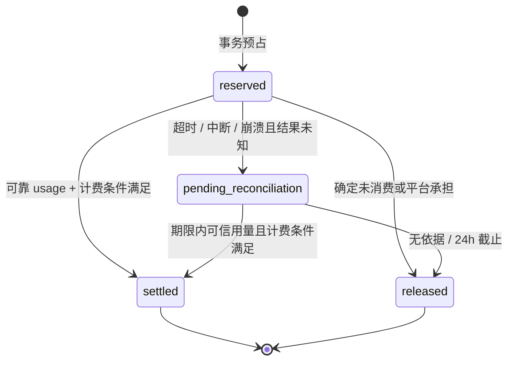
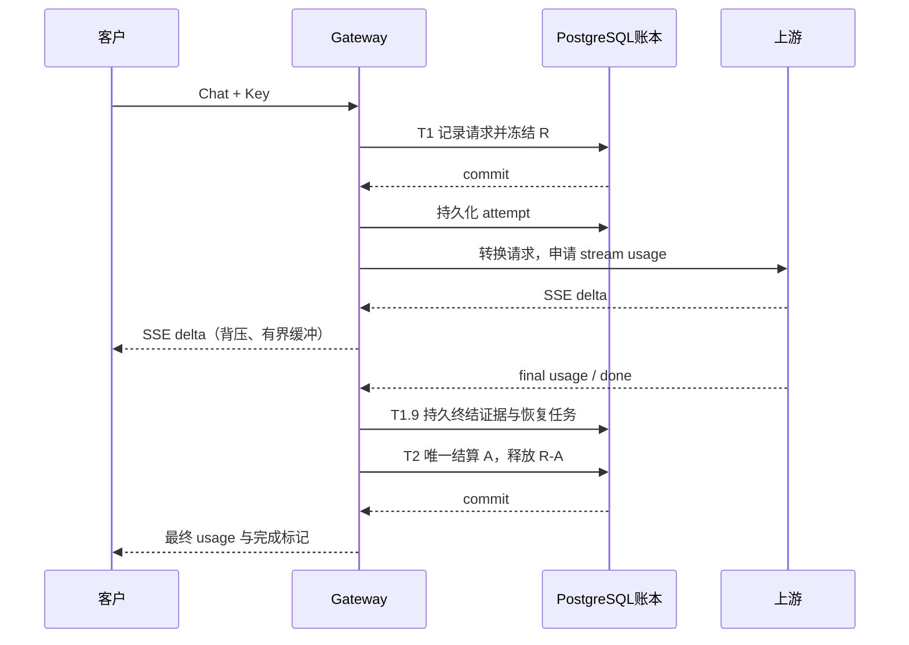
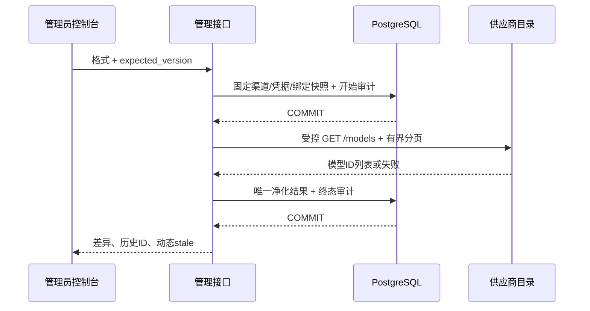

# LLD：moni-aigate 商业 API 网关

状态：r3 设计基线已获开发者同意，r5 实施对齐；目标版本：0.1.0-dev；基线日期：2026-10-30；最新修订：2026-11-04（采购当前指针、Usage与非单调墙钟校验）。实现与验收进度见[实施记录](../verification/implementation.md)，不代表生产发布验收通过。

## 1. 工程布局与模块依赖

实际目录（r4对齐）：

```text
cmd/moni-aigate/      启动、迁移/引导/维护CLI、实例保护、排空
internal/server/     HTTP鉴权/错误/分页、生成/检索协议生命周期编排与handlers
internal/identity/   用户、租户、成员、会话/MFA、Key生命周期
internal/catalog/    模型profile、不可变渠道/路由/售价版本
internal/billing/    同tx账本、核款/退款、预占/证据/结算/恢复/投影
internal/periodicbudget/ 周期预算领域、原public核验与无权威固定事实算法
internal/maintenancescan/ 独立维护集成，单向复用领域算法与真实ReadLease
internal/maintenancetrust/ Gate、私有Snapshot、Attest、Permit与ReadLease
internal/fundinglotcatalog/ 固定expected与同RR静态对象/权限证明
internal/provider/   Chat/Responses/Messages、SSE、无重放客户端、出口安全
internal/routing/    候选、优先级权重、容量、健康与attempt预算
internal/security/   bcrypt、HMAC、TOTP、身份绑定AES-GCM
internal/telemetry/  有界元数据异步日志
internal/operations/ DB角色、主密钥重包、实例保护、恢复门禁
migrations/          嵌入式checksum迁移与只读校验
web/                 Vue3/TS/Element Plus控制台与嵌入式静态资源
specs/001-commercial-mvp/contracts/  API/领域契约
scripts/ deploy/     备份恢复、Compose、反向代理示例
```

测试与对应包相邻，真实PG使用独立schema，真实HTTP/TCP上游均为本地Mock。本版用显式参数化pgx SQL而未引入sqlc，见[ADR-002](../decisions/ADR-002-implementation-refinements.md)。

Gateway编排依赖各领域接口；Provider不依赖Billing、数据库或HTTP handler。maintenancescan单向依赖billing/PB与maintenancetrust→catalog，普通领域/main及领域测试不反向依赖维护；领域raw-facts接口不授authority。跨领域写操作由明确的应用服务事务协调，避免多次“保存成功”拼成一个资金操作。

## 2. 公共接口与认证

| 接口 | 身份 | 语义 |
|---|---|---|
| `GET /v1/models` | 客户 API Key | 仅返回可用且获授权的逻辑模型 |
| `POST /v1/chat/completions` | 客户 API Key | 文本/基础工具调用，非流与 SSE；固定 `n=1` |
| `POST /v1/responses` | 客户 API Key | 无状态文本/基础函数工具，原生 JSON/SSE |
| `POST /v1/messages` | 客户 API Key | 文本/基础函数工具，原生 Messages JSON/SSE |
| `POST /api/auth/login`、`POST /api/auth/logout` | 管理/客户会话 | 安全 Cookie，会话轮换；登录限速 |
| `POST /api/auth/mfa/verify` | 待完成 MFA 的会话 | 已启用MFA的账号须完成第二因子；未绑定平台账号是否须先绑定由`MFA_ENFORCE_PLATFORM`决定 |
| `GET /api/me` | 会话 | 用户、有效租户和能力；租户切换须重新校验成员关系 |
| `GET/POST /api/keys`、`DELETE /api/keys/{id}` | 租户 owner/受限成员 | 创建一次性可见 Key、只读元数据、撤销 |
| `GET /api/wallet`、`GET /api/journals` | owner/billing viewer | 本租户可用、冻结、净入账与消费；游标分页 |
| `GET /api/requests`、`GET /api/requests/{id}` | 租户会话 | 本租户请求和收费状态，隐藏供应商秘密 |
| `GET /api/models`、`GET /api/prices` | 租户会话 | 能力/售价版本/生效时间 |
| `POST /api/platform/tenants` | 平台管理员 | 邀请开户，创建租户及 owner |
| `POST /api/platform/channels`、`PATCH .../{id}` | 平台管理员 | 平台渠道与凭据，返回值不含密钥 |
| `POST /api/platform/channels/{id}/probe` | 平台管理员 | 受相同出口安全策略约束的探测 |
| `PUT /api/platform/models/{id}/bindings` | 平台管理员 | 原子替换账号池映射，需配置 revision 防覆盖 |
| `POST /api/platform/price-versions` | 平台管理员 | 创建未来生效售价，不能原地修改生效版本 |
| `POST /api/platform/credits`、`POST .../{id}/approve` | 财务制单/审批 | 记录已核款充值，审批入账；不同账号 |
| `POST /api/platform/refunds`、`POST .../{id}/approve` | 财务制单/审批 | 退回平台钱包，绑定原结算及原因 |
| `POST /api/platform/reconciliations/{id}/resolve` | 财务操作员/审批员 | 申请有证据结算，或审批员直接释放；理由必填、完整审计 |
| `POST /api/platform/reconciliations/{id}/approve` | 不同财务审批账号 | 核对新增客户收费的证据并审批，仍受R与deadline约束 |
| `GET /health/live`、`GET /health/ready` | 探针 | live 与数据库/初始化 ready 分开 |
| `GET /metrics` | 仅运维网络 | 不公开租户信息或凭据 |

客户推理接受 `Authorization: Bearer ...`；Messages也可单独使用 `x-api-key`，两类同时提供、重复header或空凭据均拒绝。其他推理端点仍只接受Bearer，不支持 URL 参数放 Key。会话 Cookie 设置 `HttpOnly; Secure; SameSite=Lax`，写操作校验 CSRF 与 Origin。平台 API 与客户 Key 认证互不通用。

Key 验证返回内部结构化判定：`invalid/expired/revoked/forbidden/rate_limited/budget_exceeded/system_unavailable`，由传输层映射公开错误。前三类对外统一 401，权限 403，速率/并发 429，Key 花费预算不足 402 `key_budget_exceeded`，钱包不足 402 `insufficient_balance`，系统故障 503；不通过错误消息暴露某把 Key 是否存在。内部判定只记录非秘密 ID、阶段与原因，不记录提交的凭据。tenant_id 从验证结果注入，忽略客户端身份声明 header；追踪 header 也不能授予任何权限。

管理 API 成功返回 `{data, request_id, next_cursor?}`；错误返回 `{error:{code,message},request_id}`，不泄漏 SQL、供应商凭据。Chat/Responses推理错误遵循 `{error:{message,type,param,code}}`；Messages使用原生 `{type:"error",error:{type,message}}`。同时输出 `X-Request-ID`。典型状态：401 Key 无效，403 模型未授权，402 `insufficient_balance`，409 幂等冲突，429 并发/速率满额，503 无可用渠道/资金服务不可用。

`Idempotency-Key` 对入账/退款强制要求；推理可选。作用域为 `(tenant_id, operation, key)`；保存请求摘要。相同 key 不同摘要返回 409。推理同 key 已运行/已完成/结果未知统一返回 409 和原 request_id，**不自动再次生成，也不重播 SSE**；v0.1 不存完整回答以供重放。本版推理幂等记录不自动清理，持久保留；未来如引入TTL须先公开窗口与超期再次执行语义；资金单据的业务唯一键永久保留。请求摘要采用服务端 HMAC，避免对正文作可离线猜测的裸哈希。

## 3. 推理能力契约

- 支持文本 `messages`，基础 `tools/tool_calls`；拒绝媒体 content、远程文件抓取、`n != 1` 和未知计费扩展。
- 验证角色、消息长度、工具 schema 深度和 JSON 大小。请求体默认上限 1MiB；超限返回 413。
- `max_tokens` 或 `max_completion_tokens` 必须落在模型能力上限；两者同时出现时拒绝歧义；省略时按目录公布的默认值填入并约束上游。
- 路由候选须有同一逻辑模型、所需上下文与工具能力、usage 能力及允许地域。不得自动把高级模型换为不同质量档。
- 未知参数或当前 profile 无法兑现的参数在转发前明确拒绝；不得静默删除 tools、输出上限或改变计费的字段。逻辑模型别名只解析为已发布目录项，不解析客户端任意供应商/部署后缀。
- 有些供应商没有可靠 usage 或无法约束输出；这类模型 v0.1 不向付费客户开放。
- 首版按已确认 input/output Token 收费。cached input 是 input 子集，只记一次；不把 reasoning 字段与已包含它的 output 再叠加。各渠道 capability profile 明确字段映射，通过 fixture 确认后才能启用。

### 3.1 能力 profile 与工具调用边界

profile 按协议、供应商、endpoint、上游模型/版本发布，至少声明支持的参数集合、上下文规则、默认/最大输出、限制字段映射、计费维度、usage字段来源/累计语义、流终止条件及可信无消费拒绝分类；证据含官方约定和fixture版本。`GET /v1/models` 仍保持标准目录结构，扩展能力/限制在客户控制台和 `GET /api/models` 展示。兼容某个供应商的Chat接口不等于兼容其所有模型。

首版基础函数调用只处理客户端 `tools[].type=function`、`tool_choice`、assistant tool_calls与客户端回传的tool结果；网关不执行函数、不抓取URL、不自动开展下一轮生成。`parallel_tool_calls` 仅在profile声明支持时接受。托管web search/code execution/file search、按次收费内置工具、媒体及其隐藏费用不透传。工具schema和tool结果计入输入上界；工具参数增量属于输出，不能因没有自然语言文本就记为零输出；`finish_reason=tool_calls` 为一次合法生成终止。

### 3.2 用量的完整性与存在性

内部 usage 带 `status=confirmed_final|provisional|estimated|missing|conflicting`、profile版本和来源。先区分字段不存在/null与显式整数0；不能以 `tokens>0` 作为唯一有效性判断。仅完整、非负、未溢出且满足profile关系的 `confirmed_final` 可直接进入自动客户计价；cached≤input、reasoning≤output，total按该profile定义校验。只有中途累计量、互相矛盾的最终量或估算不当作最终账单，按§7处理。

OpenAI-compatible付费流在上游强制申请usage；客户端的 `stream_options.include_usage` 只控制下游是否附加usage chunk，不能关闭内部计量。省略/false时不额外发usage-only chunk，true且可信最终usage可用时在正常结束前恰好发送一次。缺失/冲突时不伪造0或估算chunk，按§9以billing_pending错误结束而不发成功DONE；上游协议完成与下游响应失败可以同时成立。累计快照替换而非相加；字段缺失的保留、显式零的替换也必须经profile确认，不用通用的“最大值/非零合并”猜账。估算可作诊断，不能作客户扣款证据。

## 4. 核心数据模型

下表为领域关系，实际字段、约束与trigger以[migrations](../../migrations/001_core.sql)以及后续002–006迁移为准。r4新增`session_families`、`delivery_observations`、`platform_probe_attempts`、`recovery_gate`、`route_binding_isolations`，006补充不可变attempt选路解释。恢复gate按epoch冻结提案并双人批准；明确模型配置错误只隔离精确渠道版本/上游模型，历史隔离不可修改，恢复需创建新版本并发布。实例接管先等待旧执行窗口，恢复只读进程可立即启动，退出恢复须重启后再按付费准入执行窗口检查。

所有金额为 `BIGINT` 微元（1 CNY = 1,000,000 微元），时间为 UTC `timestamptz`，前端按用户时区展示；数据库时钟决定价格生效和期限。JSON 中金额用十进制字符串，前端不能用 JS Number 运算资金。

| 表 | 核心字段 / 约束 |
|---|---|
| tenants | id, name, status；暂停后不接受新调用 |
| users / memberships | user_id, tenant_id, role, status；membership 复合唯一 |
| api_keys | id, tenant_id, owner_id, prefix, digest, scopes, expires_at, revoked_at, lifetime_limit, spent, held；tenant+owner 复合外键；spent/held 非负 |
| idempotency_records / recovery_jobs | tenant_id, operation, key, request_hmac, resource_id；唯一作用域；恢复任务独立认领并先提交，不能倒置资金锁顺序 |
| models / model_capability_versions | id, public_name 唯一, context_limit, output_limit, supported_features, enabled；请求保存能力版本 |
| tenant_model_grants / member_model_grants / key_model_grants | 显式授权；空集合拒绝，allow_all 须明确标志；Key 有效权限再受所属成员授权约束 |
| channels / channel_versions / channel_credentials | 平台域channel id及可变停用状态；不可变版本固定provider、base_url、network_profile、capability_profile、data_region、region_evidence_ref与credential_version引用；凭据存ciphertext/nonce/key_version及撤销状态，秘密不进快照/客户API |
| tenant_region_policies / key_region_policies | tenant_id、key_id、allowed_regions、revision；平台最大地域集合内再收紧，下层未配置表示继承，显式空集合表示拒绝；成员限制首版仅模型授权 |
| model_bindings | route_policy_version_id, model_id, channel_id, channel_version_id, upstream_model, priority, weight, max_inflight；随策略版本不可变，版本内候选唯一 |
| route_policy_versions / active_route_policies | model_id, revision, max_attempts, total_timeout_ms, retry_after_cap_ms, allowed_regions；不可变版本；活动指针以expected revision原子切换 |
| price_versions | id, model_id, currency, input_rate, output_rate, effective_at, created_by；单价为微元/百万 Token；同模型+生效时间唯一；记录不可修改 |
| cost_versions | id, channel_id, upstream_model, input_rate, output_rate, basis, effective_at；首版仅 CNY 成本，未知不记零 |
| ledger_accounts | id, tenant_id（客户账户）, kind, balance；客户 AVAILABLE/HELD 非负；平台账户显式属于平台域 |
| journals / journal_lines | kind, reference, idempotency_key, actor；每笔 line 有 account_id 与 signed_delta；同币种总和为 0；已提交后不可修改/删除 |
| reservations | id, tenant_id, request_id, amount, status, deadline, price_version_id；每请求最多一个预占；amount 非负 |
| request_records | id, tenant_id, key_id, model_id, snapshot_ids, status, protocol_outcome, transport_end_reason, delivery_stage, finish_reason, billing_status, request_hmac, policy_version, timestamps（accepted/first_byte/first_content/end）；tenant+key 复合外键 |
| upstream_attempts | id, request_id, tenant_id, sequence, channel_id, delivery_state, result, usage, cost_version_id, cost_snapshot, cost_basis, cost_status；request+sequence 唯一 |
| metering_events / finalization_records | event身份/来源/schema/request/attempt/发生与接收时间、usage状态/规范量及evidence_ref；终结记录固定协议/传输/本地写入事实和billing_policy版本，关联恢复任务；只保存最终/异常/修正事实，不逐Token写库 |
| projection_outbox / projection_receipts | event_id, tenant_id, operation_id, kind, schema_version, sanitized_payload, created_at；与资金事务同写；消费回执以(consumer,event_id)唯一，投影更新与回执同事务 |
| settlements | id, request_id, tenant_id, usage_snapshot, raw_retail_amount, charged_amount, waived_retail_amount, refunded_amount, basis；每请求唯一，退款累计封顶 |
| credit_orders / refund_orders | tenant_id, business_ref, amount, state, requester, approver, proof_ref, journal_id；业务号唯一、申请人不可审批 |
| reconciliation_cases | request_id, reason, evidence_ref, deadline, proposed_usage, requester, approver, resolution；每请求最多一个活动核对项 |
| audit_events | actor, tenant_scope, action, target, sanitized_diff, request_id, created_at；应用角色只追加 |

跨租户关系通过 `(tenant_id,id)` 唯一键与复合外键保证，例如 `request_records(tenant_id,key_id)` 指向 `api_keys(tenant_id,id)`。平台共享渠道通过单独的模型绑定引用，不借用“tenant_id 为空”等于全局可见的隐式规则。所有客户查询仍必须带有效 tenant_id；外键不能替代查询授权。

建议索引：请求 `(tenant_id, created_at DESC, id)`；尝试 `(request_id, sequence)`；未完结预占 `(status, deadline)`；流水 `(tenant_id, created_at DESC, id)`；审计 `(target_type,target_id,created_at)`。模型、渠道、价格和流水历史使用停用/版本化，不级联删除财务引用。

## 5. 资金模型与计价

### 5.1 内部平衡流水

采用平衡的业务账本：每笔 journal 的 `signed_delta` 总和等于 0，不代表已接入法定会计总账。余额缓存与分录在同一事务更新；数据库约束触发器在提交时校验平衡，只允许经受控账本写入口追加。应用角色不能 UPDATE/DELETE 已提交分录。

| 事件 | 分录（单位：微元） |
|---|---|
| 人工收款审批入账 X | 客户 AVAILABLE +X；平台 FUNDING_CLEARING -X |
| 冻结 R | 客户 AVAILABLE -R；客户 HELD +R |
| 消费 A 并释放剩余 | 客户 HELD -R；平台 REVENUE +A；客户 AVAILABLE +(R-A) |
| 全部释放 | 客户 HELD -R；客户 AVAILABLE +R |
| 退回钱包 F | 平台 REVENUE -F；客户 AVAILABLE +F |

客户账户不能为负；平台清算/收益账户允许相应方向余额，不能把所有账户统一做“余额非负”校验。供应商成本不直接修改客户钱包。

不变量：

1. 客户可用/冻结余额非负；所有已提交分录按 journal 与币种平衡。
2. 余额投影等于分录合计，日核对发现差异必须报警；不能静默修余额。
3. 一个 request 只有一个最终客户 settlement；一个 reservation 最终只消费或释放一次。
4. 理论零售费用为 A_raw，实际客户收费 A=min(A_raw,R)；豁免的零售差额 W=A_raw-A 独立记录，不作为供应商成本。供应商成本 C 始终按渠道计量独立记录。越界触发模型暂停/核对。
5. 累计消费退款不超过原消费额；充值重复审批不重复增款。
6. Key 的 `spent + held <= lifetime_limit`（配置上限时），与钱包预占/结算同事务；多个 Key 共享同一租户钱包不能各花完整余额。spent 为原始收费累计，退款不自动恢复 Key lifetime 上限，钱包退款仍可由其他有额度的 Key 使用。

### 5.2 金额精度与价格快照

单价单位为微元/百万 Token：

```text
amount_micro = ceil((input_tokens * input_rate + output_tokens * output_rate) / 1_000_000)
```

对整次请求合并后向上取整一次，避免每 SSE 分片取整。乘加用带溢出检查的整数或大整数，最终验证 BIGINT 范围；金额/Token 必须非负。例：input_rate=2,000,000、output_rate=8,000,000，input=1,000、output=500，结果为 6,000 微元，即 ¥0.006。

请求在预占事务按 DB 当前时间选中最新生效售价，保存价格 ID 与完整数值快照。上下文上限、默认输出限制、计费政策同样版本化。跨日、改价、渠道切换都不得改变历史快照。

### 5.3 预占上界

`R` 用输入 Token 的**可证明上界**与受控输出上限计算。能验证精确计量的渠道使用对应 Token 规则；只提供近似 tokenizer 时不能把估计值当硬上界。缺少独立输入强制上限时，使用供应商确认的完整上下文窗口作为输入界，不用`context-最大输出`推断。输入/输出独立最大值各不超过context，二者最大值的和可以大于共享context；`R`据此保守过预占，最终按实际可信量结算，见[004](../../specs/004-conservative-bounds/spec.md)。代价是冻结较多余额和更易拒绝请求；前端说明冻结与实际消费的差异。

这里的严格预占是moni的产品选择，不等同New API的估算预扣/授信策略。profile必须给出包含messages、工具定义和协议开销的输入边界及全部计费输出约束；共享上下文窗口与独立input/output上限分开建模，不能将上下文窗口误认为默认输出额度。目录发布 `reservation_strategy`、默认/最大输出和冻结说明；运营需评估保守冻结导致的小余额拒绝率，不能以近似tokenizer“优化”掉资金边界。失败响应不向普通推理Key泄漏整个租户钱包金额。

输出可能包含推理 Token，必须确认渠道对 max_completion_tokens 等参数的约束覆盖全部计费输出。没有可靠上界/usage 契约的模型不开放收费。若异常 usage 超出上界，计算 A_raw 并将客户收费封顶 R，记录零售豁免差额 W、告警并停用该 profile，不临时从其他可用余额追扣。供应商成本 C 独立计算；不能把 W 加到 C 上再算一次亏损。

## 6. 原子事务协议

### T0：人工入账

锁定 credit_order → 确认待审批、真实业务号唯一、审批人不同且有角色 → 锁定相关 ledger_accounts（account_id 排序）→ 写平衡 journal 与余额 → 单据标记 approved 并引用 journal → 写审计 → commit。重放返回原结果；同业务号不同金额报冲突。凭证仅存受控引用，不在普通日志里存财务附件。

### T1：接受并预占

校验请求/授权并取得平台/租户/Key并发许可；生成 request_id，读取路由配置快照。在短事务内：

1. 先用唯一键插入/认领幂等业务根；冲突时检查摘要与原请求，不重新派发。之后按固定顺序锁定 tenant、membership、Key；重新验证停用/撤销/到期、有效授权与版本。
2. 固定生效售价和能力版本，计算 R；按 account_id 排序锁定账户。
3. 验证 AVAILABLE≥R、Key spent+held+R≤limit；失败不创建上游尝试。
4. 创建 request、reservation、冻结 journal及对应projection_outbox，增加 Key held；提交。

锁顺序统一为：本操作业务根（幂等记录/核款单/退款单）→ tenant → membership → api_key → model → channel → credential → reservation → settlement → ledger_accounts；同类多行按ID排序。不涉及的层跳过，T0/T3 也沿用该顺序，不得先锁账户再取业务根。策略收紧/停用操作沿用相同对象锁序，不在取得channel锁后反取tenant锁。资金 journal 使用唯一事件键作为最终幂等保护。死锁有限次重试仅发生于数据库事务，不能因此重复发上游。

所有资金/预算/审计/outbox helper 显式接收同一个 `pgx.Tx`，事务内禁止另取全局pool开启独立写事务或异步提交余额。`settlement`尚不存在时不能靠锁不存在的行去重，须先锁现有reservation并使用request唯一约束。数据库角色和独立迁移角色分开；消费者的只读资金权限通过独立连接角色落实，不能仅靠Go接口约定。租户/平台账户行会串行化部分写入，容量验收需报告锁等待和事务耗时。

授权子表的增删与派发检查共享父行同步点：租户模型授权/地域/停用锁tenant，成员状态/模型授权锁membership，Key scope/地域/撤销锁api_key，平台模型限制/当前能力指针锁model，渠道/凭据停用锁对应channel/credential。先锁父行再读/改子表，空授权集合也不例外；多对象按统一顺序。派发查权只读主库并以DB时钟检查过期，不能用SWR缓存或只读副本代替。锁超时/权限查询error均拒绝派发。

T1/T1.5固定使用 `READ COMMITTED`：派发先按序取得父行 `FOR SHARE`，**取得锁后的后续SQL语句**再读取grants/有效策略；变更端先取得同一父行 `FOR UPDATE` 再改子表，不能也用兼容的SHARE锁。不得在REPEATABLE READ旧快照中等待后沿用旧授权；若未来改隔离级别须重做撤销竞态证明。

### T1.5：尝试边界

向上游发送前，先持久化 attempt（`delivery_state=prepared`），固定该渠道的成本版本、数值快照与计量来源。在短事务内按统一顺序检查当前租户/成员/Key状态与权限收回，再检查model/channel/credential停用和地域/出口限制收紧；相关有效状态行持有 `FOR SHARE` 锁至提交，撤销/收紧必须更新或锁定同一对象状态行，不能只靠无锁快照。租户/Key地域变更分别锁tenant/Key，平台/模型地域收紧锁受影响model行。成功后标记 `sending` 并提交；提交后才调用网络。该检查是本次attempt的派发准入点：撤销先提交则禁止派发，撤销后提交不能保证取消已获准的网络调用。数据库与上游不共享事务，不承诺“撤销按钮后绝无任何在途请求”。

首attempt在准入点被拒且本进程能证明尚未发上游时，走T2释放冻结并返回相应认证/授权/不可用错误；之前若已尝试，仍按已有usage和消费证据处理，不因撤销抹掉费用。每次尝试独立固定成本版本，调价/换渠道不能覆盖历史；供应商最终账单用附加核对记录修正，不改原合同快照。发送过程的确定性证明只用于当前活进程的传输结果；崩溃后 prepared/sending 不得推定“从未发送”。上游调用不在数据库事务内。

### T1.9：持久化终结依据

上游结束后，以短事务幂等保存最终/异常usage证据、协议终态、传输原因、本地已写内容/提交阶段及恢复任务，再执行T2；允许已存在同一证据时直接引用。它只保存事实，不更新钱包。T2失败/进程在两阶段间退出时Worker可根据已持久事实重试结算，不重发上游。若证据事务失败，只能保留预占并进入恢复/核对；崩溃前未落库的最终usage仍可能丢失，不能承诺恢复所有外部事实。

终结证据不是预先批准收费。T1记录客户请求的剩余deadline（与24h资金截止分开）；T2取得资金锁后重新裁决当前终止原因和资金期限。单实例Worker不接管仍在本进程活动表中的请求；请求退出/旧启动实例遗留后按恢复模式处理。终结证据追加、活请求终态更新和T2裁决均经相同reservation行同步，不能无锁改写一个已据此收费的结果。

### T2：结算 / 释放

按统一顺序锁定 tenant、membership、Key、reservation、settlement 与账户，验证 reservation 尚未终结；按固定收费政策裁决T1.9证据及当前活请求/恢复模式，插入唯一 settlement并引用usage，写journal与余额；Key held 减 R、spent 加 A；reservation 标终态；更新 request.billing_status；commit。成员或Key已停用不阻止此前已接受请求结算。重复执行只返回现有结果。

正常活请求可在完整响应已校验、最终量可信且T2决策检查时尚未超请求deadline时收费；该决策提交后不因后续网络失败自动反转。若T2决策前已因平台超时失败且无有效输出，只释放；恢复模式下即使有completed证据，若尚无settlement且证据明确为无有效输出，也按平台中断免收，不替一个已经消失的非流请求补收生成费用。部分输出/客户主动取消则继续按§7.1裁决；交付事实不明保留核对，不凭completed标记猜测。T2已提交但确认丢失时先查询原settlement，绝不能误当未结算免收或再扣。

所有自动及人工结算都必须在取得资金行锁后、写分录前以数据库 `clock_timestamp()` 检查 deadline，不能只依赖 Worker 是否按时运行。本版以**实际结算事务的截止判定时刻**为准：到期尚未结算时只能释放客户冻结，后到 usage 仅修正平台成本；不存在“Worker停机所以延长客户冻结”的例外。结算与释放并发时通过相同行锁/终态条件保证只有一方生效；已在期限前合法结算的记录不因后来到期而自动退款。

资金事实在同一事务提交；控制台统计可以异步投影。连接失败/数据库提交结果未知时先查询 request 唯一 settlement，不盲目重做扣款。任何事务失败均回滚，不许部分更新后继续上游转发。

### T2.1：计量身份与统计投影

`metering_events` 是结算证据，不是 trace：采用内部 `source` 和有命名空间的 `source_event_id`，同时保留发生时间与接收时间，关联 request/attempt 和 schema 版本。供应商没有事件 ID 时，内部按 attempt 与事件语义分配稳定 ID；最终 usage 是累计量则不得把重复累计快照相加。相同身份不同内容进入冲突核对，不能覆盖原证据。首版只接收本进程受信适配器/核对流程的事件，不信任客户声明的用量或金额。

数据库对 `(tenant_id,source,source_event_id)` 去重；outbox另以 `(operation_id,kind)` 唯一并分配稳定event_id，不能把schema升级当新收费事件。每次真实成本更正使用新的业务operation并关联原事实；相同operation/kind不同payload报冲突，不静默覆盖。consumer回执与投影更新同事务，不得先标记消费成功再更新统计。

T2 在资金事务中关联所用持久证据，保存settlement和projection_outbox；T0/T1/T3 也在对应事务写出已提交业务事实，覆盖入账、冻结、结算/释放和退款。进入报表的供应商成本/修正等非资金事实也与对应持久化同事务写待投影事件。metering event_id、attempt_id、资金 operation/idempotency key 各司其职，事件去重到期不能解除资金永久唯一约束。迟到事件仍受 T2 截止政策限制；供应商成本更正追加并引用原 attempt/成本事实，不改原合同快照。

证据本身也用字段白名单：标准化usage、供应商请求/账单标识、计量来源、校验信息及受控财务凭证引用；不保存推理正文、明文凭据、完整URL、原始headers或上游错误body，不能借evidence_ref绕过隐私边界。线下收款凭证另按财务角色与留存策略受控存储，不向普通请求日志/客户视图公开。

Worker 至少一次处理 outbox，按 `(consumer,event_id)` 在投影更新事务内去重；进程在更新后崩溃再处理也不重复累计。钱包可用/冻结和交易详情始终读同步账本/业务事实，不能用延迟统计决定准入或显示权威余额。outbox中的最小报表事实按相应财务保留期保存，不能在发送成功后删除，也不随30天请求诊断记录清理；保留范围内可完整重放，保留期之外不承诺恢复已删除明细。

首版只提供维护窗口内的离线全量重建：统一维护门禁暂停所有资金及报表源事实写入口/Worker，停止新收费调用并排空在途写入；确认门禁后从保留的已提交事件建立新投影版本/consumer命名空间，不复用旧回执。校验聚合与账本一致后事务切换活动投影，再恢复写入口及消费者。重建期间新调用明确503，不声称在线无停机；失败保持旧投影并恢复服务，不能半切换。恢复后新事件进入新consumer，包含重建完成后才提交的迟到成本/核对事实。

报表消费者无资金写权限，不能经重放调用预占/结算或重发上游。首版 outbox 只服务内部统计投影；未来外部通知从已提交事实发送并独立幂等，不在本版增加通知产品或消息中间件。

### T3：消费退款

先锁退款单，再按统一顺序锁原 settlement 与账户；验证累计 refund+F≤charge，审批人不同；追加退款 journal、更新 refunded_amount/退款单并写审计。退款释放为可用钱包金额；已消费历史不删除，净消费由消费减退款得到。

### 崩溃与数据库故障

预占前崩溃无消费；预占后、上游阶段崩溃一律恢复为待核对，不自动重发。由于请求发送与数据库无法共同提交，v0.1 不承诺 exactly-once 上游执行。恢复 Worker 可在独立短事务中用 `FOR UPDATE SKIP LOCKED` 认领任务，然后先提交释放认领锁，再按统一顺序执行 T2；不得持 reservation 行锁回头获取 tenant/Key 锁。认领超时只允许重新处理任务，不意味着可释放资金或重发上游；金额正确性依赖行锁/唯一约束，与 Worker 是否重复运行无关。

已有流产生usage：若T1.9已提交，T2失败可由持久任务继续处理；若证据尚未提交就崩溃且供应商不支持查询，精确usage仍可能丢失。有限重试并告警，保留持久预占和核对期限。结算/证据清理使用独立、最长5秒的后台context，不复用已取消的客户context；超时交给持久Worker，不能无限挂住连接或丢弃预占。正常响应最终完成标记仍受请求剩余deadline约束，超时后不再给客户伪造成功。

## 7. 请求、尝试和财务状态机

三个维度分开：

| 维度 | 状态 |
|---|---|
| 请求 | accepted → dispatching → streaming（可选）→ succeeded / failed / cancelled |
| 尝试 | prepared → sending → rejected_no_consumption / completed_known_usage / failed_known_usage / unknown |
| 资金 | reserved → settled / released / pending_reconciliation → settled / released |



客户收费由独立的版本化政策裁决，不能由HTTP200、是否收到[DONE]或某个error字段直接决定。下表是本轮校准后的**r3 收费政策基线**，供应商成本始终独立记账。

### 7.1 协议、交付与收费矩阵

`protocol_outcome`、`transport_end_reason`、`usage.status`、`delivery_stage`分别保存。delivery只描述网关观察到的Write/Flush进展，不证明客户应用实际收到；write错误也不能证明对端收到0字节。“有效内容”包括文本/拒绝说明及tool call增量，不包括心跳、role-only和usage-only事件。

| 情形 | 请求/协议结果 | 客户资金处理 |
|---|---|---|
| 正常stop、length或tool_calls终止，最终usage可信 | completed，保留finish_reason；不自动续写/执行工具 | 按固定售价结算≤R；length不是免费失败 |
| 合法content_filter/refusal终止且最终usage可信 | 记录业务拒绝，不算渠道健康故障 | 按公布的已消耗Token收费；不得承诺回答一定有用 |
| 上游/平台失败，计费责任点前尚未写出有效内容 | failed；只有心跳或role不算有效输出 | 客户免收并释放；供应商成本未知时仅成本侧待核对 |
| 已写出部分有效内容，随后上游错误/平台超时，最终usage可信 | failed/partial，不能伪装完整成功 | 按可信usage结算；平台故障补偿另走可追溯退款，不静默删账 |
| 客户取消且最终usage可信（包括尚无输出） | cancelled，已生成部分仍有成本 | 按可信usage结算；取消不证明未消费 |
| 部分输出/客户取消/正常结束但缺少可信最终usage | partial/cancelled或协议已结束、账单待核对 | 保留冻结待证据；不按估算、临时累计量或R扣款，仍受24h截止 |
| 非流完整有界响应已校验，T2提交后下游写失败；或流T2提交后末尾标记写失败 | delivery_failed/unknown，可与protocol completed并存 | 保留已提交收费，不自动重生成/冲正；客户争议走原消费退款流程 |
| T1.9后、T2前平台超时/崩溃，尚无settlement且证据明确无有效输出 | 生成可能完成，但平台交付中断 | 恢复模式免收并释放，不只凭completed自动收费；部分/不明交付按前述规则处理 |

非流计费责任点为完整响应已校验并完成T2；正常流为协议及最终usage已确认并完成T2。T2与网络交付不能原子提交：不能宣称“保证收到答案才扣款”，也不能因最后一次write失败自动退款。责任点前的无输出失败优先免收，不能再按“未知usage一律冻结”覆盖它；进程崩溃后无法确认本地交付事实的情况仍待核对。上述客户体验/平台风险取舍须随收费条款确认。

待核对默认期限从accepted_at起24小时，不因重试Worker重置。资金截止判定时尚未结算则一律释放，即使可信usage早已保存、只是Worker延后；按原因标记 `released_unverifiable` 或 `released_deadline`。后到供应商费用仅修正平台成本，不能自动再扣客户。重复取消/未知用量滥用触发人工风控或停用Key；不能靠不透明收费防滥用。

人工核对如会新增客户收费，必须申请/复核分离：保存可信usage证据和提案，由不同财务账号批准后进入T2，仍遵守截止时间和收费上界。释放未消费冻结不增加客户净入账，可由审批员带理由执行；已经结算的退款仍走T3双人审批，不能用resolve绕过退款流程。

## 8. 路由、健康与重试

候选过滤顺序：模型授权 → 能力/地域/usage profile 匹配 → binding/channel 启用 → 熔断/健康 → 可用并发。每次从尚未尝试的有效候选选择最高优先级池，在池内按正权重随机；主池无剩余候选才降至下一优先级。请求保存route_revision，attempt关联不可变binding的priority/weight与channel/credential版本，平台可查询实际尝试及每个已准入attempt的候选选择/排除理由。未准入attempt的完整失败池解释仍未持久化，旧attempt不补造历史理由；该解释面为部分完成。全部无可用候选快速返回503，不无限排队；不能为了满足重试次数重用已尝试channel。

首版每请求最多两次尝试，第二次只能选择同逻辑模型兼容候选。以下可重试：传输能证明 HTTP 请求未写出；或渠道契约明确该错误为未处理、无消费（如已验证的限流拒绝）。普通 5xx、发送后读超时、连接重置、未知消费默认不可透明重试；“没收到首个字节”不足以证明安全。

attempt预算覆盖Gateway、适配器、SDK、HTTP客户端和外层反向代理，不能每层各重试两次。首版生成POST使用无自动重放的客户端配置，禁用SDK/Transport可配置的隐式重试、重定向与代理重试；不透传客户 `Idempotency-Key` 使底层擅自将生成POST视为可重试。每次重新派发生成请求都先取得统一attempt额度并持久化；拨号失败数另计，不把一次拨号等同一次供应商消费。必须用真实HTTP Mock与失效连接池回归核实库实际行为，不能仅检查配置名。

策略配置独立版本化，首版持久契约为 `route_policy={model_id, revision, bindings[]}`。运行限制固定为 `max_attempts=2,total_timeout_ms=300000,retry_after_cap_ms=2000`，尚无逐策略修改这些限制的入口；binding保存priority、weight、channel_id与并发上限。允许重试的状态码集合必须与已验证渠道profile的“无消费拒绝”集合取交集，不能让管理员任填5xx就绕过资金安全。请求保留 `attempted_channel_ids` 防止同一逻辑调用循环fallback；重试等待遵守总deadline和ctx取消。不实现递归策略DSL或任意脚本插件。

配置发布遵循“完整构建→校验→持久不可变版本→CAS切换活动指针”。校验拒绝空候选、重复channel（即使upstream_model不同也不允许）、悬空引用、非正权重/并发、非法超时和能力/地域不匹配；旧 revision 并发提交返回409。停服通过显式模型/channel状态完成，不发布空池代替停服。读取者只获取一个完整 revision；该版本引用不可变channel_version，固定endpoint、provider、地域、profile及credential版本引用，不能在下次attempt临时读取新的base_url；凭据值不入快照。更新渠道需要新建版本并发布引用它的新策略，旧引用在在途请求结束前保留，但撤销凭据可立即阻止后续准入。历史配置回滚也需重新校验并发布新 revision，不能绕过当前安全限制。

硬约束为平台限制∩租户限制∩成员/Key授权∩模型能力/地域，先过滤再按优先级/权重选择；性能排序是偏好，不能让不可授权的候选因更快而复活。每次 attempt 再检查紧急停用/撤销与约束收紧，不能沿用旧快照绕过安全收回；中途新增授权或新候选不扩展当前请求快照。新请求Key撤销即拒绝；已接受请求的Key撤销默认不终止已有流，但后续attempt不再派发，按既有计费规则结束。运行时健康与容量是可变准入状态，不修改已发布策略历史。

地域候选取平台/模型策略、租户地域策略、Key可选收紧集合的交集，再匹配channel_version的已核实data_region；成员仅通过模型授权限制，不暗示首版已有成员地域配置。地域未核实的endpoint不得用于有地域要求的请求；无地域限定也不代表零留存或存储/处理都在该地。平台登记供应商处理地域声明、endpoint及处理/留存约定的证据来源，不能根据域名/IP推断或靠字符串标签提供合同保证。出口安全检查取快照限制与当前限制交集，配置放宽不扩大在途调用权限。

有请求体写出后就保守视为可能被处理，除非渠道契约给出可信拒绝证据。已经向下游写出 SSE 绝不透明重试。安全重试的已知失败不向客户收费；供应商若另有费用仍记平台成本。

基础健康采用 `closed/open/half_open/quarantined`：连续3次可归因渠道的网络/服务故障后open 30秒，半开仅授予一个受正常收费准入保护的请求；可信成功关闭，可归因渠道故障重新打开，中性结果（客户取消/慢读、本地拒绝等）仅归还半开令牌并保持half_open，不加故障数。显式probe独立低频执行并记录平台成本，不重放客户请求。401/403只有规范化原因为供应商凭据失效/权限配置错误时才隔离相关credential/channel，不能仅凭状态码禁掉整个供应商；429区分速率冷却和余额/额度耗尽。业务拒绝、上下文超限、客户取消/慢读、本地余额/并发拒绝不计为渠道故障。健康动作与是否安全重试是两套判定，熔断不授予重放权。

同一channel的不同模型可分别记录能力/失败；凭据失效作用于凭据，模型不存在或上下文错误作用于binding/profile。首版以明确错误分类与作用域为准，不引入未经验证的全局成功率自适应。模型/凭据隔离在重启时不得因内存熔断窗口重置自动解除；短暂open/cooldown可重置，运营隔离状态须持久化并审计恢复。

依赖失败矩阵：权限/撤销/有效配置查询、凭据解密、资金服务不可用均503且不派发；明确权限拒绝403、余额/Key预算不足402、RPM/并发超限429。RPM/并发实现自身error返回503，不能按“没有限额”放行；单实例窗口重启重置不属于依赖error。日志/指标失败仅有界丢弃并计数。必须在实际调用者验证这些分支，不能仅因某个限流函数fail-closed就认为HTTP入口也fail-closed。

RPM 与并发按平台/租户/Key/渠道分层。先检查速率再取平台/租户/Key许可，满额直接429且不预占。T1提交后选中账号并取得渠道许可；若全部渠道无容量且尚未发送，走T2释放冻结并503；不能把渠道稍后满额的情况假装成没有发生过预占。安全重试更换渠道时释放原渠道许可，再获取新渠道许可。按固定顺序取许可，失败释放已取许可；请求最终结束释放一次。撤销 Key 在T1与每个attempt派发准入点查数据库，v0.1 不缓存 Key 有效性；阻断新请求和尚未获准的attempt，已有流默认继续并结算。成员停用/移除或收回模型授权同样在T1和派发准入点重新校验；既有账单保留成员快照，不因移除成员级联删除 Key/结算历史。主动中断既有流的紧急管理动作后置，不在首版暗示存在该入口。

## 9. 流式协议与超时



适配器按SSE event增量解析，不假设TCP读取或单data行是一条JSON；支持UTF-8字符/前缀/分隔符跨读取、LF/CRLF/CR、注释、多data行与多event同读。单个完整/未完整event都≤1MiB，超限中止、标记协议异常，不能像观测framer那样丢掉超限事件后继续当完整计量。上游响应头≤32KiB，非流响应解压后≤8MiB；超限在普通JSON成功响应之前拒绝，输出缓冲有界。上游压缩也按解压后字节计限；不缓存整条流式回答。

只有profile规定的终止条件成立才标记协议completed，`[DONE]`不是usage；裸EOF、尾部残缺JSON、流内error以及终止后error都不能合成正常成功。[DONE]后不再读取为新生成；若此前已有error，marker不能洗掉错误。usage-only事件 `choices=[]` 不丢弃，早到usage不代表后续不会出错。保留语义finish与传输终止两个事实，严格profile所需终止/最终usage缺失时进入对应失败/核对路径。

先取得并验证可转发的上游事件再提交下游SSE；首个事件前不预发200、心跳或flush headers。`downstream_committed` 在headers实际提交或任意body写出时置位，包括role-only或心跳；它不是TTFT。提交后不透明重试、不改HTTP状态；流内只发送契约化的通用error事件后关闭且不发成功[DONE]，不追加第二段JSON。确实无法写出错误时直接关闭，用X-Request-ID/账单查询定位。usage返回偏好见§3.2。

默认connect 5s、首个有效协议事件60s、上游字节idle 60s、无有效协议进展60s、总时长300s；每次下游Write/Flush限10s且不得越过总deadline。总时限从网关接收并开始处理请求起覆盖鉴权/预占、全部attempt、等待、响应读取和客户端写入；每步取剩余预算，不因换渠道重置。注释/心跳可证明连接活跃，但不延长有效进展时限或总deadline。DB短事务配置语句/锁超时并受剩余预算约束，超时只重试DB事务，不重发生成请求。HTTP server和反向代理需配合，不统一用过短WriteTimeout；清理/核对的独立5s context不是延长客户请求时限的通道。

计时口径：首协议事件可为合法role/content/tool/usage/terminal/error对象，注释或空event不算；有效进展计时器仅由非空文本/拒绝说明、真实tool增量，或profile确认发生前进的累计usage重置。重复usage、role-only、空chunk、心跳均不重置；usage-only不记TTFT。terminal/error直接进入终结，不用来延长等待。持续role-only流即使连接不断有字节，也必须在无有效进展期限结束。

正常完成先处理最终 usage 与结算，再发送末尾完成标记；若资金库故障，流中不能再改成普通 JSON 500，应使用支持的流式错误或结束连接，并用 request_id 标识“收费核对中”。应用不能在失败结算时凭空重发上游。

客户端断开立即传播取消、关闭上游body，等待已启动的读取/写入协程退出，再释放本地许可一次；已取得的可信最终usage仍按§7结算，临时累计量/估算不当作最终量。取消不证明供应商没有消费，也不保证供应商立即停止计费。首版不为追usage在断连后继续完整生成；若供应商支持账单查询，走独立核对。异步清理不能捕获已被Gin复用的Context；Worker只接收不可变ID/值，不持请求对象。

指标区分客户端首字节TTFB、首个有效文本/工具delta的TTFT和总时长；心跳、role-only事件和空chunk不能算有效内容。按请求与attempt分别记时，未来自适应调度可据此评估，不把供应商首chunk直接当首Token。

性能迭代将上述客户端首有效内容事件明确命名为TTFC；它可作协议层TTFT的操作口径，但不等于模型内部tokenizer计时。本地旧容量报告只测首正文byte。v2分别识别完整有用事件，逐请求扣除mock等待后再聚合；对照版本、公式、派发前观测/优化不变量见 [性能LLD补充](../../specs/002-performance-parity/plan.md)。

### 9.1 观测字段、资源上限与资金隔离

日志/指标使用字段白名单：request_id、attempt_id、阶段、非秘密版本ID、状态/内部错误码、耗时和Token统计；租户/Key标识只进入授权日志查询，不作Prometheus高基数标签。禁止自动附加body、完整headers、供应商错误正文或完整URL。对需展示的endpoint只输出受控channel_id；诊断URL经过统一净化，遮盖query、fragment、userinfo和可能含秘密的路径，解析失败也不得回退输出原串。嵌套错误与大小写/重复query须使用相同策略。

资金分录、结算usage证据、核款/退款及成功敏感业务变更的审计100%持久化，不受观测采样影响；管理/权限/资金变更与审计同事务，无法持久审计则不提交变更。登录失败、恶意请求拒绝等安全信号使用独立有界日志/计数，不承诺DB全故障时仍逐条永久保存；丢弃/故障计数可见，不能把这类信号与财务审计混为一谈。首版不做trace采样或外部导出；后续引入时，同request的所有attempt共享稳定采样决定与版本，采样率0也不能删财务证据。

日志默认单条净化后≤16KiB、字符串字段≤2KiB；队列同时限制≤1,024条与≤8MiB，先净化再截断普通文本字段，仍超限则整条丢弃并计数，不截断/降级财务事实。单writer隔离，支持deadline的sink设100ms写超时；不支持deadline的stdout管道仍只用一个独立writer，阻塞时队列满即丢弃，不能不断创建新写协程。首版可下调限额，扩大上限需容量验证。生产者不在SSE热路径等待外部日志；审计和财务走持久事务，数据库资金故障仍按fail-closed处理。

公共错误响应是第三个独立出口，不能以“关闭日志/正文trace”代替：只输出本地错误码、通用消息、受控param和request_id；不透传供应商error body、URL、stack、headers或原始exception/status描述。上游headers不批量复制，响应仅允许本地Content-Type/Cache-Control/X-Request-ID及验证过的Retry-After等契约字段；Set-Cookie/Location/认证头/任意供应商调试头均不透传。客户端headers同样按名单构造，客户Key、Cookie、tenant header与内部运营凭据不能送往供应商。

### 9.2 后续路由实验门槛（不在首版）

同模型自适应策略先在不影响真实选择的影子模式评估，再对照确定性基线小流量验证；注明测量点、冷启动、样本老化和探索上限。跨模型语义路由须另建显式 `auto` SKU和公布计价规则，selector只提候选，商业准入仍有最终否决权。使用经授权的数据集，按任务、多轮、工具场景分层，校准/验证样本分离；记录数据集、模型对、路由器、阈值与策略版本，并比较质量、全程延迟、客户费用及平台全部成本。

会话绑定按 `(tenant_id,session_id)` 隔离；完整上下文重送、缓存损失、工具/推理状态兼容和额外路由/embedding成本纳入评估。达不到质量门槛或路由器不可用时执行事先公布的固定策略，不能默默降低客户购买的模型档位。无独立评估数据时不发布“省钱不降质”的承诺。

## 10. 密钥、权限与出口安全

网关 Key 采用至少 256bit 随机熵，形如 `mg_live_<id>_<secret>`；数据库存 SHA-256 摘要和非敏感 prefix，恒定时间比较。因随机秘密足够强，摘要不作为人类密码算法替代；用户密码采用 Argon2id 或合适参数的 bcrypt。Key 仅创建响应展示一次；重置即新建并撤销旧 Key。

上游凭据用 AES-256-GCM 等认证加密，nonce 随机唯一，AAD 绑定 credential_id+平台域+key_version；主密钥由只读挂载文件提供，不进镜像/数据库/Git。轮换保持旧版可解密，后台重新加密后移除旧版。备份恢复必须同时拿到相应版本的密钥。

两种轮换分开：更新供应商秘密创建新credential版本并发布新channel/route revision，旧请求仍引用旧版本；紧急撤销另有准入门禁。加密主密钥轮换仅重包同一credential版本的密文，保持供应商秘密语义；先部署可解旧/新的密钥集再重加密。旧主密钥的在线退役与备份所需的安全归档分开，旧备份尚依赖它时不得同时销毁归档。发布前校验引用及解密材料可用，禁止运行时拼接旧endpoint与“最新Key”。

管理操作的敏感字段只记录脱敏 diff；禁止明文 Key、密码、Cookie、Prompt 进入日志。`MFA_ENFORCE_PLATFORM`缺省为false：未启用MFA的账号密码通过后可进入业务；true时未绑定的平台/财务账号只可访问me、绑定/验证MFA、密码再认证及登出，须先绑定。所有已主动启用MFA的账号，不论该配置值，都须在密码后验证动态码或一次性恢复码；切换配置不修改用户绑定、恢复码或验证状态。TOTP步骤防重放、失败限速，恢复码一次性且仅存摘要；二维码仅在浏览器本地生成，不传第三方。登录及完成MFA时轮换session，绝对有效期12小时；管理写操作仍须10分钟内近期密码再认证，已启用MFA时一并验证该因素。邀请令牌一次性、24小时有效，不含默认密码。MFA重置须独立身份核验和双人记录并撤销全部会话/恢复码，不能靠关闭强制策略绕过。2026-10-30开发者明确要求默认可选，取代先前强制基线，见[ADR-003](../decisions/ADR-003-optional-mfa.md)与[身份合同](../../specs/001-commercial-mvp/contracts/identity.md)。

SSRF 防护覆盖主调用、探测、模型发现：限制 scheme/port、拒绝 userinfo，规范 IPv4/IPv6；每次建连解析并验证实际 IP，再连接到该验证地址，HTTPS 保留正确 SNI。默认禁止 redirect；永远阻断云元数据、链路本地、环回和未授权网段。私网 vLLM 须显式 network_profile/CIDR 允许列表。环境代理不隐式继承，代理出口也须满足网络策略。首版不主动下载客户媒体 URL。

审计和保留期建议：运营请求元数据 30 天、聚合用量 12 个月、业务账本及入账凭证引用按适用经营要求确定并在上线前配置。不能通过删除请求日志删除资金历史；客户数据删除与法定留存冲突时采用明确流程，本稿不预设具体法律结论。

## 11. 控制台信息架构与关键页面

平台导航：运营概览 / 客户租户 / 模型与售价 / 渠道账号池 / 请求与路由 / 资金与核对 / 审计 / 系统。

客户导航：模型目录 / API Keys / 调用记录 / 钱包流水 / 成员权限 / 接入说明。运营指标与客户指标分开，客户不接触渠道秘密。

```text
平台 / 请求详情                                       request_id: req_...
──────────────────────────────────────────────────────────────────────
请求：失败     收费：待核对     客户：tenant_A     模型：chat-standard
授权版本 / 售价版本 / 能力版本 / 时间 / 已交付状态
路由：优先级池 → 健康/并发过滤 → 账号B；原因可解释
尝试：1 账号A（确定限流拒绝） → 2 账号B（发送后断开，消费未知）
资金：冻结 ¥0.020000 / 已收费 — / 核对期限 2026-10-31 ...
成本：未知（不可当作0）     [查看核对依据] [申请释放/结算]
审计：谁操作、何时、依据；审批按钮按角色和再认证显示
```

以上为低保真信息草图，不是成品 UI。金额分列显示可用/冻结，不能只显示一个让客户误以为已消费的余额；未知显示“待核对”，不能用 0 代替。Key 创建页必须醒目提示仅显示一次。人工入账页必须显示“已核实线下收款”，不能模拟在线支付成功。

可选Open WebUI接入单独标为未验证集成；它可能额外生成标题/标签等任务，每个实际推理请求单独收费。客户自有实例应配置本租户受限Key并按需关闭未支持功能；平台代管跨客户共享聊天实例需另立身份与凭据隔离规格。

## 12. 设计限制与实施前补全项

- 当前单实例限流重启会重置；单实例本身不满足高可用要求。
- 持久预占可保住资金边界，不能恢复没有任何外部证据的精确 usage；到期释放策略让平台承担不确定性。
- 独立实现方向已确认，具体发布许可证未定；不混入上游实现后再宣称独立闭源。
- 编码切片需要生成并审阅管理 OpenAPI、精确 SQL migrations、Provider fixture、MFA/邀请/会话恢复契约；它们是本 LLD 的后续细化产物，不是假定已经存在。
- 验收点见 [acceptance](../../specs/001-commercial-mvp/acceptance.md)。

## 13. 003 原生协议与联调实现

`Profile.protocol` 空值兼容 `openai_chat`；新增 `openai_responses` / `anthropic_messages`。`provider.Parse(protocol, raw, profile)` 在任何资金预占前验证端点与能力匹配。渠道 base URL 包含供应商的 `/v1` 等版本前缀，`Request.EndpointSuffix()` 只追加 `/chat/completions`、`/responses` 或 `/messages`。供应商凭据由不可变绑定读取，不转发客户 Authorization、beta header 或任意header。

三种协议共用 Reserve → RecordAttempt → PrepareDispatch → Provider → Finalization → Settle。原生非流响应先验证/净化，再完成证据与结算后输出；SSE文本/工具增量可先输出，`response.completed` / 可计量 `response.incomplete` / `message_stop` 保留到结算成功后。原生失败输出 `event: error`，不发送Chat DONE。Flush穿过Gin的void包装层读取底层FlushError，本地写入失败只补交付观察，不回滚已结算收费。

Responses input/output/total需自洽，cached/reasoning是子集；Messages输入计费量包括base+cache_read+cache_creation，保持原生usage字段含义并按统一输入单价收费。临时累计量单调合并，不相加累计值；缺失/null、矛盾或未知非零收费维度不能确认最终量。完整请求/响应范围见[003](../../specs/003-native-protocols/spec.md)及provider fixture。

每次成功准入的选路在Engine同一把锁内生成候选解释，作为 `upstream_attempts.route_decisions` 与attempt同一INSERT持久化：只含channel/version/priority/weight和受控reason，不存URL/秘密/正文。静态停用、隔离、撤凭据、地域，以及动态容量、熔断、已尝试、低优先级和权重未选均可区分。历史字段不可修改；仅平台attempt接口返回。无可用候选而未准入attempt的请求，仍返回明确不可用错误并按001释放，暂不持久完整失败池解释；旧attempt为空数组。

Playground按获授权模型协议生成同源请求，Key只在组件内存，`credentials:omit`，不自动重试。取消通过AbortController关闭真实reader，请求ID可转调用明细；平台角色可查“路由与尝试”，普通客户不请求平台接口。无租户账号显示接入步骤，不伪造模型授权或账单。

## 14. 005/006 按Key调度短数据库阶段

请求持有原global100/tenant32/key16运行许可后，按已认证Key ID加入进程内有界FIFO，每Key至多16票、空lane回收。首次票据覆盖Reserve→RecordAttempt→PrepareDispatch→fresh Guard，Plan.Start返回即放票，再进行上游I/O；安全重试重新到队尾。等票时不借数据库连接或占新渠道，遇无渠道仍快速失败。Reserve错误也先放票，再写客户端响应。

完成阶段在原独立5s业务cleanup上下文内取同一Key票据，先RecordFinalization事务提交，再Settle独立事务，返回时放票，之后才写成功JSON/流终态。此处仍保留原执行渠道许可到真实收尾，不声称等完成票时没有渠道占用。交付观察不改变收费，不持票等待客户端写入。所有原数据库锁、获锁后的权限复核、资金/证据/审计/outbox和恢复规则继续生效；本地票据只调度，不是授权或消费证据。

取消与票据交接由同一mutex处理，已授予但取消的票据交还，重复release安全且不能影响同Key新lane。函数退出用defer归还当前票据；Plan.Start在未转交执行lease前发生panic也中性归还channel/half-open，不增加attempt。若清理等待耗尽5s且最终量未持久，仍为原未知消费恢复/核对政策，不凭RAM或队列造量收费。运行中的上游与客户端I/O均不持调度票据，人工财务/probe/worker继续由数据库保护。

排队包含在TTFB/TTFC和cleanup预算中，不能从测量减掉。规格见[005](../../specs/005-key-admission/spec.md)/[006](../../specs/006-completion-scheduling/spec.md)，控制与代价见[实际记录](../verification/key-scheduling.md)。

## 15. 007 派发读取与账户锁批次

RecordAttempt取得原request父锁、渠道及reservation锁并独立刷新request/finalization后，按isolation→published binding（revision>0）→冻结版本成员身份（012新增）→数据库deadline→安全重试证据（sequence=2）→可选cost的顺序批量读取。按同一顺序裁决错误；缺少成本行保留NULL/unknown，成功后才单独执行原INSERT RETURNING。唯一冲突后仍另发新语句读取已存在attempt，不能用同语句CTE fallback。

PrepareDispatch完整保留lockPrincipal的父锁批次与随后独立grants/profile block查询。其后第一batch依次为channel SHARE→新语句isolation→credential SHARE→不可变version地区；验证通过后，第二batch为reservation UPDATE→新语句clock_timestamp→attempt UPDATE。数据库时钟在reservation等锁结束后执行，deadline错误优先于attempt状态；全部batch排空、校验通过后才执行原sending/dispatching写批次。

lockAccounts的初始化INSERT ON CONFLICT与ORDER BY id FOR UPDATE为同batch中的两条独立语句，初始化冲突结束后锁查询取新快照。Rows消费/关闭后再关闭BatchResults，完整性、余额、溢出与记账检查保持不变。所有早期领域错误、缺行、取消与晚到数据库错误用closeBatch合并并回滚，不因优化提交部分状态。拒绝路径排空可能取得后续只读锁，仍受原超时约束。

本切片无schema/API变更、不修改三个准入COMMIT、fresh Guard或005/006票据生命周期。规格见[007](../../specs/007-dispatch-read-batches/spec.md)，真实PG屏障与固定binary前后实验见[验证记录](../verification/dispatch-read-batches.md)。

## 16. 009 输入计费协议

`openai_embeddings`使用`/v1/embeddings`与上游`/embeddings`，`jina_rerank`使用`/v1/rerank`与上游`/rerank`。Bearer鉴权及原inference编排共用，不创建另一套资金服务。`Profile.InputOnly()`仅识别这两个协议；output/default均0、输出字段为空、工具关闭，售价output_rate必须0。Catalog在发布时校验，Reserve在原锁内重读profile与价格后再次校验；生成协议仍拒绝请求零输出。无迁移，历史版本不可变。

R=`ceil(input_token_upper_bound × input_rate / 10^6)`；该input硬界覆盖整个请求聚合计费量，≤context_limit。token数组可直接知道总长度时，Parse额外拒绝超界；文本/文档的供应商聚合计费上界须正式认证，不以本地token估算替代。可信usage统一input=T/output=0/total=T，沿原Finalization/Settle结算；超界封顶R、豁免差额并隔离profile。

请求与结果合同见[009](../../specs/009-retrieval-protocols/spec.md)。Embeddings最多128项、8192维，float或base64 little-endian float32，索引完整唯一且维度一致。Rerank只支持Jina token用量与字符串文档，最多128项，索引合法唯一、分数0..1非升序且数量符合top_n；返回文档从原请求按index重建。响应≤8MiB，使用白名单输出与公开model，不透传供应商调试字段。所有stream字段（含false）、工具、生成上限及未知字段先拒绝。

结果结构与用量证据分开判断。结构有效但usage缺失/冲突时，Provider仍记录protocol=completed、DecodeJSON不返回结构错误；UsageMissing/Conflicting让非流编排留置预占并返回503 billing_pending，不交付向量或排名。不得将其降级为failed/no-output再释放。真正结构错误沿原无交付失败政策释放，且不重发上游。平台probe仅在协议与可信usage都通过时ok=true，独立审计/成本，不动客户钱包。

Playground按协议构造文本/批次或query/documents请求，隐藏生成输出与SSE选项，curl使用同一请求构造；只预览有限向量/排名与可信usage。平台创建模型及发布价格自动使用零输出约束。验收见[009记录](../verification/retrieval-protocols.md)。008性能方案后移，009不沿用007性能数字声称新协议达标。

## 17. 010 Gemini 原生文本

`gemini_generate_content`公开`/v1beta/models/<public>:generateContent`与`:streamGenerateContent?alt=sse`。URL中的model/action由server先校验，再调用`ParseGemini(raw, profile, stream)`；不往原生body注入model/stream。`inferenceNamed`复用原Reserve→RecordAttempt→PrepareDispatch→Provider→Finalization→Settle。幂等HMAC将protocol/public model/action与raw body一起绑定；相同body跨模型/动作是冲突，不冒充原请求。

`ValidGeminiModel`只允许1..100 ASCII单段名且禁止`..`；Catalog创建/发布时检查公开名与映射。`EndpointSuffixForModel`使用不可变上游映射构造`/models/<upstream>:<action>`，渠道base含`/v1beta`。原网络校验继续禁止任意query；Client通过校验后为流固定添加alt=sse、只发x-goog-api-key，不转发客户header或URL凭据。`/v1beta/`与`/v1/`共用300s、ready/Guard/恢复门禁与受控错误；客户只接受唯一Bearer。

profile默认字段maxOutputTokens、usage cumulative、tools/parallel=false，生成输出始终为正；上游generationConfig强制实际maxOutputTokens与candidateCount1。输入涵盖contents/systemInstruction与协议开销，输出要求覆盖可见与thinking的聚合计费量；这些供应商保证独立认证，不由API字段名推断。规范usage I=P、O=C+H、T=I+O、reasoning=H、cached=K≤I，cache不再加量，thinking按输出价收费。实际金额超过R沿原封顶/豁免/profileblock合同；本切片不改Settle或schema。

Provider使用独立Gemini状态机。正文只转发单candidate的可见text，清除thought/签名/调试字段，modelVersion重写公开名。JSON/SSE的根usage重复、内部重复、未知收费维度、非TEXT明细或托管工具证据都保持completed并将用量标为不确定，走原pending路径，不能误走failed/no-output释放。累计各原始计数均不能回退（包括C单独回退而H增长的情形）。

SSE无DONE；finish与text同帧时先发送去掉finish/usage的文本，保留无正文终帧，继续读尾量。仅有合法finish、finish帧或之后的完整最终usage与完整帧边界EOF才可确认收费；早到量不替代final。缺量仍completed/pending；裸EOF、残帧、error、冲突finish和finish后内容不伪成功。原framer、事件/响应上限、超时/进展/取消约束不放宽。最终终态仍由server在资金提交后发送，最后文本不重复。

平台probe发原生ping且独立审计/供应商成本、不扣客户钱包。Playground六协议共用请求编排；`inferenceHTTP`让curl与真实fetch使用相同动态URL/native body，Gemini仅文本及可选systemInstruction。模型切换清旧结果，密钥留当前页面。规格见[010](../../specs/010-gemini-native/spec.md)，直接验收见[记录](../verification/gemini-native.md)。

## 18. 011 模型发现与差异预览

渠道管理面使用`POST /api/platform/channels/:id/discover-models`，仅接收`format`与`expected_version`；历史列表/详情均为同渠道下的GET且显式要求admin。原session/CSRF、MFA策略、近期再认证、恢复/实例门禁继续生效。每渠道分钟一次，发现与probe共享4许可并占一个global100许可，不进入客户准入/资金/推理健康状态机。

`Catalog.BeginModelDiscovery`按渠道SHARE→实际credential SHARE固定身份和状态，012起按当前池position选择首个未撤销成员；使用单SQL稳定排序快照已发布绑定（含暂停模型及enabled/revision）。开始事实与审计同事务提交；再次Guard/Recheck后才进行目录GET，HTTP不占事务。007迁移新增不可变`channel_model_discoveries`及唯一终态`channel_model_discovery_results`，复合外键约束channel/version/credential完整身份，012改为指向版本成员关系。两表应用角色仅SELECT/INSERT，projection角色无权限；owner同样不能绕过不可变触发器改历史。

`Provider.DiscoverModels`复用原实际dial出口校验，仅请求base下`/models`。OpenAI/Anthropic/Gemini使用各自唯一供应商认证，分页只编码为内部固定参数且始终同源。全部10s、每页1MiB/全部4MiB（读取至边界外一个字节即可拒绝）、10页/1000原始条目；失败清空部分目录。仅返回排序去重安全ID，不保存描述、游标、原始错误或URL。不调用生成、重试、健康更新、凭据自动撤销或模型隔离。

收尾用独立5s上下文追加result+审计，完全相同终态重放幂等、冲突拒绝；写入失败返回`discovery_pending`及`discovery_id`。无result的开始事实30s后在读取时显示interrupted，不自动恢复GET。completed才计算unbound/present/missing，失败/中断保持空差异；空目录只表示此次读取无条目。已有绑定的上游名称保留旧合同纯文本，不强套发现ID规则。stale在同一读取语句中比较当前渠道/凭据可用性及同shape的已发布绑定快照，不回写事实。



控制台不直连供应商、不保存秘密、不轮询；异步epoch/lane与选择世代防止渠道切换/关闭/刷新晚回覆盖新选择。目录只作人工候选，随后仍需核实profile/硬界、创建售价/授权并按原完整bindings+expected_revision发布。自动同步和供应商余额查询仍未提供；凭据池由下节012扩展，目录合同与直接证据见[011](../../specs/011-model-discovery/spec.md)和[验收](../verification/model-discovery.md)。

## 19. 012 不可变渠道凭据池

### 19.1 数据身份与封口

008迁移新增`channel_version_credentials(channel_version_id,channel_id,credential_id,position,label,weight,max_inflight)`。版本内成员和position分别唯一；position为1..32，名称1..64字节有界纯文本，成员weight为1..1000000，并发1..1000。版本/channel与credential/channel分别用复合外键约束。`channel_versions.credential_id`继续作为primary兼容字段，以延迟到提交检查的复合外键保证primary确实属于该版本。历史单成员回填position=1、label=primary、weight=1、并发1000。

`channel_versions.credential_pool_creation_xid`为数据库事务stamp。BEFORE INSERT触发器无条件写`pg_current_xact_id()`，调用方不能提交其他stamp。成员INSERT先要求版本stamp等于当前顶层事务，再证明版本tuple创建于该事务：普通事务/active子事务以当前backend对xmin事务的`pg_locks ExclusiveLock`确认；`RELEASE SAVEPOINT`已释放子事务锁时，以匹配的顶层stamp、当前MVCC可见tuple及其完整子xid仍为`in progress`确认。完整子xid按顶层epoch重建并处理32位wrap，必须晚于顶层xid；committed、未来或无效xid均拒绝。这样兼容savepoint，又不因跨库恢复后的历史stamp偶合授予追加权。版本和全部成员必须在同事务内创建，提交后不能晚追加，UPDATE/DELETE继续由不可变触发器拒绝。应用角色对成员表仅SELECT/INSERT，projection无权操作；owner正常SQL同样受触发器约束。该stamp用于创建封口，不是API版本、路由revision或可跨数据库比较的业务标识。

`upstream_attempts`、`platform_probe_attempts`与`channel_model_discoveries`均以`(channel_version_id,channel_id,credential_id)`复合外键指向成员表。秘密仍只保存在`channel_credentials`的原AAD密文中，池表及审计不存秘密、密文或秘密前缀。主密钥重包原ID/AAD不变。完整dump恢复先装载数据再建立post-data触发器；已建schema的data-only导入须用同一事务，并先插入版本再插入成员，见[恢复手册](../runbooks/backup-restore.md)。

### 19.2 完整池管理与撤销

`GET /api/platform/channels/:id/credential-pool[?version_id=...]`返回安全当前/历史池，history version必须属于channel。`PUT`仅接受`expected_version`与完整`members`，每项`credential_id`或新`secret`二选一，并带label/weight/max_inflight；第一项为primary。未知/重复JSON字段、空池、超32成员、重复身份/秘密、同秘密另起身份及已撤销秘密重新录入均拒绝；秘密1..4096字节且禁止空白/控制字符。

更新按channel UPDATE→credential ID稳定顺序SHARE锁，比较CAS，再校验同channel及未撤销。新密文、channel_version、完整members、current_version切换及审计同事务，失败整体回滚。旧expected_version重放409；成功只更新渠道配置，须通过原完整bindings+expected_revision发布路由才用于新准入。普通元数据/状态更新复制全部成员及ID；旧单secret更新仅允许单成员池，多成员走完整池接口。

`DELETE /api/platform/channels/:id/credentials/:credentialID`按channel UPDATE→实际credential UPDATE永久撤销同channel身份；重复删除幂等且不重复成功审计。它不移除历史成员、不恢复秘密；移出新池也不替代撤销旧版本中的身份。会话、CSRF、admin、近期再认证、可选MFA、Guard及恢复门禁沿用原控制面合同。

### 19.3 两阶段调度、容量与派发

Catalog按固定route/version与成员position展开候选，停用、撤销及隔离成员不解密；地域约束在选路前硬过滤，不授予派发权限。Routing同channel候选必须有不同非空credential ID，version/model/region/priority/渠道weight/渠道MaxInflight一致；最多1000渠道，每池最多32成员，渠道与成员权重分别检查溢出。旧fixture的CredentialWeight=0按1、CredentialMaxInflight=0按渠道MaxInflight冻结，负并发拒绝。

Engine先过滤成员，再以每渠道一个权重票选最高优先级渠道，最后按该渠道可用成员的CredentialWeight选择实际凭据。渠道总并发和credential ID跨模型/版本共享并发在同mutex取得与归还；legacy空凭据使用独立渠道fallback命名空间，避免碰撞真实ID。健康仍按credential+model，选中成员才占半开probe；取消、admission失败/panic、重复Finish和旧generation完成均保持原清理保护。`route_decisions`仍每渠道一条、最多1000条/256KiB及原5个安全字段；无可用成员时按冻结顺序首个排除理由汇总，不增加逐成员诊断数组。

Plan.tried仍按channel，最多两次生成尝试，不在同channel换Key重试。RecordAttempt在原有批次内验证冻结成员；PrepareDispatch按原锁序锁channel和实际credential，读取当前撤销状态并验证该version成员/地区后，才把attempt改为sending。所有早退照常排空批次并回滚，不能用当前池替换旧attempt。客户授权、售价、独立硬预占、最终证据、唯一收费及pending/到期释放均沿用原合同。

### 19.4 探测、发现与控制台

Probe在已有事务连接读取一个完整已发布绑定及其冻结池，通过同Routing.Plan单次选成员，持有同渠道/成员容量及原probes4/global100许可；admit对实际credential SHARE锁后，用独立语句复查成员/撤销，保存实际ID和审计并commit，再发HTTP。供应商退出后释放两层容量，结果带实际credential_id；成功仅代表该成员本次协议和可信usage，不替全池认证，不动客户钱包。

发现继续固定当前渠道版本，按position取首个未撤销成员，锁实际身份后复查再提交开始事实；只发目录GET，不参与成员加权调度或生成重试。stale比较原版本、实际credential和绑定快照，primary撤销而实际secondary仍有效不会凭primary身份伪判结果。控制台历史池只读，当前池完整CAS提交，可调顺序/primary及一次添加移除多个成员；新secret仅当前组件内存，提交成功、关闭或切渠道即清除。平台attempt/probe/发现展示实际ID，客户无池信息权限。本轮不实现后台自动轮换、定时探测、供应商全局额度/余额或跨渠道批量运营，规格见[012](../../specs/012-credential-pools/spec.md)。

## 20. 013 跨渠道批量启停与回执

### 20.1 数据与接口

009新增`channels.management_revision BIGINT NOT NULL DEFAULT 1 CHECK(>0)`。BEFORE INSERT强制1，每次UPDATE无条件写OLD+1，调用者不能伪造；包括原SaveChannel入口及恢复原状态的UPDATE。API始终以规范十进制字符串传输正int64，不用JS Number转换。渠道current_version与模型active_revision各有原含义，不混用管理revision。

`channel_batch_operations`以operation_id为主键，保存actor外键、action、SHA256规范输入摘要、applied/rejected、target_count/changed_count、items JSONB和数据库时间。items整行封口、最多100项/256KiB；数据库白名单验证ID/字段、状态与原因、before/after、revision递增、计数和排序唯一性。owner普通SQL也受不可变触发器约束；app仅SELECT/INSERT、projection无访问权。`channel.batch.apply/reject`审计target有部分唯一索引。事实不存URL、供应商秘密、请求正文或原始错误。

| 接口 | 合同 |
|---|---|
| `POST /api/platform/channel-operations/preflight` | `{action,targets}`；单SQL快照返回can_apply、changed_count及逐项ready/unchanged/blocked；无锁、审计、回执、网络或资金写入 |
| `POST /api/platform/channel-operations` | 额外operation_id；整批applied或rejected持久回执；同ID同actor+规范摘要返回原决定，异内容/actor为409 |
| `GET /api/platform/channel-operations` | 原50条安全游标分页，只返回摘要，不含items/digest |
| `GET /api/platform/channel-operations/:operationID` | 原完整历史回执，后来状态不覆盖before/after；无记录404不能证明没有并发未提交事务 |

targets为`{channel_id,expected_version,expected_revision}`，1..100项，规范小写UUID、唯一channel ID、正int64字符串，按ID排序后摘要。请求≤64KiB，严格精确字段及递归重复检查，拒大小写/Unicode别名、未知字段或尾JSON。四个接口均admin；原session/可选MFA、实例Guard/ready保持，POST额外CSRF、近期再认证及恢复门禁，重放也不例外。GET历史无需近期再认证。

### 20.2 原子决定与锁顺序

专用READ COMMITTED事务：operation advisory xact锁→新语句查历史→存在的channel按全局ID顺序FOR UPDATE→这些channel当前池全部credential按全局ID顺序FOR SHARE→新语句重读状态/撤销/CAS。后续读取只认实际锁住的channel集合，缺失ID即使并发插入也不会变成无锁更新。不再锁model，避免与原发布model→channel顺序反转。自动隔离可能只锁credential，因此不能只依赖channel锁；等锁之后的新语句才能看到已提交撤销。

expected_version或expected_revision失配均阻断；enable还要求非quarantined、当前池至少一个未撤销成员，已有enabled也须验证这些条件。disable允许零可用凭据且保持隔离。全部当前已发布绑定及其中旧版本绑定数包含暂停模型，仅为影响提示，不是模型/供应商可调用证明。

任一blocked则零渠道更新，ready项变not_applied、unchanged保留，写rejected回执和唯一reject审计。全部通过只UPDATE确有enabled变化的行，RETURNING保存after及实际revision；no-op不UPDATE、不增加revision，写applied回执和唯一apply审计。渠道变更/完整回执/审计一次COMMIT；SQL或审计失败全回滚。未知提交结果不自动重试事务或生成新ID。重放在读取原回执后返回，不重校验旧CAS、不触碰当前渠道。

### 20.3 控制台与恢复

管理员渠道页仅选当前页最多50项；刷新/分页/筛选/resource变化清selection并失效预检。列表epoch防止晚回覆盖新页。预检冻结目标和action；已提交命令与预检分开管理，按actor在模块内保留安全ID，无秘密及浏览器持久存储。关闭/切页仍可查原ID，历史入口可输入ID；结果未确认只GET，不自动重复POST。界面区分applied、rejected及待确认，绑定旧路由的恢复影响先展示。

停用在资金准入前阻断新调用，已RecordAttempt但未PrepareDispatch的尝试保留实际锁屏障；停用不逆转已发上游的消费或结算。enable不清除quarantine、credential撤销或binding隔离。恢复到旧备份时revision可能回退且备份点后回执可能缺失，旧预检和未知ID不能自动重播；本版不提供跨恢复epoch的命令重放服务。生产恢复仍用原锁存/双人核对，详见[恢复手册](../runbooks/backup-restore.md)、[013规格](../../specs/013-channel-batch-operations/spec.md)与[验证](../verification/channel-operations.md)。

## 21. 014 首次接入与验证运行器

### 21.1 地域默认值

`web/src/channel-defaults.json`供真实渠道表单读取默认region=global。新租户与Key原本只授权global，三处保持精确标签语义，gateway/Billing地域硬筛选不改。跨层PG/HTTP测试直接读取该表单数据建立渠道，验证默认客户/Key成功且零残留冻结；另发布cn版本后拒绝且无网络/新增资金事实。需要cn等地域的经营者仍须配置对应客户与Key授权，不以通配规避。

### 21.2 反代身份

Config.Load解析`TRUSTED_PROXY_CIDRS`：缺省空、最多32个逗号分隔CIDR/4096字节，去重规范化，拒地址/主机名/空项、全网和IPv4-mapped前缀；错误信息不反射原值。Engine设置TrustedProxies名单且RemoteIPHeaders仅X-Real-IP。loginClientIP对重复X-Real-IP或逗号链直接回退RemoteIP，单一头仍须Gin校验peer在受信名单且IP合法；XFF不参与登录身份。原每客户端burst5/每12秒补1和4096有界bucket保持。

nginx在可信边缘覆盖`X-Real-IP $remote_addr`并清XFF，配置应用实际看到的代理CIDR；不默认信任环回/容器网段。metrics使用`RemoteIP`，不允许来自外部peer的伪造环回头；若代理peer本身环回，必须保持nginx的metrics403规则。该配置不改变Origin、CSRF、会话/MFA、再认证和客户权限。多个代理/CDN的可信真实IP还原属于目标环境部署配置，不能直接使用客户提交的头。

### 21.3 QA与真实进程排空

`scripts/browser-qa`仅显式本机moni_test，随机schema/最小LOGIN app与projector及合成账号，正式迁移/Verify和实际bin serve；私有manifest与日志留`.local`，无生产调试API。浏览器操作与API准备、数据库只读核查分别记录。信号或错误路径必须先等待本次应用退出再删除schema/角色，不能触及评审数据库或其它进程；正常结束清理私有凭据。

`TestMVPPostgresActualMainSIGTERM`另外使用同一专用PG实例内独立临时数据库，避免数据库级实例锁与其他测试相撞。真实main接入本机可控SSE，首内容后SIGTERM验证listener关闭、在途继续、唯一最终证据/结算与held归零；重启用原幂等键不得新增POST/收费，实际投影worker恢复统计。精确范围与发布缺口见[014规格](../../specs/014-mvp-release-qualification/spec.md)。

## 22. 015 Key 来源访问策略

`security.NormalizeClientCIDRs`限制32个原始项/4096字节，支持纯IP和CIDR，trim、mask、排序去重；拒全网/0、空项、主机名/端口/zone、IPv4-mapped配置。`NormalizeClientIP`规范实际来源并unmap，未知返回空。`ClientIPAllowed`空策略兼容旧行为，非空必须有合法来源且全部持久前缀合法canonical，任何畸形fail closed。来源初筛复用014的单X-Real-IP/受信peer规则，metrics仍使用实际传输peer。

010增加`api_keys.allowed_client_cidrs TEXT[]`、`access_policy_revision BIGINT`以及`request_records.client_ip INET`。数据库验证数组canonical/合法/无NULL/大小，触发器只在CIDR实际变化时递增revision；直接写revision不能跳过计数。请求来源列创建后不可变。旧Key缺省空、旧请求来源NULL；公共请求与资金投影不增加client_ip。

| 接口 | 合同 |
|---|---|
| POST /api/keys | 原有创建字段加allowed_client_cidrs；遗漏/null为空，严格JSON，响应额外安全策略与字符串版本，原一次性秘密语义保持 |
| GET /api/keys | 当前安全列表加策略/字符串版本，不含digest或请求来源 |
| GET /api/keys/:id/access-policy | 当前安全三字段：id/allowed_client_cidrs/access_policy_revision；当前active身份检查、列表visibility，允许读撤销/过期Key |
| PUT /api/keys/:id/access-policy | expected_revision为正int64十进制字符串，allowed_client_cidrs必须数组；完整替换，仅owner/member且不允许编辑撤销Key，敏感再认证/CSRF/MFA/Guard/恢复门禁保持 |

PUT锁序tenant SHARE→actor membership SHARE→actor user SHARE→Key UPDATE。锁后角色/Key身份/CAS重查；成功变更与key.access_policy.update审计同事务，审计仅before/after及revision。同内容/当前rev是no-op，不写审计；旧rev仍冲突。无持久命令回执，未知提交不能自动重放或靠GET证明actor归因。控制台固定目标Key/rev，按账号/租户/角色和对话epoch屏蔽晚回，关闭/卸载清除明文及输入。

HTTP初筛捕获`identity.Principal.ClientIP`，gateway只把该值传给billing.Principal，Reserve校验并持久化。`lockPrincipal`在Key锁SELECT后检查当前CIDR，覆盖Reserve和PrepareDispatch。`lockRequest`只读取来源，不应用新策略，以保持完成路径；RecordAttempt在Key锁后新语句读取策略单独检查。PrepareDispatch从请求保存的来源构造principal，不能由调用者重新传入来源绕过。已提交sending后的网络行为沿原语义，来源收紧不阻断后续财务收尾。具体故障和并发判据见[015规格](../../specs/015-key-access-policy/spec.md)。


## 23. 016 Key 动态运行限额

011为api_keys增加rpm_limit INTEGER 1..6000 default60、burst_limit INTEGER 1..200 default20、concurrency_limit INTEGER 1..16 default16、limit_revision BIGINT正值default1；触发器仅三元组实际变化递增，不能伪造，来源及资金计数与此版本互不干扰。创建遗漏默认、null非法，GET/PUT /api/keys/:id/runtime-limits供独立五字段安全投影与完整CAS替换，PUT审计key.runtime_limits.update同事务。

管理锁序沿015：tenant→actor membership→actor user→Key UPDATE；WithKeyRuntimeLimits按tenant→owner membership→owner user→Key SHARE读取最新当前身份及配置，并在持锁事务内调用纯内存准入。不得在持Server.mu时访问数据库。commit失败归还已授并发，已扣速率令牌不回滚，不进入Reserve。

Server.keyRuntime独立有界4096 Key状态，保存最新版本、单调lastObserved与同一rate.Limiter；同一mu内将反序采样钳制到lastObserved，防止桶时钟回退重复累计，再保护限额观察/令牌+Key租户全局许可，旧revision或同版本不同三元组fail closed。重配在同一now先SetLimitAt推进旧速率，再SetBurstAt和AllowN；桶余额不因加大容量补满。并发降低保留当前值，低于新上限才新增；permit release用once且沿真实生命周期结束，safe retry不再扣Key令牌。通用登录/平台/租户桶原行为不改。

Key桶不TTL驱逐；新Key超状态容量503，已记录Key继续。重启满桶的非持久速率边界明确展示，原单实例与财务恢复门禁保持。来源与限额编辑器分别保存CAS/unknown及epoch，旧GET/list分别合并较新revision，不互相覆盖。详见[016规格](../../specs/016-key-runtime-limits/spec.md)和[验收记录](../verification/key-runtime-limits.md)。


## 24. 017 Key 基本配置编辑

名称、模型范围、地域、累计上限和有效期共享独立configuration_revision，来源与运行限额各自版本保持。GET仅安全九字段，完整PUT在tenant→actor membership→actor user→Key UPDATE锁下校验当前权限、CAS和最新spent+held下限；变更和before/after审计同事务。过期可明确续期/移除期限，撤销不可恢复，历史未改字段保留。012仅添加版本触发器，不以新CHECK阻断旧行财务收尾。

运行侧保留原锁序，Reserve读取当前预算/范围；RecordAttempt在已有锁之后单独复查Key范围/地域/到期，不能在共用收尾锁helper拒绝新策略。PrepareDispatch取得最后锁后使用新数据库时钟校验到期与deadline，sending提交后在途和资金收尾继续。三种编辑器独立CAS/unknown与版本合并，金额用精确字符串、日期保留原微秒，禁止自动重放未知写。完整合同见[017规格](../../specs/017-key-configuration/spec.md)。

## 25. 018 采购单价门禁、精确比价与报价同步

2026-11-01实施合同，018实现完成并通过限定本地验收，状态及证据见[018清单](../../specs/018-cost-aware-routing/acceptance.md)与[执行记录](../verification/cost-aware-routing.md)。013迁移追加`route_policy_versions.cost_mode/unknown_cost_policy`和binding两维nullable BIGINT上限；旧版本默认manual/allow。完整路由版本CAS发布，策略和binding上限共同不可变，不新增可漂移的mutable策略。HTTP输入/输出单价上限与成本费率均为规范int64字符串或null，前端CNY转换使用字符串/BigInt。

成本管控条件为cost_first、unknown=deny或任一cap非null。管控候选须有contract/invoice且两维完整的非负报价；已知0合法。两维分别比较cap，0上限与无上限不同。最高priority池内按`S=boundIn*rateIn+boundOut*rateOut`无损大整数比较，先不除百万、不舍入；仅最小S参与原渠道权重，再选成员。manual排序保持。健康/容量失败可使更低priority或更高成本候选成为新的可选池，不跳过硬限制，不因池大小提高渠道概率。

CandidateSnapshot固定当前quote。报价查询使用同一数据库时刻，`ORDER BY effective_at DESC,created_at DESC,id DESC`；历史同刻多版本按确定序读，不改写旧事实，新同刻发布拒绝。成本INSERT触发器先UPDATE锁channel，与派发SHARE串行，并递增management_revision；管理员POST还比较expected_channel_revision。计划生效不会产生UPDATE，故revision不能代替运行时重新查询。

RecordAttempt持原父行/Key/model/channel/reservation锁后，读取request.route_revision对应策略与binding上限；成本管控要求调用者传入的完整CostQuote与锁后当前报价一致，再复核门禁，attempt冻结同一version/rates/basis。manual/allow无cap兼容旧内部调用，在attempt创建时冻结当时成本。PrepareDispatch按原锁序取得credential、reservation、attempt等最后锁后，以新语句新时钟读取当前quote，与attempt快照比较并复核策略，再更新sending。匹配失败503 cost_quote_stale，禁止Provider.Do与自动重新报价；准入已创建attempt但未调用Provider.Do时保存not_sent证据，成本可信0，再走原Release。不存在新attempt时不能给上一轮attempt伪造未发送事实。

报价检查的锁内时刻是018同步点；已配置未来版本若在此时尚未生效，该次仍按旧quote获准，之后的供应商/网络时间不作实时改价。sending之后不撤回、不重算原attempt单价。finalization、Settle、Release、Refund和Recover不调用新成本门禁，避免运营调价锁住客户资金。平台probe/目录发现保持各自合同，客户不见采购报价。

019另设计采购账户及共享预占，见[详细设计](procurement-accounts.md)。统一架构文档与内容清单覆盖模块和规格变化；刷新必须有reviewed声明和具体reason，CI只检查，不自动刷新，详见[架构入口](../architecture/README.md)。

## 26. 采购资金事务（019已实现，限定本地验收）

以[冻结合同](../../specs/019-procurement-accounts/contract.md)取代讨论稿锁序。客户reservation→attempt→account统一排序；account仅更新非键字段，使用FOR NO KEY UPDATE，采购reservation在account锁后建立外键引用。管理账户不返回前层，绑定从channel UPDATE开始。报价和全部时限在采购account等待结束后用新语句重新检查。证据保留spent并在冲突时恢复保守held、暂停账户；超采购硬界只暂停账户，不在持account时升级model锁。采购事务提交后才允许客户独立结算。客户共用Settle/Release/Refund不访问采购账户；独立恢复对未许可prepared可释放，对sending仅保留unknown，禁止生成网络请求。

019实现与限定本地验收见[采购账户记录](../verification/procurement-accounts.md)。020公开目录已通过限定本地验收；021注册/邮箱恢复已完成限定本地验收，022-A已完成限定本地验收；B0-P/M/Q及B2第三来源已实现并通过各自专项，B3已接线、整链验收中，C仍后续，后续依赖见[交付计划](delivery-plan.md)。

## 27. 匿名资料与选价（020已实现，限定本地验收）

015追加`models.public_visible=false/public_revision=1`与部分C排序索引。触发器仅在公开标记实际变化时递增revision，启停、路由和直接伪造revision不会改变该版本。管理GET/PUT以当前actor user SHARE验证active admin，PUT再锁model UPDATE，比较expected并用锁后新语句验证profile；同值no-op不写审计，真实变更与唯一安全审计同事务。只更新公开列，停用预设公开状态与enabled互不覆盖。

`catalog.PublicModels/PublicModel`返回强类型白名单，SQL在传回应用前约束profile≤16KiB以及名称/ID长度；坏公开行使本次503，不跳过坏行或输出内部材料。生成与输入计费协议分别表达streaming/tools/input_only和输出上界；缺当前价为完整null/unavailable，已知0仍为规范金额字符串。列表一次SQL使用物化DB时钟，空页也保留as_of，按名称/ID的C序读取50+1；游标绑定归一筛选，每页重新执行公开/启用谓词，不提供跨页历史快照。

`Reserve`与既有`modelSelect`统一`effective_at<=instant.at`，序为`effective_at DESC,created_at DESC,id DESC`；001已有的同模型同生效时刻唯一约束保留。选价在原授权/model锁后完成，之后钱包等待不重新定价；历史request价格快照与客户/采购收尾不改。平台模型列表额外显示公开状态及字符串revision，客户模型DTO仍沿原字段。

独立匿名限流20rps/burst40、每可信来源2rps/burst8、最多4096来源，Guard前取得最多4个在途许可、满额不排队，2秒总context含pool等待及rows关闭。恢复模式只对原本ready且Guard有效实例允许只读；公开布局不请求私有会话、不触发MFA弹窗，管理写继续遵守原门禁。[020验收](../verification/public-catalog.md)记录最终catalog/server PG race及前端156项/strict构建；较早全Go race不冒充最后SQL修订后的全量复测。[运行器](../verification/public-catalog-020-harness.json)、[浏览器](../verification/public-catalog-020-browser.json)和[015预览](../verification/public-catalog-020-preview.json)分别保留无生成/资金事实、390px与冲突核查、受限权限及35资源一致性证据。

## 28. 自助身份与邮件（021）

[021冻结合同](../../specs/021-self-service-identity/contract.md)已实现：默认关闭注册与邮件，Bootstrap持久标志、邮箱证明后最小权限开户、当前MFA下密码恢复、所有session family原子撤销及加密outbox。公开四条路由不依赖私有session，fragment在Router之前移除；成功不自动登录，API Key独立管理。注册不送资金或模型权限。

reset按user→subject→challenge→MFA→全部family ID序，全部锁后取DB时钟校验TTL；password_revision由DB按实际hash变更递增。SMTP独立worker只按2个空闲槽claim，60秒lease、25秒发送余量、20秒网络上限和5次有限重试，generation CAS防旧ACK；SMTP接受与ACK不原子，可能重复邮件但证明只消费一次。关闭/恢复只暂停，有效Guard下继续失效秘密清理；正常退出取消邮件IO，已开始Guard独立最长1秒完成，不误伤HTTP排空。维护密文重包仅owner、projector无身份读取。

详细DDL、锁图、权限、故障语义及源码入口见[设计](self-service-identity.md)和[统一架构](../architecture/README.md#自助身份与邮件链路021)。真实PG race、186项前端/strict、真实main+本地SMTP/浏览器及016预览升级完成限定本地验收，见[证据](../verification/self-service-identity.md)。正式SMTP收件与生产反滥用、022支付、023订阅、024媒体和025 HA继续独立验收。


## 29. 共同入账与双审兑换券（022-A）

022-A0已追加017九表、严格历史预检与人工receipt回填，共同ApplyFundingTx唯一拥有source到journal/receipt/credited的资金写入；manual与voucher赠额分开清算，不增加重复投影事件。VerifyFunding/VerifyLedger/Rebuild逐来源与精确分录核验，app列级写权限/projector无新增source读权。原钱包六字段保持，累计入账读取全部receipts。

A1独立HMAC keyring、六命令/当前授权、父锁后savepoint、未知COMMIT不重试与一次codes、严格HTTP/有界准入、控制台安全journal/来源摘要均已实现。全Go真实PG race、209项前端/strict、隔离真实main生命周期/浏览器及017默认off预览完成限定本地验收。B0-P标准库纯协议已实现并通过race/vet/fuzz，独立PG模拟器/接收器已按M/Q合同实现并通过真实进程短程，旧版本20代长程已完成，最新补丁/精确故障另验；B1核心设计/SQL与B2第三来源已冻结并实施相应切片，B3运行接线和C来源lot/原路退款继续独立收口。023-A按018精确接口/DDL与锁图已实现并通过[限定本地验收](../verification/tenant-pricing.md)，B核心/HTTP/UI、隔离浏览器和020预览已完成限定验收，独立只读核验器专项已通过，C商品/订阅继续；024-A0站内告警精确合同已冻结019；隔离DDL/权限/行为/源查询EXPLAIN原型通过，生产领域/worker/HTTP/UI已接通，真实进程/浏览器/全量race与019预览均通过，架构只读检查和make check通过；025已补独立草案，媒体/异步/长连接/外部身份、共享许可/HA和真实生产条件均不得标为已完成。源码入口、数据图和阶段证据见[统一架构](../architecture/README.md#共同入账022-a0)与[A验证](../verification/funding-vouchers.md)。


## 30. 客户价格域与请求事实（023-A）

价格组独立于tenant隔离、授权、预算与采购账户。组内缺价不回落默认。Reserve依tenant→membership→user→Key→model→group SHARE选精确域，单SQL DB时刻在钱包等待前冻结version/两维费率/组/归属revision/观察时刻。旧请求新增证据全NULL为legacy。后续派发及历史收尾不锁当前组或重算零售价。

组编辑NO KEY UPDATE；调组tenant NO KEY UPDATE→actor SHARE→目标group SHARE，兼容登录session FK KEY SHARE。pricing_operations保存不可变原result；018以NULLS NOT DISTINCT保护同域同effective唯一，app无历史/快照UPDATE，projector无新表权限。客户报价/历史仅当前域与当前授权，匿名和旧admin价入口固定默认。完整接口、锁图、DDL与权限见[合同](../../specs/023-periodic-products/a-contract.md)，运行证据见[023-A验证](../verification/tenant-pricing.md)。


## 31. 站内经营告警（024-A，限定本地验收通过）

迁移019与`internal/alerts`、独立双槽worker、平台HTTP及`/platform/alerts`已接通；真实PG/HTTP/主进程故障、最终bundle浏览器、全量race/vet和019预览均通过，架构只读检查和make check通过。四种固定来源只做MVCC观察，逻辑scope无业务FK，不锁商业根、不发模型/邮件/资金动作。admin管理、三平台角色读取/第一ACK；当前角色在领域事务复验，规则与原命令/事件/审计同事务。部署默认false暂停观察，历史与配置仍可用；恢复只读。

规则配置revision、episode行动revision、runtime内部写revision独立。完整事件链、唯一未结束发生记录、不可变快照、原命令关联及失败双CAS由019保护。双槽使用专用双连接，Guard与取消join后关闭pool；单评估2秒、源1.5秒、正常60秒/失败30秒、180秒stale。HTTP读写独立有界准入，严格嵌套JSON、字符串金额/计数/版本、UTC六位微秒、50+1/null游标及256KiB整次响应边界。

详细锁图、源码/观察时序及数据权限见[统一架构](../architecture/README.md#站内经营告警024-a)、[冻结合同](../../specs/024-extension-platform/a-contract.md)与[验证记录](../verification/operations-alerts.md)。023-B已新增[精确合同工作稿](../../specs/023-periodic-products/b-contract.md)，核心/命令/权限SQL及真实PG原型已形成，独立审查修正初占与派发时刻边界，现已冻结020核心接线；024-B–F、025与最后性能继续各自门禁。

022-M/Q已落公共paymentruntime/schema版本1、mock仓储/双槽回调、receiver/HTTP、独立CLI与paymentsandboxqa。callback target gate先于delivery行锁，网络无事务；第20代过期转review并保留stale ACK、禁止21次是实现合同，旧版本真实20代调度已完成，最新补丁及精确故障另验。after成功提交至故障消费间崩溃只按原ID恢复结果；未知COMMIT不重发effect或IO。Receiver在同tx DB时刻对exact raw验P签名，以私有verifiedEnvelope写inbox+receipt，先确认COMMIT再ACK。全部服务排空后才释放ownership，M/Q独立运行边界保持；普通main/订单/worker由B3另接APP专用证明，应用021与B2第三来源的独立实施及证据见§32。精确API/私密文件/attestation/清理见[运行合同](../../specs/022-self-service-payments/b-runtime-contract.md)和[限定验证](../verification/payment-sandbox.md)。

023-B纯DTO/cursor、Tx helper、Reader/Commander已按各自精确合同实施；020按[核心接线](../../specs/023-periodic-products/b-integration-contract.md)追加预算表、source/派发guard与固定namespace，从billing接入客户R、逐attempt采购U、原窗口收尾及同At派发，operations/main验证有效APP/projector角色。HTTP/UI专项与隔离真实main浏览器已通过，最终020相关回归与预览升级通过，独立三态只读核验器和CLI专项通过，交叉回归继续，见[023-B记录](../verification/periodic-budgets.md)。022-B1[核心合同](../../specs/022-self-service-payments/b1-contract.md)与SQL隔离LOGIN原型已冻结，通过双向资金/身份/代次验证；[B2第三来源合同](../../specs/022-self-service-payments/b2-funding-contract.md)已冻结，已追加021、实现Go第三来源与三角色核验，真实PG专项通过；领域/worker/HTTP已由B3接线，真实主进程验收另见[应用支付记录](../verification/payment-application.md)。离线历史fixture使用显式001–019前缀，普通服务始终要求最新迁移。

023-B管理HTTP按已冻结[接口合同](../../specs/023-periodic-products/b-http-contract.md)接入Reader/Commander，main在listener前初始化，独立32总读/8核查/8写与actor4/1/1及5/10秒工作期限。控制台从四类资源进入独立预算页，以IndexedDB单readwrite事务complete原子持久pending后才发命令；未知结果只核查原operation，原回执与当前预算分开展示。核心已通过全Go真实PG race，新增HTTP专项、270项前端/strict、真实多tab和隔离main浏览器已通过；020最终相关回归与预览升级通过，独立三态只读核验器和CLI专项通过；当前源码交叉回归继续；不将代码接线等同商品/订阅交付。


## 32. 只读预算核验与支付第三来源

独立Verifier在同一RR READ ONLY连接核验完整当前迁移、六表owner和来源SELECT，再扫描19方向异常、10类行数及3类缺证。SQL按typed对象去重，金额全用NUMERIC，显式拒NaN/非有限值；operation严格解码且不按当前动态窗口覆盖历史。只有只读COMMIT确认才返回完整报告；超时/未确认事务销毁有界清理。CLI分支早于serve配置和实例锁，固定安全错误，三态退出0/2/3、执行失败1，详见[合同](../../specs/023-periodic-products/b-verifier-contract.md)。

021保留funding_journal_valid/funding_fact_guard的原OID并静态分离A/B谓词；billing helper三个显式分支，sandbox定位键在RC实际worker事务每次完整重验，锁账户后再次核代次/租约/源，不回锁订单/身份/租户。账户overflow由checkedAdd确认，在Processor资金savepoint内回滚，身份/首selection保留并同代review；缺audit/最终CAS不能提交。十方向资金核验及Rebuild保持reports-v1，摘要严格六字段/三来源，前端BigInt合计与模拟来源单列。

operations从审定021静态SQL提取43函数expected，APP全族、worker31明示EXECUTE、projector零；先撤表及逐列ACL，再grant。runtime实际LOGIN，离线owner三角色和marker核验；projector runtime仅用catalog验证零权限，不能读marker。APP运行证明与订单/Processor/Runner/通知HTTP已由B3接线，真实主进程/浏览器限定本地整链验收已通过、真实在途SIGTERM与Guard失权补验已通过；不改写021追加DDL，不把本地P证据fixture当作正式PSP或生产支付验收。当前长期预览固定020已验包，见[架构](../architecture/README.md)。


022-B3已按[运行合同§10](../../specs/022-self-service-payments/b3-runtime-contract.md#10-根冻结与精确追加ddl2026-11-01)冻结同进程独立worker、双manifest与typed OID/双nonce/canonical proof。追加022仅建不可变默认空attestation，APP/worker只读、projector零权；23表权限与原43函数/worker31 EXECUTE并行保留。普通public schema把内建pg_database_owner解析为当前数据库实际owner来核迁移对象，仍拒无关owner。Processor已冻结exact QueryWork与order-first mutation expiry、共享两网络槽/四证据槽及Recovery只query；领域/runtime/Processor已进入正式internal/payments，普通main/支付HTTP及UI已装配；真实PG完整包race通过，真实主进程和浏览器已按[分层证据](../verification/payment-application.md)完成限定本地整链验收，真实在途SIGTERM与Guard失权补验已通过。详细当前状态和数据关系见[统一架构](../architecture/README.md#支付资金第三来源022-b2)。C0来源lot候选已审全部钱包路径，新增lot等待必须先于request INSERT固定周期源时刻；FIFO跨lot历史prefix证明、正式SQL/权限和维护切换尚未冻结，不注册原路退款/拒付。

## 33. 应用支付装配与故障（022-B3）

生产装配先验证两个文件Options、共同proof、三条DSN和listener，再连接APP并取得Instance；绑定同一Lifecycle后构造Service和独立OpenProcessor，完成projector权限核验才创建Engine/ready。APP/worker仅SELECT默认空且不可变的022证明表，projector零权限；23表、43静态函数和worker31项支付EXECUTE保持，worker仅额外依赖funding_uuid叶子校验。

人类命令先claim/父锁/当前授权和语义决策，再开启效果savepoint；拒绝仍持父锁到COMMIT。Create accepted提交后安全订单读取失败只能返回OutcomeUnknown；观察按logical order UUID展示unknown-order历史，不追溯改旧review。通知先独立准入，保留exact raw验签，同事务持久inbox/evidence并确认COMMIT后ACK。HTTP写5秒包含body读取，128KiB响应、8KiB ACK，金额/版本字符串与UTC6。

opaque lease/work/response绑定Processor实例seal、原ID/代数/canonical body。mutation10次、query/evidence20次；两个网络slot/四证据slot完成后等完整1秒，无预取；独立回收有界。Guard检查最多3秒，与caller正常取消分开；短事务预算不够完整3秒时本地退出。SIGTERM并行HTTP Shutdown与Runner.Close，join后关worker pool，最后释放Instance。浏览器journal在readwrite transaction complete后允许POST，精确actor+scope全命名空间检查、128上限，epoch同步取消晚回和IDB删除；原编号只作GET核查，policy未知需显式开始新意图。精确合同及分层证据见[运行](../../specs/022-self-service-payments/b3-runtime-contract.md)、[HTTP/UI](../../specs/022-self-service-payments/b3-http-ui-contract.md)、[web](../../specs/022-self-service-payments/b3-web-contract.md)与[验证](../verification/payment-application.md)。

最终普通main/mock两轮与浏览器均已完成限定本地整链验收；真实Guard/在途SIGTERM已按精确物理屏障合同独立验收，数据库COMMIT丢回包未注入。C0窄切片的package-private纯算法只对传入副本按时刻/UUID排序、NUMERIC等价总和校验、原allocation顺序收费和逆原charged顺序退回；测试覆盖MAX、分次等价和非法原边，见[证据](../verification/funding-lot-planners.md)。输入不是可信能力，生产helper仍须在同一事务持有原账户/lot锁、核完整source/journal和全钱包seq；独立Verifier不得调用runtime planner作自身证明。C0候选SQL/维护/资金入口尚未冻结或装配。

## 34. 独立计量、维护接缝和后续候选

024-B0-P的`internal/metering`已按[精确合同](../../specs/024-extension-platform/b0-pure-contract.md)实现八个闭合收费维度、两侧完整schema绑定、末尾一次ceil、硬界与actual区分、域分离摘要和旧token等价adapter。它只依赖标准库，尚无生产import、DB/网络/资金权限；subset/diagnostic及媒体端点不在本片，见[证据](../verification/metering-vectors.md)。

C0新增[VerifySnapshotTx](../../specs/022-self-service-payments/c0-snapshot-contract.md)只在调用方RR事务核完整latest迁移history；写事务可核自身可见修改，失败统一固定错误，原VerifyReadOnlyTx不变。它不授maintenance permit或验证对象/来源。C0生产lot/全序/维护仍候选，需旧tenant含零opening、保护出生事务、逐源同事务与退款累计、全路径接线及独立重放全部通过。

[C1退款](../../specs/022-self-service-payments/c1-refund-contract.md)、[023-C商品](../../specs/023-periodic-products/c-contract.md)、[024计量接线](../../specs/024-extension-platform/b0-metering-contract.md)与[025共享执行](../../specs/025-production-ha/b0-shared-execution-contract.md)均保留未实现边界。退款调度耗尽不能解冻Q，no_effect须具最终拒绝语义；商品价值/权益分账；共享执行不得凭TTL回收sending/running，仍保持单活。025-A0仅[Compose配置透传](../../specs/025-production-ha/a0-compose-config-contract.md)静态及[隔离Compose实际渲染](../verification/compose-render-025.json)已验，容器/1Panel/真实邮件仍未验。业务、生产与最终性能继续按[交付计划](delivery-plan.md)执行。

C0候选SQL已补旧tenant含零opening、新tenant出生stamp、逐退款累计及新钱包operation与完整journal同top-xid，隔离APP/worker/旧退款/SAVEPOINT专项见[记录](../verification/funding-lot-candidate.md)；它不等于生产迁移或Go接线。独立[重放候选](../../specs/022-self-service-payments/c0-verifier-contract.md)尚未实现。[C2](../../specs/022-self-service-payments/c2-dispute-contract.md)将风险屏障与资金阶段分开，原来源回收/偿付及反转独立核对；[C3](../../specs/022-self-service-payments/c3-cross-recovery-contract.md)要求完整外部最终事实、原operation恢复与离库checkpoint，未达门槛保持review/Recovery。025[A1-M](../../specs/025-production-ha/a1-mail-process-contract.md)只扩展隔离QA，无生产hook或重放权限。

025-A1-M[邮件真实进程恢复](../verification/mail-lifecycle-025.md)已通过两个SIGKILL窗口：保留原60秒lease与同proof，自然恢复至generation2；SMTP全程上界小于9秒，FinishMail物理屏障放行至进程退出/零连接小于4.5秒。变更仅在隔离QA运行器，产品邮件语义、权限和单活模型保持原合同。

C0候选的[版本化直接SQL回归](../../specs/022-self-service-payments/c0-candidate-regression-contract.md)已覆盖实际APP/worker/projector、含零开账、SAVEPOINT top-xid、FIFO/逆原边消费退款及失败回滚；五项真实PG/race均通过。APP tenant INSERT原八列、UPDATE原六列，worker原锁权限保持；[测试代码](../../internal/qa/c0candidate)不进入普通main，未替代正式helper、独立Verifier或维护切换。

022-C1-P的`internal/paymentrefundproto`已按[精确协议](../../specs/022-self-service-payments/c1-protocol-v2-contract.md)实现；v1 capture桥保留原环境，完整environment/request/query绑定与raw-body认证后才能发行私有opaque。六DTO拒绝重复/未知字段及非规范值；confirmed/final_no_effect是仅有终局，in_progress/not_seen不产生VerifiedRefundFact。uint64大端分帧、四摘要域和三签名用途经[独立Python固定向量](../verification/payment-refund-v2-golden.json)验证，专项race/vet/fuzz通过；[记录](../verification/payment-refund-protocol-v2.md)区分纯层与待实现M/S/I。v2不改写现有v1证明，不替代C0来源资格、P永久拒绝墓碑、运行授权或唯一资金效果。

C0-V0-L的`fundinglotverify.CheckLedgerRows`已按[V0-L合同](../../specs/022-self-service-payments/c0-verifier-contract.md#12-首个有界实施片-v0-l原始账本行独立纯重放根冻结)实现。NULL/空TEXT分离、canonical signed int64输入、独立big.Int中间和、孤儿仍参与可归属的算术；重复PK/错误字面值、resource和取消各返回固定错误与零结果。十方向结果只含RowsConsistent与安全计数，无Balanced/CoverageComplete/proof；race/vet/短fuzz通过，[原纯层证据](../verification/funding-ledger-rows.md)保留当期无DB/import范围。后续[caller-owned RR reader](../../internal/billing/funding_ledger_read.go)已按[冻结合同](../../specs/022-self-service-payments/c0-ledger-reader-contract.md)实现并通过真实PG/race专项：四表窄shape/PK/heap、history表及两函数名全部path重载前置、三表128keyset完整EOF、原journal额外字段、30秒/100000行/16MiB及四种安全错误，见[读取验证](../verification/funding-ledger-reader.md)。现无运行入口，完整source及证明组合仍后续。

C0离线metadata导出已按[§9](../../specs/022-self-service-payments/c0-schema-check-contract.md#9-根冻结窄片metadata-only-离线-descriptor-生成器)实现于[`scripts/funding-lot-descriptor`](../../scripts/funding-lot-descriptor/main.go)：001–022及候选DDL/ACL/provision/工具源码绑定固定摘要，ordinary/sandbox分别安装、原provision之后追加C0，before/after的结构与ACL分别编码。prosrc原字节与SHA保留，随机OID仅在结构字段符号化；每profile精确关闭Rows/连接并清理，全部profile清理后才写0600候选产物。双轮十文件同bytes、注入坏DDL清理与13项真实PG/race通过；[证据](../verification/funding-lot-descriptor.md)区分raw/default/effective ACL和自动row/array USAGE，未生成正式expected或运行证明，未应用生产DDL/角色变更。

## 35. C0正式静态catalog与opaque事务证明

[`fundinglotcatalog`](../../internal/fundinglotcatalog)按[冻结合同§10](../../specs/022-self-service-payments/c0-schema-check-contract.md#10-根冻结完整静态检查器的实现与正式期望启用)实现Snapshot/Installation/Runtime三个caller-owned RR入口。Pins区分namespace/object owner，入口先deep copy并重解actual LOGIN/endpoint/wrapper/Conn/PID/backend_start/top xid，末尾再核；Runtime必须实际选定角色且RR RO。Installation私有保存原identity，Catalog返回新wrapper，赋值不能替换empty-at-issue证据；结束、错误或换wrapper/连接均拒绝。

固定SHA的expected初始化严格解析一次并私有缓存；ordinary五个完整variant，sandbox唯一full-sandbox，不从actual删除未知条目求通过。raw nodes及safe type I/O先预检，静态SQL输出PG jsonb逐record有界解码，scalar/资源/符号/alias/multiplicity核验保留。公开链对同一已认证variant的Schema与Roles作完整逐节点比较，同时继承expected的封闭字段、shape、枚举和值类型；metadata-only observer另保留完整DTO验证，不提供skip开关。标识模板只渲染受审expected位置，actual/prosrc不替换。依赖raw multiplicity与distinct分别核静态上界；全调用100000 raw rows/64MiB、单record64KiB、五秒不按query重置。

旧SQL/provision/v1 checker不改。数据库CREATE与CREATE/CONNECT/TEMPORARY的grant option对runtime拒绝，PUBLIC默认CONNECT/TEMPORARY可保留；十跨域负权和全局runtime无owner独立核。最终完整leaf race217.140秒通过、保留原五秒预算；旧source pins与专用资源零遗留见[最终证据](../verification/funding-lot-catalog.md)及[细化架构](../architecture/funding-lot-catalog.md)。PG16.15 initdb OID/default collation profile未认证其它部署；catalog本包无main或资金调用者，T2仅消费其opaque证明。


## 36. 维护Gate生命周期（022-C0-T0）

`maintenancetrust.Acquire(ctx,*pgx.ConnConfig,fundinglotcatalog.Pins)`只返回`*Gate`或固定安全错误。配置须由pgx.ParseConfig构造，nil fallback在Copy前拒绝；配置和Pins深拷贝，专用连接捕获底层net.Conn。预检绑定配置/实际TCP/SQL endpoint、current_user=session_user=Config.User及真实LOGIN、DB/schema/raw owner OID/current_schema；此处不代替T2维护授权。

双bigint session锁固定782193402→782193401，明确false每50ms等待，明确true每把只取一次，核本PID全部advisory的DB/mode/classid/objsubid/granted及无额外锁。工作context贯穿连接、预检及两锁，采用父deadline与30秒的较早值。`Close(ctx)`忽略caller取消，独立background共用5秒，先完整核锁、401→402逐把明确true、末尾零锁再关闭。副本共态，TryLock并发返回maintenance_gate_busy，重复返回首次cleanup结果。

unknown/非idle异常先原子封闭私有socket registry并关闭已捕获连接，再有界pgx.Close；pgx异步CancelRequest使用同copied DialFunc，晚到socket立即关闭。不能只凭pgx已标closed或本地Close返回断言远端锁已释放，PG测试独立观察PID/backend_start。生产无测试hooks；T0 Acquire/Close不发BEGIN，T1的事务控制见§37；String/GoString/JSON固定redacted，不unwrap driver。合同与专项范围见[T0§10](../../specs/022-self-service-payments/c0-permit-contract.md#10-根冻结t0专用连接双session-gate与清理)和[验证](../verification/maintenance-gate.md)。

## 37. 私有维护 Snapshot（022-C0-T1）

CI新增的动态顶层测试分区与临时PG时区只影响测试执行环境；不修改本节Snapshot、SQL、proof或权限合同。Go race实际发现的Test/Fuzz/Example按C序互斥穷尽分组，父测试及其全部子测同行；细节及第二轮失败证据见[CI合同](../verification/ci-profile-contract.md)、[验证](../verification/github-ci-second-run.md)。

[根冻结生命周期](../../specs/022-self-service-payments/c0-snapshot-lifecycle-contract.md#10-根冻结范围与尚未开放的能力)限定 Gate 只消费一次 Begin，保留真实顶层rawTx，不导出Tx/Conn/PgConn/context或任意回调。Plan RR RO；Init RR RW固定三条SET LOCAL后、首次任何SELECT前，一条完整ONLY/全限定/C序125表SRE；125静态全集同时绑定六个expected profile与原109+16，canonical JSON名单SHA6fd978751fe24d37fa29da679be0976e12659e8a8f64d3983050280fffc00b19。此片不执行账户行锁。

唯一内置VerifyInstallation在同rawTx调用真实catalog issuer并重核proof/pins，保存与返回分离的opaque wrapper。整个stage占busy，终结/Close/第二stage并发直接拒绝；绝对期限约束所有stage并在idle/CPU间隙强制raw-close，watcher不并发pgx。Commit明确COMMIT、服务器明确回滚和未确认分别记录Committed/RolledBack/Unknown；pgx.ErrTxClosed或任意driver error不当作已回滚。Rollback独立最多5秒，Close不替未终结Snapshot提交或回滚。重复同终结返回首次结果，不同终结拒绝且不变Outcome。

新增[真实PG/race](../verification/maintenance-snapshot.md)115.412秒、124终态全PASS；T0旧记录保留原范围。[完整前驱合同](../../specs/022-self-service-payments/c0-predecessor-contract.md)列App19字段、M/Q真实列与各自本地值、ordinary-off21表/mandatory FK/policy/6旁路，候选SQL须在返回客户端前作scalar长度闸门；T2已按根冻结实现真实Permit，新增[专库race专项](../verification/maintenance-authority.md)已通过。T1阶段规定ReadLease必须先具备真实authority，原pgx.Tx reader通过独立query seam等价迁移，禁止假Conn适配或移除原actual LOGIN/owner检查；当前T3首片实现及范围见§39。

## 38. 真实维护授权（022-C0-T2）

按[根冻结合同](../../specs/022-self-service-payments/c0-authority-contract.md)实现库级二参Attest与Permit.Verify。Snapshot owned installation是唯一输入；完整history先scalar guard再原helper，manifest来自22项固定embed；实际LOGIN/owner与PB六表owner、sandbox字面专库例外、全runtime新鲜clear→sample、16表重新全空、完整ordinary/v1前驱、仅Init全部账户锁与出口重核后一次发证。原busy/总期限/私有rawTx贯穿CPU/SQL，错误或终结撤销全部副本，watcher只短锁状态与raw-close，不并发pgx。

前驱逐列SQL资格位和CASE有界投影、typed有限时间、262行/1MiB与累计5秒；原v1 bytes/重编码/原SHA三向绑定，不把peer本地字段硬加v1。Init一条全账户C序FOR UPDATE，无WHERE/LIMIT，count及uint64be长度+原UTF8字节SHA，无额外域前缀或历史ID长度限制。Permit.Verify以新受控call复核同authority事实及新鲜停服；发行call结束后仍可使用，终结即永久撤销。详见[架构](../architecture/maintenance-gate.md)。T2[专库race专项](../verification/maintenance-authority.md)333.879秒、89顶层/832父子终态全部PASS，整仓回归另记；T2历史范围不包括T3；当前ReadLease与五个局部reader见下节，独立全来源、basis、epoch/writer、生产CLI与资金接线仍后续。

此前[第三轮CI](../verification/github-ci-third-run.md)保留f64b56f范围；随后[T2发布CI](../verification/github-ci-authority-run.md)在精确46f25e0源码十组success。未开专用C0的跳过项不计专项通过，也不覆盖本轮T3。

## 39. 受控读取租约与五个局部reader（022-C0-T3）

精确API、状态、数据出口与验收按[根冻结合同](../../specs/022-self-service-payments/c0-read-lease-contract.md)。BeginScan至Finish/Abort持续持原gate.busy，每kind仅一次；snapshotState保存activeLease，原revokeAuthorityLocked同步撤销。ScanProof绑定原Permit/lease nonce与Snapshot生命周期，不因正常Finish关闭本lease取消视图而立即失效。所有权分为scan、query和每次method；Abort/watchers只撤销与raw-close，正在使用pgx的方法返回后才可ack并释放busy。

Rows.Next/Close显式返回error，避免并发busy假扮EOF；必须完整EOF、Err已观察及Close，提前关闭或遗漏对象不能完成。QueryRow严格恰一行。参数禁止QueryRewriter/pgx控制值，Scan禁止RowScanner/自定义Scanner与借用内存目标，内部owned decode后复制；无Values、裸context/tx/conn或回调。ledger纯CPU通过只读Deadline/Done/Err私有适配观察取消，SQL无caller context。PB原public前置与三态保持，维护scalar guard仅新增兼容边界，不宣称PG排序/CTE内存有界。实现及验证按[专项记录](../verification/maintenance-read-lease.md)和[集成记录](../verification/maintenance-read-lease-integration.md)分层记录，尚无全来源或写入能力。

正常Finish由唯一cleanup owner先stop、ack/cancel再清activeLease/permitCall并释放busy；其他goroutine不能提前使用pgx。ScanProof纯绑定同锁核当前未stopped permitCall的caller/ctx取消，关闭后继取消回调尚未调度的窗口；不检查旧成功call的正常cancel。参数[]string每项另计8字节框架。SQL取消分别验本地wire物理关闭与服务器自然退出，不将raw-close声明为任意长服务器SQL即时中断；测试采用短PgSleep并独立观察PID/start/锁。仅_test.go外包装配原QA factory解决测试依赖环，不增加生产注册或替代proof。

维护装配按[依赖隔离合同§7](../../specs/022-self-service-payments/c0-read-lease-contract.md#7-ci-启动回归后的维护集成隔离根冻结)集中到`internal/maintenancescan`，单向依赖billing、periodicbudget和maintenancetrust→fundinglotcatalog。普通billing/PB/main及领域测试不得导入维护或catalog，依赖门禁同时核生产与测试图。领域只导出internal范围的窄raw-facts query/rows接缝及唯一固定算法，不接受或发行Permit/ScanProof；假query只能返回不可信局部事实，没有外部provider、回调注册、通过位或FromFacts构造器。集成入口仅接受真实`*ReadLease`，自行构造私有adapter，Require→固定schema SELECT与领域core→Finish全部成功后才构造私有结果；Verify/Summary/Report仍绑定原Permit及kind。schema不从调用方传入，取消适配只提供Deadline/Done/Err，不转发Value；任意错误整个零结果。

账本原actual LOGIN/owner/窄shape/history/RRRO与完整三表分页、大整数核算保持；[LedgerFactQuery/Rows、LedgerFacts与ReadLedgerFacts](../../internal/billing/funding_ledger_facts.go)只描述事实，LocalSummary不授authority。[VerifyLedgerMaintenance](../../internal/maintenancescan/ledger.go)消费真实租约后才封装结果。PB原public Verifier仍自行RR READ ONLY、核actual LOGIN/六表owner/history/SET/Commit；[VerificationQuery/Rows/Row](../../internal/periodicbudget/verifier.go)为固定核验提供窄接缝，[ReadBoundedVerificationRows](../../internal/periodicbudget/verifier_maintenance.go)先执行19关系146字段scalar资源guard，再调用原唯一业务SQL/receipt算法，该guard不加入旧普通入口；[VerifyMaintenance](../../internal/maintenancescan/periodic_budget.go)负责真实租约绑定。真正维护消费者仍eager完整认证固定catalog；普通main不再支付无关初始化成本。expected专用raw parser保留原Token接受语义、全部资源界与owned树，escaped string委托标准库；actual/candidate strictJSONNodes不变，固定SHA、DTO/模板、全root canonical与owned span/digest后完整bytes.Equal及字段预编译均保留。

### 人工核款与兑换券收据关联 reader

本窄片按[冻结合同](../../specs/022-self-service-payments/c0-source-link-contract.md)在`billing.ReadFundingSourceFacts`读取固定三表：`funding_receipts`、`credit_orders`、`voucher_redemptions`。schema来自真实ReadLease中的固定`current_schema()`查询，标识符由`pgx.Identifier`引用；每表完整C序keyset分页、128行一页，整128行后继续读取，直到小于一页的真实EOF，再检查Err并显式Close。跨三表共用100000行、16MiB选中UTF-8字符串预算和原lease的30秒总期限。失败返回零facts；SQL/decode错误不向结果带出私有driver文本。

纯核验`fundinglotverify.CheckFundingSourceLinks`不接数据库或authority。它区分NULL与空文本，对人工核款检查pending无journal/receipt、approved须双向精确匹配唯一manual receipt；对兑换券按voucher与receipt ID双向核验tenant、amount、journal及source kind。receipt公共shape受检，sandbox capture仅以uncovered计数，其他未知kind作为局部mismatch。summary的scope固定为`manual_voucher_receipt_links`，`ScopedLinksConsistent`只表示合同内两类source↔receipt关系和receipt公共shape一致；该类型没有coverage、balanced、ready或proof字段。

真实接线只存在`maintenancescan.VerifyFundingSourceLinksMaintenance`：接受真实`*ReadLease`，在同一个`ScanFunding`中执行Require→固定schema/reader/core→Finish，再私有保存facts和ScanProof；`Verify`/`Summary`绑定原Permit。每个Permit的`ScanFunding`只能消费一次，未来完整Funding scanner须在同一lease里组合固定reader与其他来源reader并统一Finish，不可调用本wrapper后再启动第二个Funding lease。此切片没有普通main/HTTP/线上资金writer接线；sandbox收据、voucher batch/revocation/命令图、支付capture/evidence/订单效果、Key、采购、PB/B来源、lot、历史coverage与同事务顶层xid均未由本summary证明。纯层和reader单测、真实PG/Plan/Init evidence见[验证记录](../verification/funding-source-links.md)。

此前本地串行整仓1172.881秒成功仅属于原版本；精确f572bbd/CI run 41359784155在billing-0原12秒helper及server-2/3原10秒main观察失败。依赖隔离不放宽60/12/10/600秒期限或catalog五秒预算。新修复的原失败进程、真实双reader/资源界、无权威core、完整整仓与新精确提交CI须另行验收；[历史初始化](../verification/catalog-startup.md)和[集成记录](../verification/maintenance-read-lease-integration.md)保留各自代码身份，不据旧结果声明本次通过。

### Sandbox capture收据直接关联 reader

新增窄片按[冻结合同](../../specs/022-self-service-payments/c0-sandbox-capture-link-contract.md)使用独立ScanKind ScanSandboxSources；它与已有ScanFunding人工/券关联reader可以在同一个Permit/Snapshot中分别完成，但结果不互相升级。真实维护入口为maintenancescan.VerifySandboxCaptureReceiptLinksMaintenance，billing.ReadSandboxCaptureReceiptFacts通过同一个ReadLease完整读取funding_receipts与payment_captures，不应用where过滤、join、聚合或payment_*_valid函数。schema从lease内固定current_schema()读取，列顺序与每表128行C序keyset固定；同一reader共享100000行、16MiB逻辑字符串预算和原lease期限，逐行先过预算再保留，成功要求完整EOF、Rows.Err与显式Close。

纯core CheckSandboxCaptureReceiptLinks只按原TEXT ID检查sandbox_capture收据与capture的直接双向关系，比较tenant、amount对wallet_credit_amount及currency；单行shape、孤儿、字段不符、缺收据与重复source分别计数。摘要scope固定sandbox_capture_receipt_reference_v1，并逐capture报告UnvalidatedCaptureGraphs与UnvalidatedLedgerEffects。它不核验order、identity、evidence原件与处理代次、review/effect关系、journal/ledger/outbox/audit，也不验证外部PSP真实性。direct_links_consistent只描述本合同中的直接引用，不代表完整SandboxFacts、全源coverage或资金效果有效。

该入口仅供库级ReadLease维护集成使用；没有普通main、HTTP、支付worker、线上资金writer、basis、epoch或生产维护CLI接线。targeted go test、go test -race与go vet由集成人运行通过。专库Plan/Init尚未执行：C0_MAINTENANCE_DATABASE_URL未配置，且TEST_DATABASE_URL未配置，因此make verify-mvp未运行。没有以本地fixture代替真实capture正例或受控坏关系PG验收，具体待验边界见[验证记录](../verification/sandbox-capture-links.md)。


固定投影列为funding_receipts的id、tenant_id、source_kind、source_id、amount::pg_catalog.text、currency、journal_id，以及payment_captures的id、tenant_id、amount::pg_catalog.text、wallet_credit_amount::pg_catalog.text、currency。两张表都按id COLLATE C升序取keyset，不JOIN、不聚合、不使用业务validator；跨表查询使用同一个lease与ReadBudget。客户端UTF-8/NUL和规范整数检查失败时固定返回安全错误与零结果；summary中金额和所有计数均使用十进制字符串。ReadSandboxCaptureReceiptFacts只形成非权威局部facts，ScanProof由维护集成在core成功且lease Finish正常后保存。

### 采购预算、attempt、双审与管理历史 reader

原[预算合同](../../specs/022-self-service-payments/c0-procurement-budget-contract.md)经[attempt合同](../../specs/022-self-service-payments/c0-procurement-attempt-contract.md)与[审批合同](../../specs/022-self-service-payments/c0-procurement-approval-contract.md)扩展同一个`ScanProcurement`。当前固定读取十九个关系：channels、channel_credentials、channel_versions、channel_version_credentials、tenants、request_records、cost_versions、procurement_accounts、credential_procurement_bindings、upstream_attempts、procurement_reservations、procurement_budget_events、users、provider_cost_corrections、procurement_cost_proposals、procurement_commands、procurement_balance_observations、audit_events与projection_outbox。只读用户ID，不读取密码、MFA或当前角色；budget event增加type/evidence_ref，其余新增固定列以审批合同为准。reader不使用JOIN、业务过滤或SQL聚合；不读取凭据密文和request secret。

单列键用C序keyset，credential pool按`(channel_version_id,credential_id)`使用分列tuple游标；十九表共用100000行、16MiB所有投影文本和原lease最多30秒期限。每页严格检查Next/Scan/Err/Close及完整EOF；任何SQL、扫描、游标、资源或context故障返回零facts。

同批原始行调用五个独立core：`CheckProcurementBudgetProjection`用big.Int比较账户缓存、reservation与event delta；`CheckProcurementAttemptBindingGraph`核永久绑定、tenant/request、channel/version/pool、精确quote与reservation ceil上界；`CheckProcurementCostApprovalGraph`核历史双人身份、proposal nullable形状，以及approved proposal、managed correction和cost_corrected event的双向精确关系。legacy correction以无采购reservation判定，不凭operation前缀分类；不把当前成本/角色/revision当作历史快照，不以delta直接替代绝对更正金额。新增`CheckProcurementCommandGraph`核闭合before/after快照、binding/observation双向关系和精确命令审计；`CheckProcurementCostJournalGraph`核proposed/approved/legacy审计和cost_corrected outbox。audit整表只读一次并共享，其他域action/kind不按采购JSON解释；历史账户快照不与当前可变投影比较。

五个scope固定为`procurement_budget_projection_v1`、`procurement_attempt_binding_graph_v1`、`procurement_cost_approval_graph_v1`、`procurement_command_observation_graph_v1`、`procurement_cost_journal_graph_v1`，仅输出计数与Balanced。完整数据mismatch正常Finish；执行错误撤销lease并返回零结果。`maintenancescan.VerifyProcurementMaintenance`只Require一次、运行固定reader和五个core、Finish一次，五个summary均绑定同一原Permit/ScanProof。无普通main/HTTP/worker/writer接线，不发行全来源coverage、basis、epoch或init许可。evidence/metering、完整事件重放与PB/客户资金交叉图仍后续，新增读取与快照语义按[历史读取](../../specs/022-self-service-payments/c0-procurement-history-read-contract.md)、[命令](../../specs/022-self-service-payments/c0-procurement-command-contract.md)和[成本消息](../../specs/022-self-service-payments/c0-procurement-cost-journal-contract.md)合同，真实PG及本地验证范围见[记录](../verification/procurement-budget-maintenance.md)。


### 023-C-V 纯价值与期限

`productvalue.New(P,G)`仅接受正规范BIGINT文本，`Terms.Value`接收最多4096个有序无重叠半开权益区间，用big.Int计算`floor(P*b/G)-floor(P*a/G)`并保留每段本金端点。`Terms.Attribute`要求完整[0,P)本金分区，以有序双指针O(r+e)输出每条原edge索引的金额；不排序、合并、推断来源或修改资金桶。规范输入、资源、错误优先序及失败零结果以[C-V合同](../../specs/023-periodic-products/c-value-contract.md)为准。

`MonthAt`仅接受UTC6年0001..9999，从原年月直接加非负偏移并按目标月夹日；不递推上期已夹结果。`TermAt`同时验证本期首尾，`TermStateAt`用显式asOf判定scheduled/active/expired，不读取系统时钟。全部API无DB、JSON/HTTP解析、goroutine或生产调用；分摊结果不证明本金来源、未消费或退款资格。

### 025-A1-G 私有模型生命周期QA

`browser-qa`私有modelLifecycle接缝仅供显式opt-in使用；独立模型fixture在收到唯一POST与首内容之后提供一次性屏障，取消与Close必须join。最终证据窗口由owner事务先锁本run客户AVAILABLE，独立只读查询确认finalization已COMMIT、settlement=0，并通过pg_blocking_pids确认实际APP在该backend上等待后才SIGKILL。窗口有小于APP lock_timeout的硬时间界；未命中完整oracle即失败。

重启复用同SHA制品和原配置，不修改原300秒期限，不重新setup；ready须晚于原request_deadline+5秒。sending未知保留客户与采购held；已最终计量则原证据唯一结算。两轮恢复和幂等重放不得新增上游生成或资金事件；测试成功/失败均独立清理本run进程、连接、schema/角色/私密文件。真实运行与fixture测试分层记录，见[A1-G合同](../../specs/025-production-ha/a1-model-process-contract.md)。


## 资金21表同session与四项局部核验

[session合同](../../specs/022-self-service-payments/c0-financial-read-session-contract.md)已冻结并实现；[来源合同](../../specs/022-self-service-payments/c0-funding-source-graph-contract.md)与[Key合同](../../specs/022-self-service-payments/c0-customer-key-graph-contract.md)分别定义完整双向关系、唯一键、固定原始投影、算术和历史可证性。旧ledger/source入口保留原语义，原ScanFunding每Permit选择三表旧入口或21表新入口；新入口共享同一原始图、累计源预算和ctx，私有EOF及算法记录不可由调用者装配。完整读取后运行ledger、source links、人工/券图及Key图，四scope成功且唯一Finish后才发行局部维护结果；错误整体零事实，普通mismatch不提前跳过其余core。

人工/券覆盖共同入账、批次/兑换/撤销、commerce终态、精确两行journal、audit/outbox；Key覆盖R/预占/结算/消费退款及held/spent，退款不减spent，多pending退款允许暂时超过最终可退额。payment四kind仅共同词法/主键/FK检查，完整支付图未授coverage。保留旧ledger xid/time前置和SourceLinks规范金额资格，不从当前角色或独立clock_timestamp倒推历史授权/顺序。库级API无迁移、HTTP/main或资金写权限变更。统一链路与当前边界见[维护架构](../architecture/maintenance-gate.md)，专项与未执行真实PG的状态见[验证](../verification/funding-financial-graph.md)。

同session的采购evidence/事件、PB独立原始图、sandbox业务来源及唯一Finish现由下节68表reader完成；旧分kind局部ScanProof不能拼成该结果。lot全序与protected pre/post phase、basis同pre快照读取、epoch及APP资金接线仍是后续串行依赖。


## 采购证据、周期预算与支付来源的独立核验

根冻结的[采购证据合同](../../specs/022-self-service-payments/c0-procurement-evidence-graph-contract.md)、[PB合同](../../specs/022-self-service-payments/c0-periodic-budget-graph-contract.md)与[支付来源合同](../../specs/022-self-service-payments/c0-sandbox-source-graph-contract.md)分别实现23组、18组、33组原始行的纯Go核验。采购内部从同raw实际重跑原五core并补evidence/事件/成本/账户来源；PB独立从业务起点重放control序列和三层投影；支付独立解析P1/v1 canonical并核stored-verified原件到唯一capture资金效果。所有确定矛盾保留mismatch，真实历史缺证按封闭行级条件进入Unproven，执行失败返回零结果。

本片不增加数据库关系、角色权限、业务写入、生产CLI或RuntimeProof。公共PB owner Verifier和现五类维护reader保持原范围，新增纯算法通过第六kind完成同session读取，不改变旧五入口scope。物理列并集、可信模式、共享预算、完整EOF及七业务来源算法的唯一Finish现由下节第六kind接线；lot全序、protected pre/post、basis及epoch仍串行在后。旧21表资金专项的真实PG补验与失败修正另存[本轮记录](../verification/maintenance-financial-postgres.md)，不将历史SKIP升级成通过。模块依赖和状态以[统一架构](../architecture/README.md)为准。

`payments.Service.run`与`billing.VoucherService.run`的commerce命令INSERT采用无target的`ON CONFLICT DO NOTHING`，覆盖operation主键与供terminal复合FK引用的`UNIQUE(operation_id,kind,scope,actor)`。受影响行数为0后以新语句读原operation，再核actor/scope/kind、原指纹版本及digest、当前读权与terminal；不在INSERT同一旧snapshot读取，不扩展任意23505重试。原5秒总deadline、3秒lock_timeout及明确回滚重试集合保持。[A合同](../../specs/022-self-service-payments/a-domain-contract.md)与[B补充合同](../../specs/022-self-service-payments/b-domain-contract.md)先于修复冻结，实测结果见[验证](../verification/commerce-concurrency.md)。

## 68表完整业务来源读取

静态typed binding合并68表固定列并集；128行C序keyset、四种tuple逐项比较，其中两类revision为原生BIGINT，singleton枚举false/true。跨全表100000行/16MiB，TEXT/bytea单字段65536，时间envelope32B、bool1B。时间固定SELECT使用pg_catalog.timestamptz_send传原生8字节/NULL，再以包内pgtype binary plan还原，避开simple protocol文本四位年份限制，保留NULL/finite/infinity；旧time.Time DTO不可表示时记录按物理字段去重的input_mismatch、跳过受损core而完成其余EOF/算法，不伪造scope。SourceMode仅从原authority predecessor取，Result私有Facts+原ScanProof，Require→mode/schema→Read→唯一Finish，错误固定类别且零结果。

详细[冻结合同](../../specs/022-self-service-payments/c0-complete-source-reader-contract.md)、[统一架构](../architecture/README.md)和[验证范围](../verification/complete-source-reader.md)随源码交付；本片无迁移、表关系、权限或在线HTTP装配变更。


## V0-WS：所提供全钱包序列与声明

`CheckWalletSequenceRows(ctx, WalletSequenceRows)` 从 epoch ID、tenant birth、operations、heads、legacy sources、journal header 和 event 关系/四delta投影建独立索引。重复主键和全局自然键按组计一次且不选择任意行充当真值；跨tenant/epoch前驱、seq0分支、原journal/事件top-xid、实际event_count和四项big.Int合计逐行比较。退款kind先归一；funding源保持receipt.id，原journal.operation不误等同receipt.id。

NULL/空TEXT严格区分，新UUID规范化只适用新增身份；NUMERIC积分值允许scale-zero，BIGINT/xid各保留原范围。固定全局100000行/16MiB/单字段65536B先预算后索引；检查context，四种封闭错误一律零结果。没有SQL、网络、迁移、ScanKind/once扩展或资金接线。所给声明即使全部相符，仍不能证明实际来源、kind对应金额形状、FIFO、allocation、lot cache、完整epoch/legacy集合或数据库EOF。完整接口/计数与验收见[冻结合同](../../specs/022-self-service-payments/c0-wallet-sequence-rows-contract.md)和[验证](../verification/wallet-sequence-rows.md)。

完整重放的旧held opening必须从legacy reserve减legacy terminal集合推导；旧未结在epoch后finish时opening仍存在，后续消费退款仍按allocated原收费边处理。不能用当前unfinished状态重算cutover。

## V0-WL：原始行的独立钱包 lot 重放

[`CheckWalletLotsRows`](../../internal/fundinglotverify/wallet_lots.go)接收九组业务原行与全部16张C0事实表原列；operation、event、legacy source扩展原WS投影，时间保留NULL/finite/infinity envelope，bytea保留原件。共享输入预算先于索引和大整数分配：全25组100000行/16MiB、普通字段65536B、proof_canonical单独262144B但仍计总界，时间每字段32B、bool1B。微秒精度的PG finite年份范围保持-4712..294276；预算仅界定逻辑输入，不能外推RSS或网关p95。

内部实际运行WS检查，并分别核每tenant的真实序列和可重放前缀。epoch/attestation核内部版本、引用、旧集合计数、opening总额和canonical SHA；真实数据库/OID/角色与严格运行codec另属未来组合。每个钱包源精确归属legacy或唯一新operation，核原journal、可用身份字段与完整准确分录；所有钱包kind journal及碰到客户AVAILABLE/HELD的未知journal反向检查，零分录不能隐藏孤儿。

金额初态从真实业务行及精确legacy集合推导；lot和原边的唯一opaque ID只作后续引用的locator。FIFO在本操作前的独立正A状态按 `(fifo_at,lot_id C序)` 选择整笔最短前缀，先形成expected再apply；finish沿原边正序charge，charge0边仍须terminal/event；分次退款按原charged边逆序扣此前合法seq已退，不能从最终退款SUM决定历史余量。旧approved计入opening，旧terminal后批退款用F0+新批累计核界。操作delta/count、event前驱/revision/三桶/四delta、三类边与最终cache均与独立expected比较。

确定坏声明不重置expected状态；源金额、序列或必要origin身份歧义才停止该tenant的数值后缀，按tenant记 `ReplayPrefixUnproven`。仍计全部25组物理输入行，可证孤儿与受坏前缀影响的deferred事实分开。固定Input/Resource/Canceled/Timeout错误整个零结果；成功报告只含 `supplied_wallet_lots_rows`、三态、RowsConsistent及计数，没有CoverageComplete/ScanProof/RuntimeProof。

本片没有SQL reader、ScanKind/once扩展、ReadLease私有facts出口、维护pre/post/basis、epoch writer、迁移/ACL或HTTP/main/资金接线。九组业务投影不足以重算人工双审、券和capture完整来源资格，这些由已有独立来源域在未来同session组合。合同与独立手算fixture/边界记录见[规格](../../specs/022-self-service-payments/c0-wallet-lots-rows-contract.md)和[验证](../verification/wallet-lots-rows.md)。


## 84表读取、固定投影与第七维护入口

按[新冻结合同](../../specs/022-self-service-payments/c0-source-wallet-reader-contract.md)实现 `fundinglotscan.ReadWallet`：同owned session读取68业务与16张C0固定原表，九共享业务表仅新增tenants.fl_created_xid，全部列/行一次读取且共享100000行/16MiB。原七算法从同raw执行后，再从25组钱包投影实际调用 `CheckWalletLotsRows`，新报告平铺八结果与 complete_source_wallet_graphs_v1，旧Read的68表/七算法/原scope保持。四个匿名嵌入DTO按声明路径展开；time.Time与原生时间envelope是叶子。唯一proof_canonical列262144B特例同时用于SQL资格与Go预算，其余字段仍65536B。

新 `ScanSourceWallet` 是第七值，旧六枚举与uint8 once不变；SourceMode仅第六/第七kind可读原authority predecessor。`VerifySourceWalletMaintenance` 在Require成功后接管Abort，私有adapter使用原schema/mode，八算法返回且唯一Finish后绑定原Permit。执行错误零结果；物理EOF、core input_mismatch、确定不符、历史未证与coverage分别记录。NULL/infinity等原生钱包时间交core判定，无法表示的必填非PK值按物理字段去重且其他core继续；NULL主键为执行失败。

原空安装发行入口仍要求16表空，Verify/BeginScan/Finish不重空；同Init原RR的Attest→protected writer→post读取生命周期可行，当前protected writer/phase与已提交epoch的新授权均未交付。ReadLease没有SQL只读解析器；本固定scanner只执行SELECT，不能利用Init RW写seed代替受保护初始化。维护Plan/Init正例保留缺epoch mismatch；非空C0 owner RR仅证明reader，不证明维护postphase或严格v2运行权威。

历史V0-WL章节描述纯层交付时范围；本轮新增受控读取调用，不扩普通main、迁移、权限或在线资金写入。当前架构与精确验证见[统一架构](../architecture/README.md#同租约-84-表来源与钱包读取)和[本片记录](../verification/source-wallet-reader.md)。下一串行依赖是protected pre+basis、init/post/epoch及全资金接线，然后继续C1/C2/C3、商品、扩展、生产/HA与最后性能。


## basis v1 与 strict proof v2 叶子

[basis合同](../../specs/022-self-service-payments/c0-basis-reader-contract.md)冻结`Read(ctx, Query, schema)`，不接受Header/expected/authority。静态109表descriptor、22项manifest和15type/16send profile以原canonical字节及固定SHA嵌入；同q自读环境/原列/PK和内建发送闭包，全部通过后才读业务record_send。tenants仅接受原8列或精确第9 birth delta，basis只编码原8。PG major16且三encoding UTF8；精确minor及locale stored/actual version进hash，不以本机C/C证明其他生产环境。

U为uint64be，F为U(len)+bytes，N为U(0)或U(1)+F(bytes)。header按冻结顺序写域NUL、DB/schema OID、PG major/minor/encoding、locale/version与三份静态原件；逐表写F(name)、U(column count)、F(PK紧凑JSON)、U(COUNT)，逐行F(raw row)。不加入PID/xid/nonce/as_of/phase/owner。PK record仅为binary keyset游标与资源，不重复hash；页128，COUNT与全EOF实际行数一致，整页继续读空页。

窗口资格同时限制剩余业务行/PK+row字节和单记录，两CASE有界传输；false行保留触发Resource。Go验证record envelope的字段数/OID/长度/NULL/固定宽度及PK/row逐payload绑定，variable原字节保留。业务全109共享100000行/64MiB，单PK262144B/row1048576B；metadata另2048行/1MiB/单文本65536B。失败Facts整体零，六固定错误脱敏，Resource先于Close导致的ctx撤销；每行与大块SHA前后观察ctx，不创建连接/事务/goroutine。Summary只输出完成计数与四种SHA，没有Coverage或资金资格。

[v2合同](../../specs/022-self-service-payments/c0-proof-v2-codec-contract.md)冻结21字段strict shape、无符号规范整数、UTF8/UTF16、顺序/转义/空白严格重编码、depth12/8192值节点/262144B。EncodeV2/DecodeV2唯一构造CanonicalV2；私有owned bytes、SHA、deep-owned bindings，Bytes/Bindings clone，值与指针fmt/JSON脱敏，nil/zero无效。manifest 1..256、严格ASCII basename升序、数组原canonical自SHA；其他合法摘要仅格式校验，由未来停服init issuer对实际basis/catalog/history比较。ordinary的sandbox/两个predecessor字段显式null；sandbox完整保留旧v1 strict/canonical资格、RawURL原件与SHA，再逐DB/三schema/八role绑定。旧v1原件不含peer state-directory字段，不能虚称认证；外层role的pg_禁止仍沿catalog Pins，差分测试明确这个外层交集边界。

本片不消费第八kind，不新增ReadLease私有facts出口或phase capability，不修改迁移/ACL/main/HTTP/worker。protected pre+basis与init/post/epoch仍须另冻；当前通用Commit没有phase检查、ReadLease没有SELECT解析器。实现和独立golden/兼容差分/PG证据见[验证记录](../verification/basis-proof-v2.md)。

## C0 最小seed与纯init INSERT计划

[初始化合同](../../specs/022-self-service-payments/c0-init-planner-contract.md)冻结九组`LegacySeedRows`于`fundinglotverify`，供scanner与新`fundinglotinit`单向依赖。`ProjectLegacySeed(ctx,Facts)`重核原68表EOF、registry、报告及原共享预算，不执行SQL；独立投影view使用新ctx和独立rejected，深复制返回值，不改变原事实或继承旧ctx的取消。84表结果、缺完整coverage和任何不符均不符合出口资格。

纯`Build`独立核原始账本与业务来源关系，A=ΣF+ΣQ−ΣV.R+ΣS(R−C)，H=ΣU.R，输出12组数据写集与恒空settlement/refund边，以及描述性Metadata。Operations/Lots/Events/ReservationLots专门INSERT DTO不含数据库生成stamp；epoch/attestation仅保留两行预算，不生成伪运行证明。UUIDv5以epoch原16字节为namespace，固定域NUL及U64BE字段帧；tag/字段序与表内PK字节排序逐项冻结，输入置换不改输出。

九组输入和生成计划共享10万行/16MiB，metadata额外固定预留1MiB；省略stamp按XID20B/时间32B估算。这个界限不能替代未来完整68+输出资源重核及真实84post。纯层无数据库、Permit或writer，普通启动与七kind门禁不变；不写audit_events改变basis。错误封闭且零结果，真实专库与独立手算范围见[验证记录](../verification/init-planner.md)。


## C0 protected phase、固定writer与post

Permit.PlanFundingLots(ctx,epochID)只在原RO快照；InitializeFundingLots(ctx,expected)只在原RW快照。Expected恰含EpochID、BasisDigest、ManifestDigest、DescriptorDigest、RuntimeProofDigest五字符串。私有state永久latch/nonce/once128保持原busy；pre→basis→draft→writing→post→ready→committing→done累计30秒，公开Commit在latch后封锁。writer固定14组INSERT、builtin参数、完整RETURNING/EOF和DB stamp，epoch最后再flush；全68加生成投影+1MiB预留共享10万行/16MiB。post真实84资格/逐组计数、strict v2全部21字段与metadata、fresh catalog/history/identity，以及第二次109basis全相等后才能ready。

先冻结[精确合同](../../specs/022-self-service-payments/c0-protected-init-phase-contract.md)，实现和测试分工后由根汇合；当前图与源码见[统一架构](../architecture/README.md#受保护钱包初始化事务)，实际执行边界见[验证](../verification/protected-init-phase.md)。候选DDL/ACL和固定001–022材料不变；原16表空发行门禁保留。actor是offline-maintenance类别，实际LOGIN另由owned identity复核。未知提交保留状态且禁止重试，独立非空epoch观察/runtime、正式迁移、维护CLI和全资金路径尚未交付；普通经营后的basis不能强等历史cutover基线。前面各纯层和reader章节保留其当期范围。

旧 tenant 的 TEXT 身份校准见[phase 合同第6节](../../specs/022-self-service-payments/c0-protected-init-phase-contract.md#6-验收与交付)：空串与 SQL NULL 分离，完整来源图的 tenant 主键/外键及其索引统一接纳合法旧 TEXT，继续精确核关联和预算；新业务对象 ID、voucher 的 UUID scope 与在线 admission 不放宽。采购深层、周期预算 tenant scope 和支付命令的 scope 选择一并复核。历史 SQL fixture 与原在线 API fixture 分开记录。

023-A CI并发观察校准仅影响测试：采用实际tenant tuple排队锁与XID等待边，保持真实分组/价格/revision快照和禁止重试掩盖死锁断言；不改生产锁序或资金路径。原本地整仓结果与后续补丁验证分开记录，详见[CI屏障记录](../verification/pricing-lock-ci.md)及[合同第10节](../../specs/023-periodic-products/a-contract.md)。


## C0-O1 独立观察生命周期

[ObserveFundingLots](../../internal/maintenancetrust/funding_lots_observe.go)独占 Gate 唯一 beginAttempted 与 busy，私有 snapshotObserve 复用原绑定与 raw-close watcher，不返回 Snapshot。累计 30 秒涵盖 RR READ ONLY 到原 ROLLBACK；前驱仍有 5 秒子预算、stageContext 取消关闭及锁内期限确认/ACK。完整入口与出口各自重采 catalog/history/identity/fresh stopped，RO终结确认 idle 后停止并等待 watcher，再在独立 5 秒内逆序释放双锁及关闭原 socket；全部完成才发布普通 DTO。所有异常零结果，Unknown 不由新观察覆写。

私有 snapshot facts reader 只返回描述数据，原 authority wrapper 保留原 Installation/nonce/5秒子预算和退出验证；observer 不能构造旧证明。实际 84 表经原共享预算/EOF/八算法后，[ProjectEpochProof](../../internal/fundinglotscan/epoch_proof_projection.go)只从该次私有原行深复制双单例，不增加查询；[严格绑定](../../internal/maintenancetrust/funding_lots_observed_proof.go)核全部 v2/pins/manifest/current roots/实际原v1。它不使用初始化专属 postCounts 或经营后 109 basis 强等，历史计数与合计由独立 lot 重放核 immutable legacy/opening 集合。

精确[合同](../../specs/022-self-service-payments/c0-epoch-observer-contract.md)、[架构](../architecture/README.md#独立停服-epoch-观察)和[验证记录](../verification/epoch-observer.md)共同说明本库级范围；没有正式迁移/ACL、生产CLI、APP RuntimeProof或在线资金writer变化。

## C0-R1-A：版本化descriptor与最小列权限

后续[R1-B组合合同](../../specs/022-self-service-payments/c0-runtime-composer-contract.md)先冻结V1纯格式API、APP strict文件loader、同raw两原件投影及独立fundinglotruntime。固定30秒发行/5秒窄核验，history用LIMIT23布尔guard先核22行/35B名称/64B校验和，再同RR核完整清单；adapter提前失败latch/cancel/pending，由caller fresh cleanup确认结束/必要关闭，不把pgx.Close或defer Rollback等同清理成功。当前按限定实际验证与PB证据缺口分别记录，不增加生产接线。

新增`Profile{LegacyV1,WalletReadV2}`与`VerifySnapshotProfileTx/VerifyRuntimeProfileTx`，新proof保存显式profile并沿原tx/conn/PgConn/PID/top-xid/LOGIN绑定。入口仍累计5秒、Snapshot可RR RO/RW、Runtime只选定actual LOGIN的RR RO；不发行新Installation、不开关caller事务。原API固定LegacyV1，旧operations源SHA与拒绝条件保留。

[静态派生器](../../internal/fundinglotcatalog/wallet_expected.go)只从已SHA认证的原根复制四column ACL、四APP effective SELECT与四条列级pg_shdepend ACL dependency（sandbox在两peer文档另保存同一依赖的镜像），完整新envelope再次固定SHA认证；其他静态节点只读共享、变更数组和节点owned，schema canonical不变。完整collector的raw/normalized bounds、compare和proof发行共用同一descriptor，旧metadata候选路径仍用旧profile。[独立Python复算](../../scripts/check-wallet-profile-roots.py)与Go逐variant摘要相同；[访问清单](../../specs/022-self-service-payments/c0-wallet-readset.json)按物理列去重并固定源SHA，scanner侧双向检查、PG侧逐列与实际SELECT/ReadWallet核可读。candidate SQL只给owner测试安装，不是已应用migration。验证与未验边界见[记录](../verification/runtime-read-profile.md)，历史cutover→current根映射与独立RuntimeProof已由R1-B实现，限定验收与PB门禁见下段；生产接线仍在后续。

2026-11-03验收复核：组合库已汇合，实际执行的限定结果见[记录](../verification/runtime-composer.md)。[非空PB来源缺口](../../specs/022-self-service-payments/c0-runtime-pb-evidence-gap.md)在旧接口继续使真实held/window历史为Indeterminate；后续B-P1–B-P3以新来源证据和独立scope认证新历史，不放宽旧Unproven或重签旧原件。新组合范围见下节，完整经营与R2线上装配仍按各自门禁验收。

## B-P1：周期预算不可变观察来源

[候选](../../specs/023-periodic-products/b-prefix-candidate.sql)增加origin/head/journal三关系与operation/window不可变pointer；最后受审BEFORE在原scope→control锁序内捕获同份c/w，独立生成fresh journal，双向DEFERRABLE复合FK绑定kind/source/control/id/top xid，command另绑定原created_at。head仅按原ordinal+1前进且不反取control锁；函数固定search_path且为invoker，APP只取得候选最小列写入/函数权限，projection不新增权限。

[`periodicbudgetprefix.Check`](../../internal/periodicbudgetprefix/check.go)接原完整PB图与来源投影，自己运行旧算法，分别验证origin、source、观察连续链与精确cut/tail，再扫描资金前缀推导held/spent/carry和窗口revision/tail，严格比对12/5字段回执。窗口存在按birth.ordinal判断，不搜索同金额的其他cut。合并100000行/16MiB逻辑预算，单字段65536字节；资源/取消/超时零报告。新scope只解决已认证命令的prefix gap，原Base与legacy membership/effect缺证不改。

actual APP专库test-only reader不等于生产scanner或authority。精确安装/材料隔离由B-P2承接，新readset/basis/catalog与历史→current映射、pre/post/runtime组合由B-P3承接，正式追加迁移和普通启动另行交付；[精确合同](../../specs/023-periodic-products/b-prefix-contract.md)、[架构](../architecture/periodic-budget-prefix.md)与[执行记录](../verification/periodic-budget-prefix.md)共同保留本片当期范围。

## B-P2：同事务固定历史与候选权限

`Original22Manifest` 固定 22 项/2459B/原 SHA，逐名认证旧 SQL，不枚举 future current；`VerifyOriginal22SnapshotTx(ctx,tx,schema)` 仅在原 RR RO/RW 查询明确 schema 的 ONLY history，CASE 限制 name/checksum 传输，LIMIT23 检额外项，逐项拒绝重复/缺失/坏值。它不控制 caller 事务、加锁或发行维护权限，旧 APIs 保持。

纯 `periodicbudgetprefixschema` 保存逐字候选及权限模板；仅测试支持的 `InstallTx` 限定实际专库 owner 与随机 schema，在私有 savepoint 中核 exact history/完整缺席后安装，独立核三表25列/rowtypes/12函数及新source不可UPDATE。有效权限含 SET/ADMIN 闭包、owner/高权/grant option，raw ACL 拒 PUBLIC/外部默认授权。成功 RELEASE，任一失败 fresh 5 秒回滚，清理不明必须放弃原事务；最终 COMMIT 丢回复不据此重装。完整 catalog/依赖/正文 proof 由 B-P3 承接，不开放旧 Gate 的 tx。详见[冻结合同](../../specs/023-periodic-products/b-prefix-install-contract.md)与[架构](../architecture/periodic-budget-prefix-install.md)。

## B-P3：固定prefix读取、完整catalog与原事务组合

按[冻结合同](../../specs/023-periodic-products/b-prefix-profile-contract.md)，`fundinglotscan.ReadPrefix`和`ReadWalletPrefix`分别读取71表/635列、87表/804列；Facts使用不同私有命名state，各自保留原七/八算法并追加prefix为八/九算法。journal两列generated discriminator同样传输、计量和逐值比较，错误进入`ObservationSourceMismatches`。同一次私有session共用100000行/16MiB物理预算并记录EOF/Err/Close；不拼接旧报告。新aggregate独立重算，要求`PeriodicPrefix.Base == Periodic`且prefix完整，旧`OperationSnapshotPrefixUnproven`原样保留，legacy两类缺证与缺origin继续阻断。三个无查询投影独立核registry、计数/预算、原core和prefix，再深拷贝seed/epoch/APP付款原件。新受审清单与源码SHA见[readset](../../specs/023-periodic-products/b-prefix-readset.json)，旧30项源材料不改签。

`fundinglotbasis.ReadPrefix`复用唯一metadata/SQL/分页/hash核心，仅选择固定112表/1004列/131个PK字段的新descriptor，scope为`fixed_112_table_prefix_basis_v1`。header帧入实际选中descriptor原bytes；原manifest、send材料、v1 framing和旧109/976/128读集保持。basis单次100000行/64MiB，metadata2048行/1MiB；元数据sentinel新profile为relation/PK113、attribute1006，旧profile仍110/978。basis包含history三列，排除16张C0输出的指纹内容，`tenants.fl_created_xid`仍按准确nullable扩展核验。

`PeriodicPrefixV3=3`只由`VerifyPeriodicPrefixSnapshotTx/RuntimeTx/InstallationTx`三个专用入口加载固定根。完整catalog含128张普通表，覆盖结构、函数原文、generated、raw/effective ACL、依赖与角色；静态根从原已认证材料和准确delta推导，不采用live回填。旧generic profile入口仍只接LegacyV1/WalletReadV2。新旧共同使用identify→actual LOGIN→collect→identify→opaque proof的唯一主体；Installation在同一5秒内保留原16张C0输出空集检查，新PB观察历史允许非空。APP内容读面87/804加history两列，不向worker/projector/peer扩授内容读取。三项新增PG16 builtin依赖仅由V3私有descriptor选择，旧接受表保持。

`Gate.BeginPeriodicPrefixPlan/Init`在原Snapshot创建前固定profile，Init三条SET LOCAL后、首次数据SELECT前用一条固定C序ONLY128表SRE锁语句；旧Begin仍125表。`Snapshot.VerifyPeriodicPrefixInstallation`与旧安装入口共用原catalogUsed一次机会，交叉选择失败仍消耗机会。Permit仍由同事务original22 history、actual owner、fresh stopped、完整前驱和Init账户行锁共同发行；`VerifyPrefixSourcesMaintenance/VerifyPrefixWalletMaintenance`共享原kind6/7的once，phase保留第八位128，profile不能替换或重试。Plan自读pre71/basis112并生成draft，复核证据后只读COMMIT发布比较值；fresh Init重新完整读取，再按draft→固定writer→post87→原epoch→basis复读→fresh完整catalog/authority→ready→唯一COMMIT执行。原raw tx/nonce/busy、累计30秒和失败终结规则共同保持，固定C0 writer不生成或改写PB观察原件。

`ObservePeriodicPrefixFundingLots`沿原Gate sole-begin/owner独占raw tx，在同RR RO重核V3 catalog、exact history、87表图、strict v2及fresh stopped，只有原ROLLBACK与独立cleanup完成才返回普通观察。`VerifyOrdinaryPeriodicPrefixApplicationTx/VerifySandboxPeriodicPrefixApplicationTx`在实际APP caller-owned RR RO中组合相同完整图和前后catalog，总30秒内核准后发行原wrapper/Conn/PID/xid绑定的RuntimeProof；sandbox继续要求原`LoadSandboxApplicationState`加载的本地manifest/nonce，并与不可变v1前驱比较，不能从数据库原件替代本地材料。两类消费者共用`fundinglotprefixcompat`固定12项历史→current映射，精确绑定六个旧LegacyV1/109descriptor与六个新V3/112descriptor发行tuple；旧六项材料和V2 codec/golden保持，不将经营后basis与cutover强等。

实现已落地，scanner、basis与ordinary受保护全阶段已有专项PG证据；catalog/sandbox及最终回归状态以[组合验证](../verification/periodic-budget-prefix-profile.md)为准，模块和源码见[细化架构](../architecture/periodic-budget-prefix-profile.md)。候选仍建立在exact original22之上，不是正式追加迁移；普通migrate/provision/serve、生产维护CLI与在线资金尚未接入，不据库级组合宣布R1-B/R2或供应商/支付/1Panel验收完成。

[采购屏障缺证](../../specs/023-periodic-products/b-prefix-procurement-barrier-gap.md)保留approved提案的更正前reservation revision与evidence数；更正后当前revision递增不等于历史提案错误，原`ProposalBarrierUnproven`不删除。该历史上的pre71完整读取不能授予aggregate coverage，owned V3 Plan必须在发行epoch前失败；审批消费的不可变revision/evidence/唯一成本事件绑定须另先冻结合同。[catalog解码优化](../verification/periodic-prefix-catalog-cpu.md)只对固定五字段权限对象走完整EOF快路径，其他输入回退原decoder，SQL/root/权限与5秒总界不变；2026-11-04正式双轮安装、drift和旧profile拒绝候选race矩阵已在原5秒界通过；原失败保留。采购历史门禁与B-P3整体仍未完成。


## B-P4：采购决策与历史屏障的设计前置

[设计稿 v0.1](../../specs/023-periodic-products/b-procurement-prefix-design.md)明确账户journal ordinal、configuration revision、reservation revision、evidence成员前缀及cost decision ordinal互不替代。真实准入须绑定持锁后的before配置/held/spent/异常阻断；派发另绑定prepared→sending、期限与PB检查。现有reservation→自动pause→event→账户金额→PB效果的暂态不能由任意AFTER触发器读取后冒称before。

正常路径在`recordAttemptCost`之后才`finalizeProcurement`，冲突路径没有正常finalization；应在真实分支捕获成本资格和原incoming。批准消费提案出生时完整成员屏障，同额更正允许before/after revision相等但仍有唯一decision/event/correction/outbox；request级sticky delivery使用真实latest前驱。新纯层拟保留Base和原全部Unproven，逐项独立重放，不清零旧计数。

[权限合同](../../specs/023-periodic-products/b-procurement-writer-authority-contract.md)冻结闭合数据库 mutation、独立 NOLOGIN 最小writer及实际session_user绑定方向。definer使用精确受信schema、pg_catalog、pg_temp，函数/关系schema限定；schema禁止APP/peer CREATE。原020 `pb_scope_sync`使用current_schema计算namespace锁，真实APP/NOLOGIN writer实验确认schema首位等待原锁得到55P03，pg_catalog首位会绕开。实验只证明锁域选择，未完成全ACL/default ACL/角色攻击或断连故障验收。

独立冻结的[字节合同](../../specs/023-periodic-products/b-procurement-identity-contract.md)已实现为`internal/procurementidentity`：Version=1与固定SQL SHA、`SQLTemplate()`；六函数为STRICT/IMMUTABLE/PARALLEL SAFE/SECURITY INVOKER，PUBLIC EXECUTE撤销，无GRANT或安装器。TEXT转Go JSON字符串，Usage固定五个BIGINT，finalization固定17参数，ObservedAt归零且raw stage/content先编码；evidence保留Usage/Reason声明顺序，UTF8前像用内建sha256得到小写hex。NULL经STRICT为NULL；PG不可表示的NUL/非法UTF8不在等价域，业务UUID/usage校验另属未来根。

真实受限APP LOGIN在随机schema上与原`billing.FinalizationInput/Usage`、encoding/json及Go SHA独立差分：768组Unicode/int64向量、控制/HTML字符、逐token极值、NULL、session字符串设置与search_path等通过，2顶层/8含子项PASS，无SKIP。精确材料、源码SHA与实验范围见[验证](../verification/procurement-identity-leaf.md)。默认main依赖不含新包；没有修改旧迁移或在线入口。CI仅在other分区命令环境显式启用identity专库开关，沿原独立PG、JSONL和期限；namespace实验/其他C0专项不自动开启；精确远端终态在下文单独记录。

本轮[共同协议](../../specs/023-periodic-products/b-procurement-source-contract.md)、[账户](../../specs/023-periodic-products/b-procurement-account-contract.md)及[成本/request](../../specs/023-periodic-products/b-procurement-cost-request-contract.md)合同统一root/step/source/companion字段与封闭联合：root最后INSERT；step以逐kind discriminator和复合deferred FK精确双向闭合；有attempt的每canonical step除birth本身外接唯一node。四类PE cause先出生后被消费，8种PE及零delta仍有唯一journal；成本按实际mutation顺序重放，evidence完整成员cut与proposal出生/approval消费分别保存。audit_events/projection_outbox统一pp_root_id/pp_root_step/pp_source_kind/pp_source_id/pp_source_role/pp_created_xid六列及每槽双向ID，成本outbox指cost_outbox canonical source。Reconcile三action不新增原本忽略字段的校验，审批时刻与最终资金时刻分离；pending的原因及状态UPDATE按真实路径留存，内部metering冲突全回滚。

[PB闭包合同](../../specs/023-periodic-products/b-procurement-pb-acl-contract.md)限定列DML和显式函数EXECUTE；allocation新SQL只INSERT七列，由BEFORE填upper/baseline/source_spent，不照抄原十列占位语句。writer不获配置写权，dispatch包含三scope，reconcile包含客户finish；APP顶层COMMIT与writer根内的invoker闭包分账。原PUBLIC函数ACL须在新候选收口且精确补授，旧profile/roots不改签。[锁权实验](../verification/procurement-account-lock-acl.md)已以actual LOGIN确认SELECT-only四锁42501、仅UPDATE(created_at)四锁成功、真实UPDATE被invoker guard拒绝及锁竞争55P03；无条件拒写guard不证明真实writer允许分支/原014组合。

精确2223e40的[远端CI](../verification/procurement-identity-ci.md)10/10成功，identity实际PG 2顶层/8含子项PASS，无SKIP；旧本机整仓失败及原专项SKIP保留。[字段布局](../../specs/023-periodic-products/b-procurement-schema-contract.md)固定32新表及原件pointer、五个invoker只读validator与触发先后；[完整ACL](../../specs/023-periodic-products/b-procurement-full-acl-contract.md)列出W/APP终态、父表锁用单列UPDATE与拒真实写guard、共享audit/outbox谓词及APP顶层COMMIT闭包。[执行合同](../../specs/023-periodic-products/b-procurement-execution-contract.md)固定81个PP状态（含PP906未受证域）、原PB窄兼容例外、逐入口锁图/等待后语句、批计数与未知提交只读观察；未知COMMIT不得重放资金或模型。

完整pp_record_attempt参数中expected_version/basis为BYTEA：has=false整组NULL，has=true两个bytes非NULL但可为空/任意bytes、rates各nullable，只在原实际消费分支比较。DB在原选价语句记录quote_selected_at，unmanaged无后验重价；managed保留account/PB等待后的重新检查。APP无attempt INSERT，私有complete_birth完成来源/效果后seal，外层只重建返回；单根整体statement_timeout=5s、lock_timeout=3s。route_decisions按Go五字段JSON字节核262144业务界，两列JSONB传输界为272144，保持完整uint64 weight与64位priority。

[读取重放合同](../../specs/023-periodic-products/b-procurement-replay-read-contract.md)固定单core四域、全部原件/来源双向读取与旧十一项逐对象补证；原Base不清零。候选105/121表、144 basis/160 catalog及V4需完整新物料和实际保护链，旧V3/history/current不暗升。pure核OID宽度/一致性，实际APP身份由受审根与owned catalog/pins核定。RequestHead不将当前status永久绑定历史decision；原INET client_ip投影为PG16文本，不能跨类型直接FK。原PB实时检查另按八表sidecar授SELECT(xmin)，V4采集负attnum原始/effective ACL，旧collector与历史DTO/basis不扩xmin；账户command_created_at由独立DBclock写source，再由BEFORE派生原件，不以诊断时刻猜DEFAULT。

[只读列检查](../../scripts/check-procurement-layout/main.go)及[候选物料](../../specs/023-periodic-products/b-procurement-column-layout-v1.json)现展开32新表715列、68 generated；四个新generated字段用于delivery多态cause、reset反向cause与new-settlement槽。647个非generated列不变；前版711列验证保留历史。[procurementprefixschema.SQL(schema)](../../internal/procurementprefixschema/materials.go)先验证六份原始SHA，校验schema合法UTF8/非NUL/1..63字节并quote一次，按columns→original columns→全部keys→checks→FK装配。所有FK显式schema限定、validated且DEFERRABLE INITIALLY DEFERRED；PK/UK非deferred。原18表准确110新增列无默认或backfill，逐组NULL/role CHECK和typed/RootStep边按[原件DDL合同](../../specs/023-periodic-products/b-procurement-original-ddl-contract.md)闭合。

结构测试按original001–022+B-P1候选隔离安装，读catalog与固定布局比对，并核历史迁移、旧列/default、函数/user-trigger/ACL无变化；命名约束正负例只证明各声明边，不证明完整owner图或APP writer。宽TEXT复合UK存在btree大小和接受集风险，nullable MATCH SIMPLE外的NULL精确值及跨行闭合仍是实际validator义务。验证入口见[关系材料记录](../verification/procurement-relation-materials.md)。Make/CI只读布局检查不安装该SQL。

[DTO实施合同](../../specs/023-periodic-products/b-procurement-core-dto-contract.md)固定40类原件482列及[原件union物料](../../specs/023-periodic-products/b-procurement-original-core-layout-v1.json)，完整继承相关旧source列并覆盖全部110扩列；32类前缀DTO保留715列及68个generated。[types.go](../../internal/procurementprefix/types.go)与[original_types.go](../../internal/procurementprefix/original_types.go)静态具名映射全部72数组及各自Scanned；整数/NUMERIC/OID/XID保留text，时间为pgtype.Timestamptz envelope，nullable text保留指针。[scalar.go](../../internal/procurementprefix/scalar.go)先逐物理cell共享100000行/16MiB总界、65536B单字段及两列route_decisions272144B例外，bool/time固定1/32B；循环每256步核相同context与绝对deadline，不先分配JSON索引或big.Int。

[base_projection.go](../../internal/procurementprefix/base_projection.go)仅用本次原件确定性构造旧23数组173字段，不接受caller Base或proof；全部72数组资源预检先成功，再逐int32实际宽度和finite微秒时间转换，任一丢失风险返回固定错误与零结果，nullable text/time新分配并保留NULL/空串。独立测试对照旧scanner固定23 DTO/列序、旧readset和110扩列，不依新writer计算oracle；定向race已通过。随后[私有实施合同](../../specs/023-periodic-products/b-procurement-replay-implementation-contract.md)增加共享replayWork、逐UTF8字节长度tupleKey、来源/请求/账户叶子和从本次投影独立执行的Required枚举；十一键集合以手算与原checker逐项Unproven长度交叉验证，不接收caller报告。排序与扫描沿用原绝对deadline。**未导出Check**：完整来源、AttemptCost剩余历史cut、完整原Base调用与aggregate尚未完成，局部Candidates不直接成为Proven；详细范围见[模块细图](../architecture/procurement-replay.md)和[本片验证](../verification/procurement-replay-leaves.md)。

续片实现[成本历史](../../internal/procurementprefix/attempt_cost.go)与[Reconcile/finish](../../internal/procurementprefix/finish_replay.go)两个私有子域，分别核冻结采购价与客户售价、node成本变化、三action和最终资金时钟、真实账本/PB效果；来源新增严格路由JSON、原18表追踪联合及request26/attempt15冻结列双向核验。账户提案/批准audit金额已校准真实Money字符串ABI。finish历史request/delivery cut与历史PB闭包尚未齐，Complete=false；后续人工来源序的收口见下文，两个子域不冒充完整AttemptCost。完整范围和回归见[续片验证](../verification/procurement-cost-finish-replay.md)。

2026-11-04续片补齐来源域current request/attempt末项、永久dispatch身份及managed journal、p出生/自身最后journal和三处严格Usage JSON；完整链坏序不能充作空历史，新source也不能借legacy NULL豁免。finish按各自deadline使用三个独立墙钟样本，允许时间回退，已释放分支不得恢复收费；[专项与回归](../verification/procurement-current-source-clocks.md)记录实际范围。后续按[收口计划](../../specs/023-periodic-products/b-procurement-replay-closure-plan.md)实现人工P→A→R偏序、原case最后人工来源、proposal/actor消费与派生normal decision的真实before_latest桥；旧人工来源缺失保留私有LegacyCases，当前reason可由自动流程修改。来源域同时独立核Reconciliation/finish完整行内NULL/角色/result/金额/profile及mode/reason/deadline联合；既有结算的reason接受集不缩减，墙钟不互排。人工last-source项已移除，finish仍保留未派生decision的latest/sent观察与历史PB absence/命令动态快照两项Unimplemented。实际范围和回归见[人工顺序验证](../verification/procurement-reconciliation-order.md)；Complete=false、Qualified为空、715列与无公共Check边界保持。

本轮继续按[来源值与连续性实施合同](../../specs/023-periodic-products/b-procurement-replay-implementation-contract.md)补齐40类原件本地值、四类采购命令与采购审计/消息的严格JSON、报价与账户/采购事件行内业务联合，以及attempt/account/member跨链连续性。自动采购成本保留NUMERIC100、人工Money为int64，旧TEXT身份、部分未知报价和平台signed余额的接受集分别保留；错误账户journal不进入正确attempt动作序，错误计数不依赖map遍历顺序。实现、独立反例和最终回归见[验证记录](../verification/procurement-source-values-continuity.md)。该片交付时尚缺PB操作JSON与跨行效果；后续本轮已按独立合同补齐，准确范围见下一段。

本轮按[PB操作JSON](../../specs/023-periodic-products/b-procurement-pb-json-contract.md)、[命令与消息内容](../../specs/023-periodic-products/b-procurement-payload-relations-contract.md)及[精确资金/PB效果](../../specs/023-periodic-products/b-procurement-effect-relations-contract.md)三个合同，加入来源域独立叶子：原生bool/UTC6/日历与长度framing指纹，四类command快照和typed audit/outbox的真实内容、归属及双向集合，客户ledger/tenant与Key PB及供应商PB的原件精确效果。已知业务槽旁全NULL重复原件不能冒充legacy；今天余额、退款额、渠道revision和后来配置不倒填历史。源码与实际验证见[模块细图](../architecture/procurement-replay.md)和[本轮记录](../verification/procurement-source-relations.md)。历史PB命令动态快照与absence、业务cause与资格、逐对象Qualified、完整Base和aggregate仍未齐，来源Complete=false、Qualified为空、无公共Check。

另已形成[历史观察B-HO1设计草案](../../specs/023-periodic-products/b-procurement-historical-observation-design.md)：request序与PB scope序共六表候选，复用已有normal decision前驱及正向PB event桥，补未派生decision的latest/sent与未配置scope/首配导入观察。草案未实现、未安装、未验收；需要全writer/guard/锁图、独立reader/replay、ACL/basis/catalog新版本共同交付，不就地改签715列或回填旧历史。本轮不改变正式迁移、部署、权限或在线资金链路。


[账户命令候选](../../internal/procurementaccountwriter/materials.go)按[冻结合同](../../specs/023-periodic-products/b-procurement-account-writer-contract.md)提供20函数/29触发器和[列ACL材料](../../internal/procurementaccountwriter/materials/permissions-v1.sql)，其两个公开definer根仅处理create/configure；私有函数与deferred validator保持invoker，APP顶层COMMIT只授只读传递闭包。绑定标识符安全引用，先选择不出现在标识符中的dollarquote delimiter，再一次性替换schema/角色/OID，避免合法$$名称闭合函数体。原件source先出生，原account RETURNING/旧revision trigger、command/audit/step精确闭合后最后seal root，legacy及未实施域保持PP906；actual APP LOGIN限定专项已通过，完整故障矩阵仍待完成。未接其他八类根、普通main或正式权限装配，实际结果由[本片记录](../verification/procurement-account-prefix.md)列明。

[exact-link合同](../../specs/023-periodic-products/b-procurement-exact-link-contract.md)及[固定关系清单](../../specs/023-periodic-products/b-procurement-exact-link-inventory-v1.json)提出保留native原定位FK、对其余字段双端逐列IS NOT DISTINCT FROM。tracked父/子写在BEFORE拒绝非RC，子FOR SHARE后以新statement重读父，父等待后反向枚举当前子；legacy和RR只读不新增限制。[独立实验](../../internal/procurementprefixschema/exact_link_experiment_postgres_test.go)6组PG race场景已通过，仅验证长TEXT、NULL、等待/重读、双端最终态及RR拒绝原语，现有685约束未改，完整逐边guard/来源/权限及宽TEXT接受集仍未验收。

D1整体仍缺剩余受控根/全域validator/guard正文、完整触发顺序和ACL装配、四域纯重放、宽TEXT全域替换、最终reader/basis/catalog/profile与actual APP完整矩阵；I1完整writer、A0及B-P3未完成，不解除十一项Unproven或R2门禁。无正式迁移、默认业务import或线上权限装配变化。

### B-P4：更正原件、PB关系与账户故障续片

本轮按[更正原件](../../specs/023-periodic-products/b-procurement-correction-original-relations-contract.md)、[PB配置与观察](../../specs/023-periodic-products/b-procurement-pb-operation-relations-contract.md)和[PB事件重放](../../specs/023-periodic-products/b-procurement-pb-event-relations-contract.md)合同扩充私有来源域。两类成本cause独立绑定全局operation、原correction内容及attempt/proposal出生桥；周期预算分别核完整配置版本、changed/no-op和观察来源，以及真实source镜像、allocation/window/control三层桶。legacy残余只证明金额边界相容，不能推定历史cut；命令快照动态金额、scope absence/首次完整导入、B-HO1和逐对象资格仍保留。准确源码、验证及架构见[最新记录](../verification/procurement-pb-relations.md)与[细图](../architecture/procurement-replay.md)。

[账户故障矩阵](../../specs/023-periodic-products/b-procurement-account-writer-fault-matrix.md)补203项实际有效权限逐项撤销，以及operation/account两种锁的真实超时与精确取消；APP拒绝提交后九表逐值恢复baseline，独立清理随机schema/角色。此为真实专库账户候选证据，不扩充业务根或固定SQL，不视为完整writer/profile、生产支付或部署验收。715/482/173列字段边界、旧迁移和在线链路不变；来源Complete=false、Qualified为空且无公共Check。

新叶子共享唯一replayWork、context与原绝对deadline，所有物理PK和业务键只消费多值索引的唯一项。操作配置按revision、观察按ordinal、资金按event seq，各自排序且不以XID或墙钟互替；UTC日/月日历与NUMERIC100整数独立复算。原件关系错误按真实表/自然PK计数，缺失对象不造假键；取消、超时或资源失败由完整入口返回零结果。


### B-P4：动态前缀、DML失权与下一真实根

按[动态快照合同](../../specs/023-periodic-products/b-procurement-pb-snapshot-prefix-contract.md)实现私有独立raw重放：command自己的event_seq决定资金前缀，window birth ordinal决定存在性，精确核历史carry、窗口H/S/revision/latest-tail。今天金额与其他叶子报告不作oracle，legacy完整NULL不虚构cut；可靠可定位的坏后缀只从其seq起失效。重复control/索引bucket只处理一次，错指外部allocation不污染合法兄弟；共享work/context/原deadline与错误零结果保持。

[必要DML合同](../../specs/023-periodic-products/b-procurement-account-writer-dml-fault-contract.md)固定138个grant、232次create/changed-configure失权及50次未使用授权正控制。actual APP调原根、W准确单项true→false→true、原42501、九表全行与完整ACL恢复均通过真实PG；最终账户包10顶层/478子项、纯核220顶层/1123子项race全PASS且零SKIP/FAIL。catalog正式3顶层/37子项race另在原5秒界通过；旧失败与修复过程不删除。准确命令及范围见[本片记录](../verification/procurement-pb-snapshot-dml.md)和[catalog记录](../verification/periodic-prefix-catalog-cpu.md)。

[完整attempt出生根合同](../../specs/023-periodic-products/b-procurement-attempt-birth-writer-contract.md)及四份上位合同已校准，仍仅设计：upstream INSERT先于source的原件出生许可保留；p BEFORE按pb_procurement_stamp→procurement_reservation_identity→拟zz_pp_attempt_birth_p，末序hook取真实NEW.pb_admitted_at，一次完整生origin/reserved transition后派生p pointers；p RETURNING后闭合PE/A/PB/journal/node/head，private closure唯一seal。replay root/source均NULL，不为旧attempt补证；不用pending source、预采时间或caller phase。原p identity不查origin，后续p/journal/root/step边须真实deferred，CHECK/UK不延迟。

真实request自动birth、command+reserve新版guard/validator、exact-link、精确ACL与actual LOGIN是A0–A6显式前置；不能把函数叠到旧账户v1而绕过非command的PP906。下一根尚未实施，完整writer/profile及R2仍待交付。来源Complete=false、Qualified空，无公共Check；legacy精确cut、历史absence/完整首配、B-HO1、业务资格/逐对象依赖、完整Base/aggregate继续保留。715/482/173列、旧迁移/profile及线上/部署/权限无结构变更；当前模块与源码入口见[统一架构](../architecture/README.md#b-p4-动态快照与必要-dml-续片)。
