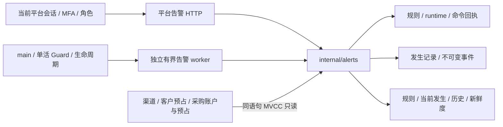
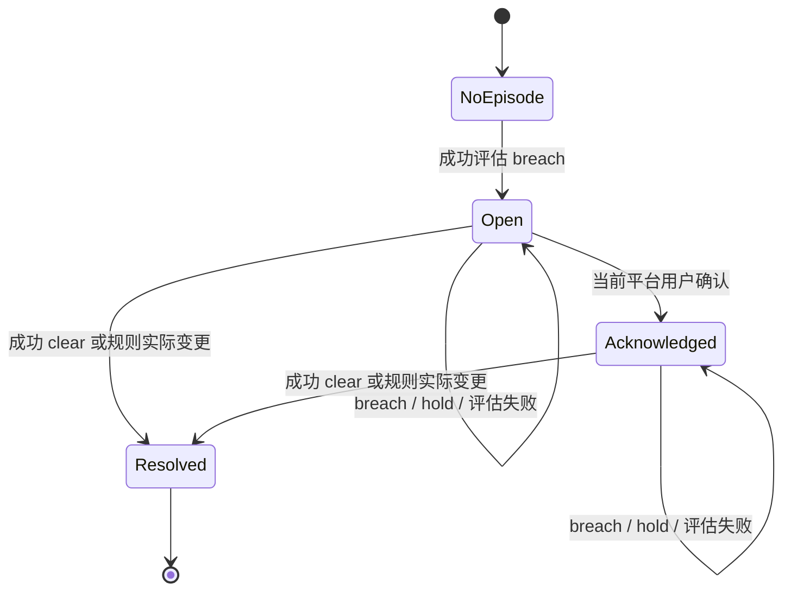
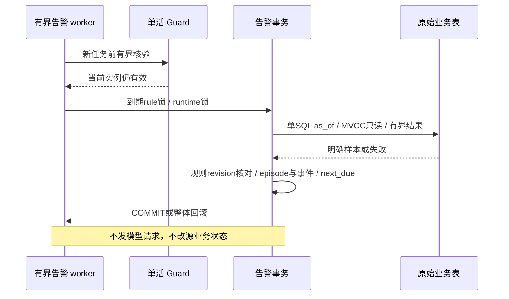

# 024 扩展平台与站内经营告警设计草案

2026-11-01，**A0精确合同已冻结019，A已完成限定本地验收；仅B0-P纯计量按独立精确合同冻结实现，其余B–F生产接线未冻结**。[024规格](../../specs/024-extension-platform/spec.md)承接实际路线图的媒体/异步、长连接、外部身份和经营告警；[合同](../../specs/024-extension-platform/contract.md)先细化A站内告警，[计划](../../specs/024-extension-platform/plan.md)与[验收](../../specs/024-extension-platform/acceptance.md)限定逐片出口。[精确合同](../../specs/024-extension-platform/a-contract.md)已通过根审查；统一架构登记A实现与验收边界，真实PG、浏览器及进程专项见[验证记录](../verification/operations-alerts.md)。

## 1. 当前源码事实与首片选择

[provider.Profile](../../internal/provider/types.go)只允许六种已声明协议，计费硬界是input/output Token；[客户Reserve](../../internal/billing/reserve.go)、[采购预占](../../internal/billing/procurement.go)、[价格发布](../../internal/catalog/store.go)和[公开目录](../../internal/catalog/public_catalog.go)也围绕两维费率。媒体按张/尺寸/秒、异步任务与持续会话均没有可直接复用的完整资金合同。增加一个端点再透传会使最坏费用和未知消费失去约束，因此B/C/D先补计量与状态，不先开流量。

[019账户](../../migrations/014_procurement_accounts.sql)已有limit/held/spent、unknown/disputed及人工余额观察；[客户预占](../../migrations/002_billing.sql)已有pending_reconciliation。[平台报表](../../internal/server/reports.go)区分已知成本和unknown，但没有独立告警记录；[指标](../../internal/server/server.go)目前主要是进程内请求/错误/活跃流计数。[路由健康](../../internal/routing/routing.go)在内存，渠道持久quarantined则由[catalog](../../internal/catalog/store.go)管理。A仅以确定的持久来源建立观察，不把这几种不同状态混成“渠道故障率”。

[平台采购读权](../../internal/server/procurement_handlers.go)已明确admin/finance_operator/finance_approver；A沿用该读边界。tenant owner和API Key不应看到平台采购预算或其他租户积压。A不新增客户通知、外发邮件或任意webhook，避免把[021身份邮件](self-service-identity.md)的证明/收件合同误作经营通知总线。

## 2. 已实现模块与观察链路

图中A的模块均已实现，运行范围见验证记录。该链路不进入Provider、Settle、Recover或邮件发送；没有调用图中未画出的自动隔离、自动充值或资金裁决。现有商业链路继续独立以硬预占和证据决定结果。

A使用独立领域package `internal/alerts`，固定四种类型，负责规范命令、当前平台授权、规则/发生/样本与评估事务；worker只装配有限任务，不拥有财务写接口。server做严格DTO、CSRF/再认证、限流和安全投影。main持有专用双连接pool和worker退出顺序，不把告警塞进当前[财务恢复/投影ticker](../../cmd/moni-aigate/main.go)。Go方法与最终DDL在A0冻结，避免多个工作面各造一套结构。

## 3. 规则、发生记录与确认

结束后下一次breach产生新ID，不回到同一episode。确认只说明某人已看到；它不消除unknown、不释放held、不恢复quarantine。关闭、退役、修改参数或label使原规则语义失效，因此原episode以配置原因结束，并保留当时快照；这类结束不是recovered。部署暂停/恢复模式保持原episode，只降低观察新鲜度。

每个rule独立configuration_revision，每个episode独立action_revision，周期样本不增长这些配置/协作版本，避免持续流量让确认CAS永远冲突。事件按action_revision唯一追加，状态改变和事件/审计/回执同事务；rule当前pointer和部分唯一索引共同防止重复open。来源无业务FK，既有财务写路径完全不需要知道告警模块。

## 4. 四个固定观察函数

预算以`limit - spent - held`为余量，不截负数；触发`<=threshold`、恢复`>recovery`形成滞回，避免边缘来回发生。这里的limit是019登记累计预算，人工供应商观察余额可能已过时，不能替换它或当做硬限额。A不承担023周期预算定义。

两类积压使用reservation创建时间和当前状态；旧请求刚变unknown也可能立刻满足年龄，此为明确的“旧预占仍未决”语义，不能称状态已持续同样时长。每个规则只观察一个tenant/account，按时间最多取1001条，足以判断最大1000阈值并保留最旧引用。超过上限显示“至少”，不做部分资金合计或任意全站SUM。

渠道只监控持久quarantined。内存熔断恢复、凭据撤销、binding isolation和profile block各有不同生命周期；后续若需要这些种类，应单独固定source、恢复条件和重启语义，而不是从日志匹配字符串。

## 5. 调度、锁与故障

用户写为actor→command→可选control→rule→runtime→episode，worker从rule开始；source只MVCC SELECT，没有业务FK或行锁。当前业务代码按tenant/user/Key/model/channel/资金根取锁，A不能持自己rule再去锁这些业务根，否则会把只读观察引入商业死锁图。

双固定槽、双专用连接、单评估2秒、源SQL1.5秒、锁等待250ms；正常60秒间隔、失败退避，无无限队列。容量并不保证所有规则一定60秒内被观察；超过180秒显示stale，未评估/暂停/错误明确出现。源错误不关闭原episode，未知COMMIT只重新读取源和告警状态，不产生外部效果。

已有[单活实例](../../internal/operations/instance.go)继续有效。A不增加分布式lease，也不代表HA；Guard失效停止worker，SIGTERM取消槽后等待结束再关pool。普通告警查询失败仅降级观察，不拦推理；告警不能反过来决定钱包准入或供应商重放。

## 6. 数据、控制台与隐私

新表仅为规则、当前runtime、episode、不可变event、command及全局配置锁根；[合同§4](../../specs/024-extension-platform/contract.md#4-a的数据合同拟追加迁移)给字段/约束/索引/权限。追加索引优化两个未决集合，需真实PG EXPLAIN证明，不修改应用过的迁移。app无DELETE，projector无任何新表权限；不新增金融投影消费者。

控制台独立规则、当前发生和历史视图，不复用泛型200即成功的表单。配置修改提示会结束当前记录；确认按钮说明只标记处理，未知结果仅查原operation。精确金额用字符串计算，计数截断与last_success/paused/stale/last_error直出，换账号/筛选/页面使用epoch隔离晚回。样本不含prompt、response、邮箱、MFA、上游endpoint/密钥或完整证据；不允许HTML/任意链接。

## 7. 后续扩展为什么继续拆开

媒体B先补计量向量再选一个同步profile，不沿用input_tokens假装张数。异步C先解决“已受理但task ID未收到”，后台只能查状态与幂等收尾，不能因超时重发生成。长连接D按session/turn/event持续预占，不能用一次Reserve覆盖无限会话。外部身份E以issuer+sub为主身份，邮箱相同不自动绑定，Passkey另有challenge/origin/恢复合同。这些最小出口与认证条件见[024计划](../../specs/024-extension-platform/plan.md#3-后续切片的最小可实施出口)。

022来源、023周期/商品若先交付，B/C/D的新单位和长生命周期必须逐条验证它们的分配、carry、到期和退款；本稿不声称已解决这些资金交叉。025的共享准入/恢复、容器/1Panel、灾备继续独立。动态插件、MCP执行、任意脚本和通用工作流不在A或本次授权实现范围。

## 8. 验证与持续架构同步

A需要真实PG证明原始快照/锁等待、幂等、唯一发生、触发器/受限角色和故障，浏览器证明当前规则/发生/历史/暂停/新鲜度/未知操作可理解。源状态fixture只证明本地语义，不是供应商余额或真实收费认证；数据库模拟与真正进程SIGKILL严格分开。A没有外发行为，因此不需要邮件收件或webhook外部交付门禁，也不能借此关闭B–F的外部认证。

实施后集成人更新统一架构的新增模块、只读观察链路、数据关系、平台权限、默认开关/资源与planned/implemented状态、源码链接和验证记录，再汇总所有并行结果执行reviewed refresh与只读检查。本次新增草案本身也须进入下一次集成人复核清单，但不能标为运行中模块或已验收能力。

[通用纯计量层](../../specs/024-extension-platform/b0-pure-contract.md)已实现闭合八维及独立专项；[较宽接线合同](../../specs/024-extension-platform/b0-metering-contract.md)继续候选。没有媒体路由、价格DB或资金调用，不能由纯层通过推断任何媒体供应商可售。
