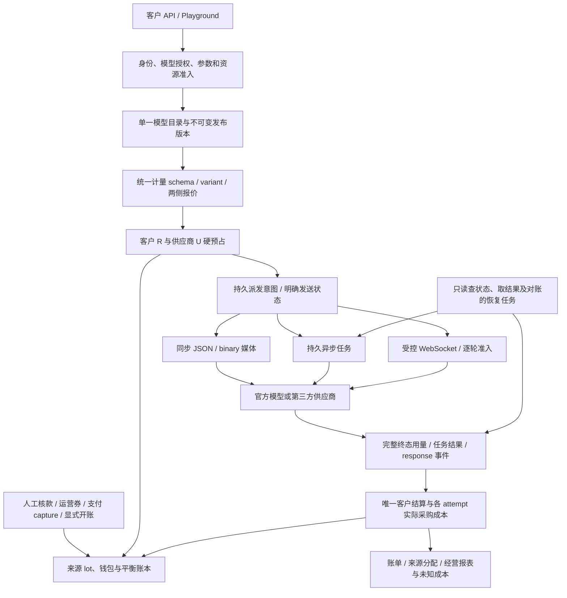

# 资金来源、媒体与 Realtime 一体化设计

日期：2026-11-04。本文是后续实施的整体设计，**不是能力完成报告**。资金来源采用已冻结的 [027 规格](../../specs/027-wallet-sources/spec.md)；计量、媒体、异步任务与 Realtime 详见 [028 生产合同草案](../../specs/028-unified-metering-media/spec.md)，仍须逐片冻结和实现。当前服务能力以[统一架构](../architecture/README.md)为准，交付证据单独记录，不把本地 fixture 或官方文档阅读写成真实供应商验收。

## 1. 目标与当前事实

moni-aigate 对外出售模型 API，也向官方模型商和第三方平台采购。客户钱包收入与每次上游尝试成本必须同时可追溯；新增图片、音频、视频任务或语音会话后，不能出现“能转发，但不知道最多会花多少钱、消费来自哪里、失败后该扣谁的钱”的旁路。

本轮交付以资金来源与开账、统一计量、选定媒体和 Realtime 的完整业务链为目标。客户/渠道目录的额外扩展后排；性能优化在这些主能力稳定后继续。按照 [ADR-005](../decisions/ADR-005-pre-mvp-single-path.md)，只维护一套现行资金与计量路径，不增加旧库自动识别、新旧双写、`token_v1`/向量双运行或第二个 `/v2` 商品目录。

| 范围 | 本文编写时的实际状态 | 本轮目标 |
| --- | --- | --- |
| 文本及检索 | 已有 Chat、Responses、Messages、Embeddings、Rerank、Gemini 六种声明协议；provider 与 billing 的生产 DTO 仍围绕输入/输出 Token | 外部已声明协议保留，内部统一接入现行计量合同 |
| 通用计量 | [metering](../../internal/metering)纯层已实现；文本和当前 media wallet 入口已各自使用不可变原件与单次 ceil | 成为文本、同步媒体、任务、会话共同的计价入口，仍需统一任务/Realtime持久 writer |
| 来源与开账 | 027 正式迁移、四写入口、命令、HTTP及控制台已实现；限定本地验收见[记录](../verification/wallet-sources.md) | 四类来源、FIFO 预占、结算/释放、消费退款与只读核对全部接通 |
| 媒体及 Realtime | 图片/TTS HTTP、mock provider、单 turn WS 与当前 media reservation/settlement 已接开发链；task 账务与 session/turn 持久 writer 未接 | 按真实供应商的端点、用量和硬上界逐个 profile 发布，并完成任务/Realtime恢复验收 |
| 经营报表 | [026](../../specs/026-operating-reports/spec.md)已按请求窗口关联唯一客户结算及全部上游尝试 | 媒体及会话进入同一请求/尝试事实，展示真实计量单位 |

## 2. 一套架构与商业链路



这是目标链路图。尚未实施的节点不能据此加入“当前在线模块”图。媒体适配器不写钱，恢复任务不重新发送生成；客户一次收费、每个上游 attempt 一份采购事实。供应商为硅基流动等第三方时，凭据、报价、限额和用量语义绑定该平台账号与真实上游型号，不能继承同名官方模型的认证。

资金由 billing 所有事务写入口负责。provider 只完成受控网络交换、协议解释和用量提取；task/session 域负责持久生命周期与资源退出；HTTP/UI 不能直接更新余额或拼接价格。任何网络调用都在资金事务之外执行。

## 3. 钱包来源、开账与四个事务入口

### 3.1 当前数据模型

027 追加正式迁移 `023_wallet_sources.sql`，保留原账本、receipt、request、reservation、settlement 等事实，新增下列关系。本文只作整体说明，精确列、约束和权限以 [027](../../specs/027-wallet-sources/spec.md) 为准。

| 关系 | 职责 |
| --- | --- |
| `funding_lots` | 每个正额 receipt 的不可变本金、来源、退款类别与 FIFO 时点；lot ID 等于 receipt ID |
| `funding_lot_balances` | 来源可用 A、冻结 H、已消费 C 三桶及 revision；A+H+C 必须等于本金 |
| `funding_lot_events` | 与同一事务、operation、journal 和 revision 绑定的不可变三桶变化 |
| `funding_reservation_lots` | 一次客户预占沿来源 FIFO 的分配，第二次安全上游尝试不重复分配 |
| `funding_settlement_lots` | 原预占边的收费与释放，逐边 charged+released 等于原分配 |
| `funding_consumption_refund_lots` | 消费退款精确回到原收费来源，累计不超过原收费 |
| `wallet_openings` | 管理员在停服、新钱包上显式确认的初始余额原件；不是历史迁移证明 |

manual_credit、voucher_grant、wallet_opening 为 `nonrefundable`；sandbox_capture 为 `sandbox_original`，仅具有本地支付沙箱语义。消费退回平台钱包与真实原路现金退款分开，不能因为来源可识别就显示“现金退款已支持”。

所有来源、事件和分配边不可修改或删除；余额更新必须有相同 operation、revision、事务的精确事件。租户复合外键约束每条关联，数据库不能只依赖 handler 的 URL 授权。应用、投影、迁移角色继续分离，开账原件不授应用角色创建。

### 3.2 来源和钱包状态转换

| 操作 | 来源与资金结果 | 幂等及故障边界 |
| --- | --- | --- |
| 人工/券/支付确认 | 原业务确认 → receipt+平衡 journal → 正额 lot 与 revision 1 入账事件 | 原来源未确认不得发 lot；同业务号重读原结果；任一来源 CAS、审计或 outbox 失败回滚全部效果 |
| 显式开账 | 停服新钱包确认 → `wallet_opening` 原件与 receipt/journal → 非现金、不可原路退款的 lot | 每 tenant 一次非零开账；相同 tenant/ref/amount/actor 读取原结果，异意图冲突；未知提交先只读核查 |
| 客户预占 R | 按 `(fifo_at, lot_id 字节序)` 选可用来源；A-=R，H+=R | 可用不足整笔拒绝；零额不造虚假本金或分配；等待锁后重验 Key/request 期限 |
| 完成收费 C | 原分配正序收费，H-=R，C 桶+=实际收费，A+=R-收费 | 唯一 settlement；超过客户硬预占的零售差额由平台承担并显式记 waived |
| 明确免收或截止释放 | H-=R，A+=R，结算收费为 0 | 只释放原分配；未知消费不伪造为上游未消费 |
| 消费退款 F | 沿原 charged 边逆序，C-=F，A+=F | 双人审批；逐来源累计不超原收费；不回退 Key.spent 或周期 spent |

一个 lot 可以同时包含可用、冻结和已消费金额，不能用一个互斥 status 代替三桶。未知消费仍保留 H；已结算后的交付失败不自动退款或重生成，争议沿原消费退款处理。

### 3.3 事务所有权与锁

统一四个写入口：`ApplyFundingTx`、`Reserve`、`finish`、`ApproveRefund`。Settle、Release、Recover、Reconcile 共用 finish，不能各写一套来源更新。helper 只接受原 `pgx.Tx`，不 Begin/Commit，不联网，不重发请求。

保持原业务来源、授权、request、Key、模型、周期 controls 的顺序，随后锁本次全部 ledger_accounts（按 ID），再锁全部所需 lot balances（按 lot_id）。Reserve 在等待 lot 后、INSERT request 之前重新核验准入时限，避免把锁等待前的预算周期时点当成派发时点；finish 在取得全部相关锁后用最终数据库时刻核验财务截止。

receipt、journal、lot/event、分配边与原审计/outbox 在同一业务事务提交。COMMIT 结果未知不能发行一个新的入账、预占或退款；先按原身份只读核对。恢复数据库本身不证明供应商未收到模型请求。

### 3.4 开账与开发数据库

空钱包自然从 0 开始。需要导入初始额度时使用 027 的 `open-wallet` 命令：要求维护模式、owner/migration 连接、取得服务单实例锁、tenant/admin 有效、钱包无历史且 Key 无 spent/held。使用 `WALLET_OPENING_CLEARING` 平衡科目并生成 journal；报表标注“初始余额导入”，不计为现金收款。

MVP 不维护旧内部历史的迁移与退款分支。023 在发现既有资金历史、非零余额或已用 Key 时明确拒迁并回滚；不能补一个 opening 伪装旧来源。**保留现有开发库，另建全新现行数据库验收**；不删库，不修改已应用 SQL，不改旧校验和。后续若承诺正式升级，再单独设计一次性升级合同。

`check-wallet-sources` 只读核对 receipt、本金、事件序列、三桶、预占/结算/退款与钱包汇总。它不修余额、不发行资金写权限，也不将早期完整历史 proof 实验重新引入在线前置。

## 4. 一套现行计量与两侧定价

### 4.1 不变对象

每个发布 profile 固定协议、上游型号、参数白名单、资源上限、计量 schema、零售/采购收费维度与完整用量解析规则。一次实际请求在准入时固定：

| 对象 | 必须绑定的内容 |
| --- | --- |
| 发布版本 | profile、能力、硬上界算法、允许的价格 variant |
| 零售快照 | 模型/分组售价版本、CNY 精确费率、R、schema/variant 摘要及生效时点 |
| 每 attempt 采购快照 | 实际渠道版本、供应商账号、上游型号、采购价版本、U 与独立采购界 |
| 最终证据 | request/attempt、供应商事件或任务身份、完整数量、确认状态及协议/交付结果 |
| 结算 | 唯一客户收费、原始零售价、豁免差额，以及所有 attempt 的独立实际成本 |

已发布价格不能回写。修改尺寸、质量、voice、格式或上游型号属于新的经校验请求/variant；客户端不能直接提交 variant ID 或费率来选便宜快照。管理员配置价格也不能跳过该 profile 的维度完整性与硬上界资格。

### 4.2 数量与金额

所有协议在边界归一为同一个现行 `schema + bounds + quantities + rates` 合同。[028-U共同域](../../specs/028-unified-metering-media/u-domain-contract.md)冻结无数据库/网络的 `internal/inference`，持有不可变Profile、BoundPlan、QuoteSnapshot、Observation和FinalQuantities。provider独占六文本parser；共同包接已验证材料，不再复制ParseJSON。共同包与metering复用strictjson语法层。文本协议把实际Token映射到数量向量，生产切换时替换旧金额路径及DTO；共同纯域实现不等于当前serve已完成切换。准确阶段出口见[任务清单](../../specs/028-unified-metering-media/tasks.md)。

现有纯层只有八个 registry 名称：音频输入/输出毫秒、图片输出张数、请求数、文本输入/输出 Token、文本输入 Unicode scalar 和 UTF-8 字节。**这不等于能准确计费现代图片或 Realtime**。生产接线须按被选供应商补齐音频/图片 Token、缓存收费叶子和视频时长等所需定义，并测试来源字段、单位及互斥关系。

- 收费向量是完整已知值；missing、null、未知字段或冲突用量不能填 0。诊断总量和缓存/推理子集与收费叶子分开，不重复累加总数与子集。
- 区分缓存价时，按供应商合同拆成互不重叠的缓存/非缓存收费叶子；缓存细分不足以完整拆分时，不能猜测各模态缓存分布。若全部输入同价，可使用已确认总输入，缓存仅作诊断。
- 图片“按张”可以是零售商品价，但采购若按文本/图片输入与输出 Token 收费，就必须单独完整记录这些成本，不能用张数假装真实采购用量。
- 毫秒、字符、UTF-8 字节和 Token 不互换。文件字节上限是资源界，不能直接当成音频收费时长；`ceil` 的时长刻度与供应商计费阶梯也要明确定义。
- 当前纯层每 schema 最多 8 个收费维度。若真实完整收费组件超限，先修订该限制及存储/校验合同，不能删收费项来凑 8。零售和采购 mask 可以不同，其并集必须覆盖该 schema 全部收费维度。

两侧按各自完整 mask 独立确认：仅供应商独有维度缺失，可使采购保持 unknown，同时按已确认的完整零售向量结算客户；未知收费无法安全归属、影响共享量或违反包含关系时，两侧都不能确认。不能因“总体 usage 存在”就确认全部成本，也不能因一侧未知而丢弃另一侧已知事实。

金额保持 CNY 微元的精确整数；单位费率为非负有理数，按 `ceil(sum(quantity × numerator / denominator))` 在总和末尾取整一次，禁止 float、每维先取整或先换一个近似美元价格。上游外币价格由平台登记明确的 CNY 采购合同费率；不暗中硬编码汇率。

生产数据采用一套 `meter_schemas`、现行 `price_versions/cost_versions` 及 rate lines、request/attempt 的 meter snapshots 和量子行，不新增媒体结算表。改动同步替换现行报价、预占、终态、退款、恢复、目录和报表中的 Token 专用依赖，连同原 SQL 函数/约束一起演进，不能只改 Go 而留下按 Token 放行的数据库合同。精确表列和正式迁移在 028-U 冻结。

### 4.3 硬预占与超界

R 是客户最坏费用，U 是本次 attempt 供应商最坏成本。两侧独立计算，不使用零售价推采购成本，也不把容量限流当余额硬界。没有可执行输入/输出/时长/尺寸上限的 profile 不能启用商业调用；官方费用估算和平均图片 Token 数不是硬上界。

实际用量超过界时仍保存真实数量与精确原始金额，不截断证据。客户收费不得超过 R，差额显式豁免；供应商实际成本独立保留，可以超过 U 并标记异常。一次客户预占可对应最多两个已有合同允许的安全 attempt，采购分别记录；媒体和 Realtime 首片默认只允许一次生成，不自动继承文本重试白名单。

零价仍经过授权、资源准入、request/attempt、用量和唯一零额结算；不绕过来源、审计和采购成本。已知零成本与未知成本是不同事实。

## 5. 同步媒体：有界结果后结算

目标公共入口依据选定供应商协议逐一冻结，不能把所有媒体塞进当前只处理 JSON/SSE 的 `provider.Request`。可复用当前安全 transport、SSRF/DNS 与实际 write 观测，但需独立的 multipart/binary、有界 base64 和媒体类型校验合同。

```text
validated
  → resource_permit
  → R/U_reserved
  → sending_committed
  → upstream_sent
  → complete_result_and_usage_validated
  → settled
  → delivery_attempted
```

| 分支 | 客户处理 | 采购处理及恢复 |
| --- | --- | --- |
| 未发送或供应商明确未消费 | 释放 R | 释放 U；只有已冻结的协议事实可证明未消费 |
| 完整结果、可信最终零售用量 | 先持久化证据并唯一结算，再写完整非流结果 | 按采购完整 mask 独立确认真实成本或保留 unknown；结果交付失败不重生成、不自动冲正 |
| 发送后断连/超时/截断或最终用量缺失 | 按原责任矩阵免收或待核对；不估算扣费 | 消费未知保留，后台只查证据，不再次生成 |
| 完整结果但资金持久化失败 | 返回受控 pending 与 request_id，不能先交付收费结果 | 保存可恢复事实；结果缓冲有界释放，不后台重新生成 |

每个 profile 冻结输入体/字段/文件数量、单文件和总大小、输出类型/大小、buffer 并发、deadline/idle、解码展开界及取消语义。不存在一个对所有图片/音频通用的安全 `8 MiB` 值。资源许可在读入大体前取得，任何退出都释放 permit、关闭上游 body；禁止无界内存、临时文件或媒体正文日志。

音频转写、语音生成、图片生成/编辑分别有自己的入参、最终用量与收费组件。首片不默认开放图片 URL、任意本地文件路径、托管工具或供应商扩展透传；需要远程取媒体时先设计受控下载、DNS/重定向、大小与时间边界。

## 6. 异步任务：执行、财务、结果三种状态

### 6.1 独立状态机

| 维度 | 合法状态与关键转换 |
| --- | --- |
| 执行 | `created → submitting → queued/running → succeeded/failed/cancelled`；提交结果不确定进入 `submission_unknown`，只能经可信查询或证据解析转出 |
| 财务 | `held → settled/released/pending_reconciliation`；pending 仅经可信最终证据或财务截止进入唯一终态 |
| 结果 | `unavailable → available → expired`；下载失败不改变生成/结算状态 |

`cancel_requested` 是请求取消的事实，不等于供应商已取消，也不证明无消费。任务 `failed` 不等于供应商成本为 0，`succeeded` 也不意味着已收齐最终用量。状态可组合，UI 必须分别展示，不能靠一个“成功/失败”字段推导收费。

首片默认只对合格的完整成功结果按可信用量向客户收费；失败/无可用结果按现行平台责任政策处理，供应商已消费仍记成本。若某供应商商品需要按提交、时长或取消收费，须在其精确 profile 与客户价格合同另行冻结后开放，不能在实现时临时选择。

### 6.2 提交和恢复

提交前同事务保存租户、Key、request/attempt、R/U、不可变快照和派发意图，提交事务后只发送一次生成。供应商已接受而 task ID 未落库是独立不确定窗口：只有供应商明示支持的幂等键/按原业务身份查询才能自动解开；没有该能力就进入人工核对，禁止猜测未提交后再 POST。

后台任务能力接口只允许 Poll、FetchResult、读取取消结果及对账，不提供 Generate/Submit。轮询重试只能重试只读状态查询；它不授予第二次生成权限。任务归属以本地 tenant/request 和固定供应商账号/task ID 为准，不能仅信任 callback 中的 tenant。

callback 需校验签名、原始 body 时间窗和供应商身份，持久去重事件 ID。重复同一终态读取原结果；相同身份不同用量或结果是冲突证据，进入核对，不能最后写入覆盖。轮询与 callback 并发、迟到终态、取消完成后的成功回调均按状态 CAS 和事件身份处理，不重复收费。

### 6.3 财务期限和结果存储

HTTP 超时只结束本次连接，不能拿现行约 300 秒请求 lifetime 作为异步任务到期释放条件。创建任务时固定执行 deadline、结果获取 deadline 和独立财务截止；027 的客户冻结政策仍是 24 小时，finish 在锁后以真实数据库时刻裁定，不因 worker 延迟续期。

需要超过该财务窗口、排队时间无界或无法停止收费的 profile，须先变更产品合同，首片保持不可售。若到截止仍无法结算，客户原冻结释放；供应商任务可以继续核对，迟到真实成本仍入账，但不自动追扣已释放客户资金。界面应显示“客户已释放、供应商成本待核对”，不能把任务改成未执行。

异步首片采用 028 的供应商原制品读取方案，不增加本地持久媒体缓存：只支持固定、受认证的 task/content API，完成前有界读取并验证原制品和最终量，持久安全 reference、类型、长度、摘要和 expiry，再经同一资金路径结算。客户下载重新读取同一个原制品并复验摘要，不生成新内容；所有权、最大大小、TTL、访问频率与下载收费均须在 profile 冻结。上游仅提供任意签名 URL 或不能稳定重读时，该 profile 先不可售，另行设计 URL/存储合同。结果过期和下载失败不产生新扣款或退款，不直接把任意供应商 URL 当客户结果地址。

## 7. Realtime：受控连接、逐轮预占

首个 Realtime profile 采用网关控制的服务端 WebSocket 代理。供应商长期 Key 或可绕开网关计量的临时凭据不下发客户。WebRTC、直连供应商、SIP、自动工具执行、通话外后台服务是独立范围，不能由“支持 Realtime”推导为已支持。

### 7.1 三层身份与状态

| 层次 | 身份和状态 |
| --- | --- |
| 会话 | 本地 session_id + tenant/Key + 发布版本；`created → connecting → active → closing → closed/failed`；负责连接与资源，不累计代替每轮结算 |
| 生成轮次 | 本地 turn_id 对应唯一 request、R、attempt 和 U；`admitting → reserved → response_requested → streaming → final_usage/pending → settled/released` |
| 供应商事件 | response ID、event ID 及本地映射；最终 usage 每个 response 只处理一次，同身份冲突进入核对 |

首片关闭或拒绝绕过逐轮准入的自动生成：自动 VAD response、会话更新启用的自动 response、未授权 tool side effect 等。在本轮第一帧可能收费的输入之前，网关按完整会话上下文计算硬界，取得资源与两侧预占并提交派发状态，之后才转发；音频 append 若可能收费，也不能先转发、等 `response.create` 再补钱。客户端可以在受限本地 buffer 中准备输入，但 buffer 不授上游发送权。输入音频 buffer 的提交若触发独立转写计费，未设计前必须禁用该功能。

### 7.2 计量、限制与退出

Realtime 可能重计历史上下文，输入界要覆盖整轮实际上下文；只按新上传音频或新一句文本预占不足。文本、音频、图片与缓存细分按照完整 schema 解析；`response.done` 的终态不保证所有会话附带服务已经计量完毕。

会话固定最大连接数、时长、轮次数、并行生成数、输入音频/图片/上下文界、输出界、消息/事件大小、待发送队列、空闲与进度超时。下游慢读达到 backpressure 上限就停止接收新轮并受控退出；不能无限缓存音频。每轮生成必须能强制停止在 U/R 所依据的界内，单纯本地断连不能证明供应商计算停止。

客户断连、服务器重启、供应商中断或已发送后超时，若没有可信最终用量则该轮消费未知；不自动 reconnect/replay 该轮，不创建“恢复轮”掩盖第二次生成。未发送轮次可释放，已确认轮次正常唯一结算。关闭会话停止准入、收敛本地 IO、关闭双向连接、释放许可，但不把本地 cleanup 成功写成供应商零消费。

按持续会话时长计费的 voice profile 与按 Response Token 计费的 Realtime 是不同模型。前者须有会话预算、时长步进、强制停止和附带后端调用成本合同，不能套用“每个 response.done 结算一次”替代所有费用。首片只发布满足逐轮硬预占模型的 profile。

## 8. 同一目录、接口和经营观察

目录仍有一套模型发布及价格观察入口；增加协议、支持参数、计量单位与已资格验证 variant，不能建第二套只给媒体用的商品目录。权限仍是平台、tenant、成员、Key 与模型能力的交集。调用方不能选择未授权渠道或供应商账号。

精确媒体路由、任务创建/读取/取消/结果与会话握手接口在各生产规格中冻结。最低接口合同如下，不代表这些端点当前存在：

| 能力 | 合同要求 |
| --- | --- |
| 同步生成 | 公开协议匹配实际 profile；明确 Content-Type、最大输入/输出及已提交资金后交付失败的语义 |
| 创建任务 | 返回本地 task_id/request_id、三维状态及财务截止；幂等键绑定 tenant、Key、规范请求意图 |
| 读取/取消任务 | 复用 request 所有权与成员授权；跨 tenant 不泄露存在性；取消不返回虚假零收费承诺 |
| 取结果 | 同源受控授权下载或已设计的短期地址；TTL/范围/最大大小明确，无任意 upstream URL 代理 |
| 会话握手 | 校验同一 Key/tenant/profile；安全传递认证，不能把长期 Key 放 URL、日志或浏览器存储；每轮独立准入 |
| 来源读取 | 使用 027 `/api/wallet/sources`、请求 funding 下钻及平台 wallet-sources 合同 |
| 错误与未知 | 返回受控 code 与本地身份；响应中不带供应商凭据、原始错误 body、内部地址或 SQL |

Playground 按发布能力提供文本、图片/音频、任务和 Realtime 的实际入口，并展示“未配置/未认证/未开放”边界。任务进度、用量未知、客户冻结、已释放、供应商待核对要能区分；不能只显示一个 spinner，或把 pending 当余额已扣。

[026 经营报表](../architecture/operating-reports.md)继续按 request 创建时间窗口归集，而非按到账或供应商发票日期。一个任务的生成对应一个 request；Realtime 每个收费轮次对应一个 request，以 session_id 聚合观察，不能再按会话总量重复收一次客户钱。全部 attempt 成本留存，客户退款按原 settlement 关联。

收入减消费退款再减已知采购成本形成该口径毛利；存在未结算或未知采购成本时保留不完整标识，不用 0 补成本。资金入账/开账属于钱包负债来源，不是模型销售收入。后续页面把固定“输入/输出 Token”标签改成按 schema 的单位化数量；CSV 同样保留单位、schema/price 版本与未知状态。

## 9. 四条并行责任与集成顺序

先冻结共享 schema/usage、request/attempt/finalization、R/U 与任务/会话身份合同，再并行实现。迁移号、billing 公共类型与价格发布有单一所有者，避免多方在共享文件中各加一套字段。

| 工作线 | 独占责任与可独立交付范围 | 必须提供的集成结果 |
| --- | --- | --- |
| A 资金与数据 | 027 四写入口、来源 DDL/ACL、开账/核对；现行计量快照、金额和故障结算合同 | 实际 PostgreSQL 下四来源→预占→结算/释放→多次退款、幂等/并发/故障的完整纵向链 |
| B 供应商协议 | 同步媒体安全 IO、任务供应商 adapter、Realtime 事件/最终 usage 解析 | 有界资源、完整计量、明确 sent/unknown、无隐式重放；逐 profile 资格材料 |
| C 任务与会话 | 持久状态、callback/poll/result、逐轮准入、期限/cleanup/只读恢复 | 进程中断与重复事件可恢复；无生成重发接口，财务/执行/结果状态保持独立 |
| D HTTP 与控制台 | 单一目录/价格单位、来源/账单下钻、媒体和会话入口、报表显示 | 真正调用领域入口，完整权限/未知/错误/取消状态；不以静态页面代替后端能力 |

先完成 027，随后统一生产计量与至少一个合格同步媒体纵向切片，再按明确供应商任务与 Realtime 切片推进；协议纯工具可提前并行，但纯工具通过不是阶段出口。各线先跑与变更相关的专项，资金专库测试串行使用单实例锁；稳定汇合后由集成人执行全量检查、架构语义复核、refresh、只读检查，再提交并推送。

统一架构的当前模块/链路/数据/权限/能力状态及源码链接必须随每片更新。没有结构变化也说明复核理由。不能先刷新 SHA 清单掩盖漏写架构，CI 不自动 refresh。HLD/LLD、规格和本文分别保留决策层、精确合同与整体入口，不把规划项写成当前部署事实。

## 10. 阶段验收出口

| 阶段 | 必须完成的出口 | 不可替代的证据 |
| --- | --- | --- |
| F 资金来源 | 四来源真实事务、FIFO/零价/部分收费/释放、多次逆序退款、两次 attempt 只分配一次、开账及读取 UI | 新现行专库的实际 APP 权限/复合 FK/事件金额故障、并发锁等待和未知 COMMIT；旧开发库保留且拒迁无改动 |
| M 统一计量与同步媒体 | 文本和选定媒体同一计价/结算路径；两侧完整硬界、终态用量、结果有界与交付策略 | 精确金额反例、真实 PostgreSQL 商业链、HTTP/binary/multipart 故障与资源退出；不能只跑 pure metering |
| T 异步任务 | 三维状态、唯一提交、未知窗口、callback/poll 去重与冲突、原制品读取及财务截止 | 实际进程/数据库中断后只读恢复、任务 ID 丢失、取消竞态、迟到结果和已释放后成本；可构造已到期数据库事实验证分支，不能称已实跑 24 小时 |
| R Realtime | 服务端 WebSocket、每轮 R/U、完整历史界、最终事件去重、受控背压与断连 | 原生事件夹具和实际 socket/进程故障、跨 tenant、自动生成旁路拒绝、缺 final usage 保持 unknown；不重连重放生成 |
| O 经营与部署收口 | 同一账单/报表单位、来源/任务/会话下钻、备份/恢复及目标部署说明 | 全量相关检查、当前架构与 README 同步；供应商与 1Panel/支付生产证据独立记录 |

每个阶段明确列出未验项目、环境和证据文件。未提供真实账号、支付商或目标机器时，继续完成本地可做部分，但只能写“本地实现/限定验收完成”，不能写“生产可运营”或“全部模型认证完成”。

## 11. 真实供应商资格与当前官方证据

### 11.1 每个 profile 的准入材料

真实可售资格按供应商账号+端点+型号/版本+variant 登记，至少包括：

1. 当前可用 API、模型版本/别名和弃用日期；第三方是否实际转发该协议，不能只看模型名。
2. 全部收费组件、缓存/推理/总量子集关系、单位、阶梯/取整及附带工具/存储/下载费用。
3. 供应商实际强制的最坏输入/输出/时长/尺寸界，足以计算 R/U；估算值不能替代硬界。
4. 最终可信用量字段、事件/response/task 唯一身份、重复和冲突语义；partial、error、cancel 和 timeout 的收费事实。
5. 提交幂等与 task ID 丢失后的查询能力、callback 验签和账号绑定；没有能力就保留 unknown。
6. 结果格式、最大体积、URL/对象所有权、TTL、删除及下载失败费用；音频采样/codec 与时长语义。
7. Realtime 历史上下文、缓存、自动 response/转写与附加服务；连接断开是否真的停止生成及最坏持续收费界。
8. 真账号成功/失败/取消/边界调用，最终用量与供应商账单核对；真实 Key 通过环境/秘密挂载提供，不进仓库和日志。

文档核对、协议 fixture、实际账号调用、供应商账单核对是四个层次，不相互替代。纯费用公式正确并不证明供应商用量完整；本地 mock 断连也不证明真实供应商停止计费。

### 11.2 本次实际读取的官方资料

以下页面于 **2026-11-04** 直接读取，均返回 HTTP 200，阅读正文而非仅引用搜索摘要。它们证明当前公开合同和弃用提示，**没有执行付费供应商调用或账单验收**。页面未来可能变化，实际发布前须复核。

| 官方资料 | 本次确认内容及对设计的影响 |
| --- | --- |
| [OpenAI Text to speech](https://developers.openai.com/api/docs/guides/text-to-speech) | `tts-1`、`tts-1-hd`、`gpt-4o-mini-tts` 已弃用，计划 2027-01-06 下线。推荐迁移至 Realtime 流程；`gpt-realtime-2.1-mini` 不支持 `/v1/audio/speech`。不得把旧 B1 `tts-1` 候选当长期首发，也不能静默换模型维持旧端点 |
| [OpenAI Video generation](https://developers.openai.com/api/docs/guides/video-generation) | Sora 2 与 Videos API 已于 2026-09-24 停用，无一对一替代。页面后文是历史参考；异步架构可借鉴，不能据此发布当前 OpenAI 视频渠道，需要另选可用供应商 |
| [OpenAI Image generation](https://developers.openai.com/api/docs/guides/image-generation) | 图片生成有文本/图片输入、缓存输入和图片输出 Token 成本；Responses 图片工具还要考虑主模型。图片成本例子是估算；张数不能覆盖全部采购。页面明确 `gpt-image-1` 于 2026-10-23 停用，不能沿用旧型号资格 |
| [OpenAI Realtime](https://developers.openai.com/api/docs/guides/realtime) | 浏览器 WebRTC 与服务端 WebSocket 是不同连接方式；会话/工具/状态需显式治理，商业首片采用受控服务端代理 |
| [OpenAI Voice WebSockets（Realtime）](https://developers.openai.com/api/docs/guides/voice-websockets?api=realtime) | 服务端持有密钥；页面同时覆盖不同 voice API，不能混用它们的事件和收费语义。使用本次确实可读地址，不引用返回 404 的旧路径 |
| [OpenAI Voice latency and cost（Realtime）](https://developers.openai.com/api/docs/guides/voice-latency-cost?api=realtime) | Realtime Response 的文本/音频/图片及缓存细分，`response.done` 用量每 response 去重；会话历史重计。转写可能按时长，GPT-Live 按会话时长并有独立后端调用费用，不能统一当普通 Token response |
| [OpenAI Speech to text](https://developers.openai.com/api/docs/guides/speech-to-text) | 当前引导使用 `gpt-transcribe`；旧 Whisper/4o 转写型号及 translations 端点计划 2027-02-26 下线。页面列出 25 MB 文件限制及受支持类型；这些是上传资源约束，尚不证明时长收费硬界和采购资格 |

这些事实取代 [024-B0 旧候选稿](../../specs/024-extension-platform/b0-metering-contract.md)中“官方文档访问受阻”的当时观察，也不把新读到的推荐模型自动写进已发布配置。旧稿的 `/v2` 第二目录、Token/向量双运行及历史资金兼容前置不进入本次现行方案；已实现纯计量算法继续复用，其 registry 与生产合同按新规格显式演进。

## 12. 本文交付边界

本次只形成整体设计并引用 027 冻结合同；没有通过本文新增迁移、运行能力、供应商资格或部署结果。027 实现、媒体生产规格与代码汇合后，由集成人更新 HLD/LLD、统一架构正文、changes 与 SHA 清单，并在 README 精确说明能力、配置、启动/部署和未开放边界后推送 GitHub。
## 2026-11-08 当前 MVP 纵向接线

异步 `video_generation` task 已在当前媒体 wallet 入口上接入预占、attempt sending、终态观察和 settlement/release。租户 scoped worker adapter 只复用原 request/reservation/attempt/source，submission unknown、失败、取消和过期不重发。图片/TTS 结算后写入不可变 `media_result_artifacts`，Realtime 在有数据库时写入现有 session/turn/event 表并保留单 turn 状态约束。该片使用 mock provider 和 55439 专库，独立 worker 容器重启、provider session 恢复、对象存储、正式供应商与生产部署仍属于未验收边界。
