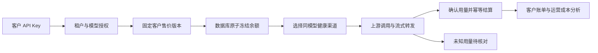

# moni-aigate 融合方案与设计导读

状态：r3为最初商业设计基线，本文保留融合取舍；2026-11-01校准至当前实现。完整的当前模块、链路、数据与部署视图见[统一系统架构](../architecture/README.md)，阶段证据见[实施记录](../verification/implementation.md)，不代表生产发布验收通过。

## 1. 定位

moni-aigate 是一个**面向外部客户销售模型 API 的商业网关**。客户使用统一地址与平台 Key 调用模型；运营者管理渠道、价格、余额、调用质量和利润。后台治理参考 1Panel 等面板产品的团队治理体验，New API 的接入和商业机制提供源码研究依据。部署由仓库自带的 Compose/脚本完成，1Panel 等面板仅为可选部署环境。

这里的 SDD 指 Specification-Driven Development（规格驱动开发）：先确认需求、约束和可验证行为，再从规格拆任务与测试，每次变更更新规格。001商业闭环已实现，后续已推进到018成本感知路由，实际本地验收与剩余生产门禁见[MVP状态](../verification/mvp-status.md)；019尚为未冻结设计讨论稿，后续扩展继续先细化规格，再编码验收。

## 2. 研究结论先行

| 对象 | 实际可研究材料 | 值得借鉴 | 不能据此断言 |
|---|---|---|---|
| 1Panel-Gateway | 固定提交的 README、截图；官方产品文档 | 账号池、模型组、用户组治理，自助 Key，路由决策记录，1Panel 部署体验 | 内部语言、加密算法、数据库事务、路由实现；给定仓库并未公开网关源码 |
| New API | Go 网关源码、适配层、计费与充值、前端及部署配置 | 多供应商协议、令牌授权、渠道选择、预扣与结算、运营能力 | 所有供应商行为一致；现成架构可直接闭源改牌使用 |

研究范围是关键链路和可借鉴模块，并非对两个产品做全量安全审计。具体版本、代码路径和证据见两份研究文档。

## 3. 融合的是哪些能力

| 能力 | 来源与取舍 | moni-aigate 的设计 | 对开发者/运营者的价值 |
|---|---|---|---|
| 统一模型 API | 借鉴 New API 的适配器与渠道概念 | 当前支持 Chat、Responses、Messages、Gemini 文本、Embeddings 与 Rerank 六协议及模型目录；适配器与资金服务隔离 | 接一个稳定入口，逐个扩展协议，避免供应商分支污染资金逻辑 |
| 后台治理 | 参考 1Panel 的账号池、模型组、分组授权 | 商业客户为租户，平台共享渠道池，客户只能看到被授权的逻辑模型 | 上游凭据不外泄，运营配置与客户使用解耦 |
| 渠道调度 | 两者均有相关能力；New API 有源码可追踪 | 同一逻辑模型内优先级+权重+健康/双层并发过滤；018增加采购单价门禁与成本优先并通过限定本地[验收](../verification/cost-aware-routing.md) | 渠道可替换，出问题能解释和定位；不承诺未经验证的省钱比例 |
| 商业收费 | 借鉴 New API 的价格、额度、预扣/结算与充值 | 价格版本快照、余额冻结、不可变平衡流水，客户费用/供应商成本分开 | 防止并发透支、重复入账和改价影响历史，能核算真实毛利 |
| 故障处理 | 从源码机制与商业边界提炼 | 已知未消费才重试，未知费用待核对；客户退款用补偿流水 | 避免一次请求重复生成或无依据扣费，降低资金争议 |
| 运维交付 | 参考面板产品的容器化与数据库/备份操作方式 | 独立镜像+PostgreSQL Compose/部署脚本、TLS、备份；1Panel 等面板可选导入同一编排 | 安装路径短，能迁移和恢复；不绑定面板内部代码 |
| 日志审计 | 借鉴两者的调用记录和用量分析 | request_id 串起授权、价格、路由、尝试、结算；默认不留正文 | 既能排障和对账，也减少客户内容泄漏面 |
| 调用管线 | 补充Bifrost、LiteLLM的尝试/预算边界 | 准入、路由、尝试、usage、结算分层，fallback候选去重 | 易于测试和扩展，每次上游成本都有归属 |
| 路由配置合同 | 补充Portkey的schema与时限控制 | 扁平策略、版本、尝试上限、总时限，不做递归DSL | 配置可校验，避免循环回退与重试放大 |
| 策略生命周期 | 补充Higress/APISIX的AI插件阶段 | 将Token限流、响应计量与资金结算分开，不引入云原生整栈 | 保留治理能力，降低首版部署复杂度 |
| 配套聊天入口 | Open WebUI为外部前端参考 | 后续可经公开API对接，自有客户/运营后台 | 对接聊天体验与API经营后台各有明确职责 |
| 配置发布与实验 | 补充TensorZero、Plano、RouteLLM | 首版配置校验/不可变版本/原子切换；语义auto商品与离线评估后置 | 出问题能还原当时配置，未来调度效果可验证 |
| 计量事件与投影 | 补充Lago、OpenMeter | 计量、attempt、资金操作分别标识，资金事务同时保存待投影事实 | 统计可重建，重复事件不变成重复收费 |
| Key治理与路由约束 | 补充Unkey与OpenRouter产品合同 | 区分权限/速率/预算/系统错误；硬约束过滤后再按偏好选路 | 错误可解释，请求不能扩大租户权限 |
| 观测与隐私 | 补充Helicone、Langfuse、Agent Router | 元数据白名单、统一URL/错误脱敏、有界遥测；财务证据不采样 | 能诊断故障，观测系统失败不改账、不无限占内存 |

**新增设计的重点**是资金可追溯、多租户隔离和失败语义。这些是本项目的目标，不是声称上游缺少相同能力，也不是已经完成的功能。完整候选对比与逐项目证据见[竞品研究汇总](../research/landscape.md)；Moni-AI给定地址当前不可访问，未将其动态调度说法当成已验证实现。

扩展研究同时核查了项目变化：TensorZero已归档，ArchGW现在为Plano，Envoy AI Gateway迁移为Agent Router；Helicone独立网关的README与实际LICENSE存在冲突。OpenRouter只作为公开商业产品文档参考。这些事实影响候选定位与后续复用判断，不改变本项目独立实现方向；详见 [Chrome阅读记录](../research/browser-research.md)。

### 3.1 r3源码校准后的关键变化

深入真实调用者和测试源码后，进一步明确：客户售价固定是moni主动选择；profile逐一限定工具/计费/用量语义；T1.9先保存最小终结证据，T2再按交付/收费矩阵结算；无输出的上游/平台失败可释放客户冻结，未知供应商成本独立核对。所有生成层共享attempt预算和总deadline，SSE提交后不重放；公共错误、观测和计量证据分别限定内容，授权以主库父行锁同步。

这些收紧了既有模块的合同，没有将订阅、全协议或语义路由加进首版。逐项来源、更正及12项设计校准见[校准汇总](../research/design-calibration.md)；收费矩阵与首发范围已作为本轮SDD开发基线。

## 4. 一次商业调用怎么走

例：客户售价为输入 ¥2/百万 Token、输出 ¥8/百万 Token。一次输入 1,000、输出 500 Token，客户消费 ¥0.006。上游成本另按供应商合同记录；失败尝试的成本也记在平台侧。更换渠道不会偷偷更改客户售价，价格调整只影响新请求。

## 5. 第一版做到哪里

建议 v0.1 定位为**可控试运营版**：邀请开户 → 运营人工核款并审批入账 → 客户领取 Key → 文本 Chat（含流式）→ 扣费 → 客户查账 → 运营查渠道与毛利 → 必要时退款。

包含：单一 CNY 币种、预付费、租户级钱包、平台管理员与客户控制台、同模型账号池、基础限流/熔断、元数据审计、备份恢复设计。

该段最初只覆盖001范围。当前已通过后续003/009/010扩展到六协议，包括原生Messages/Responses/Gemini文本；能力仍受各profile约束。后续单独做在线支付回调、自动开户、套餐订阅、代理商分销、发票、多模态、语义路由、多实例及共享采购账户/预算，不能在目录或架构图中标成已实现。

2026-10-30开发者追加要求支持New API能力，现已形成[逐项对齐路线图](new-api-roadmap.md)，补入Embeddings/Rerank、多密钥池/批量渠道与模型发现、兑换码、Playground、OAuth/Passkey、长连接及增长能力等此前未细化项目。优先核心协议与渠道，自助经营随后，媒体/长连接/HA分包推进；能力完善优先，性能002后置。路线图明确已有实现与后续目标，不将New API完整能力计入当前首版。

将自动支付后置的原因是支付服务商、主体和退款通道尚未确定。首版人工入账仍要业务凭证、审批与幂等控制；不能直接“修改余额”。如果首发就要求自助支付，应把支付规格前移，而不是复用未核对的回调代码。

## 6. 源码路线的选择

开发者最新决定：**只参考设计后独立实现，不考虑基于 New API 二次开发**。下表保留路线差异用于解释取舍，不再作为等待选择的实施分支。

| 路线 | 首版速度 | 发布方式与代价 | 本稿立场 |
|---|---|---|---|
| 在 New API 上二次开发 | 相对最快，沿用已有协议/运营功能 | 遵守 AGPL、NOTICE 和适用源码提供义务，或取得合适商业授权；仍需评估改造耦合 | 本轮已排除，仅保留对照 |
| 独立实现 moni-aigate | 初期投入更大，先覆盖较窄协议面 | 控制模块边界与商业体验；源码/素材/依赖来源仍需核对，独立编写并不自动证明免除许可义务 | 已确认并已实施的开发方向，发布许可仍待选择 |
| 直接基于 1Panel-Gateway 源码 | 当前无法执行 | 给定仓库没有可用源码和许可证，需另获授权材料 | 不作为现有可执行路线 |

目前尚未复制上游业务代码、截图或品牌资产，也不把本次源码阅读称作经过法律验证的 clean-room 实现。详细依据见 ADR-001。

## 7. 已进入 SDD 实施

开发者于2026-10-30表示“可以……使用SDD的方式进行开发”，r3范围据此作为实现基线。首版为邀请制、CNY预付费、人工核款、OpenAI文本Chat/SSE/基础工具转发、单活动实例。自动支付、媒体和HA仍未实现；原生Messages/Responses已由003补齐，Gemini文本由010补齐。

实现采用Go/Gin、PostgreSQL和Vue3控制台，已运行真实数据库及HTTP/TCP回归，见[实施与验证](../verification/implementation.md)。容量50ms目标尚未达成，容器/正式渠道未做部署验收，不能将当前开发版当作已批准上线。
