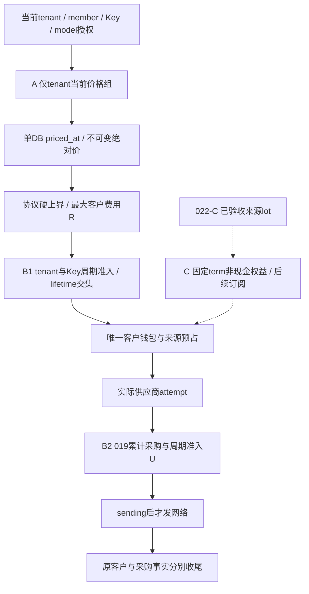
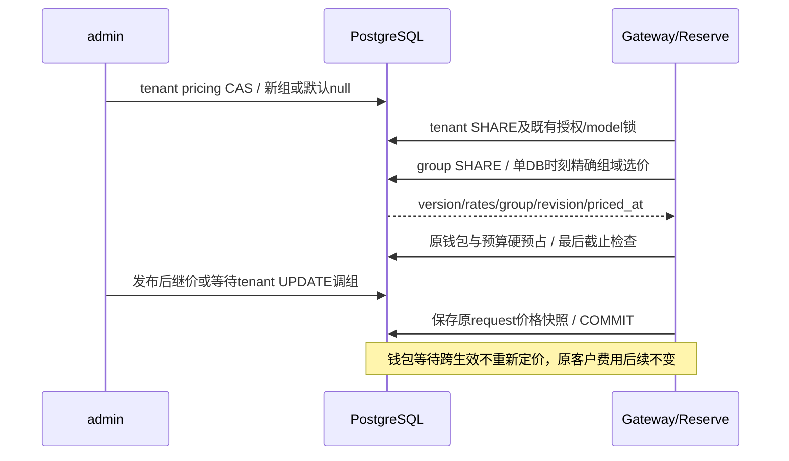

# 023 分组价格、周期预算与期限商品设计草案

2026-11-01，**A0精确合同已冻结，A已实现并通过[限定本地验收](../verification/tenant-pricing.md)；B/C未冻结未实现**。A按[精确合同](../../specs/023-periodic-products/a-contract.md)与[根复核](../../specs/023-periodic-products/review.md)实施；下文B/C保持设计方向，原型不等于上线能力。

## 1. 当前代码基础和本次范围

当前[Reserve](../../internal/billing/reserve.go)在tenant→membership→user→Key→model锁后，用单DB时刻从全局price_versions确定两维客户费率，再冻结钱包和Key lifetime；它没有价格组、周期窗口或商品权益。定价在钱包锁前完成，钱包等待后重验Key/request截止。

[catalog发布](../../internal/catalog/store.go)和[匿名目录](../../internal/catalog/public_catalog.go)使用同一默认价格表；020限定public_visible、精确安全DTO和确定排序。A应统一这些读取点，不能只给运营UI加group而让调用仍查全局价。

[lockRequest/PrepareDispatch](../../internal/billing/evidence.go)沿tenant/membership/Key/model/可选channel→reservation→attempt取得原事实与同步锁；[客户finish](../../internal/billing/settle.go)在必要model升级后锁客户账户，再决定24小时截止并唯一结算/释放。完成路径不因为新权限配置拒绝客户收尾。

[019采购](../../internal/billing/procurement.go)每attempt锁采购account NO KEY UPDATE，再锁采购reservation，保留unknown/disputed占用与双审绝对成本。客户释放、退款和采购未知分开。B周期上限是现有累计上限的交集，不是用新一期覆盖019 spent/held。

[022](../../specs/022-self-service-payments/contract.md)先共同入账、再隔离支付，再来源lot和全部推理分配；期限商品必须等022-C真实验收。仅加一个`subscription=true`或每月定时充值会破坏来源、退款和硬预占，本稿不选择该实现。

## 2. 三个相互独立的约束



图中的A/B/C均为拟议能力。价格组回答“本次每Token多少钱”，周期预算回答“这个主体还能承诺多少新费用”，权益来源回答“哪些钱/权益可以被预占和退款”。每一层只能收窄已有授权，不能提高另一层额度或改变原资金归属。

## 3. A的定价域与匿名目录

选用单tenant单group，null代表公共默认。Key不能携带便宜group，成员不叠加倍率；路由选择仍只决定供应商与采购成本，不改变客户已冻结价。首片用显式绝对两维单价，避免浮点比例、依赖多个可变配置的最终乘数以及不透明舍入。

拟追加nullable price_versions.price_group_id并调整域内同生效时刻唯一性，保留原价格ID/FK。已有版本不改写；请求另冻结tenant归属revision、组和priced_at。组退休只阻新配置，不能让已授客户的调用瞬间变成公共价或历史收尾失败。

本稿暂选组内缺价fail-closed。优点是不会因漏配向客户收取意外默认价；代价是运营必须为目标模型补齐价格，并在分配前查看缺价。若业务更需要default fallback，应显式设计版本化fallback标志、客户quote.source和请求快照；不能把SQL COALESCE当默认产品规则。



匿名目录保持020，只展示公共默认域；即使用户已登录也不读取其Cookie来改匿名价格。私有模型页按当前tenant域展示安全报价和as_of。两者都不是锁价订单；真实调用以Reserve的快照为准。公开可见不授予模型调用权，group也不授予权限。

## 4. B的窗口和跨期held

首片拟为UTC自然日/月。数据库时刻决定边界，不依赖进程时区、浏览器倒计时或午夜worker。预算control稳定唯一，window追加；旧期closed仅表示不再新接单，未决held仍有意义，不能把closed理解为可以归零。

每个request在客户Reserve归属一个原期；每个supplier attempt在RecordAttempt归属自己的原期。窗口限额计量接单时承诺的最大费用，既有客户Key lifetime和采购累计上限继续生效。

```text
当前期可准入 = 当前limit - 当前spent - 当前held - 所有旧期/legacy未决held
```

例如月底100未决，在新月limit100下不能再接100。旧请求后来结算70，70留旧月、旧held归零，新月才重新可接100。因此预算承诺按接单期成立；完成时间或供应商真实账单时间的费用可能跨期，产品不能宣传为相同含义。

已配置后的正常关开只改变cap是否参与检查，事实继续跟踪；重新开启不会得到“干净的新月”。未配置时没有calendar，不能宣称已跟踪日/月账。首配无法从累计spent可靠重建当前期，因此须在完整同步屏障下把当时全部未决held保留为legacy，从tracking_started_at开始记录，再从下一完整UTC周期启用首cap。首配扫描与新/旧预占的串行方案仍是B0冻结项，不能靠无锁历史查询猜测。改变calendar或手工reset首片不提供。

客户消费退款不回补该期spent或Key lifetime，避免一次消费反复退钱包绕过预算。采购更正仍按019绝对成本原attempt记账；未知/争议held跨期持续，客户24h释放不构成供应商无消费证明。

## 5. 锁图和故障

新增customer controls必须在原父行/model升级/reservation之后、客户ledger accounts之前取锁。多scope同层稳定排序；窗口和allocation在control保护下写，最终DB时刻在全部相关等待后重取。派发沿原父行→reservation→attempt，取得客户control后才进入采购account→采购control→采购reservation。持采购account不能回锁客户control或进入Settle。

当前price快照时刻早于钱包等待，B的period admission在最终锁后；它们可在月界两边，分别保存且不互相重算。prepared跨期不迁移allocation，PrepareDispatch检查当前cap与旧hold的carry（extra=0）；新cap阻断就保持未发送并沿原释放。sending提交后不调用新cap否决收尾。

取消、statement/lock/commit失败须保持原资金与预算事件全体原子。已知数据库回滚可以只重试原DB closure；未知提交只查原operation，任何后台恢复均不重发模型请求。时钟回退、错window归属或事件不守恒fail-closed，不能以进程时间或SUM调平。

本页锁顺序是目标合同，需要B0与实际外键/触发器/旧model升级一起审查及PG屏障验证，不表示已经证明无死锁。

## 6. C为何必须等来源完成

现金100被用完后，券100或套餐赠额不能恢复那笔现金的退款资格。期限权益还增加到期available/held差异：过期后释放应回原expired桶，不能又成为普通可用钱包；消费退款也不延长期限。

首片方向是固定期限、显式购买/续期的非现金调用额度，暂不自动扣款。价格和allowance、期限、范围、退款规则以不可变商品版本冻结；payment capture不能既完整给现金钱包入账又免费发一份套餐。term的唯一effect、原来源映射和所有桶变动必须同事务。

到期前已预占但未许可发送的请求在派发前重验期限；已sending保留原held和原24h有利收尾。新term不承担旧term held，旧退款不激活新term；取消未来续期不自动撤回本期已消费。原路退款/拒付仍只针对原支付与冻结的价值分配，不能借其他lot凑钱。

C目前没有完整购买分录、purchase/allowance不等时退款比例与取整、钱包购买来源映射或重叠term消耗规则，因此是明确待审方向，不能冻结购买API。详见[合同C0决策](../../specs/023-periodic-products/contract.md#53-c0仍需单独冻结的决策)。022-C的真实验收是必要条件，仍不替代C0本身的商品商业合同。

## 7. 并行、验证与统一架构

A catalog/管理、A billing、web可以在A0 schemas/helper冻结后分工；B客户、采购、UI可在B0锁图/事件冻结后分工。Reserve/evidence/settle的共享修改由同一账务集成人合并，最终同时跑price变化与周期边界的交叉反例。C资金分录和来源更改先串行冻结，不扩大到024。

真实PostgreSQL证明唯一占用、原期归属、跨期unknown、事件/ledger/lot守恒和受限角色；前端fixture只证明DTO及交互，不证明硬预算。实际main浏览器验证匿名/私有报价、租户切换、scheduled/disabled/carry和未知提交。外部供应商账单与正式支付仍单独认证。

集成人实施后更新统一架构的价格域、准入链路、预算关系、权限及能力状态，连同HLD/LLD与验收记录；全部并行结果汇总后再显式reviewed refresh。此次只设计，不改变架构为已实现，不运行refresh。
