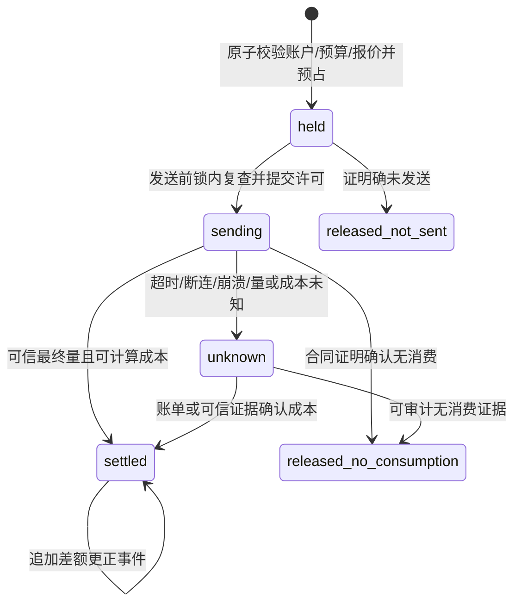

# 采购共享账户、预算与余额观察

2026-11-01，**早期设计讨论记录**。最终实施已在[019冻结合同](../../specs/019-procurement-accounts/contract.md)明确；永久凭据归属、legacy兼容、仅累计预算、人工余额证据及 `reservation → attempt → account` 锁序取代本文原建议。当前正在实施，尚未完成验收。

018只提供渠道＋精确上游模型采购价、两维单价上限和最高优先级内成本偏好。本文不改变018验收，也不要求018提前新增采购账户。当前客户钱包、客户Key预算、渠道/凭据运行时容量均不等于供应商共享额度。

## 1. 实体与不变量

采购账户代表平台实际共享采购额度的主体，例如某供应商组织、另一聚合平台的子账户或独立授信账户。渠道代表协议、出口与路由配置；credential代表访问凭据。同一采购账户可由多个渠道、多个credential访问，不能因为增加Key或渠道复制可用预算。供应商不同账户必须显式区分，不能仅凭endpoint或秘密相同猜测归属。

采购账户为平台域对象，不属于某客户租户；客户只能看到自己的客户账单，不能读取采购价、供应商账户、预算、余额观察或凭据。采购凭据秘密继续由既有密钥系统管理，账户元数据和审计不保存明文秘密。

新增请求仍只做一次客户预占；每次获准派发的supplier attempt另有采购预占。安全跨渠道尝试可能落在相同或不同采购账户，采购事实均按attempt保存，客户不能因此被重复收费。账户映射、成本版本、预算周期和预占金额在attempt前冻结，后续重绑定不能改写历史归属。

所有金额保持整数微元CNY，API使用规范十进制字符串；预算计算用可校验范围或大整数，禁止浮点累计。首阶段不支持外汇、法定会计总账、供应商授信自动兑换、缓存折扣或阶梯表达式。

## 2. 配置与绑定状态

建议账户状态为 `active → paused → active`，另有不可逆 `archived`。暂停和归档阻止新采购预占及新的sending许可，保留历史、观察、对账、成本更正与资金收尾权限。归档前必须没有有效绑定、未结束预占或未处置未知消费；不得硬删除历史引用。预算收紧不能使已承诺的spent+held事实消失；若低于既有占用，标记超限并拒绝新增，不能回滚在途请求。

credential的账户归属通过不可变绑定版本表达。初期建议每个credential在一个生效版本中最多归属一个采购账户；多个credential共享同一账户。完整池发布和账户绑定变更需共同定义CAS及生效屏障，不能让当前credential映射覆盖旧渠道版本。attempt保存 `procurement_account_id`、`procurement_binding_version_id`；PrepareDispatch重新核查冻结绑定仍获准发送。变更账户归属时旧已发attempt继续归旧账户收尾。

未绑定credential是否允许转发必须是明确的部署策略。建议019启用采购预算控制后要求经营路由完整绑定，缺失即拒绝；兼容迁移期只能显式标记“未纳入采购控制”，不可静默绕过。迁移开关、旧在途attempt及关闭采购控制的条件均须在实施前冻结。

## 3. 本地采购预算与外部余额

本地采购预算是经营者设置的风险限额，并非供应商银行余额。建议先支持账户累计预算和显式起止的固定预算期；每次预占须同时通过累计及适用周期约束。周期不能按进程本地时钟任意重置，数据库时间、时区、期界、跨期attempt、旧期收尾和预算续期均须有冻结合同。若为分阶段实现，先做累计限额，周期必须保持planned。

可用额度按同一资金事务中的 `limit - spent - held` 判定，不允许两个渠道各自先读后写。不同客户租户也共享同一采购账户锁和余额行。预算调高、调低、暂停、派发、收尾和更正均有唯一业务事件及审计；无效/未知状态不能退化为无限额。

供应商余额查询是独立只读观察。每条结果带 `account_id / amount或null / currency / source / observed_at / provider_as_of / freshness / status / evidence_ref`，保留失败及未知，明确赠额、授信、套餐余量、已用量和现金余额的供应商语义。外部消费者、查询延迟、异步扣款会使观察值与真实可花额度不同；不得把新观察覆盖本地held或直接当强一致预算。没有可靠查询API的供应商显示“不支持”，不抓取登录页面或把unknown当0。

如后续需要“观察余额门禁”，必须另定安全余量、过期拒绝/容忍策略、外部支出假设及告警；它仍不能承诺供应商侧零超支。019首阶段可以仅展示观察，不让它参与路由硬门禁。

## 4. 逐attempt采购状态机

建议将采购占用与供应商证据分别保存，避免客户reservation状态替代采购事实：

1. 选路可读取预算快照作为初筛，真正允许发送前必须在同一数据库事务原子预占；不能靠进程内capacity提供资金保证。
2. 采购预占使用已验证供应商计量硬上界和冻结采购价，逐attempt向上取整；单价未知或缺收费维度无法形成硬预占时，受控模式拒绝。019不能凭客户售价或预估平均Tokens冒充采购上界。
3. 记录attempt、冻结账户/报价、采购预占和审计必须原子提交。PrepareDispatch在全部锁取得后用新数据库时间检查账户暂停、绑定、预算期和报价有效性，再提交sending。最终同步点、跨未来调价的重新预占/拒绝规则须与018保持一致；默认拒绝过期报价而不自动重发。
4. sending一旦获准，不因后来账户暂停、预算收紧、绑定变化或调价阻止资金收尾。不得把新采购门禁塞进结算、释放、退款和恢复共用锁helper。
5. 明确未发或合同保证无消费才释放对应占用。发送后结果未知，保留采购held并进入独立对账队列；恢复任务只能查询证据和追加账务，禁止重发生成POST。
6. 客户24小时释放、免收、退款与采购未知处理独立；客户释放不能抹去平台可能已发生的采购成本。不得为自动清零held设置未经批准的供应商消费过期假设。
7. 最终可计成本在冻结硬界以内时，原子held转spent并释放差额；超出硬界属于供应商合同违约/测量异常，保存完整事实和超限异常，停止新发送，不能丢弃实际成本或追加扣客户。异常金额如何入账与双人审批须在实现前冻结。
8. 成本更正采用唯一operation_id追加事件，并按差额修正采购spent；负差额仅有供应商退款/冲正证据时减少已花，客户退款不能作为依据。已归档账户也能依法定权限对账。更正不会修改attempt原快照或客户账单。

`held / sending / unknown`不是超时可随意删除的锁记录。进程崩溃在“DB许可提交到网络写出”之间无法证明没发，须按unknown保守处置，不能从本地没有响应推导供应商未消费。

## 5. 建议表与约束

| 建议表 | 核心字段与约束 |
| --- | --- |
| procurement_accounts | id、provider/label、state、currency=CNY、management_revision、created_at；无秘密、软归档 |
| procurement_binding_versions / members | 不可变完整绑定、credential_id→account_id、revision、生效身份；attempt引用精确版本；唯一credential归属 |
| procurement_budget_periods | account_id、period_id、starts_at/ends_at、limit、spent、held、revision；同账户受控周期不重叠；非负及spent/held事实校验 |
| procurement_reservations | attempt_id唯一、account_id、binding_version、cost_version、period_id、upper bounds、held_amount、state；一attempt一预占 |
| procurement_budget_events | 唯一event_key/operation_id、account/attempt/period、类型与有符号差额、证据引用；追加不可变，与余额投影同事务 |
| procurement_reconciliation_cases | attempt唯一活动案件、原因、证据、审批状态、认领/下次恢复时刻；不能通过认领反转资金锁序 |
| procurement_balance_observations | 追加观测、原始语义类型、金额或unknown、币种、来源与时刻、错误/新鲜度；不改预算账本 |

表之间须用外键/唯一约束防止跨账户归属、重复结算和重复释放。直接受限SQL也应遵守状态与预算同步规则，不能只靠HTTP层检查；迁移角色/应用角色/投影角色继续分离。所有预算、事件、审计helper显式接收同一 `pgx.Tx`。

## 6. 建议API与控制台

仅平台admin可以管理账户和完整绑定，财务制单/审批能读取和处理授权范围内采购案件；客户无采购接口。写操作沿session、CSRF、近期再认证及实例恢复门禁；金额和revision用字符串，严格拒绝未知/重复/尾JSON及非规范值。

| 建议接口 | 合同 |
| --- | --- |
| GET/POST /api/platform/procurement-accounts | 账户安全元数据；创建用持久operation_id |
| GET/PUT /api/platform/procurement-accounts/:id/configuration | 状态/预算配置完整CAS，expected_revision；不隐式改绑定或预算历史 |
| GET/PUT /api/platform/procurement-bindings | 当前/历史完整映射；CAS，关联credential与channel版本验证 |
| GET /api/platform/procurement-accounts/:id/budget | 本地limit/spent/held/available及周期、异常/unknown数量 |
| GET /api/platform/procurement-accounts/:id/events | 追加账务与分页，按attempt追溯，不暴露秘密 |
| GET /api/platform/procurement-accounts/:id/balance-observations | 观察列表及新鲜度；查询失败仍是显式状态 |
| POST /api/platform/procurement-accounts/:id/balance-observations | 显式只读供应商查询命令；不生成模型请求，提供限速/审计 |
| GET/POST /api/platform/procurement-reconciliations/:id | 核查、提交证据及独立审批；持久命令ID与唯一回执 |

资金相关写入结果未知时只查询原operation_id回执，不改ID重放；CAS配置接口即使读回相同也不能证明原请求归因，必须保留不明状态并显式新编辑。控制台按账号/角色/页面/关闭epoch隔离晚回响应。详情同时展示客户结算和采购结果，清楚说明它们可以一个已释放、另一个待核对。

## 7. 锁序建议与并发审查

下列顺序是**待验证方案**，不是允许直接插入现有helper的补丁：

`业务命令根 → tenant → user/会员 → api_key → model → channel（ID排序）→ credential（ID排序）→ procurement_account（ID排序）→ budget_period（ID排序）→ customer reservation → attempt/procurement reservation → settlement → ledger_accounts`。

实施前须对实际Reserve、RecordAttempt、PrepareDispatch、证据保存、客户结算/释放/退款、采购对账/成本更正、配置及恢复逐条列出当前锁图，确定attempt和现有reservation的最终位置。账户跨租户共享，不能在某些路径先取account再反取tenant/channel；账户配置若要校验channel绑定，必须先取得全部channel/credential锁，再account，或拆成不持account锁的预读后按统一顺序重验。不能准入account→reservation、收尾reservation→account。

仅采购账户配置/观察可跳过前层并从account开始，但取得account后不得返回较早层。恢复先短事务认领并提交，随后按正常业务根锁序处理；不持恢复job锁进入资金事务。多账户安全切换或差额迁移必须按ID排序取全套账户/周期，不能先A后B再在另一路径B后A。

预算可用、状态、绑定和发送许可都在最终锁后重新读取，数据库clock_timestamp在全部锁取得后采样，覆盖锁等待跨期/暂停/调价。锁等待/SQL错误返回不可派发；死锁重试仅限未有外部副作用的数据库事务，不得导致上游生成重试。账户暂停/预算收紧只能阻新sending，不能阻止已经发出的attempt结算或unknown对账。

## 8. 证据与验收路线

019先冻结字段/状态/锁序和迁移兼容策略，再实施账户与绑定；其后实现累计本地采购预算、逐attempt预占/收尾/unknown恢复；最后增加有明确语义的供应商余额观察及可选周期能力。成本路由018独立验收，不依赖019上线；019只在已验证采购身份与持久预算基础上接预算硬过滤。

必须保存随机隔离schema、受限角色、真实程序版本和事务证据：两个租户/两个channel/多个credential共享账户并发争抢只剩一份额度；safe retry同账户/换账户逐attempt占用；暂停/绑定/CAS/周期/报价在锁等待中变更；sending前后崩溃；账单证据晚到与重复审批；客户24h释放/退款而采购unknown不释放；更正不重复入账；全资金事件合计与余额投影一致。观察测试使用本地供应商fixture且明确不证明真实余额契约。

正式供应商查询合同、计量硬界、运营审批制度和部署/恢复验证仍是独立门禁。planned文档不能当成业务已闭环、供应商已认证或采购零超支的证明。
