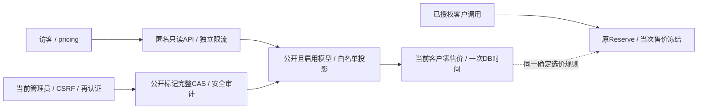

# 公开模型与客户售价目录（020冻结设计）

2026-11-01，**已实现 / 限定本地验收通过**。详细需求/API/验收分别见[规格](../../specs/020-public-catalog/spec.md)、[合同](../../specs/020-public-catalog/contracts.md)与[清单](../../specs/020-public-catalog/acceptance.md)，实际证据见[验证记录](../verification/public-catalog.md)。本设计已在models、price_versions、Reserve、Gin与Vue落地；匿名访客不接入既有客户数据接口。统一架构与最终集成检查见验证记录。

## 架构与权限



匿名组注册在`/api`会话组之外，仍经metadata的ready/Guard、请求ID、安全响应头和超时；不经过session、MFA或apiKey。匿名资源准入须位于metadata中可能访问DB的Guard之前，不能仅在路由处理器末端限流。仅接受GET，没有匿名写入口，也不能调用Provider。公开资料不依赖访客租户；携带登录Cookie与不携带Cookie结果相同。

`/pricing`从公开API取资料，独立布局/限流/请求错误路径。现有`/api/models`按租户/成员授权、`/v1/models`按Key范围的语义不变；这两种目录不能与公开可见集合混用。公开可见不作为任何收费路径的授权条件。

## 数据与配置事务

已追加[015_public_catalog.sql](../../migrations/015_public_catalog.sql)：

| 对象 | 已实施变更 |
|---|---|
| models | `public_visible BOOLEAN NOT NULL DEFAULT false`、`public_revision BIGINT NOT NULL DEFAULT 1 CHECK(>0)`；不回填自动公开 |
| 公开revision触发器 | INSERT强制1；UPDATE仅public_visible实际变化时OLD+1，否则维持OLD；调用者直接写revision不能伪造 |
| 公开查询索引 | `(public_name COLLATE "C",id)`，部分条件public_visible AND enabled |
| price_versions | 沿001现有`UNIQUE(model_id,effective_at)`及其索引；同模型同生效时刻本已禁止，不新增冗余多列索引，不修改历史价格/费率/生效时刻 |

不创建公开价格副本、采购表或客户资金表，不赋予projector新的读取能力。app沿原models/price_versions权限；新增列受原角色与触发器保护。

管理PUT事务：当前actor user SHARE并确认active admin→目标model UPDATE→读取当前public_revision→比较expected_revision→若公开则验证锁后新语句取得的逻辑名/profile→实际变化UPDATE→安全审计→COMMIT。锁到model后不访问tenant/channel/credential/账户/ledger。Reserve原model SHARE与本配置串行；公开配置只影响资料展示，不改变当次客户权限和冻结金额。隐藏不依赖profile或供应商状态，以便撤下错误资料。

旧revision无条件409，同标记且当前revision为no-op，无新审计。未知COMMIT不重发，GET仅说明现在状态，不能证明原命令归因。原普通模型编辑及路由发布不得意外重置public_visible/public_revision。

enabled与公开标记采用同一model行锁串行，但分别只写自己的列；启停不增加public_revision。允许`public_visible=true,enabled=false`：对匿名隐藏，重新启用后再次公开。PUT返回最新enabled状态，管理员不能凭public_visible=true断言目录当前可见。现有启用操作的界面需提示恢复公开影响，不增设额外审批流程。

匿名SELECT不取model SHARE/UPDATE，以免访客持锁阻塞收费调用。目录可见性的同步点是每次SQL的READ COMMITTED语句快照：下架/停用在该快照前已提交则不可见；并发提交晚于快照时，该响应允许保留其读到的公开行。no-store与下次读取过滤避免新缓存，但无法撤回已经响应的数据。

## 统一当前售价

公共规则采用一个物化时钟：

```sql
WITH instant AS MATERIALIZED (SELECT clock_timestamp() AS at)
SELECT p.id,p.input_rate,p.output_rate,p.effective_at,instant.at
FROM instant
LEFT JOIN LATERAL (
  SELECT id,input_rate,output_rate,effective_at
  FROM price_versions
  WHERE model_id=$1 AND effective_at<=instant.at
  ORDER BY effective_at DESC,created_at DESC,id DESC
  LIMIT 1
) p ON true;
```

目录一次语句为本页所有模型共用instant；Reserve在原授权/Key/model锁后使用同一排序和单时钟，并继续使用该now校验请求期限。既有客户/平台modelSelect对齐确定序，平台完整price历史列表不变。选价helper可共享纯SQL片段/查询类型，避免billing依赖catalog或二者相互导入；不为统一规则引入服务间网络或资金模块循环依赖。

001的`UNIQUE(model_id,effective_at)`已使正常数据的生效时刻排序唯一；追加created_at/id只是统一规则的明确后序，不能据此删除现有唯一约束或声称需要修复历史同刻重复。发布同刻新价格应继续因现有唯一约束拒绝，且不写部分新价格/审计。

公开与Reserve看到的提交集合/时间不同，允许得到不同的新价；这不影响历史已保存的price_version_id/input_rate/output_rate。price截止时刻as_of与SQL的MVCC可见集合是不同概念：它只决定已可见价格是否到期，不保证包含所有在响应发出前完成的提交，也不保证未来请求价格或供应商可用性。

## 安全投影与分页

SQL只读models显式安全字段、用于内部验证的profile、price_versions客户费率。公开profile额外要求`octet_length(profile::text)<=16384`；公开配置在admin事务内拒绝超界，匿名查询以CASE/尺寸标记阻止将更大profile传给应用，遇到超界公开行返回503。这样内部最多51个受限profile，不能因现有创建接口允许重复参数数组而让访客读取任意大JSON。此上界仅影响公开资格，不修改私有存储历史。

Go层解析并验证profile，然后逐字段构造独立强类型PublicModel；禁止嵌入provider.Profile、复用modelSelect/map、匿名嵌入内部类型、输出omitempty省略必要null或把未知profile键复制到DTO。内部profile即使出现秘密canary或新增字段也不得改变DTO键集合。逻辑名须1..100 UTF-8字节、无空白/控制字符；公开限制额外约束在本版产品0..10,000,000范围。平台详情、供应商报价和采购投影均不参与查询。

按`public_name COLLATE "C",id`升序，边界比较与ORDER BY必须使用相同C排序。cursor存最后一行name/id、v与规范q/protocol摘要，不能把价格、公开配置revision或客户端时间混为游标。所有输入参数化，LIKE元字符转义；第51行存在才返回第50行边界。原始query须检查ParseQuery错误与4096字节上界，不能让畸形编码被忽略成默认查询。游标不签名也不授予权限，每次读都执行可见谓词。

价格变化不改变排序键；公开/启停变化会让集合增删，新公开且落在边界之前的模型须刷新查看，当前业务没有逻辑名称改名接口。分页不提供累计总数或全库快照，也不能复现一个历史可见集合。前端按ID去重并按批次保存as_of，不用新一页时间覆盖旧行的价格观察时刻。

空目录也须由同一次SQL返回DB as_of，例如以instant LEFT JOIN有界模型子查询保留一条内部空行，Go跳过NULL模型ID。不得用额外应用时钟或第二条查时钟语句补空页时间。详情通过相同可见谓词及同一PublicModel构造器读取，不能先加载私有模型再脱敏返回。

无有效价格时保留模型及unavailable状态，所有价格相关可选字段同时null。合法输入计费模型有明确零输出价，不能把缺价替换为0；存在非0输出价的输入计费模型须像Reserve一样拒绝错误配置。坏profile/坏价使本次请求503且只记录安全诊断，不编造能力、跳过坏行改变游标或用旧缓存补齐。

## 公开访问资源边界

公开流量使用独立限流实例，不共享现有登录/tenant/platform的4096状态map。当前全局20rps、burst40；每标准化可信来源IP2rps、burst8；至多4096个来源bucket（含未知来源共享桶），另有唯一全局bucket。键使用标准化IP而非原始头/URL/会话；10分钟闲置可惰性驱逐，满表新来源429、已记录来源仍可按自身额度访问。清理扫描最多4096项，不创建每来源timer、无界历史或等待队列。只在短内存锁内调整bucket，不持锁访问数据库。来源复用`trustedClientIP`再按security规则规范化，沿单X-Real-IP与TRUSTED_PROXY_CIDRS规则，不信任任意XFF。

另设最多4个公开请求在途许可，获取失败立即429，不排队。此许可必须覆盖Guard、连接池等待、目录查询和rows关闭：在metadata分配request_id/安全响应头之后、调用可能访问DB的Guard之前取得，defer唯一归还；非法/取消/Guard失败/DB超时/序列化错误都归还。只在路由处理器中加限流不能保护更早的Guard，实施不能漏掉此顺序。它限制匿名DB工作数量，不能宣称共享32连接池给客户做了硬资源预留。

公开请求使用最多2秒总context，连接池等待与SQL均计入；Guard沿现有最多1秒独立检查且在4许可内。共享metadata的unready/Guard错误保持instance_unavailable，不修改其他API错误；目录DB/profile错误用public_catalog_unavailable。单实例内存限流为本版边界，多副本的全局限流另行设计，不引入Redis。

恢复模式并不放宽ready、实例身份或恢复隔离：只有main原本已将该实例标记ready且Guard通过时，匿名GET可读恢复中的只读价格；否则503。管理PUT仍受platform恢复门禁拒绝。页面和API不以旧缓存兜底，也不修改实例状态来实现“可访问”。匿名查询不创建request_records、metering_events、采购reservation、钱包journal或供应商网络请求。

## 前端与实施证据

公开路由在私有loadMe/MFA重定向前独立处理，避免未登录价格页出现登录跳转循环；App用明确publicLayout元数据选择布局，不把所有public页面当作已登录工作台。匿名fetch不广播私有会话失效/再认证事件。页面展示协议/当前价/产品限制，保留查询观察时间、空目录/缺价/失败状态和登录入口，默认不做自动轮询。

筛选改变时立即清旧列表/cursor、递增epoch并取消旧请求，再延迟350ms读取；显式刷新/Enter直接读取，以避免逐字输入持续打满每IP公开限流。卸载也失效epoch与timer；加载更多串行，晚回与旧cursor不可污染新列表。金额沿字符串/BigInt转换，不把缺价当零；每行保留其所属页as_of。管理员编辑复用既有敏感门禁和CAS/未知只读核查模式，但public_revision与active_revision保持独立。tab级安全journal按actor/tenant/role与model隔离，关闭再开仍不能遗忘未知PUT；只读核查后须明确新编辑，GET不证明原操作归因。

当前源码入口：[catalog安全投影与CAS](../../internal/catalog/public_catalog.go)、[HTTP与严格解析](../../internal/server/public_catalog.go)、[Guard前匿名资源准入](../../internal/server/public_catalog_admission.go)、[Reserve选价](../../internal/billing/reserve.go)、[客户/平台模型选价](../../internal/server/queries.go)、[公开DTO与匿名fetch](../../web/src/public-catalog.ts)、[分页/未知写状态](../../web/src/public-catalog-state.ts)、[公开页](../../web/src/views/PricingView.vue)、[公开设置](../../web/src/components/ModelPublicationEditor.vue)。统一架构入口的匿名只读链路、三种权限集合、公开字段/迁移和运行限流边界由集成人最终同步；不能只刷新内容摘要。

## 集成人冻结决策

自检已纠正同刻价格的事实：001早已禁止同模型同effective_at，因此不做历史价迁移或冗余price索引。2026-11-01集成人确认以下默认：旧模型全部私有；允许停用时预设公开标记并在重启用时恢复；公开profile≤16KiB且坏公开行使整次请求503；公开限流20rps/2rps及4在途/4096来源；Guard前早期资源门禁。这些取舍已冻结并已有实现，真实PG、前端与隔离浏览器证据见[验证记录](../verification/public-catalog.md)。本次没有正式供应商、容器/1Panel、灾备或性能对比结论。
