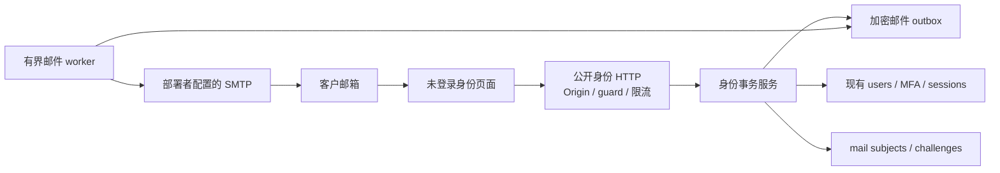
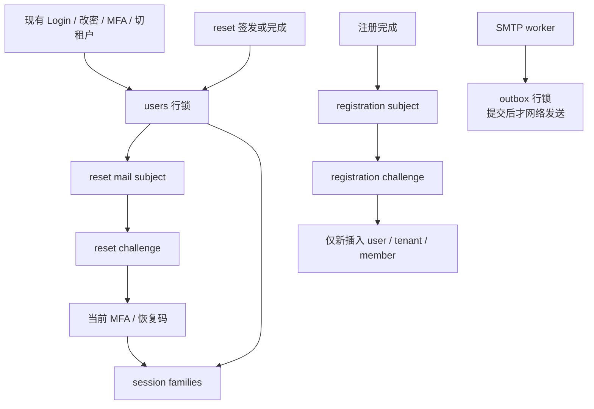
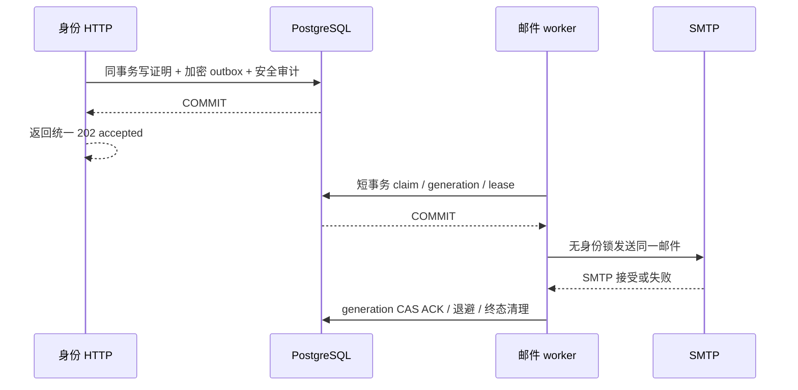

# 021 自助身份与邮件基础设施设计

2026-11-01，**已实现 / 限定本地验收通过**。本文件对应[规格](../../specs/021-self-service-identity/spec.md)、[接口与数据合同](../../specs/021-self-service-identity/contract.md)、[计划](../../specs/021-self-service-identity/plan.md)和[验收](../../specs/021-self-service-identity/acceptance.md)。具体字段、时限和状态以冻结合同为准。

## 1. 基于当前代码的边界

当前 [identity/store.go](../../internal/identity/store.go) 已有密码登录、会话 family、MFA/TOTP、一次性恢复码、再次验证及改密。Login 先在锁外做 bcrypt，再在事务中锁 user 重读密码；ChangePassword 在 user 锁内校验当前密码/MFA 后撤销全部 families。021已接线注册/证明、密码恢复、邮件outbox、独立worker与四个公开页面；本地验证见[021记录](../verification/self-service-identity.md)，真实收件未验收。

[identity/manage.go](../../internal/identity/manage.go) 的平台开户直接创建新 user/tenant/owner，默认 `allow_all_models=true`；该默认适合管理员受控配置，不能直接用于公开注册。021 保留现有平台管理入口，另设最小权限开户事务，默认没有模型、余额与 Key。

[server/server.go](../../internal/server/server.go) 保留原session/Origin/CSRF路径；021四项匿名POST有独立同源/实例/恢复/限流门禁，不要求session。[config](../../internal/config/config.go) 已有冻结的启动flags和SMTP配置；[security](../../internal/security/security.go) 已有用途/记录绑定加密、HMAC 摘要和 bcrypt，可复用原语，不另造口令算法。

[程序入口](../../cmd/moni-aigate/main.go) 保留单活动实例 guard、恢复模式、资金恢复及投影 worker。邮件 worker 只扩展独立生命周期，不与推理调用共用业务队列，不占用资金恢复串行槽，不移除单活保护。

现有 Bootstrap 只允许 user 表为空。必须新增持久初始化完成标志，由 Bootstrap 与首个管理员同事务写入，旧库仅在确有 admin 时回填；公开注册有效能力依赖该标志。仅靠默认关闭不能防止首次部署误开启注册后，普通 user 抢先写入并令管理员初始化永远失败。该标志一经合法建立不随管理员暂时停用而变化，注册事务只读它，不获取已有管理员行锁。

## 2. HLD：新增模块与数据流

身份服务负责“是否允许身份变更”，邮件 worker 负责“尝试传递已创建的证明”。二者通过数据库 outbox 解耦：请求事务不等待网络，邮件延迟或重投不重新生成证明。只有用户提交密码及完整证明才会创建账号或重置密码，GET 链接/安全扫描器预取不会消费。

前端能力查询为全站配置结果；不能把 `email_delivery_configured` 显示成“邮件正常”。请求邮件后使用统一接受文案，不能根据账号查询或 worker 状态显示不同提示。没有 SMTP 的开发者仍可使用原有平台创建账号/登录，自助相关页面清楚显示未配置。

## 3. LLD：职责拆分

实现按下列职责组织，具体入口见[统一架构](../architecture/README.md#自助身份与邮件链路021)及[验证记录](../verification/self-service-identity.md)。

| 位置 | 职责 | 不能承担的行为 |
| --- | --- | --- |
| config | 注册/reset flag、SMTP/TLS/from/origin 校验、有效能力计算 | 启动时发测试邮件、在公开响应泄露 transport 参数 |
| identity 自助服务 | 规范邮箱、签发/消费证明、最小权限开户、密码恢复/MFA/会话原子性 | 同步 SMTP、跳过当前用户锁、给新用户赠额或管理权限 |
| 邮件 outbox repository | 加密 payload、claim/lease/generation、有限重试、秘密清理 | 创建新身份证明、修改收件人、持锁调用网络 |
| SMTP transport | 有界连接、TLS、固定模板与安全错误分类 | 供应商模型调用、记录服务器敏感原文、伪报真实收件 |
| server 公共 handler | DTO/Origin/guard/限流、统一枚举契约 | 把是否存在账号暴露到状态/正文、复用 session 强制登录 |
| web 身份页面 | 能力提示、fragment 内存交接、显式提交和未知结果处理 | 保存 token/password/MFA code、GET 自动消费、自动登录 |
| main lifecycle | 仅正常有效实例启动 worker，失效/退出取消 IO | 取消单活锁、让 SMTP 阻塞资金恢复 |

不引入独立消息中间件。当前数据库原子关联 challenge/outbox；在 025 再评估共享调度与 fencing，无需为 021 先改变部署模型。

## 4. 证明与邮箱的存储

每个用途/邮箱有一个 HMAC 索引主体，串行其有效签发和消费。注册证明保存加密邮箱；reset 证明保存目标 user 与签发时 password revision。token 本身仅在创建事务内存和加密 outbox 内存在；身份表只存用途隔离摘要。

注册在邮件证明后才接受密码，避免第三方给别人预设密码。成功创建的 user 有邮箱验证时间，tenant owner 仍被外层模型授权和资金链约束；“是自己租户 owner”不意味着“是平台管理员”或“可以用任意模型”。

新增邮箱验证字段不变更现有登录准入。历史邀请账号没有验证时间时继续现有登录；一次合法 reset 可以补上验证时间。邮箱修改是另一类高风险身份绑定事务，本切片不提供。

`password_revision` 必须由 DB 观察 hash 变更递增，覆盖现有 ChangePassword 和未来写路径。它使签发后发生的改密自然失效旧 reset token，不需要先删除证明；reset 仍必须拿锁后读取当前 MFA。密码版本不代替用户 active 状态、令牌 TTL 或因素校验。

## 5. 并发与锁图校准

reset 预查只是定位；user→subject→challenge→MFA→families 才是提交事务顺序。不能从 challenge 锁反向拿旧 user 锁。reset 请求同样先锁 user，再签发与其当前密码版本关联的证明。

注册不锁旧 user/tenant。邮箱唯一冲突由 INSERT 约束拒绝并回滚，不“发现已有用户后自动加入新租户”。管理端 CreateTenant 先插入其新 tenant，再插入 user；公开注册不会在持有相反锁时访问该管理 tenant，邮箱竞争无须添加跨模块邮箱 advisory lock。需用真实 PostgreSQL 并发测试检验唯一冲突和失败事务，不仅凭图宣称无死锁。

Login 与 reset 共用 user 锁：reset 之前签发的登录会话都会被撤销，reset 之后旧密码无法通过锁内 hash 重读。MFA enrollment 共用 user 锁：已经启用的因素不能被旧邮件或旧会话状态绕过；reset 撤销会话后，旧会话不能继续完成设置。Logout 单独锁 family，不反向请求 user。

reset 必须在按 ID 锁全 family 后再读取 DB 时间检查 token TTL；否则 Logout 占锁可能让已通过的证明在真正消费时过期。合法 MFA 对 step/恢复码的写入在同一事务中，最后 TTL 拒绝必须全部回滚。注册同样在新用户唯一冲突及插入等待结束后再验时刻，不能拿事务早期时间放行。

“全部会话撤销”保证重置提交后发起的新会话认证失败。现有普通业务请求只在 session 中间件认证一次，重置之前已经获准的请求可能继续提交，021 不承诺取消所有在途管理写；密码/MFA/会话轮换仍按其事务内 user/family 复查。API Key 和已发推理请求另有授权/资金合同。若要把所有敏感写都纳入会话撤权屏障，需另补跨模块事务内 family 检查及锁图。

清理任务不调用身份恢复，按 subject→challenge→outbox 获取行锁且各组 ID 排序，不再锁 user/tenant。outbox claim 必须写 `FOR UPDATE OF o SKIP LOCKED`，JOIN 不能隐式锁 challenge；ACK 不回头取得 subject/challenge/user 行锁。发送前只读证明可能在稍后变旧，因此“旧邮件偶尔送达”是明确允许的网络竞态，证明消费事务仍拒绝它。

## 6. 邮件语义、故障与生命周期

若 SMTP 已接受而 ACK 未提交，重启后只能选择再次尝试或放弃。021 选择在 TTL/次数内恢复同一邮件，因此允许重复投递；Message-ID 稳定有助于排查，但不是下游恰好一次保证。真正的安全不变量是令牌只消费一次、重置只提交一次、恢复不会发模型请求。

claim 60 秒租约、SMTP 20 秒总超时且最多 2 个 IO，避免网络占满数据库连接；仅按空闲槽最多 claim 2 条，不能预 claim 10 条后让末尾邮件排队超过租约。短事务 claim 后立即释放连接，发送前复查 generation 和至少 25 秒剩余 lease，网络 context 受剩余 lease 减 5 秒约束；进程暂停等跨系统竞态仍允许重复尝试，CAS 只防止旧 ACK 覆盖。独立每秒 worker 不把资金恢复推迟到 SMTP 返回。Guard 失败或进程退出取消 IO 并停止新发送；未 ACK 的 claim 留待租约到期恢复。

| 故障点 | 应有结果 |
| --- | --- |
| 请求事务未提交 | 无可消费证明和可发送邮件 |
| 请求 COMMIT 已成但响应丢失 | 用户只获结果不明；持久主体频控保护重请求，不假称邮件未发 |
| claim 后、发送前退出 | 租约后同一记录恢复，token 不变 |
| SMTP 临时失败 | 有限退避，次数/TTL 耗尽后 dead |
| SMTP 接受后 ACK 丢失 | 可能重复邮件；身份变更仍最多一次 |
| 旧 generation 晚 ACK | CAS 无效，不覆盖新 claim |
| 第 5 次 claim 后崩溃无 ACK | lease 后转 dead 并清密文；不无限悬挂，也不声称确定未投递 |
| token 已消费/替换/过期 | 不再主动发；网络竞态旧邮件不能再消费 |
| 当前加密 key 缺失 | 安全错误码并进入 dead，不能解密后继续假报成功 |
| 有效能力关闭或恢复模式 | 暂停新签发/完成/发送，不延长旧 TTL |

终态清空带 token 的 payload；过期注册邮箱由每分钟有界清理擦除；脱敏记录最多保留 7 天。加密 key 轮换须覆盖仍待处理密文，offline rewrap 由既有 owner/迁移角色扩展到两种新密文并检查等义，不能给普通应用角色修改邮件收件人/token 的例外。AUTH_SECRET 的变更会使旧摘要不可用；不能把密钥轮换等同于透明 token 迁移。

业务配置目前在启动时读取，021 不实现热更新。关闭功能或恢复模式是暂停签发、消费和投递，不自动批量撤销证明；排空/重启重新开启后，TTL 内且仍有效的旧证明可用，过期或已替换的不会复活。已经进入 SMTP 的尝试无法撤回；永久撤销全部证明需要另一项受审计操作。

## 7. 前端与测试联调

前端保留登录为默认入口。注册入口依赖有效能力；恢复链接可解释不可用原因，不引导用户在邮件未配置环境无限点击发送。平台账号仍遵守原 MFA 可选或部署强制策略。

邮件使用 fragment 携带原始 token，页面读入内存后移除，POST body 显式交接。使用现有 no-referrer/CSP 并避免第三方资源。页面刷新丢失 token 时重新打开原邮件；不为便利写浏览器 storage。返回无效时不透露是已消费、邮箱冲突还是错误 MFA；“结果不明”保留独立状态，引导用户显式登录核查。

本地联调使用隔离 SMTP fixture，可编排 4xx/5xx、延迟、连接断开、DATA 接受但 ACK 丢失；所有收件地址为 fixture 域名。真实 PostgreSQL 随机 schema 测试 token 并发、锁等待越过 TTL、邮箱创建竞争、MFA replay、全部 family 撤销及直接 SQL 约束。隔离真实 main 浏览器验注册→登录、启用 MFA→请求恢复→因素证明→全部会话失效，不能操作现有评审账号/MFA/资金。

## 8. 后续商业闭环依赖

021 让客户能够证明邮箱和建立最小账号；它不会给新客户可消费资金或模型授权。022 订单必须使用已登录租户身份、服务端金额与持久支付事件，不能相信邮件里附加的 tenant/role/额度。023 订阅/周期预算需要独立权益来源与资金消费合同，不能通过注册默认赠额偷偷引入。024 媒体任务复用认证但自行设计任务 ownership、未知消费和回调。025 多活须重新定义共享限流、实例所有权、邮件并发与网络分区；021 的数据库租约不能代替完整 HA。

真实 SMTP 域名、SPF/DKIM/DMARC、收件结果与生产反滥用按外部门禁验收。本文件不新增供应商网络调用，也不提供本轮首字节性能结论。

## 9. 016 实施合同

内部身份接口固定为 `Initialized(ctx) (bool,error)`、`RequestIdentityMail(ctx,purpose,email,origin) error`、`CompleteRegistration(ctx,token,password,tenantName) error`、`CompletePasswordReset(ctx,token,password,mfaCode) error`。请求接口不返回 eligible、ID 或投递状态；不合条件、冷却与持久上限均返回 nil。HTTP 执行配置、guard、origin、限流及最多四个 hash 槽，Store 在任何事务锁外 hash。导出用途常量、`NormalizeIdentityEmail`、`ValidIdentityToken` 及 invalid-request、invalid-proof、unavailable 三类错误。

迁移 `016_self_service_identity.sql` 添加 users 的 `email_verified_at` 与 `password_revision`；revision 由触发器在 INSERT 强制为 1，hash 实际变化时加一，否则保持原值。初始化表为 `identity_initialization(singleton,initialized_at,initialized_by)`；仅 SELECT/INSERT，禁止 UPDATE/DELETE，INSERT 校验 admin；Bootstrap 在原 advisory lock 下同事务写 marker。迁移 owner 可为既有 admin 回填，普通应用仅在唯一 active admin 完成 Bootstrap 时插入；历史 marker 不随日后角色改变重算。

新表 ID 均为 SQL UUID、默认 `gen_random_uuid()`，Go 使用 `id::text`：

| 表 | 精确字段 |
| --- | --- |
| `identity_mail_subjects` | id,purpose,email_digest,window_started_at,window_count,next_issue_at,last_seen_at |
| `identity_challenges` | id,subject_id,purpose,token_digest,user_id TEXT NULL,password_revision BIGINT NULL,registration_email_ciphertext TEXT NULL,created_at,expires_at,consumed_at,revoked_at |
| `identity_mail_outbox` | id,challenge_id,payload_ciphertext,state,attempt_count,next_attempt_at,claim_generation,lease_until,sent_at,last_error_code,created_at |

subjects 对 `(purpose,email_digest)` 唯一、`(id,purpose)` 唯一；challenges 以复合外键绑定 subject/purpose、token_digest 唯一，同主体未消费未撤销证明部分唯一。注册初始要求邮箱密文且 user/version 为空；reset 要求 user/version 且无邮箱密文。证明元数据不可改，消费/撤销互斥单向，秘密只可在终结/过期后清空。签发方仅 INSERT 新 outbox、撤销旧 challenge，由 worker 取消旧邮件。

主体 INSERT 仅允许计数 0/1 且窗口不在 DB 未来，触发器统一以 DB 当前时刻固定初始窗口；窗口推进必须等旧窗口满一小时且不超过当前 DB 时刻，切换也由触发器以 DB 当前时刻固定新窗口。计数增加时触发器复核旧冷却已到，并以 DB 当前时刻设置 last_seen 与下次签发时间（至少 60 秒后），普通 app 不能用未来窗口、反复推进古老窗口或缩短 next_issue_at 绕过持久频控。

outbox 初始 pending/count0/gen0；generation 始终等于 attempt_count。claim 将 count/gen 同增一并给不超过 60 秒 lease；过期 sending 可重 claim。sending→pending 不改计数且 count<5；sending→sent/dead 与 pending/sending→cancelled 清空 payload/lease；只有 sent 有 sent_at。终态不可复活，payload 不可替换。payload 严格为版本 1 的 `{v:1,to,purpose,link}`。worker 接口由 `ClaimMail/PrepareMail/FinishMail/CleanupMail` 承担；ACK 仅锁 outbox 并以 generation CAS。

维护例外仅由 `current_user` 等于表 owner 识别，不能用 session_user、开关或 GUC；只允许现存非空密文替换为非空密文且其余列不变，不允许填回已擦除秘密。offline rewrap 在既有维护模式/单实例锁内先校验 owner 权限，工具验证解密后内容一致；数据库不声称能证明 AES 明文等义。线上 app 对 challenge/outbox 只获得状态需要的列级 UPDATE；projector 无身份写权限。

清理锁序为 subject→challenge→outbox，各类 ID 排序，绝不回锁 user/tenant。outbox 仅终态且 created_at 满 7 天可删；challenge 仅终结/过期且 created_at 满 7 天、先删除 outbox；subject 仅 last_seen_at 满 24 小时且无 children 可删。保留期明确按 created_at，无隐含 terminal_at。第五次 claim 崩溃在 lease 后进入 dead。普通 app 不能提前删除或重置 counters/generation。
