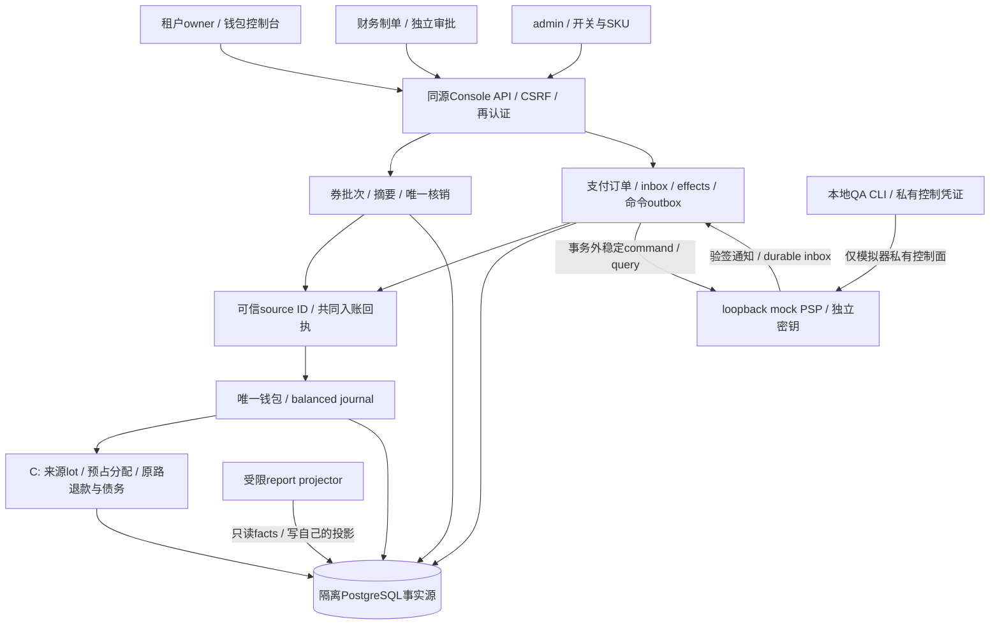
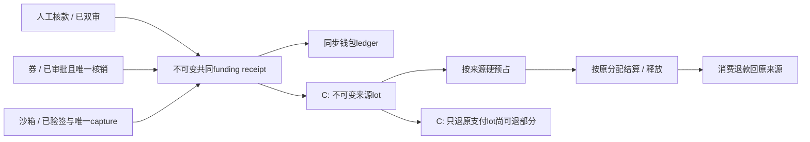
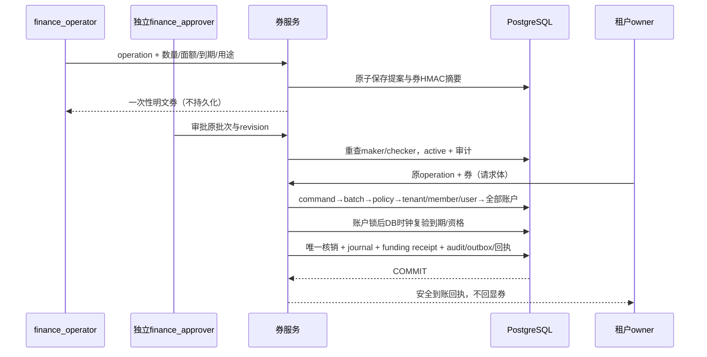
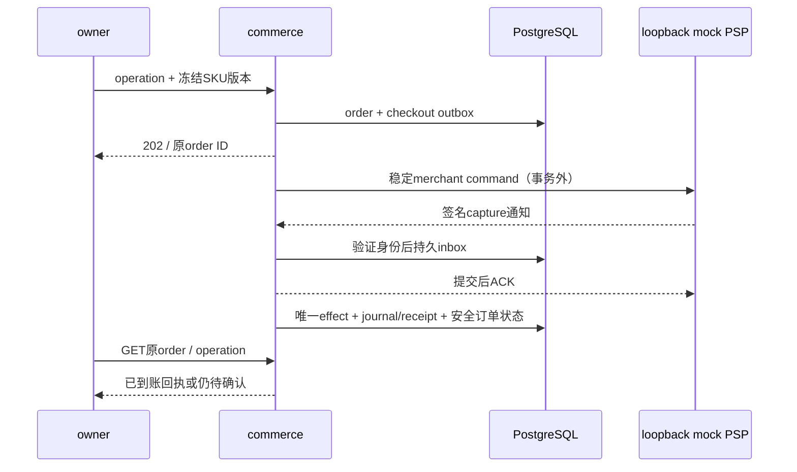

# 022 兑换券与自助支付设计提案

2026-11-01，**A0/A1已实现并完成限定本地验收；B与C未冻结未实现**。精确[A执行合同](../../specs/022-self-service-payments/a-contract.md)与[领域合同](../../specs/022-self-service-payments/a-domain-contract.md)约束共同入账和双审券；证据见[记录](../verification/funding-vouchers.md)。支付沙箱、lot/退款和债务继续独立冻结。

## 1. 现有基础与本次取舍

当前系统已经具备人工核款、财务双审、CNY钱包硬预占、不可变平衡journal、唯一结算、消费退款和受限投影。人工核款来自财务确认，不是在线支付回调；消费退款退钱包，不是外部退现。代码参考：[人工入账/消费退款](../../internal/billing/orders.go)、[账户锁与平衡分录](../../internal/billing/store.go)、[预占](../../internal/billing/reserve.go)、[查询/投影](../../internal/billing/query.go)、[重建核验](../../internal/billing/rebuild.go)、[账务迁移](../../migrations/002_billing.sql)。

现有 `Report.credited` 由credited outbox聚合，rebuild源核验直接sum approved `credit_orders`；不是只加一个新HTTP接口就支持新的入账来源。现有账户kind也没有运营赠额清算、原路退款冻结或支付债务。022应追加合同和迁移，保留旧人工入账历史与已有资金不变量。

参考New API/One API的客户自助充值和兑换码体验，独立实现三层：业务来源证明、客户钱包唯一入账、可重建报表。兑换券先做，支付先用隔离本地沙箱；真实支付商另立认证，不要求开发者先提供商户密钥。

## 2. 计划模块与信任边界

以下是**拟议架构**，不表示这些模块已经存在：

生产/普通应用没有mock控制入口。沙箱进程只绑定loopback、专用隔离DB和环境UUID；mock没有DB凭据。B允许模拟真实财务状态机，但所有资金标为sandbox，不是对真实现金收款的承诺。`PAYMENTS_MODE=live`在本编号不支持。

A已将共同Funding及券领域放`internal/billing`，由一个账务负责人维护既有tx/账户/入账所有权；A0确切冻结接口及DDL见[执行合同§12](../../specs/022-self-service-payments/a-contract.md#12-a0-账务接口与追加-ddl)。B再按领域拆`internal/commerce`（订单/支付证据/外部命令）与billing的可信source接口，commerce不直接改ledger，billing不解析外部签名。HTTP只提供业务申请，不能将客户端金额包装为可信事实。

## 3. 资金来源比钱包总额更重要

第一阶段的共同receipt统一“为什么增加钱包额度”，保持journal和source一对一；manual source是credit ID，voucher source是voucher ID并有唯一redemption。DB提交时核验同tenant、金额、币种、journal operation/reference及两条指定科目分录，算术平衡不能代替来源证明。券用独立OPERATING_GRANT_CLEARING对手科目，发行额不报外部收款。当前credit行尚缺终态保护，A追加身份/金额不可变及approved完整形状；不能把可更新旧source自动当成永久证明。

历史升级先排空并取得服务实例锁，严格验证credit/journal/原credited；异常中止，不静默忽略或造调平。合法历史只回填receipt，原journal/credited不重建。A保留reports-v1，分类同步读receipt；新增FundingVerify及Rebuild核对全部来源、receipt、journal和原账本，普通projector不因此取得source/券读权。精确维护算法见[A§9](../../specs/022-self-service-payments/a-contract.md#9-排空迁移投影与核验)。

完整原路退款必须以C的lot为硬依赖。例：支付100并消费100后，兑换100赠额，钱包虽又有100，原支付lot已消费，不能退现100。C记录FIFO预占、消费、释放及退款来源；消费退款恢复原lot，不能用另一个支付或券补原支付可退额。历史余额只能作为不可现金退legacy来源迁移。

lots不是另一份随意维护的钱包：每个桶由不可变allocation event与ledger同事务更新，VerifyLedger增加来源/预占/消费/退款核验。报表重放不能更改余额或现金退款资格。

## 4. 券发行与兑换链路

明文只在创建首次响应中出现；审批、GET和重复operation响应不能恢复。响应丢失不再生成一批：核查原批次，确认作废后才另开新operation。批次过期只限制未兑券；已到账额度本片不设过期和转让。

A采用env硬上限与DB policy的交集，均默认false；管理员用独立CAS改policy，不能越过env或获得财务权。policy SHARE覆盖兑换提交，与disable UPDATE确定先后。批次revision仅随state变，redeemed_count独立受控；revocation冻结两者并写不可变decision，兑数变化使旧提案stale。所有A写有独立有界准入和5秒总context。见[A§2–5](../../specs/022-self-service-payments/a-contract.md#2-严格值与有界-http)。

语义拒绝与基础设施失败分开：claim后的券不可用/DB policy off/旧CAS/stale/溢出清除业务savepoint后提交rejected receipt，HTTP200仅表示收到终态；env硬off在claim前409，缺省无密钥时也不必保存含券的command。DB/audit/outbox失败回滚整个command，COMMIT未知只查原operation。全部mutation的data统一OperationReceipt，UI按status判断，创建获胜响应额外携带一次codes。独立HMAC keyring将code验证和command指纹分域；命令保存指纹版本，轮换后按原版本判断同一提交，不能直接用目前单Pepper Digest。见[A§4/6](../../specs/022-self-service-payments/a-contract.md#4-命令与已知拒绝的提交矩阵)。

已生效批次作废也双审，并对已兑数量做证据CAS。核销与作废共用batch锁；批次撤销不能追扣已兑客户余额。错误不向另一个租户泄漏券是否被谁使用。

## 5. 支付状态与网络故障

订单冻结商品和收款身份，浏览器跳转没有入账权。回调验签后持久化inbox，worker只从已验证的内部事实应用资金效果；回调和查单竞争使用相同transaction/effect唯一性。checkout过期/失败与收款状态分别保存，合法时间的收款晚通知仍需处理。

外部成功但本地timeout时只能查原command/order，不能再创建一个支付。DB提交未知时客户端只GET原operation，404也不能当作失败。ACK后的worker崩溃由durable inbox恢复，所有资金效果仍一次。缺merchant/order或金额不符的可信事件保留为核查事实，不给任意tenant编造入账。

## 6. 原路退款、拒付和准入

C先把全部现有推理资金路径接入来源分配，再增加独立 `PAYMENT_REFUND_HELD` 与负值债务账户 `PAYMENT_DEBT`。退款审批持有原支付lot的可退额度；外部成功才减少退款冻结并增加已退现金事实，确定失败退回原lot，unknown继续冻结和原命令查单。

拒付先区分争议通知与确认扣回。确认扣回仅回收原lot可用部分，不挪用在途推理held，不足部分记录独立债务。债务/争议以tenant锁与Reserve/PrepareSending同步，阻止新的收费派发；既有sending、结算、释放及恢复继续。owner能进入账单核查，平台不能通过停用身份把债务状态隐藏。

拒付逆转恢复原回收和已偿债分配，余额与未偿债抵消总额等于原扣回。退款和拒付相互冲突时保留权威证据进入review；不通过猜测或调平流水掩盖。自动偿债商品与来源尚需冻结，未定义前不静默吞掉客户新资金或赠额。

## 7. 发布、权限与架构变化

A只改来源入账/兑换券，B只在隔离环境补支付可靠协议，C有账务和请求准入影响；每片单独更新统一架构的资金链路、数据关系、角色边界、能力状态及源码地图。建议表在[合同§10](../../specs/022-self-service-payments/contract.md#10-表唯一性与数据库角色)，实际旧路径和A目标锁图见[A§10](../../specs/022-self-service-payments/a-contract.md#10-按实际代码冻结的a锁图)。真实lockRequest先tenant/membership/key/model再reservation，不能沿旧草案把reservation放在tenant前；Funding账户后不得回锁业务根/授权父行。B/C扩展仍须另行审查及真实PG并发测试，文档顺序不是已证明无死锁。

迁移只追加，应用/投影/迁移角色分离。恢复旧备份后事故冻结优先：允许安全证据采集和只读查询，不自动把新inbox重新入账或重发外部退款；用离库检查点与外部记录完成核对后再解除。单活动实例约束不改变，后台绝不重发模型生成。

本页没有真实支付、商户生产环境、容量或故障演练结果。审查通过之后再逐片实施；当前统一架构只能将022标成待审设计，不能标已支持兑换券、在线收款或原路退款。

## 8. A0 精确实施合同（已冻结）

共同入账签名已冻结为`(*billing.Store).ApplyFundingTx(ctx context.Context, tx pgx.Tx, source FundingSourceRef, scope FundingScope) (FundingResult,error)`。source只有Kind/ID；scope只有TenantID/ActorID/CommandID，人工必须无CommandID，券必须指向本tx已claim的redeem命令。返回安全FundingReceipt、可空RedemptionID和内部Applied，不接受amount、balance或“已验证”boolean，不开启/提交事务。完整Go类型在[合同§12.1](../../specs/022-self-service-payments/a-contract.md#121-共同入账签名)。

外层持source与当前授权父锁；helper重读可信source，按ID一次锁齐AVAILABLE和对应清算账户，之后取新DB时刻复验资格/expiry，完成平衡journal、source绑定/核销、receipt及唯一credited。业务audit/command terminal仍属外层同tx。人工重复审批只核验原receipt不补钱，券新命令重复兑保持业务拒绝；不存在一次helper成功就跳过外层commit判定的路径。

拟追加017迁移，九表为funding_receipts、voucher_policy、commerce_commands、commerce_operation_receipts、voucher_batches、vouchers、voucher_revocations、voucher_revocation_decisions、voucher_redemptions。新ID用带canonical UUID约束的TEXT以匹配现有父键，source_id保留历史credit ID；无明文券秘密。追加journal同租户复合唯一性/引用、credit身份与终态保护、OPERATING_GRANT_CLEARING科目、严格历史预检/回填及提交时双向来源核验；credited outbox INSERT也必须触发核验，只有孤立事件的事务不能提交并污染reports-v1，非credited事件保持原路径。具体字段和约束见[合同§12.2](../../specs/022-self-service-payments/a-contract.md#122-017-追加表与约束)。

app仅有必要SELECT/INSERT与policy.enabled、batch状态/计数、credit批准三列的列级UPDATE；先收回既有blanket UPDATE/DELETE，再发小权限，trigger约束计数/状态/历史。projector继续只读原outbox及写自身投影，不获得资金来源或券表读写。owner仅在排空维护/实例锁内迁移回填。人工CreateCredit/financial_idempotency和审批响应不变，原审批audit一次，credited归helper唯一发出；券关闭不阻断人工入账。Report/Wallet DTO及reports-v1保持，Rebuild增加receipts来源与完整Funding核验后才切active，不重发历史事件、不调平余额。

根已接受API审查补项：平台admin/finance可GET commerce-capabilities，policy仍仅admin；proposal有按batch列表及独立详情GET，审批只传operation_id而不改证据。RevocationView保留原快照与可空decision，batch按state明确审批/terminal actor及时间空值。OperationReceipt accepted.reason固定accepted，只有redeem accepted带金额/funding/journal且resource指向redemption；其余accepted指向batch/proposal且资金字段null；所有rejected四关联均null。完整DTO/路径/分页形状见[合同§3–5](../../specs/022-self-service-payments/a-contract.md#3-动态开关与权限同步点)。未知提交核查不恢复codes，晚回一次性秘密在身份/页面epoch改变时丢弃；浏览器command journal不保存兑换body。

batch的reason始终是创建理由；proposed void理由保留在业务audit，active批次的双审revoke理由保留在不可变proposal，不能把两类运营关闭的证据位置混为同一个字段。

安全command摘要包含路由生成的target_id，跨batch/proposal的同body不能误幂等；创建/兑换target为null，HTTP不增加body字段。除redeem的不可枚举拒绝外，缺路径资源404、锁内失权403均回滚command。输入face×count静态溢出400无command，账户锁后的实际溢出才保存funding_amount_overflow。rejected通常只有terminal回执；revocation approve证据stale是唯一附加不可变rejected decision的例外，回滚批次/资金变化后与terminal同tx保存，仍无资金/核销/业务audit/outbox；已有decision不会重建。

以上A0合同、017 SQL、Funding/Verify/Rebuild与最小权限已实现；A1领域/HTTP/UI也已通过专项、最终全Go真实PG race、前端strict、隔离真实main浏览器和默认off预览。此处后续支付/lot/现金退款仍未实现，不能据A的资金来源回执推导已有现金资格。
