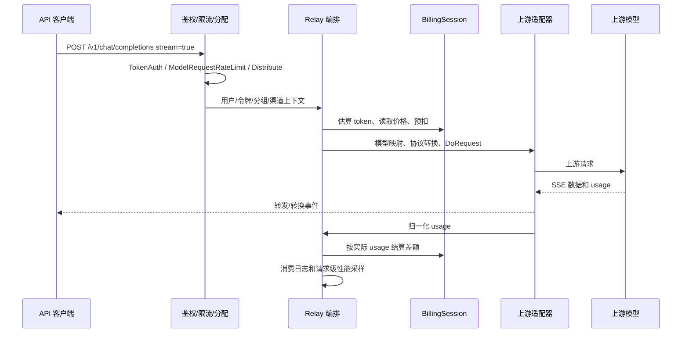

# New API 源码分析：moni-aigate 商业运营能力参考

状态：设计研究稿，供 HLD / LLD / SDD 输入；未移植代码、未运行上游服务、未做生产安全审计。

## 1. 分析基线与结论

| 项目 | 固定基线 |
|---|---|
| 仓库 | https://github.com/QuantumNous/new-api |
| HEAD | `e449cc700eb569cdfc2199cb73e97de46944f43c`，本地完整 clone 已核验 |
| 提交时间 | 2026-10-28 17:50:30（Asia/Shanghai） |
| 分析日期 | 2026-10-30（Asia/Shanghai） |
| 研究方式 | 阅读入口、路由、中间件、渠道选择、OpenAI SSE、预扣/结算/退款、支付回调、模型、部署与前端源码；README 只用于识别项目声明 |

**结论：New API 最值得 moni-aigate 借鉴的是完整的 API 商业运营闭环：用户 → 令牌 → 可用模型/分组 → 渠道 → 用量 → 预扣/结算 → 充值/订阅 → 消费记录。** 它不只是协议转发层。当前版本已具备 BillingSession、Redis Lua 原子预扣、数据库条件更新和支付事务保护，不能沿用旧版本印象把它描述为“没有并发保护”。

moni-aigate 面向对外 API 运营，建议吸收其业务分层和兼容行为，在请求账本、资金事务、支付事件持久化及恢复任务上明确自己的保证；第一版不承担它全部协议、多模态、订阅及插件范围。

## 2. 技术栈和目录边界

| 方面 | 源码观察 | 证据 |
|---|---|---|
| 后端 | Go `1.26.10`、Gin、GORM，入口负责资源初始化及后台任务 | [go.mod:1-66](https://github.com/QuantumNous/new-api/blob/e449cc700eb569cdfc2199cb73e97de46944f43c/go.mod#L1-L66)、[main.go:50-165](https://github.com/QuantumNous/new-api/blob/e449cc700eb569cdfc2199cb73e97de46944f43c/main.go#L50-L165) |
| 前端 | React 19.2、TypeScript、Rsbuild 2、TanStack Router/Query/Table、Zustand、Base UI、Tailwind 4；不能按历史版本称为 React 18 + Semi UI | [web/package.json:1-98](https://github.com/QuantumNous/new-api/blob/e449cc700eb569cdfc2199cb73e97de46944f43c/web/package.json#L1-L98)、[web/src/main.tsx:19-56](https://github.com/QuantumNous/new-api/blob/e449cc700eb569cdfc2199cb73e97de46944f43c/web/src/main.tsx#L19-L56) |
| 存储 | 主库支持 SQLite/MySQL/PostgreSQL；日志库另可配置 ClickHouse | [model/main.go:140-160](https://github.com/QuantumNous/new-api/blob/e449cc700eb569cdfc2199cb73e97de46944f43c/model/main.go#L140-L160)、[docker-compose.yml:29-44](https://github.com/QuantumNous/new-api/blob/e449cc700eb569cdfc2199cb73e97de46944f43c/docker-compose.yml#L29-L44) |
| 缓存 | 渠道内存快照、Redis 用户/令牌缓存，周期同步渠道和配置 | [main.go:83-119](https://github.com/QuantumNous/new-api/blob/e449cc700eb569cdfc2199cb73e97de46944f43c/main.go#L83-L119) |
| 交付 | Go embed 前端构建产物；Compose 示例包含网关、Redis、PostgreSQL | [main.go:44-48](https://github.com/QuantumNous/new-api/blob/e449cc700eb569cdfc2199cb73e97de46944f43c/main.go#L44-L48)、[docker-compose.yml:17-87](https://github.com/QuantumNous/new-api/blob/e449cc700eb569cdfc2199cb73e97de46944f43c/docker-compose.yml#L17-L87) |

主要目录职责：

- `router/`：控制台及代理协议入口。
- `middleware/`：鉴权、模型访问限制、限流、渠道分配、请求上下文。
- `controller/`：HTTP 业务编排，包含多次渠道尝试和支付接口。
- `relay/`：协议处理、上游适配、流式解析；`relay/channel/` 本基线约 40 个一级适配子目录，目录数不等于供应商认证兼容数量。
- `relaykit/`：独立 Go module，协议 DTO/转换；`tokenkit/`：独立 module，token 计数/估算。它们属于同一上游项目，不能因模块拆分就推定可免除许可证义务。
- `service/`：渠道选择、资金来源、计费会话、结算和授权等业务能力。
- `model/`：用户、令牌、渠道、充值、订阅、日志等持久化及缓存交互。
- `pkg/`：表达式计费、性能指标、缓存、JS 插件运行等通用子系统。
- `web/src/features/`：按控制台业务特性组织页面；`electron/` 为桌面包装层。

## 3. 一条真实的流式 Chat Completions 链路

1. **注册协议和前置控制。** `/v1` 组依次接入系统性能检查、`TokenAuth`、`ModelRequestRateLimit`；HTTP 子组接入 `Distribute`，`/chat/completions` 调用 `controller.Relay(...RelayFormatOpenAI)`。[router/relay-router.go:71-106](https://github.com/QuantumNous/new-api/blob/e449cc700eb569cdfc2199cb73e97de46944f43c/router/relay-router.go#L71-L106)
2. **验证模型和选择渠道。** `Distribute` 验证令牌模型限制，按分组、模型、路径和约束调用 `SelectChannelForRequest`，把所选渠道写入上下文。[middleware/distributor.go:60-135](https://github.com/QuantumNous/new-api/blob/e449cc700eb569cdfc2199cb73e97de46944f43c/middleware/distributor.go#L60-L135)
3. **预扣在整个请求层执行。** Relay 创建 `RelayInfo`，调用 `PrepareRequestBilling`，注册失败退款 defer；随后才进入渠道尝试循环，重试保留原请求计费会话。[controller/relay.go:134-189](https://github.com/QuantumNous/new-api/blob/e449cc700eb569cdfc2199cb73e97de46944f43c/controller/relay.go#L134-L189)
4. **模型映射、参数处理与适配。** `TextHelper` 复制请求、应用模型映射、选择 `Adaptor`；转换后可执行参数覆盖、发送上游并调用 `DoResponse`。[relay/compatible_handler.go:25-74](https://github.com/QuantumNous/new-api/blob/e449cc700eb569cdfc2199cb73e97de46944f43c/relay/compatible_handler.go#L25-L74)、[同文件:112-184](https://github.com/QuantumNous/new-api/blob/e449cc700eb569cdfc2199cb73e97de46944f43c/relay/compatible_handler.go#L112-L184)
5. **SSE 和 usage 边界。** OpenAI 适配器在 `IsStream` 时调用 `OaiStreamHandler`。它使用流扫描器；保留末尾及倒数第二条事件以兼容不同 usage 位置；缺少有效上游 usage 时用文本估算；处理函数调用计费事实，并记录终止语义。[relay/channel/openai/adaptor.go:764-797](https://github.com/QuantumNous/new-api/blob/e449cc700eb569cdfc2199cb73e97de46944f43c/relay/channel/openai/adaptor.go#L764-L797)、[relay/channel/openai/relay-openai.go:104-197](https://github.com/QuantumNous/new-api/blob/e449cc700eb569cdfc2199cb73e97de46944f43c/relay/channel/openai/relay-openai.go#L104-L197)
6. **流结束不等同成功。** `StreamStatus` 区分 timeout/client_gone/scanner_error/eof 等传输终止，以及 completed/failed/incomplete/cancelled 协议结果。[relay/common/stream_status.go:10-70](https://github.com/QuantumNous/new-api/blob/e449cc700eb569cdfc2199cb73e97de46944f43c/relay/common/stream_status.go#L10-L70)
7. **结算及采样。** `PostTextConsumeQuota` 调用 `SettleBilling`；结算失败在此路径记录日志。请求结束时 `RecordRelayResult` 记录整体延迟、TTFT、输出 tokens 和成功结果，避免把一次客户端请求的多次渠道尝试统计成多个完成请求。[service/text_quota.go:458-468](https://github.com/QuantumNous/new-api/blob/e449cc700eb569cdfc2199cb73e97de46944f43c/service/text_quota.go#L458-L468)、[pkg/perf_metrics/metrics.go:36-69](https://github.com/QuantumNous/new-api/blob/e449cc700eb569cdfc2199cb73e97de46944f43c/pkg/perf_metrics/metrics.go#L36-L69)

**对 moni-aigate 的启示：** 明确区分一次业务请求、一次上游尝试、一次协议终止、一次最终结算。第一版把 OpenAI Chat Completions 的非流式与 SSE 合同做完整，再扩展 Responses、Anthropic 等协议；不能用“统一 API”承诺所有协议字段无损互转。

## 4. 路由、密钥与限流

### 4.1 渠道选择

`GetRandomSatisfiedChannel` 先按分组/精确模型筛选，必要时用归一化模型名匹配；优先级降序，根据 retry 选优先级层；层内按 weight 随机选择，零权重等情况有平滑处理。[model/channel_cache.go:117-216](https://github.com/QuantumNous/new-api/blob/e449cc700eb569cdfc2199cb73e97de46944f43c/model/channel_cache.go#L117-L216)

这提供了可运营的“主渠道/备用渠道/权重分流”。它本身不是基于实时成本或延迟的最优路由算法。重试决策考虑固定渠道、严格会话、不可重试错误、预算与状态码规则，规则理由写入请求决策记录。[service/relay_error.go:18-56](https://github.com/QuantumNous/new-api/blob/e449cc700eb569cdfc2199cb73e97de46944f43c/service/relay_error.go#L18-L56)

建议 moni-aigate 第一版继承优先级、权重、熔断和可解释的重试理由；固定“下游已发出正文后禁止自动重放”的合同，并在上游发送结果不确定时记录重复成本风险。

### 4.2 密钥与令牌

`Token` 包含归属用户、状态、过期、额度、模型限制、允许 IP、分组等字段；`Channel` 包含上游 Key、BaseURL、模型映射、优先级、权重与配置；上游支持多 Key 状态及随机/轮询。[model/token.go:14-34](https://github.com/QuantumNous/new-api/blob/e449cc700eb569cdfc2199cb73e97de46944f43c/model/token.go#L14-L34)、[model/channel.go:23-59](https://github.com/QuantumNous/new-api/blob/e449cc700eb569cdfc2199cb73e97de46944f43c/model/channel.go#L23-L59)、[同文件:212-293](https://github.com/QuantumNous/new-api/blob/e449cc700eb569cdfc2199cb73e97de46944f43c/model/channel.go#L212-L293)

在本次检查路径中，API Key 作为 `Token.Key` 持久化并按原值查询，上游渠道 Key 也直接用于数据库模型和适配；没有看到这两条路径上的统一应用层密钥加密边界。这个观察不等于判断部署层未加密。moni-aigate 应将客户 API Key 的摘要校验，与上游可解密凭证的 AEAD 加密存储分开设计，输出只展示一次客户明文 Key。

### 4.3 限流与授权

模型请求限流有 Redis 和内存路径；Redis 成功计数检查使用列表长度与时间窗口，成功后再记录。[middleware/model-rate-limit.go:28-78](https://github.com/QuantumNous/new-api/blob/e449cc700eb569cdfc2199cb73e97de46944f43c/middleware/model-rate-limit.go#L28-L78) 这是业务限流能力的源码证据，不足以推出“所有限流维度严格原子且多节点全局一致”。moni-aigate 的 HLD 选择首版单实例内存限流、PostgreSQL 资金事务；未来多实例可评估 Redis Lua admission，但须单独定义故障、租约与存量请求语义，不能仅加 Redis 就承诺全局严格并发。

当前版本还有 Casbin 授权实现与多节点周期同步；不能把管理权限一概概括为只有旧版的 user/admin/root 数字角色。[service/authz/enforcer.go:19-60](https://github.com/QuantumNous/new-api/blob/e449cc700eb569cdfc2199cb73e97de46944f43c/service/authz/enforcer.go#L19-L60)、[同文件:78-83](https://github.com/QuantumNous/new-api/blob/e449cc700eb569cdfc2199cb73e97de46944f43c/service/authz/enforcer.go#L78-L83)

## 5. 预扣、结算和退款：保护已经存在，持久恢复仍需单独设计

### 5.1 已有保护

- 请求估算 token → `ModelPriceHelper` 形成价格数据 → `PreConsumeBilling` 创建计费会话；跨渠道尝试保留会话及初始价格输入，但**最终分组倍率仍可能变化**，不能推出客户实收跨所有回退固定。[relay/request_billing.go:22-67](https://github.com/QuantumNous/new-api/blob/e449cc700eb569cdfc2199cb73e97de46944f43c/relay/request_billing.go#L22-L67)；最终倍率与相关测试见[r3资金校准](calibration-billing.md)。
- `FundingSource` 抽象钱包和订阅，提供 `PreConsume/Settle/Refund`；可按用户偏好回退资金来源。[service/funding_source.go:14-24](https://github.com/QuantumNous/new-api/blob/e449cc700eb569cdfc2199cb73e97de46944f43c/service/funding_source.go#L14-L24)、[service/billing_session.go:388-449](https://github.com/QuantumNous/new-api/blob/e449cc700eb569cdfc2199cb73e97de46944f43c/service/billing_session.go#L388-L449)
- 钱包和令牌均有 Redis Lua 原子检查扣减；Redis 不可用/缺缓存时可回退数据库条件更新。数据库预扣使用 `quota >= amount` / `remain_quota >= amount` 条件。[model/quota_reserve.go:19-65](https://github.com/QuantumNous/new-api/blob/e449cc700eb569cdfc2199cb73e97de46944f43c/model/quota_reserve.go#L19-L65)、[同文件:143-238](https://github.com/QuantumNous/new-api/blob/e449cc700eb569cdfc2199cb73e97de46944f43c/model/quota_reserve.go#L143-L238)
- `BillingSession` 以 mutex 和 settled/refunded/fundingSettled 标志防止当前进程中重复退款或结算；资金已提交而令牌调整失败时不会误退资金。[service/billing_session.go:30-95](https://github.com/QuantumNous/new-api/blob/e449cc700eb569cdfc2199cb73e97de46944f43c/service/billing_session.go#L30-L95)
- 实际金额与预扣的正差补扣、负差退还；文本计费区分普通 token、缓存、音频、工具调用等量；使用 decimal 和统一额度转换。[service/billing.go:65-108](https://github.com/QuantumNous/new-api/blob/e449cc700eb569cdfc2199cb73e97de46944f43c/service/billing.go#L65-L108)、[service/text_quota.go:285-365](https://github.com/QuantumNous/new-api/blob/e449cc700eb569cdfc2199cb73e97de46944f43c/service/text_quota.go#L285-L365)

### 5.2 不应直接继承的边界

| 源码边界 | 对商业运营的含义 | moni-aigate 建议 |
|---|---|---|
| `BillingSession` 的状态主要在请求内存对象；退款提交后台 goroutine，失败记录日志 | 进程崩溃和后台退款失败，需要独立的持久恢复保证；不能把内存幂等称为跨崩溃 exactly-once | 建 `billing_requests`/holds/ledger，持久唯一结算键、恢复任务和人工对账入口 |
| 钱包和令牌结算分步；令牌调整失败可留下已提交资金 | 存在业务上允许但须可审计的部分提交 | 在同一 PostgreSQL 事务修改钱包、Key 预算、hold、账本与请求结算状态 |
| 钱包 `Refund` 明确为非幂等 quota 增量，代码注释禁止简单重试 | 自动恢复不能盲目重放退款 | `UNIQUE(request_id, operation)` + 条件状态迁移 + 不可变分录 |
| 结算补扣可允许钱包负余额；“信任额度”可跳过预扣 | 是产品策略，非严格零透支保证 | 第一版要求输出上限并足额预留；超预留或未知用量进入运营异常，不隐含授信 |
| 批量模式先累积进程内 map 再落库 | 减少写库，但资金事实不应只依赖该吞吐优化；需评估崩溃、缓存故障切换与批次失败 | 资金核心同步事务落库；报表统计异步聚合 |

证据：[service/billing_session.go:87-128](https://github.com/QuantumNous/new-api/blob/e449cc700eb569cdfc2199cb73e97de46944f43c/service/billing_session.go#L87-L128)、[service/funding_source.go:68-74](https://github.com/QuantumNous/new-api/blob/e449cc700eb569cdfc2199cb73e97de46944f43c/service/funding_source.go#L68-L74)、[service/billing_session.go:208-237](https://github.com/QuantumNous/new-api/blob/e449cc700eb569cdfc2199cb73e97de46944f43c/service/billing_session.go#L208-L237)、[同文件:264-285](https://github.com/QuantumNous/new-api/blob/e449cc700eb569cdfc2199cb73e97de46944f43c/service/billing_session.go#L264-L285)、[model/utils.go:24-100](https://github.com/QuantumNous/new-api/blob/e449cc700eb569cdfc2199cb73e97de46944f43c/model/utils.go#L24-L100)。

以上是代码路径和架构边界分析，未通过故障注入证明特定生产事故一定发生，也不据此断言上游整体“不可靠”。

## 6. 充值支付闭环

当前实现具有 Epay、Stripe、Creem、Waffo 等支付分支，和钱包/订阅业务；第一版可借鉴“适配器 + 本地订单 + 服务端回调”的结构，选择一个真实支付通道做完整验收。

以 Stripe 为例：

1. 校验金额、用户、充值额度上限和成功/取消跳转 URL，创建 Checkout Session 和本地 pending TopUp。[controller/topup_stripe.go:72-139](https://github.com/QuantumNous/new-api/blob/e449cc700eb569cdfc2199cb73e97de46944f43c/controller/topup_stripe.go#L72-L139)
2. Webhook 使用 Stripe 签名验签，处理 completed / expired / async success / async failed；completed 还要求 `payment_status=paid`。[同文件:164-234](https://github.com/QuantumNous/new-api/blob/e449cc700eb569cdfc2199cb73e97de46944f43c/controller/topup_stripe.go#L164-L234)
3. `fulfillOrder` 先尝试订阅订单，再调用钱包 Recharge；Recharge 事务中锁订单，校验 provider/pending，修改订单并增加用户额度，事务后同步缓存。[同文件:275-306](https://github.com/QuantumNous/new-api/blob/e449cc700eb569cdfc2199cb73e97de46944f43c/controller/topup_stripe.go#L275-L306)、[model/topup.go:236-287](https://github.com/QuantumNous/new-api/blob/e449cc700eb569cdfc2199cb73e97de46944f43c/model/topup.go#L236-L287)
4. Epay 的 RechargeEpay 明确以数据库订单行锁、状态校验和同事务入账实现多实例重复回调最多入账一次；钱包增加也有条件更新，防止并发越过上限。[model/topup.go:87-117](https://github.com/QuantumNous/new-api/blob/e449cc700eb569cdfc2199cb73e97de46944f43c/model/topup.go#L87-L117)、[同文件:173-229](https://github.com/QuantumNous/new-api/blob/e449cc700eb569cdfc2199cb73e97de46944f43c/model/topup.go#L173-L229)

**需要强化的设计点：** Stripe handler 的业务处理函数遇到入账错误可以只写日志，外层仍返回 200；该观察路径未见以 provider event id 为唯一键先落库的 durable webhook inbox。moni-aigate 应先持久化验签事件再确认接收，后台可重试入账，并建立支付服务端查询与本地对账任务，覆盖“支付成功但本地事务失败”。当前 Stripe 路径还记录 signature 和完整 body，moni-aigate 应默认脱敏并限制原始事件访问。

支付退款/拒付与 API 请求的预扣释放是不同业务。第一版设计必须分别描述；本研究没有证明 New API 已实现完整支付退款、拒付、发票或多币种复式总账，不将其列为已验证能力。

## 7. 优点及第一版取舍

| 借鉴的优点 | 给 moni-aigate 的收益 | 第一版建议 |
|---|---|---|
| 用户/令牌/模型/分组/渠道完整模型 | 客户一个 endpoint + 一把 Key，运营方管理上游 | 保留，明确租户归属与后台权限 |
| 多供应商 Adaptor 和模型映射 | 换上游时客户端改动少 | 从 OpenAI compatible 做起，以接口合同验收真实差异 |
| 优先级、权重、回退及规则日志 | 可控制流量、可解释故障切换 | 仅在证明未消费时有限重试；已发送下游 SSE 不重放；增加熔断 |
| 预扣 → usage → 差额结算 | 形成可经营的成本与收入闭环 | 保留语义，资金写入强化为持久事务 |
| 价格和 usage 语义区分 | 可支持缓存/输入/输出不同价格 | V1 先明确 input/output/cache 的支持表与来源标记 |
| 用户消费记录、请求级性能采样 | 客服定位与运营报表有事实依据 | request_id 串起客户日志、尝试和账单 |
| 前端按 feature 组织及嵌入交付 | 控制台可逐步扩展，部署少一个静态服务 | 参考组织方式，采用 moni-aigate 自有 UI |

建议后置：全量多模态协议、视频/异步任务、JS 动态插件、复杂订阅组合、邀请分佣、桌面 Electron。原因是它们扩展计费和协议状态空间，早期会稀释“充值成功 → 调用成功 → 账单准确 → 故障可恢复”的验收主线。

## 8. 许可证与复用方式

New API 主项目使用 **GNU AGPLv3**。当前 `NOTICE` 明确增加 AGPL §7 署名要求：修改版 UI 在显著 about/legal/footer/attribution 位置保留 `Frontend design and development by New API contributors.` 和指向原仓库的可见链接，并标记修改。[LICENSE](https://github.com/QuantumNous/new-api/blob/e449cc700eb569cdfc2199cb73e97de46944f43c/LICENSE)、[NOTICE:6-25](https://github.com/QuantumNous/new-api/blob/e449cc700eb569cdfc2199cb73e97de46944f43c/NOTICE#L6-L25)

AGPL 允许商业使用；若修改并通过网络向用户提供该程序，须履行适用的对应源码提供义务；分发还要满足相应许可证与声明要求。它不等于禁止 API 收费，也不等于可以删署名后作为闭源自有代码发布。README 提供商业授权联系渠道，但本次未取得任何商业授权。[README.zh_CN.md:323-331](https://github.com/QuantumNous/new-api/blob/e449cc700eb569cdfc2199cb73e97de46944f43c/README.zh_CN.md#L323-L331)

moni-aigate 当前建议路线是：**借鉴业务能力和协议行为，自行编写实现、UI 与测试，不直接复制 New API 源码或链接其内部 module。** 如果后续决定 fork/移植，须在 SDD 开发起点调整项目许可证和源码交付安排，保留 NOTICE 并核查直接依赖许可；仅拆成单独进程不能自动证明衍生关系和许可义务消失。此处是工程复用约束识别，不代替针对最终分发方式的法律审查。

## 9. 分析范围的实际边界

- 已完成真实源码静态追踪和固定提交核验，不是只根据 README 罗列功能。
- 未执行上游单元测试、启动整套服务、真实支付、并发压测或故障注入；不报告未经执行的验证结果。
- 未逐项认证全部供应商协议，也未声称商业运营可直接上线。
- 后续 SDD 应把上述建议转换成可测试的用户故事、协议合同、金额不变量和恢复场景，再开始实现。
