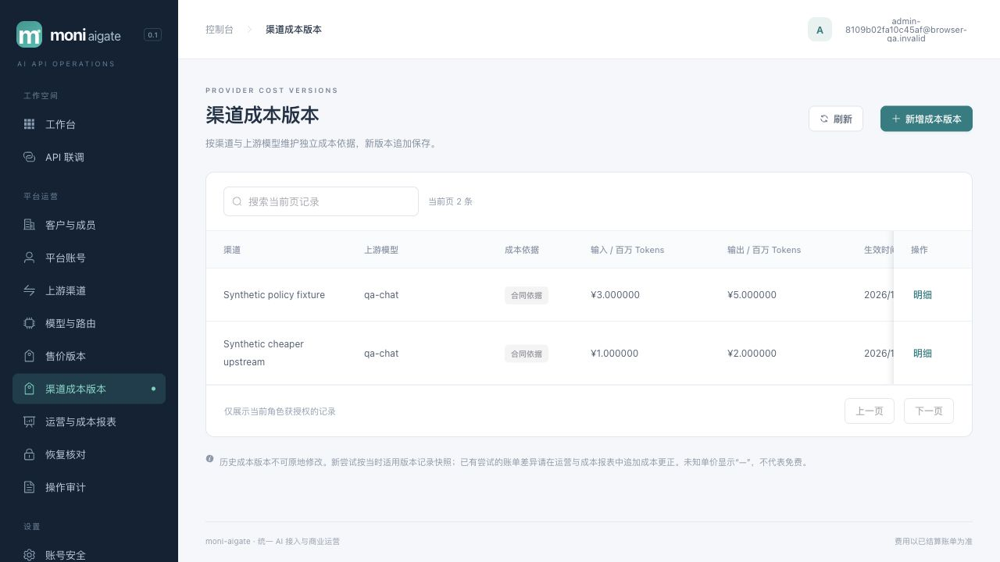
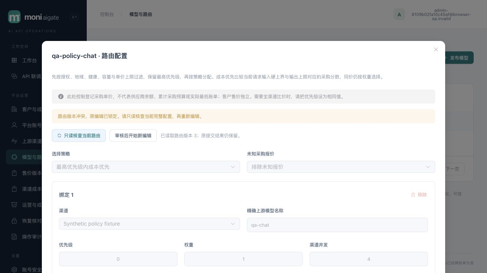
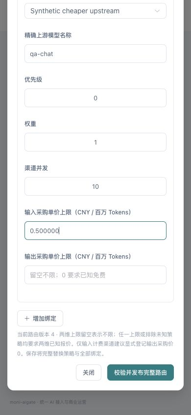
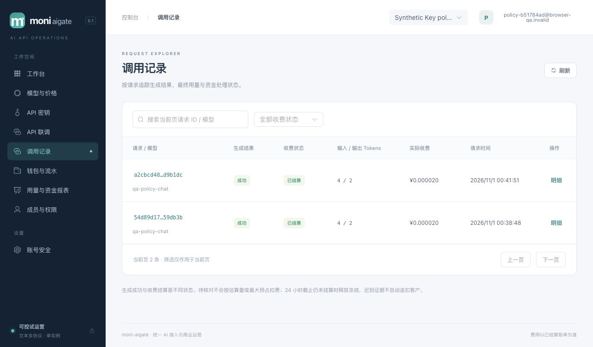
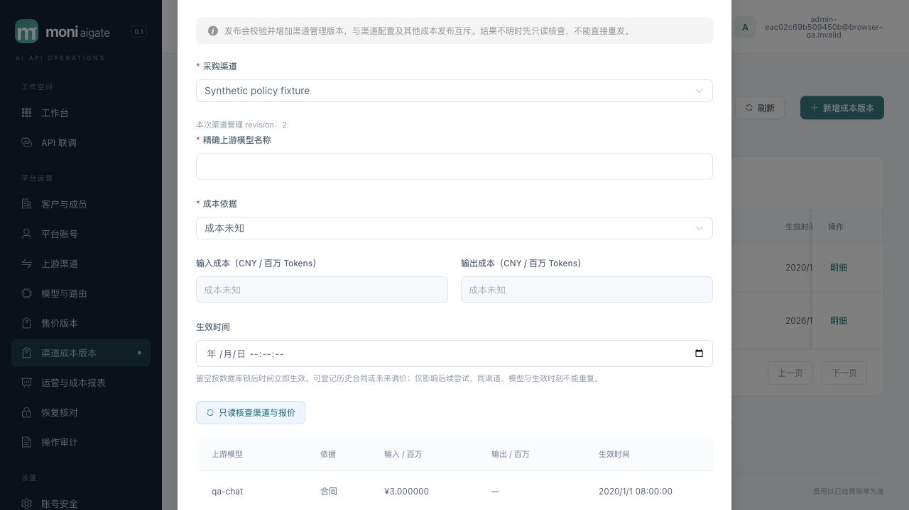
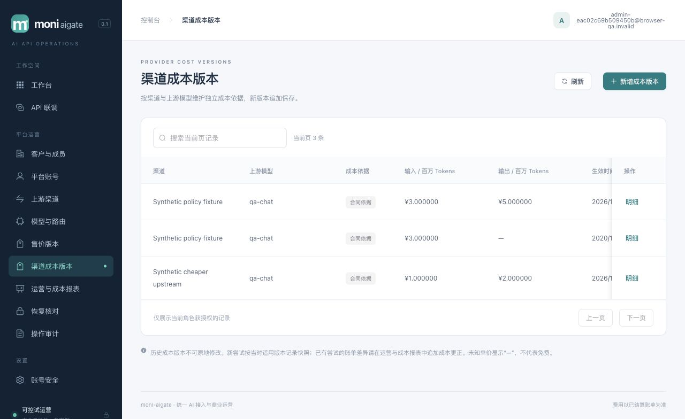

# 018 成本感知路由验收

2026-11-01，018 已实现并通过限定本地验收。013 迁移使当前 schema 为 001–013；58123 本地预览已升级。019 采购账户/共享预算仅有未冻结设计讨论稿，尚未实现。本文不替代正式供应商、Docker/1Panel、灾备、发行许可或目标性能验收。

## 交付行为

平台按「渠道＋精确上游模型」追加采购成本版本，客户售价仍按请求冻结。完整路由 CAS 一并发布策略和所有 binding：可选最高优先级内成本优先、未知报价处理，以及逐 binding 输入/输出采购单价上限。未知报价不当免费，0 上限不同于无上限；金额与比较分数均无损计算。

候选报价在 attempt 创建时核对并冻结，取得全部派发锁后再按新数据库时钟校验当前报价。成本管控路由发生调价或未来报价生效漂移时，以 `cost_quote_stale` 拒绝发送，不自动重新规划；未发送证据使客户冻结正常释放。已经提交 sending 的调用仍使用原采购快照完成证据、结算、释放、退款与恢复。

控制台提供独立路由和成本编辑器；409 或提交结果不明进入只读核查，审核后显式新编辑，禁止自动重发。关闭、切页、身份变化后的旧响应不能覆盖新编辑。客户接口不返回采购价格。

设计依据：[规格](../../specs/018-cost-aware-routing/spec.md)、[验收清单](../../specs/018-cost-aware-routing/acceptance.md)、[HLD §25](../design/HLD.md#25-018-成本感知路由与架构持续同步)、[LLD §25](../design/LLD.md#25-018-采购单价门禁精确比价与报价同步)、[配置手册](../runbooks/development.md#渠道采购价与成本路由018)。统一系统视图见[架构](../architecture/README.md)，并行工作及依赖见[交付计划](../design/delivery-plan.md)。

## 自动化与独立复核

在专用 PostgreSQL 16 测试库执行以下命令，数据库用例实际运行：

```sh
TEST_DATABASE_URL="$DEDICATED_TEST_DATABASE_URL" go test -race ./... -count=1 -timeout=240s
go vet ./...
npm --prefix web test
npm --prefix web run build
go build -trimpath -o bin/moni-aigate ./cmd/moni-aigate
```

全部通过：前端 122/122、strict TS/Vite；Go 全包 race，其中 billing 47.569s、catalog 7.605s、identity 116.698s、server 164.544s、架构检查器 5.539s。执行时间仅作本次测试记录，不是网关请求性能数据。测试后未修改业务源码。

| 验证面 | 主要覆盖 |
| --- | --- |
| 迁移与配置 | 旧 manual/allow 和历史同刻报价兼容；新同刻重复拒绝；最小角色；完整路由及成本 CAS；严格 JSON 拒绝重复/未知/别名/尾 JSON；审计同事务 |
| 选择算法 | 两维大整数分数、最高 priority、同分权重、池成员不改变渠道权重；未知/0/单价上限；健康、双层容量与安全尝试 |
| 报价同步 | 直接 INSERT 等待 channel 锁；候选到 attempt 精确匹配；并发发布及未来生效跨 channel、Key、model、credential、reservation、attempt 锁等待 |
| 财务与 HTTP | sending 后调价仍原价唯一结算；六协议共享未知/上限门禁；排队调价不发送/不重规划；credential 锁等待跨报价生效时供应商 POST=0、not_sent、成本/收费/冻结均0 |
| 控制台 | 15 项新增专项；金额 BigInt、完整 CAS、冲突与未知结果、身份/页面 epoch；修复 Vue Proxy 克隆和模型目录 1000 条的兼容问题 |
| 架构同步 | 新增/修改/删除及保留 mtime 内容变更、代码/设计/证据覆盖、支持图片、本地链接、路径与符号链接越界、显式 reviewed/reason、清单损坏等有意义夹具 |

后端与前端分别交叉只读复核，修复后未发现剩余阻断。复现源码：[routing](../../internal/routing/cost_test.go)、[catalog](../../internal/catalog/cost_policy_integration_test.go)、[billing](../../internal/billing/cost_policy_integration_test.go)、[六协议与 HTTP](../../internal/server/cost_routing_integration_test.go)、[架构检查器](../../scripts/check-architecture/main_test.go)。

## 隔离真实 main 浏览器与资金核对

运行 `scripts/browser-qa`，使用独立随机 schema、受限 app/projector 角色、合成账号与本地 mock；没有调用付费上游，也没有修改既有评审账号、MFA 或真实客户资金。合成入账 1,234,567 微元，客户输入/输出售价分别 2,000,000/6,000,000 微元/百万 Tokens；每次 mock usage 为输入4、输出2。

浏览器完成采购报价新增、两渠道完整路由发布和重读；两个渠道同 priority，成本优先自动拒绝未知。冻结 revision2 编辑时，另一 HTTP 会话先发布相同配置为3；页面提交旧2显示版本冲突并锁定，先只读读取3，再显式新编辑发布4。revision4 将便宜渠道输入单价上限设为 0.5 CNY/百万 Tokens。本组浏览器证据保留冲突界面与版本历史，未另存409原始HTTP正文；完整路由/成本CAS的状态码合同由专项HTTP/PG测试验证。

| 浏览器调用 | 路由版本 | 选中渠道 | 输入/输出采购价，微元/百万 Tokens | 客户收费，微元 | 采购成本，微元 |
| --- | --- | --- | --- | --- | --- |
| 成本优先 | 2 | Synthetic cheaper upstream | 1,000,000 / 2,000,000 | 20 | 8 |
| 便宜渠道超出该 binding 上限 | 4 | Synthetic policy fixture | 3,000,000 / 5,000,000 | 20 | 22 |

第二笔解释记录 `cost_limit_exceeded`，第一笔记录 `higher_cost`。2 个请求、2 个 attempt、2 个 finalization、2 个唯一 settlement；收费合计40、采购成本30、可用余额1,234,527、钱包与 Key 冻结均0、Key spent40，账本总和0、不平衡分录0、未知成本0。客户页面仅显示两笔各 ¥0.000020 和用量，不展示采购报价。此例第二笔毛利为负，说明上限是逐 binding 的经营约束，不是利润保证。

390×844 移动视口无水平溢出，采购上限字段和底部按钮可达；测试后已恢复视口。浏览器 console warn/error 为空。完整只读结果见[业务快照](cost-routing-018-browser.json)。代表截图：









联调单次浏览器首字节/首内容包含浏览器、网络、网关与 mock 等待；没有用这两笔数据宣称 P95 或性能改善。

## 清理、运行器与预览升级

QA mock 实际收到2个认证 SSE POST，无探测、目录或其他调用。Ctrl+C 后子进程正常排空，应用/mock listener 均关闭，本次 schema 与两个角色均不存在；manifest 密码/供应商秘密已清除，本轮自建私有凭据文件也已移除。[清理证据](cost-routing-018-harness.json)。随后显式执行：

```sh
TEST_DATABASE_URL="$DEDICATED_TEST_DATABASE_URL" \
  BROWSER_QA_REAL_MAIN_TEST=1 BROWSER_QA_ERROR_TEST=1 \
  go test -race ./scripts/browser-qa \
  -run 'TestBrowserQARealMainLifecycle|TestBrowserQAFailedBootstrapCleansOwnedResources' \
  -count=1 -timeout=120s
```

通过（10.739s）。未将该运行器测试与正在占用相同数据库单活锁的 QA 同时运行。

首次预览升级前重新确认旧进程 PID7168、58123 listener、命令和工作目录；SIGTERM 退出0，listener 关闭后，以 owner 执行013迁移和 provision，再以受限角色启动 serve。该次 PID28955，ready=true、recovery_mode=false；app 非 owner/superuser，可读取新策略/上限字段，projector 无这些读取权限。首页及29项 assets 与该次 dist 逐字节一致。[首次升级证据](cost-routing-018-preview-initial.json)。浏览器在无评审会话的 `127.0.0.1:58123/login` 只读确认渲染，console warn/error 为空，未操作账号。

首轮 QA 二进制 SHA-256：`09e75d40daf32bef1231023d7bcaed01a9e87d38c543373287651ad166f27ef5`。最终产物与补验见下一节；当前预览入口：[localhost:58123](http://localhost:58123)。

## 最终重建校准与补验

最终 `make check` 重建发现资源指纹与首轮嵌入包不同。交叉复核确认最后两项前端修正与首轮构建发生交叉：历史部分报价的只读兼容、分页 next_cursor 类型校验未进入首轮包。归一化资源引用后，28/29资源完全相同；PlatformView的其余91个顶层语句结构与字面量相同，仅上述两个函数发生实际变化。首轮证据保留原摘要，不将它说成最终源码完整对应。

从最终 strict 构建重新嵌入，122项前端测试再次全部通过。最终二进制 SHA-256 为 `f265da8aa330b0221ff8e0531565eb4c31fbe56bc6eea9135aa298adf7eb503a`；后端源码没有变化，原全 Go race/vet 仍对应当前代码。另启隔离真实 main 补验：用合成历史部分报价（输入3、输出null）验证成本编辑器只读核查正常；新 contract 报价缺输出时被表单拒绝，补输出5后成功追加；完整路由发布成功并将便宜渠道输入单价上限设为0.5。浏览器 console warn/error 为空。

随后以直接 HTTP SSE 调用新实例，完整收到 QA OK 与 DONE；选中3/5报价渠道，便宜渠道因上限被排除。1请求/attempt/finalization/settlement，客户收费20、采购22、可用余额1,234,547、钱包与Key冻结0、账本净和与不平衡分录0。补验的生成调用通过 HTTP 发送，界面核查与发布通过真实浏览器完成，详见[最终业务快照](cost-routing-018-final-browser.json)。





补验后正常排空，mock实际1次SSE、无额外付费调用；schema/角色/listener/manifest秘密及本轮私有凭据文件再次清理，见[最终清理记录](cost-routing-018-final-harness.json)。真实main生命周期/失败清理opt-in专项再次通过（11.094s）。再次核对PID28955归属、正常退出0且listener关闭后，58123升级到最终产物PID39966；013无新增迁移，受限启动Verify成功、ready非恢复、首页及29资源与重建dist逐字节一致。最终浏览器只读登录页渲染且无warn/error，见[最终预览证据](cost-routing-018-preview.json)。

## 剩余边界

018 比较已登记的采购单价和当前请求保守用量界，无法保证供应商真实扣款、自动同步价格/账单、共享采购账户余额、累计采购预算、汇率、阶梯价或实际最低账单。这些已拆为 [019 设计讨论稿](../design/procurement-accounts.md)及后续独立规格；019尚未冻结、未实现。

统一架构包含上下文、模块、请求时序、ER、部署五图，已用官方 Mermaid 12.2.0 解析及渲染5/5并视觉复核；内容同步机制另见[架构专项](architecture-sync.md)。架构清单已在本轮文档与证据稳定后由集成人语义复核并显式刷新，包含源码、设计与验证证据；`make check`（只读架构检查、vet、strict构建）已通过。最终验收状态同步后再次显式刷新并执行 `make architecture-check`，保持交付内容与清单一致。正式供应商、容器/1Panel、灾备与性能门禁仍见[MVP状态](mvp-status.md)。
