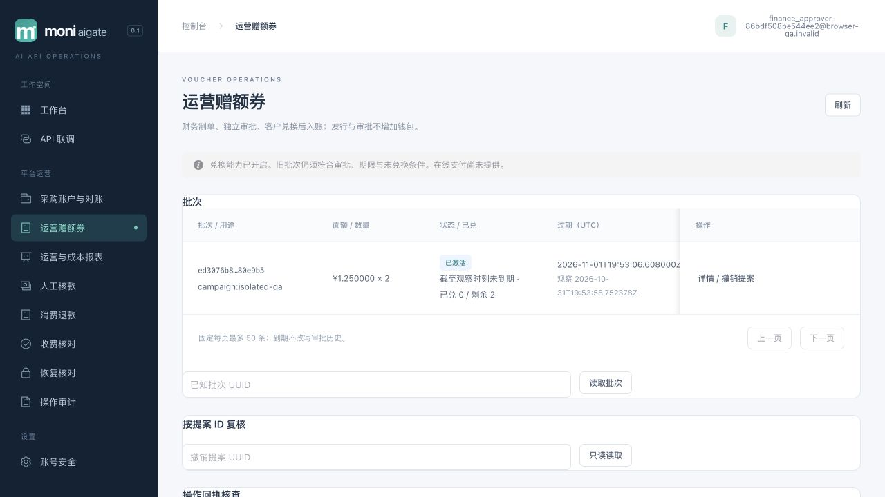
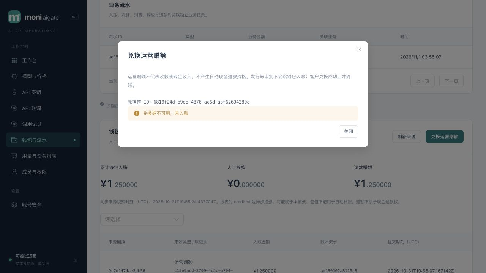

# 022 共同入账与兑换券验证

2026-11-01。**A0共同入账与A1双审兑换券已实现并完成限定本地验收。B0-P纯协议已实现并通过限定验证；M/Q及B1/C未冻结未实现。** 本记录不声称022整体完成；长期预览58123已排空升级017，默认券硬开关和数据库策略均关闭。

## A0实现和复核范围

新增017九表与严格历史预检/receipt回填；人工批准通过共同ApplyFundingTx唯一写journal、receipt和credited。voucher source/赠额独立清算及完整关系约束已实现，但没有发行/兑换领域服务或HTTP入口，不能据SQL fixture声称券产品已交付。钱包保留原六字段，累计入账改为同tenant全部funding receipts。

历史坏source/journal/credited拒绝迁移并回滚DDL，不补发journal/outbox；新孤立credited及任意非funding kind使用清算科目拒绝提交。batch/operation/proposal/decision双向绑定，原凭据/金额/归属不可变；app白名单列权限，每次provision收回表级权限，projector不能读取新增来源/券/命令。

VerifyFunding在只读REPEATABLE READ下逐source双向核对，租户核验只比其journal清算分录，不比平台总账户。VerifyLedger/Rebuild纳入来源与receipt覆盖，保留reports-v1/credited消费，无分类重复事件。A0原始余额溢出码amount_overflow由后续A1明确映射funding_amount_overflow，不能映射任意SQL故障。

## 真实PostgreSQL证据

所有测试使用127.0.0.1:55439的专用moni_test及随机schema/roles，无收费供应商，无评审账号/资金变更。

- billing最终关系专项PG race **7.991s**：人工/券source、回滚注入、BIGINT、旧reports/rebuild、两清算旁路拒绝、孤立accepted兑换回执反向核验、完整revocation图及错kind/同maker/缺proposal拒绝。
- operations最终7项Funding专项PG race **4.140s**：正常历史、异常历史拒迁移、九表/逐列最小角色、重复provision、人工和报表兼容。
- billing最终完整PG race **74.705s**通过（覆盖最终017/关系guards）。operations全包发现旧021 staged fixture只apply016却调用最新provision，测试fixture补apply017并保留原断言后，最终全包PG race **17.656s**通过。该修订不改身份实现。
- 根服务器人工HTTP兼容PG race最终 **7.830s**：原API制单/独立审批、重复审批回原结果、唯一receipt/journal/credited、钱包六字段与另一租户零额、客户无平台审批权。
- billing/operations `go vet`通过。A0源码已停写并独立复核，根接受组合证据后才放行A1。

以上保留A0阶段证据；后续A1验收如下，不用数据库source fixture代替产品验证。

## A1实现与最终证据

独立security.VoucherKeyring提供版本化code/command HMAC域，启动严格校验全部被引用版本。六命令使用READ COMMITTED、先claim及父根/当前权限锁，再建立业务savepoint；语义拒绝持久回执，stale撤销额外保留不可变decision。5秒总deadline覆盖池等待、有限已知回滚重试与COMMIT；未知COMMIT不重试、不返回codes。查询使用REPEATABLE READ重新核查当前权限；安全时间UTC六微秒，Money/NUMERIC无损字符串。

HTTP具有独立有界桶、最多4写在途及严格输入/DTO。env关闭在claim前拒create/redeem所有POST，原GET回执和旧审批/作废/撤销仍可读/收尾。前端五字段安全journal阻止unknown/404后换ID重做，关闭/身份切换/本地截止后迟到codes丢弃；200 rejected不作为入账。钱包显示人工核款/运营赠额与同步观察时刻，不赋予现金退款资格。

- 最终Voucher真实PG race：billing **8.727s**、security **1.863s**；100并发唯一资金、同operation并发一次codes、密钥轮换、撤权、50+1分页、账户锁跨expiry、NUMERIC累计超过int64、受限app完整链路均通过。
- 真实PG网络代理复现COMMIT响应丢失；发行不返codes、兑换不重复。COMMIT阶段40P01/40001最多3attempt，23514不重试；audit/outbox/receipt/terminal/deferred失败全图回滚。
- 根HTTP/config专项race **1.990s / 1.235s**；真实PG HTTP商业流程 **2.826s**。默认off、严格值/未知query、当前角色/跨tenant、env-off无key旧回执、独立限流与许可归还通过。
- 最终全Go真实PG race通过（billing **89.100s**、identity **227.804s**、server **231.001s**、operations **26.576s**），无跳过数据库验收；`go vet ./...`通过。光标/代理等专项与全量范围互补，不声称每种网络故障均由真实main覆盖。
- 全前端 **209/209**测试通过，strict vue-tsc与Vite构建通过。最终真实main三模式生命周期（普通/身份/券）及失败bootstrap资源清理race **16.880s**通过；券fixture仅开进程硬上限，DB策略仍off，不自行造资金。

## 隔离浏览器与预览

[浏览器/PG证据](funding-vouchers-022-browser.json)、[运行器与清理](funding-vouchers-022-harness.json)记录最终包`ef012655a667f662f865731ab69ba3948e24d45e493ce7c58e541fd4e7b19801`。浏览器完成admin策略CAS、finance发行2张¥1.25并一次展示、关闭清除、独立approver激活、合成owner兑换一张、重复兑换拒绝、来源/兑换详情与390px移动布局。合成账号创建经隔离HTTP，浏览器仅登录与业务操作。

权威PG只有1个redemption/receipt/journal/credited、赠额1250000微元，AVAILABLE=1250000、OPERATING_GRANT_CLEARING=-1250000，所有journal平衡；零模型请求/attempt、零人工credit。正常SIGTERM后应用/mock监听关闭，临时schema与两角色均0，manifest及自建私密文件清除凭据。

[017预览核对](funding-vouchers-022-preview.json)：原PID4350排空退出0，owner迁移/provision和受限app check-ledger通过；新PID36238 ready且非恢复，首页及45个assets与最终包一致。app拥有受限source读取，projector没有source/身份/采购/定价读权；注册/邮件默认关，券DB policy与env均off。没有修改原评审账号、密码、MFA或业务资金。

浏览器unknown/迟到201/404不能解锁由前端状态测试覆盖，真实COMMIT不明由PG网络代理覆盖；本轮真实main浏览器未伪造网络失败。正式支付、现金退款/lot、真实供应商及生产多实例/容器/灾备仍是后续独立门禁。
