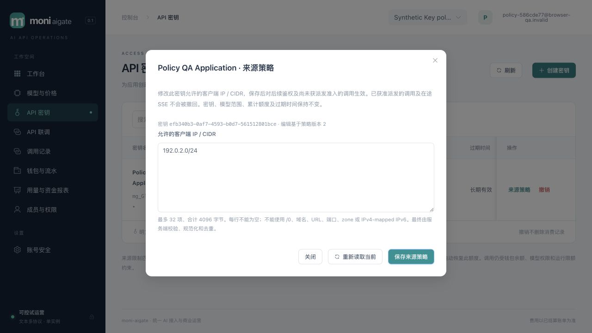

# 015 Key 来源访问策略验收

2026-10-31，`v0.1.0-dev`，限定范围本地验收通过，原生产与性能门禁保留。工作树未提交或远程发布。[规格](../../specs/015-key-access-policy/spec.md)、[实施计划](../../specs/015-key-access-policy/plan.md)、[验收清单](../../specs/015-key-access-policy/acceptance.md)、[HLD §22](../design/HLD.md#22-015-key-来源访问策略)、[LLD §22](../design/LLD.md#22-015-key-来源访问策略)。

## 交付与边界

客户Key支持来源IPv4/IPv6/CIDR创建、列表完整展示、按ID只读核查和CAS编辑。最多32项、原始总4096 UTF-8字节；服务端trim、mask、排序去重，拒绝空项、域名、URL、端口、zone、mapped IPv6配置和全网/0。空列表表示不限来源，兼容已有Key；实际mapped传输地址转换为IPv4，合法IPv4-compatible IPv6仍可配置。

010迁移新增规范来源数组、独立`access_policy_revision`及不可更新的请求`client_ip`。版本只随来源列表实际变化递增，消费spent/held不影响编辑；同内容和当前版本是无审计no-op，旧版本即使同内容仍409。owner可编辑本租户Key，member仅自己的Key，billing_viewer不可编辑；撤销后只读，过期可编辑但不延长期限。策略变更和before/after审计同事务。

模型目录和全部六协议复用014可信代理规则，鉴权时固定一次来源。Reserve、RecordAttempt和PrepareDispatch在原锁序下复查数据库当前策略；排队、历史NULL和安全重试都不能绕过收紧。`sending`提交是派发授权同步点，之后的请求与在途SSE不会被撤回；结算、释放、退款及恢复继续使用原资金规则，不能在共用收尾锁helper增加来源拒绝。

控制台固定Key/字符串revision，冲突或未知提交结果不自动重发。GET只观察当前配置，没有命令回执，不能证明某次写入归因；必须显式复核后开始新编辑。账号/租户/角色和弹窗epoch屏蔽晚回，关闭或离页清除明文/表单。列表增加分页读取。独立复核发现并修复历史元数据兼容：既有后端允许的换行名称、空或长scope仍按Vue文本转义展示，不能让一行阻断整页。

本轮没有动态RPM/burst/concurrency、其他Key属性编辑或周期预算；既有60RPM/burst20、Key并发16保持。也没有性能压测，页面单次耗时不是P95。

## 自动化与独立复核

```sh
npm --prefix web test
npm --prefix web run build
TEST_DATABASE_URL='postgres://moni_test@127.0.0.1:55439/moni_test?sslmode=disable' go test -race ./... -count=1 -timeout 240s
go vet ./...
go build -trimpath -o bin/moni-aigate ./cmd/moni-aigate
TEST_DATABASE_URL='postgres://moni_test@127.0.0.1:55439/moni_test?sslmode=disable' BROWSER_QA_REAL_MAIN_TEST=1 BROWSER_QA_ERROR_TEST=1 go test -race ./scripts/browser-qa -run 'TestBrowserQARealMainLifecycle|TestBrowserQAFailedBootstrapCleansOwnedResources' -count=1 -timeout 120s
```

79项前端测试、strict TypeScript/Vite、真实PostgreSQL全Go race、vet及最终嵌入build通过。全race包耗时：billing36.166s、catalog6.749s、config1.721s、identity59.580s、operations8.254s、provider5.368s、routing2.913s、security3.261s、server139.984s、telemetry4.068s、browser-qa4.615s；它们不是接口延迟。显式真实main两轮生命周期/失败bootstrap清理另通过11.442s。

专项覆盖：

| 层次 | 实际验证 |
|---|---|
| security/数据库 | IPv4/IPv6/mapped/compatible、输入界、完整扫描fail closed；PG与Go规范格式一致；版本不可伪造、数组约束、来源不可更新 |
| identity/权限 | owner/member/viewer/跨租户/撤销/过期、当前tenant/member/user有效状态；真实行锁等待后重判；同CAS仅一个成功、审计失败回滚、no-op不审计；最小app与projector隔离 |
| HTTP | strict创建/GET/PUT、安全三字段/头、CSRF/近期再认证/MFA/Guard/恢复模式；六协议+models可信/不可信peer、伪XFF、重复/链/非法X-Real-IP、IPv6/mapped |
| billing | Reserve/attempt/dispatch在真实PG Key锁等待后拒绝新收紧；单连接pipeline清理；历史NULL已prepared再派发拒绝、sequence2安全重试被新策略阻止；释放held归零 |
| 在途与资金 | 已sending SSE收紧后完成；最终证据/恢复重复执行/唯一结算及退款不受新来源策略阻断；无重复收费或遗留冻结 |
| frontend | CAS冻结/精度、409与未知结果锁定核查、关闭重开/晚回/身份切换、秘密清理、历史安全文本兼容；不自动重发POST/PUT |

三个独立分工相互复核了资金检查位置、锁序及前端提交状态机，已修复前端合法IPv4-compatible格式和历史展示合同问题，未发现遗留阻断项。

## 实际浏览器操作

使用014运行器启动最终真实程序：隔离应用127.0.0.1:65255，mock在65260，均排除58123。运行器仅准备随机schema、受限角色、三种平台身份和回环mock。**模型/渠道/路由/价格、客户授权与双人模拟核款由HTTP API准备**；下表才是实际浏览器控件操作。没有把准备工作记为浏览器经营闭环，没有使用评审账号、真实资金或付费渠道。

| 浏览器操作 | 结果 |
|---|---|
| 合成客户密码登录 | MFA默认可选，无需绑定；进入已有模拟余额的工作空间 |
| 创建指定模型、1 CNY额度、重复loopback来源的Key | 规范化去重为127.0.0.1/32，revision1；一次性明文关闭后完整Key不在页面文本中 |
| 相同Key执行Chat SSE | QA OK，可信input4/output2，唯一收费20微元；消费没有改变策略revision1 |
| 编辑192.0.2.8/24 | 返回192.0.2.0/24、revision2，模型/额度/身份保持 |
| 相同Key再次SSE | HTTP403 key_ip_forbidden；拒绝前后请求/尝试/预占/结算/最终证据/审计等快照一致，无新增收费 |
| 显式清空列表；再次保存相同空列表 | revision3、不限来源；相同内容保存保持revision3且没有额外审计 |
| 相同Key执行非流JSON | QA OK、input4/output2，唯一新增收费20微元 |
| 查看调用记录、移动Key页与编辑器 | 两条已结算各20微元；390×844下document宽度=viewport=390，编辑器控件可用 |
| 退出登录 | 返回登录页；关闭QA页并清除工具内存中的一次性凭据 |

没有在浏览器构造并发CAS、网络未知结果、对话中角色变化或其他五种协议；这些以定向合同/真实PG HTTP专项为证。应用console warn/error快照为空，桌面和移动截图已目视检查。



另存[两条唯一收费](assets/key-policy-billing-015.png)和[390px编辑器](assets/key-policy-mobile-015.png)。截图是合成测试归档，QA已清理，不是预览数据库实时内容。

## 原始证据与清理

[浏览器安全JSON](key-policy-browser-015.json)记录实际数据库只读核对：两次成功、两个attempt/预占/finalization/settlement，各收费20；拒绝request_id没有新增业务事实。请求持久来源均127.0.0.1；两次策略变更恰有两条before/after审计。Key身份/owner/scopes/额度前后相同，spent40、held0；钱包入账1,234,567 − 消费40 = 可用1,234,527微元，冻结0。账本总和0、每个journal平衡且至少两条分录。mock实际POST2与业务attempt2一致，目录和平台probe均0。

[运行器安全JSON](key-policy-harness-015.json)记录SIGTERM正常退出、监听关闭、schema/两角色实际不存在、manifest凭据已清除；额外准备文件中的合成客户凭据也已删除。私有日志/manifest留在忽略目录，不进入交付。

## 本地预览与保留门禁

已重新确认58123旧进程属于本工作区，SIGTERM正常停止后，以owner迁移010并provision，再以受限app/projector启动最终程序。`/health/ready`返回status=ready、recovery_mode=false；首页和全部28个assets与最终dist逐字节相同。实际受限连接确认10个迁移及010存在，app非superuser/非Key表owner，projector不能读取Key策略或请求来源。浏览器仅检查预览登录页，console无warn/error，没有登录评审账号或修改其MFA/资金。[预览摘要](key-policy-preview-015.json)保存程序及资源SHA256。

正式供应商硬界/最终usage/成本认证、Docker/Compose和1Panel目标部署、网络分区/异地灾备、指定4vCPU/8GB下完整商业链路首字节p95<50ms及Rust LiteLLM/Bifrost持续实跑对比、最终发行许可证继续保留。015不替代原001全部发布条件；动态Key限额、其余渠道运营与自助经营继续按[路线图](../design/new-api-roadmap.md)推进。
