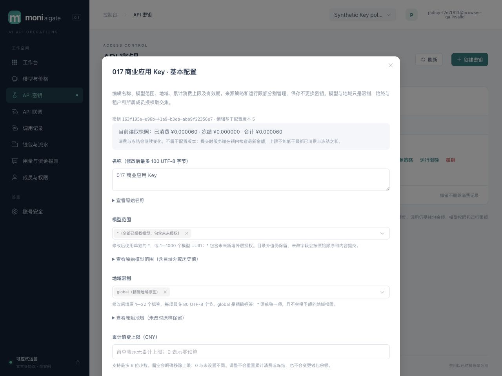

# 017 Key 基本配置编辑验收

2026-10-31，`v0.1.0-dev`，限定范围本地验收通过。原生产与性能门禁保留，工作树未提交或远程发布。[规格](../../specs/017-key-configuration/spec.md)、[计划](../../specs/017-key-configuration/plan.md)、[验收清单](../../specs/017-key-configuration/acceptance.md)、[HLD §24](../design/HLD.md#24-017-key-基本配置编辑)、[LLD §24](../design/LLD.md#24-017-key-基本配置编辑)。

## 交付与同步边界

客户 Key 新增名称、模型范围、地域、累计消费上限及有效期的完整配置编辑。012 迁移新增独立 BIGINT `configuration_revision`，API 以字符串返回；只有五元组实际改变才递增，不能直接伪造。来源、运行限额、消费/冻结及撤销均不影响此版本。创建和列表补充地域及配置版本，GET 返回九项安全字段；PUT 六项完整必填，两个可空字段必须显式给出。创建及配置 PUT 上限 64 KiB，可容纳 1000 个 UUID。重复、未知、大小写别名、尾 JSON、数组 null 元素及不规范输入拒绝。

只有改动字段才适用新名称/模型/地域规范；历史字段未改时原样保留，不自动清洗。`global` 是精确地域标签，`*` 必须单独一项；Key 是限制，继续与租户和所属成员授权取交集，不能借编辑赋权。金额用十进制字符串和 BigInt，无损回填；0 是零预算，null 是无累计上限。有效期先严格检查 RFC3339（小数部分最多 9 位），保存为 UTC 微秒；同一瞬时时区或亚微秒差异不产生变更。新值须在锁后数据库时刻之后且 UTC 年份在 0000..9999；旧过期值可保留以编辑其他字段，也可明确续期或移除期限。撤销仍不可恢复。

PUT 取得 tenant SHARE → actor membership SHARE → actor user SHARE → Key UPDATE 锁，重新校验当前身份、归属和 CAS。owner 可编辑本租户 Key，member 仅自己，viewer 禁止。锁内非 null 上限不得低于最新 spent+held，和超 int64 时仍精确比较。预算不足与版本冲突分别返回 409；旧版本同值仍冲突，当前版本同值为无审计 no-op。五字段 before/after 与版本审计和变更同事务。未知提交结果没有持久回执，不自动重发，也不能只凭 GET 相同认定归因。

运行路径通过原 Key 锁同步配置。Reserve 锁后读取限制，钱包锁等待后在提交前再次检查到期；RecordAttempt 在原渠道/预占锁后专门复查当前 Key 模型、地域、来源与到期；PrepareDispatch 在 reservation/attempt 锁后用新语句数据库时钟复查 Key 到期及请求 deadline，再进入 sending。新限制不放入资金收尾共用 helper。已有冻结不受预算下调侵占，安全重试只预占一次；已 sending 和在途 SSE 继续按原规则结束，最终证据、结算、释放、退款、恢复不受新配置阻断。配置编辑不重建运行桶或清空在途数。

控制台新增第三个独立编辑器，三种配置分别管理 CAS、unknown 和异步 lane；列表与 GET/save 合并分别保留较高版本，配置快照不覆盖当前列表 spent/held。actor/tenant/role 与弹窗 epoch 隔离晚回，关闭/离页清理输入和秘密；unknown 重开仍先只读核查，再显式开始新编辑。有效期默认保留原始秒与微秒，明确选择设置或移除；目录外历史模型/地域可见并保留。

## 自动化与独立复核

```sh
npm --prefix web test
npm --prefix web run build
TEST_DATABASE_URL='postgres://moni_test@127.0.0.1:55439/moni_test?sslmode=disable' go test -race ./... -count=1 -timeout 240s
go vet ./...
go build -trimpath -o bin/moni-aigate ./cmd/moni-aigate
# 在浏览器 QA 主实例退出并清理后串行执行；不能争用同库活动实例锁。
TEST_DATABASE_URL='postgres://moni_test@127.0.0.1:55439/moni_test?sslmode=disable' BROWSER_QA_REAL_MAIN_TEST=1 BROWSER_QA_ERROR_TEST=1 go test -race ./scripts/browser-qa -run 'TestBrowserQARealMainLifecycle|TestBrowserQAFailedBootstrapCleansOwnedResources' -count=1 -timeout=120s
```

107 项前端测试（含 16 项 017 专项）、strict TypeScript/Vite 构建、真实 PostgreSQL 全 Go race、vet 和最终嵌入 build 通过。最终全 race 包耗时：billing 41.845s、catalog 5.824s、config 1.693s、identity 117.985s、operations 7.812s、provider 4.744s、routing 2.844s、security 2.975s、server 166.973s、telemetry 3.093s、browser-qa 3.972s。包耗时不是请求延迟。真实 main 两轮启停及失败 bootstrap 清理另通过 10.290s；第一次调用因命令参数误写 `-timeout120s` 未执行测试，改为 `-timeout=120s` 后通过，没有修改产品来绕过失败。

| 层次 | 已执行验证 |
|---|---|
| 数据库 / identity | 012 默认与版本防伪、五字段各自递增、三版本互不干扰、消费不改版本；当前角色/租户/归属/撤销、CAS/no-op、审计失败回滚、最小 app/projector 权限 |
| 金额 / 日期 / 历史 | 冻结变化后以最新 spent+held 拒绝，和超 int64 仍精确；旧字段原样往返、过期保留/续期/移除、微秒和 offset 同瞬时 no-op；UTC 年份越界及严格日期 POST/PUT 无 mutation |
| 准入 / 锁等待 | Reserve/RecordAttempt/PrepareDispatch 等待 Key 锁后观察已提交的范围收紧；未改到期值跨 Key/model/wallet/channel/credential/reservation/attempt 真实锁等待后重新读数据库时钟；dispatch deadline 同样锁后重判 |
| 资金尾部 / 重试 | 尚未发送失败可释放；安全重试按新模型/地域/到期拒绝；预算降到 spent+held 后仍可重试且只有一次冻结；sending 后收紧仍完成唯一结算、恢复重复执行及退款 |
| HTTP | 六种收费协议的模型/预算/过期拒绝无资金事实；排队 Reserve 前重新检查、已发送 SSE 唯一结算；九字段安全投影、六字段完整替换、null/未知/重复/别名/尾 JSON、1000 UUID 和 64 KiB 边界 |
| 前端 | int64 与 CNY 无损往返、0/null、日期微秒/UTC 边界、历史目录外值、Unicode 地域排序与 Go 一致；三 CAS 交错/较高版本保留、配置快照不覆盖消费、unknown/晚回和秘密清理 |

三个分工独立交叉复核数据库/API、前端与 root 资金实现。复核发现 Go 标准时间解析会接受逗号小数、单数字小时和越界 offset，已在创建与编辑共用严格 RFC3339 校验，并补四类 HTTP 无 mutation 回归。另处理数组 null 被 Go 默认解为空字符串、UTC 转换跨 10000 年，以及缺失 attempt version 时保留领域错误并排空 batch，避免连接污染。最终复核未发现遗留缺陷。

## 浏览器代表路径与账本

最终真实程序使用 014 运行器：应用 127.0.0.1:60724、mock 60730，均排除 58123。运行器只准备随机 schema、受限角色、三种平台身份及回环 mock。**模型、渠道、路由、售价、客户授权和双人模拟入账由 HTTP API 准备**；下面是实际浏览器控件操作，没有将准备工作算作浏览器经营闭环。

| 浏览器操作 | 可核对结果 |
|---|---|
| 合成客户登录并创建 Key | 指定单模型/global、1 CNY 上限、127.0.0.1/32、默认 60/20/16；三版本均 1，关闭一次性明文后调用 |
| 首次同 Key Chat SSE | QA OK，可信 input 4 / output 2，唯一收费 20 微元 |
| 改名称、额度 0.5 CNY、期限 `2030-01-02T03:04:05.123456+08:00` | 配置版本 2；保存为 `2030-01-01T19:04:05.123456Z`；同值再存仍版本 2、仅一条配置审计 |
| 把上限改成 0 | 409 `key_budget_below_usage`，只读核查后才能显式开始新编辑；前后全部数据库快照字段相同 |
| 显式新编辑，上限改成当前已消费 20 微元 | 配置版本 3；新调用 HTTP 402 `key_budget_exceeded`，前后全部快照字段相同 |
| 上限恢复 0.5 CNY，地域换成 `another-region` | 配置版本 4、原微秒期限保留；新调用 HTTP 503 `no_available_channel`，前后全部快照字段相同 |
| 恢复 global、模型改 `*`、明确移除上限与期限 | 配置版本 5；两个 null 明确持久化，未换 Key 或重置已消费 |
| 交错编辑运行限额与来源 | 6000/200/3、限额版本 2；新增 192.0.2.8/24 规范为 192.0.2.0/24、来源版本 2；配置仍版本 5 |
| 恢复后同一 Key 再发 SSE 和非流 JSON | 两笔各收费 20 微元；实际 mock 合计 SSE 2 / JSON 1，三笔账单均唯一结算 |
| 查看账单、1280×960 与 390×844 编辑器 | 三笔各 20 微元；移动 document 宽度等于 390，表单可滚至期限及保存按钮 |
| 清空联调输入、退出并关闭临时页 | 密钥仅在工具内存临时使用，已清除；没有操作评审账号、MFA或真实资金 |

实际非流式调用以可见开关状态和 mock JSON 计数为准；首次恢复调用仍为 SSE，随后明确关闭开关并验证 JSON，因此成功调用总数为三。没有在浏览器构造并发 CAS、未知网络结果、撤销/过期续期或其他五协议；这些边界由前端合同/真实 PG 专项覆盖。应用 console warn/error 快照为空，桌面/移动截图已目视检查。单次浏览器计时不是 P95，本轮没有性能压测。



另存[三笔唯一结算](assets/key-configuration-billing-017.jpg)、[移动表单上部](assets/key-configuration-mobile-017.jpg)及[期限与保存按钮](assets/key-configuration-mobile-bottom-017.jpg)。截图均为已清理的合成 QA 归档。

[浏览器安全 JSON](key-configuration-browser-017.json)保留三组拒绝前后快照及最终状态：3 个成功 request/attempt/reservation/finalization/settlement，累计收费 60 微元，Key spent 60 / held 0，模拟入账 1,234,567 − 60 = 可用 1,234,507 微元。账本总和 0、冻结 0，每个 journal 平衡且至少两条分录。Playground 没有发送幂等头，幂等表为 0。配置审计 4 条、来源和运行限额各 1 条；同值保存及拒绝均不增加审计。

## 清理与预览

[运行器安全 JSON](key-configuration-harness-017.json)记录实际 mock POST 3（SSE 2 / JSON 1），与客户 attempt 3 一致，目录和平台 probe 均 0。SIGTERM 后 `stopped` / `graceful`；应用/mock 监听关闭，随机 schema 与两角色实际不存在，manifest 密码/mock 秘密清除，额外私有客户文件删除，浏览器会话退出、临时页关闭且视口重置。私有日志和已清理 manifest 保留在忽略目录。

升级前重新确认 49646 对应工作区程序及 127.0.0.1:58123 监听，SIGTERM 后进程正常退出 0、监听关闭，再以 owner 执行 012 迁移/provision，以受限 app/projector 启动最终程序。`/health/ready` 返回 ready、recovery_mode=false；首页与全部 28 个 assets 和验证过的 dist 逐字节相同。实际受限连接确认 12 个迁移、012 存在，app 不是 superuser 或 Key 表 owner，projector 不能读取 Key 及新配置字段。[预览安全摘要](key-configuration-preview-017.json)记录程序/资源 SHA256 和权限核对。

浏览器检查 localhost/login 时被既有登录会话自动导向工作台，仅作只读观察后关闭临时页，没有执行账号操作；随后在无该会话的 127.0.0.1 登录页确认渲染，warn/error 为空并关闭。没有修改评审账号、MFA或资金。

## 保留边界

本轮是 NA-07 的基本配置编辑切片，未覆盖周期预算、分组商品、自助注册/在线支付/订阅或 Key 换发。正式供应商硬界/最终 usage/成本认证、Docker/Compose 与 1Panel 目标部署、网络分区/异地灾备、指定 4vCPU/8GB 完整商业链路首字节 p95 < 50 ms 及 Rust LiteLLM/Bifrost 持续对比、最终发行许可证仍是原发布门禁。本轮没有性能压测，也不代表 New API 全功能或 001 全部验收已经完成。
