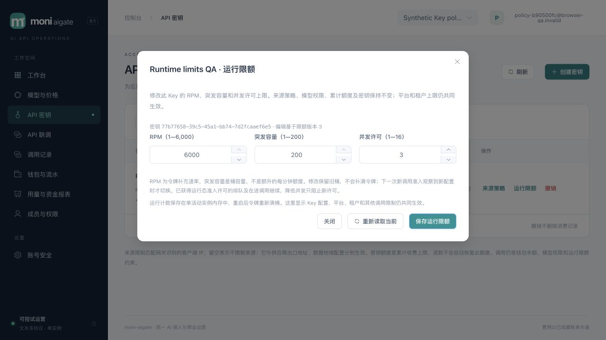

# 016 Key 动态运行限额验收

2026-10-31，`v0.1.0-dev`，限定范围本地验收通过。原生产与性能门禁保留，工作树未提交或远程发布。[规格](../../specs/016-key-runtime-limits/spec.md)、[计划](../../specs/016-key-runtime-limits/plan.md)、[验收清单](../../specs/016-key-runtime-limits/acceptance.md)、[HLD §23](../design/HLD.md#23-016-key-动态运行限额)、[LLD §23](../design/LLD.md#23-016-key-动态运行限额)。

## 交付与生效边界

客户Key可在创建时指定、列表查看、按ID读取和在线编辑三项配置：RPM 1..6000、突发容量1..200、并发许可1..16。默认60/20/16；创建遗漏使用默认，显式null、小数、字符串和越界值拒绝。RPM为令牌补充速率，burst为桶容量，不能当作额外的每分钟额度。

011追加迁移新增三字段及独立`limit_revision`。版本仅随三元组变化递增，不能直接伪造；来源版本、消费spent/held、撤销等不影响限额版本。GET安全返回五字段，PUT严格完整替换并校验字符串revision；当前版本同值为无审计no-op，旧版本即使同值也409。变更和`key.runtime_limits.update`的before/after审计同事务。owner可编辑本租户Key，member仅自己；viewer和已撤销Key不可编辑，过期可编辑但不延长期限。当前身份、安全门禁和权限锁序沿015。

六种收费协议在合法请求及候选路由准备后、资金Reserve前申请一次Key令牌与并发许可。模型目录不消耗Key令牌，预解析失败及无候选不消耗Key令牌；平台/租户速率仍在原入口统计。运行准入通过数据库Key SHARE锁读取最新配置，并在同事务内调用纯内存callback；PUT用Key UPDATE锁同步，不能用旧鉴权快照覆盖新配置，也不能持Server.mu查询数据库。

每Key只保留一个桶和真实在途计数。观察新revision时，以旧速率推进到观察时刻，再修改同一桶的速率和容量；提高配置不补满，降低容量截断余额。未观察期间仍按旧速率，多次未观察更新只使用最后观察到的三元组。旧revision或同revision不同配置返回503。降低并发不撤回旧许可，必须等计数低于新值才新增；已取得运行许可的排队、在途和安全重试继续，重试不重复扣Key令牌。来源与`sending`授权检查继续独立生效，结算、释放、退款与恢复不受新限额阻断。

Key/租户/全局容量检查与令牌消费在同一内存锁内，先占共享global槽再扣令牌，避免probe竞争造成无许可扣token。容量拒绝不消耗Key令牌，429分别为`concurrency_limited`或`rate_limited`。DB事务失败/提交未知时归还已授并发、不得进入Reserve；已扣速率token不退，避免回滚覆盖后续并发状态。

控制台来源与限额分别维护CAS、unknown和异步lane；列表/GET分别保留较高版本，不互相覆盖。未知结果不自动重发，GET仅核查当前配置，不能证明某次写入归因；须显式开始新编辑。创建显式60/20/16，清空数字会提示必填；关闭/离页清除表单和一次性明文。

## 自动化与独立复核

```sh
npm --prefix web test
npm --prefix web run build
TEST_DATABASE_URL='postgres://moni_test@127.0.0.1:55439/moni_test?sslmode=disable' go test -race ./... -count=1 -timeout 240s
go vet ./...
go build -trimpath -o bin/moni-aigate ./cmd/moni-aigate
# 下面两项必须在浏览器QA主实例退出后执行，不能争用同一测试库的活动实例锁。
TEST_DATABASE_URL='postgres://moni_test@127.0.0.1:55439/moni_test?sslmode=disable' BROWSER_QA_REAL_MAIN_TEST=1 BROWSER_QA_ERROR_TEST=1 go test -race ./scripts/browser-qa -run 'TestBrowserQARealMainLifecycle|TestBrowserQAFailedBootstrapCleansOwnedResources' -count=1 -timeout 120s
```

91项前端测试、strict TypeScript/Vite构建、真实PostgreSQL全Go race、vet和最终嵌入build通过。修复后最终全race包耗时：billing33.662s、catalog7.487s、config2.877s、identity90.373s、operations10.057s、provider6.625s、routing2.102s、security2.444s、server147.271s、telemetry5.447s、browser-qa5.747s；测试包耗时不是请求延迟。修复后真实PG运行限额专项另通过12.754s，显式真实main两轮生命周期及失败bootstrap清理通过10.883s。首轮运行器专项误与浏览器QA同时启动，被数据库级单实例锁拒绝（`serve_exited_before_ready`）；浏览器实例清理后串行重跑通过，没有降低锁或修改实现来绕过。

| 层次 | 已执行验证 |
|---|---|
| 数据库/identity | 默认与范围、显式null、revision防伪、两策略版本独立、消费不改rev；角色/跨租户/撤销/过期、CAS竞争/no-op/审计失败回滚、最小app/projector权限 |
| 锁与时间 | tenant/member/user/Key真实行锁等待后重判；旧鉴权快照不能重置限额；callback持Key锁阻塞更新；未变化Key锁等待期间过期也按锁后DB时钟拒绝；callback取消后的事务/连接可复用 |
| 令牌桶 | 确定性时钟覆盖上下调、不赠额度、低RPM、大burst、旧rev/同rev坏配置、4096容量、无TTL重建及重启满桶；同版本和升级配置的反序时间均不能重复累计 |
| 原子容量/清理 | 并发竞争只允许上限数量；降并发保留旧计数；租户/global满不消耗Key token；release并发重复调用只归还一次；合成commit错误归还许可但不退token，取消不进入Reserve |
| HTTP/资金 | 六协议rate/concurrency 429与4096桶503均零资金事实；真实Key锁后读取新配置；已获许可排队与已sending SSE收紧后继续完成、唯一结算，旧请求不改新配置版本 |
| 前端 | 严格数字/字符串revision精度、CAS/no-op/409/unknown、关闭重开/身份切换/晚回、两种策略交错及较高版本保留、创建显式配置、一次性秘密清理 |

三个分工独立复核API/数据库、前端状态机与root运行桶。复核发现锁前采样可能按t2→t1进入同一桶，使`rate.Limiter`时钟回退，下一次重复累计区间。修复为在mu内维护单调`lastObserved`并钳制旧采样，补充确定性回归；修复复核通过。单测合成commit错误不宣称真实网络commit故障注入，数据库事务取消/锁与HTTP行为另有真实PG覆盖。

## 实际浏览器代表路径

使用014运行器启动最终真实程序：应用127.0.0.1:60907、mock60912，均排除58123。运行器仅准备随机schema、最小受限角色、三种平台身份和回环mock。**模型/渠道/路由/售价、客户授权及双人模拟入账由HTTP API准备**；下表为实际浏览器控件操作，没有将准备工作计作浏览器经营闭环。

| 浏览器操作 | 可核对结果 |
|---|---|
| 合成客户密码登录 | MFA默认可选，无需绑定；没有使用评审账号 |
| 创建指定模型、1 CNY累计额度、127.0.0.1/32来源及1/1/1限额Key | 来源rev1、限额rev1；关闭一次性明文后进入Playground |
| 同Key发起Chat SSE | QA OK、可信input4/output2、唯一收费20微元 |
| 紧接着再次发送 | HTTP429 `rate_limited`，前后全部数据库快照字段相同，没有新request/attempt/预占/结算/finalization/扣费 |
| 清空编辑器RPM再保存 | 提示整数必填，配置未写入；显式填6000/200/2后保存 |
| 重复保存相同6000/200/2 | 限额rev2保持，只有一条限额变更审计 |
| 同Key再次发送非流JSON | QA OK、可信input4/output2、唯一新增收费20微元 |
| 来源增加192.0.2.8/24 | 规范为192.0.2.0/24，来源rev2；限额仍6000/200/2、rev2 |
| 再将并发改为3 | 限额rev3、来源rev2；两种配置均保留，Key身份/owner/scopes/累计额度未改变 |
| 查看账单与390×844限额编辑器 | 两笔各20微元；document宽度=viewport=390，表单及按钮可用 |
| 清空联调页秘密、退出登录 | 返回登录页，关闭QA页并清除工具内存中的临时凭据 |

修改后的成功调用距首次成功超过一分钟，旧速率本可补回令牌；本次浏览器不据此证明“更新没有赠token”，该性质以确定性时钟测试为证。没有在浏览器构造并发CAS、未知网络结果、并发拒绝或其他五协议；这些由前端合同/真实PG HTTP专项覆盖。应用console warn/error快照为空，桌面/移动截图已目视检查。浏览器显示的单次时间不是P95，本轮没有性能压测。



另存[两笔唯一结算](assets/key-runtime-billing-016.jpg)与[390px编辑器](assets/key-runtime-mobile-016.jpg)。截图均为已清理的合成QA归档，不是预览库实时业务。

## 数据、清理与本地预览

[浏览器安全JSON](key-runtime-browser-016.json)保存前后快照：两个成功request/attempt/预占/finalization/settlement，各收费20微元；Playground未发送幂等头，幂等表为0。429的request_id没有持久业务事实。Key spent40/held0，模拟入账1,234,567−收费40=可用1,234,527微元；账本总和0，每个journal平衡且至少两条分录。两个限额变更与一个来源变更各有一条before/after审计，同值保存不增加审计。

[运行器安全JSON](key-runtime-harness-016.json)记录实际mock POST2（SSE1/JSON1），与客户attempt2一致，目录和平台probe均0；SIGTERM正常退出，应用/mock监听关闭，schema与两角色实际不存在，manifest密码及mock秘密已清除，额外合成客户私有文件已删除。私有日志与manifest留在忽略目录，不进入交付。

更新预览时重新查询发现58123无监听、历史PID已不存在，未终止无关进程。以owner完成011迁移/provision，再以受限app/projector启动最终程序。`/health/ready`返回ready且recovery_mode=false；首页和全部28个assets与已验证dist逐字节相同。实际受限连接确认11个迁移及011存在，app非superuser/非Key表owner，projector不能读取Key及新限额字段。浏览器仅检查预览登录页，warn/error为空，未登录评审账号或操作其MFA/资金。[预览安全摘要](key-runtime-preview-016.json)保存程序/资源SHA256与权限核对。

## 保留边界

平台固定6000RPM/burst200、租户300RPM/burst40及并发global100/tenant32继续共同生效。Key运行状态仅在单活动实例内存中，最多4096份，无运行中TTL驱逐；满时新Key返回503 `limiter_unavailable`，已记录Key继续。重启令牌重新满桶，数据库配置保留。这是显式开发版容量与速率边界，没有分布式限流或持久速率历史。

其他Key属性编辑、周期预算/分组、自助注册/在线支付/订阅、其余渠道经营及协议扩展继续按[路线图](../design/new-api-roadmap.md)开发。正式供应商硬界/最终usage/成本认证、Docker/Compose和1Panel目标部署、网络分区/异地灾备、指定4vCPU/8GB完整商业链路首字节p95<50ms及Rust LiteLLM/Bifrost持续对比、最终发行许可证仍是原发布门禁。016限定范围通过不替代001全部验收，也不代表New API全功能已经完成。
