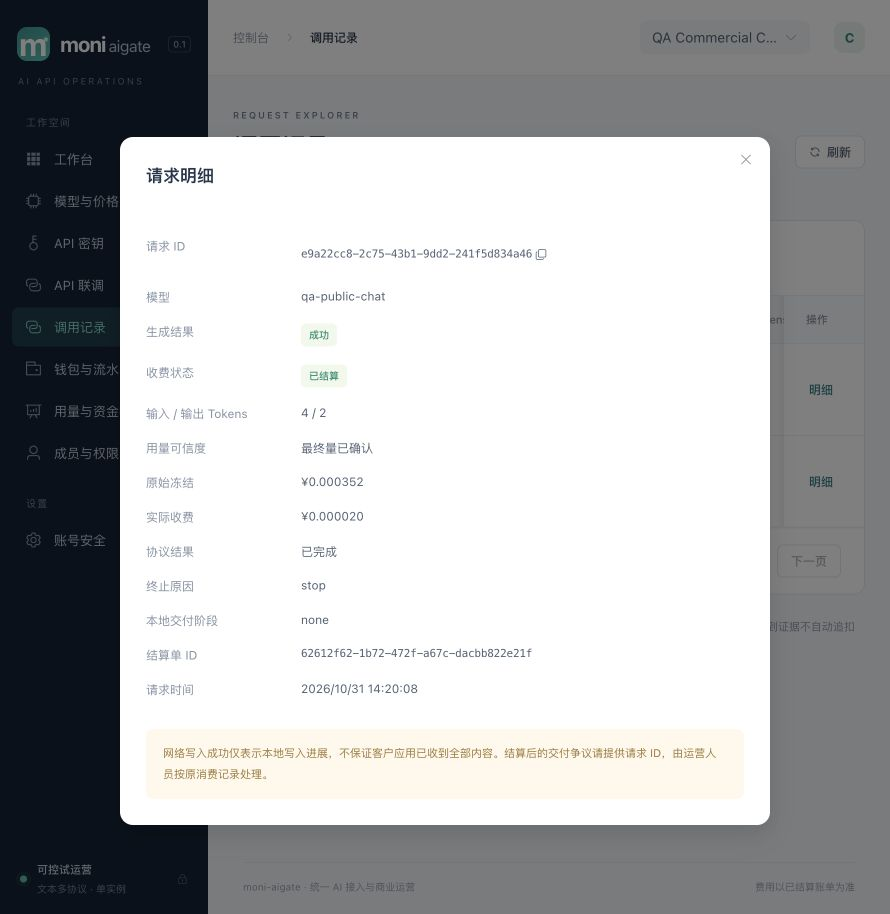

# 014 MVP 本地闭环与发布验证收口

2026-10-31，`v0.1.0-dev`。限定范围本地验收通过，原MVP生产发布门禁继续保留。工作树没有提交SHA或远程发布。[规格](../../specs/014-mvp-release-qualification/spec.md)、[计划](../../specs/014-mvp-release-qualification/plan.md)、[验收清单](../../specs/014-mvp-release-qualification/acceptance.md)、[HLD §21](../design/HLD.md#21-014-mvp-验证收口与首次接入修正)、[LLD §21](../design/LLD.md#21-014-首次接入与验证运行器)。

## 本轮交付

1. 修复首次接入地域默认不一致：渠道表单从精确`cn`改为与默认客户/Key一致的`global`。共享JSON由真实表单和跨层PG/HTTP回归共同读取；`global`仍是精确标签，切到未授权`cn`仍拒绝且零上游/新增资金事实。没有扩大客户或Key权限。
2. 修复可信反代后登录限流共享代理IP：新增默认空的`TRUSTED_PROXY_CIDRS`，只接受明确受信peer覆盖的单一合法`X-Real-IP`，忽略XFF，歧义/非法头退回传输peer。metrics按实际传输peer判断，边缘继续403。配置校验、真实Gin行为与部署说明同步；容器NAT和CDN来源仍须在目标环境核实。
3. 新增可重复的本机浏览器QA运行器：真实main、正式迁移/Verify/Guard、随机schema与受限app/projector LOGIN、一次性合成身份及回环mock，退出清理资源与私有凭据。业务数据由实际控制台创建，不增加生产调试API或放行资金检查。
4. 新增真实main SIGTERM在途SSE排空/重启不重放验证，补充既有SIGKILL恢复证据。

## 准备与浏览器操作

运行器只预置三种合成平台身份（管理员、财务制单、财务审批）和固定本机供应商。管理员bootstrap使用真实命令；另外两个身份由测试准备创建。模型、渠道、完整凭据池版本、路由、价格、客户/授权、模拟核款、客户Key、调用和退款均由浏览器控件完成。没有把API准备或直接改库记作浏览器业务通过。

本次隔离应用为127.0.0.1:58124，未通过58123评审账号操作业务。mock仅接受目录GET及固定Chat JSON/SSE，使用随机合成凭据和精确127.0.0.1/32出口授权；没有付费供应商或真实资金。测试结束已退出客户会话、关闭QA页并清除工具内存中的一次性Key。私有manifest/日志不进入交付，公开截图/JSON无完整凭据。

| 实际浏览器操作 | 可观察结果 |
|---|---|
| 未绑定MFA的管理员密码登录 | 直接进入工作台，默认可选MFA保持 |
| 创建渠道、加入secondary并保存完整池 | 默认global；两个成员；渠道版本2，随后显式发布route revision1 |
| 创建Chat模型与未来生效售价 | `qa-public-chat`，输入2/输出6 CNY/M；profile输入硬界128、输出16时冻结352微元 |
| 创建合成客户及模型授权 | 从空业务状态建立，非预置租户或余额 |
| 管理员模型发现 | 目录2模型/1页，qa-chat已绑定、qa-chat-alt未绑定、缺失0；保存实际成员及不可变发现记录 |
| 财务制单，另一账号审批核款 | 1.234567 CNY精确入账；制单员只见“待其他账号审批”，审批员可批准 |
| 客户创建受限Key | 仅授权该模型，累计额度1 CNY；关闭一次性显示后DOM不再含完整Key |
| Playground SSE与非流JSON | 各返回QA OK及可信usage 4输入/2输出/6总量，request_id关联详情与账单；每笔20微元 |
| 退款制单与另一账号批准 | 绑定第二笔原结算，退20微元到钱包；原消费保留；余额变为1.234547 CNY |
| 批量停用预检/提交 | 一个目标可提交；applied回执，revision2→3；操作ID可查询 |
| 客户停用期间调用 | HTTP503 `no_available_channel`；没有新请求/attempt/预占/结算或上游POST |
| 批量启用及刷新后历史查询 | applied，revision3→4；原route恢复；刷新后两条历史可见，输入原停用ID读到原不可变回执 |
| 客户再次SSE调用 | 成功并仅新增一笔20微元；最终可用1.234527 CNY，冻结0 |

浏览器覆盖的是Chat商业链路和011–013代表操作，其他五种协议仍以既有专项为证。没有在浏览器人为构造批量rejected、晚回/并发、关闭期间未知提交或再认证过期；这些依赖013前端合同/真实HTTP+PG专项，不冒称本次浏览器通过。未做平台付费探测，也未修改评审账号/MFA。

浏览器console读取warn/error为空。钱包、调用记录在390×844下`documentElement.scrollWidth=innerWidth=390`，移动导航可打开并跳转；宽表格在内部滚动。桌面截图已目视检查，未发现秘密。单次Playground耗时不是P95，本轮未进行性能压测。



另存[钱包与退款流水](assets/mvp-wallet-014.png)、[批量停用不可变回执](assets/mvp-batch-receipt-014.png)。这些是一次性合成业务的归档证据，QA应用已停止，非评审数据库实时状态。

## 数据库与运行器证据

在清理schema前，使用专用测试库owner开启只读事务核对，[安全原始JSON](mvp-browser-014.json)记录实际查询结果，单位均为微元：

- 入账1,234,567 − 消费60 + 退款20 = 可用1,234,527；held=0；Key spent=60/held=0，退款不回增Key累计额度。
- 3个成功请求（2个SSE、1个JSON）、3个唯一attempt/finalization/settlement，各收费20；3次冻结均352，结算后释放差额。
- 3条最终量均`confirmed_final`、input4/output2/total6。停用失败request_id未产生业务请求记录。
- 账本账户总和0、各journal分录和为0且至少两条；报表投影credited1,234,567/charged60/refunded20/requests3与业务一致。
- 核款与退款各1笔，均approved且制单/审批不同账号；两次applied批量回执与两条apply审计，无重复操作。
- 当前渠道enabled、未隔离、管理revision4；两个渠道版本、当前池2成员、route revision仍1；发现1次、平台probe0。
- app/projector两角色实际LOGIN，均非superuser、无CREATEDB/CREATEROLE；运行器另核对正式最小权限。

浏览器运行实例以最终退出manifest和数据库查询交叉确认：目录GET1、有效Chat JSON POST1/SSE POST2，和3个客户attempt一致。该实例早于运行器最终计数增强，旧计数仅覆盖有效解码的合成请求，不扩称所有异常HTTP总数；停用请求没有进入mock。旧实例SIGTERM退出exit0，schema/两角色已不存在，manifest密码和mock秘密已清除。

最终源码另做两轮正常真实main生命周期及失败bootstrap清理，精确结果与版本摘要见[运行器证据](mvp-harness-014.json)。正常轮不伪造业务数据：只有3个合成用户，租户/Key/核款/客户请求均0；停止后监听关闭，schema/角色不存在，凭据字段清除。测试与本次业务浏览器运行分开记录。

## 真实main排空

`TestMVPPostgresActualMainSIGTERMDrainsSSEAndRestartDoesNotReplay`构建当前`-race`真实程序，在专用PG中新建独立临时数据库、受限app/projector及回环SSE；随机端口排除58123，子进程环境为显式白名单。

首内容交付且余额860/held140后发SIGTERM，新连接被拒绝；已有流等待受控尾量，收到唯一DONE后正常退出。最终只存在一个attempt、最终证据和结算，收费20、余额980/held0、Key spent20，账本平衡。重启同DB，用原幂等键收到409及原request_id，未新增POST/收费；真实projection worker恢复credited1000/charged20。专项race实跑通过（测试13.90s、包15.689s），也进入本轮全量race。需要测试owner具有CREATEDB，否则该专项会明确skip；本机本次实际运行，未跳过。

## 最终回归与预览

```sh
npm --prefix web test
npm --prefix web run build
TEST_DATABASE_URL='postgres://moni_test@127.0.0.1:55439/moni_test?sslmode=disable' go test -race ./... -count=1 -timeout 240s
go vet ./...
go build -trimpath -o bin/moni-aigate ./cmd/moni-aigate
```

66项前端测试、strict TypeScript/Vite、全Go race、vet及最终嵌入build通过。全Go race：billing33.442s、catalog8.586s、config3.015s、identity43.900s、operations10.560s、provider5.043s、routing4.458s、security2.142s、server127.173s、telemetry5.348s、browser-qa5.895s。这些是测试包耗时，不是服务响应延迟；运行器真实main/失败清理属于显式opt-in，另见其证据。代理身份/metrics专项和默认地域真实PG/HTTP专项也分别通过。

预览升级实际执行：确认58123旧进程的cwd与监听身份→SIGTERM排空→最终程序owner migrate/provision→受限应用角色serve。`/health/ready`返回status=ready、recovery_mode=false；首页和全部27个assets与最终dist逐字节匹配。[预览原始JSON](mvp-preview-014.json)保存摘要，首页SHA256为`0f97b350a6ed86dfd5a79f42d2680a2cba87b5ba719f324c08093263d6c0c112`。本次没有新迁移，正式schema仍001–009。

## 保留的发布门禁

- 正式供应商输入/输出硬界、最终usage、缓存/无消费拒绝与成本证据认证；本地mock不能替代。
- Docker daemon和Compose插件当前不可用，容器首装/升级/排空、1Panel目标部署与代理实际源CIDR尚未实测；配置修改只做静态复核。
- 指定4vCPU/8GB、完整商业链路首字节p95<50ms及Rust LiteLLM/Bifrost持续实跑对比。007历史结果仍未达标，新能力未做性能认证。
- 网络分区、长时慢客户端、异地灾备/密钥恢复和发行许可证选择。真实main正常SIGTERM已补齐，但不覆盖这些故障环境。

在线支付、开放注册、订阅、媒体/长连接与HA等按[能力路线图](../design/new-api-roadmap.md)独立推进，不将New API全能力反向扩大成原001 MVP完成条件。
