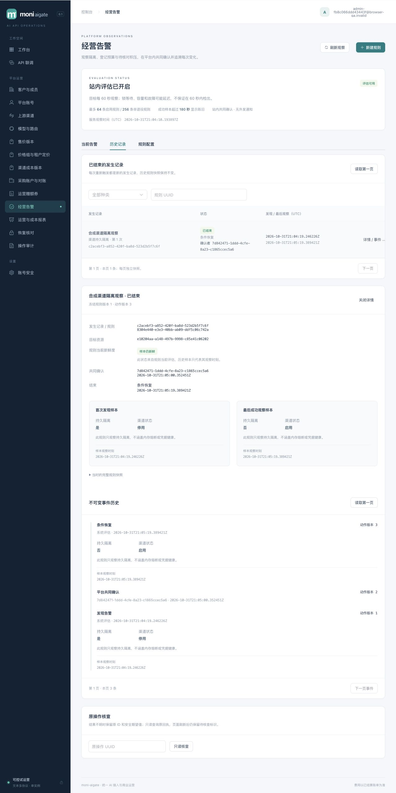

# 024-A 站内经营告警验证记录

2026-11-01，生产源码已实现，有效角色核验、真实PostgreSQL/HTTP/浏览器/主进程故障、最终全Go真实PG race/vet及019预览升级均通过；限定本地验收完成，架构只读检查与make check通过。基于[冻结合同](../../specs/024-extension-platform/a-contract.md)，追加迁移019。完整模块、时序、内部关系与权限见[统一架构](../architecture/README.md#站内经营告警024-a)。B–F、025及竞品性能不因本片完成而完成。

## 实现范围

- `internal/alerts`：封闭DTO、规范命令摘要及不可变回执、四来源MVCC观察、规则/发生/事件与新鲜度。019保护完整事件链、第一ACK、原命令同事务关联及runtime内部写版本双CAS。
- `internal/alertworker`：双固定槽、任务预算、Guard、安全错误码、退避与取消join；main装配专用APP双连接，不占财务恢复或邮件worker槽。
- `internal/server/alert_*`：十一条平台HTTP入口、严格顶层/嵌套JSON、无损金额/revision/游标、当前角色复验、独立有界准入、256KiB先缓冲响应、no-store和原操作查询。
- `/platform/alerts`：规则、当前发生、历史、事件与共同确认；独立严格解析、未知操作日志、身份/筛选/关闭后的晚回隔离。
- 部署开关默认false，只暂停评估；配置、读取与旧记录ACK仍可用。恢复模式只读。确认不改来源、路由或资金。本片验收未调用收费供应商、模型、支付或SMTP。

## 真实PG与HTTP

专用数据库为隔离本地测试库，领域使用随机schema和受限APP/projector；main故障测试使用专用临时数据库及实际LOGIN角色。

| 检查 | 实际结果与范围 |
| --- | --- |
| `internal/alerts`全包race | 24个顶层测试（18项真实PG、6项纯值），13.882s通过；生命周期、四来源、分页/权限、审计失败、并发/第一ACK及64/256上限 |
| 原始APP坏SQL/历史链 | 13类反例、双向命令/事件链、不可变身份/ACK与终态、TEMP shadow与20个函数配置均通过 |
| 故障与竞态 | 真实PG wire扣留成功COMMIT回包、未知提交不反写failure；40P01/40001最多三次、23514不重试；源超时保留成功样本、取消不记录失败；新成功后旧失败被双CAS丢弃；ACK/恢复、ACK/配置双向屏障、撤权等待、退休同scope重建 |
| 来源SQL | 两类aging源各141002行，默认planner真实EXPLAIN；normal/sparse/zero分别读取1001/3/0行，created_at进入Index Cond。构造数据仅用于planner选择性，不代表财务状态验收。四来源在商业父行NO KEY UPDATE持锁时仍完成 |
| 值边界 | Go与PG逐一比较所有Unicode Cc/WhiteSpace标签；时间拒绝year0000与越界UTC年份；游标拒绝非hex摘要；100位累计值无损 |
| 最终HTTP/单元专项 | 019路径修复后2.244s通过。两项真实PG HTTP及五组单元：角色/跨actor、命令重放/异体、规则生命周期、strict JSON/query、Origin/CSRF/再认证、off/recovery、有界准入/响应与安全错误 |
| operations全包真实PG race | 新有效权限5顶层/28子例2.918s；全包23.393s通过；最终全量中36.359s通过 |
| worker/config/cmd/browser-qa普通race | 1.954s / 2.363s / 1.614s / 1.601s通过；双槽取消join、Guard失败零评估、安全错误/退避、布尔配置默认与非法值 |

HTTP测试发现复用JSON解析器对所有对象深度应用同一字段白名单，误拒绝合法嵌套参数；已增加告警专用边界，顶层完整字段与嵌套参数分别校验。独立安全审查通过真实APP复现TEMP shadow绕过；先补冻结合同§5.6，再将019内20个函数固定到实际schema、pg_catalog、pg_temp并验证invoker配置。未修改001–018。

## 真实程序生命周期

`TestMVPPostgresActualMainAlertsDefaultOffAndCrashRecovery`以当前源码构建真实-race main，最终专项11.131s通过，包含APP event UPDATE与projector event SELECT授权漂移启动拒绝：

1. 缺失flag时默认off，跨调度tick不建立observer。
2. 最后runtime UPDATE的实际AFTER trigger与advisory锁构成COMMIT前屏障；SIGTERM取消槽并join后退出。
3. 同屏障持锁SIGKILL，重启前确认episode/event/runtime无部分事实，重启产生唯一完整记录。
4. PG wire代理只拦observer目标runtime更新的真实成功`CommandComplete(COMMIT)`，扣留回包后SIGKILL；重启保留唯一episode/event/runtime，不误写失败、不产生资金或模型效果。不是轮询见提交后再kill的近似测试。

browser-qa显式opt-in四模式（默认、identity、voucher、alerts）及bootstrap失败清理在最终包及有效权限接线后21.081s通过；另有真实bundle浏览器验收。

## 浏览器与界面

[安全HTTP证据](operations-alerts-024-browser.json)、[脱敏运行器证据](operations-alerts-024-harness.json)。实际浏览器运行本地真实main/PG及合成账号，无SQL代替界面提交：

- UI新建渠道规则→worker触发→共同确认；通过应用HTTP恢复合成来源后，等待自然60秒评估，历史保留第一确认者/时刻及opened/ack/recovered三个事件。
- 再将来源设隔离并等待自然评估，新generation2未继承ACK；UI停用后rule_disabled结束，UI退役至revision3。原创建operation只读仍返回revision1。
- UI新建采购预算规则，触发1.000000 CNY/恢复2.000000 CNY；真实worker读登记余量并触发，页面说明这是登记累计预算，区别于供应商余额与周期额。
- 原型界面暴露非空分页map将数组index传入expected ID的问题；已改独立闭包并增加真实parser回归，最终前端251/251通过、0skip，strict/Vite 1631modules通过。
- 额外修复规则变更后旧详情仍称“当前视图”、关闭动画的旧回调可能关闭新编辑器；最终bundle已定点补验：当前revision2且旧详情清除，新建表单独立/保持开启，未提交新表单不建规则，原创建回执仍revision1；[安全证据](operations-alerts-024-final-ui.json)、[运行器清理](operations-alerts-024-final-ui-harness.json)、[截图](assets/operations-alerts-024-final-ui.png)。
- 桌面1280及390×844移动视口已检查截图；页面document宽度等于viewport，无整页横溢，表格保留局部横向滚动。临时viewport已恢复。

[移动视口](assets/operations-alerts-024-mobile.png) · [采购预算告警](assets/operations-alerts-024-budget.png)

运行器正常SIGINT收尾，serve_shutdown=graceful；两条规则、三个episode、六个event、五个命令；所有模型/客户request/settlement/credit/source/voucher计数为0。schema与两角色均清理为0；manifest内密码/供应商secret清空、临时私密文件删除，临时浏览器tab关闭。

## 独立复核与最终门禁

worker/config/main/HTTP/UI/故障测试独立只读复核及专项通过。领域/DDL复核发现继承角色或owner/superuser可越过仅撤直接授权的边界，已补冻结合同§5.6.1与[有效权限核验](../../internal/operations/alert_roles.go)：包括表/列ACL、PUBLIC/继承、GRANT OPTION、owner/高权与递归SET/ADMIN提升闭包。ProvisionFor在同一事务核验失败全回滚，serve在worker/HTTP前用真实APP/projector连接核验；开关关闭也执行，owner登录SET ROLE不被视为受限连接。真实LOGIN反例与启动漂移拒绝均通过。检查范围为六表及schema，不宣称全库definer审计或启动后持续ACL防改。

最终全Go真实PG `go test -race ./... -count=1 -timeout 600s`通过（billing110.380s、identity229.337s、server255.390s）；vet通过。默认240s曾在bcrypt负载处超时，现Makefile只把套件预算延长至600s，没有降低bcrypt成本或断言。前端251/251、0skip与strict/Vite 1631modules、2.54s通过。

58123已先对旧PID57801 SIGTERM并收exit0、确认端口排空，再owner追加019/provision，受限serve PID92956 ready且非恢复。账号完整快照与资金事实升级前后相等；注册/邮件/券/告警评估默认off。最终二进制SHA256 `d3eb5afcb2c8f1e568a0a52cc845c82f9f5c6a728acd221bda5c790ce8ac827f`；首页及50项assets与dist逐字节相等，见[预览证据](operations-alerts-024-preview.json)。

所有并行文件稳定后，集成人复核模块/观察链路/内部ER/权限/能力状态/源码链接，显式reviewed refresh；724文件基线ecc47ee07aab的只读检查及make check通过，strict/Vite 1631modules、2.62s。随后仅更新本地验收状态与记录，再刷新只读检查。022-M/Q冻结待实施、023-B未冻结设计与024实际实现分开记录；本片完成不代表持续目标或外部门禁完成。
