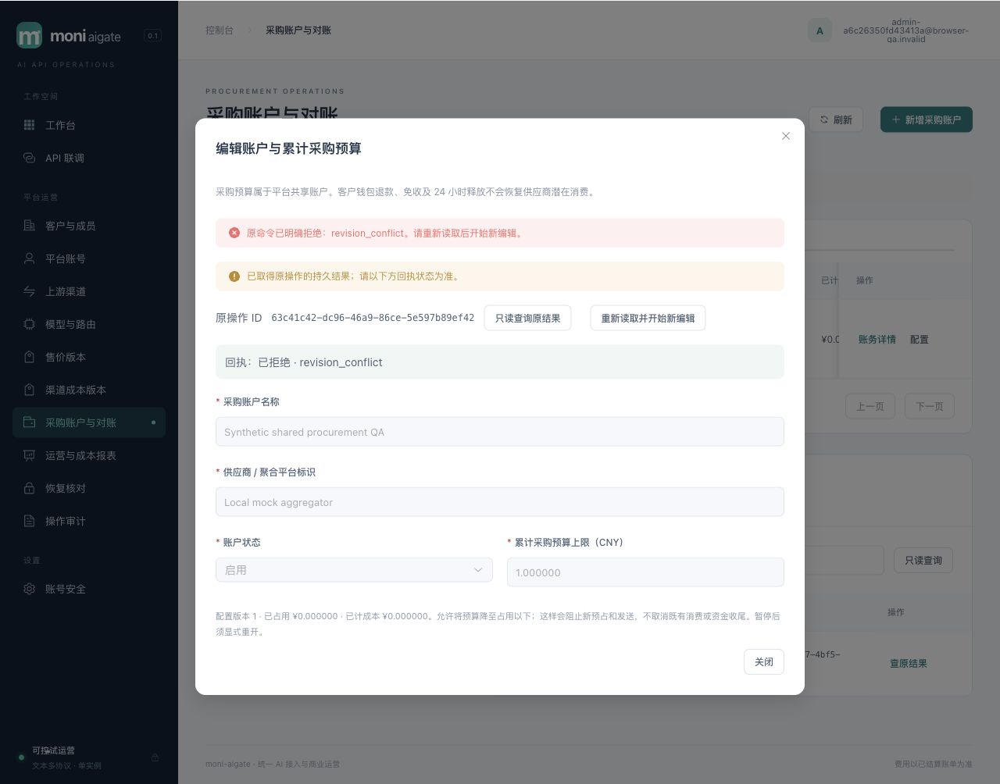
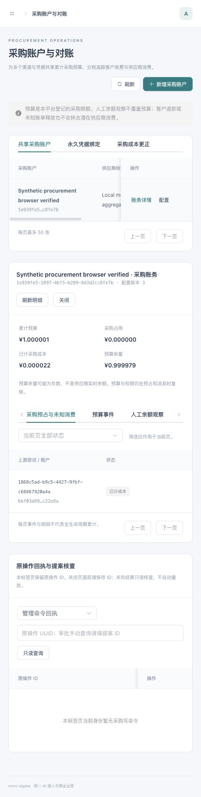
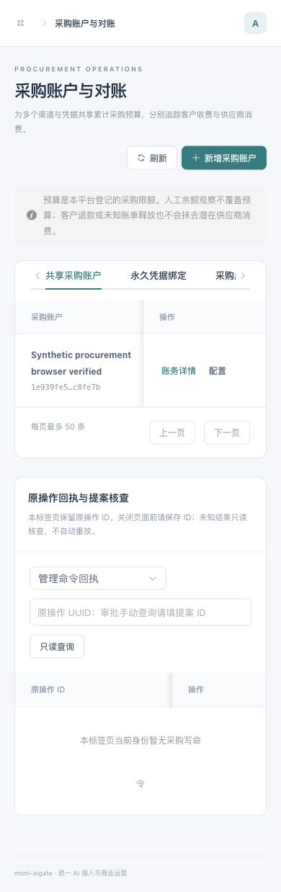
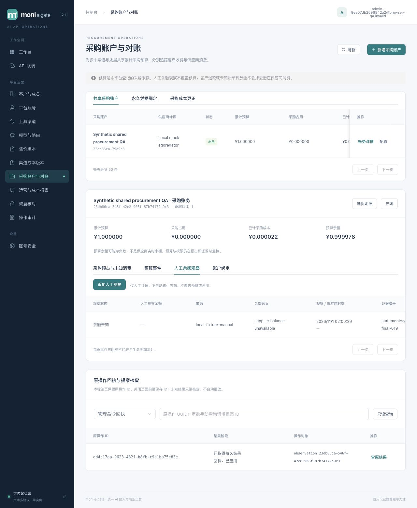

# 019 共享采购账户与预算验收

2026-11-01，019 已实现并通过限定本地验收，当前 schema 为 001–014。58123 预览已升级014并以受限角色 ready、非恢复模式运行。正式供应商余额/账单、周期预算、多币种、目标容器/1Panel、灾备、发行许可与竞品性能不在本次验收范围。

## 交付与安全边界

多个渠道/credential/客户租户共用永久绑定的采购账户，按 supplier attempt 原子预占累计采购预算；客户 request 仍只冻结和收费一次。未绑定成员显式 legacy_unmanaged，绑定后所有版本的新 attempt 都受控。候选→attempt→sending 冻结并复查报价、绑定、账户、预算和锁后数据库时钟，旧prepared不能绕过新绑定。旧sending无采购记录继续原NULL归属收尾。

可信最终usage将采购held转为spent；未知消费一直保留，与客户24小时释放、退款或免收独立。恢复只释放未获发送许可的过期prepared，sending只能转unknown，绝不生成请求。超硬界完整记录成本并暂停；矛盾证据保存spent及保守held，unknown/disputed异常不能通过改active绕过。更正由独立财务制单/审批，减少spent须invoice证据；提案冻结资金revision及证据数量，重复原证据不能重开已裁决争议或覆盖invoice成本。

配置、永久绑定与人工观察均返回不可变applied/rejected命令回执。前端未知写仅查询原ID，显式新编辑才再次提交。观察区分known/unknown/unsupported/error；余额未知不是采购消费未知，不参与预算强限额。账户余额、预占合计和不可变事件由数据库deferred校验一致；该全历史校验的增长开销留待性能阶段按不变量优化。

合同与源码：[冻结合同](../../specs/019-procurement-accounts/contract.md)、[迁移014](../../migrations/014_procurement_accounts.sql)、[账户管理](../../internal/procurement)、[采购账务](../../internal/billing/procurement.go)、[HTTP](../../internal/server/procurement_handlers.go)、[控制台](../../web/src/views/ProcurementView.vue)、[统一架构](../architecture/README.md)。

## 自动化与独立审查

专用 PostgreSQL 16 测试库实际执行全量 `go test -race ./... -count=1 -timeout=240s`，通过；其中 billing58.341s、identity118.890s、server179.293s。最终采购证据指纹/冲突修正后，再执行 `go test -race ./internal/server ./internal/billing -run 'TestProcurementHTTP|TestPostgresProcurement' -count=1 -timeout=120s`，server12.148s、billing5.681s通过。procurement/operations/catalog专项race、`go vet ./...`、前端141项测试及strict TS/Vite构建通过。耗时是测试运行记录，不是请求性能。

覆盖跨租户跨渠道共享预算单赢家、safe retry逐attempt预占、客户释放后采购unknown、双审/invoice/幂等、新证据使旧提案失效、active旁路、裁决后原usage重放、超界和无消费矛盾、锁等待跨deadline/暂停/调价、旧prepared绑定屏障、恢复、直接SQL约束及受限角色。多轮独立读码审查发现并修复了证据去重与同态争议的审批竞态。数据库测试没有以skip当通过。

真实main运行器生命周期与失败清理opt-in单独执行，首轮通过11.557s，最终补验清理后再次通过10.551s；没有与同库正在运行的QA争抢单活锁。正常SIGTERM排空和重启不重放也已包含全量server测试。用例入口：[采购PG](../../internal/billing/procurement_integration_test.go)、[HTTP](../../internal/server/procurement_integration_test.go)、[最小权限](../../internal/operations/procurement_integration_test.go)、[运行器](../../scripts/browser-qa/main_test.go)。

## 浏览器与资金核对

首轮隔离真实main使用随机schema、受限app/projector、合成账号及本地供应商mock，不修改评审账号/MFA或真实资金，不访问收费供应商。浏览器验证独立采购导航、旧revision提交持久rejected/revision_conflict、只读原回执、显式新编辑成功，以及人工unknown观察。一次客户Playground SSE成功显示QA OK和最终输入4/输出2。客户收费20微元，采购按输入2,000,000/输出7,000,000微元/百万Tokens计22微元；采购预占368归零，spent22。客户余额1,234,547、Key spent20、钱包/Key held0、1次唯一结算、账本净和及不平衡分录均0。采购预算1,000,001，余量999,979。

390×844页面body/main宽均390，无水平溢出；测试后恢复视口。console warn/error为空。首轮包SHA-256为 `c1afec200be621090e314252c68e5176e62ae929c622e4b0dc0552217ff0d987`。详见[首轮业务](procurement-019-browser.json)、[首轮清理](procurement-019-harness.json)。

首轮后仅修正人工观察unknown文案为“余额未知”。重新strict构建与嵌入后的最终SHA-256为 `d62e42931573442fd50eb71962d4bc6c251308652dd56e8c3626eb571bdc7400`。另开随机隔离实例，浏览器追加unknown并验证“余额未知”及持久applied回执；通过直接HTTP执行一次本地SSE，再核对客户20/采购22、held0及平衡账本。最终补验没有将首轮CAS操作冒称在新包重做，见[最终业务](procurement-019-final-browser.json)。console warn/error为空。

两轮QA均正常排空；mock各仅收到1次认证SSE，无额外目录/probe请求。schema、角色与listener均确认清理，manifest密码/供应商秘密和本轮自建私密文件移除：[最终清理](procurement-019-final-harness.json)。

## 预览、架构与外部门禁

重新确认旧PID39966、工作目录、命令与58123 listener后SIGTERM退出0；owner执行014迁移与provision，再以受限角色启动最终包PID70862。ready非恢复、app非owner/superuser且可读采购配置，projector不可读采购表。首页和32项assets逐字节匹配最终dist：[升级证据](procurement-019-preview.json)。预览入口为[localhost:58123](http://localhost:58123)。

统一架构上下文、模块、请求时序、ER和部署五图已用Mermaid12.2解析/渲染5/5并复核，见[渲染证据](assets/architecture-019.png)。HLD/LLD §26及模块/锁序/权限/能力状态同步；全部并行文件汇总后由集成人语义复核，显式reviewed刷新内容清单，再执行只读检查与make check。

019只保存人工供应商余额证据，不包含正式查询适配、自动对账、周期额度或外部扣款保证。020公开目录设计已冻结，021注册与邮件恢复、022兑换/支付设计待审，均尚未实现；继续按交付计划推进。正式供应商、容器、灾备、许可及性能门禁见[MVP状态](mvp-status.md)，本地fixture不能替代。
