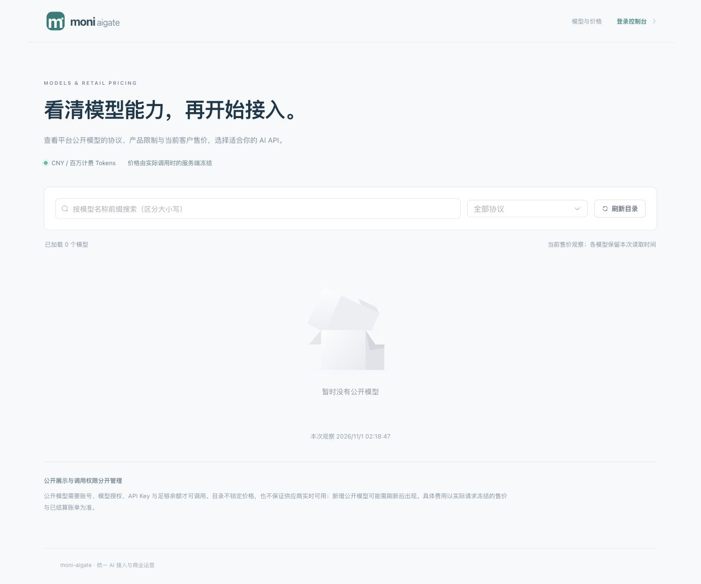
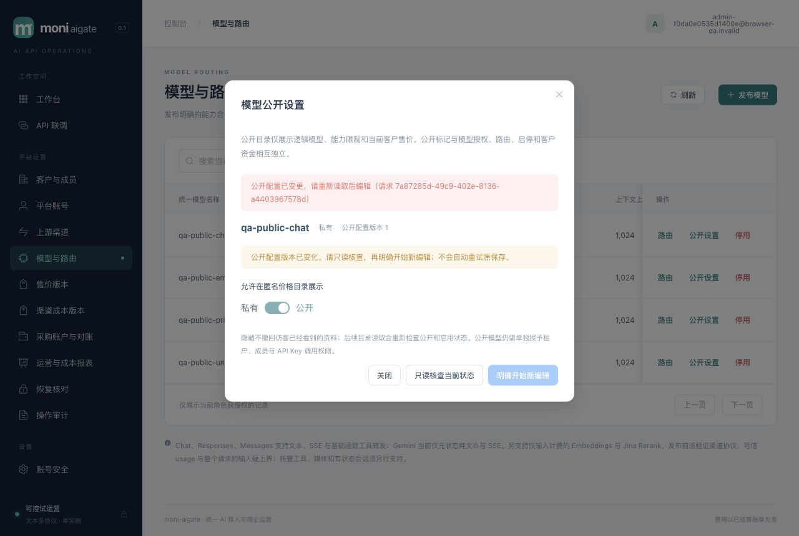
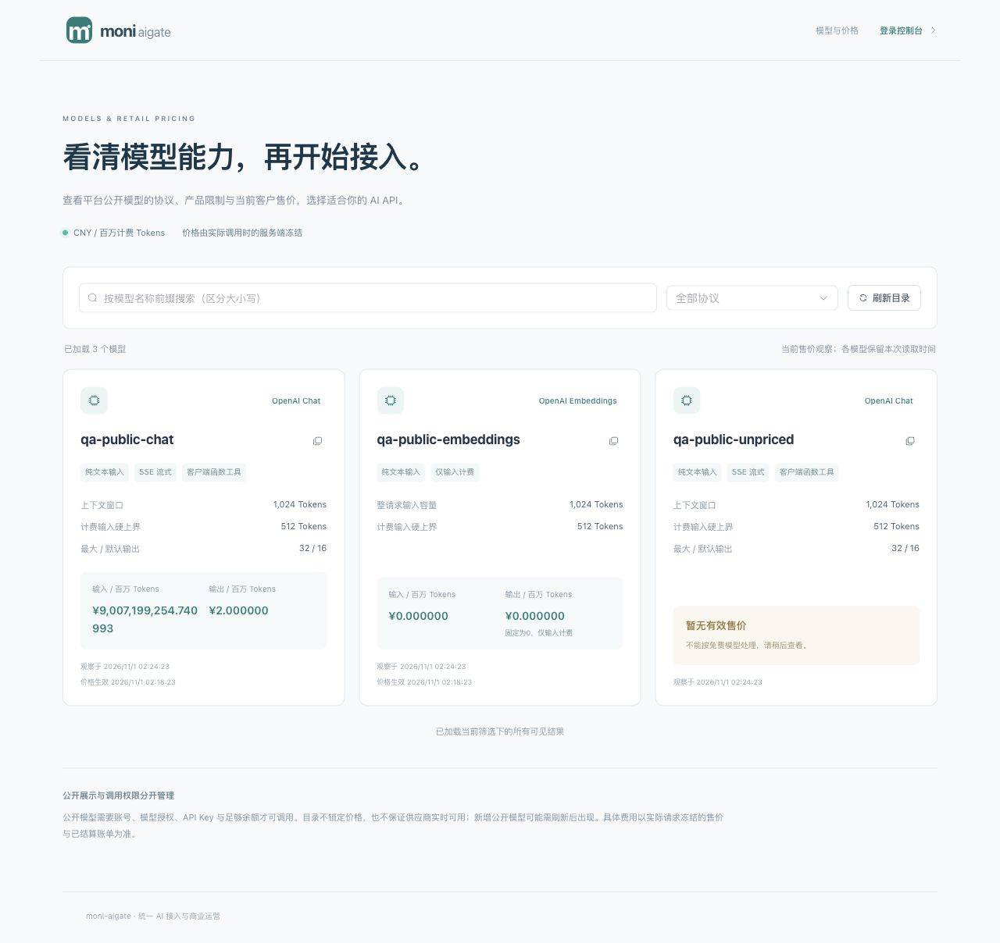
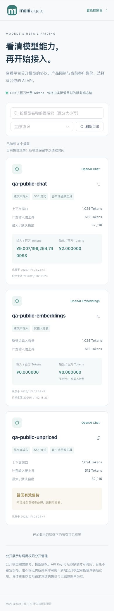

# 020 公开模型与客户售价目录验收

2026-11-01。020已有实现，专用PostgreSQL、前端、隔离真实main浏览器、资源清理和58123预览升级已执行限定本地验证；统一架构与最终集成检查已由根集成人汇总复核。当前schema为001–015，不将本页当作生产发布、正式供应商认证或New API全部能力完成。

## 交付与权限边界

`/pricing`与`GET /api/public/models`不依赖账号、MFA或API Key。旧/新模型默认私有，只有admin显式设置`public_visible=true`且模型enabled时进入公开目录；公开不增加租户/成员/Key调用权限，不产生钱包预占、供应商访问或客户请求。

匿名DTO仅有逻辑模型、六协议已实现能力/产品限制、当前客户CNY售价和本页DB观察时间。没有profile、渠道、凭据、上游模型、采购价格/账户或租户信息。无当前价显式unavailable并保留全部null；已知0是有效价格。当前价按单SQL时钟和统一确定序取得，Reserve与原客户/平台展示对齐，已冻结请求价格不重算。

独立公开限流为全局20rps/burst40、每可信IP2rps/burst8、最多4096来源和4个在途；许可覆盖Guard、pool等待和SQL，总请求2秒，满额不排队。ready/Guard仍是门禁；恢复中只允许原本ready且Guard通过的只读资料，不允许管理PUT。

管理公开设置使用独立字符串`public_revision`完整CAS和同事务审计。旧revision即使同值也冲突，同值当前revision为no-op；启停/路由不会伪增公开版本。停用且保留公开标记时仍隐藏，重启用恢复公开，UI明确解释。未知PUT仅GET核查、再由用户明确开始新编辑；没有自动重放或“GET相同即证明原保存成功”。

合同与实现：[规格](../../specs/020-public-catalog/spec.md)、[API](../../specs/020-public-catalog/contracts.md)、[设计](../design/public-catalog.md)、[迁移015](../../migrations/015_public_catalog.sql)、[catalog](../../internal/catalog/public_catalog.go)、[匿名HTTP](../../internal/server/public_catalog.go)、[公开页](../../web/src/views/PricingView.vue)、[管理编辑器](../../web/src/components/ModelPublicationEditor.vue)。

## 自动化与最终源码边界

专用PostgreSQL测试实际执行；最终catalog/server专项race分别通过2.347s/16.171s，无数据库跳过冒充通过。集成人此前已完成全量Go验证，但该轮早于最后SQL小修；本页将其与小修后的专项区分，不声称最终SQL后重新运行了全量Go。测试耗时不是请求延迟或性能达标结论。

- [catalog单元与真实PG](../../internal/catalog/public_catalog_integration_test.go)：迁移默认私有、独立revision及直接SQL防伪、六协议/价格/秘密canary、50+1与C排序、LIKE字面量、旧cursor重新过滤下架/停用、新公开落在旧cursor之前、异常/超大profile和输入计费非零输出价拒绝；公开SELECT不取model行锁，管理员锁等待后重查角色，审计失败整体回滚。
- [当前售价真实PG](../../internal/billing/retail_price_integration_test.go)：最新已生效价、已知零与未来无价、模型锁等待后的新DB截止、钱包锁等待不重算已冻结价、公开设置/新价格不改旧请求，以及原同模型同effective_at唯一约束。
- [HTTP真实PG](../../internal/server/public_catalog_integration_test.go)与[解析/准入](../../internal/server/public_catalog_test.go)：精确白名单、严格query/cursor/JSON、私有/停用同404、admin/CSRF/再认证/MFA/恢复边界、Cookie/MFA待验证/待绑定不影响匿名GET；Guard前4许可、429/Retry-After、可信IP、独立bucket上界、真实pool耗尽/取消/2秒超时归还许可。
- 前端专项15项、全量156项、`npm run typecheck`与`npm run build`通过。覆盖BigInt/缺价/零价、六协议DTO和非法字段拒绝、匿名credentials omit与私有事件隔离、每行as_of、串行加载/去重、筛选/卸载epoch、cursor未前进拒绝、CAS严格版本及tab级未知写只读核查。筛选同步失效旧请求，再延迟350ms发GET。
- 真实main运行器生命周期与失败清理opt-in通过10.296s，和业务浏览器QA分开执行；没有把运行器fixture当外部供应商认证。

## 隔离浏览器与零业务副作用

使用随机schema、受限app/projector、合成账号与本地mock，最终嵌入包SHA-256为 `5530671707b03ab90f355a073676c7405b106bc2be944e0c8cac0ac8f97127a4`。本轮不操作预览真实账号、MFA或客户资金，不发送付费生成。

1. 默认私有时匿名价格页为空；登录入口仍可访问。随后仅发布指定公开模型，私有fixture始终不出现在匿名列表。
2. 管理员弹窗持有rev1时，经独立HTTP将公开配置推进至rev3；浏览器保存得到409并冻结编辑，只读核查后明确开始新编辑，再保存成功rev4。后续隐藏/恢复继续追加revision；没有把初次冲突自动重试。
3. 公开三卡分别展示输入价`¥9,007,199,254.740993`、已知零价Embeddings与“暂无有效售价”。原API金额是`"9007199254740993"`，没有JS Number舍入；输入计费输出固定0。
4. 名称前缀筛选得到一张卡；独立HTTP隐藏chat后再次读取为两张，恢复公开后为三张。目录按当前观察结果变化，不调用上游。
5. 390×844视口的body/main宽均390，没有水平溢出；console warn/error为0。测试后恢复视口。

最终[业务与公开快照](public-catalog-020-browser.json)核验：request/reservation/attempt/settlement、journal/lines、API Key、credit order、采购账户/预占均0；7条公开变更审计。最终chat公开revision为6，来自后续隐藏/恢复；这不改变前述浏览器冲突阶段rev4的事实。没有拿零副作用结果冒充调用/收费验收。

隔离实例正常排空，mock所有目录/生成/probe计数为0；[清理回执](public-catalog-020-harness.json)确认schema/角色均0、listener关闭、本轮私密文件清除，manifest不含密码/供应商秘密。

## 预览升级与架构收口

重新核对旧预览PID70862、工作目录和58123 listener后SIGTERM，退出0并关闭端口；owner追加015迁移和provision，再以受限角色启动最终包PID85387。当前ready、非恢复模式；app不是superuser或表owner且可读publication，projector无publication读取权。首页与35项静态资源逐字节匹配当前dist，见[预览证据](public-catalog-020-preview.json)。预览入口：[localhost:58123/pricing](http://localhost:58123/pricing)。

根集成人已汇总并语义复核HLD/LLD、路线图及统一架构正文/权限/数据关系/源码地图；匿名访客、公开投影、限流和CAS边界已同步。五张架构图使用Mermaid12.2实际解析与渲染5/5通过，见[图形证据](assets/architecture-020.png)。最终显式reviewed刷新changes/manifest、只读架构检查及make check记录由集成人串行完成；这些检查不重新声明业务或生产门禁。

021注册/邮件恢复、022兑换/支付等继续按各自SDD和验收推进。正式供应商、真实收款、目标容器/1Panel、灾备、发行许可与Rust LiteLLM/Bifrost完整商业链路性能仍是独立门禁；020没有新的首字节或吞吐结论。
