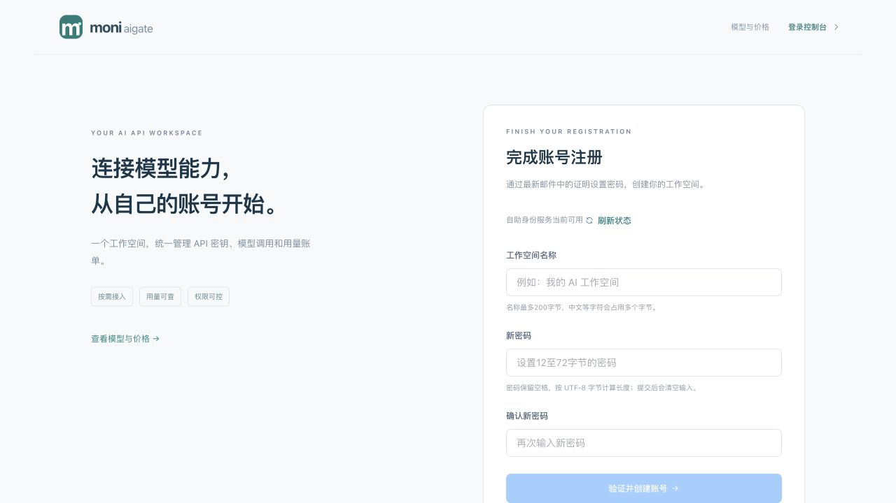
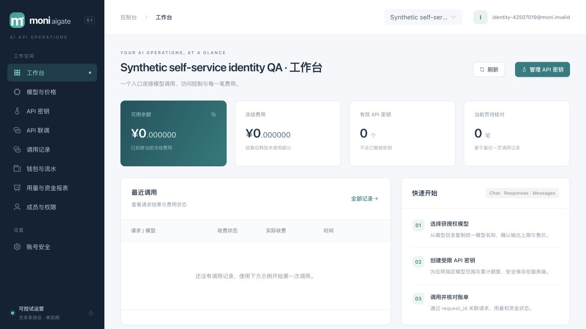
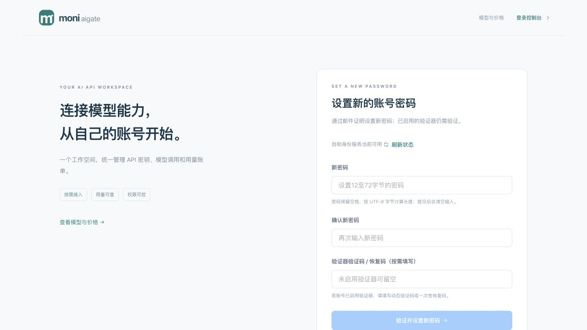
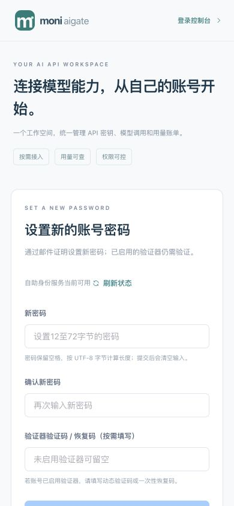
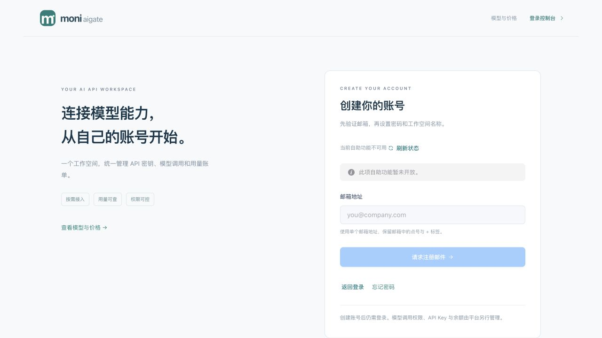

# 021 自助身份与邮件验收

2026-11-01。021已实现并通过限定本地验收，当前schema001–016；注册与邮件默认关闭。真实SMTP收件、域名信誉和生产反滥用仍待外部验证；指定窗口的真实强制终止/重启尚未执行，PG崩溃状态模拟不代替该项025故障演练。本记录不代表在线支付、订阅、媒体、HA或性能阶段完成。

## 实现与信任边界

[冻结合同](../../specs/021-self-service-identity/contract.md)、[设计](../design/self-service-identity.md)和[统一架构](../architecture/README.md#自助身份与邮件链路021)定义当前行为。新增[016迁移](../../migrations/016_self_service_identity.sql)、[身份事务](../../internal/identity/self_service.go)、[公开HTTP](../../internal/server/self_service_handlers.go)、[邮件repository](../../internal/identity/mail_outbox.go)、[清理](../../internal/identity/mail_outbox_cleanup.go)、[worker](../../internal/mailworker/worker.go)、[SMTP](../../internal/maildeliver/smtp.go)及[前端匿名transport](../../web/src/identity-public.ts)。

注册先证明邮箱，不接收预设密码；完成创建普通user、新tenant owner、allow_all_models=false，无模型授权/余额/Key。Bootstrap管理员和持久初始化标志同事务，迁移只对既有admin回填，普通用户不能抢先封死初始化。密码revision由DB随实际hash变化递增；reset在当前user/MFA和全部family锁之后重验DB时间/TTL，正确因素、密码、proof、会话撤销与审计一起提交。API Key独立；此前已完成session认证的普通在途写仍可能完成，未宣称全部在途撤回。

匿名POST保留实例Guard/恢复/同源与严格4KiB DTO，独立有界IP/主体限流及4个hash槽。能力查询只有全站有效值，邮件请求统一202，邮箱冷却/不合条件不枚举账号。邮件payload加密且用途/记录绑定；最多2槽、60秒租约、发送前25秒余量、网络20秒和5次有限退避，ACK按generation CAS。SMTP接受与ACK不原子，允许重复同一邮件，但proof至多消费一次；sent不等于进入客户收件箱。

## 自动化验证

专用PostgreSQL实际执行，没有以跳过DB测试冒充商业验收。测试时间是测试耗时，不能作为首字节或吞吐指标。

- [身份并发](../../internal/identity/self_service_integration_test.go)及[签发](../../internal/identity/self_service_issuance_integration_test.go)：初始化/最小开户、同proof竞争、改密revision/全部family与Key独立、普通改密废旧proof、签发后启用MFA、恢复码与VerifyMFA竞争、family锁等待跨TTL整体回滚；持久限流/替换/跨用途和审计失败原子性。专项60.294s、8.419s；最终全包见下。
- [迁移/最小角色](../../internal/operations/self_service_identity_integration_test.go)：015→016空/普通/admin回填、受限Bootstrap及失败审计回滚、revision/初始化不可伪造、app不可推进窗口/缩短冷却、owner双域rewrap/AAD与坏密文回滚。最终相关专项9.357s。
- [outbox真实PG](../../internal/identity/mail_outbox_integration_test.go)：独占claim且不锁challenge、generation/旧ACK、接受后清密文、退避与第5次claim后崩溃状态模拟、失效/改密取消、7天清理/上限、密文AD/用途/收件人/token摘要绑定、真实provision app角色四方法；最终专项36.252s。
- [worker](../../internal/mailworker/worker_test.go)：2槽/取消、Guard失败、按用途暂停、准备状态/剩余租约、非法投递和安全sender故障、disabled transport只清理。race1.520s。[SMTP测试](../../internal/maildeliver/smtp_test.go)含TLS/证书/降级拒绝、有限IO/取消和安全错误。
- [HTTP真实PG](../../internal/server/self_service_integration_test.go)及[准入](../../internal/server/self_service_test.go)：有效能力/初始化/旧登录、统一202、严格匿名边界、单次reset与会话撤销/无Cookie、malformed proof统一错误且不hash、不签发session。最新根专项cmd/server 1.972s/19.860s。
- 最终身份/HTTP/worker/迁移代码冻结后执行 `TEST_DATABASE_URL=本机专用moni_test go test -race ./... -count=1 -timeout=240s` 全部通过：identity223.619s、server215.029s、billing66.027s、operations19.432s；`go vet ./...`通过。随后仅运行器生命周期测试的等待断言修订，未更改应用实现；该最终断言另由下项opt-in补验。
- 前端最终186/186、`npm run build`含strict typecheck通过。[proof交接](../../web/tests/identity-proof.test.mjs)、[匿名transport](../../web/tests/identity-public.test.mjs)、[页面状态](../../web/tests/identity-public-state.test.mjs)、[会话epoch](../../web/tests/session.test.mjs)覆盖Router前fragment/history.state清理、一次内存消费、omit凭据、无自动POST、未知锁定/晚回丢弃、旧me状态与401事件不能破坏新身份、MFA 128 UTF-8字节及空串边界。
- [真实main生命周期](../../scripts/browser-qa/main_test.go)在浏览器QA退出后单独opt-in：普通模式和identity SMTP模式、实际接受1封邮件、正常排空/邮箱删除/listener关闭、失败Bootstrap清理，race11.792s通过。首轮新增断言把初始`[]`邮箱误当已有邮件，修为解码且恰1封后再退出，随后补验通过；无应用状态机改动。

## 隔离真实main、浏览器与HTTP

最终包SHA-256 `997a421130fb42f98d3c18302d1e8663259f36d3cc193dc722e512a22114b126`。使用[运行器](../../scripts/browser-qa/main.go)的显式`--identity-fixture`，随机schema/独立app与projector/合成账号、本地loopback SMTP；不继承真实SMTP配置，不操作评审账号、MFA或客户资金。

浏览器实际验证两次邮件请求的统一接受提示；打开两种真实邮件fragment后URL立即变为不带token的路径。注册proof GET前后权威快照仍3个初始用户、0租户、1个未消费proof，打开链接不创建账号。注册完成及密码修改通过隔离HTTP提交，未在浏览器输入新凭据，不把这些HTTP结果声称为浏览器提交验收。浏览器用已创建的凭据登录，余额/冻结为0、Key为0、模型页显示“暂无获授权的模型”；恢复后显式返回登录，使用新密码成功登录。

HTTP补验创建不签发Cookie、同proof第二次400；reset同样无Cookie，旧密码401、旧会话401、新密码200、旧reset proof再次400。真实PG补验中MFA/恢复码、Key保持和并发边界见自动化部分；本次浏览器账号未启用MFA，不宣称浏览器验证了因素重置。history/storage的秘密边界由源码/前端测试证明，受限浏览器DOM只读范围不提供这两个API；没有将未完成的浏览器读取记为通过。

[最终权威快照](self-service-identity-021-browser.json)：4用户/1新租户、owner且allow_all_models=false、grants/Key为0、密码revision2且邮箱verified；两个proof均消费，两个outbox均sent/count1/gen1且payload/lease已清。2个旧families撤销，之后显式重新登录创建2个新families；不能把新会话误报成旧会话未撤。请求/attempt/reservation/settlement/journal/credit/采购均0。390×844下body/main宽390，无横向溢出，console warn/error0；诊断日志原始token/密码扫描0。

[清理证据](self-service-identity-021-harness.json)确认正常退出、2封SMTP接受、私密邮箱删除、schema/角色剩余0、app/mock/SMTP listeners关闭、manifest密码与供应商秘密清空，本轮私密身份文件已删除；临时标签页关闭、视口恢复。

## 预览与统一架构

先复验旧PID85387/cwd/58123监听，再SIGTERM退出0且listener关闭；owner追加016/provision后受限serve启动PID4350。ready且非恢复，schema001–016，app非owner/superuser、身份表权限可用，projector不可读身份表。嵌入首页与40项assets逐字节匹配最终dist，见[预览证据](self-service-identity-021-preview.json)。有效能力为registration feature_disabled、reset mail_not_configured；默认没有向任何真实邮箱发送。原评审账号/MFA保持不变。

HLD/LLD、运行手册、路线图、能力状态和统一架构已同步实际链路、ER、角色、SMTP边界与退出语义；六张统一架构图已用本地Mermaid12.2实际解析与渲染6/6通过，见[图形证据](assets/architecture-021.png)；集成人已汇总021源码/证据、022-A冻结设计及023待审草案，语义复核后显式refresh；只读架构检查及make check通过。架构清单包含设计草案不表示它们已实现。022-A共同资金来源/双审兑换券独立冻结实施，B沙箱/C来源lot/原路退款需各自合同；023周期/商品、024扩展、025生产/HA及最后性能继续执行。正式供应商、邮件收件、支付商、Docker/1Panel、灾备、许可证与竞品同条件性能仍是外部门禁。
