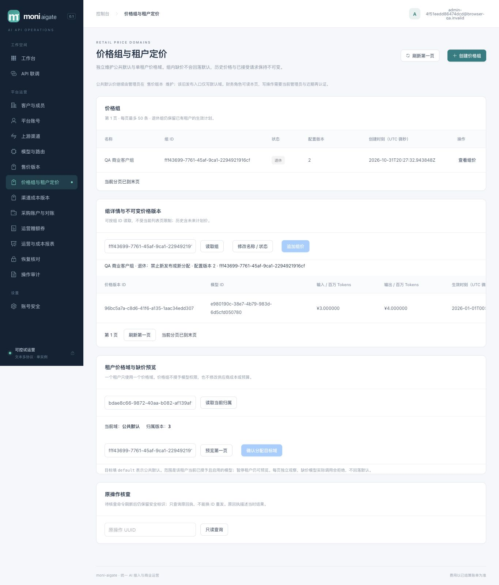

# 023-A 客户分组售价验证

2026-11-01。A1/A2/A3 已实现并完成限定本地集成验收；018 迁移已维护升级到本机评审环境。周期预算 B、期限商品 C 仍未冻结，不能据 A 宣称周期、订阅或支付已完成。

单租户一个价格域，NULL 为公共默认。组内缺价返回原 `price_unavailable`/503，不回落默认；报价 GET 返回明确 unavailable/null。管理命令保存不可变原输入指纹与结果，当前权限复验；调组只改变独立 pricing_revision。Reserve 在 tenant/model/group 锁后观察价格、钱包锁前冻结；后续派发、结算、释放、退款和恢复不重新选价。

## PostgreSQL 与故障证据

专用 PostgreSQL 16.15：127.0.0.1:55439/moni_test，各测试使用随机 schema、迁移 owner 与受限 app/projector；没有付费供应商调用。

- pricing/operations 最终真实 PG race：4.464s/18.927s，DDL/NULL/精确域、原结果、跨组 swap、登录 FK 屏障和重复 provision 通过。
- catalog/server 最后定价专项真实 PG race：2.158s/7.866s。严格 JSON/分页/当前角色、默认与私有域、历史过滤、原回执和有界准入通过。
- billing 分组与原 retail 专项 5.247s；实际网络代理丢 COMMIT 响应、40P01/40001 有限重试及 23514 不重试专项 2.709s。
- 新增 5 项真实受限角色并发测试 3.920s：钱包等待后补历史组价不改已选快照；调组与 Reserve 双方向屏障；退休不回锁租户；同时锁旧/当前组、停租户与会员后，历史 Settle/Release/Refund/Recover 继续。数据库 tracer 确认没有自动重试掩盖新增死锁。
- catalog 退休并发补测4顶层/5执行case，真实APP PG race 3.716s、vet通过：发布/分配先持group SHARE时退休等待，退休先提交时后发发布/分配拒绝且无效果；退休组未来预发版本按DB时刻激活；管理等待时撤admin后拒绝且无效果。未有死锁重试掩盖。
- 首次全 Go race 发现两项旧坏价 fixture 被 018 新插入 guard 正确拒绝，不能记为全通过。fixture 改为真实 001–017 历史写入后升级 018，保留原 fail-closed 断言；不禁用 trigger 或改旧迁移。修复后最终受影响三包全量 race：billing 87.474s、catalog 10.442s、server 229.100s，全通过。其余包在首轮通过，身份 224.803s、operations 27.766s、paymentproto 4.622s；其后这些生产源码未变。新增并发测试单独窄验，不称作单次最终全仓重跑。
- 227/227 前端测试、strict vue-tsc/Vite 构建通过；catalog/server/billing vet 通过。真实 main 三模式（普通/身份/券）与 bootstrap 失败清理 opt-in race 16.160s 通过。

未知/迟到响应、刷新后原 target 锁与 404 不解锁由前端状态测试覆盖；真实浏览器不伪造网络故障。组合 public visibility/密码恢复的全部交叉调度没有作为定价专项穷举，沿既有身份/模型锁合同及各包回归。

## 真实应用与浏览器

[安全业务证据](tenant-pricing-023-browser.json)与[运行器/清理](tenant-pricing-023-harness.json)记录真实生产二进制、随机 schema/受限登录角色、合成租户、一个 loopback 模型供应商。全部业务配置通过应用 HTTP；浏览器完成创建组、缺价预览、明确分配影响确认、发布组价与退休。

同样 4 输入/2 输出 token：默认费率 1/2 元每百万收费 **8 微元**；组费率 3/4 收费 **20 微元**；退休后已有归属仍收费 **20 微元**。缺组价时 503，已有请求与钱包均不变。三次采购成本均为 **12 微元**（采购费率 2/2），与零售价独立。最终 3 request/attempt/settlement，收费 48、held=0，全部 journal 平衡。调回默认 revision3 后原三笔快照不变；原创建操作仍返回 active/revision1，不拼当前 retired/revision2。退休后发布 409；原分配 GET 与同 ID/body 重放结果相同。

匿名目录仍只显示默认 1/2 费率；390px/1365px 下 document 宽度均等于视口。表格在容器内横向滚动。正常 SIGTERM 后 app/mock 监听关闭，随机 schema/两角色均 0，自建私密文件删除，manifest 密码与供应商秘密清空。

## 评审环境升级

[018 预览核对](tenant-pricing-023-preview.json)：确认原 PID36238 的工作区/监听后 SIGTERM，退出 0、端口关闭；owner migrate/provision 后受限 app `check-ledger` 返回 balanced=true、两种 mismatch 均 0。新 PID57801 ready、非恢复模式；首页和 **48 assets** 与最终 dist 逐字节一致。二进制 SHA-256 为 `8ac937eaf3e3d6acaaf79508aab6cb01f679bf7901c392aab04ff70416c609aa`。

app 不能更新 pricing_operations 或请求价格快照；projector 没有价格组、资金来源、身份、采购读权。注册/邮件/券保持默认 off。未修改原评审账号、密码、MFA或业务资金。正式供应商、正式支付、生产部署/灾备、许可和竞品性能仍分别待外部验收。
