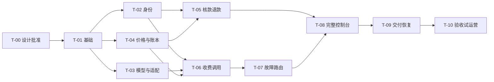

# SDD 实施计划与任务

状态：实施中，已交付可运行开发版；2026-10-30。r3基线已获开发者同意；实际完成/部分验收见文末，不能把实现完成等同生产验收。

## 1. 工作方式

从规格中的 MUST 行为拆纵向切片，先形成精确 API/SQL/测试 fixture，再编码。每个切片包含服务端、必要页面、失败路径、验收证据；不先铺满几十个空页面。API 合约变更同步客户端类型；资金 schema 变更需要真实数据库迁移与回滚/恢复验证。

规格与 [HLD](../../docs/design/HLD.md)、[LLD](../../docs/design/LLD.md) 是设计基线；本稿没有选定特定 SDD 框架或要求先安装 spec-kit。后续可接入团队既有工具，规格编号和验收映射保持稳定。

2026-10-30追加产品变更：开发者要求MFA默认可选，支持扫码，方便测试联调，见[ADR-003](../../docs/decisions/ADR-003-optional-mfa.md)。T-02和AC-22增加`MFA_ENFORCE_PLATFORM=false|true`两种策略及“已启用因素不被配置绕过”的回归；早先强制模式的验收事实保留，新增执行结果单独记录。

## 2. 任务清单

| 任务 | 需求 | 具体产物 | 完成判据 |
|---|---|---|---|
| T-00 | NFR-06 | 独立实现方向已确认；记录首发支付/协议边界，审阅并固定详细规格 | 不重复询问源码底座；详细规格不能以超时当批准 |
| T-01 | FR-01/11 | Go/Vue 工程、工具链锁定、PG 迁移与 CI；单实例启动约束 | 空库初始化/二次启动/升级演练通过 |
| T-02 | FR-01/02, NFR-02 | 身份/邀请/角色、会话与 CSRF、MFA/恢复契约及实现、一次性 Key | 跨租户/越权/失效/再认证检查通过 |
| T-03 | FR-03/04 | 管理OpenAPI、逐profile参数/usage/工具合同、渠道版本原子发布、出口安全、Provider interface、真实HTTP Mock/SSE fixture | 能力不支持先拒绝；配置失败保留旧版；SSRF/分帧/参数契约通过 |
| T-04 | FR-05/06/12, NFR-01 | 售价/成本版本、同tx账本/Key/审计/outbox、冻结/消费/释放、上界样例 | PG多连接、逐写入点故障回滚、唯一键与金额边界通过 |
| T-05 | FR-08 | 人工核款/审批、退款/审批、业务号唯一和审计 | 重复审批/自审批/超额退款被阻断 |
| T-06 | FR-03/07/09/12, NFR-07 | 收费Chat、终结证据T1.9与T2、交付/收费矩阵、Key预算、取消、公开错误/观测白名单 | 真实PG金额与可信最终usage一致；T2前后交付故障有明确结果，重复量不叠加 |
| T-07 | FR-04/09 | 统一attempt预算、错误作用域/熔断、限流、总deadline、资源清理、持久恢复/核对期限 | 真实HTTP Mock无底层重放，取消后真实资源退出；恢复不重扣/重发 |
| T-08 | FR-10/12 | 客户目录/Key/钱包/请求页；运营渠道/定价/资金/审计页；幂等统计投影与重建 | 最小业务闭环端到端通过，信息与账本一致；投影重放不重扣 |
| T-09 | FR-11, NFR-03/05/07 | Docker/Compose、1Panel指南、TLS/SSE、备份及密钥恢复、日志资源上限、故障手册 | 全新环境部署/恢复与DB故障演练通过；慢日志端不阻塞 |
| T-10 | NFR-01~07 | 验收矩阵执行、容量基准、渠道 usage 白名单验证、来源清单 | 记录实际版本/命令/结果与残留风险，通过后才发布 |

## 3. 切片顺序与并行边界

身份、渠道契约、账本可以按明确文件边界并行，资金 schema 与事务不允许多个任务互相覆盖。Provider 的只读研究与 Mock fixture 不需要真实客户资金。T-08 可随前面切片逐步完成页面，图示表示完整控制台出口依赖。

里程碑：M0=T-01~03；M1=T-04~07；M2=T-08~10。无依据的日期估算不作为承诺，开始编码后按人员和渠道范围评估。

## 4. 验证策略

- 纯计价/状态转换：精确边界用例，包含取整、零值、溢出、版本生效。
- 资金一致性：真实 PostgreSQL 多连接/多事务，注入回滚、提交结果未知、重复结算、进程终止；核对分录合计与余额投影。
- 推理契约：受控 Mock 上游生成拆分 SSE、长事件、usage 缺失/重复、明确拒绝、已发送后断连；验证客户端可见结果和资金结果。
- profile：缺字段/显式0/冲突量、临时累计与最终量、usage-only、include_usage两种偏好、工具增量及length/tool_calls终止；给出每个收费profile的预占上界样例与隐藏计费维度拒绝项。
- 重试与传输：使用真实本地HTTP/TCP Mock计数生成POST及拨号，覆盖过期池连接、响应头后断流、首帧前错误、下游headers已提交、心跳无进展和总deadline；验证取消后资源退出才释放许可，财务清理不复用已取消ctx。
- 交付与资金：在T1.9前/后、T2前/后、末尾Write/Flush分别中断，按版本化矩阵验证唯一收费/释放/核对；不以写失败推定客户没有收到。
- 业务端到端：两个不同财务账号、两个租户、多个 Key，完成核款、调用、账单与退款；验证资源隔离。
- 配置与事件：并发发布/CAS冲突/无效配置、硬约束不可扩权；事件冲突与重复累计usage、投影崩溃重放/全量重建，核对账本始终不变。
- 观测：敏感URL/嵌套错误/未知字段脱敏，模拟满队列和慢日志端，证明资源有界且资金证据完整；不把遥测可丢弃用于审计。
- 上线核实：对选定正式渠道检查 usage、输出上界、取消/429契约与成本口径；未验证渠道保持关闭。真实付费测试需在后续约定的测试预算内执行，本轮没有发起。
- 部署：一次全新安装、一次代表性升级、一次数据库/主密钥恢复；记录实际 RPO/RTO。

这里只规定有业务价值的验证，不创建与实现一一镜像的测试，也不把文档检查称为业务测试。

## 5. 未来在线支付切片（不属于 v0.1）

确定主体、支付商、币种和退款通道后，另建规格。最小边界：建单时固定金额/币种/租户/商品 → 验签并核对事件 → durable inbox 唯一事件先落库 → 事务幂等入账 → 可靠 ack → 失败重放与主动查单 → 支付退款/拒付补偿。不能仅验签就信任前端金额，也不能处理失败仍 ack 后丢失事件。

## 6. 发布门槛

T-00 未通过不开始实现。T-10 未通过不标记“可商用/已就绪”。任何未执行的检查均记录为未验证；若首发范围改变，先改 spec/HLD/LLD/acceptance，再调整任务。

## 7. 实际执行状态（r4）

| 任务 | 当前证据与状态 |
|---|---|
| T-00 | 已确认独立实现和r3开发基线；保留来源记录，发布许可证未定 |
| T-01 | Go/Vue工程、6份SQL迁移、checksum启动校验、CI、独占锁及失锁fencing已实现；本地PG首装通过，实际容器升级未验 |
| T-02 | 身份/权限/会话/MFA/恢复码/改密/Key已实现；真实PG及Chrome验证 |
| T-03 | Chat/Responses/Messages文本与基础函数工具profile、出口防护、渠道/路由原子版本已实现；真实HTTP/TCP与原生SDK限定范围验证。契约为Markdown，未声称已生成完整管理OpenAPI |
| T-04/05 | 同事务资金闭环、版本/精确金额/成本更正、双人核款退款；真实PG并发、回滚、重放、角色测试 |
| T-06/07 | 三协议JSON/SSE、最终量证据、统一重试/取消/限流/健康/恢复；纵向HTTP+PG、五个真实子进程SIGKILL边界与结算后交付故障验证。完整main/容器/网络分区矩阵未验 |
| T-08 | 客户与运营控制台、Playground、成本/报表、投影重建已实现；账本回归与真Chrome操作验证。006已保存每个准入attempt的候选选择/排除理由，无attempt的完整失败池解释仍缺 |
| T-09 | Compose/1Panel指南、私钥重包、最小权限、备份恢复脚本；本地恢复演练有记录。容器实际部署/目标环境升级未验 |
| T-10 | 已执行多包race、前端测试/构建及容量；100并发本地成功但50ms目标未达，不批准生产发布 |

[逐AC执行记录](../../docs/verification/acceptance-execution.md)列出直接覆盖与待验证部分。
