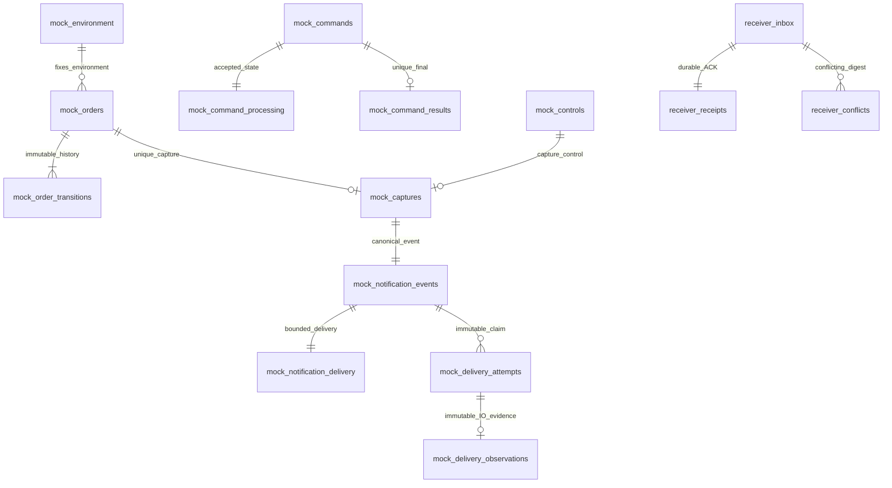

# 022-B0-M：隔离 PSP / receiver 精确 SQL 评审稿

状态：**根集成人已冻结SQL版本1与运行合同，授权022-B0-M/Q实施；尚未接线或完成mock/receiver运行验收**。P 已按 [b-domain-contract.md](b-domain-contract.md) §2–4 冻结；本稿只细化 M，不能替代主任务的独立冻结和架构复核。应用 018 属 023、现有 019 属 024；本稿所有 SQL 都是独立 mock/receiver 自有 schema 版本 1，绝不进入应用迁移序列。

## 1. 可审查产物与责任边界

| 文件 | 唯一用途 |
| --- | --- |
| [b-mock-schema-prototype.sql](b-mock-schema-prototype.sql) | mock 自有表、函数、不可变/状态/提交完整约束 |
| [b-receiver-schema-prototype.sql](b-receiver-schema-prototype.sql) | receiver 自有身份、验签后 inbox、固定 receipt、冲突证据 |
| [b-sandbox-roles-prototype.sql](b-sandbox-roles-prototype.sql) | 私有随机三个 schema、七个独立角色的离线模板 |
| [b-sandbox-grants-prototype.sql](b-sandbox-grants-prototype.sql) | 精确 mock/receiver grants；只在本次 QA schema 撤销 PUBLIC |
| [b-sql-prototype-check.py](b-sql-prototype-check.py) | 仅专用 PG 的 SQL/角色实验与隔离应用克隆合法人工入账 fixture；无 listener 或支付商调用 |
| [b-sql-prototype-evidence.json](b-sql-prototype-evidence.json) | 本轮原型结果及覆盖限制 |

P 精确验证原始字节中的重复字段、UTF-8/Unicode、JSON 数字/字符串类型、nullable union、大小、时间和 HMAC。运行时接线必须先经 P；验签只能使用原始 body，不能使用 `jsonb` 重序列化值。Notification/query 的未验证 DTO 不能直接流入可信入账或 receiver 持久入口；只有 P 的不可伪造 Verified 值及其 owned canonical copy 能成为该入口参数。mock 自己生成请求/回复/event 也必须先经 P canonical 构造与复验，再持久保存原字节。

SQL 负责存储包络、实体绑定、永久幂等、历史不可改、状态和事实完整及角色隔离，不声称再次实现完整 Go JSON/HMAC/Unicode 解析器。`mock_ref` / `receiver_ref` 的 SQL 存储包络接受 1..100 UTF-8 字节、ASCII 仅字母数字与 `:_./-`、拒绝 `://` 与 sk-/mg_/bearer 前缀；非 ASCII 精确类别由 P 的 `unicode.IsLetter/IsDigit` 决定，不能依赖数据库 locale 的 POSIX alnum。

协议澄清沿用 P：DeliveryTime 是 canonical unsigned Unix 秒，范围 **0..253402300799**（1970..9999）；key 窗口是 UTC 微秒、year 1..9999 且非 Go zero，闭区间并允许前后端点相等。Go keyring 不超过 128 个、每个 32 字节、ID/材料均唯一。数据库只保存 key ID/摘要/窗口；原材料只在对应私有配置中。merchant/ref 沿 P 的受控引用字符；payee 是非 URL 的安全标签。

## 2. 三个 schema、七个身份

每个环境独立生成 UUID，schema 固定格式 `payment_sandbox_<UUIDhex>`、`payment_mock_<UUIDhex>`、`payment_receiver_<UUIDhex>`。角色名可使用 `pm_<component-role>_<UUIDhex>`，其完整文本与 OID 必须进入离线 master manifest；不能用名称前缀作为所有权证据。

| 身份 | 登陆/所有权 | 运行时数据权限 |
| --- | --- | --- |
| app owner | NOLOGIN；仅应用 schema owner | 现有迁移/ProvisionFor 离线调用，不进入服务 |
| app runtime | LOGIN；非 owner | 仅既有 ProvisionFor 的应用权限；B0 无 mock/receiver 权限 |
| app projector | LOGIN；非 owner | 仅既有投影权限；B0 无 mock/receiver 权限 |
| mock owner | NOLOGIN；仅 mock schema owner | 安装自有 DDL、marker、key 摘要，之后不交给 mock |
| mock runtime | LOGIN；非 owner | 自有 SELECT、明确 INSERT、有限状态列 UPDATE；无 DELETE/CREATE/TRUNCATE |
| receiver owner | NOLOGIN；仅 receiver schema owner | 自有 DDL/marker/key 摘要 |
| receiver runtime | LOGIN；非 owner | 自有 SELECT、inbox/receipt/conflict INSERT；无 UPDATE/DELETE/CREATE |

所有角色 NOINHERIT/NOSUPERUSER/NOCREATEDB/NOCREATEROLE/NOREPLICATION/NOBYPASSRLS，彼此无 membership。owner 密码/DSN 不放进任何运行时文件。每个函数均 SECURITY INVOKER，创建时先设 `search_path=<精确schema>,pg_catalog,pg_temp`，再 `SET search_path FROM CURRENT` 固定函数配置；启动验证 owner 和该配置，不允许临时表抢占关键关系。schema 不在 public 建立，不修改共享数据库/其他 schema 的 PUBLIC 配置。

应用自身先用原迁移和原 ProvisionFor 建立既有权限，然后仅对本环境应用 schema 撤销 PUBLIC 表/函数权限，向 app/runtime 和 projector 恢复现有 invoker 函数 EXECUTE；表权限仍由原 ProvisionFor 决定。mock/receiver 对应用每一表的 SELECT/INSERT/UPDATE/DELETE/TRUNCATE/REFERENCES/TRIGGER，以及每一函数 EXECUTE 必须为 false。真实 runtime 登陆后逐一 SET ROLE 其他六身份必须拒绝；从超级用户连接 SET ROLE 模拟运行时不是有效负测试。

**对 §8 表矩阵的必要增补**：processing 的有限 UPDATE 除 state/completed_at 外必须允许 `released_by_control_id`，由状态触发器限制为 held→completed 且一次性绑定合法 release control；否则无法持久证明谁释放 held command。

## 3. 模块与事实关系

图中跨组件没有数据库 FK、授予或函数调用。mock event 发送到 receiver 是经签名的 HTTP，而非跨 schema INSERT。receiver 不成为应用 B2 inbox，也不能给应用钱包加钱。

`mock_queries.command_id` **刻意没有 FK**，从而能永久保存 not_seen。snapshot 的状态和当前 provider 事实只在首次 INSERT 时校验；以后 command 到达、capture 或 close 都不得重验旧快照并使其失效。相同 query ID 同参数永远返回原 body，不同 ID 才观察新事实。command 也保存原接收 body；in_progress 被 release 后仍原样重放，仅新增 final result，不覆盖初始回执。

订单只能 ready(rev1)→captured/closed(rev2)，或 cancel-first closed tombstone(rev1)。tombstone 的金额/created/expires/checkout_ref 同时 NULL；其余订单四者必须已知、expires-created=900s，原条款不可更新。checkout 已过期首次到达，应保留条款形成 closed rev1 + checkout order_expired final + closed transition；内部 checkout_ref 仍生成并冻结，但 rejected 回执不暴露该 ref。此路径必须由下一轮运行时测试补验。

提交时检查 command↔processing↔final、order↔transitions、capture↔order/control/canonical event、event↔delivery 双向完整；不允许已完成没有结果、ready 没有创建事实、capture 没有 event 或 event 没有 delivery。触发器只沿受影响根检查，不每次扫描全域。transition.fact_digest 按 SQL 中 `mock_transition_digest` 的固定 `mock-transition-v1`、换行分隔字段和 UTC 六微秒时间生成；不是任意 hash 标签。

## 4. 回调租约与不可变 IO 证据

§8 需新增 `mock_delivery_observations`。每个 `(event_id,generation)` 最多一条不可变结果，FK 指向既有 immutable claim；仅保存 ack/failed、安全 HTTP 状态、受控错误、可公开 receipt data 和 DB 观察时间，不保存 Authorization、签名或响应原文。

| 数据 | 提交语义 |
| --- | --- |
| event / canonical capture / delivery pending | 同事务持久化；业务 event/body 永久不改 |
| generation / attempt_count / attempt claim | 网络前同事务各 +1；60 秒 lease；20 次总预算，崩溃也计次 |
| failed observation / retry_wait | 同 generation CAS 同事务；失败代码匹配；退避 1/5/30/120/300 秒，之后 300 |
| ACK observation / delivered | 同 generation + leased CAS 同事务；必须实际 HTTP 200/202，安全 receipt 的 event_id 与环境匹配 |
| 旧 generation IO | 可追加该旧 claim 的不可变结果，但 CAS 0 行，不能更新当前 delivery |
| 第 20 次未 ACK | 最终失败或 lease 过期进入 review_required/attempts_exhausted，不能第 21 次 claim |

只允许 live lease 内处理 ACK/失败；已经送达/人工复核终态不能复位。崩溃允许某次 claim 永远没有 observation，后续仅 lease 到期恢复；不能凭缺 observation 把 capture 说成未发生。

SQL 对 ACK 的闭合联合条件必须整体 `IS TRUE`，明确拒绝 `http_status=NULL`；NULL 不能利用 PostgreSQL CHECK 的三值逻辑代替实际 200/202。第 20 次 leased→review_required 必须由数据库时钟证明原 lease 已到期，或存在**同一 event、当前 generation** 的不可变 failed observation；live lease、缺 observation、旧 generation 的失败或当前 ACK 均不能单独说明最终失败。最终失败 observation 与 review 转移同事务提交；转移清空 lease，但保留原 immutable claim 的 lease_until 供提交完整性复核。

原型的第 20 次边界测试允许离线 owner 在本次随机 schema 中安装完整的历史 checkpoint：保留正常命令/订单/capture/event 事实，安装 20 条不可变 claim 和匹配的最后 leased 状态，随后恢复全部触发器，再由实际 runtime 登陆执行拒绝/允许用例。该 fixture 不修改数据库时钟，不运行 HTTP，不证明之前 20 次真实调度、退避或 kill/restart；真实第 1/2 claim 与第一次退避仍沿原路径执行。报告必须单列 checkpoint 范围，不将其写成 M-04/R-01 通过。

下一轮运行时仍需实现 claim 后独立读取核对剩余 lease>=15s、固定 10s IO、2 个槽位、生命周期取消和实例 ownership guard。数据库不持事务做 HTTP。body 的重新签名只能更换本次 delivery ID/time/key 包络，不能换业务 event/body。

## 5. Receiver 持久回执身份

receiver marker 冻结 environment UUID、merchant、DB OID、receiver schema name/OID、owner/runtime、state-directory UUID、独立 32 字节 nonce 的摘要、callback URL、protocol=1。自身 schema_migrations/version/hash 与每个签名 key 摘要/窗口也固定；不读取应用或 mock 的 marker。receipt 使用独立 UUID，与 mock capture/event 内部 UUID 无混用。

receiver 在自己的事务读取 `transaction_timestamp()`，交给 P 作为验签 DB now；保存同一 verified_at，避免再取更晚的时刻改变 ±300 秒端点。只有 VerifiedNotification 才能插入 canonical body/digest。首次同事务写 inbox+receipt；commit 确认后回 202。同 `(env,merchant,event_id)` 同 digest 不再写第二 receipt，返回 200 + 原 receipt data；异 digest 追加不可变 conflict，commit 后回 409。超时/commit 未知不提前 ACK，重试通过唯一事件身份恢复。

**回执冻结边界**：持久且重复使用的是 `data={receipt_id,event_id,status:"received",environment:"sandbox",received_at}`；`request_id` 是本次 HTTP 请求追踪包络，重复投递可变化，不属于幂等 receipt identity。mock 严格解析 envelope，再将安全 `data` 字节持久为 ACK evidence。不得把缺/坏 receipt、204、其他 2xx 或环境不符当成 ACK。B0 receiver 只说明收到可验证事件，无资金效果。

## 6. Manifest 与启动门禁（待实现）

离线 master manifest 在 0700 非 symlink 私有目录管理，过滤的每个 component 文件 0600。主文件可临时持有三组 DSN；mock 文件仅其 DSN/API+control token/key material/自身 nonce，receiver 文件仅其 DSN/验签 keys/独立 receiver nonce，app 文件仅应用 DSN/独立 app nonce。各 nonce/token 32 字节，组件之间不同；DSN/password/token/nonce/签名/body 不进入日志和报告。

mock 过滤 manifest 需固定：manifest/protocol/schema版本及 SQL SHA256、环境 UUID、merchant/payee、state-directory UUID、DB name/OID、三个 schema 各 name/OID/owner/runtime 身份（应用另 projector）、自身 key ID/digest/window、API/control literal loopback origins、固定 receiver callback URL，以及相应密钥文件摘要。receiver 使用 §5 最小独立身份及自己 key/nonce/URL，不持有 mock/API/control 凭据。app 文件不添加 B0 mock token/QA endpoint/worker。角色名与 OID 均纳入 master/过滤身份核验；当前表 marker 只保存文本角色名，启动必须通过 pg_roles 同时核对过滤 manifest 中 role OID，不能仅依赖 marker 文本。

启动先检查文件权限/非 symlink/状态完整，再用各自 actual runtime 验证 current_database/current_user、pg_database.oid、pg_namespace.oid/nspowner、pg_class.relowner、pg_proc.proowner/prosecdef/proconfig、角色标志/membership、上述所有正负 grants。检查 marker/migration/key 行与 manifest 完整集合相等，缺失或多余版本均拒绝，**不自动重新初始化空环境**。成功前不得开 listener/worker；同名重建 schema、错误 DB/OID/nonce/state dir/URL/key 或 copied marker 均失败。

mock 实例锁使用 session advisory `(782193403, int32(mock_schema_oid))`，与应用单 int64 `782193402` 不同；OID 高位转 int32 必须按 uint32 位模式明确转换。会话存活 ownership 检查失败永久停止 DB/IO。merchant-order 事务锁按独立 namespace+完整原引用 SHA-256 前 32 位，hash 碰撞只增加串行；每条路径再次比较完整身份，按同 merchant 锁→现有 order 行→command/query 唯一键，不回锁第二 merchant。

一次性 before-command-commit 故障必须在独立提交中持久消费 fault plan，再执行/回滚对应命令效应并断开；不能把 plan 消费跟测试回滚放在同一事务导致永远再次触发。该精确并发顺序、正常断开和真实 COMMIT 未知行为由 M 运行时评审/测试落实，当前 SQL 不冒充网络故障机制。

根已裁决每 `(target_kind,target_id)` 至多一个 `remaining=1` 计划，追加部分 UNIQUE 索引；不同 boundary 也不能同时占同一 target。原型用真实 mock LOGIN 证明第二 operation 的同目标 arm 原子回滚、原计划仍唯一；消费原计划后新 operation 可占同目标，已消费历史保留。运行时必须依 [b-runtime-contract.md](b-runtime-contract.md) 同连接 target session gate先查再写，将业务拒绝持久化为新 control 的 `state_conflict`；SQL 唯一错误本身不是 HTTP 拒绝映射，本轮不实现该 handler。

本轮还补齐应用正权限实验设计：在受忽略 `.local` 的 0700 临时目录创建无凭据 Go helper，DSN 仅私密子进程环境传入。离线 owner 会话调用现有 `migrations.Apply` 和 `operations.ProvisionFor`（含 019 的角色权限核验），不复制其 grant 逻辑；随后真实 APP LOGIN 建 tenant/两个不同财务用户，经现有 `billing.CreateCredit/ApproveCredit` 完成合法人工双审入账，真实 projector LOGIN 消费既有 credited。APP 与 projector 均调用现有 `VerifyAlertRole`，APP 验 migrations、VerifyFunding、VerifyLedger，并检查重放只保留一份 source/journal/receipt/credited。它不是 mock 产生的收款，不引入 B1 资金 source。

应用资金基线必须在任何跨域负例或 mock/receiver 实验前建立，journal、journal lines、人工 source、receipt、credited/outbox、accounts、财务幂等及审计均以完整字段、稳定主键排序在单 SQL 快照哈希；要求这些相关事实非空且 AVAILABLE=1000。后续所有跨域权限负例与自有 schema 状态实验后，以真实 APP 再读同一快照并比全部行及计数不变。离线 owner 仅做当前应用迁移与授权，不能替代 APP 正向身份。helper 无 listener，退出删除临时目录；finally 精确清理本次三 schema/七角色。

## 7. 原型证据与未决门禁

命令：`python3 specs/022-self-service-payments/b-sql-prototype-check.py`，仅接受专用 `127.0.0.1:55439/moni_test` 管理入口，真实四个 LOGIN runtime 身份连接，创建随机本次七角色/三个 schema。私密 helper 实际调用当前 001–019 `migrations.Apply`、两次 `operations.ProvisionFor` 和 019 角色核验，再由真实 APP 执行合法人工双审正向 fixture；finally 精确删除本次资源与临时 helper。此脚本不应用新的应用资金 DDL，也不改变既有部署。

本轮 **84 项 PASS**，详见证据 JSON：保留原 70 项 DDL/真实 runtime/24 次跨角色 SET ROLE 拒绝、函数路径/temp 影子抵抗、历史/状态/完整性、快照/捕获/held-release、callback 证据与预算回归；跨域矩阵增加列权限检查。新增实际 ProvisionFor/001–019/019 核验、真实 APP 人工双审及真实 projector/资金双向验证、两个 mock arm 同目标唯一与消费后新 arm、六个真实资金写入越权 SQLSTATE=42501。每项 fixture 仅落本次随机 schema。

资金正向为 1000 微分人工入账，两名不同财务用户；重放 CreateCredit/ApproveCredit 后仍 source/journal/receipt/credited 各 1、journal lines=2、AVAILABLE=1000，VerifyFunding/VerifyLedger 均 balanced。整个实验开始前后，真实 APP 读取完整稳定排序的 source/journals/lines/receipts/accounts/outbox/financial_idempotency/audit，hash 均为 `87911bd47ae9ebb9d2d1b06f2c2b3ca7f91ab59c92d3fc96171cd9cb800c132a`；它是本次随机 fixture 的内容 hash，不是固定 golden。由空资金基线升级为合法非空经营链隔离证明；这仍不是 mock 收款入账、B1、正式支付商或生产商业验收。

冻结前独立审查新增 8 项回归。原 SQL 上，真实 runtime 的 NULL-status ACK 可提交 delivered；第 20 次 live lease 缺失败证据也可提交 review，两个新增负例均已先复现失败。修复后 ACK 联合 CHECK 整体 `IS TRUE`，第 20 次状态触发器与 deferred 完整性同时要求当前失败证据或原 claim lease 到期。新增用例证明 NULL ACK 回滚且原租约保留；checkpoint 的 live/无证据、旧 generation 失败、当前 ACK 均不能提前 review，当前失败可同事务 review、已到期无 observation 可 review、review 后不能第 21 次 claim、最后 live claim 仍可用实际 200 ACK。checkpoint 范围见 §4 与证据的 `checkpoint_scope`，不算 20 次真实调度或进程恢复验收。

以下必须保持未完成，不得标记 M/Q 已冻结或 B0 持久恢复已实现：

1. 根独立审查 SQL 与三处合同新增：observations 表、processing release 列、receipt data/request_id 边界；检查 typed negative event 的 scenario→原 order/capture 偏移关系。当前 SQL 固定 union/绑定，但未把每个 QA 场景的全部时间/金额变换独立重复在 DB 中。
2. runtime 只接 P Verified/Canonical 的 API。实际 ProvisionFor 与 APP 人工双审/projector 正权限回归已由本轮原型完成；mock/receiver 运行仓储与调用链仍未实现，不能把 APP fixture 当成其验签或收款证明。
3. 实际 manifest/nonce/OID/schema role-OID 比对、错误启动/第二实例、socket guard、HTTP/redirect/proxy/压缩/限流、QA token 与协议 HMAC 端到端接线。
4. 100 并发命令、capture/cancel 真实竞争、expired checkout、fault 各 boundary、20 次总 claim/最后一次崩溃、同 receipt data 的实际 HTTP 重放、实际进程 kill/restart/ACK 丢失，及正常停止后清理。当前原型只有真实第 1/2 claim 与第一退避，没有假装完成第 20 次崩溃。
5. receiver 的精确安全 envelope parser 与 strict HTTP status、原始 Verified 防绕过接口；每轮 runtime 输入不得直接从 jsonb 还原可信证据。
6. 后续 B1 全应用可信证据/transaction identity/capture selection/资金 helper/Verify/Rebuild/双向唯一入账约束仍须独立冻结；本稿仅复用既有合法人工 source，不增加 mock→应用 source/journal/credited 入口。

集成人统一更新 architecture README/changes/manifest。本任务在新设计与原型稳定点停写，未自行刷新根维护架构，未改 P、旧 b-domain、运行时或应用迁移。
