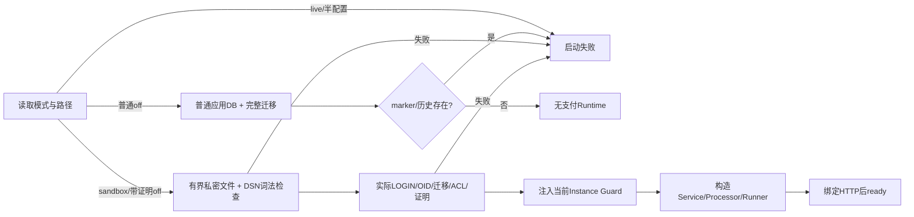
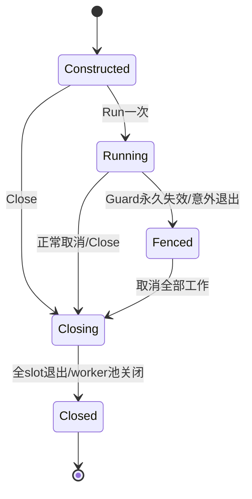

# 022-B3 APP 与独立支付 worker 运行证明候选

2026-11-01，**根按§10冻结运行证明、生命周期与022追加DDL；实施和验收独立记录，普通main/HTTP现已接线，真实进程整链验收中**。本稿收口 [B3 §9 D6](b3-http-ui-contract.md#9-根集成裁决2026-11-01) 的缺口；不改写已追加的021，不扩展 P 字节或 M/Q Component，不把已有 SQL/账务测试写成 APP 启动验收。根须先裁决 §9，之后才能追加迁移和实现。

前置：[B1](b1-contract.md)、[B2 §7](b2-funding-contract.md#7-普通-off-与独立-worker-provisionverify)、[B3 HTTP/UI](b3-http-ui-contract.md)、[P](b-domain-contract.md)、[M/Q runtime](b-runtime-contract.md)、[HLD](../../docs/design/HLD.md)、[LLD](../../docs/design/LLD.md)。Processor 的私有 lease/work/response、SQL 锁图和唯一资金事务另由 `b-processor-contract.md` 候选收口，本稿不复制或扩大该入口。

## 1. 已存在的证明与不能复用的身份

[paymentruntime](../../internal/paymentruntime/types.go) 当前只构造 Mock/Receiver，负责其自有 version1 schema、七角色、私密文件、nonce/keyset 和 ownership；其 `ownPin` 不能把 APP 当 Receiver。021 APP marker 只保存 DB/schema OID、app/worker/projector角色文本、商户及 app nonce摘要，**没有** endpoint/keyset/roleOID 或 worker nonce绑定。仅 `VerifyPaymentRole` 成功也不能证明私密文件属于该环境。

本稿建议 APP/worker 的验证与生命周期归 `internal/payments`，沿 B1 字段私有的 Options/Service/Processor；不向已有 `paymentruntime.Component` 塞新常量，不让 APP/worker 读取 M/Q 业务表、秘密文件或 owner DSN。可复用经审查的纯字节/文件验证算法；不得复用 Q repository、角色、通知回执表或 ownership 身份。

“独立 worker”建议本片指 **同一 serve 进程中的独立真实 LOGIN、连接池、调度与取消生命周期**，共用 APP 当前 Instance Guard；不是用 owner SET ROLE，也不是独立进程。若根选择独立进程，须另冻结跨进程 ownership/fencing；不能把函数 Guard 当成可跨进程传输的证明。

## 2. 模式、历史与启动状态机

配置建议固定 `PAYMENTS_MODE=off|sandbox|live`（默认off）、`PAYMENTS_APP_MANIFEST`、`PAYMENTS_WORKER_MANIFEST`（路径，默认空）。live 在任何连接/文件读取前失败。sandbox 必须两路径齐全；off 两路径同时为空或齐全，单边配置失败。

| 输入/数据库事实 | listener 前行为 |
| --- | --- |
| off、两路径空、无 marker/attestation/B事实 | 只检查完整迁移及 APP/projector 权限；不读支付秘密，不建 PSP client/worker pool/签名器，不注册通知，不出站 |
| off、两路径空、有任一 B历史或 marker/attestation | fail closed；不能以 off 丢弃旧授权或自动创建新证明 |
| sandbox、或 off+两私密路径 | 文件与 DSN 预验证→实际连接→迁移/权限/marker/attestation→Guard→worker构造；任何一项失败均不开 listener/ready |
| sandbox、policy off | 有合法环境；不接受新售，仍处理原授权及通知/query/合法 capture |
| off、有已证明历史 | 禁新售包括旧operation POST重读；原receipt GET、cancel、旧checkout/cancel的既有授权收尾、query/通知及合法capture继续 |
| Recovery | 禁人类写、mutation IO、evidence资金处理；允许安全读、已验签durable ACK和只读query；不靠重启/重放修改原授权 |
| Guard永久丢失 | ready=false，取消所有DB/IO/通知成功ACK；本进程不可重新变ready |

无 marker 的 B事实包括 SKU/订单/命令/证据/资金/审核记录、payment种类commerce命令/回执/审计、sandbox source/journal，以及非默认 policy；默认 policy(enabled=false,revision=1) 不算历史。须在同一只读 RR 快照做完整固定表检查，缺表/查询失败均不可推断为空。无 marker却有孤立事实直接失败，不降级普通off。

普通off允许既有正常 `DATABASE_URL` 连接后判断数据库是否有历史；在没有连接之前无法从 mode=off 推断远端数据库内容。本稿不声称对这个普通数据库连接做过沙箱证明。**一旦提供私密manifest或mode=sandbox，首次pgx ParseConfig/连接前就必须启用 §4 沙箱白名单**，不能先连接DNS/代理目标再补验证。无证明的历史off只在分类后失败，绝不构造支付出站。



## 3. 建议追加022：可独立验证的不可变 attestation

**建议需要追加 `022_payment_runtime_attestation.sql`**。原因是库外manifest自身无法证明它的 endpoint/keyset/worker nonce 属于021 marker；仅哈希文件和核对角色名也无法拒同名重建角色。不得回写021或新增在线 owner 权限。

建议只加一张 `payment_runtime_attestations`，默认空；其 typed 列如下，全部非null，singleton固定true且引用原marker.singleton，environment_id引用原marker.id：

```text
singleton:boolean PK
environment_id:text UNIQUE
database_oid:oid, schema_oid:oid, schema_owner_oid:oid
app_role_oid:oid, worker_role_oid:oid, projector_role_oid:oid
app_nonce_digest:text, worker_nonce_digest:text
proof_version:integer = 1
proof_canonical:bytea  // ≤65536 bytes，只有无密身份/摘要/地址/key窗口
proof_sha256:text     // 64位小写hex，等于SHA256(proof_canonical)
created_at:timestamptz(6)
```

owner 离线插入一次；APP/worker 仅SELECT，projector/PUBLIC零权，所有在线 INSERT/UPDATE/DELETE/TRUNCATE/列写零权。复用不可变历史防改触发器，不增加 SECURITY DEFINER。owner安装器须在同事务核marker、实际OID、proof与typed列一致后插入；线上构造不得补空表、生成nonce或改变endpoint。独立raw owner可以篡改数据库这一风险不在沙箱证明威胁模型中。

`proof_canonical` 是 §3.1 固定 Go struct、encoding/json、EscapeHTML=false、无尾LF 的唯一UTF-8 bytes，不是任意JSONB或从live catalog生成expected。读取后以独立严格parser拒重复/未知/null/坏类型，再按固定struct编码并逐字节相等；typed列/marker/文件/实际catalog逐项互验。canonical摘要只描述证明内容，不能作用户可提交的trusted capability。

### 3.1 无密 public proof 的精确形状

```text
Proof = {
 proof_version:1, protocol_version:1, environment_id:UUID,
 merchant_id:SafeRef, payee_label:SafeLabel,
 database:DatabasePin,
 app:SchemaPin, mock:SchemaPin, receiver:SchemaPin,
 worker:RolePin, projector:RolePin,
 app_nonce_digest:Hex64, worker_nonce_digest:Hex64,
 api_token_digest:Hex64,
 api_origin:Origin, control_origin:Origin,
 app_listen_origin:Origin, callback_url:CallbackURL,
 keys:[KeyPin...]
}
DatabasePin = {host:"127.0.0.1",port:55439,name:"moni_test",oid:OID}
RolePin = {name:RoleName,oid:OID,login:boolean}
SchemaPin = {name:SchemaName,oid:OID,owner:RolePin,runtime:RolePin}
KeyPin = {id:KeyID,digest:Hex64,not_before:UTC6,not_after:UTC6}
```

所有字段必填/非null；OID是1..2^32-1规范 JSON 整数，不能走float比较。三schema沿 M/Q 的同后缀命名规范且OID不同；三owner NOLOGIN，app/mock/receiver runtime和worker/projector LOGIN，八角色name/OID两两不同。固定schema/role identifier沿M/Q小写ASCII规则，所有SQL标识符仍经pgx.Identifier。key数组按ASCII id升序、1..128项、不重复且窗口合法；key ID/材料/窗口全部沿P。peer schema只作catalog身份和负权限核验，不授业务读取。

proof不含DSN、密码、token原文、nonce原文、签名key原文、私密文件路径或签名；对外HTTP和日志也不输出此proof/摘要。api/control/app origin三端口互异，callback origin=app_listen_origin，path固定`/api/payments/sandbox/notifications`。control origin只用于拒同端口/误配置，APP/worker均不持QA control token，也不发送control请求。

app/worker各用32随机byte独立nonce：app marker和新表 app_nonce_digest=`SHA256("moni-payment-application-state-v1"||NUL||appNonce)`；worker_nonce_digest=`SHA256("moni-payment-worker-state-v1"||NUL||workerNonce)`。api token和signing key摘要继续沿M/Q已冻结域 `moni-mock-api-token-v1` / `moni-mock-signing-key-v1`，不能发明与mock不一致的兼容算法。

首片建议完整keyset在环境创建时固定，包括需要轮换的旧/新版本；mock可以在已有完整集合内切active版本，APP/worker始终按header keyID和该版本窗口验签，不删除旧版本。新增/删除key、改窗口、改endpoint需要新QA环境，不在本片原地改immutable证明。若要求环境内增量轮换，根必须先设计追加attestation版本链与M/Q各自key行迁移，不能更新原证明或只从manifest挑最新key。

新增表意味着 B2 当前22表模型/worker全schema allowlist需要显式升级到23表；022之后完整迁移校验必须包含022。operations只增该表APP/worker只读，projector零权，不能用通配SELECT通过；021现有43函数与worker31 EXECUTE矩阵保持。所有当前001–021专项仍是旧版本验收，不能自动记为022通过。

## 4. 私密 manifest 与预连接 DSN

使用两个精确wire struct，共同字段 `{manifest_version:1,component,proof,proof_sha256,nonce_file,keys}`；app component=`application`，worker=`worker`。`nonce_file` 为 `{name,sha256}`；`keys` 为按id升序的 `{id,material_base64_url}` 数组，须与proof.keys完整一一对应并重算同域digest，缺/多/重复均失败。

app manifest不含任何DSN/API/control token；APP复用主配置DATABASE_URL但必须通过专用预连接构造器。worker manifest**额外且必须** `{runtime_dsn_file:{name,sha256},api_token_file:{name,sha256}}`；不含app/projector/M/Q DSN或QA token。两个struct不以可选/null字段混在一个万能对象里。

私密目录/文件规则沿 [现有files实现](../../internal/paymentruntime/files.go)：绝对clean路径、当前euid、目录0700，保留dirfd，用openat+NOFOLLOW读取当前euid拥有的regular0600文件，拒symlink/路径逃逸/FIFO，先有界再读。manifest≤64KiB；DSN≤8192bytes；nonce/token≤44bytes，43字符canonical无padding base64url加可选一个LF；每key32bytes。不同nonce/token/key版本材料不能相同，两个组件持有同一验证key副本合法。harness证明组件nonce彼此独立；服务不读取对方秘密来比较。配置String/GoString/JSON固定redacted。

`PAYMENTS_MODE` off/sandbox不进入proof，不改已有承诺。keyring只供VerifyNotification/VerifyQuery；不对APP/worker提供Sign*、ActiveKey、KeyMaterial getter。P的NewKeyring需要active参数时可内部使用集合第一ID作为构造索引，不称其为mock active key，服务不使用它签名；实际验证仍按delivery keyID/window。这项实现选择须根确认，不修改P公开API。

DSN词法核验在任何pgx ParseConfig之前，沿 [M/Q dsnConfig](../../internal/paymentruntime/dsn.go) 精确限制：单host `127.0.0.1:55439`、path `/moni_test`、scheme postgres/postgresql、manifest本组件user和非空密码、唯一query `sslmode=disable`；拒DNS/localhost/IPv6/socket、多host、userinfo混淆、service/options/fallback/query注入和多余path。PGSERVICE非空直接拒；不修改进程全局环境。随后内部构造canonicalDSN，显式覆盖passfile/options/target_session_attrs/connect_timeout，清空TLS/fallback，固定Lookup/Dial只连唯一literal地址，2s connect timeout，runtime params固定search_path=`<appschema>,pg_catalog,pg_temp`、synchronous_commit=on、client_encoding=UTF8。不继承未知PGOPTIONS/PGHOST等GUC/连接目标。

每条新物理连接AfterConnect核实际server addr/port、database name/OID、schema OID、current_user=session_user=对应LOGIN、UTF8及synchronous_commit。APP旧主pool创建路径也必须走该构造器；不能加载文件后仍调用原pgxpool.New(raw)。worker pool建议MaxConns=8/MinConns=0，APP继续既有池容量但其预连接目标和AfterConnect同样固定。projection DSN由root既有配置持有；构造前同样校验其proof role/OID与literal目标，不允许漏掉第三条连接路径。

## 5. runtime 正身份证明与对等域否定证明

加载Options只读文件、无DB/IO；打开pool/构造Service或Processor时分别用≤5s只读RR执行：

1. 完整当前嵌入迁移；实际server/DB/schema/owner/八角色name、OID、LOGIN/危险属性与proof精确相同。APP/worker/projector不能是owner、superuser、createrole/createdb/replication/bypassrls，角色闭包不能获得超权；拥有任何其他schema/table/function/database也拒绝。schema实际owner须为proof指定NOLOGIN角色。
2. `operations.VerifyPaymentRole` 核当前真实LOGIN的B表/列/函数矩阵和继承/SET/ADMIN闭包；APP、worker都核marker角色文本与DB/schema。projector runtime按B2根裁决只核catalog权限，**不读取marker或attestation、不宣称归属**；归属由离线owner VerifyPaymentRolesFor及APP读取proof后核实际projection LOGIN name/OID补齐，不放宽投影ACL。
3. APP/worker只读自己的marker与attestation：行数恰一、环境/商户/收款标签、typed OID/role、nonce digest、proof bytes/hash全部相同。未加022/空证明/错keyset/nonce/endpoint/OID均失败，无自动重建。APP/worker的原始nonce不必互相可见。
4. M/Q schema名/OID/owner及其runtime role只能通过pg_catalog核身份；APP/worker/projector对M/Q无USAGE/CREATE、所有table与列权限为零、函数EXECUTE零、无grant option、无可SET/ADMIN提升。M/Q不能因此得到APP worker角色或新表权。
5. APP不跨域SELECT M/Q key/marker业务内容。harness离线以各自owner核同环境公共proof/key digest/URL一致，各M/Q进程继续证明自己原marker/完整keyset；APP的本地正证明不能冒充对peer已启动或实际可达的认证。peer停机/无效回复只进入受限恢复，不阻断普通查询变成伪到账。
6. APP自有整体schema不宣称拥有M/Q那种“namespace精确仅version1对象”的证明；沿当前迁移历史、支付静态函数/ACL和APP既有模块检查，不把001–020 PUBLIC invoker ACL保留写成全库函数最小化。fsync/full_page_writes=UTF8等耐久前置与本地PG16+核验沿M/Q；不宣称断电认证。

默认off/无秘密构造也必须执行当前APP/projector权限核验与历史分类；未登记proof时不构造worker连接。查询keys缺失不能伪报陌生key401；部署证据缺失在启动前固定错误失败。

## 6. 建议 Go ABI 与接线顺序

以下均为**待根冻结的新ABI**，保留B1的Service/Options构造接缝；Processor记录方法以其独立候选的根裁决修订为准，不暴露可伪造trusted字段或公开ApplyCapture：

```go
// package payments; Options仍只有私有字段。
type Lifecycle struct {
    Guard func(context.Context) error
    Recovery bool // 启动固定；改变需重启
}
func DisabledOptions() Options
func LoadSandboxOptions(context.Context, string) (Options, error) // application文件
func LoadWorkerOptions(context.Context, string) (Options, error)  // worker文件
func (Options) BindLifecycle(Lifecycle) (Options, error)
func ApplicationPoolConfig(context.Context, string, Options) (*pgxpool.Config, error)
func ProjectionPoolConfig(context.Context, string, Options) (*pgxpool.Config, error)
func NewService(context.Context, *pgxpool.Pool, Options) (*Service, error)
func NewProcessor(context.Context, *pgxpool.Pool, Options) (*Processor, error)
func OpenProcessor(context.Context, Options) (*Processor, error)
func (*Processor) Close(context.Context) error
func NewRunner(*Processor) (*Runner, error)
func (*Runner) Run(context.Context) error
func (*Runner) Done() <-chan struct{}
func (*Runner) Close(context.Context) error
```

LoadSandboxOptions只产application component，LoadWorkerOptions只产worker；零值、错component、未Bind非nil Guard、另一环境或禁用Options构造Processor均拒绝。Application/ProjectionPoolConfig接受main已有rawDSN并做§4白名单，无DSNgetter；返回pgxConfig仅供受审进程内装配，不是防同进程读取自身密码的秘密保险箱。

OpenProcessor在私有配置中读取worker DSN并内部先预验证再开pool，随后调用NewProcessor；失败关闭pool，成功由Processor拥有并Close。NewProcessor低层注入pool仍核actualLOGIN/marker/proof，并校验pool Config与固定目标；它不能撤销外部调用者过去已经做过的网络连接，所以生产main只走OpenProcessor，低层仅供受审内部装配/测试。Processor不导出pool/token/key访问器，Query/Mutation网络只在同package私有发送器内完成。

运行错误建议固定为 `ErrPaymentsConfiguration=payments_configuration_invalid`、`ErrPaymentsEnvironment=payments_environment_invalid`、`ErrPaymentsLifecycleClosed=payments_lifecycle_closed`；角色边界沿operations固定哨兵。与Processor候选共用`ErrPaymentsRecovery=payments_recovery`、`ErrPaymentsGuard=payments_guard_unavailable`、`ErrPaymentsInvalidWork=payments_invalid_work`、`ErrPaymentsLeaseLost=payments_lease_lost`、`ErrPaymentsIntegrity=payments_integrity`、`ErrPaymentsUnavailable=payment_unavailable`、`ErrPaymentsOutcomeUnknown=payment_outcome_unknown`、`ErrPaymentsProtocol=payments_protocol_invalid`、`ErrPaymentsQueryConflict=payments_query_conflict`，仍待根统一冻结。任何driver/raw/path/role/DSN不拼接进错误。它们是内部码，不扩大B HTTP白名单。

main顺序：config模式/路径→（带证明时）两Options加载/两proof一致→预验证APP及projectionDSN并构造pool→完整迁移→Recovery分类→AcquireInstance→定义Guard并先绑定Options→NewService/InitializePayments→OpenProcessor→APP核实际projection身份与静态权限→NewRunner→启动独立runner及现有其他workers→绑定HTTP→ready。引擎/通知路由只能在InitializePayments成功后生成。普通off两路径空走DisabledOptions的无网络/worker分支。启动ctx仅限制构造，不能成为Runner寿命。

## 7. 调度、Guard 与停止

与Processor候选约定：两个**共享**物理网络slot，mutation/query不能各开两槽；证据另有四DB slot。slot0首选query，slot1首选mutation，每次完成翻转；首选明确无due才尝试另一种，claim错误/COMMIT未知不在同tick再claim另一项。空闲slot每秒至多成功claim一项，忙slot不预取。只用已确认claim的opaque work；原command/query ID/bytes/参数绑定不变。

网络IO≤10s（connect/读写全程），lease60s，发送前DB剩余lease≥15s；证据事务≤5s/lease30s。claim在原短事务内消耗mutation10/query20/evidence20的预算，退避1/5/30/120/300；未IO崩溃也不退次数。正常cancel/停机/提交未知保留原lease供恢复；不得换命令ID或重放模型生成。MutationResponse/QueryWork/传输失败分类与记录由Processor候选冻结，Runner不增加公开“可信response”构造器。根对未实现记录接缝的最新裁决方向为`RecordQuery(ctx,QueryWork,headers,raw)`，私有queryFailure同样绑定原QueryWork；work封存原lease、Processor实例seal、childID/request/digest/endpoint，record仍重新DB全重验，不能先从未验raw中的query_id决定定位。Runner按该封存work传递，不另外维护可变“当前query”cell。

Recovery中仅运行query分支，不ClaimMutation/ClaimEvidence；其调用固定ErrPaymentsRecovery且零claim预算。ExpireLeases在Recovery仅回收query，不推进mutation/evidence状态、预算或review。通知可durable入箱，但资金证据等待退出Recovery并重启后处理。只读query的签名capture可以保存可信证据，不能在Recovery落资金。

现有 [Instance.Check](../../internal/operations/instance.go) 会把传入context取消作为永久fence；支付Guard包装器不能直接传HTTP/IO/Run的取消context。建议先检查本地ctx/closing，再用独立background派生≤3s检查底层Guard；只有真实Guard失败/检查自身超时才永久fence。调用者在检查期间正常取消则结束其本地工作，不把取消归因ownership丢失。Guard前后复查本地生命周期，禁止检查成功后向已停止Runner发新IO。DB每个短事务/通知验签时钟/认领/发送前/落结果前均执行既定Guard；不用历史成功Ping缓存。

Run仅一次，Done在run终止或Close完成时关闭；Close幂等、取消调度/IO并等待全部slot退出，超出caller context返回固定停止未完成结果，不提前关闭借用中的pool。unexpected Run退出导致ready=false并取消serve；外部正常ctx取消返回nil，永久Guard丢失返回固定ownership错误。Close不把本地停止标记成Guard失效，关闭后不能再Run。

无due固定`false,nil`；LeaseLost释放slot并等下一tick，不换ID补发。Guard/Integrity/InvalidWork属于不可继续的本地故障，停止Runner并关闭ready；Protocol/QueryConflict/Unavailable/OutcomeUnknown按Processor的持久lease/review恢复边界释放slot，不绕过预算/退避，不把remote错误变成人类rejected。正常本地取消只结束工作；Recovery门禁不被归类为ownership故障。日志只有固定stage/code和受控request引用，不输出manifest、proof摘要、命令/通知body或签名。

SIGTERM顺序建议：ready=false/停止新售→停止新claim并取消Runner出站→保持APP Guard可供已进入HTTP短事务和durable ACK排空→等待Runner全部IO/事务结束→HTTP drain→Processor.Close归还/关闭独立worker pool→其余pool关闭→最后释放Instance。若HTTP drain超时/Guard丢失，取消所有调用且不成功ACK；未确认的命令交原lease恢复。不得先关worker pool再等待借用者，不能先释放全局Instance让后继与旧IO并发。



## 8. 验收与文件边界

本稿只设计，不启动APP/M/Q进程、浏览器或支付网络。后续按独占分片：payments配置/运行证明、Processor、Runner分文件；022及operations表/列allowlist由账务集成人控制；main/config/server/CLI/harness/router由根指定唯一负责人串行接线。M/Q SQL/marker/manifest与P不改；若新增纯文件helper，须保留原M/Q专项且不静默升级其权限/组件集合。

验收需真实专用PG、随机schema/独立八角色和完整022：正常off零秘密/零worker/零通知/零PSP出站；半配置/live/错OID/同名重建角色/错误nonce/keyset/endpoint/DSN/service/代理/redirect/列/函数/继承/SET/ADMIN均listener前拒。APP、worker、projector必须actual LOGIN，owner只做安装/seed/破坏fixture/清理；明确验证projector不能读marker/新证明表。

构造测试覆盖所有DSN在解析前拒DNS/socket/fallback/PGSERVICE及未知GUC，AfterConnect拒实际目标不符；完整keyset、两个组件秘密互斥、文件替换/symlink/FIFO/权限/限长；copy DB或manifest无nonce失败；旧key晚通知与同ID query恢复。真实main测试再覆盖SIGTERM正常排空不fence、Guard实际丢失全停、第二APP实例、两个网络slot/四DB slot上界、Recovery仅query及历史off收尾。fixture或SQL通过不能替代真实main、APP通知/HTTP/浏览器证据；COMMIT回包丢失缺真实注入时仍标SKIP。

## 9. 根裁决清单

1. 是否接受同serve进程独立worker身份/池/Runner，以及共用现有Instance Guard；若独立进程，先补ownership协议。
2. 是否追加022单不可变attestation与proof_canonical模型、app/worker两个nonce域；首片keyset固定、轮换仅在既有集合内，不改M/Q身份。
3. 是否接受两个私密manifest精确字段、环境名、APP/worker仅验证keyring的构造索引语义，以及projection预连接路径补齐。
4. 冻结§6 ABI、生产OpenProcessor内部开池/低层NewProcessor只限受审装配、constructor前绑定Guard；与Processor候选核对lease/错误签名。
5. 冻结调度公平性、Recovery Expire仅query、正常取消与永久fence区分、SIGTERM排空/池关闭/Instance最后释放顺序。

冻结后由根将模块图、请求链/资金链、权限和能力状态同步到统一架构及HLD/LLD，再执行仓库规定的reviewed refresh/check。该候选没有把D6、022或任何APP支付运行链路写成已实现。


## 10. 根冻结与精确追加DDL（2026-11-01）

根完整审读§1–9及[Processor合同](b-processor-contract.md)，接受§9五组选择：同serve进程、独立真实worker LOGIN/连接池/Runner；共用Instance Guard；追加单不可变attestation、双nonce与固定完整keyset；两个独立manifest及三条DSN预连接核验；固定共享两网络槽、四证据槽和Recovery仅query。以下精确修订优先于前文“建议”、B1旧目标和B3 D6未定表述；未列差异按原文冻结。普通main/HTTP发布、真实PSP、lot/退款不据此视作实现或验收。

### 10.1 模式、绑定和构造

新增 `type Mode string`，常量 `ModeOff="off"`、`ModeSandbox="sandbox"`；`Lifecycle`新增 `Mode Mode`。空Mode规范为off，其他包括live拒。DisabledOptions仅可绑定off；文件Options可以绑定off或sandbox。Load不从env决定模式；BindLifecycle返回包含固定Mode/Recovery/non-nil Guard的不可变snapshot，已bound snapshot再次Bind拒。原unbound值可复制并分别绑定，本合同不承诺配置副本的全局single-use，不增加共享mutable bind cell。Service/Processor/Runner只消费已绑定snapshot，不再读取环境配置。

新增 `ValidateOptionsPair(application Options, worker Options) error`：验证恰当组件、完整canonical proof及完整keyset一致；两者要么都unbound、要么都bound且Mode/Recovery一致，拒单边bound。不导出proof/digest/秘密，不比较函数地址。main只创建并复用同一Lifecycle值，连接前检查unbound pair，绑定后再次检查。PoolConfig接受已验证文件而尚未Bind的Options，因为main必须先连接并取得Instance才能定义Guard；NewService/NewProcessor/OpenProcessor拒unbound。

生产内部同包装配接缝先固定最小语义：runtime文件拥有Options/Mode/Lifecycle/运行错误与 `newPaymentRuntime(ctx,pool,opts,component)` 正身份校验、Guard保护；Service与Processor各拥有自己的结构体和公开构造。runtime实现人须先交付私有seam声明供另外两片对照，不让上层猜字段或导出秘密getter。三片共同使用同package私有类型，不增加公开trusted资金入口。

### 10.2 Guard、Close与排空

Guard检查同步使用独立background派生最多3s context，调用前后检查本地ctx/closing。若caller已有deadline且剩余不足完整3s，返回本地DeadlineExceeded，**不调用Instance.Check且不fence**。检查期间正常caller取消可以等本次独立检查结束，再返回本地ctx.Err；真正Guard错误或其独立超时才永久fence。无脱离生命周期的异步Guard goroutine；slot/HTTP join包含已经进入的Guard。所有短事务仍受整体5s上限，Guard成功不是缓存写权。

OpenProcessor的pool由其拥有，NewProcessor注入pool只借用；Close只关闭自有pool。Runner.Close取消调度/IO并join所有slot，不关Processor pool；Run必须join完才返回，Done仅在Run已join结束或Close-before-Run时关闭。Close幂等；等待超时返回ctx.Err，关闭继续，不能提前关闭Done/放回在用连接。Runner的局部停止不关闭仍供Service排空的Guard/keyring。

SIGTERM设置ready=false后立即启动HTTP Shutdown停止新连接，并行Runner.Close；保留APP Guard供既有HTTP短事务和通知durable ACK排空。二者都结束后Processor.Close，再关闭其他pool，Instance最后释放。Guard实际丢失则全停，不成功ACK。该顺序优先于§7中的串行“先Runner后HTTP drain”建议。

canonical codec用固定私有struct字段顺序和snake_case，SetEscapeHTML(false)，只删除Encode自身追加的一个LF；不TrimSpace、不map/JSONB/float/Unicode规范化。keys必须已排序，拒乱序而非静默sort。DB bytes独立严格解码/再编码逐字节核对；manifest内部proof严格解码后按同codec归一。P keyring内部取首ID作仅验证的构造索引，服务不暴露Sign/key/material/active getter。

### 10.3 022表精确合同

追加文件名固定 `022_payment_runtime_attestation.sql`，不改021。仅新增 `payment_runtime_attestations` 一张普通持久表，无默认行、无新函数/在线安装口：

- `singleton boolean PRIMARY KEY DEFAULT true CHECK(singleton)`，FK原marker.singleton；`environment_id text NOT NULL UNIQUE`，FK原marker.id。
- `database_oid,schema_oid,schema_owner_oid,app_role_oid,worker_role_oid,projector_role_oid` 均 `oid NOT NULL CHECK(col<>0)`；三个runtime role OID两两不同，均不同于schema_owner_oid。
- `app_nonce_digest,worker_nonce_digest text NOT NULL`，各小写hex64；`proof_version integer NOT NULL CHECK(proof_version=1)`。
- `proof_canonical bytea NOT NULL CHECK(octet_length(proof_canonical) BETWEEN 1 AND 65536)`；`proof_sha256 text NOT NULL`小写hex64，并CHECK等于`encode(sha256(proof_canonical),'hex')`。
- `created_at timestamptz(6) NOT NULL DEFAULT clock_timestamp() CHECK(isfinite(created_at))`。
- BEFORE UPDATE OR DELETE逐行复用 `reject_history_mutation()`；不增加SECURITY DEFINER，拒PUBLIC的全部表和列权限。在线APP/worker仅SELECT，projector零权，全部在线INSERT/UPDATE/DELETE/TRUNCATE/REFERENCES/TRIGGER/列写与grant option零权。

marker与typed列、canonical proof、实际catalog之间的逐项一致，由owner离线安装器同事务和在线runtime读取证明强制验证；SQL CHECK不冒充跨表/文件认证。owner可插入一个结构合法但语义不符的行，该环境必须listener前失败。迁移默认空不要求旧marker自动生成证明；021已有B历史在未提供证明时继续失败关闭。不得自动创建/回填nonce、key、endpoint或attestation。

operations表白名单显式升级23表（APP/worker新增SELECT；projector仍全零），43份审定函数及worker31 EXECUTE不变。完整当前迁移核验包含022；旧001–019 QA固定前缀不扩。正式测试分别证明空库/有A事实升级不改资金、marker/proof不可变、实际三LOGIN列/表权限、错proof/缺证明/同名角色重建listener前拒。测试、SQLfixture、真实main各层证据分别记录。

### 10.4 普通off的query-conflict空性证明

B2§7明确APP不读payment_query_conflicts；保留该边界。普通off在同RR快照逐表分类时，此一表使用等价的catalog证明：先确认payment_verified_queries为空，再核实际payment_query_conflicts.verified_query_id为NOT NULL，并且存在validated、非deferrable、单列精确FK指向本schema的payment_verified_queries(id)。缺FK、未validated、可空或关联错表/列均拒；不能只相信迁移checksum或表名。非空parent已足够判历史存在并失败关闭。其他APP可读B表继续固定逐表检查，不自动grant该冲突表、不用SECURITY DEFINER。此证明只用外键空性分类，不代替资金真实性/原query请求与签名核验。

### 10.5 隔离环境升级后的函数权限与调度细节

离线沙箱安装器升级旧019环境至完整当前迁移后，须重新撤销APP schema全部函数的PUBLIC EXECUTE，再恢复旧QA已持有的APP/projector invoker执行权，并执行`ProvisionFor`重新收紧43个支付函数的精确矩阵。仅撤schema USAGE不能证明M/Q对APP函数零权限；完整M/Q启动证明必须再次通过。此步骤只作用于本次随机隔离环境，不改变普通off部署的既有全库权限政策。

worker除冻结的31个支付函数外，仅明确授予既有`funding_uuid(text)`的EXECUTE：资金回执等CHECK约束依赖此纯校验叶子函数。不给worker授予pb函数或全部legacy函数；其他调用依赖若被实际路径发现，须先审查再逐项冻结。完整八角色构造和入账须在撤PUBLIC后验证，不能以依赖PUBLIC的领域fixture结果代替。

装配增加纯非秘密接缝`ValidateApplicationAddress(Options, string) error`：文件Options的实际LISTEN_ADDR必须精确等于证明中app_listen_origin的host:port（固定literal loopback）；普通off无该绑定。主进程在任何pool打开前调用，不能持有合法证明却监听另一个接口/端口。`Service.SandboxNotificationsEnabled() bool`仅说明成功构造的Service是否有已证明环境，供Engine决定是否注册通知路由，不公开proof、地址、摘要或秘密。

Runner的两个网络slot各自只在工作完成后等待完整1秒；没有缓冲tick、预取或额外网络goroutine。slot0初始优先query、slot1优先mutation，每次确认认领工作完成（含后续失败）后翻转该slot优先项；无due不翻转，只有`false,nil`才允许尝试另一类。Recovery两个slot仅query，不启动四个evidence slot；独立单slot每秒至多执行一次有界`ExpireLeases`，Recovery的回收限制由Processor强制。Close只取消和join调度，不关闭Processor pool；Run结束前join所有slot，Close超时后继续排空且Done保持未关闭。
