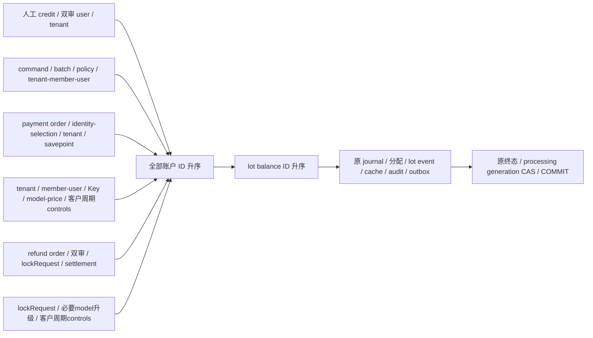

# 022-C0：全资金来源 lot、消费分配与维护切换合同（候选）

2026-11-01，**C0 资金路径/生产SQL仍为设计候选，未分配迁移号或完成验收**；仅§12纯分配算法窄片另有根冻结。本文B2/B3审计表保留当时来源接缝；当前B3领域、worker、HTTP与进程装配已有实现，见[运行合同](b3-runtime-contract.md)、[应用验收](b3-application-qa-contract.md)及统一架构中的当前验证记录。C0精确生产对象/权限/维护见[生产DDL候选](c0-production-schema.sql)、[列ACL候选](c0-production-permissions.sql)、[维护合同候选](c0-maintenance-contract.md)，均尚待根冻结，不把隔离SQL或纯算法通过当C0资金验收。本稿不授权原路退款、拒付、债务或真实支付商。

依据：[HLD](../../docs/design/HLD.md)、[LLD](../../docs/design/LLD.md)、[022 总规格](spec.md)、[总合同](contract.md)、[实施计划](plan.md)、[A 共同入账](a-contract.md)、[B1 资金身份](b1-contract.md)、[B2 第三来源](b2-funding-contract.md)、[023-B 核心接线](../023-periodic-products/b-integration-contract.md)。C0 必须一次覆盖全部钱包写路径，不能只给新支付加 lot。

## 1. 已审计的真实基线

这里描述的是当前代码，不是拟议锁序。账户均由 `lockAccounts` 先初始化缺项，再在独立新语句按账户 ID 升序 `FOR UPDATE`；`postLocked` 先以大整数检查全部余额，再一次提交 journal、balance cache 和 journal lines。原默认五科目没有随 sandbox 变成六科目。

| 路径 / 实际接缝 | 当前显式锁 / 同步点 | 当前资金与终态 |
| --- | --- | --- |
| [Reserve](../../internal/billing/reserve.go) / `Store.Reserve` | 可选 request_idempotency INSERT 唯一冲突 → `lockPrincipal`：tenant SHARE → membership SHARE → user SHARE → Key UPDATE → model SHARE → 已分配价格组/生效售价同步 → `periodicbudget.LockCustomerTx` → AVAILABLE/HELD 全 ID 序 | 创建 request/reservation；`AdmitCustomerTx` → reserve journal：AVAILABLE−R、HELD+R → 周期 reserve effect → Key.held+R、recovery job、audit、reserved outbox 同事务；R 可为 0 |
| [共享收尾父锁](../../internal/billing/evidence.go) / `lockRequestWithChannel` | 非锁定 request 定位 → tenant SHARE → membership SHARE → Key UPDATE → model SHARE → 可选 channel SHARE → reservation UPDATE → 新语句重读最新 evidence | 不检查租户、成员、Key 当前是否仍 active；用于合法历史收尾；不是 `lockPrincipal` 的当前授权检查 |
| [Settle/finish](../../internal/billing/settle.go) / `Store.Settle`、`settleRequest`、`finish` | `lockRequest` → 已有 settlement 只读返回；需要收费时审 evidence；raw>R 才将 model 升级 UPDATE → 客户周期 controls → HELD/AVAILABLE/必要 REVENUE 全 ID 序 → **最终 DB clock 再判 24h** | charge C≤R；HELD−R、AVAILABLE+(R−C)、REVENUE+C；唯一 settlement、Key.held−R/spent+C、reservation/request 终态、周期 finish、case close、job delete、audit/outbox 同事务 |
| [Release/MarkPending](../../internal/billing/settle.go) | Release：`lockRequest` → 原 settlement 重读或 `finish(C=0)`；MarkPending：同父锁，未到 24h 只改 pending/case，已到期进入 `settleRequest` | 所有实际释放共用 `finish`；pending 没有钱写；24h 释放不受旧 usage 已保存与否影响 |
| [消费退款](../../internal/billing/orders.go) / `CreateRefund` | 当前 operator user SHARE → financial idempotency claim → plain settlement 检查 → pending refund INSERT | 不增加余额，不占用可退款额；只检查单笔 F≤charged，最终剩余检查在批准阶段 |
| `ApproveRefund` | refund_order UPDATE → checker SHARE → maker SHARE → plain 取 request → `lockRequest` → settlement UPDATE → `post` 内 AVAILABLE/REVENUE 全 ID 序 | F≤charged−refunded；AVAILABLE+F、REVENUE−F；更新 refunded_amount/refund approved、audit/refunded outbox；**不恢复 Key.spent 或客户周期 spent** |
| [人工核款](../../internal/billing/orders.go) / `CreateCredit`、`ApproveCredit` | Create 只 claim/建 pending；Approve：credit_order UPDATE → checker SHARE → maker SHARE → tenant SHARE → `ApplyFundingTx` → AVAILABLE/FUNDING_CLEARING 全 ID 序 | AVAILABLE+A、FUNDING_CLEARING−A；唯一 receipt/credited；外层写 approval audit；approved 重读原 receipt |
| [兑券](../../internal/billing/voucher_commands.go) / `RedeemVoucher` | commerce operation claim → plain 定位 voucher → batch UPDATE → voucher policy SHARE → tenant/membership/user SHARE → 业务 savepoint → `ApplyFundingTx` → AVAILABLE/OPERATING_GRANT_CLEARING 全 ID 序 → 锁后时刻重验到期 | AVAILABLE+A、OPERATING_GRANT_CLEARING−A；唯一 redemption、receipt、credited、audit、terminal；语义拒绝回滚业务 savepoint，再写 rejected；基础设施错误全回滚 |
| [沙盒共同入账](../../internal/billing/funding.go)、[可信来源重读](../../internal/billing/funding_sandbox.go) | helper 实际不取得 order/identity/tenant 父锁；按 B1，Processor 外层须先 order NO KEY UPDATE → revision/identity/selection → tenant SHARE → 资金 savepoint；helper 只锁 AVAILABLE/SANDBOX_FUNDING_CLEARING 全 ID 序，锁后再读可信图与 claim | AVAILABLE+A、SANDBOX_FUNDING_CLEARING−A；source/capture operation/order reference/固定 actor；helper 写 journal/receipt/credited，Processor 写安全 audit/最终 processing CAS；后两项遗漏 COMMIT 必须失败；Processor 尚由另片接线 |
| [恢复](../../internal/billing/recovery.go) / `Recover` | claim 短事务只锁 recovery_jobs SKIP LOCKED，先 COMMIT；随后独立调用 `Settle(mode=recovery)` | 不持 job 锁回取 tenant/Key/reservation；仅使用原证据、原 reservation、原 deadline；不重发模型生成；本机 active 且未到期则 defer |
| 同文件 `Reconcile` | 当前 operator/checker SHARE → `lockRequest` → reconciliation case UPDATE；approve 再核 maker；必要时 recordFinalization，再进入 `settleRequest/finish` | 人工 release 也是 `finish(C=0)`；提案不制造消费；批准 usage 不制造 delivery，仍服从 24h 和 R；已经结算必须走消费退款 |
| [Verify/投影](../../internal/billing/query.go)、[Rebuild](../../internal/billing/rebuild.go) | VerifyLedger/VerifyFunding 为 RR READ ONLY；Project 只写 receipt/report；Rebuild 在外部维护 gate 下追完 outbox，最后锁 active projection，核资金/总额/ledger，再切换 | 当前 source/journal 核验已经含三来源；NUMERIC 报表来自全部 receipt；**没有 lot 核验**。Rebuild 只重建报表，不是余额修复或退款资格重建 |

补充实际边界：

1. [transaction](../../internal/billing/store.go) 为 RC，lock_timeout=3s、statement_timeout=5s；只有确定 PostgreSQL 40P01/40001、且上下文仍有效时最多重试两次。COMMIT 回复未知不重试。C0 helper 不另起事务、不提交、不重试、不联网。
2. `finish` 已持 model SHARE 后，raw>R 才升级 UPDATE；不同 Key 的并发超界收尾可能在现有父锁层形成升级死锁。不能在设计中把它写成已证明无死锁。C0 不增加这类升级，验证须区分已知完整回滚重试和未知提交，且不以死锁重试掩盖新增反序。
3. `RecordAttempt`、`PrepareDispatch`、`RecordFinalization`、采购预占/成本更正只影响原 request 的证据或独立采购账，不新取客户 AVAILABLE。第二次安全尝试仍只有一份客户 reservation。C0 要核原来源关系，不为第二 attempt 再次分配钱包 lot。
4. 023 客户周期与 Key 累计 spent 使用**原收费**；消费退款不减少它们。采购 unknown/disputed 也不因客户 24h、消费退款、切月或 lot 释放清零。
5. [main 维护入口](../../cmd/moni-aigate/main.go) 当前使用 `MAINTENANCE_MODE=true`、停止活动服务并取得 instance advisory lock `782193402`；[DrainPredecessor](../../internal/operations/instance.go) 等待旧 request_deadline+5s。仅设置环境变量不是排空所有业务写的证明。
6. 020 的 `pb_stamp_request` 在 **request_records INSERT** 时固定 `pb_admitted_at`；`AdmitCustomerTx` 返回这份持久源时间，不是调用时重新取时钟。因此 C0 的新增 lot 等待必须放在 request/reservation INSERT **之前**。只把 `AdmitCustomerTx` 挪到 lot 等待之后仍会用旧时间，不能解决跨期/Key到期/请求deadline问题。

## 2. C0 的范围与不可变量

C0 为钱包金额添加不可替换的来源链，不改变原收费政策、价格、usage、硬预占、24h 截止或报告事件协议。首片 lot 没有到期，也没有自动偿债。023 期限商品以后必须另加 expired/权益合同，不得借本稿直接购买套餐。

每个新 funding receipt 恰有一个 lot；每次 Reserve 将 R 精确分到原 lot；每次 settle/release 精确结束原分配；每次消费退款只退回当次原收费来源。lot、分配、journal、账户 cache、审计和原 outbox 必须同事务提交。任何一项失败都不允许留“账先成功，lot 后补”的中间状态。

lot 初始来源与资格由持久事实推导，不能由 HTTP、actor、自报 amount 或客户端 source_kind 选择：

| origin | C0 资格 `refund_class` | 原因 |
| --- | --- | --- |
| cutover 后的 manual_credit receipt | `nonrefundable` | 人工核款可以证明钱包入账，当前没有与真实 PSP 原交易/退款绑定的合同；不能伪装为在线可退支付 |
| cutover 后的 voucher_grant receipt | `nonrefundable` | 运营赠额；不能现金化，消费退款后仍为赠额 |
| cutover 后的 sandbox_capture receipt | `sandbox_original` | 仅关联同 sandbox environment/capture/原 order；C1 才可模拟原路退；不能显示为真实现金或 live 可退余额 |
| cutover 的 legacy_available / legacy_reservation | `nonrefundable` | 历史来源分配未知；包括切换前已到账的 sandbox 金额，不能按旧 receipt 或当前余额猜可退资格 |
| 原历史 settlement 的后续消费退款 | `nonrefundable` | 明确关联原 refund/settlement 的 `legacy_consumption_refund` 新 lot，不尝试猜原支付 |

不允许把 nonrefundable 转为 sandbox_original，不允许把 lot 从一个 receipt 换到另一 receipt，不允许给同来源追加第二份本金。消费退款恢复原 lot 时，FIFO 时刻和资格不变。

## 3. 金额桶、确定性分配和状态机

### 3.1 C0 三个金额桶

每个 lot 原本金 `issued_amount=P>0`，三个 BIGINT 非负桶：`available_amount=A`、`inference_held_amount=H`、`consumed_amount=S`。这里 S 是**净已消费**，即原来源累计 charge 减原来源累计消费退款；累计 charge/refund 另从不可变事实 NUMERIC 求和，不能用 S 覆盖历史。

所有等式与累计求和使用 NUMERIC/大整数：

```text
P = A + H + S
tenant.AVAILABLE = SUM(lot.A)
tenant.HELD      = SUM(lot.H)
每个未终结 reservation：SUM(该 reservation 的 allocation.amount) = R
每个已终结 reservation：SUM(settlement_lot.charged) = C
                       SUM(settlement_lot.released) = R-C
每个批准的消费退款：SUM(refund_lot.amount) = F
每条原收费边：SUM(其消费退款 amount) <= settlement_lot.charged
```

`AVAILABLE+HELD` 可能超过一个 BIGINT，即使两个账户都合法；历史初始化必须拆分 lot，不把两账户先以 int64 相加。一个 lot 的桶均不超过自己的 P。R=0 仍保留现有零额 reserve/finish journal，但没有正额 allocation/event，不能为此创建零本金 lot。

### 3.2 FIFO 与消费退款顺序

Reserve 按 `funding_lots.fifo_at ASC, id COLLATE "C" ASC` 选择可用来源；新 funding 的 fifo_at 等于锁后生成的 receipt.created_at，legacy opening 为该 epoch 固定时刻，legacy 消费退款为本次批准时刻。没有“优先花券”、客户可选 lot 或跳过旧 lot 的隐式分支。

先计算 FIFO prefix，实际 `funding_lot_balances` 行锁按 **lot_id 升序**取得；allocation_index 保留 FIFO 次序，与锁序无关。当前 AVAILABLE 账户锁已序列化同租户钱包写，prefix 计算后不会被另一合法写偷走。不能先锁 lot 后回取账户。

金额不足沿现有 `insufficient_balance` 整事务拒绝。账户显示足额、但 lot 总可用不足或不等时是 `funding_lot_invariant`，不能创建补差 lot 或继续改用后面的来源。正额 lot 按 128 行 keyset 页扫描并完整关闭 Rows；不设置会改变 FIFO 语义的“只取前 N lot”放行。每页仍受原 3s 锁/5s 语句约束；C0 helper 再取至多 5s 的子 context，继承父级更短 deadline；总预算用尽整笔回滚为安全 unavailable，不能跳过尾部或只扣部分。需要跨大量 lot 的性能与可用性须专项量测，不能用放弃来源追溯优化 p95。

Settle 按原 allocation_index 升序吃满前缀，最后一条可部分收费；剩余部分释放，不能重新按当时 AVAILABLE 选来源。多次消费退款按该 settlement 的 charged 边 **allocation_index 降序**逐段退回，扣除各边已经累计退还的金额；F1 后 F2 的累计分配必须等于一次退款 F1+F2 的结果。客户端无 lot 选择权，部分退款也不能挑可现金退来源。

### 3.3 桶变动表

| 操作 | 原 lot 的变化 | 不可变来源事实 |
| --- | --- | --- |
| funding A | 新 lot：P=A，available=A，held=0，consumed=0 | receipt → lot → 初始 funding event；原两分录/credited 不变 |
| Reserve 取该 lot 的 q | available−q，held+q | reservation_lot(q) + reserve event |
| settle 该边 q，其中 charge=c | held−q，available+(q−c)，consumed+c | 一份 settlement_lot(q,c,q−c) + finish event |
| Release/24h/reconcile release | held−q，available+q，consumed 不变 | 与 settle 同一终态结构，charged=0；不另做重分配 |
| pending/unknown | 桶与分配不变 | 可记原 pending/case；不得释放 lot |
| 新来源消费退款 f | consumed−f，available+f | 指向原 settlement_lot 的 refund_lot + consumption_refund event；资格/FIFO 不变 |
| cutover 前 terminal settlement 的后续消费退款 f | 新 legacy_consumption_refund lot：P=f、available=f | 指向原 approved refund_order 和 legacy settlement 快照；不伪造历史 reservation_lot |
| 旧结果/重复 recovery/重复 approved | 不变 | 只重读完整原图；缺边属于完整性失败，不能“补齐” |

reservation 状态仍为 `reserved → pending_reconciliation → settled|released` 或直接终态。allocation 创建后不可改；有对应 settlement_lot 表示该边结束；没有这张表且源 reservation 未终态才为 held。lot 自身不以一个布尔 state 代替金额桶，多种请求可以同时占用一个来源。

## 4. 待追加的数据合同（不给迁移号）

所有新 ID 为非 nil 小写规范 UUID TEXT，时间 UTC、微秒精度，currency 固定 CNY；既有业务 TEXT ID 保留原值，不为迁移强转/改写旧 ID。所有跨租户 FK 同时含 tenant_id。除明确的 balance cache 外都是不可变事实，拒 UPDATE/DELETE。下面给出确切表名和核心列，实施前的 SQL 片还须逐项展开 CHECK/唯一键/双向 deferred trigger 与静态函数体摘要。

### 4.1 维护边界五表

| 表 | 核心列与唯一性 | 作用 |
| --- | --- | --- |
| `funding_lot_epoch` | singleton=true PK；id UNIQUE、schema_version=1、database_oid/schema_oid、basis_digest SHA256、manifest_digest SHA256、created_at、actor=`offline-maintenance`、各类数量和 NUMERIC 观察合计 | 初始没有行；离线初始化一事务最后插入唯一 epoch，存在即 active；不可重置/替换，不使用可在线改的 enabled 开关 |
| `funding_lot_legacy_receipts` | receipt_id PK/FK、epoch_id FK、tenant_id、source_kind、source_id、amount、journal_id | 精确圈定 cutover 前全部 receipt；这些本金已计入 opening，不再按 receipt 建第二份 lot |
| `funding_lot_legacy_settlements` | settlement_id PK/FK、epoch_id、tenant_id、reservation_id/request_id、charged_amount、refunded_amount_at_cutover、journal_id | 圈定 cutover 前已 terminal 的收费/释放；后续消费退款才可走明确 legacy 分支 |
| `funding_lot_legacy_approved_refunds` | refund_order_id PK/FK、epoch_id、tenant_id、settlement_id、amount、journal_id | 已批准的旧退款已经进入 opening，不能以后再给其建 lot。pending 退款不在此表，之后正常审批但按其 settlement 的 legacy 性质处理 |
| `funding_lot_legacy_openings` | id PK、epoch_id、tenant_id、kind=`available|reservation`、account_id（仅原来没有可用账户且金额=0时可 null）、reservation_id（仅 reservation kind 非null）、amount≥0、observed_at；每 tenant 一个 available，reservation_id 唯一 | 每租户原 AVAILABLE 一份快照；每个未 terminal reservation 一份 held 快照。金额>0 恰建一个 lot，金额=0 不建 lot；全部 opening 和旧事实摘要进入 epoch |

切换前的旧数据不会因 created_at 早晚自动成为 legacy；只有上述维护表的精确成员才有例外。未来插入但反填旧时间的 receipt/request/refund 仍须满足新合同。runtime 无这五表 INSERT/UPDATE/DELETE；只有离线 owner 初始化，且 epoch 只能提交一次。

### 4.2 lot 与金额缓存

`funding_lots`：`id,tenant_id,origin_kind,issued_amount,currency,refund_class,fifo_at,created_at`，以及互斥来源列 `funding_receipt_id` / `legacy_opening_id` / `legacy_refund_order_id`。origin_kind 精确为 `funding_receipt|legacy_available|legacy_reservation|legacy_consumption_refund`。每个非 null 来源 UNIQUE；funding receipt 的 kind/class/amount/tenant 必须重建，不能让呼叫者传可信金额；legacy refund 必须指向 legacy settlement 上非 cutover-approved 的新批准 refund。

`funding_lot_balances`：`lot_id PK,tenant_id,available_amount,inference_held_amount,consumed_amount,revision,last_event_id`。三个桶非负，NUMERIC 合计=lot.issued_amount；revision 正数；仅以一份本事务新 event 的精确 before/after 变更，last_event/revision 连续，不能直接加余额。初始 lot、初始 event、revision1 的缓存必须同事务出现，禁止空壳 lot。

`funding_lot_events`：`id,tenant_id,lot_id,kind,operation_id,journal_id,previous_event_id,before_revision,after_revision`，追加`wallet_operation_id,wallet_seq`；完整 before/after 三桶及 `available_delta,inference_held_delta,consumed_delta,issued_delta`；`created_at,created_xid`。kind 精确为 `funding|legacy_opening|reserve|finish|consumption_refund|legacy_consumption_refund`。生产候选精确唯一键为`UNIQUE(wallet_operation_id,lot_id)`、`UNIQUE(lot_id,after_revision)`；原`UNIQUE(kind,operation_id,lot_id)`对非genesis的意图由wallet operation↔原journal一对一及event原operation精确等值覆盖，genesis不以NULL unique作证明。after=before+1；previous_event精确指前一份after；首event前revision/buckets为0且issued_delta=P，后续issued_delta=0。source/journal/分配与delta全部精确相等，不能仅校验三个delta总和为0。

只有 legacy_opening 的 journal_id 为 null，因为它是旧账户/预占来源映射，**不能追加新财务 journal 或 credited**。其他 event 的 journal_id 必须是本次原资金操作的 journal，operation_id 为该 journal 的原 operation；资金来源函数分支重建时允许旧 source reference TEXT，不伪造 command/users。event 的累计值按 NUMERIC 求和，重复消费/退还可以令总流量大于 BIGINT，余额仍受各桶限制。

### 4.3 三类不可变分配

| 表 | 列 / 唯一性 / 双向证明 |
| --- | --- |
| `funding_reservation_lots` | id、tenant_id、reservation_id、lot_id、allocation_index≥1、amount>0、created_at；UNIQUE(reservation_id,lot_id)、UNIQUE(reservation_id,allocation_index)；sum=R；正额新 reservation 恰有完整 FIFO prefix，原 reserve journal 和 event 精确相符；legacy 未终态 reservation 只引用自己的 legacy_reservation lot |
| `funding_settlement_lots` | id、tenant_id、settlement_id、reservation_lot_id、charged_amount≥0、released_amount≥0；reservation_lot_id UNIQUE；charged+released=原 allocation.amount；每条 allocation 即使 charge=0 也有一份终态边；按 prefix 决定 charge；同一 reservation 不能既 release 又另一份 settle |
| `funding_consumption_refund_lots` | id、tenant_id、refund_order_id、lot_id、settlement_lot_id、allocation_index、amount>0、origin=`allocated|legacy_settlement`；UNIQUE(refund_order_id,lot_id)、UNIQUE(refund_order_id,allocation_index)；allocated 必须关联原 charged 边且 lot 相等，legacy 必须没有虚构 settlement_lot 且关联本 refund 的新 legacy lot；来源 mode 由 cutover 成员事实推导；每单合计=F，累计不能超过原边 charge |

`funding_reservation_lots` 的行只提供 q，不携带可被覆盖的“剩余 held”；终态/退款必须走另外两表与 event。必须有反向证明：无来源 allocation、无 settlement 的 finish event、无批准退款的退款边、无 effect 的 cache 更新、遗漏任何一条尾部边，均不能通过 COMMIT 或独立核验。

## 5. 新旧锁图如何合并

共同新增尾部只有：**全部既有前层父锁/controls → 本次涉及的全部账户按 ID 锁 → 选中的 lot balance 按 lot_id 锁 → 不可变 lot/分配/event 和资金原事实 → 原最终 CAS/COMMIT**。不加 tenant UPDATE 或可与 payment order 反序的新 tenant advisory gate。



图为依赖图，业务内部的 journal/lot/source INSERT 可按 deferred FK 要求交错；不意味着先写完全部账户再解除它们的锁。全部锁保留至同一事务结束。

| 路径 | C0 插入点与限制 |
| --- | --- |
| 新 funding | 沿用 `ApplyFundingTx` 原一次账户锁，写原 journal/receipt 后，创建 lot/初始 event/cache，再写原 credited；只锁自己的新 lot，不查询/锁别的来源。不能让 Processor 预建 lot 后再调 helper |
| Reserve | 原父锁、价格、周期 controls 不变；原 accounts 后先按已算出的 R 计算 prefix/锁 lot，**全部等待后才 INSERT request/reservation**，让020固定的 pb_admitted_at 覆盖lot等待；再 AdmitCustomerTx、原reserve journal、allocation/lot event、周期reserve和原audit/outbox。任何拒绝不留下 request、periodic 或 lot 的半张图 |
| finish | model 必要升级与周期 controls 在账户之前；账户后锁原分配涉及的 lot；在所有 account+lot 等待后再取最终 DB clock 并重判24h，再确定 C；不把获得 lot 锁的等待时间当收费期限延长 |
| 消费 refund approve | 原 refund/user/request/settlement 父锁完整保留；将隐藏在 `post` 中的账户锁显式展开为一次 `lockAccounts` + `postLocked`，然后锁原 charged 来源 lot；不新增周期 control 锁；禁止 helper 再次取得 settlement/order/tenant 锁 |
| recovery / reconciliation | 不新增第二条 lot 写路径，全部收敛到原 `finish`；job claim 继续先独立提交；pending 只验证 held 来源完整，不制造释放或新 allocation |
| PrepareDispatch/第二 attempt | 不重新选择 lot；在现有 reservation/attempt 同步后，只读核对 reservation 的完整原 allocation+held 状态，损坏时不派发；不持 lot 锁去取采购 account/control |
| Rebuild/独立 verify | 只读 lot 图，不参与业务 lot 行锁；维护态最终切换校验使用一个 RR 写事务，仍锁 active projection 并做全部源核验后才切换 |

隐式 FK 同样需要检查：tenant/member/Key/model 与 reservation 父锁已在账户之前；新 lot 的 receipt/journal 来源已经在当前事务或为不可变旧行；新分配 FK 指向本 request/reservation/settlement/refund 已锁或本事务新建的父。**不能**在账户/lot 后为 FK 新锁另一 payment order、另一 tenant、SKU、另一个人类 user 或另一个退款根。receipt 与 lot 的双向关系用 deferred proof，不创建会反向锁所有旧 A 源表的跨来源 UPDATE。

source/lot 元数据不变；lot 余额更新只发生在持同租户 AVAILABLE 的路径里。C1 后续也必须先取 AVAILABLE 和新增 PAYMENT_REFUND_HELD 的完整账户集合，再锁 lot；不能为了提高退款并发绕过这层同步。

## 6. 精确 Go 接缝（待根冻结）

不扩张现有 HTTP body，不让调用者传可退 class、FIFO 分配或 trusted amount。拟新增 `internal/billing/lots.go`、`lots_verify.go` 与专项测试，helper 均包内私有：

```go
type lockedFundingLots struct { /* 私有：tx身份、tenant、purpose、源ID、锁后prefix */ }

func lockReserveFundingLotsTx(ctx context.Context, tx pgx.Tx,
    tenantID string, reserveAmount Money,
    accounts []lockedAccount) (lockedFundingLots, error)
func lockFinishFundingLotsTx(ctx context.Context, tx pgx.Tx,
    reservationID string, accounts []lockedAccount) (lockedFundingLots, error)
func lockRefundFundingLotsTx(ctx context.Context, tx pgx.Tx,
    refundOrderID string, accounts []lockedAccount) (lockedFundingLots, error)
func createFundingLotTx(ctx context.Context, tx pgx.Tx,
    receipt FundingReceipt, accounts []lockedAccount) error
func reserveFundingLotsTx(ctx context.Context, tx pgx.Tx,
    reservationID, journalID string, lots lockedFundingLots) error
func finishFundingLotsTx(ctx context.Context, tx pgx.Tx,
    settlementID string, lots lockedFundingLots) error
func refundFundingLotsTx(ctx context.Context, tx pgx.Tx,
    refundOrderID string, lots lockedFundingLots) error
func verifyLotsTx(ctx context.Context, tx pgx.Tx, tenantID string) (LotCheck, error)
func (s *Store) VerifyLots(ctx context.Context, tenantID string) (LotCheck, error)
```

前三个 lock helper 先取得来源锁，后三个 record helper 只使用该锁结果，不再次锁来源；这是覆盖最终时刻的必要两阶段接口，不能合成“写完源事实后才等待lot”的接口。Reserve 的预锁 amount 只是锁定前缀的计算结果，record 时必须与实际新增 reservation 的 R、tenant、journal、periodic源时间精确比较，不能凭 token 自报金额写账。finish 在 lockFinish 返回后才最终判24h并创建 settlement；refund 在原批准状态与 journal 形成后再 record。

以上写 helper 只使用 caller 的 RC 事务，不 Begin/Commit、重试、取得前层业务根或联网；accounts 是当前锁定结果，只用于对应 tenant/科目/余额归属证明，不是可信金额。record helper 从 receipt 或源 ID 重读实际完整事实，检查 epoch、来源/租户/journal/operation/金额与私有锁结果的 tx 身份/purpose。所有锁由一次调用取得并保留；内部 token 不能代替数据库来源合法性证明。

| 现有文件 / 函数 | 必须改变的行为 |
| --- | --- |
| `funding.go / ApplyFundingTx` | 每个 Applied=true receipt 同事务调用 create；原已批准/已存 receipt 重读时，额外证明其完整 lot 或精确 legacy receipt 成员。Applied=false 不补 lot；少 lot 报 integrity |
| `funding_sandbox.go / readSandboxFundingSource` | 原 B2 证据/identity/selection/processing 强证明保留；完整 receipt 再核 lot 完整性或精确 legacy 例外。worker 的读取不能顺便获得人工/券表权 |
| `reserve.go / Store.Reserve` | 在当前一次账户锁后调用 lockReserve；随后才建 request/reservation 固定020源时刻，再走原 AdmitCustomerTx/原reserve journal，最后 record allocation/event；原 Key expiry/request deadline 用 admission.At 复验，整事务 rollback 覆盖全部 |
| `settle.go / finish` | account之后先lockFinish，将最终时刻后移到 account+lot 等待之后；创建唯一 settlement 后 record 全部 settlement_lots 与 finish events；原 charged/raw/waived、Key/periodic/outbox 口径不变。重复 settlement 先验证原 lot 图再返回 |
| `settle.go / markPending` | 不动任何 lot 桶，验证原分配仍为完整 held；如果原源已经终态则只读完整终态图 |
| `orders.go / ApproveRefund` | 显式同一次账户锁/`postLocked`；锁原来源并按固定逆序分配 refund；已 approved 需验证原退款来源图或 cutover-approved 例外，而非仅按 state 返回；不恢复 Key/周期spent |
| `evidence.go / PrepareDispatch` | 原当前授权/预占/周期/采购同步之后，确认原 reservation 的 lot 分配仍完整；此检查不能造成 lot→采购锁反序，使用已有 reservation 根保护下的普通读取，不借此提前释放来源 |
| `recovery.go / Recover, Reconcile` | 仅调用上述共用收尾；不新增重新 allocate、按现在余额修补或重新生成请求的逻辑 |
| `query.go / VerifyLedger` | 在同 RR READ ONLY 快照内加入完整 `verifyLotsTx`，Balanced 同时要求账本、funding 与 lot 全部成立 |
| `funding_verify.go / VerifyFunding` | 增加 funding receipt↔lot 或维护例外的双向计数；不因 lot 类型忽略原 A/B 十方向。原 `funding_journal_valid` 继续证明钱链，不在它内递归调用 lot 证明 |
| `rebuild.go / Rebuild` | 追完 outbox 后，在同一次最终 RR 写事务内核 lot、funding、NUMERIC ledger/同步来源总额；任何失败不切 active。Project 只重建原报告，绝不建/修 lot |
| `operations / main` 后续 C0 接线 | 最新迁移与 epoch/有效角色证明同时通过才启动；离线 init 独立命令与 owner 身份，普通 serve 没有自动 init/repair/fallback |

`LotCheck` 至少给出 `Balanced, EpochMismatches, OriginMismatches, EventChainMismatches, BalanceMismatches, ReservationMismatches, SettlementMismatches, RefundMismatches, LegacyBoundaryMismatches, MissingFacts, OrphanFacts` 十个方向计数。public `VerifyLots` 为单个 RR READ ONLY 事务，非法 scope、取消、SQL/COMMIT 错误返回零结果和安全错误；内部 helper 可用于已处在正确快照的 VerifyLedger/Rebuild，不能另开事务拼快照。租户范围只比较本租户账户/lot/来源，不把租户小计与共享 clearing 全额比较。

## 7. 数据库保护与角色边界

C0 追加迁移保留已经应用的 001–021 SQL；不重命名现有函数、不删除既有资金 deferred triggers，不把 app 升格 owner。受审 migration 先创建空 lot 表与 guard，普通 runtime 缺 epoch 必须 fail closed；维护初始化是之后的独立受控操作，不能把新 migration 当自动历史回填脚本。

必须保护下列双向关系：

1. 新 receipt 无 lot、lot 指另 tenant/同额别 receipt、同来源两个 lot、class/原本金错绑，拒绝。
2. 正额 reserve 无 allocation、allocation 合计或来源错误、零额 reserve 伪造正额 allocation、无 reserve journal 的 held event，拒绝。
3. terminal settlement 漏任一 allocation、charged prefix 异常、release 与 charge 互换、原 lot 被重新选择、同额不同 journal，拒绝。
4. approved 消费 refund 无精确原 charged 边、超累计、映射到别的支付/券、approved 旧退款再发新 lot，拒绝。
5. 任何 cache 变化无唯一新 event、before/revision/previous 不相符、复用本事务更早 event、事件链分叉/中断、负桶或溢出，拒绝；验证器独立从事实重验，不能只相信 INSERT trigger 曾经运行过。
6. 当前 tenant 两余额与所有 lot 桶不符、reservation-held 与 lot-held 不符、旧例外缺/多/错 tenant，核验与 Rebuild 失败；不得以一正一负抵消后看总额为0。

角色按本次实际 LOGIN 做最小增量，不靠 SECURITY DEFINER：

- APP：读 lot/分配/event/维护证明；仅 INSERT 不可变业务事实，balance 只授受 guard 约束的指定列 UPDATE；没有 epoch/legacy 快照写权、DELETE 或 DDL。现有金融/推理前层授权仍逐路径生效。
- sandbox worker：只为已验证 sandbox receipt 新建来源 lot/初始 event/cache；不修改已有 lot，不造 Reserve/finish/消费 refund，不读 A 人工、voucher、用户/会话或模型密钥。需要的维护元数据只给 epoch 和旧 receipt 成员的必要列 SELECT；验证新 lot 没有消费边只给必要 lot_id 列 SELECT，不能为了共用一个大 SQL 给它整张 request/refund 表读权。source validator 必须按 kind 先分支执行，不能用 SQL OR 迫使 worker 读取 A 表。
- projector：仍仅原 outbox/自身报告表，**零 lot/来源/维护表权限**，不因 VerifyLots 新增读取；角色启动证明采用现有 runtime projector catalog 例外，不给 marker SELECT。
- migration/离线 owner：仅停服务维护时使用，独占初始化与完整预检；不成为长期运行凭据。函数体、签名、invoker/search_path、PUBLIC/继承/SET/ADMIN/grant option 闭包同步纳入静态角色证明。

worker 初始 lot 完整性证明与 APP 全生命周期证明可由不同 invoker 分支实现，但对同一初始图必须给出同一结论；不能“worker 免核账”。正式权限矩阵、函数名单及实际三 LOGIN 原型需另审后冻结，不能根据运行时 permission denied 自动补权。

## 8. 历史维护迁移与恢复

### 8.1 计划与应用

新增离线命令名称候选 `funding-lots-plan` / `funding-lots-init`，**本稿不实现 CLI**。两个命令都要求真实维护 gate；plan 为只读 RR，输出安全计数、schema/migration 摘要、业务 basis_digest，不输出凭据、券、支付证据正文。init 接收本次 plan 的 epoch UUID 与 expected basis_digest，实际重算后必须完全相同才应用；未知结果只查该 epoch，不能换新 epoch 再次初始化。

维护步骤固定：

1. 停新准入及全部控制面资金写，停止 payment/alert/periodic/restore 等可能写业务的 worker；等待全部 handler、后台数据库事务和网络 cleanup 完成。取得 instance 独占 session lock `782193402`，并遵循迁移 advisory lock 顺序。锁本身不证明没有离线滥用者，DB 写角色必须受控。
2. 等待旧实例 request_deadline+5s。若仍有 live 模型连接，排空后继续；**不强行把未知 consumption 重放或认为未消费**。允许保留持久 reserved/pending_reconciliation，它们在 cutover 后继续原证据/24h 收尾；只是网络与数据库写必须停稳。
3. 当前完整最新 migration、全部三来源 funding 图、ledger NUMERIC、reservation/Key held 与唯一 settlement、批准退款累计/原 journal/outbox、023 周期图、B 身份/selection/处理中资金的完整性先核验。任一损坏整体拒绝，不能按当前 AVAILABLE 直接开 lot 掩盖坏账。
4. 一个维护 RR 写事务中，先对受审静态对象清单中的全部业务写表按 schema/table 名序取得 SHARE ROW EXCLUSIVE 表锁，阻止漏停写入者改变源；再取得所有既有账户 ID 序锁并再次确认业务 basis 未改变。清单须覆盖钱包、source/request/settlement/refund、A/B资金、periodic及其命令/租约写表，不能运行时按前缀猜表。表锁在账户之前，后续 legacy FK 不与在线父锁形成循环；这是明确的全停维护顺序，不供runtime使用。为每 tenant 记录 available opening、每个未终态 reservation 记录 held opening；`SUM(unfinished R)=HELD`、`SUM(Key held)`等原守恒必须成立。
5. 正 available opening 建一个 nonrefundable lot；每个正额未结 reservation 各建自己的 nonrefundable lot，初始 H=R，并建对应 reservation_lot。这样单租户 A+H 超 BIGINT 也不合并溢出。零额 opening 只保留快照。所有旧 terminal settlement、旧 approved refund、全部旧 receipt 加入明确例外集合。
6. 新 lot/event/cache/legacy memberships 及 epoch 同事务核验，初始化 audit 一份；确认 COMMIT 后才允许新 binary 启动。**不修改任何原 ledger balance、不追加 financial journal/outbox、不重复 credited，也不改原报告 consumer**。

计划后发现新 receipt/refund/终态等任一变化，basis_digest 不同则拒绝；不能重新“补差”后悄悄接受。首片不做分批在线 cutover 或双写过渡；大库单事务的容量、WAL/锁时间必须维护演练后确定。超出维护容量需另立分阶段迁移合同，不能删除预检或半提交 epoch。

### 8.2 崩溃与未知提交

- COMMIT 前崩溃：初始化整体回滚，epoch 不存在，新服务拒绝启动；重新 plan/init 仍需原事实完整预检。
- COMMIT 回复丢失：不重试 init；用新只读连接核对原 epoch UUID、basis_digest、完整 lot 图。存在完整原 epoch 才视为已完成；缺失/不完整均人工核查，不按 GET 无行自行二次发行。
- 当前最新 schema 但 epoch 缺失、DB/schema OID 错、快照函数/角色异常：listener 和资金 worker 前拒绝启动，不临时退回无 lot 旧实现。
- 恢复到 C0 前备份：仍服从既有 recovery latch，不能启动后自动按旧余额造现金来源。必须受控补迁移、重新维护计划并说明所有历史余额非可原路退；备份点后外部支付事实另行按 B/C 恢复合同处理。
- 恢复到 C0 后备份：保留同一 epoch 与不可变来源链；已知外部事实可能晚于本地备份，不能因某笔退款/lot event 缺失而重发命令或解冻。C1/C3 要独立覆盖外部 unknown，C0 不发任何 PSP 或模型请求。

Rebuild 只能在完整 lot 图已成立时切报告。它不修复 lot、cache 或 ledger，不通过 reports-v1 总额反推现金资格。另加“修 lot”工具必须有独立维护规格、事实与验收，不能混进本片 Rebuild。

## 9. 异常、回滚和验收边界

正常不足额保留原错误；新增内部固定安全错误候选 `funding_lot_uninitialized`、`funding_lot_invariant`、`funding_lot_unavailable`。前者用于启动/离线门禁，不成为可绕过的 HTTP flag；invariant 为 fail closed，不对客户泄漏另 tenant、receipt/capture、lot graph；SQL/COMMIT/超时均 unavailable，不持久伪造业务 rejected。

只有已有共同入账实际 checkedAdd 的 `amount_overflow` 可沿 A/B 原 savepoint 语义进入 `funding_amount_overflow` review/rejected。lot 缺边、权限错误或验证失败不能被误认成业务溢出；B identity/selection 外层保持规则继续沿 B1，最终 generation CAS 失败仍全体回滚。消费 refund、Reserve、finish 任一点出错，原钱与 lot 同事务回滚，恢复只处理原事实。

下列均为**待运行**，本稿没有测试通过结论：

| 验收 | 必须证明 |
| --- | --- |
| 三来源原子入账 | 真 APP 人工/券、真 worker sandbox；receipt/lot/event/cache/journal/credited/audit 任一点故障都无半链；重复只返回原完整图；projector 零 lot 权 |
| 基本多来源 | legacy、manual、voucher、sandbox 混合，固定 FIFO；零额、1、MAX 单笔与 NUMERIC 生命周期总额；按 lot_id 实际锁定不改变 allocation_index；lot锁等待跨periodic边界/Key到期/deadline时，request INSERT的pb_admitted_at与最终准入正确，不复用等待前时间 |
| 部分结算/退款 | R 跨≥3 lot，部分 C、0收费、超R raw封顶、部分/多次F；退款逆原 charged 边，分次累计与一次相同；不恢复 Key/周期spent |
| 关键反套利 | sandbox100消费100，再兑券100；AVAILABLE=100但原 sandbox lot available=0，C1可退原来源=0。原消费退款30后仅原 lot30恢复资格；其他支付/legacy不能补足 |
| 全部释放入口 | Release各原因、live/recovery no-delivery、24h、reconcile release、批准usage仍unknown；都走同一原分配，pending不改桶；锁等待跨24h最终C=0 |
| attempt/未知消费 | 安全第二尝试不再分 lot；prepared/sending、usage unknown/conflict、模型断连/重启不再生成请求；后台 claim 与收尾无 job→父锁反序 |
| 并发 | 同 tenant 不同 Key Reserve、Reserve↔消费refund、funding↔Reserve、sandbox↔券↔manual、finish↔refund、Login/停用/周期配置；确定回滚重试不双记，未知COMMIT不重放 |
| 历史维护 | 非空001–021账户+旧receipt+已批准退款+未结/零额reservation；A+H>MAX；清单变更/损坏严格拒绝且前后财务指纹相同；init前后原钱/原outbox/原report不变 |
| 历史后续收尾 | cutover前未结请求正常 settle/release；旧terminal以后消费退款只建 nonrefundable legacy refund lot；旧approved refund重读不再建lot；旧pending refund后批正确处理 |
| 双向破坏 | owner仅随机schema精确注入并恢复：同额错lot/tenant/source、漏尾分配、事件分叉、旧revision复用、cache漂移、错误legacy例外；APP只读VerifyFunding/VerifyLots/VerifyLedger均独立检出，Rebuild不切active |
| 角色与FK | 真实APP/worker/projector LOGIN；逐列越权、PUBLIC/继承/SET/ADMIN提升、函数替换/搜索路径错误拒绝；worker不读A，projector不读lot，不用owner代替业务验收 |
| 资源/性能 | 1/128/129/1000+碎片 lot 选择、rows关闭与取消、5s总预算整回滚；测首字节/首token之外的独立资金事务延迟，不以删来源证明达标 |
| 恢复/重建 | init提交丢回、worker崩溃、部分投影、恢复旧备份、late evidence；原epoch/receipt/allocation不重发；报告重建不造钱、不改变资格 |

实现验证先专项真实 PostgreSQL/race，再相关旧资金/采购/周期/HTTP回归；最后由根汇总更新统一架构与验证记录并执行架构 refresh、make check/verify-mvp。没有真实外部支付商证据，只能标本地 sandbox 验收，不能声称 live 退款完成。

## 10. C1 原路退款的硬前置与后续分工

C0 通过前，所有原路退款/拒付扣回入口仍不注册；页面不能以总 AVAILABLE 展示“可退现金”。C1 需逐项满足：

1. 当前完整 migration、active epoch、真实全量 lot verifier 均通过；没有只给新来源加 lot 的旧旁路。
2. 原 capture 的 `sandbox_original` lot、原 environment/merchant/order/transaction 唯一且完整；仅该 lot 的 A 可冻结，且外部同原交易累计可退上限也充足。
3. C1 **另行增加** tenant `PAYMENT_REFUND_HELD` 账户和 lot 的 `payment_refund_held_amount/payment_refunded_amount` 两桶，扩展守恒为 P=A+H+S+refund_held+refunded；C0 不预建可用的退款接口/桶，不复用 inference HELD。
4. 双审、外部原退款 command/outbox/query、失败/unknown/退款完成各自有冻结状态机；同原order父锁→tenant→全部账户ID→原lotID顺序。unknown 保留原 refund_held 和原 command，不释放后另发。
5. 消费退款原来源恢复后，可退资格只恢复到该真实已退消费的原 lot；不能退款赠额来恢复另一个支付。若退款进行中再收拒付等交叉事实，C2/C3先冻结处理，不能临时改变 C0 分配去调平。

C0 冻结后可以并行：来源与共用helper/维护迁移由一个资金负责人串行；独立只读 verifier/负角色/历史损坏测试在冻结表和API上并行；安全来源读取DTO/文案在冻结查询后另片做。Reserve/finish/refund、共享 funding helper/迁移与最终架构集成不得多人同时改同一文件。C1/C2设计可并行审阅，但必须等 C0 实际验收后才实施资金效果。

根需裁决的本候选具体选择是：原始严格 FIFO、消费退款逆原charged边、manual一律不产生在线原路退款权、历史余额全部保守nonrefundable、空库也显式维护初始化、C0不引入到期或自动偿债。裁决改变任一项，须先更新本稿的表/桶/锁/异常/验收，再编码；不能留给HTTP或worker自行推断。

## 11. 根初审方向（2026-11-01，仍未冻结SQL或授权编码）

根接受严格FIFO、消费退款逆原charged边、manual不产生在线原路退款权、历史全部nonrefundable、空库显式初始化、C0无到期/自动偿债的业务选择。全路径两阶段锁接口与request INSERT之前等待lot的时刻边界必须保留。

独立重验FIFO还缺明确的全钱包历史prefix：单lot event链、DB时刻和事务ID不能证明不同lot之间的串行顺序。SQL冻结前须增加或证明等价的按tenant钱包操作序列，在已有AVAILABLE锁之后单调分配；每份钱包操作绑定原业务source/journal与本次全部lot事件，独立核验器按此序列重建各lot的当时余额，逐笔验证Reserve的FIFO prefix与退款逆原收费边。零额原钱包操作也需明确见证，不能通过无lot event跳过整条路径检查。epoch维护初始化给出起始prefix与全部opening完整性；不能以created_at排序猜提交序、不能靠SUM守恒声称已证明FIFO。该新增数据/角色/锁/恢复合同尚待展开复核，C0继续候选。

当前生产候选已在sequence与maintenance合同展开该序列，并补上两个完整性边界：旧tenant集合由追加、不回填且不可变的`tenants.fl_created_xid`精确区分，新tenant INSERT总以top xid绑定genesis；全部NULL旧tenant必须有含0 available opening。退款source入口自身核全部approved NUMERIC累计=settlement.refunded_amount<=charged_amount，legacy另核cutover基线+新批准累计，不能靠调用方额外UPDATE settlement才触发。这些仍为生产候选，专项SQL通过不代替完整维护/证明/Go验收。

非genesis operation还须在通用source绑定后与原journal同top事务：journal id/tenant相等及`journals.created_txid::numeric=operation.created_xid::text::numeric`，不符固定23514 `funding_lot_operation_transaction`。002完整journal lines的current-tx guard提供既有见证，C0保护operation stamp并绑定；不为每种source加birth列，不使用xmin/时刻推断。SAVEPOINT合法，seq0只走独立opening/birth证明。

tenant列ACL只收敛、不扩大原权限：APP INSERT保持原八列，UPDATE保持原六列`name,status,allowed_regions,price_group_id,pricing_revision,pricing_operation_id`；不给APP新增UPDATE(id,created_at)或birth列写权。worker既有SELECT/UPDATE(id)只为原锁用途，C0不改变；projector无新增权。候选自动回归同时覆盖APP两列负权限与原worker锁权限。

## 12. 根冻结：纯分配算法切片（2026-11-01）

仅冻结和授权 `internal/billing/lot_plan.go` 的 package-private 纯算法；不冻结生产DDL、角色、维护切换或任何资金入口。输入只是调用方的候选/原边快照，不是可信资金能力，算法不读写数据库、不发网络、不生成来源或操作ID。运行时必须先由后续受审helper证明完整来源、持有原账户/lot锁并与本事务绑定；此切片不提供绕过入口。

`planReserveFundingLots([]fundingLotCandidate,R)`校验规范lot UUID、有限UTC6可表示时刻、非负可用额和唯一ID，按实际时刻升序、相同时刻ID的ASCII/C序排序副本，选择覆盖R的最短正额prefix；R=0无分配。单笔R/int64与每个lot金额均不经float/累计溢出；候选不足返回既有insufficient_balance，坏输入返回funding_lot_invariant。它不宣称证明候选完整或lot总额等于钱包，后续DBhelper必须另外验证。

`planFinishFundingLots(original,R,C)`要求原allocation_index从1连续、lot唯一、金额正且NUMERIC总和精确R，0<=C<=R。按原次序吃满charge prefix，每条原边返回charged/released且和等于原额；R=0只允许空边/C=0。`planRefundFundingLots(charged,F)`要求原index连续/lot唯一、reserved>0、0<=charged<=reserved、0<=先前累计refund<=charged；原总预占须不超int64、charged为正序prefix，先前累计refund为逆charged边prefix；F>0从原charged边倒序取尚未退回的部分，仅输出正额退款。原图不足以支持F为invariant，不能临时退到另一来源。

全部算法不修改输入，输出分别保存原index和refund次序。独立VerifyLots不得调用这些运行时planner来验证自身结果，必须按全钱包seq从原事实另行重放。专项覆盖FIFO同刻C序、多来源、MAX金额/总和超MAX、部分/零收费、分次退款等价、非法/重复/不连续/超退原边和输入不变。纯算法通过只表示分配规则可执行，不等于C0已接线或原路退款可用。
